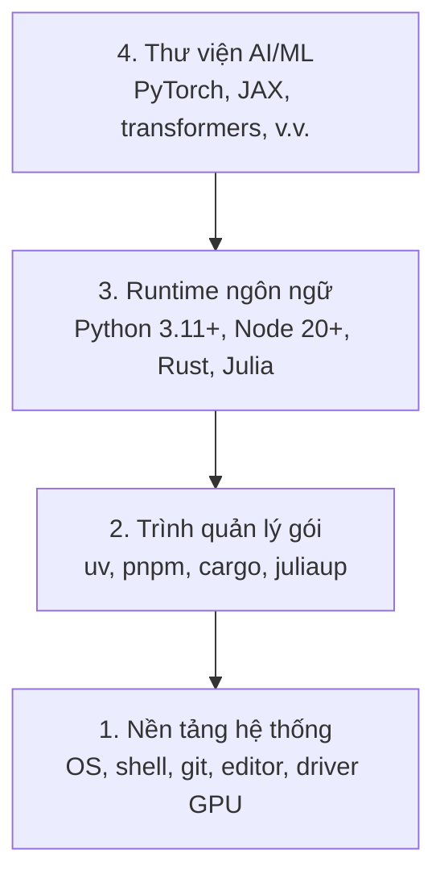

# Môi trường phát triển

> Công cụ định hình cách bạn suy nghĩ. Hãy thiết lập chúng một lần, và thiết lập cho đúng.

**Type:** Build
**Languages:** Python, Node.js, Rust
**Prerequisites:** Không có
**Time:** ~45 phút

## Mục tiêu học tập

- Thiết lập toolchain (bộ công cụ) Python 3.11+, Node.js 20+ và Rust từ đầu
- Cấu hình virtual environment (môi trường ảo) và package manager (trình quản lý gói) để có những bản build tái lập được
- Kiểm tra quyền truy cập GPU qua CUDA/MPS và chạy thử một phép toán tensor
- Hiểu stack (ngăn xếp) bốn lớp: hệ thống, gói, runtime, thư viện AI

## Vấn đề

Bạn sắp học AI engineering qua hơn 500 bài học, dùng Python, TypeScript, Rust và Julia. Nếu môi trường của bạn hỏng, mỗi bài học sẽ biến thành một cuộc chiến với tooling thay vì một buổi học.

Hầu hết mọi người bỏ qua bước thiết lập môi trường. Rồi họ mất hàng giờ để debug (gỡ lỗi) lỗi import, xung đột version và driver CUDA bị thiếu. Chúng ta sẽ làm việc này một lần, và làm cho đàng hoàng.

## Khái niệm

Một môi trường AI engineering gồm bốn lớp:



Chúng ta cài từ dưới lên. Mỗi lớp phụ thuộc vào lớp nằm ngay dưới nó.

```figure
s0-env-stack
```

## Tự tay làm

### Bước 1: Nền tảng hệ thống

Kiểm tra hệ thống của bạn và cài những thứ cơ bản.

```bash
# macOS
xcode-select --install
brew install git curl wget

# Ubuntu/Debian
sudo apt update && sudo apt install -y build-essential git curl wget unzip

# Windows (use WSL2)
wsl --install -d Ubuntu-24.04
```

### Bước 2: Python với uv

Chúng ta dùng `uv` — nó nhanh hơn pip từ 10-100 lần và tự xử lý virtual environment.

```bash
curl -LsSf https://astral.sh/uv/install.sh | sh

uv python install 3.12

uv venv
source .venv/bin/activate  # or .venv\Scripts\activate on Windows

uv pip install numpy matplotlib jupyter
```

Kiểm tra:

```python
import sys
print(f"Python {sys.version}")

import numpy as np
print(f"NumPy {np.__version__}")
a = np.array([1, 2, 3])
print(f"Vector: {a}, dot product with itself: {np.dot(a, a)}")
```

### Bước 3: Node.js với pnpm

Cho các bài học TypeScript (agent, MCP server, web app).

```bash
curl -fsSL https://fnm.vercel.app/install | bash
fnm install 22
fnm use 22

npm install -g pnpm

node -e "console.log('Node', process.version)"
```

Trình cài đặt fnm kiểm tra `unzip` trước, và nếu thiếu thì thoát với thông báo `Not installing fnm due to missing dependencies.`: trên Linux nó giải nén một file zip, còn trên macOS nó cài qua Homebrew. macOS có sẵn `unzip`; Ubuntu, Debian và WSL2 lấy nó từ dòng apt ở Bước 1 (`sudo apt install -y unzip` nếu bạn đã bỏ qua bước đó).

**macOS / Apple Silicon (M1/M2/M3/M4):** Nếu trình cài đặt dừng với `Error: Cannot install under Rosetta 2 in ARM default prefix (/opt/homebrew)`, thì terminal của bạn đang chạy dưới Rosetta 2 (`arch` in ra `i386`) trong khi Homebrew là bản arm64 native. Hãy cài fnm buộc dùng arm64, nối nó vào shell của bạn, rồi chạy lại các lệnh phía trên bắt đầu từ `fnm install 22`:

```bash
arch -arm64 brew install fnm
echo 'eval "$(fnm env --use-on-cd)"' >> ~/.zshrc
source ~/.zshrc
```

### Bước 4: Rust

Cho các bài học cần hiệu năng cao (inference, systems).

```bash
curl --proto '=https' --tlsv1.2 -sSf https://sh.rustup.rs | sh

rustc --version
cargo --version
```

### Bước 5: Julia (Tuỳ chọn)

Cho những bài học nặng về toán, nơi Julia tỏa sáng.

```bash
curl -fsSL https://install.julialang.org | sh

julia -e 'println("Julia ", VERSION)'
```

### Bước 6: Thiết lập GPU (nếu bạn có)

**NVIDIA (Linux / Windows):**

```bash
nvidia-smi

# Install PyTorch with CUDA
uv pip install torch torchvision torchaudio --index-url https://download.pytorch.org/whl/cu124
```

**macOS / Apple Silicon (M1/M2/M3/M4):** Trên Mac không có CUDA — đó là chuyện bình thường, không phải lỗi. **Đừng** truyền `--index-url .../cuXXX` (những wheel đó chỉ có cho Linux/Windows, nên cài sẽ hỏng). Hãy cài bản thường, vì bản này đã bao gồm backend GPU MPS (Metal) của Apple:

```bash
uv pip install torch torchvision torchaudio
```

Kiểm tra (chạy được trên mọi nền tảng):

```python
import torch
print(f"CUDA available: {torch.cuda.is_available()}")           # False on macOS — expected
print(f"MPS available:  {torch.backends.mps.is_available()}")   # True on Apple Silicon
if torch.cuda.is_available():
    print(f"GPU: {torch.cuda.get_device_name(0)}")
```

Không có GPU? Không sao. Phần lớn bài học chạy được trên CPU. Với những bài học nặng về training, hãy dùng Google Colab hoặc GPU trên cloud.

### Bước 7: Kiểm tra route bạn muốn bắt đầu

Hãy chạy mọi lệnh trong bài học này từ thư mục gốc của repository, tức thư mục
chứa `README.md` và `phases/`. Bước preflight chỉ kiểm tra đúng những gì bạn cần
để bắt đầu route đã chọn. Mặc định nó bỏ qua các tool về sau, để người học mới
thấy một câu trả lời rõ ràng thay vì một bức tường cảnh báo.

Bắt đầu toàn bộ chuỗi beginner:

```bash
python3 phases/00-setup-and-tooling/01-dev-environment/code/verify.py --route beginner
```

Hoặc chỉ kiểm tra route bạn muốn:

```bash
python3 phases/00-setup-and-tooling/01-dev-environment/code/verify.py --route ml-foundations
python3 phases/00-setup-and-tooling/01-dev-environment/code/verify.py --route llm-engineering
python3 phases/00-setup-and-tooling/01-dev-environment/code/verify.py --route agents
python3 phases/00-setup-and-tooling/01-dev-environment/code/verify.py --route mcp
python3 phases/00-setup-and-tooling/01-dev-environment/code/verify.py --route agent-skills
python3 phases/00-setup-and-tooling/01-dev-environment/code/verify.py --route certification
```

Thêm `--show-later` khi bạn muốn cùng bước preflight đó kiểm tra thêm các tool
tuỳ chọn và dependency mà những bài học sau dùng. Một tool về sau bị thiếu không
bao giờ chặn route đã chọn.

Mỗi kiểm tra bắt buộc bị lỗi đều kèm theo đường dẫn hoặc lỗi import phát hiện
được, cùng một lệnh sửa chính xác. Các route Agent Skills và certification còn
hiển thị thêm kiểm tra thủ công trên host, vì một script Python không thể chứng
minh rằng một AI host đã phát hiện ra một skill, hay rằng scope skill bạn chọn có ghi được hay không.

Khi preflight beginner vượt qua, nó in ra đúng bài học đầu tiên có thể chạy:

```text
Ready to start Beginner course.
Next: python3 phases/01-math-foundations/01-linear-algebra-intuition/code/vectors.py
```

## Áp dụng

Môi trường của bạn đã sẵn sàng để bắt đầu route bạn đã kiểm tra. Hãy cài các tool
về sau khi một bài học yêu cầu, thay vì chặn bài học đầu tiên của bạn bằng cả
stack. Dưới đây là những gì bạn sẽ dùng xuyên suốt chương trình:

| Ngôn ngữ | Dùng trong | Trình quản lý gói |
|----------|---------|-----------------|
| Python | Phases 1-12 (ML, DL, NLP, Vision, Audio, LLMs) | uv |
| TypeScript | Phases 13-17 (Tools, Agents, Swarms, Infra) | pnpm |
| Rust | Phases 12, 15-17 (Hệ thống cần hiệu năng cao) | cargo |
| Julia | Phase 1 (Nền tảng toán học) | Pkg |

## Đóng gói

Bài học này tạo ra một script xác minh mà bất kỳ ai cũng có thể chạy để kiểm tra thiết lập của mình.

Xem `outputs/prompt-env-check.md` để có một prompt giúp các AI assistant chẩn đoán vấn đề về môi trường.

## Bài tập

1. Chạy script xác minh và sửa mọi lỗi
2. Tạo một virtual environment Python cho khoá học này và cài PyTorch
3. Viết một "hello world" bằng cả bốn ngôn ngữ và chạy từng bản

---

[Bài sau: Git & Collaboration →](../../02-git-and-collaboration/docs/vi.md)
