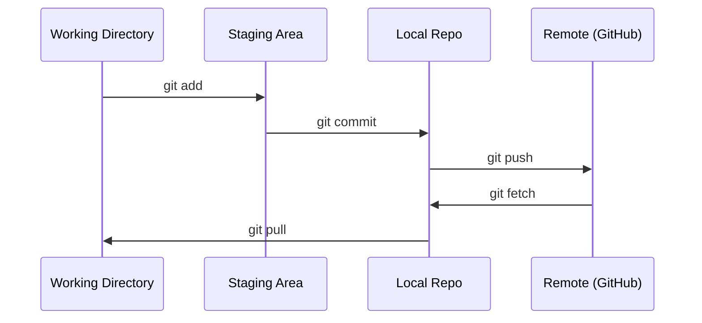

# Git & Collaboration

> Version control (quản lý phiên bản) không phải là tùy chọn. Mọi thử nghiệm, mọi mô hình, mọi bài học bạn xây dựng ở đây đều được theo dõi.

**Type:** Learn
**Languages:** --
**Prerequisites:** Giai đoạn 0, Bài 01
**Time:** ~30 phút

## Mục tiêu học tập

- Cấu hình danh tính git và sử dụng quy trình làm việc hằng ngày với add, commit (lần lưu) và push
- Tạo và hợp nhất branch (nhánh) cho các thử nghiệm tách biệt mà không làm hỏng main
- Viết `.gitignore` loại trừ các checkpoint của mô hình và các tệp nhị phân lớn
- Duyệt lịch sử commit bằng `git log` để hiểu quá trình phát triển của dự án

## Vấn đề

Bạn sắp viết hàng trăm tệp mã trên 20 phase. Không có quản lý phiên bản, bạn sẽ mất việc, làm hỏng những thứ không thể hoàn tác, và không có cách nào cộng tác với người khác.

Git là công cụ. GitHub là nơi mã nguồn được lưu trữ. Bài học này chỉ bao quát những gì bạn cần cho khóa học này mà thôi.

## Khái niệm



Ba điều cần ghi nhớ:
1. Lưu thường xuyên (`git commit`)
2. Đẩy lên remote (kho từ xa) (`git push`)
3. Tạo nhánh cho thử nghiệm (`git checkout -b experiment`)

```figure
s0-commit-dag
```

## Tự tay làm

### Bước 1: Cấu hình git

```bash
git config --global user.name "Your Name"
git config --global user.email "you@example.com"
```

### Bước 2: Quy trình làm việc hằng ngày

```bash
git status
git add file.py
git commit -m "Add perceptron implementation"
git push origin main
```

### Bước 3: Tạo nhánh cho thử nghiệm

```bash
git checkout -b experiment/new-optimizer

# ... make changes, commit ...

git checkout main
git merge experiment/new-optimizer
```

### Bước 4: Làm việc với repo của khóa học này

Bạn không thể push lên chính repo của khóa học — chỉ những người bảo trì mới có quyền ghi. Hãy fork nó trên GitHub trước (nút Fork, ở góc trên bên phải) để `origin` trỏ tới bản sao của chính bạn:

```bash
git clone https://github.com/YOUR-USERNAME/ai-engineering-from-scratch.git
cd ai-engineering-from-scratch

git checkout -b my-progress
# work through lessons, commit your code
git push origin my-progress
```

## Áp dụng

Đối với khóa học này, bạn chỉ cần đúng những lệnh sau:

| Lệnh | Khi nào dùng |
|---------|------|
| `git clone` | Lấy repo của khóa học |
| `git add` + `git commit` | Lưu công việc của bạn |
| `git push` | Sao lưu nó lên GitHub |
| `git checkout -b` | Thử điều gì đó mà không làm hỏng main |
| `git log --oneline` | Xem những gì bạn đã làm |

Vậy là đủ. Bạn không cần rebase, cherry-pick hay submodule cho khóa học này.

## Bài tập

1. Fork repo này, clone bản fork của bạn, tạo một branch tên `my-progress`, tạo một tệp, commit nó, push nó
2. Tạo `.gitignore` loại trừ các tệp checkpoint của mô hình (`.pt`, `.pth`, `.safetensors`)
3. Xem lịch sử commit của repo này bằng `git log --oneline` và đọc cách các bài học được thêm vào

## Thuật ngữ chính

| Thuật ngữ | Người ta thường nói | Thực chất nghĩa là |
|------|----------------|----------------------|
| Commit | "Lưu lại" | Ảnh chụp toàn bộ dự án của bạn tại một thời điểm |
| Branch | "Một bản sao" | Một con trỏ tới một commit, dịch về phía trước khi bạn làm việc |
| Merge | "Ghép mã lại" | Lấy các thay đổi từ một nhánh và áp dụng chúng vào nhánh khác |
| Remote | "Đám mây" | Một bản sao repo của bạn được lưu trữ ở nơi khác (GitHub, GitLab) |
