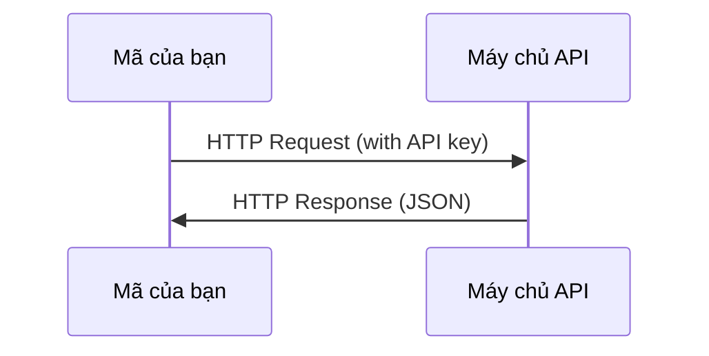

# API & Key

> Mọi AI API đều hoạt động theo cùng một cách: gửi request, nhận response. Chi tiết thì thay đổi, nhưng mô hình thì không.

**Type:** Build
**Languages:** Python, TypeScript
**Prerequisites:** Giai đoạn 0, Bài 01
**Time:** ~30 phút

## Mục tiêu học tập

- Lưu API key một cách an toàn bằng environment variable (biến môi trường) và file `.env`
- Thực hiện một lời gọi LLM API bằng cả Anthropic Python SDK và raw HTTP
- So sánh định dạng request/response giữa cách dùng SDK và raw HTTP để gỡ lỗi
- Nhận diện và xử lý các lỗi API phổ biến, bao gồm lỗi xác thực và rate limit (giới hạn tần suất)

## Vấn đề

Bắt đầu từ Giai đoạn 11, bạn sẽ gọi các LLM API (Anthropic, OpenAI, Google). Trong Giai đoạn 13-16, bạn sẽ xây dựng các agent dùng những API này trong vòng lặp. Bạn cần biết API key hoạt động thế nào, cách lưu chúng an toàn, và cách thực hiện lời gọi API đầu tiên.

## Khái niệm



Mỗi lời gọi API đều có:
1. Một endpoint (URL)
2. Một API key (xác thực)
3. Một request body (điều bạn muốn)
4. Một response body (điều bạn nhận lại)

```figure
s0-secret-inject
```

## Tự tay làm

### Bước 1: Lưu API key an toàn

Không bao giờ đặt API key trong code. Hãy dùng environment variable.

```bash
export ANTHROPIC_API_KEY="sk-ant-..."
export OPENAI_API_KEY="sk-..."
```

Hoặc dùng một file `.env` (thêm nó vào `.gitignore`):

```
ANTHROPIC_API_KEY=sk-ant-...
OPENAI_API_KEY=sk-...
```

### Bước 2: Lời gọi API đầu tiên (Python)

```python
import os

import anthropic

client = anthropic.Anthropic()

MODEL = os.environ.get("LLM_MODEL", "claude-sonnet-5")

response = client.messages.create(
    model=MODEL,
    max_tokens=256,
    messages=[{"role": "user", "content": "What is a neural network in one sentence?"}]
)

print(response.content[0].text)
```

`LLM_MODEL` chọn model id của Anthropic, và giá trị mặc định là alias Sonnet không kèm ngày. Các nhà cung cấp khác (OpenAI, Google, và những bên khác) cũng theo cùng mô hình gồm một key cộng một model id, nhưng mỗi bên có SDK, endpoint và schema request/response riêng.

### Bước 3: Lời gọi API đầu tiên (TypeScript)

```typescript
import Anthropic from "@anthropic-ai/sdk";

const client = new Anthropic();

const MODEL = process.env.LLM_MODEL ?? "claude-sonnet-5";

const response = await client.messages.create({
  model: MODEL,
  max_tokens: 256,
  messages: [{ role: "user", content: "What is a neural network in one sentence?" }],
});

console.log(response.content[0].text);
```

### Bước 4: Raw HTTP (không dùng SDK)

```python
import os
import urllib.request
import json

url = "https://api.anthropic.com/v1/messages"
headers = {
    "Content-Type": "application/json",
    "x-api-key": os.environ["ANTHROPIC_API_KEY"],
    "anthropic-version": "2023-06-01",
}
body = json.dumps({
    "model": os.environ.get("LLM_MODEL", "claude-sonnet-5"),
    "max_tokens": 256,
    "messages": [{"role": "user", "content": "What is a neural network in one sentence?"}],
}).encode()

req = urllib.request.Request(url, data=body, headers=headers, method="POST")
with urllib.request.urlopen(req) as resp:
    result = json.loads(resp.read())
    print(result["content"][0]["text"])
```

Đây chính là những gì các SDK làm ở bên dưới. Hiểu lời gọi raw HTTP sẽ giúp ích khi gỡ lỗi.

## Áp dụng

Với khóa học này:

| API | Khi nào bạn cần | Free tier (gói miễn phí) |
|-----|-----------------|-----------|
| Anthropic (Claude) | Giai đoạn 11-16 (agent, tool) | $5 credit on signup |
| OpenAI | Giai đoạn 11 (so sánh) | $5 credit on signup |
| Hugging Face | Giai đoạn 4-10 (model, dataset) | Free |

Bạn không cần tất cả các API này ngay bây giờ. Hãy thiết lập chúng khi bài học yêu cầu.

## Đóng gói

Bài học này tạo ra:
- `outputs/prompt-api-troubleshooter.md` - chẩn đoán các lỗi API phổ biến

## Bài tập

1. Lấy một Anthropic API key và thực hiện lời gọi API đầu tiên của bạn
2. Thử phiên bản raw HTTP và so sánh định dạng response với phiên bản SDK
3. Cố ý dùng một API key sai và đọc thông báo lỗi

## Thuật ngữ chính

| Thuật ngữ | Người ta thường nói | Thực chất nó nghĩa là gì |
|------|----------------|----------------------|
| API key | "Mật khẩu cho API" | Một chuỗi duy nhất định danh tài khoản của bạn và cấp quyền cho các request |
| Rate limit | "Họ đang bóp băng thông của tôi" | Số request tối đa mỗi phút/giờ để chống lạm dụng và đảm bảo sử dụng công bằng |
| Token | "Một từ" (trong ngữ cảnh API) | Một đơn vị tính phí (billing): token đầu vào và đầu ra được đếm và tính phí riêng |
| Streaming | "Phản hồi thời gian thực" | Nhận response từng từ một thay vì chờ toàn bộ response |
