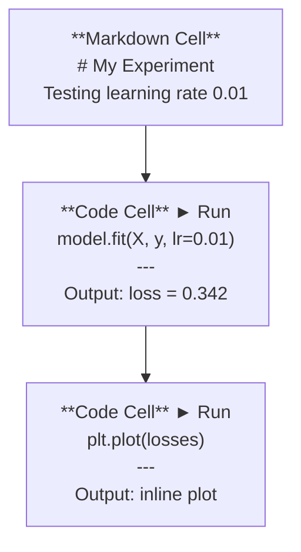
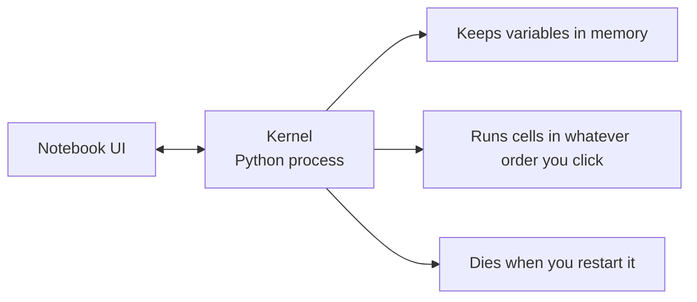

# Jupyter Notebooks

> Notebook (sổ tay) là bàn thí nghiệm của kỹ thuật AI. Bạn tạo nguyên mẫu ở đây, rồi đưa những gì chạy tốt vào production.

**Type:** Build
**Languages:** Python
**Prerequisites:** Giai đoạn 0, Bài 01
**Time:** ~30 phút

## Mục tiêu học tập

- Cài đặt và khởi chạy JupyterLab, Jupyter Notebook, hoặc VS Code với extension Jupyter
- Dùng magic command (`%timeit`, `%%time`, `%matplotlib inline`) để đo hiệu năng và trực quan hóa ngay trong trang
- Phân biệt khi nào dùng notebook và khi nào dùng script, rồi áp dụng quy trình "khám phá trong notebook, đóng gói trong script"
- Nhận diện và tránh những cái bẫy phổ biến của notebook: thực thi sai thứ tự, trạng thái ẩn và rò rỉ bộ nhớ

## Vấn đề

Mọi bài báo AI, hướng dẫn và cuộc thi Kaggle đều dùng Jupyter notebook. Chúng cho bạn chạy code theo từng phần, xem kết quả ngay trong trang, trộn code với giải thích và lặp lại nhanh. Nếu bạn học AI mà không có notebook, bạn đang làm bài tập toán mà không có giấy nháp.

Nhưng notebook có những cái bẫy thực sự. Người ta dùng chúng cho mọi việc, kể cả những việc chúng rất dở. Biết khi nào dùng notebook và khi nào dùng script sẽ cứu bạn khỏi những cơn ác mộng gỡ lỗi về sau.

## Khái niệm

Một notebook là một danh sách các cell (ô). Mỗi ô hoặc là code, hoặc là văn bản.



Kernel (nhân thực thi) là một tiến trình Python chạy nền. Khi bạn chạy một ô, ô đó gửi code tới kernel, kernel thực thi code rồi gửi kết quả về. Tất cả các ô dùng chung một kernel, nên biến vẫn tồn tại giữa các ô.



Phần "chạy theo bất kỳ thứ tự nào bạn bấm" vừa là siêu năng lực, vừa là cái bẫy.

```figure
s0-cell-order
```

## Tự tay làm

### Bước 1: Chọn giao diện

Ba lựa chọn, một định dạng:

| Giao diện | Cài đặt | Phù hợp nhất |
|-----------|---------|----------|
| JupyterLab | `pip install jupyterlab` sau đó `jupyter lab` | Trải nghiệm IDE đầy đủ, nhiều tab, trình duyệt tệp, terminal |
| Jupyter Notebook | `pip install notebook` sau đó `jupyter notebook` | Đơn giản, nhẹ, mỗi lần một notebook |
| VS Code | Cài extension "Jupyter" | Đã có sẵn trong editor của bạn, tích hợp git, gỡ lỗi |

Cả ba đều đọc và ghi cùng một tệp `.ipynb`. Chọn cái bạn thích. JupyterLab là phổ biến nhất trong công việc AI.

```bash
pip install jupyterlab
jupyter lab
```

### Bước 2: Những phím tắt quan trọng

Bạn làm việc ở hai chế độ. Nhấn `Escape` để vào command mode (chế độ lệnh, thanh màu xanh bên trái), `Enter` để vào edit mode (chế độ soạn thảo, thanh màu xanh lá).

**Command mode (dùng nhiều nhất):**

| Phím | Hành động |
|-----|--------|
| `Shift+Enter` | Chạy ô, chuyển sang ô tiếp theo |
| `A` | Chèn ô phía trên |
| `B` | Chèn ô phía dưới |
| `DD` | Xóa ô |
| `M` | Chuyển sang markdown |
| `Y` | Chuyển sang code |
| `Z` | Hoàn tác thao tác trên ô |
| `Ctrl+Shift+H` | Hiện tất cả phím tắt |

**Edit mode:**

| Phím | Hành động |
|-----|--------|
| `Tab` | Tự động hoàn thành |
| `Shift+Tab` | Hiện chữ ký hàm |
| `Ctrl+/` | Bật/tắt comment |

`Shift+Enter` là phím bạn sẽ dùng cả nghìn lần mỗi ngày. Học nó trước.

### Bước 3: Các loại ô

**Ô code** chạy Python và hiển thị kết quả:

```python
import numpy as np
data = np.random.randn(1000)
data.mean(), data.std()
```

Kết quả: `(0.0032, 0.9987)`

**Ô markdown** hiển thị văn bản có định dạng. Dùng chúng để ghi lại bạn đang làm gì và vì sao. Hỗ trợ tiêu đề, in đậm, in nghiêng, công thức LaTeX (`$E = mc^2$`), bảng và hình ảnh.

### Bước 4: Magic command

Đây không phải Python. Chúng là các lệnh riêng của Jupyter, bắt đầu bằng `%` (line magic) hoặc `%%` (cell magic).

**Đo thời gian code của bạn:**

```python
%timeit np.random.randn(10000)
```

Kết quả: `45.2 us +/- 1.3 us per loop`

```python
%%time
model.fit(X_train, y_train, epochs=10)
```

Kết quả: `Wall time: 2.34 s`

`%timeit` chạy code nhiều lần rồi lấy trung bình. `%%time` chạy một lần. Dùng `%timeit` cho microbenchmark, `%%time` cho các lần training.

**Bật vẽ đồ thị inline:**

```python
%matplotlib inline
```

Mọi `plt.plot()` hay `plt.show()` giờ hiển thị trực tiếp trong notebook.

**Cài package mà không rời notebook:**

```python
!pip install scikit-learn
```

Tiền tố `!` chạy bất kỳ lệnh shell nào.

**Kiểm tra biến môi trường:**

```python
%env CUDA_VISIBLE_DEVICES
```

### Bước 5: Hiển thị output phong phú ngay trong trang

Notebook tự hiển thị biểu thức cuối cùng trong một ô. Nhưng bạn có thể điều khiển việc đó:

```python
import pandas as pd

df = pd.DataFrame({
    "model": ["Linear", "Random Forest", "Neural Net"],
    "accuracy": [0.72, 0.89, 0.94],
    "training_time": [0.1, 2.3, 45.6]
})
df
```

Lệnh này hiển thị một bảng HTML có định dạng, không phải đổ văn bản thô. Tương tự với đồ thị:

```python
import matplotlib.pyplot as plt

plt.figure(figsize=(8, 4))
plt.plot([1, 2, 3, 4], [1, 4, 2, 3])
plt.title("Inline Plot")
plt.show()
```

Đồ thị xuất hiện ngay dưới ô. Đây là lý do notebook thống trị công việc AI. Bạn thấy dữ liệu, đồ thị và code cùng một chỗ.

Với hình ảnh:

```python
from IPython.display import Image, display
display(Image(filename="architecture.png"))
```

### Bước 6: Google Colab

Colab là một Jupyter notebook miễn phí trên cloud. Nó cho bạn GPU, thư viện cài sẵn và tích hợp Google Drive. Không cần thiết lập.

1. Truy cập [colab.research.google.com](https://colab.research.google.com)
2. Tải lên bất kỳ tệp `.ipynb` nào từ khóa học này
3. Runtime > Change runtime type > T4 GPU (miễn phí)

Colab khác Jupyter cục bộ ở chỗ:
- Tệp không tồn tại giữa các phiên (hãy lưu vào Drive hoặc tải về)
- Cài sẵn: numpy, pandas, matplotlib, torch, tensorflow, sklearn
- `from google.colab import files` để tải tệp lên và xuống
- `from google.colab import drive; drive.mount('/content/drive')` để lưu trữ bền vững
- Phiên bị timeout sau 90 phút không hoạt động (bản miễn phí)

## Áp dụng

### Notebook vs Script: Khi nào dùng cái nào

| Dùng notebook cho | Dùng script cho |
|-------------------|-----------------|
| Khám phá một bộ dữ liệu | Pipeline training |
| Tạo nguyên mẫu một model | Tiện ích tái sử dụng |
| Trực quan hóa kết quả | Bất cứ thứ gì có `if __name__` |
| Giải thích công việc của bạn | Code chạy theo lịch |
| Thí nghiệm nhanh | Code production |
| Bài tập khóa học | Package và thư viện |

Nguyên tắc: **khám phá trong notebook, đóng gói trong script**.

Một quy trình phổ biến trong AI:
1. Khám phá dữ liệu trong notebook
2. Tạo nguyên mẫu model trong notebook
3. Khi đã chạy được, chuyển code sang các tệp `.py`
4. Import các tệp `.py` đó trở lại notebook để thí nghiệm tiếp

### Những cái bẫy phổ biến

**Thực thi sai thứ tự.** Bạn chạy ô 5, rồi ô 2, rồi ô 7. Notebook chạy được trên máy bạn nhưng hỏng khi người khác chạy từ trên xuống dưới. Cách sửa: Kernel > Restart & Run All trước khi chia sẻ.

**Trạng thái ẩn.** Bạn xóa một ô nhưng biến mà ô đó tạo ra vẫn còn trong bộ nhớ. Notebook trông sạch sẽ nhưng phụ thuộc vào một ô bóng ma. Cách sửa: khởi động lại kernel thường xuyên.

**Rò rỉ bộ nhớ.** Nạp một bộ dữ liệu 4GB, train một model, nạp thêm một bộ dữ liệu khác. Không có gì được giải phóng. Cách sửa: `del variable_name` và `gc.collect()`, hoặc khởi động lại kernel.

## Đóng gói

Bài học này tạo ra:
- `outputs/prompt-notebook-helper.md` để gỡ lỗi các vấn đề notebook

## Bài tập

1. Mở JupyterLab, tạo một notebook và dùng `%timeit` để so sánh list comprehension với numpy khi tạo một mảng gồm 100.000 số ngẫu nhiên
2. Tạo một notebook có cả ô markdown và ô code, nạp một CSV, hiển thị một dataframe và vẽ một biểu đồ. Sau đó chạy Kernel > Restart & Run All để kiểm tra nó chạy được từ trên xuống dưới
3. Lấy code từ `code/notebook_tips.py`, dán vào một notebook Colab và chạy với GPU miễn phí

## Thuật ngữ chính

| Thuật ngữ | Người ta thường nói | Ý nghĩa thực sự |
|------|----------------|----------------------|
| Kernel | "Thứ đang chạy code của tôi" | Một tiến trình Python riêng biệt thực thi các ô và giữ biến trong bộ nhớ |
| Cell | "Một khối code" | Một đơn vị chạy độc lập trong notebook, hoặc code hoặc markdown |
| Magic command | "Mấy chiêu Jupyter" | Các lệnh đặc biệt có tiền tố `%` hoặc `%%` điều khiển môi trường notebook |
| `.ipynb` | "Tệp notebook" | Một tệp JSON chứa các ô, output và metadata. Viết tắt của IPython Notebook |

## Đọc thêm

- [Tài liệu JupyterLab](https://jupyterlab.readthedocs.io/) để xem đầy đủ các tính năng
- [Câu hỏi thường gặp về Google Colab](https://research.google.com/colaboratory/faq.html) để biết các giới hạn và tính năng riêng của Colab
- [28 mẹo Jupyter Notebook](https://www.dataquest.io/blog/jupyter-notebook-tips-tricks-shortcuts/) cho các phím tắt của người dùng thành thạo

---

[← Bài trước: API & Key](../../04-apis-and-keys/docs/vi.md) · [Bài sau: Môi trường Python →](../../06-python-environments/docs/vi.md)
