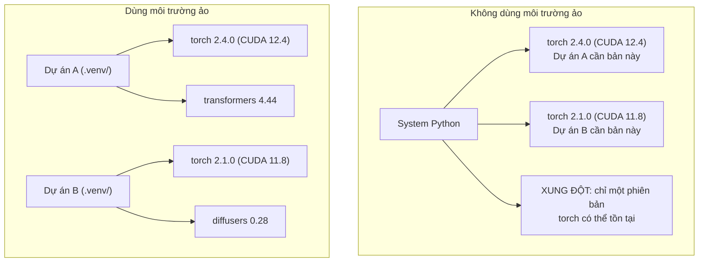

# Môi trường Python

> Địa ngục phụ thuộc (dependency hell) là có thật. Môi trường ảo (virtual environment) chính là cách chữa.

**Type:** Build
**Languages:** Shell
**Prerequisites:** Giai đoạn 0, Bài 01
**Time:** ~30 phút

## Mục tiêu học tập

- Tạo các môi trường ảo tách biệt bằng `uv`, `venv` hoặc `conda`
- Viết `pyproject.toml` với các nhóm phụ thuộc tuỳ chọn và tạo lockfile để tái lập được kết quả
- Chẩn đoán và sửa các lỗi thường gặp: cài đặt toàn cục, trộn pip với conda, lệch phiên bản CUDA
- Triển khai chiến lược môi trường theo từng phase cho các dự án có phụ thuộc xung đột

## Vấn đề

Bạn cài PyTorch 2.4 cho một dự án fine-tuning. Sang tuần sau, một dự án khác lại cần PyTorch 2.1 vì bản dựng CUDA của nó bị ghim phiên bản. Bạn nâng cấp toàn cục, dự án đầu tiên hỏng. Bạn hạ cấp, dự án thứ hai hỏng.

Đây là địa ngục phụ thuộc. Nó xảy ra liên tục trong công việc AI/ML vì:

- PyTorch, JAX và TensorFlow mỗi bên đều có bộ ràng buộc CUDA riêng
- Các thư viện mô hình ghim những phiên bản framework cụ thể
- Một lệnh `pip install` toàn cục sẽ ghi đè lên bất cứ thứ gì đã có trước đó
- Bản dựng CUDA 11.8 không chạy được với driver CUDA 12.x (và ngược lại)

Cách sửa: mỗi dự án có một môi trường tách biệt với bộ package riêng của nó.

## Khái niệm



```figure
s0-env-isolation
```

## Tự tay làm

### Cách 1: uv venv (khuyến nghị)

`uv` là trình quản lý package Python nhanh nhất (nhanh hơn pip 10-100 lần). Nó xử lý môi trường ảo, phiên bản Python và việc phân giải phụ thuộc (dependency resolution) trong một công cụ duy nhất.

```bash
curl -LsSf https://astral.sh/uv/install.sh | sh

uv python install 3.12

cd your-project
uv venv
source .venv/bin/activate
```

Cài package:

```bash
uv pip install torch numpy
```

Tạo một dự án có `pyproject.toml` chỉ trong một bước:

```bash
uv init my-ai-project
cd my-ai-project
uv add torch numpy matplotlib
```

### Cách 2: venv (có sẵn)

Nếu bạn không cài được `uv`, Python có sẵn `venv`:

```bash
python3 -m venv .venv
source .venv/bin/activate  # Linux/macOS
.venv\Scripts\activate     # Windows

pip install torch numpy
```

Chậm hơn `uv`, nhưng chạy được ở mọi nơi có cài Python.

### Cách 3: conda (khi bạn thật sự cần)

Conda quản lý cả các phụ thuộc không phải Python như CUDA toolkit, cuDNN và các thư viện C. Hãy dùng nó khi:

- Bạn cần một phiên bản CUDA toolkit cụ thể mà không muốn cài đặt toàn hệ thống
- Bạn đang ở trên một cluster dùng chung, nơi bạn không thể cài package hệ thống
- Hướng dẫn cài đặt của một thư viện ghi "use conda"

```bash
# Install miniconda (not the full Anaconda)
curl -LsSf https://repo.anaconda.com/miniconda/Miniconda3-latest-Linux-x86_64.sh -o miniconda.sh
bash miniconda.sh -b

conda create -n myproject python=3.12
conda activate myproject

conda install pytorch torchvision torchaudio pytorch-cuda=12.4 -c pytorch -c nvidia
```

Một nguyên tắc: nếu bạn dùng conda cho một môi trường, hãy dùng conda cho tất cả package trong môi trường đó. Trộn `pip install` vào một env conda sẽ gây ra xung đột phụ thuộc rất khó gỡ lỗi.

### Với khoá học này: chiến lược theo từng phase

Bạn có thể tạo một môi trường cho toàn bộ khoá học. Đừng làm thế. Các phase khác nhau cần những phụ thuộc khác nhau (đôi khi xung đột với nhau).

Chiến lược:

```
ai-engineering-from-scratch/
├── .venv/                    <-- shared lightweight env for phases 0-3
├── phases/
│   ├── 04-neural-networks/
│   │   └── .venv/            <-- PyTorch env
│   ├── 05-cnns/
│   │   └── .venv/            <-- same PyTorch env (symlink or shared)
│   ├── 08-transformers/
│   │   └── .venv/            <-- might need different transformer versions
│   └── 11-llm-apis/
│       └── .venv/            <-- API SDKs, no torch needed
```

Script trong `code/env_setup.sh` sẽ tạo môi trường nền cho khoá học này.

## Kiến thức cơ bản về pyproject.toml

Mọi dự án Python nên có một `pyproject.toml`. Nó thay thế `setup.py`, `setup.cfg` và `requirements.txt` chỉ trong một file.

```toml
[project]
name = "ai-engineering-from-scratch"
version = "0.1.0"
requires-python = ">=3.11"
dependencies = [
    "numpy>=1.26",
    "matplotlib>=3.8",
    "jupyter>=1.0",
    "scikit-learn>=1.4",
]

[project.optional-dependencies]
torch = ["torch>=2.3", "torchvision>=0.18"]
llm = ["anthropic>=0.39", "openai>=1.50"]
```

Sau đó cài đặt:

```bash
uv pip install -e ".[torch]"    # base + PyTorch
uv pip install -e ".[llm]"     # base + LLM SDKs
uv pip install -e ".[torch,llm]" # everything
```

## Lockfile

Lockfile ghim mọi phụ thuộc (kể cả các phụ thuộc bắc cầu) vào phiên bản chính xác. Điều này bảo đảm khả năng tái lập: bất kỳ ai cài từ lockfile đều nhận đúng bộ package như nhau.

```bash
# uv generates uv.lock automatically when using uv add
uv add numpy

# pip-tools approach
uv pip compile pyproject.toml -o requirements.lock
uv pip install -r requirements.lock
```

Hãy commit lockfile vào git. Khi ai đó clone repo, họ cài từ lockfile và nhận được phiên bản giống hệt.

## Lỗi thường gặp

### 1. Cài đặt toàn cục

```bash
pip install torch  # BAD: installs to system Python

source .venv/bin/activate
pip install torch  # GOOD: installs to virtual environment
```

Kiểm tra xem package của bạn đi đâu:

```bash
which python       # should show .venv/bin/python, not /usr/bin/python
which pip           # should show .venv/bin/pip
```

### 2. Trộn pip và conda

```bash
conda create -n myenv python=3.12
conda activate myenv
conda install pytorch -c pytorch
pip install some-other-package   # BAD: can break conda's dependency tracking
conda install some-other-package # GOOD: let conda manage everything
```

Nếu buộc phải dùng pip bên trong conda (một số package chỉ có trên pip), hãy cài tất cả package conda trước, rồi cài package pip sau cùng.

### 3. Quên kích hoạt môi trường

```bash
python train.py           # uses system Python, missing packages
source .venv/bin/activate
python train.py           # uses project Python, packages found
```

Dấu nhắc shell của bạn nên hiển thị tên môi trường:

```
(.venv) $ python train.py
```

### 4. Commit .venv vào git

```bash
echo ".venv/" >> .gitignore
```

Môi trường ảo nặng từ 200MB đến 2GB. Chúng chỉ tồn tại cục bộ, không mang sang máy khác được. Thay vào đó, hãy commit `pyproject.toml` và lockfile.

### 5. Lệch phiên bản CUDA

```bash
nvidia-smi                # shows driver CUDA version (e.g., 12.4)
python -c "import torch; print(torch.version.cuda)"  # shows PyTorch CUDA version

# These must be compatible.
# PyTorch CUDA version must be <= driver CUDA version.
```

## Áp dụng

Chạy script cài đặt để tạo môi trường cho khoá học:

```bash
bash phases/00-setup-and-tooling/06-python-environments/code/env_setup.sh
```

Lệnh này tạo một `.venv` ở thư mục gốc repo với các phụ thuộc cốt lõi đã được cài và xác minh.

## Bài tập

1. Chạy `env_setup.sh` và xác minh mọi bước kiểm tra đều qua
2. Tạo môi trường ảo thứ hai, cài một phiên bản numpy khác trong đó, rồi xác nhận hai môi trường tách biệt nhau
3. Viết `pyproject.toml` cho một dự án cần cả PyTorch và Anthropic SDK
4. Cố tình cài một package ở cấp toàn cục (không kích hoạt venv), xem nó đi đâu, rồi gỡ nó đi

## Thuật ngữ chính

| Thuật ngữ | Người ta thường nói | Ý nghĩa thực sự |
|------|----------------|----------------------|
| Virtual environment | "A venv" | Một thư mục tách biệt chứa trình thông dịch Python và các package, độc lập với Python của hệ thống |
| Lockfile | "Pinned dependencies" | Một file liệt kê mọi package và phiên bản chính xác của nó, bảo đảm cài đặt giống hệt nhau giữa các máy |
| pyproject.toml | "The new setup.py" | File cấu hình dự án Python tiêu chuẩn, thay thế setup.py/setup.cfg/requirements.txt |
| Transitive dependency | "A dependency of a dependency" | Package B phụ thuộc vào C; nếu bạn cài A mà A phụ thuộc B, thì C là phụ thuộc bắc cầu của A |
| CUDA mismatch | "My GPU isn't working" | PyTorch được biên dịch cho một phiên bản CUDA khác với phiên bản mà driver GPU của bạn hỗ trợ |
