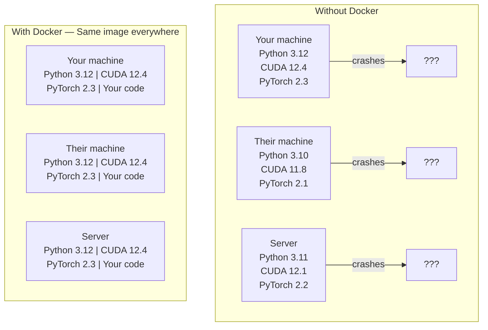

# Docker cho AI

> Container (vùng chứa) khiến câu "máy tôi chạy được mà" trở thành chuyện quá khứ.

**Type:** Build
**Languages:** Docker
**Prerequisites:** Giai đoạn 0, Bài 01 và 03
**Time:** ~60 phút

## Mục tiêu học tập

- Build một Docker image (ảnh) có hỗ trợ GPU với CUDA, PyTorch và các thư viện AI từ một Dockerfile
- Mount thư mục trên host thành volume (ổ đĩa chia sẻ) để giữ lại model, dataset và code qua các lần rebuild container
- Cấu hình NVIDIA Container Toolkit để đưa GPU vào bên trong container
- Điều phối các ứng dụng AI nhiều service (inference server + vector database) bằng Docker Compose

## Vấn đề

Bạn huấn luyện một model trên laptop với PyTorch 2.3, CUDA 12.4 và Python 3.12. Đồng nghiệp của bạn có PyTorch 2.1, CUDA 11.8 và Python 3.10. Model của bạn crash trên máy họ. Dockerfile của bạn thì chạy được trên cả hai.

Các dự án AI là cơn ác mộng về dependency. Một stack điển hình gồm Python, PyTorch, driver CUDA, cuDNN, các thư viện C cấp hệ thống và những package chuyên dụng như flash-attn cần đúng phiên bản compiler. Docker đóng gói tất cả vào một image duy nhất chạy giống hệt nhau ở mọi nơi.

## Khái niệm

Docker bọc code, runtime, thư viện và công cụ hệ thống của bạn vào một đơn vị tách biệt gọi là container. Hãy nghĩ về nó như một máy ảo nhẹ, chỉ khác là nó dùng chung kernel của hệ điều hành host thay vì chạy kernel riêng, nên khởi động trong vài giây thay vì vài phút.



### Vì sao dự án AI cần Docker hơn hầu hết dự án khác

1. **Driver GPU rất dễ vỡ.** Code CUDA 12.4 không chạy trên CUDA 11.8. Docker cô lập CUDA toolkit bên trong container trong khi vẫn chia sẻ driver GPU của host qua NVIDIA Container Toolkit.

2. **Model weight rất lớn.** Một model 7B tham số nặng 14 GB ở fp16. Bạn không muốn tải lại nó mỗi lần rebuild. Volume của Docker cho phép bạn mount một thư mục models từ host.

3. **Kiến trúc nhiều service là chuyện thường.** Một ứng dụng AI thật không chỉ là một script Python. Nó là một inference server, một vector database cho RAG, có thể có cả web frontend. Docker Compose điều phối tất cả bằng một câu lệnh.

### Từ vựng cốt lõi

| Thuật ngữ | Ý nghĩa thực sự |
|------|---------------|
| Image | Một template chỉ đọc. Công thức của bạn. Được build từ một Dockerfile. |
| Container | Một thực thể đang chạy của image. Nhà bếp của bạn. |
| Dockerfile | Các chỉ dẫn để build một image. Từng layer (lớp) một. |
| Volume | Lưu trữ bền vững, tồn tại qua các lần khởi động lại container. |
| docker-compose | Một công cụ để định nghĩa ứng dụng nhiều container trong YAML. |

### Các mẫu container phổ biến trong AI

```
Dev Container
  Full toolkit. Editor support. Jupyter. Debugging tools.
  Used during development and experimentation.

Training Container
  Minimal. Just the training script and dependencies.
  Runs on GPU clusters. No editor, no Jupyter.

Inference Container
  Optimized for serving. Small image. Fast cold start.
  Runs behind a load balancer in production.
```

```figure
s0-image-layers
```

## Tự tay làm

### Bước 1: Cài Docker

```bash
# macOS
brew install --cask docker
open /Applications/Docker.app

# Ubuntu
curl -fsSL https://get.docker.com | sh
sudo usermod -aG docker $USER
# Log out and back in for group change to take effect
```

Kiểm tra:

```bash
docker --version
docker run hello-world
```

### Bước 2: Cài NVIDIA Container Toolkit (Linux có GPU NVIDIA)

Bước này cho phép container Docker truy cập GPU của bạn. Người dùng macOS và Windows (WSL2) có thể bỏ qua; Docker Desktop xử lý GPU passthrough theo cách khác trên các nền tảng đó.

```bash
distribution=$(. /etc/os-release;echo $ID$VERSION_ID)
curl -fsSL https://nvidia.github.io/libnvidia-container/gpgkey | sudo gpg --dearmor -o /usr/share/keyrings/nvidia-container-toolkit-keyring.gpg
curl -s -L https://nvidia.github.io/libnvidia-container/$distribution/libnvidia-container.list | \
    sed 's#deb https://#deb [signed-by=/usr/share/keyrings/nvidia-container-toolkit-keyring.gpg] https://#g' | \
    sudo tee /etc/apt/sources.list.d/nvidia-container-toolkit.list

sudo apt-get update
sudo apt-get install -y nvidia-container-toolkit
sudo nvidia-ctk runtime configure --runtime=docker
sudo systemctl restart docker
```

Kiểm tra quyền truy cập GPU bên trong container:

```bash
docker run --rm --gpus all nvidia/cuda:12.4.1-base-ubuntu22.04 nvidia-smi
```

Nếu bạn thấy thông tin GPU của mình, toolkit đang hoạt động.

### Bước 3: Hiểu về base image

Chọn đúng base image giúp bạn tiết kiệm hàng giờ debug.

```
nvidia/cuda:12.4.1-devel-ubuntu22.04
  Full CUDA toolkit. Compilers included.
  Use for: building packages that need nvcc (flash-attn, bitsandbytes)
  Size: ~4 GB

nvidia/cuda:12.4.1-runtime-ubuntu22.04
  CUDA runtime only. No compilers.
  Use for: running pre-built code
  Size: ~1.5 GB

pytorch/pytorch:2.6.0-cuda12.4-cudnn9-runtime
  PyTorch pre-installed on top of CUDA.
  Use for: skipping the PyTorch install step
  Size: ~6 GB

python:3.12-slim
  No CUDA. CPU only.
  Use for: inference on CPU, lightweight tools
  Size: ~150 MB
```

### Bước 4: Viết Dockerfile cho phát triển AI

Đây là Dockerfile trong `code/Dockerfile`. Cùng đi qua từng phần:

```dockerfile
FROM --platform=linux/amd64 nvidia/cuda:12.4.1-devel-ubuntu22.04

ENV DEBIAN_FRONTEND=noninteractive
ENV PYTHONUNBUFFERED=1

RUN apt-get update && apt-get install -y --no-install-recommends \
    software-properties-common \
    git \
    curl \
    build-essential \
    && add-apt-repository -y ppa:deadsnakes/ppa \
    && apt-get update && apt-get install -y --no-install-recommends \
    python3.12 \
    python3.12-venv \
    python3.12-dev \
    && rm -rf /var/lib/apt/lists/*

RUN update-alternatives --install /usr/bin/python python /usr/bin/python3.12 1

RUN curl -sSL https://raw.githubusercontent.com/pypa/get-pip/3b73145063be545b649ad9ca83ea8da5fc915a4f/public/get-pip.py -o /tmp/get-pip.py \
    && echo "a341e1a43e38001c551a1508a73ff23636a11970b61d901d9a1cad2a18f57055  /tmp/get-pip.py" | sha256sum -c - \
    && python /tmp/get-pip.py \
    && rm /tmp/get-pip.py \
    && update-alternatives --install /usr/bin/pip pip /usr/local/bin/pip3.12 1

RUN python -m pip install --no-cache-dir --upgrade pip setuptools wheel

RUN python -m pip install --no-cache-dir \
    torch==2.6.0+cu124 \
    torchvision==0.21.0+cu124 \
    torchaudio==2.6.0+cu124 \
    --index-url https://download.pytorch.org/whl/cu124

RUN python -m pip install --no-cache-dir \
    numpy \
    pandas \
    scikit-learn \
    matplotlib \
    jupyter \
    transformers \
    datasets \
    accelerate \
    safetensors

WORKDIR /workspace

VOLUME ["/workspace", "/models"]

EXPOSE 8888

CMD ["python"]
```

Build nó:

```bash
docker build -t ai-dev -f phases/00-setup-and-tooling/07-docker-for-ai/code/Dockerfile .
```

Lần đầu sẽ mất một lúc (tải base image CUDA + PyTorch). Các lần build sau dùng layer đã cache.

**macOS / Apple Silicon (M1/M2/M3/M4):** Chính `--platform=linux/amd64` trên dòng `FROM` là thứ giúp build này thành công trên máy Mac. Base image CUDA cũng có biến thể arm64 và Docker Desktop tự động chọn nó trên Apple Silicon, nhưng PyTorch chỉ phát hành wheel `cu124` cho x86_64, nên layer `pip install torch==2.6.0+cu124` sẽ thất bại với `No matching distribution found for torch==2.6.0+cu124`. Ghim platform sẽ kéo image x86_64 và chạy nó qua emulation: build chậm hơn và container không có GPU (dù sao trên Mac cũng không có CUDA). Hãy bỏ `--gpus all` khỏi các lệnh `docker run` bên dưới khi dùng Mac. Với công việc GPU trên Apple Silicon, hãy chạy các bài học trực tiếp với bản dựng MPS từ Lesson 01 và giữ image này cho các host x86_64 Linux có GPU NVIDIA.

Chạy nó:

```bash
docker run --rm -it --gpus all \
    -v $(pwd):/workspace \
    -v ~/models:/models \
    ai-dev python -c "import torch; print(f'PyTorch {torch.__version__}, CUDA: {torch.cuda.is_available()}')"
```

Chạy Jupyter bên trong container:

```bash
docker run --rm -it --gpus all \
    -v $(pwd):/workspace \
    -v ~/models:/models \
    -p 8888:8888 \
    ai-dev jupyter notebook --ip=0.0.0.0 --port=8888 --no-browser --allow-root
```

### Bước 5: Mount volume cho dữ liệu và model

Mount volume là điểm cực kỳ quan trọng khi làm việc với AI. Không có nó, bản tải model 14 GB của bạn sẽ biến mất khi container dừng.

```bash
# Mount your code
-v $(pwd):/workspace

# Mount a shared models directory
-v ~/models:/models

# Mount datasets
-v ~/datasets:/data
```

Bên trong script huấn luyện, hãy load từ đường dẫn đã mount:

```python
from transformers import AutoModel

model = AutoModel.from_pretrained("/models/llama-7b")
```

Model nằm trên filesystem của host. Bạn có thể rebuild container bao nhiêu lần tùy thích mà không phải tải lại.

### Bước 6: Docker Compose cho ứng dụng AI nhiều service

Một ứng dụng RAG thực thụ cần một inference server và một vector database. Docker Compose chạy cả hai bằng một câu lệnh.

Xem `code/docker-compose.yml`:

```yaml
services:
  ai-dev:
    build:
      context: .
      dockerfile: Dockerfile
    deploy:
      resources:
        reservations:
          devices:
            - driver: nvidia
              count: all
              capabilities: [gpu]
    volumes:
      - ../../../:/workspace
      - ~/models:/models
      - ~/datasets:/data
    ports:
      - "8888:8888"
    stdin_open: true
    tty: true
    command: jupyter notebook --ip=0.0.0.0 --port=8888 --no-browser --allow-root

  qdrant:
    image: qdrant/qdrant:v1.12.5
    ports:
      - "6333:6333"
      - "6334:6334"
    volumes:
      - qdrant_data:/qdrant/storage

volumes:
  qdrant_data:
```

Khởi động mọi thứ:

```bash
cd phases/00-setup-and-tooling/07-docker-for-ai/code
docker compose up -d
```

Giờ container phát triển AI của bạn có thể truy cập vector database tại `http://qdrant:6333` thông qua tên service. Docker Compose tự động tạo một network dùng chung.

Kiểm tra kết nối từ bên trong container AI:

```python
from qdrant_client import QdrantClient

client = QdrantClient(host="qdrant", port=6333)
print(client.get_collections())
```

Dừng mọi thứ:

```bash
docker compose down
```

Thêm `-v` để xóa luôn volume của qdrant:

```bash
docker compose down -v
```

### Bước 7: Các lệnh Docker hữu ích khi làm việc với AI

```bash
# List running containers
docker ps

# List all images and their sizes
docker images

# Remove unused images (reclaim disk space)
docker system prune -a

# Check GPU usage inside a running container
docker exec -it <container_id> nvidia-smi

# Copy a file from container to host
docker cp <container_id>:/workspace/results.csv ./results.csv

# View container logs
docker logs -f <container_id>
```

## Áp dụng

Giờ bạn đã có một môi trường phát triển AI có thể tái lập. Trong phần còn lại của khóa học:

- Dùng `docker compose up` để khởi động môi trường phát triển và vector database cùng nhau
- Mount code, model và dữ liệu của bạn thành volume để không mất gì giữa các lần rebuild
- Khi một bài học cần package Python mới, hãy thêm nó vào Dockerfile và rebuild
- Chia sẻ Dockerfile của bạn với đồng đội. Họ nhận được đúng môi trường như vậy.

### Không có GPU?

Hãy bỏ flag `--gpus all` và khối deploy NVIDIA. Container vẫn hoạt động với các bài học chạy trên CPU. PyTorch nhận biết không có CUDA và tự động fallback về CPU.

## Bài tập

1. Build Dockerfile và chạy `python -c "import torch; print(torch.__version__)"` bên trong container
2. Khởi động stack docker-compose và xác minh Qdrant truy cập được từ container AI tại `http://qdrant:6333/collections`
3. Thêm `flask` vào Dockerfile, rebuild, và chạy một API server đơn giản trên cổng 5000. Map cổng bằng `-p 5000:5000`
4. Đo kích thước image bằng `docker images`. Thử chuyển base image từ `devel` sang `runtime` và so sánh kích thước

## Thuật ngữ chính

| Thuật ngữ | Người ta hay nói | Ý nghĩa thật sự |
|------|----------------|----------------------|
| Container | "Máy ảo nhẹ" | Một process được cô lập dùng kernel của host, có filesystem và network riêng |
| Image layer | "Bước được cache" | Mỗi chỉ dẫn trong Dockerfile tạo ra một layer. Các layer không đổi được cache, nên rebuild rất nhanh. |
| NVIDIA Container Toolkit | "GPU trong Docker" | Một runtime hook đưa GPU của host vào container qua flag `--gpus` |
| Volume mount | "Thư mục chia sẻ" | Một thư mục trên host được map vào container. Thay đổi vẫn tồn tại sau khi container dừng. |
| Base image | "Điểm khởi đầu" | Image ở dòng `FROM` mà Dockerfile của bạn build dựa trên đó. Nó quyết định những gì được cài sẵn. |

---

[← Bài trước: Môi trường Python](../../06-python-environments/docs/vi.md) · [Bài sau: Thiết lập trình soạn thảo →](../../08-editor-setup/docs/vi.md)
