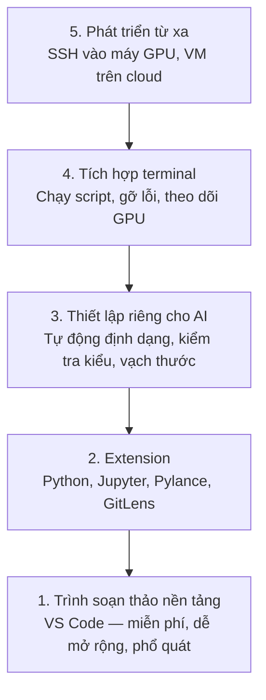

# Thiết lập trình soạn thảo

> Trình soạn thảo của bạn là người đồng lái. Hãy cấu hình nó một lần để nó không cản đường bạn và bắt đầu gánh việc cho bạn.

**Type:** Build
**Languages:** --
**Prerequisites:** Giai đoạn 0, Bài 01
**Time:** ~20 phút

## Mục tiêu học tập

- Cài VS Code cùng các extension (tiện ích mở rộng) thiết yếu cho Python, Jupyter, kiểm tra tĩnh và remote SSH
- Cấu hình format-on-save, kiểm tra kiểu và cuộn đầu ra notebook cho quy trình AI
- Thiết lập Remote SSH để sửa và gỡ lỗi mã trên máy GPU từ xa như thể chúng ở ngay máy bạn
- Đánh giá các trình soạn thảo thay thế (Cursor, Windsurf, Neovim) và những đánh đổi của chúng cho công việc AI

## Vấn đề

Bạn sẽ dành hàng nghìn giờ bên trong trình soạn thảo để viết Python, chạy notebook, gỡ lỗi vòng lặp huấn luyện và SSH vào các máy GPU. Một trình soạn thảo cấu hình sai biến mỗi phiên làm việc thành ma sát: không có tự động hoàn thành, không có gợi ý kiểu, không có lỗi hiển thị ngay trong dòng, định dạng thủ công, và một quy trình terminal vụng về.

Thiết lập đúng chỉ mất 20 phút. Bỏ qua nó khiến bạn mất 20 phút mỗi ngày.

## Khái niệm

Một thiết lập trình soạn thảo cho kỹ thuật AI cần năm thứ:



```figure
s0-lsp-roundtrip
```

## Tự tay làm

### Bước 1: Cài VS Code

VS Code là trình soạn thảo được khuyến nghị. Nó miễn phí, chạy trên mọi hệ điều hành, hỗ trợ notebook Jupyter hạng nhất, và hệ sinh thái extension bao phủ mọi thứ bạn cần cho công việc AI.

Tải nó từ [code.visualstudio.com](https://code.visualstudio.com/).

Kiểm tra từ terminal:

```bash
code --version
```

Nếu `code` không được tìm thấy trên macOS, mở VS Code, nhấn `Cmd+Shift+P`, gõ "Shell Command", và chọn "Install 'code' command in PATH".

### Bước 2: Cài các extension thiết yếu

Mở terminal tích hợp trong VS Code (`` Ctrl+` `` trên mọi hệ điều hành) và cài những extension quan trọng cho công việc AI:

```bash
code --install-extension ms-python.python
code --install-extension ms-python.vscode-pylance
code --install-extension ms-toolsai.jupyter
code --install-extension eamodio.gitlens
code --install-extension ms-vscode-remote.remote-ssh
code --install-extension ms-python.debugpy
code --install-extension ms-python.black-formatter
code --install-extension charliermarsh.ruff
```

Mỗi cái làm gì:

| Extension | Tại sao |
|-----------|-----|
| Python | Hỗ trợ ngôn ngữ, phát hiện môi trường ảo, chạy/gỡ lỗi |
| Pylance | Kiểm tra kiểu nhanh, tự động hoàn thành, phân giải import |
| Jupyter | Chạy notebook ngay trong VS Code, trình khám phá biến |
| GitLens | Xem ai đã đổi gì, git blame ngay trong dòng |
| Remote SSH | Mở một thư mục trên máy GPU từ xa như thể nó ở cục bộ |
| Debugpy | Gỡ lỗi từng bước cho Python |
| Black Formatter | Tự động định dạng khi lưu, phong cách nhất quán |
| Ruff | Lint (kiểm tra tĩnh) nhanh, bắt các lỗi thường gặp |

Tệp `code/.vscode/extensions.json` trong bài này chứa danh sách khuyến nghị đầy đủ. Khi bạn mở thư mục dự án, VS Code sẽ nhắc bạn cài chúng.

### Bước 3: Cấu hình settings

Sao chép phần settings từ `code/.vscode/settings.json` trong bài này, hoặc áp dụng thủ công qua `Settings > Open Settings (JSON)`.

Các settings then chốt cho công việc AI:

```jsonc
{
    "python.analysis.typeCheckingMode": "basic",
    "editor.formatOnSave": true,
    "editor.rulers": [88, 120],
    "notebook.output.scrolling": true,
    "files.autoSave": "afterDelay"
}
```

Vì sao chúng quan trọng:

- **Kiểm tra kiểu ở mức basic**: Bắt kiểu đối số sai trước khi bạn chạy. Tiết kiệm thời gian gỡ lỗi với lệch shape tensor và sai tham số API.
- **Định dạng khi lưu**: Không bao giờ phải nghĩ về định dạng nữa. Black lo việc đó.
- **Thước tại 88 và 120**: Black ngắt dòng ở 88. Vạch 120 cho thấy khi docstring và chú thích bắt đầu quá dài.
- **Cuộn đầu ra notebook**: Vòng lặp huấn luyện in ra hàng nghìn dòng. Không có cuộn, bảng đầu ra sẽ nổ tung.
- **Tự động lưu**: Bạn sẽ quên lưu. Script huấn luyện của bạn sẽ chạy mã cũ. Tự động lưu ngăn điều đó.

### Bước 4: Tích hợp terminal

Terminal tích hợp của VS Code là nơi bạn chạy script huấn luyện, theo dõi GPU và quản lý môi trường.

Thiết lập nó cho đúng:

```jsonc
{
    "terminal.integrated.defaultProfile.osx": "zsh",
    "terminal.integrated.defaultProfile.linux": "bash",
    "terminal.integrated.fontSize": 13,
    "terminal.integrated.scrollback": 10000
}
```

Các phím tắt hữu ích:

| Hành động | macOS | Linux/Windows |
|--------|-------|---------------|
| Bật/tắt terminal | `` Ctrl+` `` | `` Ctrl+` `` |
| Terminal mới | `` Ctrl+Shift+` `` | `` Ctrl+Shift+` `` |
| Chia đôi terminal | `Cmd+\` | `Ctrl+Shift+5` |

Terminal chia đôi rất hữu ích: một cái để chạy script, một cái để theo dõi GPU bằng `nvidia-smi -l 1` hoặc `watch -n 1 nvidia-smi`.

### Bước 5: Phát triển từ xa (SSH vào máy GPU)

Đây là extension quan trọng nhất cho công việc AI. Bạn sẽ chạy huấn luyện trên máy từ xa (VM trên cloud, server phòng lab, Lambda, Vast.ai). Remote SSH cho phép bạn mở hệ thống tệp từ xa, sửa tệp, chạy terminal và gỡ lỗi như thể mọi thứ đều ở cục bộ.

Thiết lập:

1. Cài extension Remote SSH (đã làm ở Bước 2).
2. Nhấn `Ctrl+Shift+P` (hoặc `Cmd+Shift+P`), gõ "Remote-SSH: Connect to Host".
3. Nhập `user@your-gpu-box-ip`.
4. VS Code tự động cài thành phần server của nó trên máy từ xa.

Để truy cập không cần mật khẩu, hãy thiết lập khóa SSH:

```bash
ssh-keygen -t ed25519 -C "your-email@example.com"
ssh-copy-id user@your-gpu-box-ip
```

Thêm host vào `~/.ssh/config` cho tiện:

```
Host gpu-box
    HostName 203.0.113.50
    User ubuntu
    IdentityFile ~/.ssh/id_ed25519
    ForwardAgent yes
```

Giờ thì `Remote-SSH: Connect to Host > gpu-box` kết nối ngay lập tức.

## Các lựa chọn thay thế

### Cursor

[cursor.com](https://cursor.com) là một bản fork của VS Code có sẵn khả năng sinh mã bằng AI. Nó dùng cùng hệ sinh thái extension và cùng định dạng settings. Nếu bạn dùng Cursor, mọi thứ trong bài này vẫn đúng. Hãy import cùng `settings.json` và `extensions.json`.

### Windsurf

[windsurf.com](https://windsurf.com) là một bản fork VS Code khác ưu tiên AI. Câu chuyện tương tự: cùng extension, cùng định dạng settings, cùng hỗ trợ Remote SSH.

### Vim/Neovim

Nếu bạn đã dùng Vim hoặc Neovim và làm việc hiệu quả với nó, cứ ở lại đó. Thiết lập tối thiểu cho công việc Python AI:

- **pyright** hoặc **pylsp** để kiểm tra kiểu (qua Mason hoặc cài thủ công)
- **nvim-lspconfig** để tích hợp language server (máy chủ ngôn ngữ)
- **jupyter-vim** hoặc **molten-nvim** để thực thi kiểu notebook
- **telescope.nvim** để tìm tệp/ký hiệu
- **none-ls.nvim** cùng black và ruff để định dạng/lint

Nếu bạn chưa từng dùng Vim, đừng bắt đầu bây giờ. Đường cong học tập sẽ tranh chấp với việc học kỹ thuật AI. Hãy dùng VS Code.

## Áp dụng

Với thiết lập này, quy trình hàng ngày của bạn trông như sau:

1. Mở thư mục dự án trong VS Code (hoặc kết nối qua Remote SSH tới một máy GPU).
2. Viết Python trong trình soạn thảo với tự động hoàn thành, gợi ý kiểu và lỗi hiển thị ngay trong dòng.
3. Chạy notebook Jupyter ngay trong tệp với extension Jupyter.
4. Dùng terminal tích hợp cho script huấn luyện, `uv pip install` và theo dõi GPU.
5. Xem lại thay đổi bằng GitLens trước khi commit.

## Bài tập

1. Cài VS Code và tất cả extension được liệt kê ở Bước 2
2. Sao chép `settings.json` từ bài này vào cấu hình VS Code của bạn
3. Mở một tệp Python và xác nhận rằng Pylance hiển thị gợi ý kiểu và Black định dạng khi lưu
4. Nếu bạn có quyền truy cập một máy từ xa, hãy thiết lập Remote SSH và mở một thư mục trên đó

## Thuật ngữ chính

| Thuật ngữ | Người ta thường nói | Ý nghĩa thực sự |
|------|----------------|----------------------|
| LSP | "Cỗ máy tự động hoàn thành" | Language Server Protocol: một chuẩn để trình soạn thảo lấy thông tin kiểu, gợi ý hoàn thành và chẩn đoán từ một server chuyên cho từng ngôn ngữ |
| Pylance | "Cái plugin Python" | Language server Python của Microsoft, dùng Pyright để kiểm tra kiểu và cung cấp IntelliSense |
| Remote SSH | "Làm việc trên server" | Extension VS Code chạy một server nhẹ trên máy từ xa và truyền giao diện về trình soạn thảo cục bộ của bạn |
| Format on save | "Auto-prettier" | Trình soạn thảo chạy một formatter (trình định dạng) (Black, Ruff) mỗi lần bạn lưu, nên phong cách mã luôn nhất quán |

---

[← Bài trước: Docker cho AI](../../07-docker-for-ai/docs/vi.md) · [Bài sau: Quản lý dữ liệu →](../../09-data-management/docs/vi.md)
