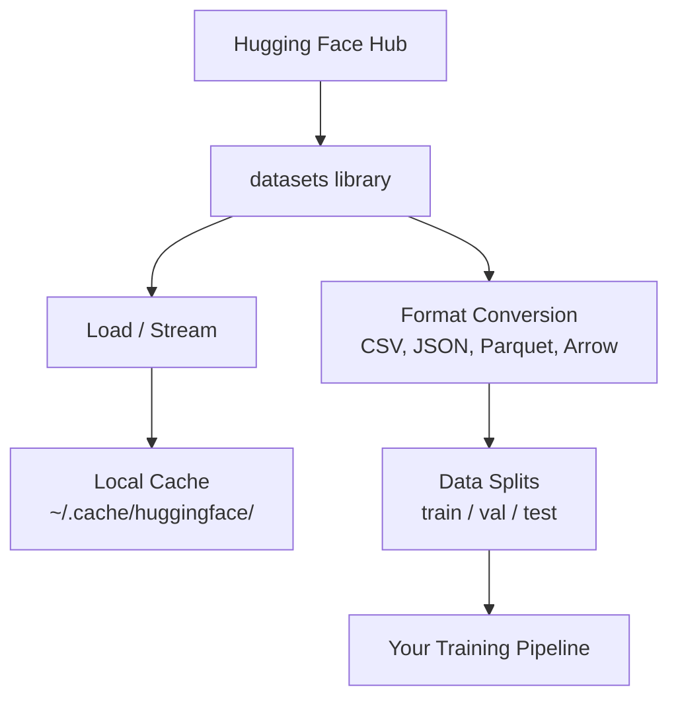

# Quản lý dữ liệu

> Dữ liệu là nhiên liệu. Cách bạn quản lý nó quyết định tốc độ bạn đi.

**Type:** Build
**Language:** Python
**Prerequisites:** Giai đoạn 0, Bài 01
**Time:** ~45 phút

## Mục tiêu học tập

- Nạp, stream và cache (bộ nhớ đệm) dataset (bộ dữ liệu) bằng thư viện `datasets` của Hugging Face
- Chuyển đổi giữa các định dạng CSV, JSON, Parquet và Arrow, đồng thời giải thích được đánh đổi của từng loại
- Tạo các split train/validation/test có thể tái lập với random seed cố định
- Quản lý file model và dataset lớn bằng `.gitignore`, Git LFS hoặc DVC

## Vấn đề

Mọi dự án AI đều bắt đầu từ dữ liệu. Bạn cần tìm dataset, tải về, chuyển đổi giữa các định dạng, chia chúng để huấn luyện và đánh giá, rồi version chúng để các thí nghiệm có thể tái lập. Làm việc này thủ công mỗi lần thì chậm và dễ sai. Bạn cần một quy trình có thể lặp lại.

## Khái niệm



Thư viện `datasets` của Hugging Face là cách chuẩn để nạp dữ liệu cho công việc AI. Nó xử lý việc tải về, cache, chuyển đổi định dạng và streaming ngay khi dùng.

```figure
s0-data-pipeline
```

## Tự tay làm

### Bước 1: Cài thư viện datasets

```bash
pip install datasets huggingface_hub
```

### Bước 2: Nạp một dataset

```python
from datasets import load_dataset

dataset = load_dataset("stanfordnlp/imdb")
print(dataset)
print(dataset["train"][0])
```

Đoạn này tải dataset đánh giá phim IMDB. Sau lần tải đầu tiên, nó nạp từ cache ở `~/.cache/huggingface/datasets/`.

### Bước 3: Stream các dataset lớn

Có những dataset quá lớn để chứa vừa trên đĩa. Streaming nạp chúng từng hàng mà không cần tải toàn bộ.

```python
dataset = load_dataset("wikimedia/wikipedia", "20231101.en", split="train", streaming=True)

for i, example in enumerate(dataset):
    print(example["title"])
    if i >= 4:
        break
```

Streaming cho bạn một `IterableDataset`. Bạn xử lý từng hàng khi chúng đến. Lượng bộ nhớ dùng giữ nguyên bất kể dataset lớn đến đâu.

### Bước 4: Các định dạng dataset

Thư viện `datasets` dùng Apache Arrow ở bên dưới. Bạn có thể chuyển sang định dạng khác tùy theo pipeline của mình cần gì.

```python
dataset = load_dataset("stanfordnlp/imdb", split="train")

dataset.to_csv("imdb_train.csv")
dataset.to_json("imdb_train.json")
dataset.to_parquet("imdb_train.parquet")
```

So sánh định dạng:

| Định dạng | Kích thước | Tốc độ đọc | Phù hợp nhất cho |
|--------|------|-----------|----------|
| CSV | Lớn | Chậm | Con người đọc được, bảng tính |
| JSON | Lớn | Chậm | API, dữ liệu lồng nhau |
| Parquet | Nhỏ | Nhanh | Phân tích, truy vấn theo cột |
| Arrow | Nhỏ | Nhanh nhất | Xử lý trong bộ nhớ (thứ `datasets` dùng bên trong) |

Với công việc AI, Parquet là định dạng lưu trữ tốt nhất. Arrow là thứ bạn làm việc trong bộ nhớ. CSV và JSON dùng để trao đổi qua lại.

### Bước 5: Chia dữ liệu

Mọi dự án ML đều cần ba split:

- **Train**: Model học từ phần này (thường là 80%)
- **Validation**: Bạn kiểm tra tiến độ trong quá trình huấn luyện (thường là 10%)
- **Test**: Đánh giá cuối cùng sau khi huấn luyện xong (thường là 10%)

Một số dataset đã được chia sẵn. Khi chúng không có, hãy tự chia:

```python
dataset = load_dataset("stanfordnlp/imdb", split="train")

split = dataset.train_test_split(test_size=0.2, seed=42)
train_val = split["train"].train_test_split(test_size=0.125, seed=42)

train_ds = train_val["train"]
val_ds = train_val["test"]
test_ds = split["test"]

print(f"Train: {len(train_ds)}, Val: {len(val_ds)}, Test: {len(test_ds)}")
```

Luôn đặt seed để tái lập được. Cùng một seed sẽ cho ra cùng một cách chia mỗi lần.

### Bước 6: Tải và cache model

Model là những file lớn. Thư viện `huggingface_hub` xử lý việc tải về và cache.

```python
from huggingface_hub import hf_hub_download, snapshot_download

model_path = hf_hub_download(
    repo_id="sentence-transformers/all-MiniLM-L6-v2",
    filename="config.json"
)
print(f"Cached at: {model_path}")

model_dir = snapshot_download("sentence-transformers/all-MiniLM-L6-v2")
print(f"Full model at: {model_dir}")
```

Model được cache vào `~/.cache/huggingface/hub/`. Sau khi đã tải, chúng nạp tức thì ở những lần chạy sau.

### Bước 7: Xử lý file lớn

Trọng số model và các dataset lớn không nên đưa vào git. Có ba lựa chọn:

**Option A: .gitignore (đơn giản nhất)**

```
*.bin
*.safetensors
*.pt
*.onnx
data/*.parquet
data/*.csv
models/
```

**Option B: Git LFS (theo dõi file lớn trong git)**

```bash
git lfs install
git lfs track "*.bin"
git lfs track "*.safetensors"
git add .gitattributes
```

Git LFS lưu các con trỏ trong repo của bạn và file thật trên một server riêng. GitHub cho bạn 1 GB miễn phí.

**Option C: DVC (data version control)**

```bash
pip install dvc
dvc init
dvc add data/training_set.parquet
git add data/training_set.parquet.dvc data/.gitignore
git commit -m "Track training data with DVC"
```

DVC tạo ra các file `.dvc` nhỏ trỏ đến dữ liệu của bạn. Bản thân dữ liệu nằm ở S3, GCS hoặc một backend lưu trữ từ xa khác.

| Cách tiếp cận | Độ phức tạp | Phù hợp nhất cho |
|----------|-----------|----------|
| .gitignore | Thấp | Dự án cá nhân, dữ liệu đã tải mà bạn có thể tải lại |
| Git LFS | Trung bình | Đội nhóm chia sẻ trọng số model qua git |
| DVC | Cao | Thí nghiệm có thể tái lập, dataset lớn, đội nhóm |

Với khóa học này, `.gitignore` là đủ. Hãy dùng DVC khi bạn cần tái lập chính xác các thí nghiệm trên nhiều máy.

### Bước 8: Các mẫu lưu trữ

**Lưu trữ cục bộ** phù hợp với dataset dưới ~10 GB. Cache của HF xử lý việc này tự động.

**Lưu trữ đám mây** dành cho mọi thứ lớn hơn hoặc được chia sẻ giữa nhiều máy:

```python
import os

local_path = os.path.expanduser("~/.cache/huggingface/datasets/")

# s3_path = "s3://my-bucket/datasets/"
# gcs_path = "gs://my-bucket/datasets/"
```

DVC tích hợp trực tiếp với S3 và GCS:

```bash
dvc remote add -d myremote s3://my-bucket/dvc-store
dvc push
```

Với khóa học này, lưu trữ cục bộ là đủ. Lưu trữ đám mây trở nên cần thiết khi bạn fine-tune trên các instance GPU từ xa.

## Các dataset dùng trong khóa học này

| Dataset | Bài học | Kích thước | Điều nó dạy |
|---------|---------|------|----------------|
| IMDB | Tokenization, classification | 84 MB | Kiến thức cơ bản về phân loại văn bản |
| WikiText | Language modeling | 181 MB | Dự đoán token tiếp theo |
| SQuAD | QA systems | 35 MB | Hỏi đáp, span |
| Common Crawl (subset) | Embeddings | Tùy | Xử lý văn bản quy mô lớn |
| MNIST | Vision basics | 21 MB | Nền tảng phân loại ảnh |
| COCO (subset) | Multimodal | Tùy | Cặp ảnh-văn bản |

Bạn không cần tải tất cả những thứ này ngay bây giờ. Mỗi bài học sẽ nêu rõ nó cần gì.

## Áp dụng

Chạy script tiện ích để xác nhận mọi thứ hoạt động:

```bash
python code/data_utils.py
```

Script này tải một dataset nhỏ, chuyển đổi nó, chia nó và in ra bản tóm tắt.

## Đóng gói

Bài học này tạo ra:
- `code/data_utils.py` - tiện ích nạp và cache dữ liệu tái sử dụng
- `outputs/prompt-data-helper.md` - prompt để tìm đúng dataset cho một tác vụ

## Bài tập

1. Nạp dataset `glue` với config `mrpc` và xem 5 ví dụ đầu tiên
2. Stream dataset `c4` và đếm xem bạn xử lý được bao nhiêu ví dụ trong 10 giây
3. Chuyển một dataset sang Parquet và so sánh kích thước file với CSV
4. Tạo split train/val/test theo tỉ lệ 70/15/15 với seed cố định và kiểm tra kích thước

## Thuật ngữ chính

| Thuật ngữ | Người ta thường nói | Ý nghĩa thực sự |
|------|----------------|----------------------|
| Dataset split | "Dữ liệu huấn luyện" | Một tập con có tên (train/val/test) được dùng ở các giai đoạn khác nhau của vòng đời ML |
| Streaming | "Nạp một cách lười" | Xử lý dữ liệu từng hàng từ một nguồn từ xa mà không tải toàn bộ dataset |
| Parquet | "CSV nén" | Định dạng file theo cột, được tối ưu cho truy vấn phân tích và hiệu quả lưu trữ |
| Arrow | "Dataframe nhanh" | Định dạng theo cột trong bộ nhớ, được thư viện datasets dùng bên trong cho đọc zero-copy |
| Git LFS | "Git cho file lớn" | Một extension lưu file lớn bên ngoài repo git trong khi vẫn giữ con trỏ trong version control |
| DVC | "Git cho dữ liệu" | Hệ thống version control cho dataset và model, tích hợp với lưu trữ đám mây |
| Cache | "Đã tải rồi" | Bản sao cục bộ của dữ liệu đã lấy trước đó, mặc định lưu ở ~/.cache/huggingface/ |
