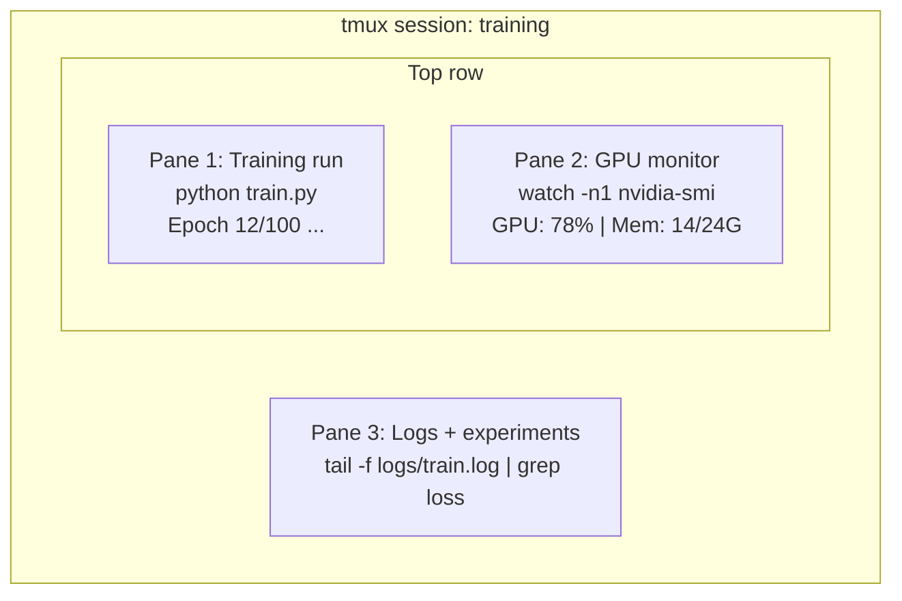

# Terminal & Shell

> Terminal là nơi các kỹ sư AI sống và làm việc. Hãy thấy thoải mái ở đây.

**Type:** Learn
**Languages:** --
**Prerequisites:** Giai đoạn 0, Bài 01
**Time:** ~35 phút

## Mục tiêu học tập

- Dùng pipe (ống dẫn), chuyển hướng và `grep` để lọc và xử lý log huấn luyện ngay trên dòng lệnh
- Tạo các phiên tmux bền vững với nhiều pane để vừa huấn luyện vừa theo dõi GPU
- Theo dõi tài nguyên hệ thống và GPU bằng `htop`, `nvtop` và `nvidia-smi`
- Truyền file giữa máy local và máy remote bằng SSH, `scp` và `rsync`

## Vấn đề

Bạn sẽ dành nhiều thời gian trong terminal hơn trong bất kỳ editor nào. Chạy huấn luyện, theo dõi GPU, xem log, phiên SSH remote, quản lý môi trường. Mọi quy trình AI đều chạm tới shell (vỏ dòng lệnh). Nếu bạn chậm ở đây, bạn sẽ chậm ở mọi nơi.

Bài học này bao gồm những kỹ năng terminal quan trọng cho công việc AI. Không có lịch sử Unix. Không đào sâu vào lập trình Bash. Chỉ những gì bạn cần.

## Khái niệm



Ba thứ chạy cùng lúc. Một terminal. Bạn có thể detach, về nhà, SSH lại vào và reattach. Quá trình huấn luyện vẫn tiếp tục.

```figure
s0-shell-pipeline
```

## Tự tay làm

### Bước 1: Biết shell của bạn

Kiểm tra xem bạn đang chạy shell nào:

```bash
echo $SHELL
```

Hầu hết hệ thống dùng `bash` hoặc `zsh`. Cả hai đều ổn. Các lệnh trong khóa học này chạy được với cả hai.

Những điều cần biết:

```bash
# Move around
cd ~/projects/ai-engineering-from-scratch
pwd
ls -la

# History search (most useful shortcut you'll learn)
# Ctrl+R then type part of a previous command
# Press Ctrl+R again to cycle through matches

# Clear terminal
clear   # or Ctrl+L

# Cancel a running command
# Ctrl+C

# Suspend a running command (resume with fg)
# Ctrl+Z
```

### Bước 2: Pipe và chuyển hướng

Pipe nối các lệnh lại với nhau. Đây là cách bạn xử lý log, lọc output và xâu chuỗi công cụ. Bạn sẽ dùng nó liên tục.

```bash
# Count how many times "loss" appears in a log
cat train.log | grep "loss" | wc -l

# Extract just the loss values from training output
grep "loss:" train.log | awk '{print $NF}' > losses.txt

# Watch a log file update in real time, filtering for errors
tail -f train.log | grep --line-buffered "ERROR"

# Sort experiments by final accuracy
grep "final_accuracy" results/*.log | sort -t= -k2 -n -r

# Redirect stdout and stderr to separate files
python train.py > output.log 2> errors.log

# Redirect both to the same file
python train.py > train_full.log 2>&1
```

Ba kiểu chuyển hướng bạn cần:

| Ký hiệu | Nó làm gì |
|--------|-------------|
| `>` | Ghi stdout vào file (ghi đè) |
| `>>` | Nối thêm stdout vào cuối file |
| `2>` | Ghi stderr vào file |
| `2>&1` | Gửi stderr tới cùng nơi với stdout |
| `\|` | Gửi stdout của lệnh này làm stdin cho lệnh tiếp theo |

### Bước 3: Tiến trình chạy nền

Các lần huấn luyện mất hàng giờ. Bạn không muốn giữ terminal mở suốt thời gian đó.

```bash
# Run in background (output still goes to terminal)
python train.py &

# Run in background, immune to hangup (closing terminal won't kill it)
nohup python train.py > train.log 2>&1 &

# Check what's running in background
jobs
ps aux | grep train.py

# Bring a background job to foreground
fg %1

# Kill a background process
kill %1
# or find its PID and kill that
kill $(pgrep -f "train.py")
```

Sự khác nhau giữa `&`, `nohup` và `screen`/`tmux`:

| Cách | Sống sót khi đóng terminal? | Có thể gắn lại? |
|--------|-------------------------|---------------|
| `command &` | Không | Không |
| `nohup command &` | Có | Không (kiểm tra file log) |
| `screen` / `tmux` | Có | Có |

Với bất cứ thứ gì dài hơn vài phút, hãy dùng tmux.

### Bước 4: tmux

tmux cho phép bạn tạo các phiên terminal bền vững với nhiều pane. Đây là công cụ hữu ích nhất để quản lý các lần chạy huấn luyện.

```bash
# Install
# macOS
brew install tmux
# Ubuntu
sudo apt install tmux

# Start a named session
tmux new -s training

# Split horizontally
# Ctrl+B then "

# Split vertically
# Ctrl+B then %

# Navigate between panes
# Ctrl+B then arrow keys

# Detach (session keeps running)
# Ctrl+B then d

# Reattach
tmux attach -t training

# List sessions
tmux ls

# Kill a session
tmux kill-session -t training
```

Một phiên làm việc AI điển hình:

```bash
tmux new -s train

# Pane 1: start training
python train.py --epochs 100 --lr 1e-4

# Ctrl+B, " to split, then run GPU monitor
watch -n1 nvidia-smi

# Ctrl+B, % to split vertically, tail the logs
tail -f logs/experiment.log

# Now detach with Ctrl+B, d
# SSH out, go get coffee, come back
# tmux attach -t train
```

### Bước 5: Theo dõi với htop và nvtop

```bash
# System processes (better than top)
htop

# GPU processes (if you have NVIDIA GPU)
# Install: sudo apt install nvtop (Ubuntu) or brew install nvtop (macOS)
nvtop

# Quick GPU check without nvtop
nvidia-smi

# Watch GPU usage update every second
watch -n1 nvidia-smi

# See which processes are using the GPU
nvidia-smi --query-compute-apps=pid,name,used_memory --format=csv
```

Các phím tắt `htop` bạn sẽ dùng:
- `F6` hoặc `>` để sắp xếp theo cột (sắp xếp theo memory để tìm rò rỉ bộ nhớ)
- `F5` để bật/tắt chế độ dạng cây (xem các tiến trình con)
- `F9` để kill một tiến trình
- `/` để tìm tên tiến trình

### Bước 6: SSH cho máy GPU remote

Khi bạn thuê GPU cloud (Lambda, RunPod, Vast.ai), bạn kết nối qua SSH.

```bash
# Basic connection
ssh user@gpu-box-ip

# With a specific key
ssh -i ~/.ssh/my_gpu_key user@gpu-box-ip

# Copy files to remote
scp model.pt user@gpu-box-ip:~/models/

# Copy files from remote
scp user@gpu-box-ip:~/results/metrics.json ./

# Sync a whole directory (faster for many files)
rsync -avz ./data/ user@gpu-box-ip:~/data/

# Port forward (access remote Jupyter/TensorBoard locally)
ssh -L 8888:localhost:8888 user@gpu-box-ip
# Now open localhost:8888 in your browser

# SSH config for convenience
# Add to ~/.ssh/config:
# Host gpu
#     HostName 192.168.1.100
#     User ubuntu
#     IdentityFile ~/.ssh/gpu_key
#
# Then just:
# ssh gpu
```

### Bước 7: Alias hữu ích cho công việc AI

Thêm những dòng này vào `~/.bashrc` hoặc `~/.zshrc` của bạn:

```bash
source phases/00-setup-and-tooling/10-terminal-and-shell/code/shell_aliases.sh
```

Hoặc copy những cái bạn muốn. Các alias (bí danh) chính:

```bash
# GPU status at a glance
alias gpu='nvidia-smi --query-gpu=index,name,utilization.gpu,memory.used,memory.total,temperature.gpu --format=csv,noheader'

# Kill all Python training processes
alias killtraining='pkill -f "python.*train"'

# Quick virtual environment activate
alias ae='source .venv/bin/activate'

# Watch training loss
alias watchloss='tail -f logs/*.log | grep --line-buffered "loss"'
```

Xem `code/shell_aliases.sh` để có bộ đầy đủ.

### Bước 8: Các mẫu terminal thường gặp trong công việc AI

Những mẫu này lặp lại thường xuyên trong thực tế:

```bash
# Run training, log everything, notify when done
python train.py 2>&1 | tee train.log; echo "DONE" | mail -s "Training complete" you@email.com

# Compare two experiment logs side by side
diff <(grep "accuracy" exp1.log) <(grep "accuracy" exp2.log)

# Find the largest model files (clean up disk space)
find . -name "*.pt" -o -name "*.safetensors" | xargs du -h | sort -rh | head -20

# Download a model from Hugging Face
wget https://huggingface.co/model/resolve/main/model.safetensors

# Untar a dataset
tar xzf dataset.tar.gz -C ./data/

# Count lines in all Python files (see how big your project is)
find . -name "*.py" | xargs wc -l | tail -1

# Check disk space (training data fills disks fast)
df -h
du -sh ./data/*

# Environment variable check before training
env | grep -i cuda
env | grep -i torch
```

## Áp dụng

Đây là lúc mỗi công cụ phát huy tác dụng trong khóa học này:

| Công cụ | Khi nào bạn dùng |
|------|----------------|
| tmux | Mọi lần chạy huấn luyện (Phase 3+) |
| `tail -f` + `grep` | Theo dõi log huấn luyện |
| `nohup` / `&` | Các tác vụ nền nhanh |
| `htop` / `nvtop` | Gỡ lỗi huấn luyện chậm, lỗi OOM |
| SSH + `rsync` | Làm việc trên GPU cloud |
| Pipe + chuyển hướng | Xử lý kết quả thí nghiệm |
| Alias | Tiết kiệm thời gian với các lệnh lặp lại |

## Bài tập

1. Cài tmux, tạo một phiên với ba pane, chạy `htop` ở một pane, `watch -n1 date` ở pane khác, và một script Python ở pane thứ ba. Detach rồi reattach.
2. Thêm các alias từ `code/shell_aliases.sh` vào file cấu hình shell của bạn và nạp lại bằng `source ~/.zshrc` (hoặc `~/.bashrc`).
3. Tạo một file log huấn luyện giả bằng `for i in $(seq 1 100); do echo "epoch $i loss: $(echo "scale=4; 1/$i" | bc)"; sleep 0.1; done > fake_train.log` rồi dùng `grep`, `tail` và `awk` để trích ra chỉ các giá trị loss.
4. Thiết lập một mục trong cấu hình SSH cho server bạn có quyền truy cập (hoặc dùng `localhost` để luyện cú pháp).

## Thuật ngữ chính

| Thuật ngữ | Người ta thường nói | Ý nghĩa thực sự |
|------|----------------|----------------------|
| Shell | "Cái terminal" | Chương trình diễn giải các lệnh của bạn (bash, zsh, fish) |
| tmux | "Terminal multiplexer" | Chương trình cho phép bạn chạy nhiều phiên terminal trong một cửa sổ, và detach/reattach |
| Pipe | "Cái dấu gạch đó" | Toán tử `\|` gửi output của lệnh này thành input của lệnh khác |
| PID | "Process ID" | Một con số duy nhất gán cho mỗi tiến trình đang chạy, dùng để theo dõi hoặc kill nó |
| nohup | "No hangup" | Chạy một lệnh không bị ảnh hưởng bởi tín hiệu hangup, nên đóng terminal sẽ không kill nó |
| SSH | "Kết nối tới server" | Secure Shell, một giao thức mã hóa để chạy lệnh trên máy remote |

---

[← Bài trước: Quản lý dữ liệu](../../09-data-management/docs/vi.md) · [Bài sau: Linux cho AI →](../../11-linux-for-ai/docs/vi.md)
