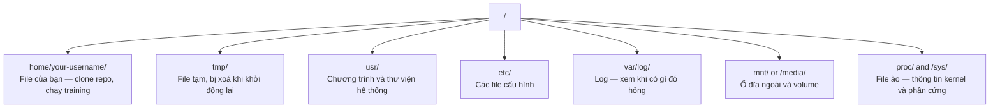

# Linux cho AI

> Phần lớn AI chạy trên Linux. Bạn cần biết đủ để không bị kẹt.

**Type:** Learn
**Languages:** --
**Prerequisites:** Giai đoạn 0, Bài 01
**Time:** ~30 phút

## Mục tiêu học tập

- Điều hướng hệ thống file Linux và thực hiện các thao tác file thiết yếu từ dòng lệnh
- Quản lý permission (quyền) file với `chmod` và `chown` để xử lý lỗi "Permission denied"
- Cài các gói hệ thống bằng `apt` và thiết lập một máy GPU mới cho công việc AI
- Nhận ra những khác biệt giữa macOS và Linux thường làm các lập trình viên thao tác trên máy từ xa vấp phải

## Vấn đề

Bạn phát triển trên macOS hoặc Windows. Nhưng ngay khi bạn SSH vào một máy GPU trên cloud, thuê một instance Lambda, hay dựng một máy EC2, bạn sẽ đáp xuống Ubuntu. Terminal là giao diện duy nhất của bạn. Không có Finder, không có Explorer, không có GUI. Nếu bạn không thể điều hướng hệ thống file, cài gói, và quản lý process (tiến trình) từ dòng lệnh, bạn sẽ bị kẹt trả tiền cho những giờ GPU nhàn rỗi trong lúc google "how to unzip a file in Linux."

Đây là một cẩm nang sinh tồn. Nó bao phủ đúng những gì bạn cần để vận hành một máy Linux từ xa cho công việc AI. Không gì hơn.

## Bố cục hệ thống file

Linux tổ chức mọi thứ dưới một gốc duy nhất `/`. Không có `C:\` hay `/Volumes`. Những thư mục bạn thực sự sẽ chạm tới:



Thư mục home của bạn là `~` hoặc `/home/your-username`. Gần như mọi thứ bạn làm đều diễn ra ở đây.

## Các lệnh thiết yếu

Đây là 15 lệnh bao phủ 95% những gì bạn sẽ làm trên một máy GPU từ xa.

### Di chuyển

```bash
pwd                         # Where am I?
ls                          # What's here?
ls -la                      # What's here, including hidden files with details?
cd /path/to/dir             # Go there
cd ~                        # Go home
cd ..                       # Go up one level
```

### File và thư mục

```bash
mkdir my-project            # Create a directory
mkdir -p a/b/c              # Create nested directories in one shot

cp file.txt backup.txt      # Copy a file
cp -r src/ src-backup/      # Copy a directory (recursive)

mv old.txt new.txt          # Rename a file
mv file.txt /tmp/           # Move a file

rm file.txt                 # Delete a file (no trash, it's gone)
rm -rf my-dir/              # Delete a directory and everything inside
```

`rm -rf` là vĩnh viễn. Không có hoàn tác. Hãy kiểm tra lại đường dẫn trước khi nhấn enter.

### Đọc file

```bash
cat file.txt                # Print entire file
head -20 file.txt           # First 20 lines
tail -20 file.txt           # Last 20 lines
tail -f log.txt             # Follow a log file in real time (Ctrl+C to stop)
less file.txt               # Scroll through a file (q to quit)
```

### Tìm kiếm

```bash
grep "error" training.log           # Find lines containing "error"
grep -r "learning_rate" .           # Search all files in current directory
grep -i "cuda" config.yaml          # Case-insensitive search

find . -name "*.py"                 # Find all Python files under current dir
find . -name "*.ckpt" -size +1G     # Find checkpoint files larger than 1GB
```

## Permissions

Mỗi file trên Linux đều có một chủ sở hữu và các bit permission. Bạn sẽ gặp chuyện này khi script không chạy được hoặc bạn không ghi được vào một thư mục.

```bash
ls -l train.py
# -rwxr-xr-- 1 user group 2048 Mar 19 10:00 train.py
#  ^^^             owner permissions: read, write, execute
#     ^^^          group permissions: read, execute
#        ^^        everyone else: read only
```

Các cách sửa phổ biến:

```bash
chmod +x train.sh           # Make a script executable
chmod 755 deploy.sh         # Owner: full, others: read+execute
chmod 644 config.yaml       # Owner: read+write, others: read only

chown user:group file.txt   # Change who owns a file (needs sudo)
```

Khi có thứ gì đó báo "Permission denied," thì gần như luôn là vấn đề quyền. `chmod +x` hoặc `sudo` sẽ sửa được phần lớn trường hợp.

## Quản lý gói (apt)

Ubuntu dùng `apt`. Đây là cách bạn cài phần mềm ở mức hệ thống.

```bash
sudo apt update             # Refresh the package list (always do this first)
sudo apt install -y htop    # Install a package (-y skips confirmation)
sudo apt install -y build-essential  # C compiler, make, etc. Needed by many Python packages
sudo apt install -y tmux    # Terminal multiplexer (keep sessions alive after disconnect)

apt list --installed        # What's installed?
sudo apt remove htop        # Uninstall
```

Những gói phổ biến bạn sẽ cài trên một máy GPU mới:

```bash
sudo apt update && sudo apt install -y \
    build-essential \
    git \
    curl \
    wget \
    tmux \
    htop \
    unzip \
    python3-venv
```

## Người dùng và sudo

Bạn thường đăng nhập với tư cách người dùng thường. Một số thao tác cần quyền root (quản trị).

```bash
whoami                      # What user am I?
sudo command                # Run a single command as root
sudo su                     # Become root (exit to go back, use sparingly)
```

Trên các instance GPU cloud, bạn thường là người dùng duy nhất và đã có sẵn quyền sudo. Đừng chạy mọi thứ với tư cách root. Chỉ dùng sudo khi cần.

## Process và systemd

Khi quá trình training của bạn bị treo, hoặc bạn cần kiểm tra cái gì đang chạy:

```bash
htop                        # Interactive process viewer (q to quit)
ps aux | grep python        # Find running Python processes
kill 12345                  # Gracefully stop process with PID 12345
kill -9 12345               # Force kill (use when graceful doesn't work)
nvidia-smi                  # GPU processes and memory usage
```

systemd quản lý service (dịch vụ) — các daemon chạy nền. Bạn sẽ dùng nó nếu bạn chạy inference server:

```bash
sudo systemctl start nginx          # Start a service
sudo systemctl stop nginx           # Stop it
sudo systemctl restart nginx        # Restart it
sudo systemctl status nginx         # Check if it's running
sudo systemctl enable nginx         # Start automatically on boot
```

## Dung lượng đĩa

Máy GPU thường có dung lượng đĩa hạn chế. Model và dataset lấp đầy nó rất nhanh.

```bash
df -h                       # Disk usage for all mounted drives
df -h /home                 # Disk usage for /home specifically

du -sh *                    # Size of each item in current directory
du -sh ~/.cache             # Size of your cache (pip, huggingface models land here)
du -sh /data/checkpoints/   # Check how big your checkpoints are

# Find the biggest space hogs
du -h --max-depth=1 / 2>/dev/null | sort -hr | head -20
```

Các cách giải phóng dung lượng phổ biến:

```bash
# Clear pip cache
pip cache purge

# Clear apt cache
sudo apt clean

# Remove old checkpoints you don't need
rm -rf checkpoints/epoch_01/ checkpoints/epoch_02/
```

## Mạng

Bạn sẽ tải model, truyền file, và gọi API từ dòng lệnh.

```bash
# Download files
wget https://example.com/model.bin                   # Download a file
curl -O https://example.com/data.tar.gz              # Same thing with curl
curl -s https://api.example.com/health | python3 -m json.tool  # Hit an API, pretty-print JSON

# Transfer files between machines
scp model.bin user@remote:/data/                     # Copy file to remote machine
scp user@remote:/data/results.csv .                  # Copy file from remote to local
scp -r user@remote:/data/checkpoints/ ./local-dir/   # Copy directory

# Sync directories (faster than scp for large transfers, resumes on failure)
rsync -avz --progress ./data/ user@remote:/data/
rsync -avz --progress user@remote:/results/ ./results/
```

Với bất cứ thứ gì lớn, hãy dùng `rsync` thay vì `scp`. Nó chỉ truyền các byte đã thay đổi và xử lý được kết nối bị ngắt giữa chừng.

## tmux: giữ session sống

Khi bạn SSH vào một máy từ xa, việc gập laptop sẽ giết chết lượt chạy training của bạn. tmux ngăn điều đó.

```bash
tmux new -s train           # Start a new session named "train"
# ... start your training, then:
# Ctrl+B, then D            # Detach (training keeps running)

tmux ls                     # List sessions
tmux attach -t train        # Reattach to session

# Inside tmux:
# Ctrl+B, then %            # Split pane vertically
# Ctrl+B, then "            # Split pane horizontally
# Ctrl+B, then arrow keys   # Switch between panes
```

Luôn chạy các job training dài bên trong tmux. Luôn luôn.

## WSL2 cho người dùng Windows

Nếu bạn dùng Windows, WSL2 cho bạn một môi trường Linux thực sự mà không cần dual-boot.

```bash
# In PowerShell (admin)
wsl --install -d Ubuntu-24.04

# After restart, open Ubuntu from Start menu
sudo apt update && sudo apt upgrade -y
```

WSL2 chạy một kernel Linux thực sự. Mọi thứ trong bài học này đều hoạt động bên trong nó. File Windows của bạn nằm ở `/mnt/c/Users/YourName/` khi nhìn từ trong WSL.

GPU passthrough hoạt động với driver NVIDIA được cài ở phía Windows. Hãy cài driver NVIDIA cho Windows (không phải bản Linux), và CUDA sẽ khả dụng bên trong WSL2.

## Những cạm bẫy: từ macOS sang Linux

Những thứ sẽ làm bạn vấp nếu bạn đến từ macOS:

| macOS | Linux | Ghi chú |
|-------|-------|-------|
| `brew install` | `sudo apt install` | Đôi khi tên gói khác nhau. `brew install htop` so với `sudo apt install htop` thì giống nhau, nhưng `brew install readline` so với `sudo apt install libreadline-dev` thì không. |
| `open file.txt` | `xdg-open file.txt` | Nhưng trên máy từ xa bạn sẽ không có GUI. Hãy dùng `cat` hoặc `less`. |
| `pbcopy` / `pbpaste` | Không có sẵn | Chuyển dữ liệu vào/ra clipboard không tồn tại qua SSH. |
| `~/.zshrc` | `~/.bashrc` | macOS mặc định dùng zsh. Hầu hết server Linux dùng bash. |
| `/opt/homebrew/` | `/usr/bin/`, `/usr/local/bin/` | Các binary nằm ở những nơi khác nhau. |
| `sed -i '' 's/a/b/' file` | `sed -i 's/a/b/' file` | sed trên macOS cần một chuỗi rỗng sau `-i`. Linux thì không. |
| Hệ thống file không phân biệt hoa/thường | Hệ thống file phân biệt hoa/thường | `Model.py` và `model.py` là hai file khác nhau trên Linux. |
| Ký tự xuống dòng `\n` | Ký tự xuống dòng `\n` | Giống nhau. Nhưng Windows dùng `\r\n`, thứ này làm hỏng script bash. Chạy `dos2unix` để sửa. |

## Thẻ tham chiếu nhanh

```
Navigation:     pwd, ls, cd, find
Files:          cp, mv, rm, mkdir, cat, head, tail, less
Search:         grep, find
Permissions:    chmod, chown, sudo
Packages:       apt update, apt install
Processes:      htop, ps, kill, nvidia-smi
Services:       systemctl start/stop/restart/status
Disk:           df -h, du -sh
Network:        curl, wget, scp, rsync
Sessions:       tmux new/attach/detach
```

```figure
s0-process-fork
```

## Bài tập

1. SSH vào bất kỳ máy Linux nào (hoặc mở WSL2) và điều hướng tới thư mục home của bạn. Tạo một thư mục dự án, tạo ba file rỗng bên trong nó bằng `touch`, rồi liệt kê chúng với `ls -la`.
2. Cài `htop` bằng apt, chạy nó, và xác định process nào đang dùng nhiều bộ nhớ nhất.
3. Khởi động một session tmux, chạy `sleep 300` bên trong nó, detach, liệt kê các session, và attach lại.
4. Dùng `df -h` để kiểm tra dung lượng đĩa còn trống, rồi dùng `du -sh ~/.cache/*` để tìm xem thứ gì đang chiếm chỗ trong cache của bạn.
5. Truyền một file từ máy cục bộ của bạn sang một máy từ xa bằng `scp`, rồi làm lại việc truyền đó với `rsync` và so sánh trải nghiệm.
