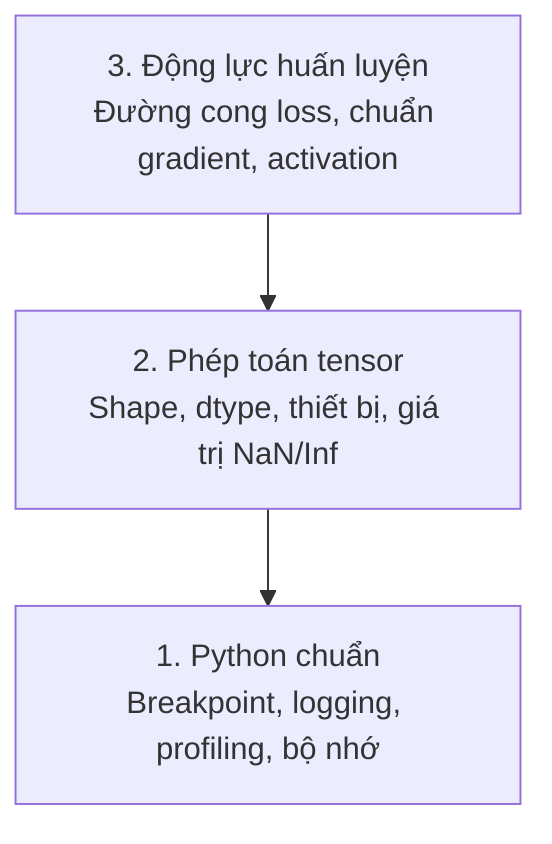

# Gỡ lỗi và phân tích hiệu năng

> Những lỗi AI tệ nhất không hề làm chương trình crash. Chúng âm thầm huấn luyện trên dữ liệu rác rồi báo về một đường cong loss đẹp đẽ.

**Type:** Build
**Language:** Python
**Prerequisites:** Bài 1 (Dev Environment), quen thuộc cơ bản với PyTorch
**Time:** ~60 phút

## Mục tiêu học tập

- Dùng `breakpoint()` có điều kiện và `debug_print` để kiểm tra shape, dtype và giá trị NaN của tensor ngay giữa quá trình huấn luyện
- Phân tích vòng lặp huấn luyện bằng `cProfile`, `line_profiler` và `tracemalloc` để tìm ra nút thắt cổ chai
- Phát hiện những lỗi AI thường gặp: lệch shape, loss NaN, rò rỉ dữ liệu (data leakage) và tensor nằm sai thiết bị
- Thiết lập TensorBoard để trực quan hoá đường cong loss, histogram trọng số và phân phối gradient

## Vấn đề

Code AI thất bại theo cách khác code thông thường. Một ứng dụng web crash kèm theo stack trace (dấu vết ngăn xếp). Còn một vòng lặp huấn luyện cấu hình sai thì chạy 8 giờ, đốt 200$ tiền GPU và tạo ra một model luôn dự đoán giá trị trung bình của mọi đầu vào. Code không hề báo lỗi. Lỗi nằm ở một tensor nằm sai thiết bị, một chỗ quên gọi `.detach()`, hoặc nhãn bị rò rỉ vào đặc trưng.

Bạn cần những công cụ gỡ lỗi bắt được các thất bại âm thầm đó trước khi chúng lãng phí thời gian và tài nguyên tính toán của bạn.

## Khái niệm

Gỡ lỗi AI hoạt động ở ba tầng:



Hầu hết mọi người nhảy thẳng lên tầng 3 (nhìn chằm chằm vào TensorBoard). Nhưng 80% lỗi AI nằm ở tầng 1 và tầng 2.

```figure
s0-flame-hot
```

## Tự tay làm

### Phần 1: Gỡ lỗi bằng print (đúng, nó vẫn hiệu quả)

Gỡ lỗi bằng print thường bị xem nhẹ. Không nên như vậy. Với code tensor, một câu lệnh print đúng chỗ tốt hơn hẳn việc dò từng bước trong debugger, vì bạn cần thấy shape, dtype và miền giá trị cùng một lúc.

```python
def debug_print(name, tensor):
    print(f"{name}: shape={tensor.shape}, dtype={tensor.dtype}, "
          f"device={tensor.device}, "
          f"min={tensor.min().item():.4f}, max={tensor.max().item():.4f}, "
          f"mean={tensor.mean().item():.4f}, "
          f"has_nan={tensor.isnan().any().item()}")
```

Gọi hàm này sau mỗi phép toán đáng ngờ. Khi đã tìm ra lỗi thì xoá các print đi. Đơn giản.

### Phần 2: Debugger của Python (pdb và breakpoint)

Debugger tích hợp sẵn bị đánh giá thấp trong công việc AI. Thả một `breakpoint()` vào vòng lặp huấn luyện và kiểm tra tensor một cách tương tác.

```python
def training_step(model, batch, criterion, optimizer):
    inputs, labels = batch
    outputs = model(inputs)
    loss = criterion(outputs, labels)

    if loss.item() > 100 or torch.isnan(loss):
        breakpoint()

    loss.backward()
    optimizer.step()
```

Khi debugger đưa bạn vào, đây là các lệnh hữu ích:

- `p outputs.shape` để kiểm tra shape
- `p loss.item()` để xem giá trị loss
- `p torch.isnan(outputs).sum()` để đếm số NaN
- `p model.fc1.weight.grad` để kiểm tra gradient
- `c` để chạy tiếp, `q` để thoát

Đây là gỡ lỗi có điều kiện. Bạn chỉ dừng lại khi có gì đó trông sai. Với một lần huấn luyện 10,000 bước, điều đó rất quan trọng.

### Phần 3: Logging trong Python

Hãy thay các câu lệnh print bằng logging khi việc gỡ lỗi vượt ra ngoài một lần kiểm tra nhanh.

```python
import logging

logging.basicConfig(
    level=logging.INFO,
    format="%(asctime)s [%(levelname)s] %(message)s",
    handlers=[
        logging.FileHandler("training.log"),
        logging.StreamHandler()
    ]
)
logger = logging.getLogger(__name__)

logger.info("Starting training: lr=%.4f, batch_size=%d", lr, batch_size)
logger.warning("Loss spike detected: %.4f at step %d", loss.item(), step)
logger.error("NaN loss at step %d, stopping", step)
```

Logging cho bạn mốc thời gian, mức độ nghiêm trọng và khả năng ghi ra file. Khi một lần huấn luyện thất bại lúc 3 giờ sáng, bạn muốn có một file log, chứ không phải output trên terminal đã trôi mất khỏi màn hình.

### Phần 4: Đo thời gian các đoạn code

Biết thời gian đi đâu là bước đầu tiên để tối ưu hoá.

```python
import time

class Timer:
    def __init__(self, name=""):
        self.name = name

    def __enter__(self):
        self.start = time.perf_counter()
        return self

    def __exit__(self, *args):
        elapsed = time.perf_counter() - self.start
        print(f"[{self.name}] {elapsed:.4f}s")

with Timer("data loading"):
    batch = next(dataloader_iter)

with Timer("forward pass"):
    outputs = model(batch)

with Timer("backward pass"):
    loss.backward()
```

Phát hiện thường gặp: nạp dữ liệu chiếm 60% thời gian huấn luyện. Cách sửa là đặt `num_workers > 0` trong DataLoader của bạn, chứ không phải mua GPU nhanh hơn.

### Phần 5: cProfile và line_profiler

Khi bạn cần nhiều hơn những bộ hẹn giờ thủ công:

```bash
python -m cProfile -s cumtime train.py
```

Lệnh này hiển thị mọi lần gọi hàm, sắp xếp theo thời gian tích luỹ. Để phân tích theo từng dòng:

```bash
pip install line_profiler
```

```python
@profile
def train_step(model, data, target):
    output = model(data)
    loss = F.cross_entropy(output, target)
    loss.backward()
    return loss

# Run with: kernprof -l -v train.py
```

### Phần 6: Phân tích bộ nhớ

#### Bộ nhớ CPU với tracemalloc

```python
import tracemalloc

tracemalloc.start()

# your code here
model = build_model()
data = load_dataset()

snapshot = tracemalloc.take_snapshot()
top_stats = snapshot.statistics("lineno")
for stat in top_stats[:10]:
    print(stat)
```

#### Bộ nhớ CPU với memory_profiler

```bash
pip install memory_profiler
```

```python
from memory_profiler import profile

@profile
def load_data():
    raw = read_csv("data.csv")       # watch memory jump here
    processed = preprocess(raw)       # and here
    return processed
```

Chạy bằng `python -m memory_profiler your_script.py` để xem mức sử dụng bộ nhớ theo từng dòng.

#### Bộ nhớ GPU với PyTorch

```python
import torch

if torch.cuda.is_available():
    print(torch.cuda.memory_summary())

    print(f"Allocated: {torch.cuda.memory_allocated() / 1e9:.2f} GB")
    print(f"Cached: {torch.cuda.memory_reserved() / 1e9:.2f} GB")
```

Khi bạn gặp OOM (Out of Memory):

1. Giảm batch size (việc đầu tiên cần thử, luôn luôn vậy)
2. Dùng `torch.cuda.empty_cache()` để giải phóng bộ nhớ đã cache
3. Dùng `del tensor` rồi gọi `torch.cuda.empty_cache()` cho các biến trung gian lớn
4. Dùng mixed precision (`torch.cuda.amp`) để giảm một nửa mức dùng bộ nhớ
5. Dùng gradient checkpointing cho những model rất sâu

### Phần 7: Các lỗi AI thường gặp và cách bắt chúng

#### Lệch shape

Lỗi phổ biến nhất. Một tensor có shape `[batch, features]` trong khi model mong đợi `[batch, channels, height, width]`.

```python
def check_shapes(model, sample_input):
    print(f"Input: {sample_input.shape}")
    hooks = []

    def make_hook(name):
        def hook(module, inp, out):
            in_shape = inp[0].shape if isinstance(inp, tuple) else inp.shape
            out_shape = out.shape if hasattr(out, "shape") else type(out)
            print(f"  {name}: {in_shape} -> {out_shape}")
        return hook

    for name, module in model.named_modules():
        hooks.append(module.register_forward_hook(make_hook(name)))

    with torch.no_grad():
        model(sample_input)

    for h in hooks:
        h.remove()
```

Chạy hàm này một lần với một batch mẫu. Nó sẽ vẽ ra bản đồ của mọi phép biến đổi shape trong model của bạn.

#### Loss NaN

Loss NaN nghĩa là có gì đó đã bùng nổ. Các nguyên nhân thường gặp:

- Learning rate quá cao
- Chia cho 0 trong hàm loss tự viết
- Log của 0 hoặc số âm
- Gradient bùng nổ trong RNN

```python
def detect_nan(model, loss, step):
    if torch.isnan(loss):
        print(f"NaN loss at step {step}")
        for name, param in model.named_parameters():
            if param.grad is not None:
                if torch.isnan(param.grad).any():
                    print(f"  NaN gradient in {name}")
                if torch.isinf(param.grad).any():
                    print(f"  Inf gradient in {name}")
        return True
    return False
```

#### Rò rỉ dữ liệu

Model của bạn đạt độ chính xác 99% trên tập test. Nghe thật tuyệt. Đó là một lỗi.

```python
def check_data_leakage(train_set, test_set, id_column="id"):
    train_ids = set(train_set[id_column].tolist())
    test_ids = set(test_set[id_column].tolist())
    overlap = train_ids & test_ids
    if overlap:
        print(f"DATA LEAKAGE: {len(overlap)} samples in both train and test")
        return True
    return False
```

Cũng nên kiểm tra rò rỉ theo thời gian: dùng dữ liệu tương lai để dự đoán quá khứ. Hãy sắp xếp theo timestamp trước khi chia tập.

#### Sai thiết bị

Các tensor nằm trên những thiết bị khác nhau (CPU và GPU) gây lỗi runtime. Nhưng đôi khi một tensor âm thầm nằm lại trên CPU trong khi mọi thứ khác ở trên GPU, và quá trình huấn luyện chỉ chạy chậm đi.

```python
def check_devices(model, *tensors):
    model_device = next(model.parameters()).device
    print(f"Model device: {model_device}")
    for i, t in enumerate(tensors):
        if t.device != model_device:
            print(f"  WARNING: tensor {i} on {t.device}, model on {model_device}")
```

### Phần 8: Kiến thức cơ bản về TensorBoard

TensorBoard cho bạn thấy điều gì đang diễn ra bên trong quá trình huấn luyện theo thời gian.

```bash
pip install tensorboard
```

```python
from torch.utils.tensorboard import SummaryWriter

writer = SummaryWriter("runs/experiment_1")

for step in range(num_steps):
    loss = train_step(model, batch)

    writer.add_scalar("loss/train", loss.item(), step)
    writer.add_scalar("lr", optimizer.param_groups[0]["lr"], step)

    if step % 100 == 0:
        for name, param in model.named_parameters():
            writer.add_histogram(f"weights/{name}", param, step)
            if param.grad is not None:
                writer.add_histogram(f"grads/{name}", param.grad, step)

writer.close()
```

Khởi chạy nó:

```bash
tensorboard --logdir=runs
```

Những điều cần quan sát:

- **Loss không giảm**: Learning rate quá thấp, hoặc kiến trúc model có vấn đề
- **Loss dao động dữ dội**: Learning rate quá cao
- **Loss chuyển thành NaN**: Bất ổn định số học (xem phần NaN ở trên)
- **Loss train giảm, loss val tăng**: Overfitting
- **Histogram trọng số co về 0**: Gradient tiêu biến
- **Histogram gradient bùng nổ**: Cần gradient clipping

### Phần 9: Debugger của VS Code

Để gỡ lỗi tương tác, hãy cấu hình VS Code với một file `launch.json`:

```json
{
    "version": "0.2.0",
    "configurations": [
        {
            "name": "Debug Training",
            "type": "debugpy",
            "request": "launch",
            "program": "${file}",
            "console": "integratedTerminal",
            "justMyCode": false
        }
    ]
}
```

Đặt breakpoint (điểm dừng) bằng cách nhấp vào lề trái. Dùng khung Variables để kiểm tra các thuộc tính của tensor. Debug Console cho phép bạn chạy bất kỳ biểu thức Python nào ngay giữa lúc thực thi.

Hữu ích khi bạn cần dò từng bước trong pipeline tiền xử lý dữ liệu, nơi bạn muốn thấy từng phép biến đổi.

## Áp dụng

Đây là quy trình gỡ lỗi bắt được phần lớn lỗi AI:

1. **Trước khi huấn luyện**: Chạy `check_shapes` với một batch mẫu. Kiểm tra kích thước đầu vào và đầu ra có khớp với kỳ vọng không.
2. **10 bước đầu**: Dùng `debug_print` cho loss, outputs và gradient. Xác nhận không có gì là NaN và các giá trị nằm trong miền hợp lý.
3. **Trong khi huấn luyện**: Ghi log loss, learning rate và chuẩn gradient. Dùng TensorBoard để trực quan hoá.
4. **Khi có gì đó hỏng**: Thả `breakpoint()` tại điểm thất bại. Kiểm tra tensor một cách tương tác.
5. **Về hiệu năng**: Đo thời gian nạp dữ liệu so với lượt forward và lượt backward. Phân tích bộ nhớ nếu bạn đang gần OOM.

## Đóng gói

Chạy script bộ công cụ gỡ lỗi:

```bash
python phases/00-setup-and-tooling/12-debugging-and-profiling/code/debug_tools.py
```

Xem `outputs/prompt-debug-ai-code.md` để có một prompt giúp chẩn đoán những lỗi đặc thù của AI.

## Bài tập

1. Chạy `debug_tools.py` và đọc output của từng phần. Sửa dummy model để tạo ra một NaN (gợi ý: chia cho 0 trong lượt forward) và xem bộ phát hiện bắt được nó.
2. Phân tích một vòng lặp huấn luyện bằng `cProfile` và xác định hàm chậm nhất.
3. Dùng `tracemalloc` để tìm ra dòng nào trong pipeline nạp dữ liệu của bạn cấp phát bộ nhớ nhiều nhất.
4. Thiết lập TensorBoard cho một lần huấn luyện đơn giản và xác định xem model có đang overfitting không.
5. Dùng `breakpoint()` bên trong một vòng lặp huấn luyện. Luyện tập kiểm tra shape, thiết bị và giá trị gradient từ dấu nhắc của debugger.

---

[← Bài trước: Linux cho AI](../../11-linux-for-ai/docs/vi.md) · [Bài sau: Python cho Kỹ thuật AI →](../../13-python-for-ai-engineering/docs/vi.md)
