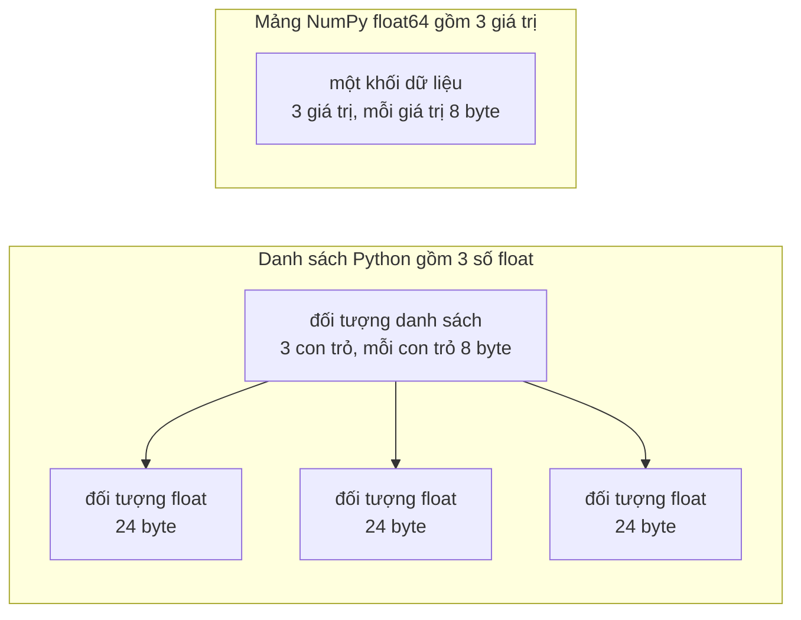

# Python cho Kỹ thuật AI

> Phần lớn mã trong khóa học này dùng cùng một tập nhỏ các idiom Python. Hãy học tập đó ở đây, trước khi các bài về toán và mô hình phụ thuộc vào nó.

**Type:** Build
**Languages:** Python
**Prerequisites:** Dev Environment, Python Environments
**Time:** ~120 phút

## Mục tiêu học tập

- Đọc và viết các idiom mà phần lớn mã khóa học dùng, từ unpacking và f-string cho tới dataclass và comprehension.
- Tìm ra ba lỗi Python cho kết quả sai mà không báo lỗi: danh sách (list) dùng chung, giá trị mặc định có thể thay đổi, và bộ sinh (generator) đã cạn.
- Xây dựng bộ nạp CSV và JSON, một phép chia có seed, và một bộ sinh mini-batch chỉ với thư viện chuẩn (standard library).
- Viết dot product, mean và standard deviation bằng Python thuần, rồi đo tốc độ và mức dùng bộ nhớ của chúng.
- Giải thích vì sao một vòng lặp Python thuần trên các số lại chậm, và cách NumPy broadcasting đưa vòng lặp vào mã đã biên dịch.

## Vấn đề

Các bài sau giai đoạn này dùng Python thuần cho phần toán và các mô hình. Trong 541 file Python của các bài học, 276 file import `dataclasses`. Ngoài ra, 187 file gọi `random.seed` hoặc tạo một bộ sinh `random.Random`. Nếu những idiom đó còn mới với bạn, bạn sẽ đọc cú pháp trong khi điều bạn muốn là đọc phần toán.

Python cũng có những hành vi cho kết quả sai mà không có thông báo lỗi. Hai cái tên có thể cùng tham chiếu tới một danh sách, nên thay đổi qua tên này cũng làm đổi tên kia. Một đối số mặc định giữ nguyên giá trị của nó từ lần gọi này sang lần gọi khác. Một bộ sinh rỗng sau một lần duyệt, nên epoch huấn luyện thứ hai không nhận được dữ liệu và loss không thay đổi.

Vấn đề cuối là tốc độ. Trên laptop thử nghiệm của chúng tôi, một vòng lặp Python thuần trên một triệu số float mất khoảng 30 mili-giây. NumPy tính cùng dot product đó trong chưa tới một mili-giây. Bạn cần biết lý do, để có thể chọn giữa một vòng lặp rõ ràng và một phép toán trên mảng.

## Khái niệm

### Những gì mã khóa học sử dụng

Chúng tôi đã phân tích cả 541 file Python trong `phases/*/*/code/` bằng mô-đun (module) `ast`. Bảng đếm số file dùng mỗi cấu trúc ít nhất một lần. Các con số là từ ngày chúng tôi viết bài này, và chúng thay đổi khi có thêm bài học.

| Cấu trúc | Số file | Tỉ lệ |
|-----------|-------|-------|
| Định nghĩa hàm | 541 | 100% |
| `if __name__ == "__main__":` | 529 | 98% |
| f-string | 517 | 96% |
| Tuple unpacking | 448 | 83% |
| Lớp | 379 | 70% |
| Comprehension trên danh sách | 375 | 69% |
| Gợi ý kiểu (type hint) cho hàm | 342 | 63% |
| Biểu thức bộ sinh | 326 | 60% |
| Slice | 314 | 58% |
| `lambda` | 175 | 32% |
| `try` và `except` | 120 | 22% |
| Câu lệnh `with` | 96 | 18% |
| Comprehension trên dict | 93 | 17% |
| Hàm bộ sinh có `yield` | 14 | 3% |

Phần import cho thấy mô-đun chuẩn nào quan trọng. Trong 541 file, 340 file bắt đầu bằng `from __future__ import annotations`, và 276 file import `dataclasses`. Các mô-đun `math`, `random` và `json` xuất hiện trong 187, 175 và 126 file. Mô-đun `collections` xuất hiện trong 70 file, còn `itertools` chỉ xuất hiện trong 4 file.

Không bài học nào gọi `map()` hay `filter()`. Comprehension làm việc đó. Các lệnh gọi `sorted`, `min`, `max` hoặc `.sort` với một hàm `key=` xuất hiện trong hơn 140 file. Bài học này dành nhiều thời gian nhất cho những idiom ở đầu các danh sách trên.

### Tên tham chiếu tới đối tượng

Trong Python, một biến là một cái tên tham chiếu tới một đối tượng (object). Phép gán gắn một cái tên với một đối tượng. Nó không sao chép đối tượng. Khi hai cái tên cùng tham chiếu tới một danh sách, thay đổi qua bất kỳ tên nào đều thấy được qua cả hai. Số, chuỗi và tuple không thể thay đổi, nên quy tắc này không gây vấn đề gì với chúng. Danh sách, dict và set có thể thay đổi, nên hãy tạo một bản sao khi bạn cần một bản độc lập.

### Danh sách giữ con trỏ, mảng giữ số

Một danh sách Python không lưu số trực tiếp. Nó lưu con trỏ, và mỗi con trỏ tham chiếu tới một đối tượng Python đầy đủ. Trên bản build 64-bit của CPython, mỗi con trỏ chiếm 8 byte và mỗi đối tượng `float` chiếm 24 byte. Một mảng (array) `float64` của NumPy lưu các giá trị thô 8 byte cạnh nhau trong một khối bộ nhớ.



Một vòng lặp trên danh sách làm rất nhiều việc cho mỗi phần tử. Trình thông dịch chạy từng lệnh bytecode một. Với mỗi phần tử, nó đi theo một con trỏ và kiểm tra kiểu của từng toán hạng. Sau đó nó gọi mã nhân float và tạo một đối tượng float Python để giữ kết quả.

NumPy làm phép toán tương tự trong một vòng lặp bằng mã đã biên dịch trên các giá trị thô. Nó kiểm tra kiểu dữ liệu một lần cho cả mảng, và không tạo đối tượng Python nào cho mỗi phần tử. Mã vector hóa mô tả một phép toán trên cả mảng, chẳng hạn `(x - mean) / std`, và một thư viện chạy vòng lặp. Các hàm vector trong bài này tuân theo quy tắc đó. Mỗi hàm làm một phép toán trên mảng, nên sau này bạn có thể thay nó bằng một lệnh gọi NumPy.

### Danh sách giữ mọi phần tử, bộ sinh giữ một

Một comprehension trên danh sách tạo mọi phần tử trước khi dòng tiếp theo chạy. Một bộ sinh tạo một phần tử mỗi lần người gọi hỏi phần tử tiếp theo. Bộ nhớ cho một danh sách tăng theo số phần tử. Bộ nhớ cho một bộ sinh gần như giữ nguyên với bất kỳ số phần tử nào.

Một bộ sinh chỉ chạy được một lần. Sau phần tử cuối, nó ném `StopIteration` ở mỗi lần yêu cầu, nên vòng lặp `for` thứ hai trên nó không nhận được phần tử nào. Mã huấn luyện đọc dataset một lần mỗi epoch, nên nó phải tạo một bộ sinh mới cho mỗi epoch.

Hàm bộ sinh hiếm gặp trong mã các bài học. Các bộ nạp dữ liệu mà các bài về deep learning dùng là iterable của batch, nên ý tưởng này có trong mọi vòng lặp huấn luyện. Hình vẽ cho thấy cả hai cách tiếp cận trên cùng tám dòng.

```figure
s0-list-vs-generator
```

## Những idiom bạn cần

Mỗi khối trong phần này chạy độc lập. Hãy lưu nó vào một tệp và chạy bằng `python3`. Các khối cần Python 3.11 trở lên, đúng phiên bản chúng ta đã cài trong bài về môi trường phát triển.

### 1. Giá trị, collection và unpacking

Python có bốn kiểu collection dựng sẵn. Hãy học khi nào dùng mỗi kiểu.

| Kiểu | Ví dụ | Có thứ tự | Thay đổi được | Dùng điển hình trong khóa học |
|------|---------|---------|------------|---------------------------|
| `list` | `[0.5, 1.2]` | Có | Có | Mẫu dữ liệu, loss, trọng số |
| `tuple` | `(32, 784)` | Có | Không | Shape, bản ghi cố định, khóa dict |
| `dict` | `{"lr": 0.01}` | Thứ tự chèn | Có | Config, từ vựng, dòng JSON |
| `set` | `{"cat", "dog"}` | Không | Có | Token duy nhất, kiểm tra giao nhau |

Khối này cho thấy phép gán không sao chép một danh sách (list).

```python
weights = [0.5, -1.2, 3.0]
alias = weights
alias[0] = 99.0
print(weights)

independent = list(weights)
independent[1] = 0.0
print(weights, independent)

grid = [[0] * 3] * 2
grid[0][0] = 1
print(grid)

grid = [[0] * 3 for _ in range(2)]
grid[0][0] = 1
print(grid)
```

```text
[99.0, -1.2, 3.0]
[99.0, -1.2, 3.0] [99.0, 0.0, 3.0]
[[1, 0, 0], [1, 0, 0]]
[[1, 0, 0], [0, 0, 0]]
```

Biểu thức `[[0] * 3] * 2` tạo một list ngoài với hai tham chiếu tới cùng một list trong. Comprehension tạo một list trong mới cho mỗi hàng. Phần math dựng ma trận từ list, nên hãy dùng dạng comprehension.

Unpacking gán các phần tử của một sequence cho nhiều tên trong một dòng. Một tên có dấu sao gom các phần tử còn lại. F-string đặt giá trị của một biểu thức vào chuỗi, kèm định dạng tùy chọn sau dấu hai chấm.

```python
shape = (32, 784)
batch_size, n_features = shape
first, *middle, last = [1, 2, 3, 4, 5]
x, y = 1.0, 3.0
x, y = y, x

config = {"lr": 0.01, "epochs": 5}
config["seed"] = 7
tokens = ["the", "cat", "sat", "on", "the", "mat"]
vocab = set(tokens)

print(batch_size, n_features, first, middle, last, x, y)
print(config.get("momentum", 0.9), "cat" in vocab, len(vocab))
print(f"lr={config['lr']:.0e} loss={0.123456:.3f} n={60_000:,} {batch_size=}")
```

```text
32 784 1 [2, 3, 4] 5 3.0 1.0
0.9 True 5
lr=1e-02 loss=0.123 n=60,000 batch_size=32
```

`dict.get` trả về một giá trị mặc định khi thiếu khóa. Phép kiểm tra `in` trên set mất gần như cùng thời gian với mọi kích thước set. Dạng `{batch_size=}` in cả tên và giá trị, rất hữu ích khi bạn debug.

Slice `a[start:stop:step]` bao gồm `start` và loại trừ `stop`. Chỉ số âm đếm từ cuối. Slice của một list là một list mới, nên slice của một list lớn sẽ sao chép toàn bộ con trỏ (pointer) của nó.

```python
tokens = ["<s>", "the", "cat", "sat", "on", "the", "mat", "</s>"]
print(tokens[1:-1])
print(tokens[:3], tokens[-3:])
print(tokens[::2])
print(tokens[::-1][:2])
windows = [tokens[i:i + 3] for i in range(len(tokens) - 2)]
print(len(windows), windows[0])
```

```text
['the', 'cat', 'sat', 'on', 'the', 'mat']
['<s>', 'the', 'cat'] ['the', 'mat', '</s>']
['<s>', 'cat', 'on', 'mat']
['</s>', 'mat']
6 ['<s>', 'the', 'cat']
```

### 2. Comprehension

Comprehension dựng một list, dict hoặc set từ một iterable trong một biểu thức. Nó đọc như công thức toán mà nó mô tả.

```python
scores = [0.91, 0.42, 0.77, 0.15, 0.66]
labels = [1 if s >= 0.5 else 0 for s in scores]
high = [s for s in scores if s > 0.6]
squares = {i: i * i for i in range(4)}
lengths = {len(word) for word in ["a", "bb", "cc", "ddd"]}
sum_sq = sum(s * s for s in scores)

matrix = [[1, 2, 3], [4, 5, 6]]
transposed = [list(column) for column in zip(*matrix)]
flat = [v for row in matrix for v in row]

print(labels, high, squares, lengths, round(sum_sq, 4))
print(transposed, flat)
```

```text
[1, 0, 1, 0, 1] [0.91, 0.77, 0.66] {0: 0, 1: 1, 2: 4, 3: 9} {1, 2, 3} 2.0555
[[1, 4], [2, 5], [3, 6]] [1, 2, 3, 4, 5, 6]
```

Một `if` ở cuối chỉ giữ lại một số phần tử. Biểu thức trước `for` có thể là biểu thức điều kiện, `a if condition else b`. Hai mệnh đề `for` chạy theo cùng thứ tự như hai vòng lặp lồng nhau.

Dấu ngoặc tròn tạo một biểu thức bộ sinh (generator expression). Trong `sum(s * s for s in scores)`, `sum` đọc từng bình phương một, và Python không dựng list nào. Trong `zip(*matrix)`, dấu sao truyền từng hàng như một đối số riêng, và `zip` ghép các phần tử ở từng vị trí.

### 3. Hàm, đối số và bao đóng

Giá trị mặc định làm một đối số thành tùy chọn. Đối số từ khóa đặt tên cho tham số tại chỗ gọi. Một `*` đứng riêng trong danh sách tham số làm các tham số phía sau thành chỉ-nhận-từ-khóa (keyword-only).

```python
def clip(value, low=0.0, high=1.0):
    return max(low, min(high, value))


def train(data, *, lr=0.01, epochs=3):
    return f"{len(data)} samples, lr={lr}, epochs={epochs}"


def make_scaler(factor):
    def scale(values):
        return [v * factor for v in values]
    return scale


print(clip(1.7), clip(-3.0, low=-1.0), clip(0.4, high=0.3))
print(train([1, 2, 3], lr=0.1))
to_percent = make_scaler(100)
print(to_percent([0.25, 0.5]))
```

```text
1.0 -1.0 0.3
3 samples, lr=0.1, epochs=3
[25.0, 50.0]
```

Với tham số chỉ-nhận-từ-khóa, một lời gọi như `train(data, 0.1, 3)` sẽ ném `TypeError`. Người gọi buộc phải viết `lr=0.1`, nhờ vậy hai con số không thể vô tình đổi chỗ.

Hàm trong `scale` dùng `factor` từ hàm đã tạo ra nó. Python giữ `factor` chừng nào `scale` còn tồn tại. Một hàm giữ lại các biến từ nơi tạo ra nó là một bao đóng (closure). Bộ chuẩn hóa trong Build It dùng một bao đóng để giữ các thống kê của tập huấn luyện.

`lambda` là một hàm chỉ có một biểu thức và không có tên. Mã trong khóa học chủ yếu dùng nó như hàm `key=`, mà phần 8 sẽ trình bày.

Python đánh giá giá trị mặc định một lần, khi nó chạy câu lệnh `def`. Mọi lời gọi dùng giá trị mặc định đó đều nhận cùng một đối tượng (object).

```python
def add_bad(item, bucket=[]):
    bucket.append(item)
    return bucket


def add_good(item, bucket=None):
    if bucket is None:
        bucket = []
    bucket.append(item)
    return bucket


add_bad("a")
print(add_bad("b"))
add_good("a")
print(add_good("b"))
```

```text
['a', 'b']
['b']
```

Hãy dùng `None` làm giá trị mặc định cho list, dict hoặc set. Tạo đối tượng mới bên trong hàm.

### 4. Lớp và dataclass

Decorator `@dataclass` viết `__init__`, `__repr__` và `__eq__` từ các trường được khai báo kiểu. Với `frozen=True`, đối tượng (object) không thể thay đổi sau khi tạo, và bạn có thể dùng nó làm khoá của dict hoặc đưa nó vào một set.

```python
from dataclasses import dataclass, field


@dataclass(frozen=True)
class Example:
    features: tuple[float, ...]
    label: int


@dataclass
class TrainConfig:
    lr: float = 0.01
    epochs: int = 5
    hidden: list[int] = field(default_factory=lambda: [64, 32])

    def describe(self):
        return f"lr={self.lr} epochs={self.epochs} hidden={self.hidden}"


ex = Example((1.5, 2.0), 1)
print(ex)
print(ex == Example((1.5, 2.0), 1), len({ex, Example((1.5, 2.0), 1)}))
print(TrainConfig(epochs=10).describe())
try:
    ex.label = 0
except AttributeError as err:
    print(type(err).__name__)
```

```text
Example(features=(1.5, 2.0), label=1)
True 1
lr=0.01 epochs=10 hidden=[64, 32]
FrozenInstanceError
```

`field(default_factory=...)` cấp cho mỗi instance một danh sách (list) mới. Nó giải quyết vấn đề giá trị mặc định dùng chung ở phần 3 ngay bên trong một dataclass.

Các phương thức đặc biệt kết nối một lớp với cú pháp Python. `len(ds)` gọi `__len__`, và `ds[2]` gọi `__getitem__`.

```python
class SquaresDataset:
    def __init__(self, n):
        self.n = n

    def __len__(self):
        return self.n

    def __getitem__(self, index):
        if not 0 <= index < self.n:
            raise IndexError(index)
        return index, index * index


ds = SquaresDataset(4)
print(len(ds), ds[2])
print(list(ds))
```

```text
4 (2, 4)
[(0, 0), (1, 1), (2, 4), (3, 9)]
```

Vòng `for` bên trong `list(ds)` hoạt động mà không cần phương thức `__iter__`. Python gọi `__getitem__` với 0, 1, 2, và cứ thế tiếp tục cho đến khi nhận được `IndexError`. Dataset kiểu map của PyTorch dùng đúng hai phương thức đó, `__len__` và `__getitem__`.

### 5. Bộ lặp (iterator) và bộ sinh (generator)

Iterable là bất kỳ đối tượng nào mà một vòng `for` chấp nhận. `iter()` lấy bộ lặp từ nó, và `next()` hỏi bộ lặp một phần tử. Khi bộ lặp không còn phần tử nào, nó ném `StopIteration`. Vòng `for` gọi `next()` thay bạn và dừng lại ở `StopIteration`.

```python
numbers = [10, 20, 30]
it = iter(numbers)
print(next(it), next(it), next(it))
try:
    next(it)
except StopIteration:
    print("no more items")


def countdown(n):
    while n > 0:
        yield n
        n -= 1


gen = countdown(3)
print(type(gen).__name__)
print(list(gen))
print(list(gen))
```

```text
10 20 30
no more items
generator
[3, 2, 1]
[]
```

Một hàm có `yield` trong thân là hàm bộ sinh. Khi gọi nó, không dòng code nào trong thân chạy và nó trả về một đối tượng bộ sinh. Mỗi lần `next()` chạy thân hàm đến `yield` kế tiếp rồi tạm dừng ở đó. `list(gen)` lần thứ hai rỗng vì lần đầu đã dùng hết bộ sinh.

Một bộ sinh có thể đọc file từng dòng một.

```python
import os
import tempfile


def read_rows(path):
    with open(path, encoding="utf-8") as fh:
        header = fh.readline().rstrip("\n").split(",")
        for line in fh:
            yield dict(zip(header, line.rstrip("\n").split(",")))


with tempfile.TemporaryDirectory() as tmp:
    path = os.path.join(tmp, "rows.csv")
    with open(path, "w", encoding="utf-8") as fh:
        fh.write("x,label\n")
        fh.writelines(f"{i * 0.5},{i % 2}\n" for i in range(5))
    rows = read_rows(path)
    print(next(rows))
    print(sum(1 for _ in rows))
```

```text
{'x': '0.0', 'label': '0'}
4
```

`read_rows` chỉ giữ một dòng của file trong bộ nhớ tại một thời điểm. Đó chính là `read_rows` trong hình. Nó tách theo dấu phẩy để giữ ví dụ ngắn gọn. File CSV thật có thể chứa dấu phẩy bên trong trường được trích dẫn, nên phần Build It dùng mô-đun (module) `csv`.

```python
import sys

as_list = [i * i for i in range(1_000_000)]
as_generator = (i * i for i in range(1_000_000))
print(sys.getsizeof(as_list), sys.getsizeof(as_generator))
print(sum(as_list) == sum(as_generator))
```

Trên CPython 64-bit, danh sách báo khoảng 8 MB còn bộ sinh khoảng 200 byte. `sys.getsizeof` chỉ đếm các con trỏ (pointer) của danh sách, còn bản thân các đối tượng số nguyên dùng nhiều bộ nhớ hơn. Phần Build It đo mức đỉnh thực bằng `tracemalloc`, công cụ chúng ta đã dùng trong bài gỡ lỗi và profiling.

### 6. Trình quản lý ngữ cảnh (context manager) và ngoại lệ (exception)

Câu lệnh `with` chạy code khởi tạo, rồi đến thân của nó, rồi đến code dọn dẹp. Phần dọn dẹp vẫn chạy kể cả khi thân ném ngoại lệ. Đối tượng file trả về từ `open()` là một trình quản lý ngữ cảnh giúp đóng file.

Trong bài gỡ lỗi và profiling, chúng ta đã viết một lớp `Timer` với `__enter__` và `__exit__`. Decorator `contextlib.contextmanager` tạo ra đúng loại đối tượng đó từ một bộ sinh. Code nằm trước `yield` là phần khởi tạo, và khối `finally` là phần dọn dẹp.

```python
import time
from contextlib import contextmanager


@contextmanager
def timer(label):
    start = time.perf_counter()
    try:
        yield
    finally:
        print(f"{label}: {(time.perf_counter() - start) * 1000:.1f} ms")


def parse_label(text):
    try:
        return int(text)
    except ValueError:
        raise ValueError(f"label must be an integer, got {text!r}") from None


with timer("sum of squares"):
    total = sum(i * i for i in range(200_000))

print(parse_label("3"))
try:
    parse_label("cat")
except ValueError as err:
    print("rejected:", err)
```

```text
sum of squares: 9.4 ms
3
rejected: label must be an integer, got 'cat'
```

Thời gian trên máy bạn sẽ khác. Hãy nêu đúng loại ngoại lệ mà bạn mong đợi trong mệnh đề `except`, ví dụ `ValueError` hoặc `KeyError`. Mệnh đề `except:` không kèm loại ngoại lệ cũng xử lý luôn `KeyboardInterrupt`, nên Ctrl+C có thể không dừng được một vòng lặp chứa nó. Hãy ném ngoại lệ với thông điệp rõ ràng khi đầu vào sai. Thêm `from None` khi thông điệp của bạn thay thế traceback gốc.

### 7. Gợi ý kiểu, mô-đun và the main guard

Gợi ý kiểu (type hint) cho người đọc biết một hàm nhận gì và trả về gì. Python không kiểm tra chúng khi mã chạy. Một trình kiểm tra kiểu, ví dụ mypy, đọc chúng trước khi mã chạy.

```python
from __future__ import annotations

from collections.abc import Iterable, Sequence


def mean(values: Sequence[float]) -> float:
    if not values:
        raise ValueError("mean() needs at least one value")
    return sum(values) / len(values)


def count_tokens(docs: Iterable[str]) -> int:
    return sum(len(doc.split()) for doc in docs)


def main() -> None:
    print(mean([1.0, 2.0, 4.0]))
    print(count_tokens(["the cat sat", "on the mat"]))
    print(mean.__annotations__)


if __name__ == "__main__":
    main()
```

```text
2.3333333333333335
6
{'values': 'Sequence[float]', 'return': 'float'}
```

Với `from __future__ import annotations`, Python lưu mỗi gợi ý dưới dạng chuỗi, như dòng cuối cho thấy. `Sequence` nghĩa là bất kỳ đối tượng (object) nào có `len()` và chỉ số, như một danh sách (list) hay một tuple. `Iterable` nghĩa là bất kỳ đối tượng nào mà vòng lặp `for` chấp nhận. Nhiều tệp trong khóa học import cùng các tên đó từ `typing`, cách này cũng chạy được.

Mỗi tệp `.py` là một mô-đun (module). Khi bạn chạy một tệp bằng `python3 file.py`, Python đặt `__name__` của nó thành `"__main__"`. Khi một tệp khác import nó, `__name__` là tên mô-đun. main guard chỉ gọi `main()` trong trường hợp đầu tiên. Nhờ guard đó, các bài kiểm thử trong `code/tests/` có thể import `main.py` mà không bị khởi động phần demo.

### 8. Tệp, JSON, CSV và sắp xếp

`pathlib.Path` nối đường dẫn bằng `/` và có thể đọc hoặc ghi cả một tệp trong một lần gọi. Luôn truyền `encoding="utf-8"`, vì encoding mặc định phụ thuộc vào hệ điều hành.

```python
import csv
import json
import tempfile
from pathlib import Path

rows = [
    {"text": "great movie", "label": 1, "score": 0.93},
    {"text": "boring plot", "label": 0, "score": 0.12},
    {"text": "fine acting", "label": 1, "score": 0.58},
]

with tempfile.TemporaryDirectory() as tmp:
    json_path = Path(tmp) / "reviews.json"
    json_path.write_text(json.dumps(rows, indent=2), encoding="utf-8")
    from_json = json.loads(json_path.read_text(encoding="utf-8"))

    csv_path = Path(tmp) / "reviews.csv"
    with csv_path.open("w", newline="", encoding="utf-8") as fh:
        writer = csv.DictWriter(fh, fieldnames=["text", "label", "score"])
        writer.writeheader()
        writer.writerows(rows)
    with csv_path.open(newline="", encoding="utf-8") as fh:
        from_csv = list(csv.DictReader(fh))

print(from_json == rows)
print(from_csv[0])

by_score = sorted(rows, key=lambda r: r["score"], reverse=True)
print([r["text"] for r in by_score])
print(max(rows, key=lambda r: r["score"])["text"])
print([r["text"] for r in sorted(rows, key=lambda r: (-r["label"], r["text"]))])
```

```text
True
{'text': 'great movie', 'label': '1', 'score': '0.93'}
['great movie', 'fine acting', 'boring plot']
great movie
['fine acting', 'great movie', 'boring plot']
```

JSON giữ số là số. CSV trả lại mọi trường dưới dạng chuỗi, nên bạn phải chuyển đổi từng trường. Mở tệp CSV với `newline=""`, đúng như tài liệu `csv` hướng dẫn bạn.

Hàm `key=` trả về giá trị mà Python so sánh cho từng phần tử. `sorted`, `min` và `max` đều nhận một hàm như vậy. Một khóa tuple sắp xếp theo giá trị thứ nhất, và chỉ dùng giá trị thứ hai khi có hòa. Dấu trừ đưa label lớn hơn lên trước. Sắp xếp của Python là ổn định (stable), nên các phần tử có khóa bằng nhau giữ nguyên thứ tự ban đầu.

### 9. Đếm, nhóm và các công cụ bộ lặp

Hai mô-đun này chứa các cấu trúc dữ liệu và công cụ bộ lặp (iterator) mà danh sách và dict thông thường không cung cấp cho bạn.

```python
from collections import Counter, defaultdict, deque
from itertools import chain, islice, product

labels = ["cat", "dog", "cat", "bird", "cat", "dog"]
counts = Counter(labels)
print(counts.most_common(2))

positions = defaultdict(list)
for i, label in enumerate(labels):
    positions[label].append(i)
print(dict(positions))

recent = deque(maxlen=3)
for loss in [2.0, 1.5, 1.2, 1.1, 0.9]:
    recent.append(loss)
print(list(recent), round(sum(recent) / len(recent), 3))

print(list(product([0.1, 0.01], [16, 32])))
print(list(chain([1, 2], [3], [4, 5])))
print(list(islice(range(100), 5, 10)))
```

```text
[('cat', 3), ('dog', 2)]
{'cat': [0, 2, 4], 'dog': [1, 5], 'bird': [3]}
[1.2, 1.1, 0.9] 1.067
[(0.1, 16), (0.1, 32), (0.01, 16), (0.01, 32)]
[1, 2, 3, 4, 5]
[5, 6, 7, 8, 9]
```

`Counter` đếm các phần tử hashable, như label hay token. `defaultdict(list)` tạo một danh sách rỗng ở lần đầu bạn dùng một khóa mới, nên vòng lặp nhóm không cần kiểm tra khóa. `deque(maxlen=3)` loại bỏ phần tử cũ nhất khi bạn thêm phần tử thứ tư, tạo ra một cửa sổ trượt trên các loss gần đây. `enumerate` cho bạn từng phần tử kèm chỉ số của nó.

`product` cho mọi tổ hợp của các đầu vào, tức là một lưới hyperparameter. `chain` nối các iterable từ đầu đến cuối. `islice` lấy một lát cắt của bất kỳ bộ lặp nào, kể cả generator (bộ sinh). Bộ sinh mini-batch trong phần Build It dùng `islice`.

### 10. Vì sao các vòng lặp trên số lại chậm

Mô-đun `dis` in ra các lệnh bytecode mà trình thông dịch chạy cho một hàm.

```python
import dis


def dot(a, b):
    total = 0.0
    for x, y in zip(a, b):
        total += x * y
    return total


dis.dis(dot)
```

Các lệnh từ `FOR_ITER` đến bước nhảy ngược về nó chạy một lần cho mỗi phần tử. Đó là khoảng mười lệnh cho mỗi phép nhân và phép cộng. Tên lệnh chính xác thay đổi giữa các phiên bản Python.

Một vòng lặp trở nên nhanh hơn khi ít bước của nó chạy dưới dạng bytecode hơn. Các hàm dựng sẵn như `sum`, `map` và `zip` được viết bằng C. Phần Build It đo hiệu ứng này bằng Python thuần, và phần Use It chuyển toàn bộ vòng lặp sang NumPy.

## Tự tay làm

Giờ hãy xây những thành phần mà các bài học sau cần. Bản đầy đủ là `code/main.py`, và `code/tests/test_main.py` kiểm thử nó. Mỗi khối bên dưới chạy độc lập.

### Bước 1: Một record type (kiểu bản ghi) và một dataset loader (bộ tải bộ dữ liệu)

Bộ tải đọc một tệp CSV hoặc một tệp JSON về cùng một dạng: một tuple các đặc trưng kiểu float và một nhãn kiểu integer.

```python
import csv
import json
import tempfile
from dataclasses import dataclass
from pathlib import Path


@dataclass(frozen=True)
class Record:
    features: tuple[float, ...]
    label: int


def row_to_record(row, names, label_field="label"):
    if label_field not in row:
        raise ValueError(f"row has no {label_field!r} field: {row}")
    if set(row) != {*names, label_field}:
        raise ValueError(f"row fields {list(row)} do not match {[*names, label_field]}")
    return Record(tuple(float(row[name]) for name in names), int(row[label_field]))


def load_records(path, label_field="label"):
    path = Path(path)
    if path.suffix == ".json":
        rows = json.loads(path.read_text(encoding="utf-8"))
    elif path.suffix == ".csv":
        with path.open(newline="", encoding="utf-8") as fh:
            rows = list(csv.DictReader(fh))
    else:
        raise ValueError(f"unsupported file type: {path.suffix!r}")
    if not rows:
        return []
    names = [key for key in rows[0] if key != label_field]
    return [row_to_record(row, names, label_field) for row in rows]


with tempfile.TemporaryDirectory() as tmp:
    csv_path = Path(tmp) / "data.csv"
    csv_path.write_text("x1,x2,label\n1.5,60,1\n1.8,82.5,0\n", encoding="utf-8")
    json_path = Path(tmp) / "data.json"
    json_path.write_text('[{"x1": 1.5, "x2": 60, "label": 1}]', encoding="utf-8")
    print(load_records(csv_path))
    print(load_records(json_path))
```

```text
[Record(features=(1.5, 60.0), label=1), Record(features=(1.8, 82.5), label=0)]
[Record(features=(1.5, 60.0), label=1)]
```

Dòng đầu tiên xác lập tên các đặc trưng và thứ tự của chúng. `DictReader` và `json.loads` giữ các khóa theo thứ tự trong tệp, và một dict giữ thứ tự các khóa được thêm vào. Chuẩn JSON không định nghĩa thứ tự cho các khóa trong một object, nên `row_to_record` đọc từng dòng theo tên, theo thứ tự của dòng đầu tiên. Nhãn bị thiếu, đặc trưng bị thiếu hoặc bị thừa, hay kiểu tệp không xác định đều ném `ValueError` kèm thông báo, nên một tệp hỏng sẽ dừng lần chạy ngay từ đầu. `main.py` cũng có `save_records`, hàm này ghi đúng hai định dạng đó.

### Bước 2: Chia train/test (train and test split) với seed cố định

```python
import random


def train_test_split(items, test_fraction=0.2, seed=0):
    if not 0.0 < test_fraction < 1.0:
        raise ValueError(f"test_fraction must be between 0 and 1, got {test_fraction}")
    if len(items) < 2:
        raise ValueError(f"need at least 2 items to split, got {len(items)}")
    order = list(range(len(items)))
    random.Random(seed).shuffle(order)
    n_test = min(max(1, round(len(items) * test_fraction)), len(items) - 1)
    test = [items[i] for i in order[:n_test]]
    train = [items[i] for i in order[n_test:]]
    return train, test


items = list(range(10))
print(train_test_split(items, seed=1))
print(train_test_split(items, seed=1) == train_test_split(items, seed=1))
print(train_test_split(items, seed=2)[1])
print(items)
```

```text
([9, 7, 5, 3, 0, 4, 1, 2], [6, 8])
True
[5, 9]
[0, 1, 2, 3, 4, 5, 6, 7, 8, 9]
```

`random.Random(seed)` tạo một bộ sinh (generator) số ngẫu nhiên riêng. `random.seed(seed)` đặt lại bộ sinh toàn cục duy nhất mà mọi module dùng chung, nên một lời gọi trong thư viện khác có thể làm thay đổi chuỗi số của bạn. Trong khóa học, 100 tệp bài học gọi `random.seed` và 96 tạo `random.Random`. Hãy dùng bộ sinh riêng trong mã mới.

Hàm này xáo trộn một danh sách (list) các chỉ số, nên danh sách đầu vào giữ nguyên. Cùng một seed luôn cho cùng một phép chia. Mỗi bên giữ ít nhất một phần tử, nên một danh sách có ít hơn 2 phần tử sẽ ném `ValueError`. Hãy chia dữ liệu trước mọi bước học từ nó, chẳng hạn chuẩn hóa. Trong bài học về gỡ lỗi và profiling, chúng ta đã thấy rằng sự trùng lặp giữa dữ liệu train và test cho điểm test cao hơn thực tế.

### Bước 3: Một bộ sinh mini-batch

```python
from itertools import islice


def batches(items, batch_size, drop_last=False):
    if batch_size < 1:
        raise ValueError(f"batch_size must be at least 1, got {batch_size}")
    return _batch_iter(iter(items), batch_size, drop_last)


def _batch_iter(iterator, batch_size, drop_last):
    while True:
        batch = list(islice(iterator, batch_size))
        if not batch or (drop_last and len(batch) < batch_size):
            return
        yield batch


print(list(batches(range(10), 4)))
print(list(batches(range(10), 4, drop_last=True)))
squares = (i * i for i in range(7))
print([len(b) for b in batches(squares, 3)])

for epoch in range(2):
    sizes = [len(b) for b in batches(range(10), 4)]
    print(f"epoch {epoch}: {sizes}")
```

```text
[[0, 1, 2, 3], [4, 5, 6, 7], [8, 9]]
[[0, 1, 2, 3], [4, 5, 6, 7]]
[3, 3, 1]
epoch 0: [4, 4, 2]
epoch 1: [4, 4, 2]
```

`islice` lấy tối đa `batch_size` phần tử từ iterator. `batches` chỉ cần `iter()`, nên nó nhận được list, tệp và các bộ sinh khác. Lô cuối nhỏ hơn khi độ dài không phải bội số của kích thước lô. `drop_last=True` bỏ lô đó, dành cho mô hình cần hình dạng lô cố định.

Công việc nằm trong hai hàm vì một hàm generator không chạy mã nào cho tới lần `next()` đầu tiên. Nếu đặt phần kiểm tra bên trong bộ sinh, `batches(data, 0)` sẽ trả về mà không báo lỗi. Lỗi sẽ đến sau, từ bên trong vòng lặp huấn luyện. Hàm bên ngoài là một hàm thường, nên nó kiểm tra tham số ngay lập tức. Vòng lặp epoch gọi lại `batches()` cho mỗi epoch, vì một bộ sinh chỉ đưa các phần tử của nó đúng một lần.

### Bước 4: Phép toán vector (vector math) và bộ chuẩn hóa (standardizer)

```python
import math


def dot(a, b):
    return sum(x * y for x, y in zip(a, b, strict=True))


def mean(values):
    if not values:
        raise ValueError("mean() needs at least one value")
    return sum(values) / len(values)


def std(values):
    mu = mean(values)
    return math.sqrt(sum((v - mu) ** 2 for v in values) / len(values))


def make_standardizer(rows):
    columns = list(zip(*rows))
    means = [mean(c) for c in columns]
    scales = [s if s > 0 else 1.0 for s in (std(c) for c in columns)]

    def standardize(row):
        return [(v - m) / s for v, m, s in zip(row, means, scales, strict=True)]

    return standardize


print(dot([1.0, 2.0, 3.0], [4.0, 5.0, 6.0]))
values = [2.0, 4.0, 4.0, 4.0, 5.0, 5.0, 7.0, 9.0]
print(mean(values), std(values))

train_rows = [(1.0, 100.0), (2.0, 300.0), (3.0, 500.0)]
standardize = make_standardizer(train_rows)
print([[round(v, 3) for v in standardize(r)] for r in train_rows])
print([round(v, 3) for v in standardize((4.0, 700.0))])
```

```text
32.0
5.0 2.0
[[-1.225, -1.225], [0.0, 0.0], [1.225, 1.225]]
[2.449, 2.449]
```

Với `strict=True`, `zip` ném `ValueError` khi hai vector có độ dài khác nhau. Không có nó, `zip` dừng ở cuối đầu vào ngắn hơn và trả về kết quả sai mà không báo lỗi. Tham số `strict` cần Python 3.10 trở lên.

`std` chia cho `n`, nên nó cho độ lệch chuẩn quần thể, giống như `statistics.pstdev`. Hãy chia cho `n - 1` khi bạn ước lượng độ phân tán của một quần thể lớn hơn từ một mẫu.

`make_standardizer` là một closure. Nó tính các giá trị trung bình và độ lệch chuẩn từ các dòng train một lần, và `standardize` giữ chúng. Bạn áp cùng hàm đó lên các dòng test, nên dữ liệu test không ảnh hưởng gì tới các thống kê. Một cột hằng số có độ lệch chuẩn bằng 0, nên bộ chuẩn hóa dùng scale bằng 1 cho cột đó.

### Bước 5: Một lần chạy đầy đủ

`code/main.py` kết nối các mảnh lại. Nó tạo 400 bản ghi từ hai cụm, lưu chúng dạng CSV và JSON, rồi tải lại cả hai tệp. Sau đó nó chia các bản ghi, khớp bộ chuẩn hóa trên phần train, và tính các centroid theo lớp từ những mini-batch kích thước 48.

Một bộ phân loại nearest-centroid lưu vector đặc trưng trung bình của mỗi lớp. Nó dự đoán lớp có giá trị trung bình gần đầu vào nhất. `fit_centroids` cộng dồn các dòng theo từng lô, nên nó không bao giờ cần giữ toàn bộ tập train trong bộ nhớ. `predict` dùng `min()` với một hàm `key=` để tìm centroid gần nhất.

```bash
python3 phases/00-setup-and-tooling/13-python-for-ai-engineering/code/main.py
```

```text
Python for AI engineering: a standard-library toolkit
data     400 records, CSV and JSON load back unchanged: True
split    320 train, 80 test, records in both: 0
batches  size 48: [48, 48, 48, 48, 48, 48, 32]
scale    train feature means after standardizing: [0.0, 0.0]
model    nearest-centroid test accuracy: raw 0.86, standardized 0.89
speed    dot product of 200,000 floats, best of 5:
           index loop         6.60 ms
           zip generator      5.93 ms
           map + mul          2.89 ms
memory   peak bytes to sum 100,000 squares:
           list              4,000,616
           generator               472
```

Hai đặc trưng có thang đo rất khác nhau. Đặc trưng thứ hai có độ phân tán gấp mười lần đặc trưng thứ nhất, nên nó chi phối các khoảng cách thô, và độ chính xác thô thấp hơn. Các con số về tốc độ và bộ nhớ của bạn sẽ khác những con số này.

### Bước 6: Đo tốc độ và bộ nhớ

```python
import operator
import random
import time
import tracemalloc


def dot_index_loop(a, b):
    total = 0.0
    for i in range(len(a)):
        total += a[i] * b[i]
    return total


def dot_zip(a, b):
    return sum(x * y for x, y in zip(a, b, strict=True))


def dot_map(a, b):
    return sum(map(operator.mul, a, b))


def best_time(fn, *args, repeat=5):
    times = []
    for _ in range(repeat):
        start = time.perf_counter()
        fn(*args)
        times.append(time.perf_counter() - start)
    return min(times)


def peak_bytes(fn):
    tracemalloc.start()
    try:
        fn()
        return tracemalloc.get_traced_memory()[1]
    finally:
        tracemalloc.stop()


rng = random.Random(0)
a = [rng.random() for _ in range(1_000_000)]
b = [rng.random() for _ in range(1_000_000)]
for fn in (dot_index_loop, dot_zip, dot_map):
    print(f"{fn.__name__:15} {best_time(fn, a, b) * 1000:7.2f} ms")

print(peak_bytes(lambda: sum([i * i for i in range(100_000)])))
print(peak_bytes(lambda: sum(i * i for i in range(100_000))))
```

`best_time` báo cáo lần chạy nhanh nhất trong vài lần. Các chương trình khác trên máy chỉ có thể cộng thêm thời gian, nên giá trị nhỏ nhất là gần nhất với chi phí thật. Tài liệu của module `timeit` đưa ra lời khuyên tương tự.

Trên laptop thử nghiệm của chúng tôi với Python 3.11, vòng lặp theo chỉ số mất khoảng 33 ms. Bản zip mất khoảng 30 ms, và bản `map` khoảng 14 ms. Cả ba làm cùng một phép tính. Bản `map` nhanh hơn vì `map` và `operator.mul` được viết bằng C, nên ít lệnh bytecode hơn được chạy cho mỗi phần tử. Các con số về bộ nhớ lặp lại kết quả: khoảng 4 MB cho list và dưới 1 KB cho bộ sinh.

## Áp dụng

### Các phiên bản trong thư viện chuẩn

Thư viện chuẩn (standard library) có sẵn phiên bản đã được kiểm thử cho hầu hết những thành phần mà bạn đã tự xây dựng.

| Bạn đã xây dựng | Thư viện chuẩn | Ghi chú |
|-----------|------------------|------|
| `mean`, `std` | `statistics.fmean`, `statistics.pstdev` | Các bài kiểm thử so sánh với những hàm này |
| `dot` | `math.sumprod` | Python 3.12 trở lên |
| `batches` | `itertools.batched` | Python 3.12 trở lên, trả về tuple |
| `best_time` | `timeit.repeat` | Cũng tắt garbage collection trong lúc chạy |
| `peak_bytes` | `tracemalloc` | Cùng module đó, kèm snapshot và thống kê theo từng dòng |

```python
import statistics
import sys

values = [2.0, 4.0, 4.0, 4.0, 5.0, 5.0, 7.0, 9.0]
print(statistics.fmean(values), statistics.pstdev(values))

if sys.version_info >= (3, 12):
    import math
    from itertools import batched

    print(math.sumprod([1.0, 2.0, 3.0], [4.0, 5.0, 6.0]))
    print(list(batched(range(10), 4)))
```

```text
5.0 2.0
32.0
[(0, 1, 2, 3), (4, 5, 6, 7), (8, 9)]
```

Khóa học hỗ trợ Python 3.11, nên `main.py` dùng `dot` và `batches` của riêng nó. Trên Python 3.11, khối lệnh trên chỉ in ra dòng đầu tiên.

### Cùng phép toán đó với mảng đã được biên dịch

Hãy cài NumPy vào môi trường ảo từ bài học về môi trường Python, ví dụ bằng `uv pip install numpy`. Mã nguồn và bài kiểm thử của bài này không cần đến nó.

```python
import time

import numpy as np

n = 1_000_000
rng = np.random.default_rng(0)
a = rng.random(n)
b = rng.random(n)
a_list, b_list = a.tolist(), b.tolist()

start = time.perf_counter()
slow = sum(x * y for x, y in zip(a_list, b_list))
python_ms = (time.perf_counter() - start) * 1000

start = time.perf_counter()
fast = float(a @ b)
numpy_ms = (time.perf_counter() - start) * 1000

print(f"pure Python {python_ms:8.2f} ms")
print(f"NumPy       {numpy_ms:8.2f} ms")
print(f"difference  {abs(slow - fast):.1e}")
print(a.dtype, a.itemsize, a.nbytes)
```

Trên chiếc laptop dùng để kiểm thử của chúng tôi, NumPy mất dưới 1 ms, còn bản pure Python mất khoảng 30 ms. Hai kết quả lệch nhau ở những chữ số cuối, vì hai phiên bản cộng các tích theo thứ tự khác nhau. Phép cộng dấu phẩy động cho kết quả hơi khác khi thứ tự thay đổi.

NumPy nhanh hơn vì ba lý do:

- Mảng (array) lưu các giá trị `float64` thô, mỗi giá trị 8 byte, trong một khối bộ nhớ. Một list các số thực cần một con trỏ 8 byte và một object số thực 24 byte cho mỗi giá trị.
- Vòng lặp chạy trong mã đã biên dịch. NumPy kiểm tra kiểu dữ liệu một lần cho cả mảng và không tạo ra object Python nào cho từng phần tử.
- Các giá trị nằm cạnh nhau trong bộ nhớ cho phép NumPy dùng các lệnh SIMD, tức là xử lý nhiều giá trị bằng một lệnh.

Với mảng rất nhỏ, chi phí cố định của một lần gọi NumPy có thể lớn hơn một vòng lặp Python ngắn. Bài tập 4 tìm ra kích thước mà tại đó NumPy trở nên nhanh hơn trên máy của bạn.

### Broadcasting

Broadcasting cho phép NumPy kết hợp các mảng có shape khác nhau mà không cần vòng lặp trong mã của bạn. Khối lệnh này làm cùng công việc như `make_standardizer` ở Bước 4.

```python
import numpy as np

X = np.array([[1.0, 100.0], [2.0, 300.0], [3.0, 500.0]])
mu = X.mean(axis=0)
sigma = X.std(axis=0)
Z = (X - mu) / sigma
print(X.shape, mu.shape, Z.shape)
print(Z.round(3))

norms = np.sqrt((X ** 2).sum(axis=1, keepdims=True))
print(norms.shape, (X / norms).shape)
```

```text
(3, 2) (2,) (3, 2)
[[-1.225 -1.225]
 [ 0.     0.   ]
 [ 1.225  1.225]]
(3, 1) (3, 2)
```

NumPy so sánh hai shape từ chiều cuối cùng ngược về chiều đầu tiên. Hai chiều tương thích khi chúng bằng nhau hoặc khi một trong hai bằng 1. Một chiều dẫn đầu bị thiếu được tính là 1. Chiều có kích thước 1 được dùng lại dọc theo chiều lớn hơn, và NumPy không tạo bản sao dữ liệu nào.

| Shape của `X` | Shape của mảng còn lại | Kết quả |
|--------------|--------------------------|--------|
| `(3, 2)` | `(2,)`, trung bình theo cột | `(3, 2)` |
| `(3, 2)` | `(3, 1)`, norm theo hàng với `keepdims=True` | `(3, 2)` |
| `(3, 2)` | `(3,)`, norm theo hàng không có `keepdims` | `ValueError` |

Dòng cuối là một lỗi thường gặp. NumPy so sánh số 2 ở cuối với số 3, và không số nào bằng 1. Hãy giữ `keepdims=True` khi bạn rút gọn theo hàng rồi kết hợp kết quả với mảng gốc.

## Đóng gói

Bài học này tạo ra `outputs/prompt-python-review.md`. Đó là một prompt review cho mã Python trong các dự án AI và dữ liệu. Bạn đưa cho nó một file hoặc một diff. Nó kiểm tra mã theo các idiom và các lỗi âm thầm trong bài này:

- Tham chiếu dùng chung và tham số mặc định mutable
- Các bộ sinh (generator) bị epoch thứ hai đọc sau khi đã dùng hết
- Số ngẫu nhiên không có seed, hoặc chỉ có seed toàn cục
- Các số thống kê lấy từ tập test
- Vòng lặp pure Python trên các mảng số lớn

Nó báo cáo từng phát hiện kèm vị trí, vấn đề và cách sửa.

## Bài tập

1. Chạy `run_demo(seed=8)` trong `main.py`. Tìm những dòng kết quả thay đổi và những dòng giữ nguyên. Giải thích vì sao kích thước các split giữ nguyên.
2. Viết `median(values)` bằng pure Python. Kiểm thử nó với `statistics.median` trên các list có độ dài lẻ và độ dài chẵn.
3. Viết `stream_records(path)`, một bộ sinh trả về từng `Record` một từ một file CSV. Tạo một file 200.000 dòng. So sánh bộ nhớ đỉnh của `stream_records` và `load_records` bằng `tracemalloc`.
4. Viết `matvec(matrix, vector)` bằng pure Python và bằng NumPy. Đo cả hai bằng `best_time` với các kích thước 4, 64 và 1024. Tìm ra kích thước mà tại đó NumPy trở nên nhanh hơn trên máy của bạn.
5. Viết phần quét cấu trúc trong The Concept. Dùng `ast.parse` và `ast.walk` trên từng file trong `phases/*/*/code/*.py`. Đếm số file có chứa `ast.ListComp`, `ast.Yield` và `ast.With`, rồi so sánh số đếm của bạn với bảng.

## Thuật ngữ chính

| Thuật ngữ | Người ta thường nói | Ý nghĩa thực sự |
|------|----------------|----------------------|
| Iterable | "Thứ bạn có thể lặp qua" | Một object mà `iter()` chấp nhận, ví dụ một list, một file hoặc một bộ sinh |
| Iterator | "Một con trỏ" | Một object có phương thức `__next__` trả về một phần tử mỗi lần gọi và ném `StopIteration` khi hết |
| Generator | "Một list lười" | Một iterator đến từ hàm có `yield` hoặc từ generator expression. Nó tạo từng phần tử theo yêu cầu và chỉ chạy một lần. |
| Comprehension | "Một vòng lặp một dòng" | Một biểu thức xây dựng list, dict hoặc set từ một iterable, có thể kèm bộ lọc |
| Closure | "Một hàm bên trong hàm" | Một hàm giữ lại các biến từ hàm đã tạo ra nó |
| Dataclass | "Một struct" | Một class mà Python tự viết các phương thức `__init__`, `__repr__` và `__eq__` từ các trường có annotation |
| Context manager | "Một khối with" | Một object chạy mã khởi tạo ở đầu khối `with` và mã dọn dẹp ở cuối, kể cả khi có ngoại lệ |
| Seed | "Con số ngẫu nhiên" | Giá trị khởi đầu của một bộ sinh số giả ngẫu nhiên. Cùng một seed cho cùng một chuỗi. |
| Vectorized code | "Mã nhanh" | Mã áp dụng một phép toán lên cả mảng, để mã đã biên dịch chạy vòng lặp |
| Broadcasting | "Tự khớp shape" | Các quy tắc NumPy kết hợp các mảng có shape khác nhau bằng cách dùng lại các chiều có kích thước 1, không tạo bản sao |

## Đọc thêm

- [The Python Tutorial: Data Structures](https://docs.python.org/3/tutorial/datastructures.html): list, tuple, set, dict và comprehension.
- [The Python Tutorial: Classes](https://docs.python.org/3/tutorial/classes.html): phạm vi, class, iterator và bộ sinh.
- [dataclasses](https://docs.python.org/3/library/dataclasses.html): mọi tùy chọn của decorator, gồm cả `frozen` và `field`.
- [collections](https://docs.python.org/3/library/collections.html): `Counter`, `defaultdict`, `deque` và các kiểu container khác.
- [itertools](https://docs.python.org/3/library/itertools.html): `islice`, `chain`, `product`, `batched` và các recipe kết hợp chúng.
- [Sorting Techniques](https://docs.python.org/3/howto/sorting.html): hàm key, sắp xếp ổn định và sắp xếp theo nhiều khóa.
- [timeit](https://docs.python.org/3/library/timeit.html): cách đo những đoạn mã nhỏ, và vì sao nên báo cáo giá trị nhỏ nhất.
- [random](https://docs.python.org/3/library/random.html): bộ sinh toàn cục, các instance `random.Random` và khả năng tái lập.
- [PEP 255: Simple Generators](https://peps.python.org/pep-0255/): đề xuất đã thêm `yield`, kèm lý do thiết kế.
- [NumPy: Broadcasting](https://numpy.org/doc/stable/user/basics.broadcasting.html): toàn bộ quy tắc shape, có hình minh họa.
- [Harris et al., Array programming with NumPy, Nature 585, 2020](https://doi.org/10.1038/s41586-020-2649-2): thiết kế của mảng NumPy và lý do nó nhanh.
