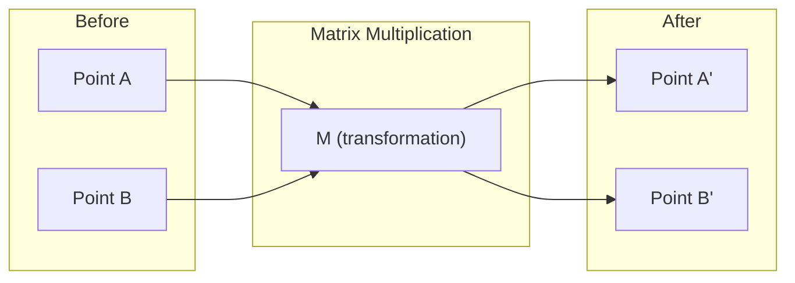
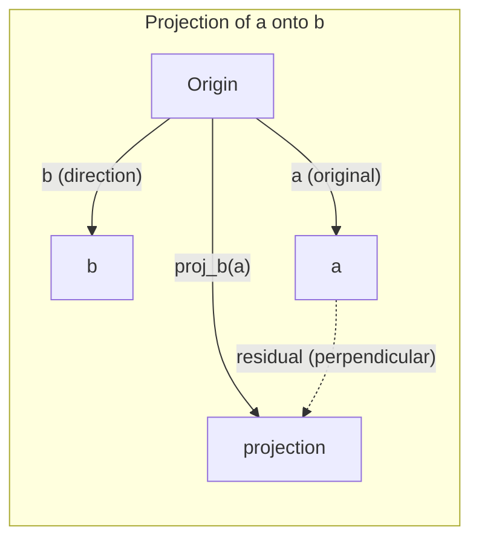

# Trực giác Đại số tuyến tính

> Mọi mô hình AI suy cho cùng chỉ là toán ma trận khoác lên mình một chiếc mũ hào nhoáng.

**Type:** Learn
**Languages:** Python, Julia
**Prerequisites:** Giai đoạn 0
**Time:** ~60 phút

## Mục tiêu học tập

- Tự viết từ đầu các phép toán vectơ và ma trận (phép cộng, tích vô hướng (dot product), phép nhân ma trận) trong Python
- Giải thích bằng hình học ý nghĩa của tích vô hướng, phép chiếu và quy trình Gram-Schmidt
- Xác định tính độc lập tuyến tính, hạng và cơ sở (basis) của một tập vectơ bằng cách khử dòng
- Liên hệ các khái niệm đại số tuyến tính với ứng dụng AI của chúng: embedding, điểm attention và LoRA

## Vấn đề

Mở bất kỳ bài báo ML nào. Ngay trong trang đầu, bạn sẽ thấy vectơ (vector), ma trận, tích vô hướng và các phép biến đổi. Nếu không có trực giác đại số tuyến tính, đó chỉ là những ký hiệu. Có trực giác rồi, bạn sẽ thấy mạng nơ-ron thực sự đang làm gì -- di chuyển các điểm trong không gian.

Bạn không cần phải là nhà toán học. Bạn chỉ cần thấy những phép toán này có ý nghĩa gì về mặt hình học, rồi tự code chúng.

## Khái niệm

### Vectơ là điểm (và hướng)

Một vectơ chỉ là một danh sách các số. Nhưng những con số đó có ý nghĩa -- chúng là toạ độ trong không gian.

**Vectơ 2D [3, 2]:**

| x | y | Điểm |
|---|---|-------|
| 3 | 2 | Vectơ chỉ từ gốc (0,0) tới (3, 2) trên mặt phẳng |

Vectơ có độ lớn sqrt(3^2 + 2^2) = sqrt(13) và hướng lên trên, sang phải.

Trong AI, vectơ biểu diễn mọi thứ:
- Một từ → một vectơ gồm 768 số ("ý nghĩa" của nó trong không gian embedding)
- Một ảnh → một vectơ gồm hàng triệu giá trị điểm ảnh
- Một người dùng → một vectơ sở thích

### Ma trận (matrix) là phép biến đổi

Một ma trận biến vectơ này thành vectơ khác. Nó có thể xoay, co giãn, kéo căng hoặc chiếu.



Trong AI, ma trận CHÍNH LÀ mô hình:
- Trọng số mạng nơ-ron → những ma trận biến đầu vào thành đầu ra
- Điểm attention → những ma trận quyết định xem nên tập trung vào đâu
- Embedding → những ma trận ánh xạ từ thành vectơ

### Tích vô hướng đo độ tương đồng

Tích vô hướng của hai vectơ cho bạn biết chúng giống nhau đến mức nào.

```
a · b = a₁×b₁ + a₂×b₂ + ... + aₙ×bₙ

Same direction:      a · b > 0  (similar)
Perpendicular:       a · b = 0  (unrelated)
Opposite direction:  a · b < 0  (dissimilar)
```

Đây chính là cách các công cụ tìm kiếm, hệ thống gợi ý và RAG hoạt động -- tìm những vectơ có tích vô hướng lớn.

### Độc lập tuyến tính

Các vectơ độc lập tuyến tính nếu không vectơ nào trong tập có thể viết thành tổ hợp tuyến tính (linear combination) của các vectơ còn lại. Nếu v1, v2, v3 độc lập, chúng bao tuyến tính (span) cả một không gian 3D. Nếu một vectơ là tổ hợp của các vectơ khác, chúng chỉ bao tuyến tính (span) một mặt phẳng.

Vì sao điều này quan trọng với AI: ma trận đặc trưng của bạn nên có các cột độc lập tuyến tính. Nếu hai đặc trưng tương quan hoàn hảo (phụ thuộc tuyến tính), mô hình không thể phân biệt tác động của chúng. Điều này gây đa cộng tuyến trong hồi quy -- ma trận trọng số trở nên bất ổn, và thay đổi nhỏ ở đầu vào tạo ra dao động lớn ở đầu ra.

**Ví dụ cụ thể:**

```
v1 = [1, 0, 0]
v2 = [0, 1, 0]
v3 = [2, 1, 0]   # v3 = 2*v1 + v2
```

v1 và v2 độc lập -- không vectơ nào là bội vô hướng (scalar) hay tổ hợp của vectơ kia. Nhưng v3 = 2*v1 + v2, nên {v1, v2, v3} là một tập phụ thuộc. Ba vectơ này đều nằm trong mặt phẳng xy. Dù bạn kết hợp chúng thế nào, cũng không thể tới được [0, 0, 1]. Bạn có ba vectơ nhưng chỉ có hai chiều tự do.

Trong một tập dữ liệu: nếu feature_3 = 2*feature_1 + feature_2, thêm feature_3 không cho mô hình thêm thông tin nào. Tệ hơn, nó làm hệ phương trình chuẩn trở nên suy biến -- không có nghiệm duy nhất cho các trọng số.

### Cơ sở và hạng

Cơ sở là tập tối thiểu các vectơ độc lập tuyến tính bao tuyến tính toàn bộ không gian. Số vectơ trong cơ sở chính là số chiều của không gian.

Cơ sở chuẩn của không gian 3D là {[1,0,0], [0,1,0], [0,0,1]}. Nhưng ba vectơ độc lập bất kỳ trong 3D đều tạo thành một cơ sở hợp lệ. Chọn cơ sở là chọn hệ toạ độ.

Hạng của ma trận = số cột độc lập tuyến tính = số dòng độc lập tuyến tính. Nếu hạng < min(rows, cols), ma trận bị thiếu hạng. Điều này có nghĩa là:
- Hệ có vô số nghiệm (hoặc không có nghiệm nào)
- Thông tin bị mất đi trong phép biến đổi
- Không thể nghịch đảo ma trận này

| Tình huống | Hạng | Ý nghĩa với ML |
|-----------|------|---------------------|
| Đủ hạng (hạng = min(m, n)) | Cao nhất có thể | Tồn tại nghiệm bình phương tối thiểu duy nhất. Mô hình ổn định tốt. |
| Thiếu hạng (hạng < min(m, n)) | Dưới mức cao nhất | Các đặc trưng dư thừa. Vô số nghiệm trọng số. Cần chính quy hoá. |
| Hạng 1 | 1 | Mỗi cột là một bản sao được nhân vô hướng của cùng một vectơ. Toàn bộ dữ liệu nằm trên một đường thẳng. |
| Gần thiếu hạng (giá trị kỳ dị nhỏ) | Thấp về mặt số học | Ma trận kém ổn định. Nhiễu rất nhỏ ở đầu vào gây thay đổi lớn ở đầu ra. Dùng cắt SVD hoặc hồi quy ridge. |

### Phép chiếu

Chiếu vectơ **a** lên vectơ **b** cho bạn thành phần của **a** theo hướng của **b**:

```
proj_b(a) = (a dot b / b dot b) * b
```

Phần dư (a - proj_b(a)) vuông góc với b. Phân tích trực giao này là nền tảng của khớp bình phương tối thiểu.

Phép chiếu có mặt khắp nơi trong ML:
- Hồi quy tuyến tính cực tiểu hoá khoảng cách từ các quan sát tới không gian cột -- nghiệm CHÍNH LÀ một phép chiếu
- PCA chiếu dữ liệu lên các hướng có phương sai lớn nhất
- Attention trong transformer tính các phép chiếu của query lên key



**Ví dụ:** a = [3, 4], b = [1, 0]

proj_b(a) = (3*1 + 4*0) / (1*1 + 0*0) * [1, 0] = 3 * [1, 0] = [3, 0]

Phép chiếu bỏ đi thành phần y. Đây là dạng giảm chiều đơn giản nhất -- vứt bỏ những hướng bạn không quan tâm.

### Quy trình Gram-Schmidt

Chuyển một tập vectơ độc lập bất kỳ thành một cơ sở trực chuẩn. Trực chuẩn nghĩa là mỗi vectơ có độ dài 1 và mọi cặp đều vuông góc.

Thuật toán:
1. Lấy vectơ đầu tiên, chuẩn hoá nó
2. Lấy vectơ thứ hai, trừ đi hình chiếu của nó lên vectơ đầu, rồi chuẩn hoá
3. Lấy vectơ thứ ba, trừ đi hình chiếu của nó lên tất cả các vectơ trước đó, rồi chuẩn hoá
4. Lặp lại với các vectơ còn lại

```
Input:  v1, v2, v3, ... (linearly independent)

u1 = v1 / |v1|

w2 = v2 - (v2 dot u1) * u1
u2 = w2 / |w2|

w3 = v3 - (v3 dot u1) * u1 - (v3 dot u2) * u2
u3 = w3 / |w3|

Output: u1, u2, u3, ... (orthonormal basis)
```

Đây là cách phân rã QR hoạt động bên trong. Q là cơ sở trực chuẩn, R lưu các hệ số chiếu. Phân rã QR được dùng trong:
- Giải hệ phương trình tuyến tính (ổn định hơn khử Gauss)
- Tính trị riêng (thuật toán QR)
- Hồi quy bình phương tối thiểu (phương pháp số tiêu chuẩn)

```figure
eigen-directions
```

## Tự tay làm

### Bước 1: Tự viết vectơ từ đầu (Python)

```python
class Vector:
    def __init__(self, components):
        self.components = list(components)
        self.dim = len(self.components)

    def __add__(self, other):
        return Vector([a + b for a, b in zip(self.components, other.components)])

    def __sub__(self, other):
        return Vector([a - b for a, b in zip(self.components, other.components)])

    def dot(self, other):
        return sum(a * b for a, b in zip(self.components, other.components))

    def magnitude(self):
        return sum(x**2 for x in self.components) ** 0.5

    def normalize(self):
        mag = self.magnitude()
        return Vector([x / mag for x in self.components])

    def cosine_similarity(self, other):
        return self.dot(other) / (self.magnitude() * other.magnitude())

    def __repr__(self):
        return f"Vector({self.components})"


a = Vector([1, 2, 3])
b = Vector([4, 5, 6])

print(f"a + b = {a + b}")
print(f"a · b = {a.dot(b)}")
print(f"|a| = {a.magnitude():.4f}")
print(f"cosine similarity = {a.cosine_similarity(b):.4f}")
```

### Bước 2: Ma trận từ đầu (Python)

```python
class Matrix:
    def __init__(self, rows):
        self.rows = [list(row) for row in rows]
        self.shape = (len(self.rows), len(self.rows[0]))

    def __matmul__(self, other):
        if isinstance(other, Vector):
            return Vector([
                sum(self.rows[i][j] * other.components[j] for j in range(self.shape[1]))
                for i in range(self.shape[0])
            ])
        rows = []
        for i in range(self.shape[0]):
            row = []
            for j in range(other.shape[1]):
                row.append(sum(
                    self.rows[i][k] * other.rows[k][j]
                    for k in range(self.shape[1])
                ))
            rows.append(row)
        return Matrix(rows)

    def transpose(self):
        return Matrix([
            [self.rows[j][i] for j in range(self.shape[0])]
            for i in range(self.shape[1])
        ])

    def __repr__(self):
        return f"Matrix({self.rows})"


rotation_90 = Matrix([[0, -1], [1, 0]])
point = Vector([3, 1])

rotated = rotation_90 @ point
print(f"Original: {point}")
print(f"Rotated 90°: {rotated}")
```

### Bước 3: Vì sao điều này quan trọng với AI

```python
import random

random.seed(42)
weights = Matrix([[random.gauss(0, 0.1) for _ in range(3)] for _ in range(2)])
input_vector = Vector([1.0, 0.5, -0.3])

output = weights @ input_vector
print(f"Input (3D): {input_vector}")
print(f"Output (2D): {output}")
print("This is what a neural network layer does -- matrix multiplication.")
```

### Bước 4: Phiên bản Julia

```julia
a = [1.0, 2.0, 3.0]
b = [4.0, 5.0, 6.0]

println("a + b = ", a + b)
println("a · b = ", a ⋅ b)       # Julia supports unicode operators
println("|a| = ", √(a ⋅ a))
println("cosine = ", (a ⋅ b) / (√(a ⋅ a) * √(b ⋅ b)))

# Matrix-vector multiplication
W = [0.1 -0.2 0.3; 0.4 0.5 -0.1]
x = [1.0, 0.5, -0.3]
println("Wx = ", W * x)
println("This is a neural network layer.")
```

### Bước 5: Độc lập tuyến tính và phép chiếu từ đầu (Python)

```python
def is_linearly_independent(vectors):
    n = len(vectors)
    dim = len(vectors[0].components)
    mat = Matrix([v.components[:] for v in vectors])
    rows = [row[:] for row in mat.rows]
    rank = 0
    for col in range(dim):
        pivot = None
        for row in range(rank, len(rows)):
            if abs(rows[row][col]) > 1e-10:
                pivot = row
                break
        if pivot is None:
            continue
        rows[rank], rows[pivot] = rows[pivot], rows[rank]
        scale = rows[rank][col]
        rows[rank] = [x / scale for x in rows[rank]]
        for row in range(len(rows)):
            if row != rank and abs(rows[row][col]) > 1e-10:
                factor = rows[row][col]
                rows[row] = [rows[row][j] - factor * rows[rank][j] for j in range(dim)]
        rank += 1
    return rank == n


def project(a, b):
    scalar = a.dot(b) / b.dot(b)
    return Vector([scalar * x for x in b.components])


def gram_schmidt(vectors):
    orthonormal = []
    for v in vectors:
        w = v
        for u in orthonormal:
            proj = project(w, u)
            w = w - proj
        if w.magnitude() < 1e-10:
            continue
        orthonormal.append(w.normalize())
    return orthonormal


v1 = Vector([1, 0, 0])
v2 = Vector([1, 1, 0])
v3 = Vector([1, 1, 1])
basis = gram_schmidt([v1, v2, v3])
for i, u in enumerate(basis):
    print(f"u{i+1} = {u}")
    print(f"  |u{i+1}| = {u.magnitude():.6f}")

print(f"u1 · u2 = {basis[0].dot(basis[1]):.6f}")
print(f"u1 · u3 = {basis[0].dot(basis[2]):.6f}")
print(f"u2 · u3 = {basis[1].dot(basis[2]):.6f}")
```

## Áp dụng

Giờ làm điều tương tự với NumPy -- thứ bạn thực sự dùng trong thực tế:

```python
import numpy as np

a = np.array([1, 2, 3], dtype=float)
b = np.array([4, 5, 6], dtype=float)

print(f"a + b = {a + b}")
print(f"a · b = {np.dot(a, b)}")
print(f"|a| = {np.linalg.norm(a):.4f}")
print(f"cosine = {np.dot(a, b) / (np.linalg.norm(a) * np.linalg.norm(b)):.4f}")

W = np.random.randn(2, 3) * 0.1
x = np.array([1.0, 0.5, -0.3])
print(f"Wx = {W @ x}")
```

### Hạng, phép chiếu và QR với NumPy

```python
import numpy as np

A = np.array([[1, 2], [2, 4]])
print(f"Rank: {np.linalg.matrix_rank(A)}")

a = np.array([3, 4])
b = np.array([1, 0])
proj = (np.dot(a, b) / np.dot(b, b)) * b
print(f"Projection of {a} onto {b}: {proj}")

Q, R = np.linalg.qr(np.random.randn(3, 3))
print(f"Q is orthogonal: {np.allclose(Q @ Q.T, np.eye(3))}")
print(f"R is upper triangular: {np.allclose(R, np.triu(R))}")
```

### PyTorch -- Tensor là vectơ kèm tự động vi phân

```python
import torch

x = torch.randn(3, requires_grad=True)
y = torch.tensor([1.0, 0.0, 0.0])

similarity = torch.dot(x, y)
similarity.backward()

print(f"x = {x.data}")
print(f"y = {y.data}")
print(f"dot product = {similarity.item():.4f}")
print(f"d(dot)/dx = {x.grad}")
```

Gradient của tích vô hướng theo x chỉ là y. PyTorch đã tự tính điều này. Mọi phép toán trong một mạng nơ-ron đều được dựng từ những phép như thế -- nhân ma trận, tích vô hướng, phép chiếu -- và autodiff theo dõi gradient xuyên qua tất cả chúng.

Bạn vừa tự dựng từ đầu thứ mà NumPy làm chỉ trong một dòng. Giờ bạn đã biết chuyện gì xảy ra bên dưới.

## Đóng gói

Bài học này tạo ra:
- `outputs/prompt-linear-algebra-tutor.md` -- một prompt để trợ lý AI dạy đại số tuyến tính qua trực giác hình học

## Liên hệ

Mọi thứ trong bài học này đều nối với những phần cụ thể của AI hiện đại:

| Khái niệm | Xuất hiện ở đâu |
|---------|------------------|
| Tích vô hướng | Điểm attention trong transformer, độ tương đồng cosine trong RAG |
| Nhân ma trận | Mọi lớp của mạng nơ-ron, mọi phép biến đổi tuyến tính |
| Độc lập tuyến tính | Chọn đặc trưng, tránh đa cộng tuyến |
| Hạng | Xác định một hệ có giải được hay không, LoRA (low-rank adaptation) |
| Phép chiếu | Hồi quy tuyến tính (chiếu lên không gian cột), PCA |
| Gram-Schmidt / QR | Bộ giải số, tính trị riêng |
| Cơ sở trực chuẩn (orthonormal basis) | Tính toán số ổn định, phép biến đổi whitening |

LoRA đáng được nhắc riêng. Nó tinh chỉnh các mô hình ngôn ngữ lớn bằng cách phân rã cập nhật trọng số thành những ma trận hạng thấp. Thay vì cập nhật một ma trận trọng số 4096x4096 (16M tham số), LoRA cập nhật hai ma trận kích thước 4096x16 và 16x4096 (131K tham số). Ràng buộc hạng 16 nghĩa là LoRA giả định cập nhật trọng số nằm trong một không gian con 16 chiều của không gian 4096 chiều đầy đủ. Đó là đại số tuyến tính đang làm việc thật.

## Bài tập

1. Cài đặt `Vector.angle_between(other)` trả về góc giữa hai vectơ (vector) theo độ
2. Tạo một ma trận co giãn 2D nhân đôi tọa độ x và nhân ba tọa độ y, rồi áp nó lên vectơ [1, 1]
3. Cho 5 vectơ ngẫu nhiên kiểu từ (chiều 50), hãy tìm hai vectơ giống nhau nhất bằng độ tương đồng cosine
4. Kiểm chứng đầu ra của Gram-Schmidt thực sự trực chuẩn: kiểm tra mọi cặp có tích vô hướng bằng 0 và mọi vectơ có độ lớn bằng 1
5. Tạo một ma trận 3x3 có hạng 2. Kiểm chứng bằng phương thức `rank()`. Sau đó giải thích các cột bao tuyến tính (span) hình học nào.
6. Chiếu vectơ [1, 2, 3] lên [1, 1, 1]. Kết quả biểu diễn điều gì về mặt hình học?

## Thuật ngữ chính

| Thuật ngữ | Người ta thường nói | Ý nghĩa thực sự |
|------|----------------|----------------------|
| Vector | "Một mũi tên" | Một danh sách số biểu diễn một điểm hoặc một hướng trong không gian n chiều |
| Matrix | "Một bảng số" | Một phép biến đổi ánh xạ vectơ từ không gian này sang không gian khác |
| Dot product | "Nhân rồi cộng" | Thước đo mức độ cùng hướng của hai vectơ -- cốt lõi của tìm kiếm tương đồng |
| Embedding | "Phép thuật AI nào đó" | Một vectơ biểu diễn ý nghĩa của một thứ gì đó (từ, ảnh, người dùng) |
| Linear independence | "Chúng không chồng lên nhau" | Không vectơ nào trong tập có thể viết thành tổ hợp của những vectơ còn lại |
| Rank | "Bao nhiêu chiều" | Số cột (hoặc hàng) độc lập tuyến tính trong một ma trận |
| Projection | "Cái bóng" | Thành phần của một vectơ theo hướng của một vectơ khác |
| Basis | "Các trục tọa độ" | Một tập tối thiểu gồm các vectơ độc lập bao tuyến tính không gian đó |
| Orthonormal | "Các vectơ đơn vị vuông góc" | Các vectơ vuông góc với nhau và mỗi vectơ có độ dài bằng 1 |

---

[Bài sau: Vectơ, Ma trận & Các phép toán →](../../02-vectors-matrices-operations/docs/vi.md)
