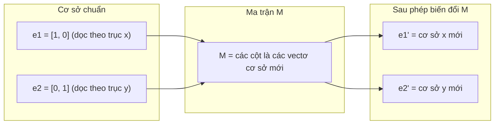
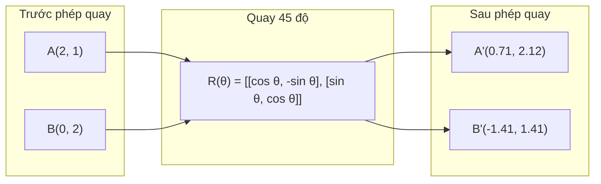
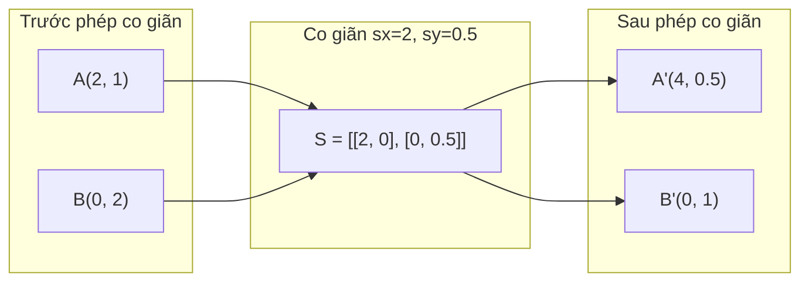
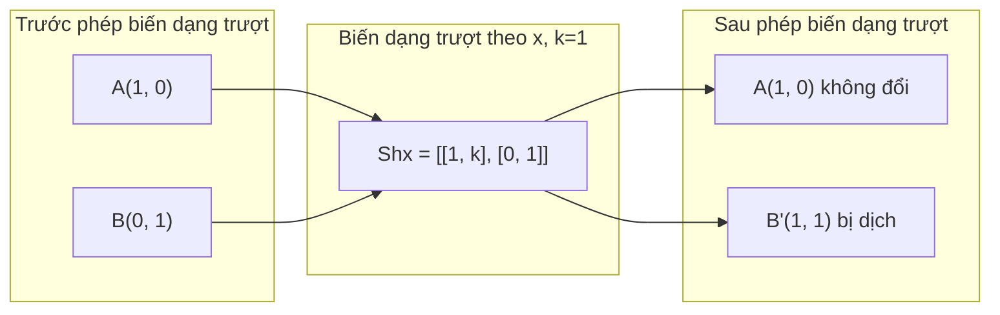
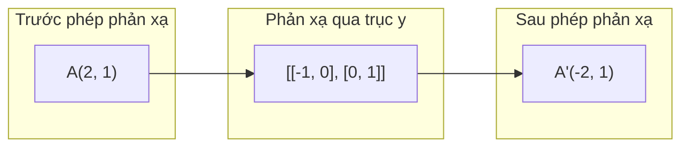
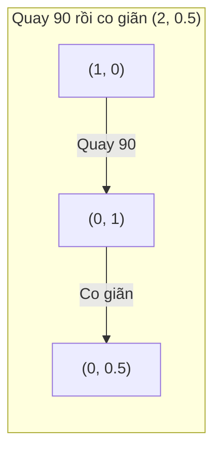
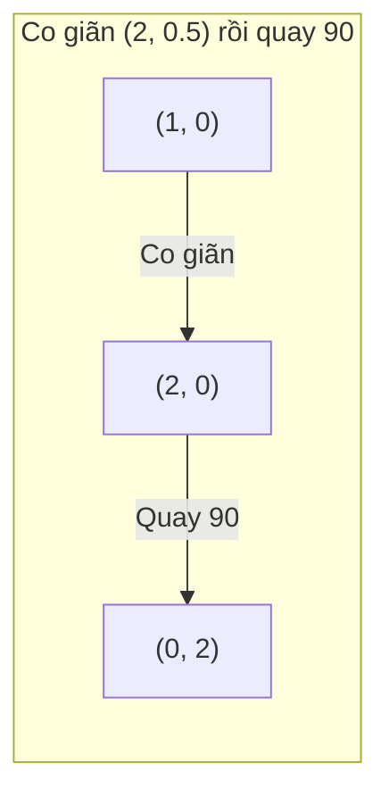

# Phép biến đổi ma trận

> Một ma trận (matrix) là một cỗ máy định hình lại không gian. Học xem nó tác động thế nào lên từng điểm, và bạn sẽ hiểu toàn bộ phép biến đổi (transformation).

**Type:** Build
**Languages:** Python, Julia
**Prerequisites:** Giai đoạn 1, Bài 01-02 (Trực giác Đại số tuyến tính, Phép toán Vectơ & Ma trận)
**Time:** ~75 phút

## Mục tiêu học tập

- Xây dựng ma trận phép quay (rotation), phép co giãn (scaling), phép biến dạng trượt (shear), và phép phản xạ rồi áp dụng chúng lên các điểm 2D và 3D
- Kết hợp nhiều phép biến đổi bằng phép nhân ma trận và kiểm chứng rằng thứ tự có ý nghĩa
- Tính trị riêng và vectơ riêng của ma trận 2x2 từ phương trình đặc trưng
- Giải thích vì sao trị riêng quyết định hướng của PCA, độ ổn định của RNN, và hành vi của phân cụm phổ

## Vấn đề

Bạn đọc về PCA và thấy "tìm các vectơ riêng của ma trận hiệp phương sai." Bạn đọc về độ ổn định của mô hình và thấy "kiểm tra xem mọi trị riêng có độ lớn nhỏ hơn 1 không." Bạn đọc về tăng cường dữ liệu và thấy "áp dụng một phép quay ngẫu nhiên." Không điều nào trong số này có nghĩa cho đến khi bạn hiểu ma trận tác động lên không gian về mặt hình học như thế nào.

Ma trận không chỉ là những lưới số. Chúng là những cỗ máy không gian. Một ma trận phép quay làm các điểm xoay. Một ma trận phép co giãn kéo căng chúng. Một ma trận phép biến dạng trượt làm nghiêng chúng. Mọi phép biến đổi mà một mạng nơ-ron áp dụng lên dữ liệu đều là một trong các phép toán này hoặc một tổ hợp của chúng. Bài học này làm cho những phép toán đó trở nên cụ thể.

## Khái niệm

### Phép biến đổi dưới dạng ma trận

Mọi phép biến đổi tuyến tính trong 2D đều có thể viết thành một ma trận 2x2. Ma trận cho bạn biết chính xác các vectơ (vector) cơ sở (basis) [1, 0] và [0, 1] kết thúc ở đâu. Mọi thứ còn lại đều suy ra từ đó.



### Phép quay

Phép quay 2D theo góc theta giữ nguyên khoảng cách và góc. Nó dịch chuyển mọi điểm dọc theo một cung tròn.



Trong 3D, bạn quay quanh một trục. Mỗi trục có ma trận phép quay riêng:

```
Rz(theta) = | cos  -sin  0 |     Rotate around z-axis
            | sin   cos  0 |     (x-y plane spins, z stays)
            |  0     0   1 |

Rx(theta) = | 1   0     0    |   Rotate around x-axis
            | 0  cos  -sin   |   (y-z plane spins, x stays)
            | 0  sin   cos   |

Ry(theta) = |  cos  0  sin |     Rotate around y-axis
            |   0   1   0  |     (x-z plane spins, y stays)
            | -sin  0  cos |
```

### Phép co giãn

Phép co giãn kéo căng hoặc nén dọc theo từng trục một cách độc lập.



### Phép biến dạng trượt

Phép biến dạng trượt làm nghiêng một trục trong khi giữ trục kia cố định. Nó biến hình chữ nhật thành hình bình hành.



Ma trận phép biến dạng trượt:
- `Shx = [[1, k], [0, 1]]` dịch x đi k * y
- `Shy = [[1, 0], [k, 1]]` dịch y đi k * x

### Phép phản xạ

Phép phản xạ soi gương các điểm qua một trục hoặc một đường thẳng.



Ma trận phép phản xạ:
- Phản xạ qua trục y: `[[-1, 0], [0, 1]]`
- Phản xạ qua trục x: `[[1, 0], [0, -1]]`

### Phép hợp: nối chuỗi các phép biến đổi

Áp dụng phép biến đổi A rồi đến B cũng giống như nhân các ma trận của chúng: `result = B @ A @ point`. Thứ tự có ý nghĩa. Quay rồi co giãn cho kết quả khác với co giãn rồi quay.



Ma trận hợp: `S @ R = [[0, -2], [0.5, 0]]`



Ma trận hợp: `R @ S = [[0, -0.5], [2, 0]]`

Kết quả khác nhau. Phép nhân ma trận không có tính giao hoán.

### Trị riêng và vectơ riêng

Hầu hết các vectơ đổi hướng khi một ma trận tác động lên chúng. Các vectơ riêng thì đặc biệt: ma trận chỉ co giãn chúng, không bao giờ quay chúng. Hệ số co giãn là trị riêng.

```
A @ v = lambda * v

v is the eigenvector (direction that survives)
lambda is the eigenvalue (how much it stretches)

Example: A = | 2  1 |
             | 1  2 |

Eigenvector [1, 1] with eigenvalue 3:
  A @ [1,1] = [3, 3] = 3 * [1, 1]     (same direction, scaled by 3)

Eigenvector [1, -1] with eigenvalue 1:
  A @ [1,-1] = [1, -1] = 1 * [1, -1]  (same direction, unchanged)
```

Ma trận kéo căng không gian gấp 3 lần dọc theo [1, 1] và giữ nguyên [1, -1]. Mọi hướng khác đều là sự pha trộn của hai hướng này.

### Phân rã trị riêng

Nếu một ma trận có n vectơ riêng độc lập tuyến tính, nó có thể được phân rã:

```
A = V @ D @ V^(-1)

V = matrix whose columns are eigenvectors
D = diagonal matrix of eigenvalues
V^(-1) = inverse of V

This says: rotate into eigenvector coordinates, scale along each axis, rotate back.
```

### Vì sao trị riêng quan trọng

**PCA.** Các vectơ riêng của ma trận hiệp phương sai là các thành phần chính. Các trị riêng cho bạn biết mỗi thành phần nắm giữ bao nhiêu phương sai. Sắp xếp theo trị riêng, giữ k thành phần đầu, và bạn có phép giảm chiều.

**Độ ổn định.** Trong các mạng hồi quy và hệ động lực, các trị riêng có độ lớn > 1 khiến đầu ra bùng nổ. Độ lớn < 1 khiến chúng triệt tiêu. Đây là vấn đề gradient biến mất/bùng nổ được phát biểu chỉ trong một câu.

**Phương pháp phổ.** Mạng nơ-ron đồ thị dùng trị riêng của ma trận kề. Phân cụm phổ dùng trị riêng của toán tử Laplacian. Các vectơ riêng tiết lộ cấu trúc của đồ thị.

### Định thức (determinant) như hệ số co giãn thể tích

Định thức của một ma trận phép biến đổi cho bạn biết nó co giãn diện tích (2D) hoặc thể tích (3D) bao nhiêu.

```
det = 1:   area preserved (rotation)
det = 2:   area doubled
det = 0:   space crushed to lower dimension (singular)
det = -1:  area preserved but orientation flipped (reflection)

| det(Rotation) | = 1        (always)
| det(Scale sx, sy) | = sx * sy
| det(Shear) | = 1           (area preserved)
| det(Reflection) | = -1     (orientation flipped)
```

```figure
matrix-transform
```

## Tự tay làm

### Bước 1: Ma trận (matrix) của phép biến đổi (transformation) từ đầu (Python)

```python
import math

def rotation_2d(theta):
    c, s = math.cos(theta), math.sin(theta)
    return [[c, -s], [s, c]]

def scaling_2d(sx, sy):
    return [[sx, 0], [0, sy]]

def shearing_2d(kx, ky):
    return [[1, kx], [ky, 1]]

def reflection_x():
    return [[1, 0], [0, -1]]

def reflection_y():
    return [[-1, 0], [0, 1]]

def mat_vec_mul(matrix, vector):
    return [
        sum(matrix[i][j] * vector[j] for j in range(len(vector)))
        for i in range(len(matrix))
    ]

def mat_mul(a, b):
    rows_a, cols_b = len(a), len(b[0])
    cols_a = len(a[0])
    return [
        [sum(a[i][k] * b[k][j] for k in range(cols_a)) for j in range(cols_b)]
        for i in range(rows_a)
    ]

point = [1.0, 0.0]
angle = math.pi / 4

rotated = mat_vec_mul(rotation_2d(angle), point)
print(f"Rotate (1,0) by 45 deg: ({rotated[0]:.4f}, {rotated[1]:.4f})")

scaled = mat_vec_mul(scaling_2d(2, 3), [1.0, 1.0])
print(f"Scale (1,1) by (2,3): ({scaled[0]:.1f}, {scaled[1]:.1f})")

sheared = mat_vec_mul(shearing_2d(1, 0), [1.0, 1.0])
print(f"Shear (1,1) kx=1: ({sheared[0]:.1f}, {sheared[1]:.1f})")

reflected = mat_vec_mul(reflection_y(), [2.0, 1.0])
print(f"Reflect (2,1) across y: ({reflected[0]:.1f}, {reflected[1]:.1f})")
```

### Bước 2: Hợp thành các phép biến đổi

```python
R = rotation_2d(math.pi / 2)
S = scaling_2d(2, 0.5)

rotate_then_scale = mat_mul(S, R)
scale_then_rotate = mat_mul(R, S)

point = [1.0, 0.0]
result1 = mat_vec_mul(rotate_then_scale, point)
result2 = mat_vec_mul(scale_then_rotate, point)

print(f"Rotate 90 then scale: ({result1[0]:.2f}, {result1[1]:.2f})")
print(f"Scale then rotate 90: ({result2[0]:.2f}, {result2[1]:.2f})")
print(f"Same? {result1 == result2}")
```

### Bước 3: Trị riêng từ đầu (2x2)

Với ma trận 2x2 `[[a, b], [c, d]]`, các trị riêng là nghiệm của phương trình đặc trưng: `lambda^2 - (a+d)*lambda + (ad - bc) = 0`.

```python
def eigenvalues_2x2(matrix):
    a, b = matrix[0]
    c, d = matrix[1]
    trace = a + d
    det = a * d - b * c
    discriminant = trace ** 2 - 4 * det
    if discriminant < 0:
        real = trace / 2
        imag = (-discriminant) ** 0.5 / 2
        return (complex(real, imag), complex(real, -imag))
    sqrt_disc = discriminant ** 0.5
    return ((trace + sqrt_disc) / 2, (trace - sqrt_disc) / 2)

def eigenvector_2x2(matrix, eigenvalue):
    a, b = matrix[0]
    c, d = matrix[1]
    if abs(b) > 1e-10:
        v = [b, eigenvalue - a]
    elif abs(c) > 1e-10:
        v = [eigenvalue - d, c]
    else:
        if abs(a - eigenvalue) < 1e-10:
            v = [1, 0]
        else:
            v = [0, 1]
    mag = (v[0] ** 2 + v[1] ** 2) ** 0.5
    return [v[0] / mag, v[1] / mag]

A = [[2, 1], [1, 2]]
vals = eigenvalues_2x2(A)
print(f"Matrix: {A}")
print(f"Eigenvalues: {vals[0]:.4f}, {vals[1]:.4f}")

for val in vals:
    vec = eigenvector_2x2(A, val)
    result = mat_vec_mul(A, vec)
    scaled = [val * vec[0], val * vec[1]]
    print(f"  lambda={val:.1f}, v={[round(x,4) for x in vec]}")
    print(f"    A@v = {[round(x,4) for x in result]}")
    print(f"    l*v = {[round(x,4) for x in scaled]}")
```

### Bước 4: Định thức (determinant) là hệ số co giãn (scaling) thể tích

```python
def det_2x2(matrix):
    return matrix[0][0] * matrix[1][1] - matrix[0][1] * matrix[1][0]

print(f"det(rotation 45) = {det_2x2(rotation_2d(math.pi/4)):.4f}")
print(f"det(scale 2,3)   = {det_2x2(scaling_2d(2, 3)):.1f}")
print(f"det(shear kx=1)  = {det_2x2(shearing_2d(1, 0)):.1f}")
print(f"det(reflect y)   = {det_2x2(reflection_y()):.1f}")

singular = [[1, 2], [2, 4]]
print(f"det(singular)     = {det_2x2(singular):.1f}")
print("Singular: columns are proportional, space collapses to a line.")
```

## Áp dụng

NumPy xử lý toàn bộ những việc này bằng các routine đã được tối ưu.

```python
import numpy as np

theta = np.pi / 4
R = np.array([[np.cos(theta), -np.sin(theta)],
              [np.sin(theta),  np.cos(theta)]])

point = np.array([1.0, 0.0])
print(f"Rotate (1,0) by 45 deg: {R @ point}")

S = np.diag([2.0, 3.0])
composed = S @ R
print(f"Scale(2,3) after Rotate(45): {composed @ point}")

A = np.array([[2, 1], [1, 2]], dtype=float)
eigenvalues, eigenvectors = np.linalg.eig(A)
print(f"\nEigenvalues: {eigenvalues}")
print(f"Eigenvectors (columns):\n{eigenvectors}")

for i in range(len(eigenvalues)):
    v = eigenvectors[:, i]
    lam = eigenvalues[i]
    print(f"  A @ v{i} = {A @ v}, lambda * v{i} = {lam * v}")

print(f"\ndet(R) = {np.linalg.det(R):.4f}")
print(f"det(S) = {np.linalg.det(S):.1f}")

B = np.array([[3, 1], [0, 2]], dtype=float)
vals, vecs = np.linalg.eig(B)
D = np.diag(vals)
V = vecs
reconstructed = V @ D @ np.linalg.inv(V)
print(f"\nEigendecomposition A = V @ D @ V^-1:")
print(f"Original:\n{B}")
print(f"Reconstructed:\n{reconstructed}")
```

### Phép quay (rotation) trong 3D với NumPy

```python
def rotation_3d_z(theta):
    c, s = np.cos(theta), np.sin(theta)
    return np.array([[c, -s, 0], [s, c, 0], [0, 0, 1]])

def rotation_3d_x(theta):
    c, s = np.cos(theta), np.sin(theta)
    return np.array([[1, 0, 0], [0, c, -s], [0, s, c]])

point_3d = np.array([1.0, 0.0, 0.0])
rotated_z = rotation_3d_z(np.pi / 2) @ point_3d
rotated_x = rotation_3d_x(np.pi / 2) @ point_3d

print(f"\n3D point: {point_3d}")
print(f"Rotate 90 around z: {np.round(rotated_z, 4)}")
print(f"Rotate 90 around x: {np.round(rotated_x, 4)}")
```

## Đóng gói

Bài học này dựng nền tảng hình học cho PCA (Giai đoạn 2) và cho việc phân tích trọng số của mạng nơ-ron. Đoạn mã trị riêng/vectơ riêng bạn xây ở đây chính là thuật toán đứng sau giảm chiều, phân cụm phổ và phân tích độ ổn định trong các hệ thống ML thực tế.

## Bài tập

1. Áp dụng phép quay, phép co giãn và phép cắt lên một hình vuông đơn vị (các đỉnh tại [0,0], [1,0], [1,1], [0,1]). In ra toạ độ các đỉnh sau biến đổi cho từng phép. Kiểm chứng rằng phép quay giữ nguyên khoảng cách giữa các đỉnh.

2. Tìm trị riêng của ma trận [[4, 2], [1, 3]] bằng tay, dùng phương trình đặc trưng. Sau đó kiểm chứng lại bằng hàm bạn tự viết và bằng NumPy.

3. Tạo một hợp thành của ba phép biến đổi (quay 30 độ, co giãn theo [1.5, 0.8], cắt với kx=0.3) rồi áp dụng lên 8 điểm xếp thành một vòng tròn. In toạ độ trước và sau. Tính định thức của ma trận hợp thành và kiểm chứng rằng nó bằng tích các định thức riêng lẻ.

## Thuật ngữ chính

| Thuật ngữ | Người ta thường nói | Ý nghĩa thực sự |
|------|----------------|----------------------|
| Ma trận phép quay | "Làm mọi thứ xoay tròn" | Ma trận trực giao dịch chuyển các điểm theo cung tròn mà vẫn giữ nguyên khoảng cách và góc. Định thức luôn bằng 1. |
| Ma trận co giãn | "Làm mọi thứ to hơn" | Ma trận chéo kéo dài hoặc nén độc lập theo từng trục. Định thức là tích của các hệ số co giãn. |
| Ma trận cắt | "Làm mọi thứ nghiêng đi" | Ma trận dịch một toạ độ theo tỉ lệ với một toạ độ khác, biến hình chữ nhật thành hình bình hành. Định thức bằng 1. |
| Phép phản xạ | "Làm mọi thứ soi gương" | Ma trận lật không gian qua một trục hoặc một mặt phẳng. Định thức bằng -1. |
| Hợp thành | "Làm hai việc một lúc" | Nhân các ma trận biến đổi để nối chuỗi phép toán. Thứ tự rất quan trọng: B @ A nghĩa là áp dụng A trước, rồi đến B. |
| Vectơ riêng | "Hướng đặc biệt" | Một hướng mà ma trận chỉ co giãn, không hề quay. Dấu vân tay của phép biến đổi. |
| Trị riêng | "Nó kéo giãn bao nhiêu" | Hệ số vô hướng mà ma trận dùng để co giãn vectơ riêng của nó. Có thể âm (lật) hoặc phức (quay). |
| Phân rã trị riêng | "Tách ma trận ra" | Viết một ma trận dưới dạng V @ D @ V^(-1), tách nó thành các hướng co giãn cơ bản và độ lớn tương ứng. |
| Định thức | "Một con số rút ra từ ma trận" | Hệ số mà phép biến đổi dùng để co giãn diện tích (2D) hoặc thể tích (3D). Bằng 0 nghĩa là phép biến đổi không thể đảo ngược. |
| Phương trình đặc trưng | "Nơi trị riêng sinh ra" | det(A - lambda * I) = 0. Đa thức mà các nghiệm của nó chính là các trị riêng. |

## Đọc thêm

- [3Blue1Brown: Linear Transformations](https://www.3blue1brown.com/lessons/linear-transformations) -- trực giác hình ảnh về cách ma trận tái định hình không gian
- [3Blue1Brown: Eigenvectors and Eigenvalues](https://www.3blue1brown.com/lessons/eigenvalues) -- cách giải thích trực quan hay nhất về ý nghĩa hình học của vectơ riêng
- [MIT 18.06 Lecture 21: Eigenvalues and Eigenvectors](https://ocw.mit.edu/courses/18-06-linear-algebra-spring-2010/) -- cách trình bày kinh điển của Gilbert Strang
