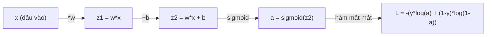
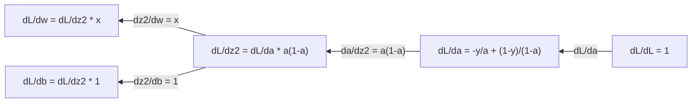
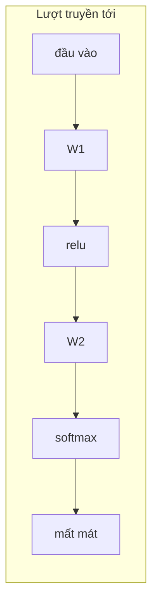
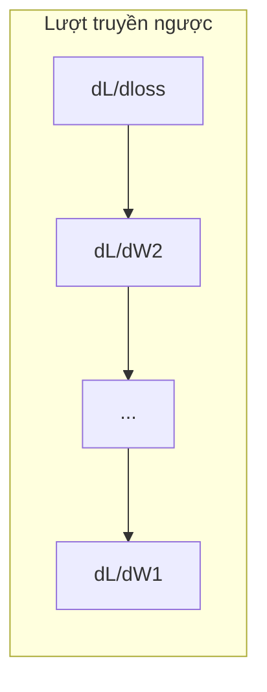

# Giải tích cho Học máy

> Đạo hàm (derivative) cho bạn biết hướng nào là xuống dốc. Đó là tất cả những gì một mạng nơ-ron cần để học.

**Type:** Learn
**Language:** Python
**Prerequisites:** Giai đoạn 1, Bài 01-03
**Time:** ~60 phút

## Mục tiêu học tập

- Tính đạo hàm số và đạo hàm giải tích cho các hàm ML thường gặp (x^2, sigmoid, cross-entropy)
- Cài đặt gradient descent từ đầu để tối ưu hóa (optimization) một hàm mất mát (loss function) trong 1D và 2D
- Suy ra gradient của một mô hình hồi quy tuyến tính và huấn luyện nó bằng cách cập nhật trọng số thủ công
- Giải thích ma trận Hessian, xấp xỉ chuỗi Taylor, và mối liên hệ của chúng với các phương pháp tối ưu hóa

## Vấn đề

Bạn có một mạng nơ-ron với hàng triệu trọng số. Mỗi trọng số là một núm vặn. Bạn cần xác định phải xoay từng núm vặn theo hướng nào để mô hình bớt sai đi một chút. Giải tích cho bạn hướng đó.

Nếu không có giải tích, việc huấn luyện một mạng nơ-ron sẽ là thử những thay đổi ngẫu nhiên và hy vọng gặp may. Với đạo hàm, bạn biết chính xác mỗi trọng số ảnh hưởng đến sai số như thế nào. Bạn xoay từng núm vặn đúng hướng, mỗi lần.

## Khái niệm

### Đạo hàm là gì?

Đạo hàm đo tốc độ thay đổi. Với một hàm y = f(x), đạo hàm f'(x) cho bạn biết: nếu bạn dịch x một lượng rất nhỏ, thì y thay đổi bao nhiêu?

Về mặt hình học, đạo hàm là độ dốc (slope) của đường tiếp tuyến (tangent) tại một điểm.

**f(x) = x^2:**

| x | f(x) | f'(x) (độ dốc) |
|---|------|---------------|
| 0 | 0    | 0 (phẳng, ở đáy) |
| 1 | 1    | 2 |
| 2 | 4    | 4 (độ dốc của tiếp tuyến tại điểm này) |
| 3 | 9    | 6 |

Tại x=2, độ dốc là 4. Nếu bạn dịch x sang phải một chút, y tăng khoảng 4 lần lượng đó. Tại x=0, độ dốc là 0. Bạn đang ở đáy của cái bát.

Định nghĩa hình thức:

```
f'(x) = lim   f(x + h) - f(x)
        h->0  -----------------
                     h
```

Trong mã, bạn bỏ qua giới hạn (limit) và chỉ dùng một h rất nhỏ. Đó là đạo hàm số.

### Đạo hàm riêng (partial derivative): mỗi lần một biến

Các hàm thực có nhiều đầu vào. Hàm mất mát của một mạng nơ-ron phụ thuộc vào hàng nghìn trọng số. Một đạo hàm riêng giữ mọi biến không đổi trừ một biến, rồi lấy đạo hàm theo biến đó.

```
f(x, y) = x^2 + 3xy + y^2

df/dx = 2x + 3y     (treat y as a constant)
df/dy = 3x + 2y     (treat x as a constant)
```

Mỗi đạo hàm riêng trả lời: nếu tôi chỉ dịch một trọng số này, mất mát thay đổi thế nào?

### Gradient: vector của tất cả đạo hàm riêng

Gradient gom mọi đạo hàm riêng vào một vector. Với một hàm f(x, y, z), gradient là:

```
grad f = [ df/dx, df/dy, df/dz ]
```

Gradient chỉ theo hướng dốc lên mạnh nhất. Để cực tiểu hóa một hàm, hãy đi theo hướng ngược lại.

**Đường đồng mức của f(x,y) = x^2 + y^2:**

Hàm tạo thành hình cái bát với các đường đồng mức là những vòng tròn đồng tâm. Cực tiểu nằm tại (0, 0).

| Điểm | grad f | -grad f (hướng hạ dốc) |
|-------|--------|----------------------------|
| (1, 1) | [2, 2] (chỉ lên dốc, ra xa cực tiểu) | [-2, -2] (chỉ xuống dốc, về phía cực tiểu) |
| (0, 0) | [0, 0] (phẳng, tại cực tiểu) | [0, 0] |

Đây là gradient descent trong một bức tranh. Tính gradient, đổi dấu, bước một bước.

### Mối liên hệ với tối ưu hóa

Huấn luyện một mạng nơ-ron là tối ưu hóa. Bạn có một hàm mất mát L(w1, w2, ..., wn) đo mức độ sai của mô hình. Bạn muốn cực tiểu hóa nó.

```
Gradient descent update rule:

  w_new = w_old - learning_rate * dL/dw

For every weight:
  1. Compute the partial derivative of loss with respect to that weight
  2. Subtract a small multiple of it from the weight
  3. Repeat
```

Learning rate điều khiển bước nhảy (step size). Quá lớn thì bạn vượt quá đích. Quá nhỏ thì bạn bò rất chậm.

**Bề mặt mất mát (lát cắt 1D):**

Hàm mất mát L(w) tạo thành một đường cong có đỉnh và đáy khi trọng số w thay đổi.

| Đặc điểm | Mô tả |
|---------|-------------|
| Cực tiểu toàn cục | Điểm thấp nhất trên toàn bộ đường cong -- lời giải tốt nhất |
| Cực tiểu cục bộ | Một đáy thấp hơn các điểm lân cận nhưng không thấp nhất toàn cục |
| Độ dốc | Gradient descent đi theo độ dốc xuống dốc từ bất kỳ điểm khởi đầu nào |

Gradient descent đi theo độ dốc xuống dốc. Nó có thể kẹt ở cực tiểu cục bộ, nhưng trong không gian nhiều chiều (hàng triệu trọng số) đây hiếm khi là vấn đề thực tế.

### Đạo hàm số và đạo hàm giải tích

Có hai cách tính đạo hàm.

Giải tích: áp dụng các quy tắc giải tích bằng tay. Với f(x) = x^2, đạo hàm là f'(x) = 2x. Chính xác. Nhanh.

Số trị: xấp xỉ bằng định nghĩa. Tính f(x+h) và f(x-h) với một h rất nhỏ, rồi dùng hiệu của chúng.

```
Numerical (central difference):

f'(x) ~= f(x + h) - f(x - h)
          -----------------------
                  2h

h = 0.0001 works well in practice
```

Đạo hàm số chậm hơn nhưng dùng được cho mọi hàm. Đạo hàm giải tích nhanh nhưng đòi hỏi bạn phải suy ra công thức. Các framework mạng nơ-ron dùng cách thứ ba: vi phân tự động (automatic differentiation), tính đạo hàm chính xác một cách máy móc. Bạn sẽ thấy điều này ở Giai đoạn 3.

### Đạo hàm bằng tay cho các hàm đơn giản

Đây là những đạo hàm bạn sẽ gặp đi gặp lại trong ML.

```
Function        Derivative       Used in
--------        ----------       -------
f(x) = x^2     f'(x) = 2x      Loss functions (MSE)
f(x) = wx + b  f'(w) = x        Linear layer (gradient w.r.t. weight)
                f'(b) = 1        Linear layer (gradient w.r.t. bias)
                f'(x) = w        Linear layer (gradient w.r.t. input)
f(x) = e^x     f'(x) = e^x     Softmax, attention
f(x) = ln(x)   f'(x) = 1/x     Cross-entropy loss
f(x) = 1/(1+e^-x)  f'(x) = f(x)(1-f(x))   Sigmoid activation
```

Với f(x) = x^2:

```
f(x) = x^2    f'(x) = 2x

  x    f(x)   f'(x)   meaning
  -2    4      -4      slope tilts left (decreasing)
  -1    1      -2      slope tilts left (decreasing)
   0    0       0      flat (minimum!)
   1    1       2      slope tilts right (increasing)
   2    4       4      slope tilts right (increasing)
```

Với f(w) = wx + b với x=3, b=1:

```
f(w) = 3w + 1    f'(w) = 3

The derivative with respect to w is just x.
If x is big, a small change in w causes a big change in output.
```

### Quy tắc chuỗi

Khi các hàm được hợp thành, quy tắc chuỗi cho bạn biết cách lấy đạo hàm.

```
If y = f(g(x)), then dy/dx = f'(g(x)) * g'(x)

Example: y = (3x + 1)^2
  outer: f(u) = u^2       f'(u) = 2u
  inner: g(x) = 3x + 1    g'(x) = 3
  dy/dx = 2(3x + 1) * 3 = 6(3x + 1)
```

Mạng nơ-ron là một chuỗi các hàm: input -> linear -> activation -> linear -> activation -> loss. Lan truyền ngược là quy tắc chuỗi được áp dụng lặp đi lặp lại từ đầu ra về đầu vào. Đó là toàn bộ thuật toán.

### Ma trận Hessian

Gradient cho bạn biết độ dốc. Hessian cho bạn biết độ cong.

Hessian là ma trận các đạo hàm riêng bậc hai. Với một hàm f(x1, x2, ..., xn), phần tử (i, j) của Hessian là:

```
H[i][j] = d^2f / (dx_i * dx_j)
```

Với hàm hai biến f(x, y):

```
H = | d^2f/dx^2    d^2f/dxdy |
    | d^2f/dydx    d^2f/dy^2 |
```

**Hessian cho bạn biết gì tại một điểm tới hạn (nơi gradient = 0):**

| Tính chất của Hessian | Ý nghĩa | Bề mặt ví dụ |
|-----------------|---------|-----------------|
| Xác định dương (mọi eigenvalue > 0) | Cực tiểu cục bộ | Bát hướng lên |
| Xác định âm (mọi eigenvalue < 0) | Cực đại cục bộ | Bát hướng xuống |
| Không xác định (eigenvalue trái dấu) | Điểm yên ngựa | Hình yên ngựa |

**Ví dụ:** f(x, y) = x^2 - y^2 (một hàm yên ngựa)

```
df/dx = 2x       df/dy = -2y
d^2f/dx^2 = 2    d^2f/dy^2 = -2    d^2f/dxdy = 0

H = | 2   0 |
    | 0  -2 |

Eigenvalues: 2 and -2 (one positive, one negative)
--> Saddle point at (0, 0)
```

So sánh với f(x, y) = x^2 + y^2 (một cái bát):

```
H = | 2  0 |
    | 0  2 |

Eigenvalues: 2 and 2 (both positive)
--> Local minimum at (0, 0)
```

**Vì sao Hessian quan trọng trong ML:**

Phương pháp Newton dùng Hessian để thực hiện các bước tối ưu hóa tốt hơn gradient descent. Thay vì chỉ đi theo độ dốc, nó tính đến cả độ cong:

```
Newton's update:    w_new = w_old - H^(-1) * gradient
Gradient descent:   w_new = w_old - lr * gradient
```

Phương pháp Newton hội tụ nhanh hơn vì Hessian "tái co giãn" gradient -- các hướng dốc đứng nhận bước nhỏ hơn, các hướng phẳng nhận bước lớn hơn.

Điều đánh đổi: với một mạng nơ-ron có N tham số, Hessian là N x N. Một mô hình với 1 triệu tham số sẽ cần một ma trận 1 nghìn tỷ phần tử. Đó là lý do chúng ta dùng các xấp xỉ.

| Phương pháp | Dùng gì | Chi phí | Hội tụ |
|--------|-------------|------|-------------|
| Gradient descent | Chỉ đạo hàm bậc một | O(N) mỗi bước | Chậm (tuyến tính) |
| Phương pháp Newton | Hessian đầy đủ | O(N^3) mỗi bước | Nhanh (bậc hai) |
| L-BFGS | Hessian xấp xỉ từ lịch sử gradient | O(N) mỗi bước | Trung bình (siêu tuyến tính) |
| Adam | Tốc độ thích ứng theo từng tham số (xấp xỉ Hessian đường chéo) | O(N) mỗi bước | Trung bình |
| Natural gradient | Ma trận thông tin Fisher (Hessian thống kê) | O(N^2) mỗi bước | Nhanh |

Trong thực tế, Adam là optimizer mặc định cho deep learning. Nó xấp xỉ thông tin bậc hai một cách rẻ bằng cách theo dõi trung bình chạy và phương sai của gradient theo từng tham số.

### Xấp xỉ chuỗi Taylor

Mọi hàm trơn đều có thể được xấp xỉ cục bộ bằng một đa thức:

```
f(x + h) = f(x) + f'(x)*h + (1/2)*f''(x)*h^2 + (1/6)*f'''(x)*h^3 + ...
```

Bạn càng đưa vào nhiều số hạng, xấp xỉ càng tốt -- nhưng chỉ ở gần điểm x.

**Vì sao chuỗi Taylor quan trọng với ML:**

- **Taylor bậc một = gradient descent.** Khi bạn dùng f(x + h) ~ f(x) + f'(x)*h, bạn đang tạo một xấp xỉ tuyến tính. Gradient descent cực tiểu hóa mô hình tuyến tính này để chọn h = -lr * f'(x).

- **Taylor bậc hai = phương pháp Newton.** Dùng f(x + h) ~ f(x) + f'(x)*h + (1/2)*f''(x)*h^2, bạn có một mô hình bậc hai. Cực tiểu hóa nó cho h = -f'(x)/f''(x) -- bước Newton.

- **Thiết kế hàm mất mát.** MSE và cross-entropy là trơn, nghĩa là các khai triển Taylor của chúng có hành vi tốt. Đây không phải chuyện ngẫu nhiên. Hàm mất mát trơn làm cho tối ưu hóa có thể dự đoán được.

```
Approximation order    What it captures    Optimization method
-------------------    -----------------   -------------------
0th order (constant)   Just the value      Random search
1st order (linear)     Slope               Gradient descent
2nd order (quadratic)  Curvature           Newton's method
Higher orders          Finer structure     Rarely used in ML
```

Điểm mấu chốt: mọi tối ưu hóa dựa trên gradient thực ra là xấp xỉ cục bộ hàm mất mát rồi bước tới cực tiểu của xấp xỉ đó.

### Tích phân trong ML

Đạo hàm cho bạn biết tốc độ thay đổi. Tích phân tính tích lũy -- diện tích dưới một đường cong.

Trong ML, bạn hiếm khi tính tích phân bằng tay, nhưng khái niệm này có ở khắp nơi:

**Xác suất.** Với một biến ngẫu nhiên liên tục có hàm mật độ p(x):
```
P(a < X < b) = integral from a to b of p(x) dx
```
Diện tích dưới đường cong mật độ xác suất giữa a và b là xác suất rơi vào khoảng đó.

**Giá trị kỳ vọng.** Kết quả trung bình được trọng số theo xác suất:
```
E[f(X)] = integral of f(x) * p(x) dx
```
Mất mát kỳ vọng trên một phân phối dữ liệu là một tích phân. Việc huấn luyện cực tiểu hóa một xấp xỉ thực nghiệm của nó.

**Phân kỳ KL.** Đo mức độ khác nhau giữa hai phân phối:
```
KL(p || q) = integral of p(x) * log(p(x) / q(x)) dx
```
Được dùng trong VAE, knowledge distillation, và suy luận Bayesian.

**Hằng số chuẩn hóa.** Trong suy luận Bayesian:
```
p(w | data) = p(data | w) * p(w) / integral of p(data | w) * p(w) dw
```
Mẫu số là một tích phân trên mọi giá trị tham số có thể. Nó thường không tính được, đó là lý do chúng ta dùng các xấp xỉ như MCMC và variational inference.

| Khái niệm tích phân | Xuất hiện ở đâu trong ML |
|-----------------|----------------------|
| Diện tích dưới đường cong | Xác suất từ các hàm mật độ |
| Giá trị kỳ vọng | Hàm mất mát, cực tiểu hóa rủi ro |
| Phân kỳ KL | VAE, tối ưu hóa policy, distillation |
| Chuẩn hóa | Hậu nghiệm Bayesian, mẫu số của softmax |
| Khả năng biên | So sánh mô hình, evidence lower bound (ELBO) |

### Quy tắc chuỗi nhiều biến trong đồ thị tính toán (computation graph)

Quy tắc chuỗi không chỉ áp dụng cho hàm vô hướng trên một đường thẳng. Trong mạng nơ-ron, các biến tỏa ra và hợp lại với nhau. Đây là cách đạo hàm chảy qua một lượt truyền tới đơn giản:



Lượt truyền ngược tính gradient từ phải sang trái:



Mỗi mũi tên tương ứng với một phép nhân với đạo hàm cục bộ. Gradient của bất kỳ tham số nào là tích của tất cả đạo hàm cục bộ dọc theo đường đi từ hàm mất mát đến tham số đó. Khi các đường đi rẽ nhánh và hợp lại, bạn cộng các đóng góp lại (quy tắc chuỗi đa biến).

Đó chính là toàn bộ lan truyền ngược: quy tắc chuỗi được áp dụng một cách có hệ thống xuyên qua đồ thị tính toán, từ đầu ra về đầu vào.

### Ma trận Jacobian

Khi một hàm ánh xạ một vector sang một vector (như một lớp của mạng nơ-ron), đạo hàm của nó là một ma trận. Jacobian chứa mọi đạo hàm riêng của mọi đầu ra theo mọi đầu vào.

Với f: R^n -> R^m, ma trận Jacobian J là một ma trận m x n:

| | x1 | x2 | ... | xn |
|---|---|---|---|---|
| f1 | df1/dx1 | df1/dx2 | ... | df1/dxn |
| f2 | df2/dx1 | df2/dx2 | ... | df2/dxn |
| ... | ... | ... | ... | ... |
| fm | dfm/dx1 | dfm/dx2 | ... | dfm/dxn |

Bạn sẽ không phải tự tính Jacobian bằng tay cho mạng nơ-ron. PyTorch lo việc đó. Nhưng biết rằng nó tồn tại giúp bạn hiểu các shape trong lan truyền ngược: nếu một lớp ánh xạ R^n sang R^m, Jacobian của nó là m x n. Gradient chảy ngược qua chuyển vị của ma trận này.

### Vì sao điều này quan trọng với mạng nơ-ron

Mỗi trọng số trong mạng nơ-ron đều nhận một gradient. Gradient cho bạn biết cần điều chỉnh trọng số đó thế nào để giảm hàm mất mát.





Mỗi bước cập nhật trọng số:
- `W1 = W1 - lr * dL/dW1`
- `W2 = W2 - lr * dL/dW2`

Lượt truyền tới tính dự đoán và hàm mất mát. Lượt truyền ngược tính gradient của hàm mất mát theo từng trọng số. Sau đó mỗi trọng số bước một bước nhỏ xuống dốc. Lặp lại hàng triệu bước. Đó là deep learning.

```figure
derivative-tangent
```

## Tự tay làm

### Bước 1: Đạo hàm số từ đầu

```python
def numerical_derivative(f, x, h=1e-7):
    return (f(x + h) - f(x - h)) / (2 * h)

def f(x):
    return x ** 2

for x in [-2, -1, 0, 1, 2]:
    numerical = numerical_derivative(f, x)
    analytical = 2 * x
    print(f"x={x:2d}  f'(x) numerical={numerical:.6f}  analytical={analytical:.1f}")
```

Đạo hàm số khớp với đạo hàm giải tích đến nhiều chữ số thập phân.

### Bước 2: Đạo hàm riêng và gradient

```python
def numerical_gradient(f, point, h=1e-7):
    gradient = []
    for i in range(len(point)):
        point_plus = list(point)
        point_minus = list(point)
        point_plus[i] += h
        point_minus[i] -= h
        partial = (f(point_plus) - f(point_minus)) / (2 * h)
        gradient.append(partial)
    return gradient

def f_multi(point):
    x, y = point
    return x**2 + 3*x*y + y**2

grad = numerical_gradient(f_multi, [1.0, 2.0])
print(f"Numerical gradient at (1,2): {[f'{g:.4f}' for g in grad]}")
print(f"Analytical gradient at (1,2): [2*1+3*2, 3*1+2*2] = [{2*1+3*2}, {3*1+2*2}]")
```

### Bước 3: Gradient descent để tìm cực tiểu của f(x) = x^2

```python
x = 5.0
lr = 0.1
for step in range(20):
    grad = 2 * x
    x = x - lr * grad
    print(f"step {step:2d}  x={x:8.4f}  f(x)={x**2:10.6f}")
```

Xuất phát từ x=5, mỗi bước tiến gần hơn về x=0 (điểm cực tiểu).

### Bước 4: Gradient descent trên một hàm 2D

```python
def f_2d(point):
    x, y = point
    return x**2 + y**2

point = [4.0, 3.0]
lr = 0.1
for step in range(30):
    grad = numerical_gradient(f_2d, point)
    point = [p - lr * g for p, g in zip(point, grad)]
    loss = f_2d(point)
    if step % 5 == 0 or step == 29:
        print(f"step {step:2d}  point=({point[0]:7.4f}, {point[1]:7.4f})  f={loss:.6f}")
```

### Bước 5: So sánh đạo hàm số và đạo hàm giải tích

```python
import math

test_functions = [
    ("x^2",      lambda x: x**2,          lambda x: 2*x),
    ("x^3",      lambda x: x**3,          lambda x: 3*x**2),
    ("sin(x)",   lambda x: math.sin(x),   lambda x: math.cos(x)),
    ("e^x",      lambda x: math.exp(x),   lambda x: math.exp(x)),
    ("1/x",      lambda x: 1/x,           lambda x: -1/x**2),
]

x = 2.0
print(f"{'Function':<12} {'Numerical':>12} {'Analytical':>12} {'Error':>12}")
print("-" * 50)
for name, f, df in test_functions:
    num = numerical_derivative(f, x)
    ana = df(x)
    err = abs(num - ana)
    print(f"{name:<12} {num:12.6f} {ana:12.6f} {err:12.2e}")
```

### Bước 6: Tính Hessian bằng số

```python
def hessian_2d(f, x, y, h=1e-5):
    fxx = (f(x + h, y) - 2 * f(x, y) + f(x - h, y)) / (h ** 2)
    fyy = (f(x, y + h) - 2 * f(x, y) + f(x, y - h)) / (h ** 2)
    fxy = (f(x + h, y + h) - f(x + h, y - h) - f(x - h, y + h) + f(x - h, y - h)) / (4 * h ** 2)
    return [[fxx, fxy], [fxy, fyy]]

def saddle(x, y):
    return x ** 2 - y ** 2

def bowl(x, y):
    return x ** 2 + y ** 2

H_saddle = hessian_2d(saddle, 0.0, 0.0)
H_bowl = hessian_2d(bowl, 0.0, 0.0)
print(f"Saddle Hessian: {H_saddle}")  # [[2, 0], [0, -2]] -- mixed signs
print(f"Bowl Hessian:   {H_bowl}")    # [[2, 0], [0, 2]]  -- both positive
```

Hessian của hàm saddle có trị riêng 2 và -2 (trái dấu, xác nhận một điểm yên ngựa). Hàm bowl có trị riêng 2 và 2 (cùng dương, xác nhận một điểm cực tiểu).

### Bước 7: Xấp xỉ Taylor trong thực tế

```python
import math

def taylor_approx(f, f_prime, f_double_prime, x0, h, order=2):
    result = f(x0)
    if order >= 1:
        result += f_prime(x0) * h
    if order >= 2:
        result += 0.5 * f_double_prime(x0) * h ** 2
    return result

x0 = 0.0
for h in [0.1, 0.5, 1.0, 2.0]:
    true_val = math.sin(h)
    t1 = taylor_approx(math.sin, math.cos, lambda x: -math.sin(x), x0, h, order=1)
    t2 = taylor_approx(math.sin, math.cos, lambda x: -math.sin(x), x0, h, order=2)
    print(f"h={h:.1f}  sin(h)={true_val:.4f}  order1={t1:.4f}  order2={t2:.4f}")
```

Gần x0=0, sin(x) ~ x (Taylor bậc một). Xấp xỉ rất tốt với h nhỏ nhưng hỏng khi h lớn. Đó là lý do gradient descent hoạt động tốt nhất với learning rate nhỏ -- mỗi bước đều giả định xấp xỉ tuyến tính là chính xác.

### Bước 8: Vì sao điều này quan trọng với một mạng nơ-ron

```python
import random

random.seed(42)

w = random.gauss(0, 1)
b = random.gauss(0, 1)
lr = 0.01

xs = [1.0, 2.0, 3.0, 4.0, 5.0]
ys = [3.0, 5.0, 7.0, 9.0, 11.0]

for epoch in range(200):
    total_loss = 0
    dw = 0
    db = 0
    for x, y in zip(xs, ys):
        pred = w * x + b
        error = pred - y
        total_loss += error ** 2
        dw += 2 * error * x
        db += 2 * error
    dw /= len(xs)
    db /= len(xs)
    total_loss /= len(xs)
    w -= lr * dw
    b -= lr * db
    if epoch % 40 == 0 or epoch == 199:
        print(f"epoch {epoch:3d}  w={w:.4f}  b={b:.4f}  loss={total_loss:.6f}")

print(f"\nLearned: y = {w:.2f}x + {b:.2f}")
print(f"Actual:  y = 2x + 1")
```

Mọi vòng lặp huấn luyện dựa trên gradient đều theo mẫu này: dự đoán, tính hàm mất mát, tính gradient, cập nhật trọng số.

## Áp dụng

Với NumPy, các phép toán tương tự nhanh hơn và gọn hơn:

```python
import numpy as np

x = np.array([1, 2, 3, 4, 5], dtype=float)
y = np.array([3, 5, 7, 9, 11], dtype=float)

w, b = np.random.randn(), np.random.randn()
lr = 0.01

for epoch in range(200):
    pred = w * x + b
    error = pred - y
    loss = np.mean(error ** 2)
    dw = np.mean(2 * error * x)
    db = np.mean(2 * error)
    w -= lr * dw
    b -= lr * db

print(f"Learned: y = {w:.2f}x + {b:.2f}")
```

Bạn vừa tự xây dựng gradient descent từ đầu. PyTorch tự động hoá việc tính gradient, nhưng vòng lặp cập nhật thì giống hệt.

## Bài tập

1. Hãy cài đặt `numerical_second_derivative(f, x)` bằng cách gọi `numerical_derivative` hai lần. Kiểm chứng rằng đạo hàm bậc hai của x^3 tại x=2 là 12.
2. Dùng gradient descent để tìm cực tiểu của f(x, y) = (x - 3)^2 + (y + 1)^2. Xuất phát từ (0, 0). Kết quả phải hội tụ về (3, -1).
3. Thêm momentum vào vòng lặp gradient descent: duy trì một vector vận tốc tích luỹ các gradient trước đó. So sánh tốc độ hội tụ khi có và không có momentum trên f(x) = x^4 - 3x^2.

## Thuật ngữ chính

| Thuật ngữ | Cách người ta nói | Ý nghĩa thực sự |
|------|----------------|----------------------|
| Đạo hàm | "Độ dốc" | Tốc độ thay đổi của một hàm tại một điểm. Cho biết đầu ra thay đổi bao nhiêu trên mỗi đơn vị thay đổi của đầu vào. |
| Đạo hàm riêng | "Đạo hàm theo một biến" | Đạo hàm theo một biến trong khi mọi biến khác được giữ cố định. |
| Gradient | "Hướng dốc lên nhanh nhất" | Một vector gồm tất cả các đạo hàm riêng. Chỉ theo hướng làm hàm tăng nhanh nhất. |
| Gradient descent | "Đi xuống dốc" | Trừ gradient (nhân với learning rate) khỏi các tham số để giảm hàm mất mát. Cốt lõi của việc huấn luyện mạng nơ-ron. |
| Learning rate | "Kích thước bước" | Một số vô hướng điều khiển mỗi bước gradient descent lớn đến đâu. Quá lớn: phân kỳ. Quá nhỏ: hội tụ chậm. |
| Quy tắc chuỗi | "Nhân các đạo hàm" | Quy tắc lấy đạo hàm của hàm hợp: df/dx = df/dg * dg/dx. Nền tảng toán học của lan truyền ngược. |
| Jacobian | "Ma trận các đạo hàm" | Khi một hàm ánh xạ vector sang vector, Jacobian là ma trận của tất cả đạo hàm riêng của đầu ra theo đầu vào. |
| Numerical derivative | "Sai phân hữu hạn" | Xấp xỉ đạo hàm bằng cách tính giá trị hàm tại hai điểm gần nhau rồi tính độ dốc giữa chúng. |
| Lan truyền ngược | "Vi phân tự động chế độ ngược" | Tính gradient từng lớp từ đầu ra về đầu vào bằng quy tắc chuỗi. Cách mạng nơ-ron học. |
| Hessian | "Ma trận đạo hàm bậc hai" | Ma trận của tất cả đạo hàm riêng bậc hai. Mô tả độ cong của một hàm. Hessian xác định dương tại một điểm tới hạn nghĩa là cực tiểu địa phương. |
| Chuỗi Taylor | "Xấp xỉ bằng đa thức" | Xấp xỉ một hàm quanh một điểm bằng các đạo hàm của nó: f(x+h) ~ f(x) + f'(x)h + (1/2)f''(x)h^2 + ... Cơ sở để hiểu vì sao gradient descent và phương pháp Newton hoạt động. |
| Tích phân | "Diện tích dưới đường cong" | Sự tích luỹ của một đại lượng trên một khoảng. Trong ML, tích phân định nghĩa xác suất, giá trị kỳ vọng và KL divergence. |

## Đọc thêm

- [3Blue1Brown: Essence of Calculus](https://www.3blue1brown.com/topics/calculus) - trực giác trực quan về đạo hàm, tích phân và quy tắc chuỗi
- [Stanford CS231n: Backpropagation](https://cs231n.github.io/optimization-2/) - cách gradient chảy qua các lớp của mạng nơ-ron
