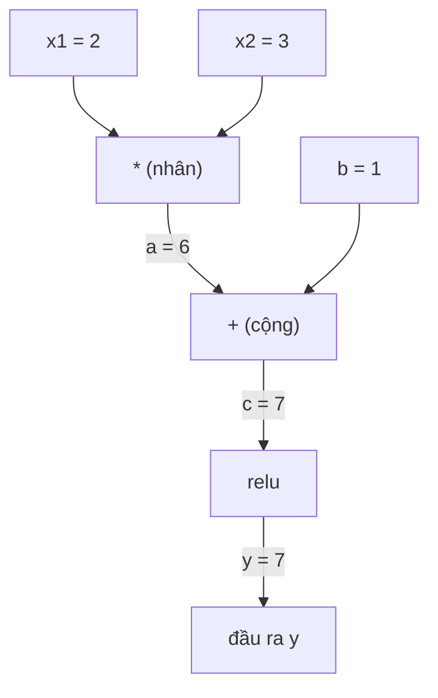
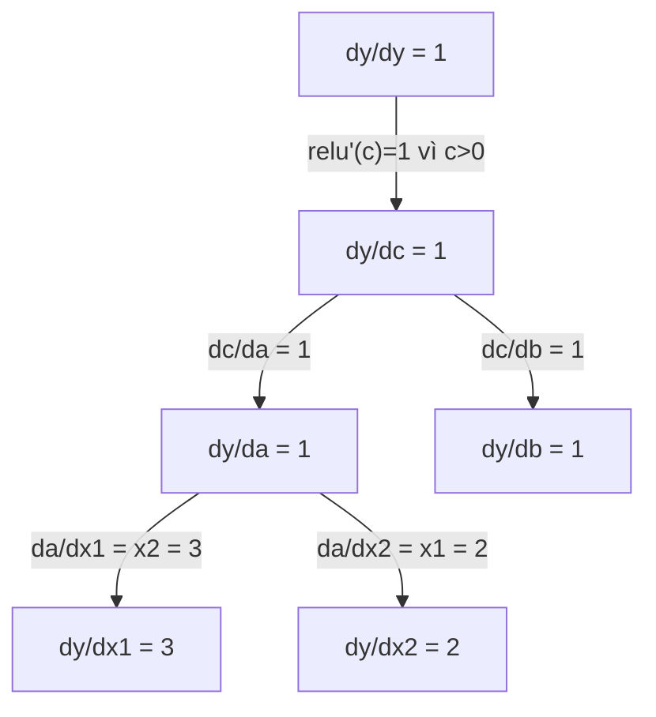

# Quy tắc chuỗi & Vi phân tự động

> Quy tắc chuỗi (chain rule) là cỗ máy đằng sau mọi mạng nơ-ron biết học.

**Type:** Build
**Language:** Python
**Prerequisites:** Giai đoạn 1, Bài 04 (Đạo hàm & Gradient)
**Time:** ~90 phút

## Mục tiêu học tập

- Xây dựng một engine autograd tối giản (lớp Value) ghi lại các phép toán và tính gradient bằng autodiff (vi phân tự động) chế độ ngược
- Thực hiện lượt lan truyền xuôi (forward pass) và lượt lan truyền ngược qua đồ thị tính toán (computation graph) bằng sắp xếp tô-pô
- Dựng và huấn luyện một perceptron nhiều tầng trên bài toán XOR chỉ bằng engine autograd viết từ đầu
- Kiểm chứng tính đúng đắn của autodiff bằng cách kiểm tra gradient đối chiếu với sai phân hữu hạn dạng số

## Vấn đề

Bạn đã biết tính đạo hàm của những hàm đơn giản. Nhưng mạng nơ-ron không phải một hàm đơn giản. Nó là hàng trăm hàm ghép lại với nhau: nhân ma trận, cộng bias, áp activation, nhân ma trận lần nữa, softmax, loss cross-entropy. Đầu ra là một hàm của hàm của hàm.

Để huấn luyện mạng, bạn cần gradient của loss theo từng trọng số một. Làm thủ công là bất khả thi với hàng triệu tham số. Làm bằng số (sai phân hữu hạn) thì quá chậm.

Quy tắc chuỗi cho bạn phần toán. Vi phân tự động cho bạn thuật toán. Cùng với nhau, chúng cho phép bạn tính gradient chính xác qua mọi phép hợp hàm bất kỳ trong thời gian tỉ lệ với một lượt lan truyền xuôi.

Đây là cách PyTorch, TensorFlow và JAX hoạt động. Bạn sẽ tự xây một phiên bản thu nhỏ từ đầu.

## Khái niệm

### Quy tắc chuỗi

Nếu `y = f(g(x))`, đạo hàm của `y` theo `x` là:

```
dy/dx = dy/dg * dg/dx = f'(g(x)) * g'(x)
```

Nhân các đạo hàm dọc theo chuỗi. Mỗi mắt xích đóng góp đạo hàm cục bộ (local derivative) của nó.

Ví dụ: `y = sin(x^2)`

```
g(x) = x^2       g'(x) = 2x
f(g) = sin(g)     f'(g) = cos(g)

dy/dx = cos(x^2) * 2x
```

Với những phép hợp hàm sâu hơn, chuỗi được mở rộng:

```
y = f(g(h(x)))

dy/dx = f'(g(h(x))) * g'(h(x)) * h'(x)
```

Mỗi lớp trong mạng nơ-ron là một mắt xích trong chuỗi này.

### Đồ thị tính toán

Đồ thị tính toán làm quy tắc chuỗi trở nên trực quan. Mỗi phép toán trở thành một nút (node). Dữ liệu chảy xuôi qua đồ thị. Gradient chảy ngược.

**Lượt lan truyền xuôi (tính giá trị):**



**Lượt lan truyền ngược (tính gradient):**



Lượt lan truyền ngược áp quy tắc chuỗi tại mỗi nút, lan gradient từ đầu ra về đầu vào.

### Chế độ xuôi so với chế độ ngược

Có hai cách để áp quy tắc chuỗi qua một đồ thị.

**Chế độ xuôi** bắt đầu từ đầu vào và đẩy đạo hàm về phía trước. Nó tính `dx/dx = 1` rồi lan qua từng phép toán. Phù hợp khi bạn có ít đầu vào và nhiều đầu ra.

```
Forward mode: seed dx/dx = 1, propagate forward

  x = 2       (dx/dx = 1)
  a = x^2     (da/dx = 2x = 4)
  y = sin(a)  (dy/dx = cos(a) * da/dx = cos(4) * 4 = -2.615)
```

**Chế độ ngược** bắt đầu từ đầu ra và kéo gradient về phía sau. Nó tính `dy/dy = 1` rồi lan qua từng phép toán theo thứ tự ngược. Phù hợp khi bạn có nhiều đầu vào và ít đầu ra.

```
Reverse mode: seed dy/dy = 1, propagate backward

  y = sin(a)  (dy/dy = 1)
  a = x^2     (dy/da = cos(a) = cos(4) = -0.654)
  x = 2       (dy/dx = dy/da * da/dx = -0.654 * 4 = -2.615)
```

Mạng nơ-ron có hàng triệu đầu vào (trọng số) và một đầu ra (loss). Chế độ ngược tính tất cả gradient trong một lượt lan truyền ngược. Đó là lý do lan truyền ngược dùng chế độ ngược.

| Chế độ | Hạt giống | Hướng | Tốt nhất khi |
|------|------|-----------|-----------|
| Xuôi | `dx_i/dx_i = 1` | Đầu vào tới đầu ra | Ít đầu vào, nhiều đầu ra |
| Ngược | `dy/dy = 1` | Đầu ra tới đầu vào | Nhiều đầu vào, ít đầu ra (mạng nơ-ron) |

### Số kép cho chế độ xuôi

Chế độ xuôi có thể được cài đặt một cách thanh thoát bằng số kép. Một số kép có dạng `a + b*epsilon` với `epsilon^2 = 0`.

```
Dual number: (value, derivative)

(2, 1) means: value is 2, derivative w.r.t. x is 1

Arithmetic rules:
  (a, a') + (b, b') = (a+b, a'+b')
  (a, a') * (b, b') = (a*b, a'*b + a*b')
  sin(a, a')         = (sin(a), cos(a)*a')
```

Khởi tạo biến đầu vào với đạo hàm bằng 1. Đạo hàm lan tự động qua từng phép toán.

### Xây dựng engine autograd

Một engine autograd cần ba thứ:

1. **Bọc giá trị.** Bọc mỗi số trong một đối tượng lưu giá trị và gradient của nó.
2. **Ghi đồ thị.** Mỗi phép toán ghi lại đầu vào và hàm gradient cục bộ.
3. **Lượt lan truyền ngược.** Sắp xếp tô-pô đồ thị, rồi duyệt theo thứ tự ngược, áp quy tắc chuỗi tại mỗi nút.

Đây chính xác là những gì `autograd` của PyTorch làm. Lớp `torch.Tensor` bọc giá trị, ghi lại các phép toán khi `requires_grad=True`, và tính gradient khi bạn gọi `.backward()`.

### PyTorch Autograd hoạt động bên trong như thế nào

Khi bạn viết code PyTorch:

```python
x = torch.tensor(2.0, requires_grad=True)
y = x ** 2 + 3 * x + 1
y.backward()
print(x.grad)  # 7.0 = 2*x + 3 = 2*2 + 3
```

Bên trong, PyTorch:

1. Tạo một nút `Tensor` cho `x` với `requires_grad=True`
2. Mỗi phép toán (`**`, `*`, `+`) tạo một nút mới và ghi lại hàm backward
3. `y.backward()` kích hoạt autodiff chế độ ngược qua đồ thị đã ghi
4. `grad_fn` của mỗi nút tính gradient cục bộ rồi truyền cho các nút cha
5. Gradient tích lũy vào thuộc tính `.grad` bằng phép cộng (không phải ghi đè)

Đồ thị là động (define-by-run). Một đồ thị mới được dựng ở mỗi lượt lan truyền xuôi. Đó là lý do PyTorch hỗ trợ luồng điều khiển (if/else, vòng lặp) bên trong model.

```figure
chain-rule
```

## Tự tay làm

### Bước 1: Lớp Value

```python
class Value:
    def __init__(self, data, children=(), op=''):
        self.data = data
        self.grad = 0.0
        self._backward = lambda: None
        self._prev = set(children)
        self._op = op

    def __repr__(self):
        return f"Value(data={self.data:.4f}, grad={self.grad:.4f})"
```

Mỗi `Value` lưu dữ liệu số của nó, gradient (khởi tạo bằng không), một hàm backward, và con trỏ tới các nút con đã tạo ra nó.

### Bước 2: Các phép toán số học có theo dõi gradient

```python
    def __add__(self, other):
        other = other if isinstance(other, Value) else Value(other)
        out = Value(self.data + other.data, (self, other), '+')
        def _backward():
            self.grad += out.grad
            other.grad += out.grad
        out._backward = _backward
        return out

    def __mul__(self, other):
        other = other if isinstance(other, Value) else Value(other)
        out = Value(self.data * other.data, (self, other), '*')
        def _backward():
            self.grad += other.data * out.grad
            other.grad += self.data * out.grad
        out._backward = _backward
        return out

    def relu(self):
        out = Value(max(0, self.data), (self,), 'relu')
        def _backward():
            self.grad += (1.0 if out.data > 0 else 0.0) * out.grad
        out._backward = _backward
        return out
```

Mỗi phép toán tạo một closure biết cách tính gradient cục bộ và nhân với gradient phía trên (`out.grad`). Phép `+=` xử lý trường hợp một giá trị được dùng trong nhiều phép toán.

### Bước 3: Lượt lan truyền ngược

```python
    def backward(self):
        topo = []
        visited = set()
        def build_topo(v):
            if v not in visited:
                visited.add(v)
                for child in v._prev:
                    build_topo(child)
                topo.append(v)
        build_topo(self)

        self.grad = 1.0
        for v in reversed(topo):
            v._backward()
```

Sắp xếp tô-pô đảm bảo gradient của mỗi nút được tính đầy đủ trước khi lan tới các nút con của nó. Gradient hạt giống là 1.0 (dy/dy = 1).

### Bước 4: Thêm phép toán để có một engine hoàn chỉnh

Lớp Value cơ bản xử lý phép cộng, phép nhân và relu. Một engine autograd thực thụ cần nhiều hơn thế. Dưới đây là những phép toán bạn cần để xây mạng nơ-ron:

```python
    def __neg__(self):
        return self * -1

    def __sub__(self, other):
        return self + (-other)

    def __radd__(self, other):
        return self + other

    def __rmul__(self, other):
        return self * other

    def __rsub__(self, other):
        return other + (-self)

    def __pow__(self, n):
        out = Value(self.data ** n, (self,), f'**{n}')
        def _backward():
            self.grad += n * (self.data ** (n - 1)) * out.grad
        out._backward = _backward
        return out

    def __truediv__(self, other):
        return self * (other ** -1) if isinstance(other, Value) else self * (Value(other) ** -1)

    def exp(self):
        import math
        e = math.exp(self.data)
        out = Value(e, (self,), 'exp')
        def _backward():
            self.grad += e * out.grad
        out._backward = _backward
        return out

    def log(self):
        import math
        out = Value(math.log(self.data), (self,), 'log')
        def _backward():
            self.grad += (1.0 / self.data) * out.grad
        out._backward = _backward
        return out

    def tanh(self):
        import math
        t = math.tanh(self.data)
        out = Value(t, (self,), 'tanh')
        def _backward():
            self.grad += (1 - t ** 2) * out.grad
        out._backward = _backward
        return out
```

**Vì sao từng phép toán quan trọng:**

| Phép toán | Quy tắc lan truyền ngược | Dùng trong |
|-----------|--------------|---------|
| `__sub__` | Tái dùng add + neg | Tính loss (pred - target) |
| `__pow__` | n * x^(n-1) | Activation đa thức, MSE (error^2) |
| `__truediv__` | Tái dùng mul + pow(-1) | Chuẩn hoá, co giãn learning rate |
| `exp` | exp(x) * upstream | Softmax, log-likelihood |
| `log` | (1/x) * upstream | Loss cross-entropy, log xác suất |
| `tanh` | (1 - tanh^2) * upstream | Hàm activation kinh điển |

Phần tinh tế: `__sub__` và `__truediv__` được định nghĩa dựa trên các phép toán đã có. Chúng có gradient đúng mà không tốn thêm công, vì quy tắc chuỗi kết hợp qua các phép add/mul/pow bên dưới.

### Bước 5: MLP nhỏ tự xây từ đầu

Với một lớp Value đầy đủ, bạn có thể dựng một mạng nơ-ron. Không PyTorch. Không NumPy. Chỉ Value và quy tắc chuỗi.

```python
import random

class Neuron:
    def __init__(self, n_inputs):
        self.w = [Value(random.uniform(-1, 1)) for _ in range(n_inputs)]
        self.b = Value(0.0)

    def __call__(self, x):
        act = sum((wi * xi for wi, xi in zip(self.w, x)), self.b)
        return act.tanh()

    def parameters(self):
        return self.w + [self.b]

class Layer:
    def __init__(self, n_inputs, n_outputs):
        self.neurons = [Neuron(n_inputs) for _ in range(n_outputs)]

    def __call__(self, x):
        return [n(x) for n in self.neurons]

    def parameters(self):
        return [p for n in self.neurons for p in n.parameters()]

class MLP:
    def __init__(self, sizes):
        self.layers = [Layer(sizes[i], sizes[i+1]) for i in range(len(sizes)-1)]

    def __call__(self, x):
        for layer in self.layers:
            x = layer(x)
        return x[0] if len(x) == 1 else x

    def parameters(self):
        return [p for layer in self.layers for p in layer.parameters()]
```

Một `Neuron` tính `tanh(w1*x1 + w2*x2 + ... + b)`. Một `Layer` là danh sách các neuron. Một `MLP` xếp chồng các layer. Mọi trọng số đều là `Value`, nên chỉ cần gọi `loss.backward()` là gradient lan tới từng tham số.

**Huấn luyện trên XOR:**

```python
random.seed(42)
model = MLP([2, 4, 1])  # 2 inputs, 4 hidden neurons, 1 output

xs = [[0, 0], [0, 1], [1, 0], [1, 1]]
ys = [-1, 1, 1, -1]  # XOR pattern (using -1/1 for tanh)

for step in range(100):
    preds = [model(x) for x in xs]
    loss = sum((p - y) ** 2 for p, y in zip(preds, ys))

    for p in model.parameters():
        p.grad = 0.0
    loss.backward()

    lr = 0.05
    for p in model.parameters():
        p.data -= lr * p.grad

    if step % 20 == 0:
        print(f"step {step:3d}  loss = {loss.data:.4f}")

print("\nPredictions after training:")
for x, y in zip(xs, ys):
    print(f"  input={x}  target={y:2d}  pred={model(x).data:6.3f}")
```

Đây chính là micrograd. Một vòng huấn luyện mạng nơ-ron hoàn chỉnh bằng Python thuần với khả năng vi phân tự động. Mọi framework deep learning thương mại đều làm đúng việc này ở quy mô khổng lồ.

### Bước 6: Kiểm tra gradient

Làm sao bạn biết autodiff của mình đúng? Hãy so sánh với đạo hàm tính bằng số. Đó chính là kiểm tra gradient (gradient check).

```python
def gradient_check(build_expr, x_val, h=1e-7):
    x = Value(x_val)
    y = build_expr(x)
    y.backward()
    autodiff_grad = x.grad

    y_plus = build_expr(Value(x_val + h)).data
    y_minus = build_expr(Value(x_val - h)).data
    numerical_grad = (y_plus - y_minus) / (2 * h)

    diff = abs(autodiff_grad - numerical_grad)
    return autodiff_grad, numerical_grad, diff
```

Thử nó trên một biểu thức phức tạp:

```python
def expr(x):
    return (x ** 3 + x * 2 + 1).tanh()

ad, num, diff = gradient_check(expr, 0.5)
print(f"Autodiff:  {ad:.8f}")
print(f"Numerical: {num:.8f}")
print(f"Difference: {diff:.2e}")
# Difference should be < 1e-5
```

Kiểm tra gradient là bắt buộc khi bạn hiện thực phép toán mới. Nếu lượt lan truyền ngược của bạn có bug, phép kiểm tra bằng số sẽ bắt được. Mọi hiện thực deep learning nghiêm túc đều chạy kiểm tra gradient trong lúc phát triển.

**Khi nào nên dùng kiểm tra gradient:**

| Tình huống | Có làm kiểm tra gradient? |
|-----------|-------------------|
| Thêm phép toán mới vào autograd của bạn | Có, luôn luôn |
| Debug vòng huấn luyện không hội tụ | Có, kiểm tra gradient trước |
| Huấn luyện production | Không, quá chậm (gấp đôi lượt forward cho mỗi tham số) |
| Unit test cho code autograd | Có, hãy tự động hoá |

### Bước 7: Đối chiếu với tính tay

```python
x1 = Value(2.0)
x2 = Value(3.0)
a = x1 * x2          # a = 6.0
b = a + Value(1.0)    # b = 7.0
y = b.relu()          # y = 7.0

y.backward()

print(f"y = {y.data}")          # 7.0
print(f"dy/dx1 = {x1.grad}")   # 3.0 (= x2)
print(f"dy/dx2 = {x2.grad}")   # 2.0 (= x1)
```

Kiểm tra tay: `y = relu(x1*x2 + 1)`. Vì `x1*x2 + 1 = 7 > 0`, relu là hàm đồng nhất.
`dy/dx1 = x2 = 3`. `dy/dx2 = x1 = 2`. Engine khớp kết quả.

## Áp dụng

### Đối chiếu với PyTorch

```python
import torch

x1 = torch.tensor(2.0, requires_grad=True)
x2 = torch.tensor(3.0, requires_grad=True)
a = x1 * x2
b = a + 1.0
y = torch.relu(b)
y.backward()

print(f"PyTorch dy/dx1 = {x1.grad.item()}")  # 3.0
print(f"PyTorch dy/dx2 = {x2.grad.item()}")  # 2.0
```

Gradient giống nhau. Engine của bạn cho cùng kết quả với PyTorch vì toán học là như nhau: autodiff chế độ ngược qua quy tắc chuỗi.

### Một biểu thức phức tạp hơn

```python
a = Value(2.0)
b = Value(-3.0)
c = Value(10.0)
f = (a * b + c).relu()  # relu(2*(-3) + 10) = relu(4) = 4

f.backward()
print(f"df/da = {a.grad}")  # -3.0 (= b)
print(f"df/db = {b.grad}")  #  2.0 (= a)
print(f"df/dc = {c.grad}")  #  1.0
```

## Đóng gói

Bài học này tạo ra:
- `outputs/skill-autodiff.md` -- một skill để xây và debug hệ autograd
- `code/autodiff.py` -- một engine autograd tối giản để bạn mở rộng

Lớp Value xây ở đây là nền tảng cho vòng huấn luyện mạng nơ-ron ở Phase 3.

## Bài tập

1. Thêm `__pow__` vào lớp Value để tính được `x ** n`. Kiểm tra rằng `d/dx(x^3)` tại `x=2` bằng `12.0`.

2. Thêm `tanh` làm hàm activation. Kiểm tra rằng `tanh'(0) = 1` và `tanh'(2) = 0.0707` (xấp xỉ).

3. Dựng đồ thị tính toán cho một neuron đơn: `y = relu(w1*x1 + w2*x2 + b)`. Tính cả năm gradient và đối chiếu với PyTorch.

4. Hiện thực autodiff chế độ xuôi bằng số đối ngẫu. Tạo một lớp `Dual` và kiểm tra rằng nó cho đạo hàm giống engine chế độ ngược của bạn.

## Thuật ngữ chính

| Thuật ngữ | Người ta thường nói | Ý nghĩa thực sự |
|------|----------------|----------------------|
| Quy tắc chuỗi | "Nhân các đạo hàm với nhau" | Đạo hàm của hàm hợp bằng tích đạo hàm cục bộ của từng hàm, tính tại đúng điểm |
| Đồ thị tính toán | "Sơ đồ mạng" | Đồ thị có hướng không chu trình, trong đó node là phép toán và cạnh mang giá trị (xuôi) hoặc gradient (ngược) |
| Chế độ xuôi | "Đẩy đạo hàm về phía trước" | Autodiff lan đạo hàm từ input tới output. Một lượt cho mỗi biến input. |
| Chế độ ngược | "Lan truyền ngược" | Autodiff lan gradient từ output về input. Một lượt cho mỗi biến output. |
| Autograd | "Gradient tự động" | Hệ thống ghi lại các phép toán trên giá trị, dựng đồ thị và tính gradient chính xác qua quy tắc chuỗi |
| Số đối ngẫu | "Giá trị kèm đạo hàm" | Số dạng a + b*epsilon (epsilon^2 = 0), mang thông tin đạo hàm qua các phép số học |
| Sắp xếp topo | "Thứ tự phụ thuộc" | Sắp thứ tự các node của đồ thị sao cho mỗi node nằm sau mọi node mà nó phụ thuộc. Cần thiết để lan gradient đúng. |
| Tích luỹ gradient | "Cộng vào, đừng ghi đè" | Khi một giá trị đi vào nhiều phép toán, gradient của nó là tổng của mọi đóng góp gradient chảy tới |
| Đồ thị động | "Định nghĩa khi chạy" | Đồ thị tính toán được dựng lại ở mỗi lượt forward, cho phép dùng luồng điều khiển Python bên trong model (kiểu PyTorch) |
| Kiểm tra gradient | "Xác minh bằng số" | So sánh gradient từ autodiff với gradient sai phân hữu hạn để xác minh tính đúng. Thiết yếu khi debug. |
| MLP | "Perceptron nhiều lớp" | Mạng nơ-ron có một hoặc nhiều lớp ẩn. Mỗi neuron tính tổng có trọng số cộng bias, rồi áp dụng hàm activation. |
| Neuron | "Tổng có trọng số + activation" | Đơn vị cơ bản: output = activation(w1*x1 + w2*x2 + ... + b). Trọng số và bias là tham số học được. |

## Đọc thêm

- [3Blue1Brown: Backpropagation calculus](https://www.youtube.com/watch?v=tIeHLnjs5U8) -- giải thích trực quan quy tắc chuỗi trong mạng nơ-ron
- [PyTorch Autograd mechanics](https://pytorch.org/docs/stable/notes/autograd.html) -- hệ thống thật hoạt động ra sao
- [Baydin et al., Automatic Differentiation in Machine Learning: a Survey](https://arxiv.org/abs/1502.05767) -- tài liệu tham khảo toàn diện
