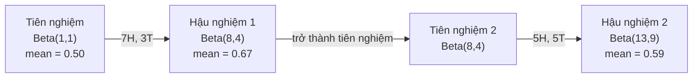

# Định lý Bayes

> Xác suất nói về điều bạn kỳ vọng. Định lý Bayes nói về điều bạn học được.

**Type:** Build
**Language:** Python
**Prerequisites:** Giai đoạn 1, Bài 06 (Nền tảng xác suất)
**Time:** ~75 phút

## Mục tiêu học tập

- Áp dụng định lý Bayes (Bayes' theorem) để tính xác suất hậu nghiệm (posterior) từ tiên nghiệm (prior), hợp lý (likelihood) và bằng chứng (evidence)
- Tự xây dựng một bộ phân loại văn bản Naive Bayes từ đầu, có làm mượt Laplace và tính toán trong không gian log
- So sánh ước lượng MLE và MAP, giải thích vì sao MAP tương ứng với chính quy hóa L2
- Cài đặt cập nhật Bayes tuần tự dùng tiên nghiệm liên hợp Beta-Binomial cho kiểm thử A/B

## Vấn đề

Một xét nghiệm y tế có độ chính xác 99%. Bạn xét nghiệm dương tính. Khả năng bạn thực sự mắc bệnh là bao nhiêu?

Hầu hết mọi người trả lời 99%. Câu trả lời thật phụ thuộc vào mức độ hiếm của căn bệnh. Nếu 1 trong 10,000 người mắc bệnh, một kết quả dương tính chỉ cho bạn khoảng 1% khả năng bị bệnh. 99% còn lại của các kết quả dương tính là báo động giả từ những người khỏe mạnh.

Đây không phải một câu hỏi mẹo. Đây là định lý Bayes. Mọi bộ lọc spam, mọi chẩn đoán y tế, mọi model học máy định lượng được sự không chắc chắn đều dùng đúng lập luận này. Bạn bắt đầu với một niềm tin. Bạn thấy bằng chứng. Bạn cập nhật.

Nếu bạn xây hệ thống ML mà không hiểu điều này, bạn sẽ diễn giải sai kết quả của model, đặt ngưỡng tồi và tung ra những dự đoán quá tự tin.

## Khái niệm

### Từ xác suất đồng thời đến Bayes

Bạn đã biết từ Bài 06 rằng xác suất có điều kiện (conditional probability) là:

```
P(A|B) = P(A and B) / P(B)
```

Và đối xứng:

```
P(B|A) = P(A and B) / P(A)
```

Cả hai biểu thức dùng chung một tử số: P(A and B). Cho chúng bằng nhau rồi sắp xếp lại:

```
P(A and B) = P(A|B) * P(B) = P(B|A) * P(A)

Therefore:

P(A|B) = P(B|A) * P(A) / P(B)
```

Đó là định lý Bayes. Bốn đại lượng, một phương trình.

### Bốn thành phần

| Phần | Tên | Ý nghĩa |
|------|------|---------------|
| P(A\|B) | Hậu nghiệm | Niềm tin đã cập nhật của bạn về A sau khi thấy bằng chứng B |
| P(B\|A) | Hợp lý | Mức độ khả dĩ của bằng chứng B nếu A đúng |
| P(A) | Tiên nghiệm | Niềm tin của bạn về A trước khi thấy bất kỳ bằng chứng nào |
| P(B) | Bằng chứng | Tổng xác suất thấy B trên mọi khả năng |

Số hạng bằng chứng P(B) đóng vai trò chuẩn hóa. Bạn có thể khai triển nó bằng luật xác suất toàn phần:

```
P(B) = P(B|A) * P(A) + P(B|not A) * P(not A)
```

### Ví dụ xét nghiệm y tế

Một căn bệnh ảnh hưởng 1 trong 10,000 người. Xét nghiệm chính xác 99% (bắt được 99% người bệnh, cho dương tính giả 1% số lần).

```
P(sick)          = 0.0001     (prior: disease is rare)
P(positive|sick) = 0.99       (likelihood: test catches it)
P(positive|healthy) = 0.01    (false positive rate)

P(positive) = P(positive|sick) * P(sick) + P(positive|healthy) * P(healthy)
            = 0.99 * 0.0001 + 0.01 * 0.9999
            = 0.000099 + 0.009999
            = 0.010098

P(sick|positive) = P(positive|sick) * P(sick) / P(positive)
                 = 0.99 * 0.0001 / 0.010098
                 = 0.0098
                 = 0.98%
```

Dưới 1%. Tiên nghiệm chi phối. Khi một tình trạng là hiếm, ngay cả xét nghiệm chính xác cũng chủ yếu tạo ra dương tính giả. Đây là lý do các bác sĩ chỉ định xét nghiệm xác nhận.

### Ví dụ bộ lọc spam

Bạn nhận được một email chứa từ "lottery". Nó có phải spam không?

```
P(spam)                = 0.3      (30% of email is spam)
P("lottery"|spam)      = 0.05     (5% of spam emails contain "lottery")
P("lottery"|not spam)  = 0.001    (0.1% of legitimate emails contain "lottery")

P("lottery") = 0.05 * 0.3 + 0.001 * 0.7
             = 0.015 + 0.0007
             = 0.0157

P(spam|"lottery") = 0.05 * 0.3 / 0.0157
                  = 0.955
                  = 95.5%
```

Một từ chuyển xác suất từ 30% lên 95.5%. Một bộ lọc spam thật áp dụng Bayes trên hàng trăm từ cùng lúc.

### Naive Bayes: giả định độc lập

Naive Bayes mở rộng điều này cho nhiều đặc trưng bằng cách giả định mọi đặc trưng đều độc lập có điều kiện khi đã biết lớp:

```
P(class | feature_1, feature_2, ..., feature_n)
  = P(class) * P(feature_1|class) * P(feature_2|class) * ... * P(feature_n|class)
    / P(feature_1, feature_2, ..., feature_n)
```

Phần "naive" chính là giả định độc lập. Trong văn bản, các lần xuất hiện của từ không độc lập ("New" và "York" có tương quan). Nhưng giả định này lại hiệu quả đến bất ngờ trong thực tế, vì bộ phân loại chỉ cần xếp hạng các lớp chứ không cần cho ra xác suất đã hiệu chỉnh.

Vì mẫu số giống nhau cho mọi lớp, bạn có thể bỏ qua nó và chỉ so sánh các tử số:

```
score(class) = P(class) * product of P(feature_i | class)
```

Chọn lớp có điểm cao nhất.

### Ước lượng hợp lý cực đại (MLE)

Làm sao bạn có P(feature|class) từ dữ liệu huấn luyện? Đếm.

```
P("free"|spam) = (number of spam emails containing "free") / (total spam emails)
```

Đây là MLE: chọn các giá trị tham số làm cho dữ liệu quan sát được trở nên khả dĩ nhất. Bạn đang cực đại hóa hàm hợp lý, mà với số đếm rời rạc thì rút gọn thành tần suất tương đối.

Vấn đề: nếu một từ không bao giờ xuất hiện trong spam khi huấn luyện, MLE gán cho nó xác suất bằng không. Một từ chưa từng thấy sẽ giết chết toàn bộ tích. Khắc phục điều này bằng làm mượt Laplace:

```
P(word|class) = (count(word, class) + 1) / (total_words_in_class + vocabulary_size)
```

Thêm 1 vào mọi số đếm đảm bảo không xác suất nào bằng không.

### Cực đại hậu nghiệm (MAP)

MLE hỏi: tham số nào cực đại hóa P(data|parameters)?

MAP hỏi: tham số nào cực đại hóa P(parameters|data)?

Theo định lý Bayes:

```
P(parameters|data) proportional to P(data|parameters) * P(parameters)
```

MAP thêm một tiên nghiệm trên chính các tham số. Nếu bạn tin rằng tham số nên nhỏ, bạn mã hóa điều đó thành một tiên nghiệm phạt các giá trị lớn. Điều này hoàn toàn giống chính quy hóa L2 trong ML. Số hạng phạt "ridge" trong hồi quy ridge thực chất chính là một tiên nghiệm Gaussian trên các trọng số.

| Ước lượng | Tối ưu hóa | Tương đương trong ML |
|------------|-----------|---------------|
| MLE | P(data\|params) | Huấn luyện không chính quy hóa |
| MAP | P(data\|params) * P(params) | Chính quy hóa L2 / L1 |

### Bayes so với tần suất: khác biệt thực tế

Người theo trường phái tần suất coi tham số là những ẩn số cố định. Họ hỏi: "Nếu tôi lặp lại thí nghiệm này nhiều lần, điều gì sẽ xảy ra?"

Người theo Bayes coi tham số là các phân phối. Họ hỏi: "Dựa trên những gì tôi đã quan sát, tôi tin gì về các tham số?"

Với việc xây hệ thống ML, khác biệt thực tế là:

| Khía cạnh | Tần suất | Bayes |
|--------|-------------|----------|
| Đầu ra | Ước lượng điểm | Phân phối trên các giá trị |
| Độ bất định | Khoảng tin cậy (về thủ tục) | Khoảng tín nhiệm (về tham số) |
| Dữ liệu ít | Có thể overfit | Tiên nghiệm đóng vai trò chính quy hóa |
| Tính toán | Thường nhanh hơn | Thường cần lấy mẫu (MCMC) |

Phần lớn ML trong sản xuất là tần suất (SGD, ước lượng điểm). Phương pháp Bayes tỏa sáng khi bạn cần độ bất định đã hiệu chỉnh (quyết định y tế, hệ thống an toàn trọng yếu) hoặc khi dữ liệu khan hiếm (học few-shot, khởi đầu nguội).

### Vì sao tư duy Bayes quan trọng với ML

Mối liên hệ còn sâu hơn một phép loại suy:

**Tiên nghiệm là chính quy hóa.** Một tiên nghiệm Gaussian trên trọng số là chính quy hóa L2. Một tiên nghiệm Laplace là L1. Mỗi lần bạn thêm một số hạng chính quy hóa, bạn đang đưa ra một phát biểu Bayes về những giá trị tham số mà bạn kỳ vọng.

**Hậu nghiệm là độ bất định.** Một xác suất dự đoán duy nhất không cho bạn biết model tự tin đến đâu vào ước lượng đó. Phương pháp Bayes cho bạn một phân phối: "Tôi nghĩ P(spam) nằm giữa 0.8 và 0.95."

**Cập nhật Bayes là học trực tuyến.** Hậu nghiệm hôm nay trở thành tiên nghiệm ngày mai. Khi model thấy dữ liệu mới, nó cập nhật niềm tin từng bước thay vì huấn luyện lại từ đầu.

**So sánh model là Bayes.** Tiêu chí thông tin Bayes (BIC), hợp lý biên, và hệ số Bayes đều dùng lập luận Bayes để chọn giữa các model mà không overfit.

```figure
bayes-update
```

## Tự tay làm

### Bước 1: Hàm định lý Bayes

```python
def bayes(prior, likelihood, false_positive_rate):
    evidence = likelihood * prior + false_positive_rate * (1 - prior)
    posterior = likelihood * prior / evidence
    return posterior

result = bayes(prior=0.0001, likelihood=0.99, false_positive_rate=0.01)
print(f"P(sick|positive) = {result:.4f}")
```

### Bước 2: Bộ phân loại Naive Bayes

```python
import math
from collections import defaultdict

class NaiveBayes:
    def __init__(self, smoothing=1.0):
        self.smoothing = smoothing
        self.class_counts = defaultdict(int)
        self.word_counts = defaultdict(lambda: defaultdict(int))
        self.class_word_totals = defaultdict(int)
        self.vocab = set()

    def train(self, documents, labels):
        for doc, label in zip(documents, labels):
            self.class_counts[label] += 1
            words = doc.lower().split()
            for word in words:
                self.word_counts[label][word] += 1
                self.class_word_totals[label] += 1
                self.vocab.add(word)

    def predict(self, document):
        words = document.lower().split()
        total_docs = sum(self.class_counts.values())
        vocab_size = len(self.vocab)
        best_class = None
        best_score = float("-inf")
        for cls in self.class_counts:
            score = math.log(self.class_counts[cls] / total_docs)
            for word in words:
                count = self.word_counts[cls].get(word, 0)
                total = self.class_word_totals[cls]
                score += math.log((count + self.smoothing) / (total + self.smoothing * vocab_size))
            if score > best_score:
                best_score = score
                best_class = cls
        return best_class
```

Xác suất log giúp tránh tràn dưới. Nhân nhiều xác suất nhỏ cho ra những số quá bé so với số thực dấu phẩy động. Cộng các log-xác suất thì ổn định về số học và tương đương về mặt toán học.

### Bước 3: Huấn luyện trên dữ liệu spam

```python
train_docs = [
    "win free money now",
    "free lottery ticket winner",
    "claim your prize today free",
    "urgent offer free cash",
    "congratulations you won free",
    "meeting tomorrow at noon",
    "project update attached",
    "can we schedule a call",
    "quarterly report review",
    "lunch on thursday sounds good",
    "team standup notes attached",
    "please review the pull request",
]

train_labels = [
    "spam", "spam", "spam", "spam", "spam",
    "ham", "ham", "ham", "ham", "ham", "ham", "ham",
]

classifier = NaiveBayes()
classifier.train(train_docs, train_labels)

test_messages = [
    "free money waiting for you",
    "meeting rescheduled to friday",
    "you won a free prize",
    "please review the attached report",
]

for msg in test_messages:
    print(f"  '{msg}' -> {classifier.predict(msg)}")
```

### Bước 4: Kiểm tra các xác suất đã học

```python
def show_top_words(classifier, cls, n=5):
    vocab_size = len(classifier.vocab)
    total = classifier.class_word_totals[cls]
    probs = {}
    for word in classifier.vocab:
        count = classifier.word_counts[cls].get(word, 0)
        probs[word] = (count + classifier.smoothing) / (total + classifier.smoothing * vocab_size)
    sorted_words = sorted(probs.items(), key=lambda x: x[1], reverse=True)
    for word, prob in sorted_words[:n]:
        print(f"    {word}: {prob:.4f}")

print("\nTop spam words:")
show_top_words(classifier, "spam")
print("\nTop ham words:")
show_top_words(classifier, "ham")
```

## Áp dụng

Scikit-learn cung cấp các bản triển khai naive Bayes (Bayes ngây thơ) sẵn sàng cho production:

```python
from sklearn.feature_extraction.text import CountVectorizer
from sklearn.naive_bayes import MultinomialNB
from sklearn.metrics import classification_report

vectorizer = CountVectorizer()
X_train = vectorizer.fit_transform(train_docs)
clf = MultinomialNB()
clf.fit(X_train, train_labels)

X_test = vectorizer.transform(test_messages)
predictions = clf.predict(X_test)
for msg, pred in zip(test_messages, predictions):
    print(f"  '{msg}' -> {pred}")
```

Cùng một thuật toán. CountVectorizer xử lý tokenization và xây dựng từ vựng. MultinomialNB xử lý làm trơn (smoothing) và xác suất log ở bên trong. Bản tự viết từ đầu của bạn làm đúng điều đó trong 40 dòng.

## Đóng gói

Lớp NaiveBayes dựng trong bài này minh hoạ toàn bộ pipeline: tokenization, ước lượng xác suất với làm trơn Laplace (Laplace smoothing), dự đoán trong không gian log (log-space). Mã trong `code/bayes.py` chạy end-to-end mà không cần thư viện nào ngoài thư viện chuẩn của Python.

### Tiên nghiệm liên hợp

Khi tiên nghiệm (prior) và hậu nghiệm (posterior) cùng thuộc một họ phân phối, tiên nghiệm đó được gọi là "liên hợp". Điều này khiến việc cập nhật Bayes trở nên gọn gàng về đại số -- bạn nhận được hậu nghiệm dạng đóng mà không cần tích phân số.

| Hợp lý | Tiên nghiệm liên hợp | Hậu nghiệm | Ví dụ |
|-----------|----------------|-----------|---------|
| Bernoulli | Beta(a, b) | Beta(a + successes, b + failures) | Ước lượng độ lệch của đồng xu |
| Normal (phương sai đã biết) | Normal(mu_0, sigma_0) | Normal(trung bình có trọng số, phương sai nhỏ hơn) | Hiệu chuẩn cảm biến |
| Poisson | Gamma(a, b) | Gamma(a + tổng số đếm, b + n) | Mô hình hoá tốc độ đến |
| Multinomial | Dirichlet(alpha) | Dirichlet(alpha + số đếm) | Mô hình hoá chủ đề, mô hình ngôn ngữ |

Vì sao điều này quan trọng: nếu không có tiên nghiệm liên hợp, bạn cần lấy mẫu Monte Carlo hoặc suy luận biến phân để xấp xỉ hậu nghiệm. Có tiên nghiệm liên hợp, bạn chỉ cần cập nhật hai con số.

Phân phối Beta là tiên nghiệm liên hợp phổ biến nhất trong thực tế. Beta(a, b) biểu diễn niềm tin của bạn về một tham số xác suất. Giá trị trung bình là a/(a+b). a+b càng lớn thì phân phối càng tập trung (càng tự tin).

Các trường hợp đặc biệt của tiên nghiệm Beta:
- Beta(1, 1) = đều. Bạn không có ý kiến gì về tham số.
- Beta(10, 10) = nhọn tại 0.5. Bạn tin chắc rằng tham số nằm gần 0.5.
- Beta(1, 10) = lệch về phía 0. Bạn tin rằng tham số nhỏ.

Quy tắc cập nhật cực kỳ đơn giản:

```
Prior:     Beta(a, b)
Data:      s successes, f failures
Posterior: Beta(a + s, b + f)
```

Không tích phân. Không lấy mẫu. Chỉ phép cộng.

### Cập nhật Bayes tuần tự

Suy luận Bayes vốn mang tính tuần tự. Hậu nghiệm hôm nay trở thành tiên nghiệm ngày mai. Đây là cách các hệ thống thực tế học tăng dần mà không phải xử lý lại toàn bộ dữ liệu lịch sử.

Ví dụ cụ thể: ước lượng xem một đồng xu có cân đối hay không.

**Ngày 1: Chưa có dữ liệu.**
Bắt đầu với Beta(1, 1) -- một tiên nghiệm đều. Bạn chưa có ý kiến gì.
- Trung bình của tiên nghiệm: 0.5
- Tiên nghiệm phẳng trên [0, 1]

**Ngày 2: Quan sát 7 mặt ngửa, 3 mặt sấp.**
Hậu nghiệm = Beta(1 + 7, 1 + 3) = Beta(8, 4)
- Trung bình hậu nghiệm: 8/12 = 0.667
- Bằng chứng cho thấy đồng xu lệch về phía mặt ngửa

**Ngày 3: Quan sát thêm 5 mặt ngửa, 5 mặt sấp.**
Dùng hậu nghiệm hôm qua làm tiên nghiệm hôm nay.
Hậu nghiệm = Beta(8 + 5, 4 + 5) = Beta(13, 9)
- Trung bình hậu nghiệm: 13/22 = 0.591
- Dữ liệu mới cân bằng đã kéo ước lượng trở lại gần 0.5



Thứ tự các quan sát không quan trọng. Beta(1,1) cập nhật với tất cả 12 mặt ngửa và 8 mặt sấp cùng lúc cũng cho Beta(13, 9) -- kết quả y hệt. Cập nhật tuần tự và cập nhật theo lô là tương đương về mặt toán học. Nhưng cập nhật tuần tự cho phép bạn ra quyết định ở mỗi bước mà không cần lưu dữ liệu thô.

Đây là nền tảng của học trực tuyến trong các hệ thống ML production. Thompson sampling cho bandit, hệ gợi ý tăng dần, và bộ phát hiện bất thường dạng streaming đều dùng mẫu hình này.

### Liên hệ với kiểm thử A/B

Kiểm thử A/B thực chất là suy luận Bayes được cải trang.

Thiết lập: bạn đang thử hai màu nút. Biến thể A (xanh dương) và biến thể B (xanh lá). Bạn muốn biết cái nào được nhấp nhiều hơn.

Kiểm thử A/B theo Bayes:

1. **Tiên nghiệm.** Bắt đầu với Beta(1, 1) cho cả hai biến thể. Không thiên lệch trước.
2. **Dữ liệu.** Biến thể A: 50 nhấp trên 1000 lượt xem. Biến thể B: 65 nhấp trên 1000 lượt xem.
3. **Hậu nghiệm.**
   - A: Beta(1 + 50, 1 + 950) = Beta(51, 951). Trung bình = 0.051
   - B: Beta(1 + 65, 1 + 935) = Beta(66, 936). Trung bình = 0.066
4. **Quyết định.** Tính P(B > A) -- xác suất rằng tỷ lệ chuyển đổi thật của B cao hơn của A.

Tính P(B > A) bằng giải tích thì khó. Nhưng Monte Carlo làm nó trở nên dễ dàng:

```
1. Draw 100,000 samples from Beta(51, 951)  -> samples_A
2. Draw 100,000 samples from Beta(66, 936)  -> samples_B
3. P(B > A) = fraction of samples where B > A
```

Nếu P(B > A) > 0.95, bạn tung biến thể B. Nếu nằm giữa 0.05 và 0.95, bạn tiếp tục thu thập dữ liệu. Nếu P(B > A) < 0.05, bạn tung biến thể A.

Ưu điểm so với kiểm thử A/B tần suất:
- Bạn có một phát biểu xác suất trực tiếp: "có 97% khả năng B tốt hơn"
- Không còn rối rắm về p-value. Không còn lối nói giảm nhẹ kiểu "không bác bỏ được giả thuyết không".
- Bạn có thể kiểm tra kết quả bất cứ lúc nào mà không làm phồng tỷ lệ dương tính giả (không có "vấn đề nhìn trước")
- Bạn có thể đưa tri thức tiên nghiệm vào (ví dụ các thử nghiệm trước cho thấy tỷ lệ chuyển đổi thường là 3-8%)

| Khía cạnh | A/B tần suất | A/B Bayes |
|--------|----------------|--------------|
| Đầu ra | p-value | P(B > A) |
| Diễn giải | "Dữ liệu này đáng ngạc nhiên đến đâu nếu A=B?" | "B tốt hơn A đến mức nào về khả năng?" |
| Dừng sớm | Làm phồng dương tính giả | An toàn ở mọi thời điểm (với tiên nghiệm chọn tốt và mô hình đặc tả đúng) |
| Tri thức tiên nghiệm | Không dùng | Mã hoá thành tiên nghiệm Beta |
| Quy tắc quyết định | p < 0.05 | P(B > A) > ngưỡng |

## Bài tập

1. **Nhiều lần xét nghiệm.** Một bệnh nhân có kết quả dương tính hai lần trên hai xét nghiệm độc lập (cả hai có độ chính xác 99%, tỷ lệ mắc bệnh 1 trên 10,000). P(bệnh) sau cả hai lần xét nghiệm là bao nhiêu? Dùng hậu nghiệm của lần xét nghiệm đầu làm tiên nghiệm cho lần thứ hai.

2. **Tác động của làm trơn.** Chạy bộ phân loại spam với các giá trị làm trơn 0.01, 0.1, 1.0 và 10.0. Xác suất của các từ hàng đầu thay đổi thế nào? Điều gì xảy ra với smoothing=0 và một từ chỉ xuất hiện trong ham?

3. **Thêm đặc trưng.** Mở rộng lớp NaiveBayes để dùng thêm độ dài tin nhắn (ngắn/dài) như một đặc trưng song song với số đếm từ. Hãy ước lượng P(short|spam) và P(short|ham) từ dữ liệu huấn luyện rồi đưa vào điểm dự đoán.

4. **MAP bằng tay.** Với dữ liệu quan sát được (7 mặt ngửa trong 10 lần tung đồng xu), hãy tính ước lượng MAP của độ lệch dùng tiên nghiệm Beta(2,2). So sánh với ước lượng MLE (7/10).

## Thuật ngữ chính

| Thuật ngữ | Người ta thường nói | Ý nghĩa thực sự |
|------|----------------|----------------------|
| Prior | "Phỏng đoán ban đầu của tôi" | P(hypothesis) trước khi quan sát bằng chứng. Trong ML: chính là số hạng regularization. |
| Likelihood | "Dữ liệu khớp đến đâu" | P(evidence\|hypothesis). Xác suất của dữ liệu quan sát được dưới một giả thuyết cụ thể. |
| Posterior | "Niềm tin đã cập nhật của tôi" | P(hypothesis\|evidence). Tiên nghiệm nhân với hợp lý, rồi chuẩn hoá. |
| Evidence | "Hằng số chuẩn hoá" | P(data) trên toàn bộ các giả thuyết. Đảm bảo hậu nghiệm cộng lại bằng 1. |
| Naive Bayes | "Cái bộ phân loại văn bản đơn giản đó" | Bộ phân loại giả định các đặc trưng độc lập khi đã biết lớp. Vẫn hoạt động tốt dù giả định đó sai. |
| Laplace smoothing | "Làm trơn cộng một" | Cộng thêm một số đếm nhỏ cho mọi đặc trưng để tránh xác suất bằng 0 do dữ liệu chưa gặp. |
| MLE | "Cứ dùng tần suất" | Chọn tham số làm cực đại P(data\|parameters). Không có tiên nghiệm. Có thể overfit khi dữ liệu nhỏ. |
| MAP | "MLE có thêm tiên nghiệm" | Chọn tham số làm cực đại P(data\|parameters) * P(parameters). Tương đương MLE có regularization. |
| Log-probability | "Làm việc trong không gian log" | Dùng log(P) thay cho P để tránh tràn số dưới khi nhân nhiều số nhỏ. |
| False positive | "Một báo động sai" | Xét nghiệm nói dương tính nhưng trạng thái thật là âm tính. Đây là thứ tạo ra ngụy biện tỷ lệ nền. |

## Đọc thêm

- [3Blue1Brown: Bayes' theorem](https://www.youtube.com/watch?v=HZGCoVF3YvM) - giải thích trực quan với ví dụ xét nghiệm y khoa
- [Stanford CS229: Generative Learning Algorithms](https://cs229.stanford.edu/main_notes.pdf) - naive Bayes và liên hệ của nó với mô hình phân biệt
- [Think Bayes](https://greenteapress.com/wp/think-bayes/) - sách miễn phí, thống kê Bayes kèm mã Python
- [scikit-learn Naive Bayes](https://scikit-learn.org/stable/modules/naive_bayes.html) - các bản triển khai production và khi nào nên dùng biến thể nào

---

[← Bài trước: Xác suất và Phân phối](../../06-probability-and-distributions/docs/vi.md) · [Bài sau: Tối ưu hóa →](../../08-optimization/docs/vi.md)
