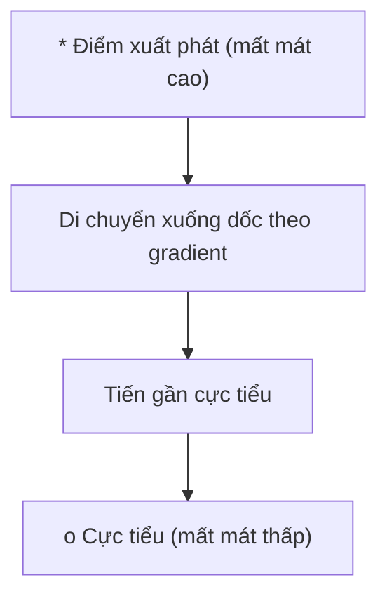
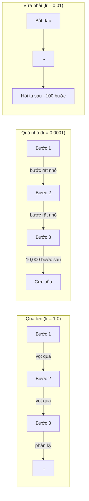
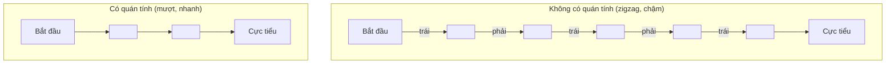
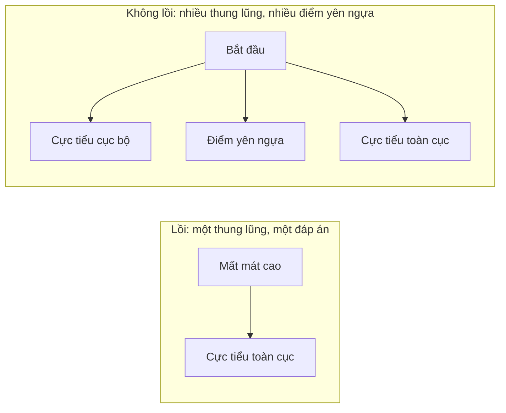
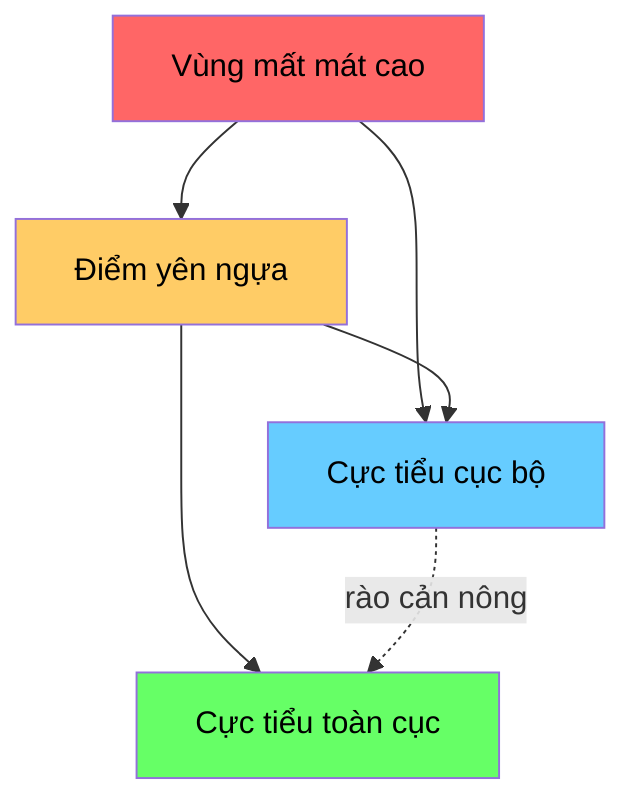

# Tối ưu hóa

> Huấn luyện một mạng nơ-ron không gì khác ngoài việc tìm đáy của một thung lũng.

**Type:** Build
**Language:** Python
**Prerequisites:** Phase 1, Lessons 04-05 (Derivatives, Gradients)
**Time:** ~75 phút

## Mục tiêu học tập

- Tự cài đặt gradient descent (hạ gradient) cơ bản, SGD với momentum (quán tính), và Adam từ đầu
- So sánh convergence (hội tụ) của các optimizer trên hàm Rosenbrock và giải thích vì sao Adam thích ứng learning rate (tốc độ học) theo từng weight
- Phân biệt cảnh quan mất mát convex (lồi) và không lồi, rồi giải thích vai trò của saddle point (điểm yên ngựa) trong không gian nhiều chiều
- Cấu hình lịch learning rate (giảm theo bước, ủ cosine, warmup) để huấn luyện ổn định

## Vấn đề

Bạn có một loss function (hàm mất mát). Nó cho biết model của bạn sai đến mức nào. Bạn có gradient. Chúng cho biết hướng nào làm mất mát tệ hơn. Giờ bạn cần một chiến lược để bước xuống dốc.

Cách ngây thơ rất đơn giản: đi ngược hướng gradient. Nhân bước đi với một con số gọi là learning rate. Lặp lại. Đó chính là gradient descent, và nó hiệu quả. Nhưng "hiệu quả" vẫn có những lưu ý. Learning rate quá lớn thì bạn vọt qua thung lũng hoàn toàn, nảy qua nảy lại giữa các thành. Quá nhỏ thì bạn bò về phía đáp án qua hàng nghìn bước không cần thiết. Gặp một saddle point thì bạn đứng yên, dù chưa tìm được cực tiểu nào.

Mọi optimizer trong deep learning đều trả lời cùng một câu hỏi: làm sao xuống đáy thung lũng nhanh hơn và chắc chắn hơn?

## Khái niệm

### Ý nghĩa của tối ưu hóa

Optimization (tối ưu hóa) là việc tìm các giá trị đầu vào làm cực tiểu (hoặc cực đại) một hàm. Trong machine learning, hàm đó là loss. Đầu vào là các weight của model. Huấn luyện chính là tối ưu hóa.

```
minimize L(w) where:
  L = loss function
  w = model weights (could be millions of parameters)
```

### Gradient descent (bản cơ bản)

Optimizer đơn giản nhất. Tính gradient của loss theo từng weight. Dịch mỗi weight ngược hướng gradient của nó. Nhân bước đi với learning rate.

```
w = w - lr * gradient
```

Toàn bộ thuật toán chỉ có vậy. Một dòng.



### Learning rate: siêu tham số quan trọng nhất

Learning rate quyết định kích thước bước đi. Nó chi phối mọi khía cạnh của convergence.



Không có công thức nào cho learning rate đúng. Bạn tìm ra nó bằng thực nghiệm. Điểm khởi đầu thường dùng: 0.001 cho Adam, 0.01 cho SGD với momentum.

### SGD so với batch và mini-batch

Gradient descent cơ bản tính gradient trên toàn bộ dataset trước khi thực hiện một bước. Cách này gọi là batch gradient descent. Nó ổn định nhưng chậm.

Stochastic gradient descent (SGD) tính gradient trên một mẫu ngẫu nhiên duy nhất rồi bước ngay. Nó nhiễu nhưng nhanh.

Mini-batch gradient descent dung hòa hai cách. Tính gradient trên một batch nhỏ (32, 64, 128, 256 mẫu), rồi bước. Đây là cách mọi người thực sự dùng.

| Biến thể | Kích thước batch | Chất lượng gradient | Tốc độ mỗi bước | Nhiễu |
|---------|-----------|-----------------|---------------|-------|
| Batch GD | Toàn bộ dataset | Chính xác | Chậm | Không |
| SGD | 1 mẫu | Rất nhiễu | Nhanh | Cao |
| Mini-batch | 32-256 | Ước lượng tốt | Cân bằng | Trung bình |

Nhiễu trong SGD và mini-batch không phải là lỗi. Nó giúp thoát khỏi local minima (cực tiểu cục bộ) nông và các saddle point.

### Momentum: quả bóng lăn xuống dốc

Gradient descent cơ bản chỉ nhìn gradient hiện tại. Nếu gradient zigzag (thường gặp trong thung lũng hẹp), tiến độ rất chậm. Momentum khắc phục điều này bằng cách tích lũy các gradient quá khứ vào một số hạng vận tốc.

```
v = beta * v + gradient
w = w - lr * v
```

Hình dung: một quả bóng lăn xuống dốc. Nó không dừng lại rồi khởi động lại ở mỗi chỗ gồ ghề. Nó tăng tốc theo những hướng nhất quán và làm dịu các dao động.



`beta` (thường là 0.9) quyết định giữ lại bao nhiêu lịch sử. Beta cao hơn nghĩa là nhiều quán tính hơn, đường đi mượt hơn, nhưng phản ứng chậm hơn với thay đổi hướng.

### Adam: learning rate thích ứng

Các weight khác nhau cần learning rate khác nhau. Một weight hiếm khi nhận gradient lớn nên bước dài hơn khi cuối cùng có gradient lớn. Một weight liên tục nhận gradient khổng lồ nên bước ngắn hơn.

Adam (Adaptive Moment Estimation) theo dõi hai thứ cho mỗi weight:

1. Moment bậc một (m): trung bình trượt của gradient (giống momentum)
2. Moment bậc hai (v): trung bình trượt của bình phương gradient (độ lớn gradient)

```
m = beta1 * m + (1 - beta1) * gradient
v = beta2 * v + (1 - beta2) * gradient^2

m_hat = m / (1 - beta1^t)    bias correction
v_hat = v / (1 - beta2^t)    bias correction

w = w - lr * m_hat / (sqrt(v_hat) + epsilon)
```

Phép chia cho `sqrt(v_hat)` là điểm mấu chốt. Các weight có gradient lớn bị chia cho một số lớn (bước hiệu dụng nhỏ). Các weight có gradient nhỏ bị chia cho một số nhỏ (bước hiệu dụng lớn). Mỗi weight có learning rate thích ứng riêng.

Siêu tham số mặc định: `lr=0.001, beta1=0.9, beta2=0.999, epsilon=1e-8`. Các giá trị mặc định này hiệu quả với hầu hết bài toán.

### Lịch learning rate

Learning rate cố định là một thỏa hiệp. Giai đoạn đầu huấn luyện, bạn muốn bước lớn để tiến nhanh. Giai đoạn cuối, bạn muốn bước nhỏ để tinh chỉnh gần cực tiểu.

Các lịch thường dùng:

| Lịch | Công thức | Trường hợp dùng |
|----------|---------|----------|
| Giảm theo bước | lr = lr * factor mỗi N epoch | Đơn giản, điều khiển thủ công |
| Giảm theo hàm mũ | lr = lr_0 * decay^t | Giảm mượt |
| Ủ cosine | lr = lr_min + 0.5 * (lr_max - lr_min) * (1 + cos(pi * t / T)) | Transformer, huấn luyện hiện đại |
| Warmup + giảm dần | Tăng tuyến tính, rồi giảm | Model lớn, tránh bất ổn giai đoạn đầu |

### Lồi và không lồi

Một hàm lồi chỉ có một cực tiểu. Gradient descent luôn tìm được nó. Một hàm bậc hai như `f(x) = x^2` là lồi.

Loss function của mạng nơ-ron thì không lồi. Chúng có nhiều cực tiểu cục bộ, nhiều điểm yên ngựa và nhiều vùng phẳng.



Trên thực tế, cực tiểu cục bộ trong mạng nơ-ron nhiều chiều hiếm khi là vấn đề. Phần lớn cực tiểu cục bộ có giá trị mất mát gần với cực tiểu toàn cục. Điểm yên ngựa (phẳng theo một số hướng, cong theo các hướng khác) mới là trở ngại thật sự. Momentum và nhiễu từ mini-batch giúp thoát khỏi chúng.

### Trực quan hóa cảnh quan mất mát

Loss là một hàm của toàn bộ weight. Với một model có 1 triệu weight, cảnh quan mất mát nằm trong không gian 1,000,001 chiều. Ta trực quan hóa bằng cách chọn hai hướng ngẫu nhiên trong không gian weight và vẽ loss dọc theo hai hướng đó, tạo ra một mặt phẳng 2D.



Cực tiểu nhọn tổng quát hóa kém. Cực tiểu phẳng tổng quát hóa tốt. Đây là một lý do SGD với momentum thường vượt Adam về độ chính xác test cuối cùng: nhiễu của nó ngăn việc lắng lại ở các cực tiểu nhọn.

```figure
gradient-descent
```

## Tự tay làm

### Bước 1: Định nghĩa một hàm kiểm thử

Hàm Rosenbrock là một bài kiểm thử chuẩn kinh điển cho tối ưu hoá. Cực tiểu của nó nằm tại (1, 1), bên trong một thung lũng cong và hẹp — dễ tìm ra nhưng khó đi theo.

```
f(x, y) = (1 - x)^2 + 100 * (y - x^2)^2
```

```python
def rosenbrock(params):
    x, y = params
    return (1 - x) ** 2 + 100 * (y - x ** 2) ** 2

def rosenbrock_gradient(params):
    x, y = params
    df_dx = -2 * (1 - x) + 200 * (y - x ** 2) * (-2 * x)
    df_dy = 200 * (y - x ** 2)
    return [df_dx, df_dy]
```

### Bước 2: Gradient descent (hạ gradient) cơ bản

```python
class GradientDescent:
    def __init__(self, lr=0.001):
        self.lr = lr

    def step(self, params, grads):
        return [p - self.lr * g for p, g in zip(params, grads)]
```

### Bước 3: SGD với momentum (quán tính)

```python
class SGDMomentum:
    def __init__(self, lr=0.001, momentum=0.9):
        self.lr = lr
        self.momentum = momentum
        self.velocity = None

    def step(self, params, grads):
        if self.velocity is None:
            self.velocity = [0.0] * len(params)
        self.velocity = [
            self.momentum * v + g
            for v, g in zip(self.velocity, grads)
        ]
        return [p - self.lr * v for p, v in zip(params, self.velocity)]
```

### Bước 4: Adam

```python
class Adam:
    def __init__(self, lr=0.001, beta1=0.9, beta2=0.999, epsilon=1e-8):
        self.lr = lr
        self.beta1 = beta1
        self.beta2 = beta2
        self.epsilon = epsilon
        self.m = None
        self.v = None
        self.t = 0

    def step(self, params, grads):
        if self.m is None:
            self.m = [0.0] * len(params)
            self.v = [0.0] * len(params)

        self.t += 1

        self.m = [
            self.beta1 * m + (1 - self.beta1) * g
            for m, g in zip(self.m, grads)
        ]
        self.v = [
            self.beta2 * v + (1 - self.beta2) * g ** 2
            for v, g in zip(self.v, grads)
        ]

        m_hat = [m / (1 - self.beta1 ** self.t) for m in self.m]
        v_hat = [v / (1 - self.beta2 ** self.t) for v in self.v]

        return [
            p - self.lr * mh / (vh ** 0.5 + self.epsilon)
            for p, mh, vh in zip(params, m_hat, v_hat)
        ]
```

### Bước 5: Chạy và so sánh

```python
def optimize(optimizer, func, grad_func, start, steps=5000):
    params = list(start)
    history = [params[:]]
    for _ in range(steps):
        grads = grad_func(params)
        params = optimizer.step(params, grads)
        history.append(params[:])
    return history

start = [-1.0, 1.0]

gd_history = optimize(GradientDescent(lr=0.0005), rosenbrock, rosenbrock_gradient, start)
sgd_history = optimize(SGDMomentum(lr=0.0001, momentum=0.9), rosenbrock, rosenbrock_gradient, start)
adam_history = optimize(Adam(lr=0.01), rosenbrock, rosenbrock_gradient, start)

for name, history in [("GD", gd_history), ("SGD+M", sgd_history), ("Adam", adam_history)]:
    final = history[-1]
    loss = rosenbrock(final)
    print(f"{name:6s} -> x={final[0]:.6f}, y={final[1]:.6f}, loss={loss:.8f}")
```

Kết quả mong đợi: Adam hội tụ nhanh nhất. SGD với quán tính đi theo một đường mượt hơn. GD thuần tiến rất chậm dọc theo thung lũng hẹp.

## Áp dụng

Trong thực tế, hãy dùng optimizer của PyTorch hoặc JAX. Chúng xử lý nhóm tham số, weight decay, gradient clipping và tăng tốc bằng GPU.

```python
import torch

model = torch.nn.Linear(784, 10)

sgd = torch.optim.SGD(model.parameters(), lr=0.01, momentum=0.9)
adam = torch.optim.Adam(model.parameters(), lr=0.001)
adamw = torch.optim.AdamW(model.parameters(), lr=0.001, weight_decay=0.01)

scheduler = torch.optim.lr_scheduler.CosineAnnealingLR(adam, T_max=100)
```

Vài nguyên tắc thực dụng:

- Bắt đầu với Adam (lr=0.001). Nó dùng được cho hầu hết bài toán mà không cần tinh chỉnh.
- Chuyển sang SGD với quán tính (lr=0.01, momentum=0.9) khi bạn cần độ chính xác cuối cùng tốt nhất và có thể bỏ thêm thời gian tinh chỉnh.
- Dùng AdamW (Adam với weight decay tách rời) cho transformer.
- Luôn dùng một schedule cho learning rate (tốc độ học) khi huấn luyện dài hơn vài epoch.
- Nếu huấn luyện không ổn định, hãy giảm learning rate. Nếu huấn luyện quá chậm, hãy tăng nó.

## Đóng gói

Bài học này tạo ra một prompt để chọn đúng optimizer. Xem `outputs/prompt-optimizer-guide.md`.

Các lớp optimizer dựng ở đây sẽ xuất hiện lại ở Phase 3, khi chúng ta huấn luyện một mạng nơ-ron từ đầu.

## Bài tập

1. **Quét learning rate.** Chạy gradient descent thuần trên hàm Rosenbrock với các learning rate [0.0001, 0.0005, 0.001, 0.005, 0.01]. Vẽ hoặc in ra loss cuối cùng sau 5000 bước cho từng giá trị. Tìm learning rate lớn nhất mà vẫn hội tụ.

2. **So sánh momentum.** Chạy SGD với các giá trị momentum [0.0, 0.5, 0.9, 0.99] trên hàm Rosenbrock. Ghi lại loss ở mỗi bước. Giá trị momentum nào hội tụ nhanh nhất? Giá trị nào vượt quá đà?

3. **Thoát khỏi điểm yên ngựa.** Định nghĩa hàm `f(x, y) = x^2 - y^2` (một điểm yên ngựa tại gốc toạ độ). Xuất phát tại (0.01, 0.01). So sánh cách GD thuần, SGD với momentum và Adam hành xử. Cái nào thoát được điểm yên ngựa?

4. **Cài đặt suy giảm learning rate.** Thêm một schedule suy giảm theo hàm mũ vào lớp GradientDescent: `lr = lr_0 * 0.999^step`. So sánh hội tụ khi có và khi không có suy giảm trên hàm Rosenbrock.

## Thuật ngữ chính

| Thuật ngữ | Người ta thường nói | Ý nghĩa thực sự |
|------|----------------|----------------------|
| Gradient descent | "Đi xuống dốc" | Cập nhật trọng số bằng cách trừ đi gradient nhân với learning rate. Optimizer cơ bản nhất. |
| Learning rate | "Kích thước bước" | Một số vô hướng điều khiển mỗi lần cập nhật đẩy trọng số đi bao xa. Quá lớn gây phân kỳ. Quá nhỏ thì phí tính toán. |
| Momentum | "Cứ tiếp tục lăn" | Tích luỹ các gradient trong quá khứ thành một vector vận tốc. Giảm dao động và tăng tốc di chuyển theo những hướng nhất quán. |
| SGD | "Lấy mẫu ngẫu nhiên" | Stochastic gradient descent. Tính gradient trên một tập con ngẫu nhiên thay vì toàn bộ dữ liệu. Trong thực tế gần như luôn có nghĩa là mini-batch SGD. |
| Mini-batch | "Một khúc dữ liệu" | Một tập con nhỏ của dữ liệu huấn luyện (32-256 mẫu) dùng để ước lượng gradient. Cân bằng giữa tốc độ và độ chính xác của gradient. |
| Adam | "Optimizer mặc định" | Adaptive Moment Estimation. Theo dõi trung bình động của gradient và bình phương gradient cho từng trọng số, để mỗi trọng số có learning rate riêng. |
| Bias correction | "Sửa khởi đầu nguội" | Mô-men bậc một và bậc hai của Adam được khởi tạo bằng 0. Bias correction chia cho (1 - beta^t) để bù lại trong những bước đầu. |
| Learning rate schedule | "Đổi lr theo thời gian" | Một hàm điều chỉnh learning rate trong quá trình huấn luyện. Bước lớn lúc đầu, bước nhỏ về sau. |
| Convex function | "Một thung lũng" | Một hàm mà mọi cực tiểu cục bộ đều là cực tiểu toàn cục. Gradient descent luôn tìm được nó. Loss của mạng nơ-ron không lồi. |
| Saddle point | "Bằng phẳng nhưng không phải cực tiểu" | Một điểm mà gradient bằng 0 nhưng nó là cực tiểu theo vài hướng và là cực đại theo những hướng khác. Phổ biến ở không gian nhiều chiều. |
| Loss landscape | "Địa hình" | Hàm loss được vẽ trên không gian trọng số. Được trực quan hoá bằng cách cắt lát theo hai hướng ngẫu nhiên. |
| Convergence | "Tới đích" | Optimizer đã đạt tới điểm mà các bước tiếp theo không làm giảm loss một cách có ý nghĩa nữa. |

## Đọc thêm

- [Sebastian Ruder: An overview of gradient descent optimization algorithms](https://ruder.io/optimizing-gradient-descent/) - khảo sát toàn diện mọi optimizer chính
- [Why Momentum Really Works (Distill)](https://distill.pub/2017/momentum/) - trực quan hoá tương tác về động lực học của momentum
- [Adam: A Method for Stochastic Optimization (Kingma & Ba, 2014)](https://arxiv.org/abs/1412.6980) - bài báo gốc về Adam, dễ đọc và ngắn
- [Visualizing the Loss Landscape of Neural Nets (Li et al., 2018)](https://arxiv.org/abs/1712.09913) - bài báo cho thấy cực tiểu nhọn so với cực tiểu phẳng
