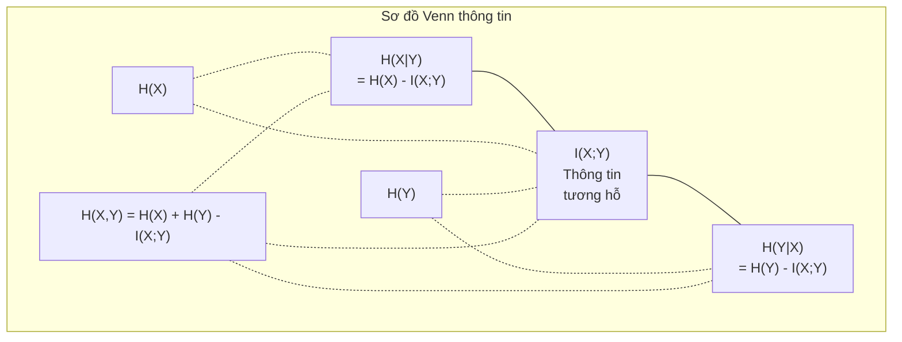

# Lý thuyết thông tin

> Lý thuyết thông tin (information theory) đo lường sự bất ngờ. Các hàm mất mát được dựng trên nền nó.

**Type:** Learn
**Language:** Python
**Prerequisites:** Giai đoạn 1, Bài 06 (Xác suất)
**Time:** ~60 phút

## Mục tiêu học tập

- Tính entropy, entropy chéo (cross-entropy) và phân kỳ KL (KL divergence) từ đầu, rồi giải thích quan hệ giữa chúng
- Chứng minh vì sao tối thiểu hoá mất mát entropy chéo lại tương đương với tối đa hoá log-likelihood
- Tính thông tin tương hỗ giữa các đặc trưng và biến mục tiêu để xếp hạng tầm quan trọng của đặc trưng
- Giải thích perplexity như kích thước từ vựng hiệu dụng mà một mô hình ngôn ngữ chọn ra

## Vấn đề

Bạn gọi `CrossEntropyLoss()` trong mọi mô hình phân loại mà bạn huấn luyện. Bạn thấy "perplexity" trong mọi bài báo về mô hình ngôn ngữ. Bạn đọc về phân kỳ KL trong VAE, distillation và RLHF. Đây không phải những khái niệm rời rạc. Tất cả đều là cùng một ý tưởng, chỉ đội những chiếc mũ khác nhau.

Lý thuyết thông tin cho bạn ngôn ngữ để lập luận về sự bất định, nén và dự đoán. Claude Shannon phát minh ra nó năm 1948 để giải các bài toán truyền thông. Hoá ra, huấn luyện một mạng nơ-ron cũng là một bài toán truyền thông: mô hình đang cố truyền nhãn đúng qua một kênh nhiễu gồm các trọng số đã học.

Bài này dựng lại mọi công thức từ đầu để bạn thấy chúng đến từ đâu và vì sao chúng hoạt động.

## Khái niệm

### Nội dung thông tin (Độ ngạc nhiên)

Khi một điều ít khả năng xảy ra mà lại xảy ra, nó mang nhiều thông tin hơn. Đồng xu rơi vào mặt ngửa? Không có gì đáng ngạc nhiên. Trúng số? Rất đáng ngạc nhiên.

Lượng thông tin của một sự kiện có xác suất p là:

```
I(x) = -log(p(x))
```

Dùng log cơ số 2 thì bạn có bit (bits). Dùng log tự nhiên thì bạn có nat. Cùng một ý tưởng, khác đơn vị.

```
Event              Probability    Surprise (bits)
Fair coin heads    0.5            1.0
Rolling a 6        0.167          2.58
1-in-1000 event    0.001          9.97
Certain event      1.0            0.0
```

Những sự kiện chắc chắn mang lượng thông tin bằng không. Bạn đã biết chúng sẽ xảy ra rồi.

### Entropy (Độ ngạc nhiên trung bình)

Entropy (entropy) là độ ngạc nhiên (surprisal) kỳ vọng trên toàn bộ các kết cục có thể có của một phân phối xác suất (probability distribution).

```
H(P) = -sum( p(x) * log(p(x)) )  for all x
```

Một đồng xu cân đối có entropy cực đại với biến nhị phân: 1 bit. Một đồng xu lệch (99% ngửa) có entropy thấp: 0.08 bit. Bạn đã biết điều gì sẽ xảy ra, nên mỗi lần tung chẳng nói cho bạn điều gì đáng kể.

```
Fair coin:    H = -(0.5 * log2(0.5) + 0.5 * log2(0.5)) = 1.0 bit
Biased coin:  H = -(0.99 * log2(0.99) + 0.01 * log2(0.01)) = 0.08 bits
```

Entropy đo sự bất định không thể giảm bớt trong một phân phối. Bạn không thể nén xuống dưới mức đó.

### Entropy chéo (Hàm mất mát bạn dùng mỗi ngày)

Entropy chéo đo độ ngạc nhiên trung bình khi bạn dùng phân phối Q để mã hoá những sự kiện thực ra đến từ phân phối P.

```
H(P, Q) = -sum( p(x) * log(q(x)) )  for all x
```

P là phân phối thật (các nhãn). Q là dự đoán của mô hình bạn. Nếu Q khớp hoàn toàn với P, entropy chéo bằng entropy. Mọi chỗ lệch đều làm nó lớn hơn.

Trong phân loại, P là một vector one-hot (lớp đúng có xác suất 1, mọi thứ khác là 0). Điều này rút gọn entropy chéo thành:

```
H(P, Q) = -log(q(true_class))
```

Đó chính là toàn bộ công thức mất mát entropy chéo cho phân loại. Hãy tối đa hoá xác suất dự đoán của lớp đúng.

### Phân kỳ KL (Khoảng cách giữa các phân phối)

Phân kỳ KL đo lượng ngạc nhiên thêm mà bạn phải chịu khi dùng Q thay cho P.

```
D_KL(P || Q) = sum( p(x) * log(p(x) / q(x)) )  for all x
             = H(P, Q) - H(P)
```

Entropy chéo bằng entropy cộng phân kỳ KL. Vì entropy của phân phối thật là hằng số trong suốt quá trình huấn luyện, tối thiểu hoá entropy chéo cũng chính là tối thiểu hoá phân kỳ KL. Bạn đang đẩy phân phối của mô hình về phía phân phối thật.

Phân kỳ KL không đối xứng: D_KL(P || Q) != D_KL(Q || P). Nó không phải một metric khoảng cách thực sự.

### Thông tin tương hỗ

Thông tin tương hỗ đo việc biết một biến cho bạn biết bao nhiêu về một biến khác.

```
I(X; Y) = H(X) - H(X|Y)
        = H(X) + H(Y) - H(X, Y)
```

Nếu X và Y độc lập, thông tin tương hỗ bằng không. Biết biến này chẳng nói gì về biến kia. Nếu chúng tương quan hoàn hảo, thông tin tương hỗ bằng entropy của một trong hai biến.

Trong chọn đặc trưng, thông tin tương hỗ cao giữa một đặc trưng và biến mục tiêu nghĩa là đặc trưng đó hữu ích. Thông tin tương hỗ thấp nghĩa là nó chỉ là nhiễu.

### Entropy có điều kiện

H(Y|X) đo lượng bất định còn lại về Y sau khi bạn quan sát X.

```
H(Y|X) = H(X,Y) - H(X)
```

Hai thái cực:
- Nếu X xác định hoàn toàn Y, thì H(Y|X) = 0. Biết X xoá hết mọi bất định về Y. Ví dụ: X = nhiệt độ theo Celsius, Y = nhiệt độ theo Fahrenheit.
- Nếu X chẳng nói gì về Y, thì H(Y|X) = H(Y). Biết X không hề làm giảm bất định của bạn. Ví dụ: X = một lần tung đồng xu, Y = thời tiết ngày mai.

Entropy có điều kiện luôn không âm và không bao giờ vượt quá H(Y):

```
0 <= H(Y|X) <= H(Y)
```

Trong học máy, entropy có điều kiện xuất hiện trong cây quyết định. Ở mỗi lần chia, thuật toán chọn đặc trưng X làm tối thiểu H(Y|X) -- đặc trưng loại bỏ nhiều bất định nhất về nhãn Y.

### Entropy đồng thời

H(X,Y) là entropy của phân phối đồng thời của X và Y cùng nhau.

```
H(X,Y) = -sum sum p(x,y) * log(p(x,y))   for all x, y
```

Tính chất then chốt:

```
H(X,Y) <= H(X) + H(Y)
```

Dấu bằng xảy ra khi X và Y độc lập. Nếu chúng chia sẻ thông tin, entropy đồng thời nhỏ hơn tổng các entropy riêng. Phần entropy "thiếu" đó đúng chính là thông tin tương hỗ.



Các quan hệ:
- H(X,Y) = H(X) + H(Y|X) = H(Y) + H(X|Y)
- I(X;Y) = H(X) - H(X|Y) = H(Y) - H(Y|X)
- H(X,Y) = H(X) + H(Y) - I(X;Y)

### Thông tin tương hỗ (Đi sâu)

Thông tin tương hỗ I(X;Y) định lượng mức độ mà việc biết một biến làm giảm bất định về biến kia.

```
I(X;Y) = H(X) - H(X|Y)
       = H(Y) - H(Y|X)
       = H(X) + H(Y) - H(X,Y)
       = sum sum p(x,y) * log(p(x,y) / (p(x) * p(y)))
```

Các tính chất:
- I(X;Y) >= 0 luôn luôn. Bạn không bao giờ mất thông tin khi quan sát một thứ gì đó.
- I(X;Y) = 0 khi và chỉ khi X và Y độc lập.
- I(X;Y) = I(Y;X). Nó đối xứng, khác với phân kỳ KL.
- I(X;X) = H(X). Một biến chia sẻ toàn bộ thông tin của nó với chính nó.

**Thông tin tương hỗ cho chọn đặc trưng.** Trong ML, bạn muốn những đặc trưng chứa thông tin về biến mục tiêu. Thông tin tương hỗ cho bạn một cách có nguyên tắc để xếp hạng đặc trưng:

1. Với mỗi đặc trưng X_i, tính I(X_i; Y) trong đó Y là biến mục tiêu.
2. Xếp hạng các đặc trưng theo điểm MI.
3. Giữ k đặc trưng đứng đầu.

Cách này hiệu quả với mọi quan hệ giữa đặc trưng và biến mục tiêu -- tuyến tính, phi tuyến, đơn điệu hay không. Tương quan chỉ bắt được quan hệ tuyến tính. MI bắt được mọi thứ.

| Phương pháp | Phát hiện | Chi phí tính toán | Xử lý được dữ liệu phân loại? |
|--------|---------|-------------------|---------------------|
| Tương quan Pearson | Quan hệ tuyến tính | O(n) | Không |
| Tương quan Spearman | Quan hệ đơn điệu | O(n log n) | Không |
| Thông tin tương hỗ | Mọi phụ thuộc thống kê | O(n log n) với chia giỏ | Có |

### Làm mượt nhãn và entropy chéo

Phân loại tiêu chuẩn dùng nhãn cứng: [0, 0, 1, 0]. Lớp đúng nhận xác suất 1, mọi thứ khác nhận 0. Làm mượt nhãn thay chúng bằng nhãn mềm:

```
soft_target = (1 - epsilon) * hard_target + epsilon / num_classes
```

Với epsilon = 0.1 và 4 lớp:
- Nhãn cứng: [0, 0, 1, 0]
- Nhãn mềm: [0.025, 0.025, 0.925, 0.025]

Từ góc nhìn lý thuyết thông tin, làm mượt nhãn tăng entropy của phân phối nhãn. Nhãn one-hot cứng có entropy 0 -- không có bất định. Nhãn mềm có entropy dương.

Vì sao điều này có ích:
- Ngăn mô hình đẩy logits tới giá trị cực đoan (muốn khớp hoàn hảo một nhãn one-hot dưới entropy chéo thì sẽ cần logits vô hạn)
- Hoạt động như regularization: mô hình không thể tự tin 100%
- Cải thiện calibration: xác suất dự đoán phản ánh đúng bất định thật
- Giảm khoảng cách giữa hành vi lúc huấn luyện và lúc suy luận

Mất mát entropy chéo khi có làm mượt nhãn trở thành:

```
L = (1 - epsilon) * CE(hard_target, prediction) + epsilon * H_uniform(prediction)
```

Số hạng thứ hai phạt những dự đoán cách xa phân phối đều -- một regularization trực tiếp trên độ tự tin.

### Vì sao cross-entropy (entropy chéo) LÀ hàm mất mát của phân loại

Ba góc nhìn, cùng một kết luận.

**Góc nhìn lý thuyết thông tin.** Cross-entropy đo xem bạn lãng phí bao nhiêu bit khi dùng phân phối của model thay cho phân phối thật. Tối thiểu hóa nó làm cho model của bạn trở thành bộ mã hóa thực tại hiệu quả nhất.

**Góc nhìn hợp lý cực đại.** Với N mẫu huấn luyện có lớp thật y_i:

```
Likelihood     = product( q(y_i) )
Log-likelihood = sum( log(q(y_i)) )
Negative log-likelihood = -sum( log(q(y_i)) )
```

Dòng cuối cùng chính là mất mát cross-entropy. Tối thiểu hóa cross-entropy = cực đại hóa hợp lý của dữ liệu huấn luyện dưới model của bạn.

**Góc nhìn gradient.** Gradient của cross-entropy theo logits đơn giản là (dự đoán - thật). Gọn gàng, ổn định và tính nhanh. Đây là lý do nó kết hợp hoàn hảo với softmax.

### Bit vs Nat

Khác biệt duy nhất là cơ số log.

```
log base 2   -> bits      (information theory tradition)
log base e   -> nats      (machine learning convention)
log base 10  -> hartleys  (rarely used)
```

1 nat = 1/ln(2) bit = 1.4427 bit. PyTorch và TensorFlow mặc định dùng log tự nhiên (nats).

### Perplexity

Perplexity là lũy thừa của cross-entropy. Nó cho bạn biết số lượng hiệu dụng các lựa chọn đồng khả năng mà model đang phân vân.

```
Perplexity = 2^H(P,Q)   (if using bits)
Perplexity = e^H(P,Q)   (if using nats)
```

Một language model có perplexity 50 nghĩa là trung bình nó bối rối như thể phải chọn đều từ 50 token tiếp theo khả dĩ. Thấp hơn là tốt hơn.

GPT-2 đạt perplexity ~30 trên các benchmark phổ biến. Các model hiện đại ở mức một chữ số với những miền được đại diện tốt.

```figure
entropy-kl
```

## Tự tay làm

### Bước 1: Lượng tin và entropy

```python
import math

def information_content(p, base=2):
    if p <= 0 or p > 1:
        return float('inf') if p <= 0 else 0.0
    return -math.log(p) / math.log(base)

def entropy(probs, base=2):
    return sum(
        p * information_content(p, base)
        for p in probs if p > 0
    )

fair_coin = [0.5, 0.5]
biased_coin = [0.99, 0.01]
fair_die = [1/6] * 6

print(f"Fair coin entropy:   {entropy(fair_coin):.4f} bits")
print(f"Biased coin entropy: {entropy(biased_coin):.4f} bits")
print(f"Fair die entropy:    {entropy(fair_die):.4f} bits")
```

### Bước 2: Cross-entropy và KL divergence (phân kỳ KL)

```python
def cross_entropy(p, q, base=2):
    total = 0.0
    for pi, qi in zip(p, q):
        if pi > 0:
            if qi <= 0:
                return float('inf')
            total += pi * (-math.log(qi) / math.log(base))
    return total

def kl_divergence(p, q, base=2):
    return cross_entropy(p, q, base) - entropy(p, base)

true_dist = [0.7, 0.2, 0.1]
good_model = [0.6, 0.25, 0.15]
bad_model = [0.1, 0.1, 0.8]

print(f"Entropy of true dist:     {entropy(true_dist):.4f} bits")
print(f"CE (good model):          {cross_entropy(true_dist, good_model):.4f} bits")
print(f"CE (bad model):           {cross_entropy(true_dist, bad_model):.4f} bits")
print(f"KL divergence (good):     {kl_divergence(true_dist, good_model):.4f} bits")
print(f"KL divergence (bad):      {kl_divergence(true_dist, bad_model):.4f} bits")
```

### Bước 3: Cross-entropy như hàm mất mát phân loại

```python
def softmax(logits):
    max_logit = max(logits)
    exps = [math.exp(z - max_logit) for z in logits]
    total = sum(exps)
    return [e / total for e in exps]

def cross_entropy_loss(true_class, logits):
    probs = softmax(logits)
    return -math.log(probs[true_class])

logits = [2.0, 1.0, 0.1]
true_class = 0

probs = softmax(logits)
loss = cross_entropy_loss(true_class, logits)

print(f"Logits:      {logits}")
print(f"Softmax:     {[f'{p:.4f}' for p in probs]}")
print(f"True class:  {true_class}")
print(f"Loss:        {loss:.4f} nats")
print(f"Perplexity:  {math.exp(loss):.2f}")
```

### Bước 4: Cross-entropy bằng âm log-likelihood

```python
import random

random.seed(42)

n_samples = 1000
n_classes = 3
true_labels = [random.randint(0, n_classes - 1) for _ in range(n_samples)]
model_logits = [[random.gauss(0, 1) for _ in range(n_classes)] for _ in range(n_samples)]

ce_loss = sum(
    cross_entropy_loss(label, logits)
    for label, logits in zip(true_labels, model_logits)
) / n_samples

nll = -sum(
    math.log(softmax(logits)[label])
    for label, logits in zip(true_labels, model_logits)
) / n_samples

print(f"Cross-entropy loss:      {ce_loss:.6f}")
print(f"Negative log-likelihood: {nll:.6f}")
print(f"Difference:              {abs(ce_loss - nll):.2e}")
```

### Bước 5: Mutual information (thông tin tương hỗ)

```python
def mutual_information(joint_probs, base=2):
    rows = len(joint_probs)
    cols = len(joint_probs[0])

    margin_x = [sum(joint_probs[i][j] for j in range(cols)) for i in range(rows)]
    margin_y = [sum(joint_probs[i][j] for i in range(rows)) for j in range(cols)]

    mi = 0.0
    for i in range(rows):
        for j in range(cols):
            pxy = joint_probs[i][j]
            if pxy > 0:
                mi += pxy * math.log(pxy / (margin_x[i] * margin_y[j])) / math.log(base)
    return mi

independent = [[0.25, 0.25], [0.25, 0.25]]
dependent = [[0.45, 0.05], [0.05, 0.45]]

print(f"MI (independent): {mutual_information(independent):.4f} bits")
print(f"MI (dependent):   {mutual_information(dependent):.4f} bits")
```

## Áp dụng

Cùng những khái niệm đó nhưng dùng NumPy, đúng theo cách bạn sẽ dùng trong thực tế:

```python
import numpy as np

def np_entropy(p):
    p = np.asarray(p, dtype=float)
    mask = p > 0
    result = np.zeros_like(p)
    result[mask] = p[mask] * np.log(p[mask])
    return -result.sum()

def np_cross_entropy(p, q):
    p, q = np.asarray(p, dtype=float), np.asarray(q, dtype=float)
    mask = p > 0
    return -(p[mask] * np.log(q[mask])).sum()

def np_kl_divergence(p, q):
    return np_cross_entropy(p, q) - np_entropy(p)

true = np.array([0.7, 0.2, 0.1])
pred = np.array([0.6, 0.25, 0.15])
print(f"Entropy:    {np_entropy(true):.4f} nats")
print(f"Cross-ent:  {np_cross_entropy(true, pred):.4f} nats")
print(f"KL div:     {np_kl_divergence(true, pred):.4f} nats")
```

Bạn vừa tự xây từ đầu đúng thứ mà `torch.nn.CrossEntropyLoss()` làm bên trong. Giờ bạn đã hiểu vì sao loss giảm dần trong quá trình huấn luyện: phân phối dự đoán của model đang tiến gần hơn tới phân phối thật, đo bằng số nat thông tin bị lãng phí.

## Bài tập

1. Tính entropy của bảng chữ cái tiếng Anh giả sử phân phối đều (26 chữ cái). Sau đó ước lượng nó bằng tần suất chữ cái thực tế. Cái nào cao hơn và vì sao?

2. Một model xuất ra logits [5.0, 2.0, 0.5] cho một mẫu có lớp thật là 1. Hãy tính mất mát cross-entropy bằng tay, rồi kiểm chứng bằng hàm `cross_entropy_loss` của bạn. Logits nào sẽ cho loss bằng 0?

3. Chứng minh rằng KL divergence không đối xứng. Chọn hai phân phối P và Q, tính D_KL(P || Q) và D_KL(Q || P). Giải thích vì sao chúng khác nhau.

4. Xây dựng một hàm tính perplexity cho một chuỗi dự đoán token. Cho danh sách các cặp (true_token_index, predicted_logits), trả về perplexity của chuỗi đó.

## Thuật ngữ chính

| Thuật ngữ | Người ta thường nói | Ý nghĩa thực sự |
|------|----------------|----------------------|
| Information content | "Bất ngờ" | Số bit (hoặc nat) cần để mã hóa một sự kiện: -log(p) |
| Entropy | "Độ ngẫu nhiên" | Độ bất ngờ trung bình trên mọi kết cục của một phân phối. Đo mức bất định không thể khử bỏ. |
| Cross-entropy | "Hàm loss" | Độ bất ngờ trung bình khi dùng phân phối Q của model để mã hóa các sự kiện từ phân phối thật P. |
| KL divergence | "Khoảng cách giữa hai phân phối" | Số bit thừa bị lãng phí do dùng Q thay cho P. Bằng cross-entropy trừ entropy. Không đối xứng. |
| Mutual information | "X và Y liên quan đến nhau thế nào" | Mức giảm bất định về X khi biết Y. Bằng 0 nghĩa là độc lập. |
| Softmax | "Biến logits thành xác suất" | Lấy lũy thừa rồi chuẩn hóa. Ánh xạ mọi vector giá trị thực thành một phân phối xác suất hợp lệ. |
| Perplexity | "Model bối rối đến mức nào" | Lũy thừa của cross-entropy. Kích thước từ vựng hiệu dụng mà model đang chọn ra ở mỗi bước. |
| Bits | "Đơn vị của Shannon" | Thông tin đo bằng log cơ số 2. Một bit phân giải một lần tung đồng xu cân đối. |
| Nats | "Đơn vị của ML" | Thông tin đo bằng log tự nhiên. PyTorch và TensorFlow mặc định dùng đơn vị này. |
| Negative log-likelihood | "NLL loss" | Đồng nhất với mất mát cross-entropy khi nhãn là one-hot. Tối thiểu hóa nó là cực đại hóa xác suất của các dự đoán đúng. |

## Đọc thêm

- [Shannon 1948: A Mathematical Theory of Communication](https://people.math.harvard.edu/~ctm/home/text/others/shannon/entropy/entropy.pdf) - bài báo gốc, vẫn còn dễ đọc
- [Visual Information Theory (Chris Olah)](https://colah.github.io/posts/2015-09-Visual-Information/) - giải thích trực quan hay nhất về entropy và KL divergence
- [PyTorch CrossEntropyLoss docs](https://pytorch.org/docs/stable/generated/torch.nn.CrossEntropyLoss.html) - cách framework hiện thực đúng thứ bạn vừa tự xây
