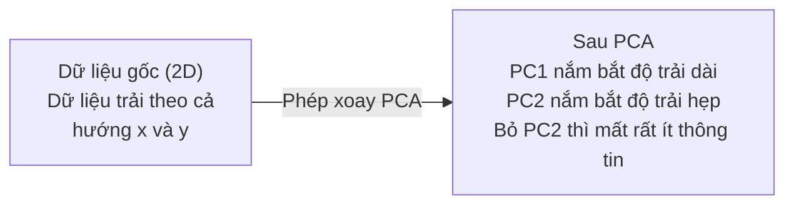

# Giảm chiều (dimensionality reduction)

> Dữ liệu nhiều chiều có cấu trúc. Bạn tìm ra nó bằng cách nhìn từ đúng góc.

**Type:** Build
**Language:** Python
**Prerequisites:** Giai đoạn 1, Bài 01 (Linear Algebra Intuition), 02 (Vectors, Matrices & Operations), 03 (Eigenvalues & Eigenvectors), 06 (Probability & Distributions)
**Time:** ~90 phút

## Mục tiêu học tập

- Tự cài đặt PCA từ đầu: chuẩn hoá tâm dữ liệu, tính ma trận hiệp phương sai (covariance), phân rã trị riêng, rồi chiếu dữ liệu
- Dùng tỷ lệ phương sai (variance) được giải thích và phương pháp khuỷu tay để chọn số thành phần chính
- So sánh PCA, t-SNE và UMAP để trực quan hoá các chữ số MNIST trong 2D và giải thích ưu nhược điểm của chúng
- Áp dụng kernel PCA với kernel RBF để tách những cấu trúc dữ liệu phi tuyến mà PCA chuẩn không xử lý được

## Vấn đề

Bạn có một tập dữ liệu với 784 đặc trưng cho mỗi mẫu. Có thể đó là giá trị điểm ảnh của các chữ số viết tay. Có thể đó là mức độ biểu hiện gen. Có thể đó là các tín hiệu hành vi người dùng. Bạn không thể trực quan hoá 784 chiều. Bạn không thể vẽ chúng. Bạn thậm chí không thể hình dung nổi chúng.

Nhưng phần lớn trong 784 đặc trưng đó là dư thừa. Thông tin thực sự nằm trên một bề mặt nhỏ hơn nhiều. Một chữ "7" viết tay không cần 784 con số độc lập để mô tả nó. Nó cần vài con số: góc của nét bút, độ dài của nét ngang, mức độ nghiêng. Phần còn lại là nhiễu.

Giảm chiều đi tìm bề mặt nhỏ hơn đó. Nó lấy dữ liệu 784 chiều của bạn và nén xuống 2, 10 hoặc 50 chiều, trong khi vẫn giữ cấu trúc quan trọng.

## Khái niệm

### Lời nguyền số chiều (curse of dimensionality)

Không gian nhiều chiều rất phản trực giác. Ba thứ sụp đổ khi số chiều tăng lên.

**Khoảng cách trở nên vô nghĩa.** Trong không gian nhiều chiều, khoảng cách giữa hai điểm ngẫu nhiên bất kỳ hội tụ về cùng một giá trị. Nếu mọi điểm đều cách mọi điểm khác xấp xỉ như nhau, tìm kiếm láng giềng gần nhất không còn tác dụng.

```
Dimension    Avg distance ratio (max/min between random points)
2            ~5.0
10           ~1.8
100          ~1.2
1000         ~1.02
```

**Thể tích tập trung ở các góc.** Một siêu lập phương đơn vị trong d chiều có 2^d góc. Trong 100 chiều, gần như toàn bộ thể tích nằm ở các góc, cách xa tâm. Các điểm dữ liệu lan ra phía rìa và model của bạn thiếu dữ liệu ở phần trong.

**Bạn cần lượng dữ liệu tăng theo cấp số nhân.** Để giữ nguyên mật độ mẫu trong một không gian, đi từ 2D lên 20D nghĩa là bạn cần lượng dữ liệu nhiều gấp 10^18 lần. Bạn không bao giờ có đủ. Giảm chiều đưa mật độ dữ liệu trở lại mức dùng được.

### PCA: tìm những hướng quan trọng

Phân tích thành phần chính (PCA) tìm các trục mà dữ liệu của bạn biến thiên nhiều nhất. Nó xoay hệ toạ độ để trục thứ nhất nắm bắt nhiều phương sai nhất, trục thứ hai nắm bắt nhiều thứ nhì, và cứ thế.

Thuật toán:

```
1. Center the data        (subtract the mean from each feature)
2. Compute covariance     (how features move together)
3. Eigendecomposition     (find the principal directions)
4. Sort by eigenvalue     (biggest variance first)
5. Project               (keep top k eigenvectors, drop the rest)
```

Tại sao lại là phân rã trị riêng? Ma trận hiệp phương sai là đối xứng và nửa xác định dương. Các vectơ riêng (eigenvector) của nó là những hướng trực giao trong không gian đặc trưng. Các trị riêng (eigenvalue) cho bạn biết mỗi hướng nắm bắt bao nhiêu phương sai. Vectơ riêng có trị riêng lớn nhất trỏ theo hướng có phương sai lớn nhất.



- **Trước PCA:** đám mây dữ liệu trải theo đường chéo qua cả trục x và trục y
- **Sau PCA:** hệ toạ độ được xoay để PC1 thẳng hàng với hướng có phương sai lớn nhất (độ trải dài) và PC2 thẳng hàng với hướng có phương sai nhỏ nhất (độ trải hẹp)
- **Giảm chiều:** bỏ PC2 sẽ chiếu dữ liệu lên PC1, mất rất ít thông tin

### Tỷ lệ phương sai được giải thích

Mỗi thành phần chính nắm bắt một phần của tổng phương sai. Tỷ lệ phương sai được giải thích cho bạn biết đó là bao nhiêu.

```
Component    Eigenvalue    Explained ratio    Cumulative
PC1          4.73          0.473              0.473
PC2          2.51          0.251              0.724
PC3          1.12          0.112              0.836
PC4          0.89          0.089              0.925
...
```

Khi phương sai được giải thích tích luỹ đạt 0.95, bạn biết rằng chừng đó thành phần nắm bắt 95% thông tin. Mọi thứ sau đó hầu như chỉ là nhiễu.

### Chọn số thành phần

Ba chiến lược:

1. **Ngưỡng.** Giữ đủ thành phần để giải thích 90-95% phương sai.
2. **Phương pháp khuỷu tay.** Vẽ phương sai được giải thích theo từng thành phần. Tìm chỗ sụt giảm mạnh.
3. **Hiệu năng ở tác vụ phía sau.** Dùng PCA như bước tiền xử lý. Quét k và đo độ chính xác của model. k tốt nhất là chỗ độ chính xác đi ngang.

### t-SNE: giữ lại các láng giềng

t-Distributed Stochastic Neighbor Embedding (t-SNE) được thiết kế để trực quan hoá. Nó ánh xạ dữ liệu nhiều chiều xuống 2D (hoặc 3D) trong khi vẫn giữ lại việc điểm nào ở gần điểm nào.

Trực giác: trong không gian gốc, hãy tính một phân bố xác suất trên các cặp điểm dựa trên khoảng cách giữa chúng. Điểm gần nhận xác suất cao. Điểm xa nhận xác suất thấp. Sau đó tìm một cách sắp xếp trong 2D sao cho cùng phân bố xác suất đó vẫn đúng. Những điểm là láng giềng của nhau trong 784 chiều vẫn là láng giềng trong 2D.

Các tính chất chính của t-SNE:
- Phi tuyến. Nó có thể mở ra những đa tạp (manifold) phức tạp mà PCA không làm được.
- Ngẫu nhiên. Các lần chạy khác nhau cho ra các cách sắp xếp khác nhau.
- Tham số perplexity điều khiển số láng giềng được xét (khoảng điển hình: 5-50).
- Khoảng cách giữa các cụm trong kết quả không có ý nghĩa. Chỉ bản thân các cụm là có ý nghĩa.
- Chậm trên tập dữ liệu lớn. Mặc định là O(n^2).

### UMAP: nhanh hơn, cấu trúc toàn cục tốt hơn

Uniform Manifold Approximation and Projection (UMAP) hoạt động tương tự t-SNE nhưng có hai ưu điểm:
- Nhanh hơn. Nó dùng đồ thị láng giềng gần nhất xấp xỉ thay vì tính tất cả các khoảng cách theo cặp.
- Cấu trúc toàn cục tốt hơn. Vị trí tương đối của các cụm trong kết quả thường có ý nghĩa hơn so với t-SNE.

UMAP xây một đồ thị có trọng số trong không gian nhiều chiều ("biểu diễn tôpô mờ") rồi tìm một cách sắp xếp ít chiều giữ lại đồ thị này tốt nhất có thể.

Các tham số chính:
- `n_neighbors`: bao nhiêu láng giềng định nghĩa cấu trúc cục bộ (tương tự perplexity). Giá trị cao hơn giữ lại nhiều cấu trúc toàn cục hơn.
- `min_dist`: các điểm xếp sát nhau đến mức nào trong kết quả. Giá trị thấp hơn tạo ra các cụm đặc hơn.

### Khi nào dùng cách nào

| Phương pháp | Trường hợp dùng | Giữ lại | Tốc độ |
|--------|----------|-----------|-------|
| PCA | Tiền xử lý trước khi huấn luyện | Phương sai toàn cục | Nhanh (chính xác), chạy được trên hàng triệu mẫu |
| PCA | Trực quan hoá khám phá nhanh | Cấu trúc tuyến tính | Nhanh |
| t-SNE | Biểu đồ 2D chất lượng xuất bản | Các láng giềng cục bộ | Chậm (lý tưởng là dưới 10k mẫu) |
| UMAP | Trực quan hoá 2D ở quy mô lớn | Cấu trúc cục bộ + một phần toàn cục | Trung bình (xử lý được hàng triệu mẫu) |
| PCA | Giảm đặc trưng cho model | Đặc trưng xếp theo phương sai | Nhanh |
| t-SNE / UMAP | Hiểu cấu trúc cụm | Tách cụm | Trung bình đến chậm |

Quy tắc ngón tay cái: dùng PCA để tiền xử lý và nén dữ liệu. Dùng t-SNE hoặc UMAP khi bạn cần trực quan hoá cấu trúc trong 2D.

### Kernel PCA

PCA chuẩn tìm các không gian con tuyến tính. Nó xoay hệ toạ độ của bạn và bỏ bớt trục. Nhưng nếu dữ liệu nằm trên một đa tạp phi tuyến thì sao? Một đường tròn trong 2D không thể tách bằng bất kỳ đường thẳng nào. PCA chuẩn sẽ không giúp được gì.

Kernel PCA áp dụng PCA trong một không gian đặc trưng nhiều chiều được sinh ra bởi một hàm kernel, mà không cần tính tường minh toạ độ trong không gian đó. Đây là mẹo kernel -- cùng ý tưởng đứng sau SVM.

Thuật toán:
1. Tính ma trận kernel K, trong đó K_ij = k(x_i, x_j)
2. Chuẩn hoá tâm ma trận kernel trong không gian đặc trưng
3. Phân rã trị riêng ma trận kernel đã chuẩn hoá tâm
4. Các vectơ riêng hàng đầu (được nhân với 1/sqrt(eigenvalue)) chính là các phép chiếu (projection)

Các hàm kernel thông dụng:

| Kernel | Công thức | Phù hợp với |
|--------|---------|----------|
| RBF (Gaussian) | exp(-gamma * \|\|x - y\|\|^2) | Hầu hết dữ liệu phi tuyến, các đa tạp trơn |
| Polynomial | (x . y + c)^d | Các quan hệ đa thức |
| Sigmoid | tanh(alpha * x . y + c) | Ánh xạ kiểu mạng nơ-ron |

Khi nào dùng kernel PCA và khi nào dùng PCA chuẩn:

| Tiêu chí | PCA chuẩn | Kernel PCA |
|-----------|-------------|------------|
| Cấu trúc dữ liệu | Không gian con tuyến tính | Đa tạp phi tuyến |
| Tốc độ | O(min(n^2 d, d^2 n)) | O(n^2 d + n^3) |
| Khả năng diễn giải | Các thành phần là tổ hợp tuyến tính của các đặc trưng | Các thành phần không diễn giải trực tiếp theo đặc trưng |
| Khả năng mở rộng | Chạy được trên hàng triệu mẫu | Ma trận kernel là n x n, bị giới hạn bộ nhớ |
| Tái tạo | Biến đổi nghịch đảo trực tiếp | Cần xấp xỉ tiền ảnh (pre-image) |

Ví dụ kinh điển: các đường tròn đồng tâm trong 2D. Hai vòng điểm, vòng này nằm trong vòng kia. PCA chuẩn chiếu cả hai lên cùng một đường thẳng -- vô dụng cho phân loại. Kernel PCA với kernel RBF ánh xạ vòng trong và vòng ngoài sang các vùng khác nhau, khiến chúng tách được bằng đường tuyến tính.

### Sai số tái tạo

Việc giảm chiều của bạn tốt đến đâu? Bạn đã nén 784 chiều xuống 50. Bạn mất những gì?

Đo sai số tái tạo:
1. Chiếu dữ liệu xuống k chiều: X_reduced = X @ W_k
2. Tái tạo: X_hat = X_reduced @ W_k^T
3. Tính MSE: mean((X - X_hat)^2)

Với PCA, sai số tái tạo có quan hệ rõ ràng với phương sai được giải thích:

```
Reconstruction error = sum of eigenvalues NOT included
Total variance = sum of ALL eigenvalues
Fraction lost = (sum of dropped eigenvalues) / (sum of all eigenvalues)
```

Tỷ lệ phương sai được giải thích cho từng thành phần là:

```
explained_ratio_k = eigenvalue_k / sum(all eigenvalues)
```

Vẽ phương sai được giải thích tích luỹ theo số thành phần cho bạn đường cong "khuỷu tay". Số thành phần đúng là chỗ:
- Đường cong phẳng ra (lợi ích giảm dần)
- Phương sai tích luỹ vượt ngưỡng của bạn (thường là 0.90 hoặc 0.95)
- Hiệu năng của tác vụ phía sau đi ngang

Sai số tái tạo còn hữu ích ngoài việc chọn k. Bạn có thể dùng nó để phát hiện bất thường: các mẫu có sai số tái tạo cao là những điểm ngoại lai không khớp với không gian con đã học. Đây là nền tảng của phát hiện bất thường dựa trên PCA trong các hệ thống production.

```figure
pca-axes
```

## Tự tay làm

### Bước 1: PCA từ đầu

```python
import numpy as np

class PCA:
    def __init__(self, n_components):
        self.n_components = n_components
        self.components = None
        self.mean = None
        self.eigenvalues = None
        self.explained_variance_ratio_ = None

    def fit(self, X):
        self.mean = np.mean(X, axis=0)
        X_centered = X - self.mean

        cov_matrix = np.cov(X_centered, rowvar=False)

        eigenvalues, eigenvectors = np.linalg.eigh(cov_matrix)

        sorted_idx = np.argsort(eigenvalues)[::-1]
        eigenvalues = eigenvalues[sorted_idx]
        eigenvectors = eigenvectors[:, sorted_idx]

        self.components = eigenvectors[:, :self.n_components].T
        self.eigenvalues = eigenvalues[:self.n_components]
        total_var = np.sum(eigenvalues)
        self.explained_variance_ratio_ = self.eigenvalues / total_var

        return self

    def transform(self, X):
        X_centered = X - self.mean
        return X_centered @ self.components.T

    def fit_transform(self, X):
        self.fit(X)
        return self.transform(X)
```

### Bước 2: Kiểm thử trên dữ liệu tổng hợp

```python
np.random.seed(42)
n_samples = 500

t = np.random.uniform(0, 2 * np.pi, n_samples)
x1 = 3 * np.cos(t) + np.random.normal(0, 0.2, n_samples)
x2 = 3 * np.sin(t) + np.random.normal(0, 0.2, n_samples)
x3 = 0.5 * x1 + 0.3 * x2 + np.random.normal(0, 0.1, n_samples)

X_synthetic = np.column_stack([x1, x2, x3])

pca = PCA(n_components=2)
X_reduced = pca.fit_transform(X_synthetic)

print(f"Original shape: {X_synthetic.shape}")
print(f"Reduced shape:  {X_reduced.shape}")
print(f"Explained variance ratios: {pca.explained_variance_ratio_}")
print(f"Total variance captured: {sum(pca.explained_variance_ratio_):.4f}")
```

### Bước 3: Chữ số MNIST trong 2D

```python
from sklearn.datasets import fetch_openml

mnist = fetch_openml("mnist_784", version=1, as_frame=False, parser="auto")
X_mnist = mnist.data[:5000].astype(float)
y_mnist = mnist.target[:5000].astype(int)

pca_mnist = PCA(n_components=50)
X_pca50 = pca_mnist.fit_transform(X_mnist)
print(f"50 components capture {sum(pca_mnist.explained_variance_ratio_):.2%} of variance")

pca_2d = PCA(n_components=2)
X_pca2d = pca_2d.fit_transform(X_mnist)
print(f"2 components capture {sum(pca_2d.explained_variance_ratio_):.2%} of variance")
```

### Bước 4: So sánh với sklearn

```python
from sklearn.decomposition import PCA as SklearnPCA
from sklearn.manifold import TSNE

sklearn_pca = SklearnPCA(n_components=2)
X_sklearn_pca = sklearn_pca.fit_transform(X_mnist)

print(f"\nOur PCA explained variance:     {pca_2d.explained_variance_ratio_}")
print(f"Sklearn PCA explained variance: {sklearn_pca.explained_variance_ratio_}")

diff = np.abs(np.abs(X_pca2d) - np.abs(X_sklearn_pca))
print(f"Max absolute difference: {diff.max():.10f}")

tsne = TSNE(n_components=2, perplexity=30, random_state=42)
X_tsne = tsne.fit_transform(X_mnist)
print(f"\nt-SNE output shape: {X_tsne.shape}")
```

### Bước 5: So sánh với UMAP

```python
try:
    from umap import UMAP

    reducer = UMAP(n_components=2, n_neighbors=15, min_dist=0.1, random_state=42)
    X_umap = reducer.fit_transform(X_mnist)
    print(f"UMAP output shape: {X_umap.shape}")
except ImportError:
    print("Install umap-learn: pip install umap-learn")
```

## Áp dụng

Dùng PCA làm bước tiền xử lý trước một bộ phân loại:

```python
from sklearn.decomposition import PCA as SklearnPCA
from sklearn.linear_model import LogisticRegression
from sklearn.model_selection import train_test_split
from sklearn.metrics import accuracy_score

X_train, X_test, y_train, y_test = train_test_split(
    X_mnist, y_mnist, test_size=0.2, random_state=42
)

results = {}
for k in [10, 30, 50, 100, 200]:
    pca_k = SklearnPCA(n_components=k)
    X_tr = pca_k.fit_transform(X_train)
    X_te = pca_k.transform(X_test)

    clf = LogisticRegression(max_iter=1000, random_state=42)
    clf.fit(X_tr, y_train)
    acc = accuracy_score(y_test, clf.predict(X_te))
    var_captured = sum(pca_k.explained_variance_ratio_)
    results[k] = (acc, var_captured)
    print(f"k={k:>3d}  accuracy={acc:.4f}  variance={var_captured:.4f}")
```

Hiệu năng chững lại từ rất lâu trước khi chạm 784 chiều. Điểm chững đó chính là điểm vận hành của bạn.

## Đóng gói

Bài học này tạo ra:
- `outputs/skill-dimensionality-reduction.md` - một skill để chọn đúng kỹ thuật giảm chiều cho một bài toán cụ thể

## Bài tập

1. Sửa lớp PCA để hỗ trợ `inverse_transform`. Tái tạo các chữ số MNIST từ 10, 50 và 200 thành phần. In sai số tái tạo (reconstruction error) — trung bình bình phương độ lệch so với bản gốc — cho từng trường hợp.

2. Chạy t-SNE trên cùng tập con MNIST với perplexity lần lượt 5, 30 và 100. Mô tả đầu ra thay đổi ra sao. Vì sao perplexity ảnh hưởng đến độ chặt của cụm?

3. Lấy một bộ dữ liệu có 50 đặc trưng mà chỉ 5 đặc trưng mang thông tin (tạo bằng `sklearn.datasets.make_classification`). Áp dụng PCA và kiểm tra xem đường cong phương sai giải thích được có nhận ra đúng rằng dữ liệu thực chất là 5 chiều hay không.

## Thuật ngữ chính

| Thuật ngữ | Người ta thường nói | Ý nghĩa thực sự |
|------|----------------|----------------------|
| Curse of dimensionality | "Quá nhiều đặc trưng" | Khoảng cách, thể tích và mật độ dữ liệu đều hành xử phản trực giác khi số chiều tăng. Mô hình cần lượng dữ liệu tăng theo hàm mũ để bù lại. |
| PCA | "Giảm số chiều" | Xoay hệ tọa độ sao cho các trục trùng với những hướng có phương sai lớn nhất, rồi bỏ đi các trục có phương sai thấp. |
| Principal component | "Một hướng quan trọng" | Một vector riêng của ma trận hiệp phương sai. Hướng trong không gian đặc trưng mà dữ liệu biến thiên nhiều nhất. |
| Explained variance ratio | "Thành phần này chứa bao nhiêu thông tin" | Phần phương sai tổng được một thành phần chính nắm giữ. Cộng k tỷ lệ đầu tiên để biết k thành phần giữ lại được bao nhiêu. |
| Covariance matrix | "Các đặc trưng tương quan thế nào" | Ma trận đối xứng trong đó phần tử (i,j) đo mức độ đặc trưng i và đặc trưng j cùng biến thiên. Các phần tử trên đường chéo là phương sai riêng của từng đặc trưng. |
| t-SNE | "Cái biểu đồ cụm đó" | Phương pháp phi tuyến ánh xạ dữ liệu nhiều chiều xuống 2D bằng cách giữ xác suất lân cận theo từng cặp. Tốt cho trực quan hóa, không dùng để tiền xử lý. |
| UMAP | "t-SNE nhanh hơn" | Phương pháp phi tuyến dựa trên phân tích dữ liệu tô-pô. Giữ được cả cấu trúc cục bộ lẫn một phần cấu trúc toàn cục. Mở rộng tốt hơn t-SNE. |
| Perplexity | "Một núm vặn của t-SNE" | Kiểm soát số lân cận hiệu dụng mà mỗi điểm xét đến. Perplexity thấp tập trung vào cấu trúc rất cục bộ. Perplexity cao bắt được những mẫu rộng hơn. |
| Manifold | "Bề mặt mà dữ liệu sống trên đó" | Một bề mặt ít chiều hơn được nhúng trong không gian nhiều chiều hơn. Một tờ giấy bị vò trong không gian 3D là một đa tạp 2D. |

## Đọc thêm

- [A Tutorial on Principal Component Analysis](https://arxiv.org/abs/1404.1100) (Shlens) - cách dẫn giải PCA rõ ràng từ những bước cơ bản
- [How to Use t-SNE Effectively](https://distill.pub/2016/misread-tsne/) (Wattenberg et al.) - hướng dẫn tương tác về những cạm bẫy của t-SNE và cách chọn tham số
- [UMAP documentation](https://umap-learn.readthedocs.io/) - lý thuyết và hướng dẫn thực hành từ chính các tác giả UMAP

---

[← Bài trước: Lý thuyết thông tin](../../09-information-theory/docs/vi.md) · [Bài sau: Phân rã giá trị kỳ dị →](../../11-singular-value-decomposition/docs/vi.md)
