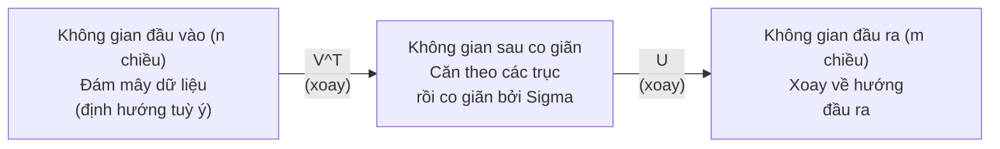
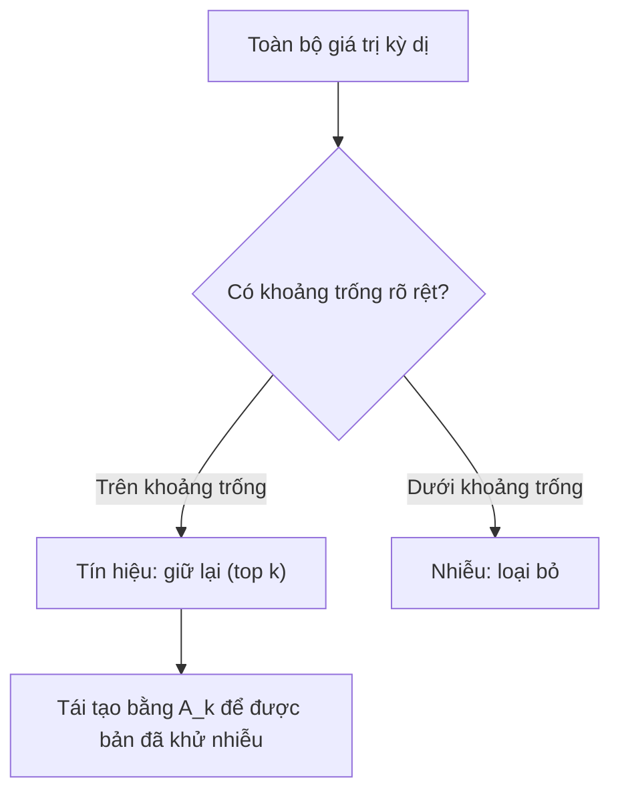

# Phân rã giá trị kỳ dị

> SVD (phân rã giá trị kỳ dị) là con dao đa năng của đại số tuyến tính. Ma trận nào cũng có một bộ. Nhà khoa học dữ liệu nào cũng cần một bộ.

**Type:** Build
**Languages:** Python, Julia
**Prerequisites:** Giai đoạn 1, Bài 01 (Linear Algebra Intuition), 02 (Vectors & Matrices Operations), 03 (Matrix Transformations)
**Time:** ~120 phút

## Mục tiêu học tập

- Cài đặt SVD bằng power iteration và giải thích ý nghĩa hình học của U, Sigma và V^T
- Áp dụng SVD rút gọn (truncated SVD) để nén ảnh và đo tỉ lệ nén so với sai số tái tạo
- Tính giả nghịch đảo (pseudoinverse) Moore-Penrose qua SVD để giải các hệ bình phương tối thiểu quá xác định
- Nối SVD với PCA, hệ gợi ý (các nhân tố ẩn) và Latent Semantic Analysis trong NLP

## Vấn đề

Bạn có một ma trận 1000x2000. Có thể đó là bảng đánh giá của người dùng cho phim. Có thể đó là bảng tần suất từ–tài liệu. Có thể đó là giá trị điểm ảnh của một bức ảnh. Bạn cần nén nó, khử nhiễu nó, tìm cấu trúc ẩn bên trong nó, hoặc dùng nó để giải một hệ bình phương tối thiểu. Phân rã trị riêng chỉ hoạt động với ma trận vuông. Mà ngay cả khi ma trận vuông, nó cũng đòi hỏi ma trận phải có đủ một bộ vector riêng độc lập tuyến tính.

SVD hoạt động với mọi ma trận. Mọi kích thước. Mọi hạng (rank). Không cần điều kiện gì. Nó phân rã ma trận thành ba nhân tử, làm lộ ra hình học của những gì ma trận làm với không gian. Đây là phân rã tổng quát nhất và hữu ích nhất trong toàn bộ đại số tuyến tính.

## Khái niệm

### SVD làm gì về mặt hình học

Mọi ma trận, bất kể kích thước, đều thực hiện ba phép liên tiếp: xoay, co giãn, xoay. SVD làm cho phân rã này trở nên tường minh.

```
A = U * Sigma * V^T

      m x n     m x m    m x n    n x n
     (any)    (rotate)  (scale)  (rotate)
```

Cho một ma trận A bất kỳ, SVD phân rã nó thành:
- V^T xoay các vector trong không gian đầu vào (n chiều)
- Sigma co giãn dọc theo từng trục (kéo dài hoặc nén lại)
- U xoay kết quả vào không gian đầu ra (m chiều)



Hãy hình dung thế này. Bạn đưa cho SVD một ma trận. Nó bảo bạn: "Ma trận này lấy một khối cầu các đầu vào, trước tiên xoay khối đó bằng V^T, rồi kéo nó thành một ellipsoid bằng Sigma, rồi xoay ellipsoid bằng U." Các giá trị kỳ dị chính là độ dài các trục của ellipsoid đó.

### Phân rã đầy đủ

Với một ma trận A có kích thước m x n:

```
A = U * Sigma * V^T

where:
  U     is m x m, orthogonal (U^T U = I)
  Sigma is m x n, diagonal (singular values on the diagonal)
  V     is n x n, orthogonal (V^T V = I)

The singular values sigma_1 >= sigma_2 >= ... >= sigma_r > 0
where r = rank(A)
```

Các cột của U được gọi là vector kỳ dị trái. Các cột của V được gọi là vector kỳ dị phải. Các phần tử trên đường chéo của Sigma được gọi là giá trị kỳ dị. Chúng luôn không âm và theo quy ước được sắp xếp giảm dần.

### Vector kỳ dị trái, giá trị kỳ dị, vector kỳ dị phải

Mỗi thành phần của SVD có một ý nghĩa hình học riêng.

**Vector kỳ dị phải (các cột của V):** Chúng tạo thành một cơ sở trực chuẩn cho không gian đầu vào (R^n). Đó là những hướng trong không gian đầu vào mà ma trận ánh xạ thành những hướng trực giao (orthogonal) trong không gian đầu ra. Hãy coi chúng như hệ toạ độ tự nhiên của miền xác định.

**Giá trị kỳ dị (đường chéo của Sigma):** Đây là các hệ số co giãn. Giá trị kỳ dị thứ i cho bạn biết ma trận kéo dài các vector dọc theo vector kỳ dị phải thứ i bao nhiêu lần. Một giá trị kỳ dị bằng không nghĩa là ma trận nghiền nát hoàn toàn hướng đó.

**Vector kỳ dị trái (các cột của U):** Chúng tạo thành một cơ sở trực chuẩn cho không gian đầu ra (R^m). Vector kỳ dị trái thứ i là hướng trong không gian đầu ra mà vector kỳ dị phải thứ i hạ cánh xuống (sau khi đã co giãn).

Mối quan hệ giữa chúng:

```
A * v_i = sigma_i * u_i

The matrix A takes the i-th right singular vector v_i,
scales it by sigma_i, and maps it to the i-th left singular vector u_i.
```

Điều này cho bạn một bức tranh theo từng toạ độ về những gì một ma trận bất kỳ làm.

### Dạng tích ngoài

SVD có thể được viết thành tổng của các ma trận hạng 1:

```
A = sigma_1 * u_1 * v_1^T + sigma_2 * u_2 * v_2^T + ... + sigma_r * u_r * v_r^T

Each term sigma_i * u_i * v_i^T is a rank-1 matrix (an outer product).
The full matrix is the sum of r such matrices, where r is the rank.
```

Dạng này là nền tảng của xấp xỉ hạng thấp (low-rank approximation). Mỗi số hạng thêm vào một lớp cấu trúc. Số hạng đầu tiên nắm bắt mẫu quan trọng nhất. Số hạng thứ hai nắm bắt mẫu quan trọng tiếp theo. Cứ thế tiếp tục. Cắt ngắn tổng này cho bạn xấp xỉ tốt nhất có thể ở bất kỳ hạng nào.

```
Rank-1 approx:    A_1 = sigma_1 * u_1 * v_1^T
                  (captures the dominant pattern)

Rank-2 approx:    A_2 = sigma_1 * u_1 * v_1^T + sigma_2 * u_2 * v_2^T
                  (captures the two most important patterns)

Rank-k approx:    A_k = sum of top k terms
                  (optimal by the Eckart-Young theorem)
```

### Liên hệ với phân rã trị riêng

SVD và phân rã trị riêng gắn bó sâu sắc với nhau. Các giá trị kỳ dị và vector kỳ dị của A đến trực tiếp từ các trị riêng và vector riêng của A^T A và A A^T.

```
A^T A = V * Sigma^T * U^T * U * Sigma * V^T
      = V * Sigma^T * Sigma * V^T
      = V * D * V^T

where D = Sigma^T * Sigma is a diagonal matrix with sigma_i^2 on the diagonal.

So:
- The right singular vectors (V) are eigenvectors of A^T A
- The singular values squared (sigma_i^2) are eigenvalues of A^T A

Similarly:
A A^T = U * Sigma * V^T * V * Sigma^T * U^T
      = U * Sigma * Sigma^T * U^T

So:
- The left singular vectors (U) are eigenvectors of A A^T
- The eigenvalues of A A^T are also sigma_i^2
```

Mối liên hệ này cho bạn biết ba điều:
1. Giá trị kỳ dị luôn là số thực và không âm (chúng là căn bậc hai của các trị riêng của một ma trận nửa xác định dương).
2. Bạn có thể tính SVD qua phân rã trị riêng của A^T A, nhưng cách này bình phương số điều kiện (condition number) và làm mất độ chính xác số học. Các thuật toán SVD chuyên dụng tránh được điều đó.
3. Khi A vuông và đối xứng nửa xác định dương, SVD và phân rã trị riêng là một.

### SVD rút gọn: xấp xỉ hạng thấp

Định lý Eckart-Young-Mirsky phát biểu rằng xấp xỉ hạng k tốt nhất cho A (theo cả chuẩn Frobenius lẫn chuẩn phổ) đạt được bằng cách chỉ giữ lại k giá trị kỳ dị lớn nhất cùng các vector tương ứng:

```
A_k = U_k * Sigma_k * V_k^T

where:
  U_k     is m x k  (first k columns of U)
  Sigma_k is k x k  (top-left k x k block of Sigma)
  V_k     is n x k  (first k columns of V)

Approximation error = sigma_{k+1}  (in spectral norm)
                    = sqrt(sigma_{k+1}^2 + ... + sigma_r^2)  (in Frobenius norm)
```

Đây không chỉ là một xấp xỉ "tốt". Nó được chứng minh là xấp xỉ hạng k tốt nhất có thể. Không ma trận hạng k nào khác gần A hơn.

| Thành phần | Độ lớn tương đối | Giữ trong xấp xỉ hạng 3? |
|-----------|-------------------|------------------------|
| sigma_1 | Lớn nhất | Có |
| sigma_2 | Lớn | Có |
| sigma_3 | Trung bình-lớn | Có |
| sigma_4 | Trung bình | Không (sai số) |
| sigma_5 | Trung bình-nhỏ | Không (sai số) |
| sigma_6 | Nhỏ | Không (sai số) |
| sigma_7 | Rất nhỏ | Không (sai số) |
| sigma_8 | Cực nhỏ | Không (sai số) |

Giữ 3 giá trị đầu: A_3 nắm bắt ba giá trị kỳ dị lớn nhất. Sai số = các giá trị còn lại (sigma_4 đến sigma_8).

Nếu các giá trị kỳ dị giảm nhanh, một k nhỏ đã nắm được phần lớn ma trận. Nếu chúng giảm chậm, ma trận không có cấu trúc hạng thấp.

### Nén ảnh bằng SVD

Ảnh xám là một ma trận cường độ điểm ảnh. Một ảnh 800x600 có 480,000 giá trị. SVD cho phép bạn xấp xỉ nó với số giá trị ít hơn nhiều.

```
Original image: 800 x 600 = 480,000 values

SVD with rank k:
  U_k:      800 x k values
  Sigma_k:  k values
  V_k:      600 x k values
  Total:    k * (800 + 600 + 1) = k * 1401 values

  k=10:   14,010 values   (2.9% of original)
  k=50:   70,050 values  (14.6% of original)
  k=100: 140,100 values  (29.2% of original)

  The compression ratio improves as k gets smaller,
  but visual quality degrades.
```

Điểm mấu chốt: ảnh tự nhiên có các giá trị kỳ dị giảm rất nhanh. Vài giá trị kỳ dị đầu nắm bắt cấu trúc tổng thể (hình dạng, gradient). Những giá trị sau nắm bắt chi tiết mịn và nhiễu. Cắt ở hạng 50 thường cho ra một bức ảnh trông gần như y hệt bản gốc trong khi dùng ít hơn 85% dung lượng lưu trữ.

### SVD cho hệ gợi ý

Giải thưởng Netflix đã làm cho ý tưởng này nổi tiếng. Bạn có một ma trận đánh giá người dùng–phim trong đó hầu hết các ô bị thiếu.

```
             Movie1  Movie2  Movie3  Movie4  Movie5
  User1      [  5      ?       3       ?       1  ]
  User2      [  ?      4       ?       2       ?  ]
  User3      [  3      ?       5       ?       ?  ]
  User4      [  ?      ?       ?       4       3  ]

  ? = unknown rating
```

Ý tưởng: ma trận đánh giá này có hạng thấp. Người dùng không có những thị hiếu hoàn toàn độc lập. Có một vài nhân tố ẩn (hành động so với tâm lý, cũ so với mới, trí tuệ so với bản năng) giải thích phần lớn sở thích.

SVD trên ma trận đánh giá (đã điền đầy) phân rã nó thành:
- U: hồ sơ người dùng trong không gian nhân tố ẩn
- Sigma: mức quan trọng của từng nhân tố ẩn
- V^T: hồ sơ phim trong không gian nhân tố ẩn

Đánh giá dự đoán của một người dùng cho một bộ phim là tích vô hướng giữa hồ sơ người dùng của họ với hồ sơ của bộ phim (có trọng số là các giá trị kỳ dị). Xấp xỉ hạng thấp lấp đầy các ô còn thiếu.

Trong thực tế, bạn dùng các biến thể như incremental SVD của Simon Funk hoặc ALS (alternating least squares) để xử lý trực tiếp dữ liệu thiếu. Nhưng ý tưởng cốt lõi vẫn vậy: phân rã theo nhân tố ẩn bằng SVD.

### SVD trong NLP: Latent Semantic Analysis

Latent Semantic Analysis (LSA), còn gọi là Latent Semantic Indexing (LSI), áp dụng SVD lên một ma trận từ–tài liệu.

```
             Doc1   Doc2   Doc3   Doc4
  "cat"      [  3      0      1      0  ]
  "dog"      [  2      0      0      1  ]
  "fish"     [  0      4      1      0  ]
  "pet"      [  1      1      1      1  ]
  "ocean"    [  0      3      0      0  ]

After SVD with rank k=2:

  Each document becomes a point in 2D "concept space."
  Each term becomes a point in the same 2D space.
  Documents about similar topics cluster together.
  Terms with similar meanings cluster together.

  "cat" and "dog" end up near each other (land pets).
  "fish" and "ocean" end up near each other (water concepts).
  Doc1 and Doc3 cluster if they share similar topics.
```

LSA là một trong những phương pháp thành công đầu tiên để nắm bắt sự tương đồng ngữ nghĩa từ văn bản thô. Nó hoạt động vì các từ đồng nghĩa thường xuất hiện trong những tài liệu giống nhau, nên SVD nhóm chúng vào cùng những chiều ẩn. Word embedding hiện đại (Word2Vec, GloVe) có thể được xem là hậu duệ của ý tưởng này.

### SVD để giảm nhiễu

Dữ liệu nhiễu có tín hiệu tập trung ở các giá trị kỳ dị lớn nhất còn nhiễu trải đều trên mọi giá trị kỳ dị. Cắt ngắn sẽ loại bỏ sàn nhiễu.

**Giá trị kỳ dị của tín hiệu sạch:**

| Thành phần | Độ lớn | Loại |
|-----------|-----------|------|
| sigma_1 | Rất lớn | Tín hiệu |
| sigma_2 | Lớn | Tín hiệu |
| sigma_3 | Trung bình | Tín hiệu |
| sigma_4 | Gần bằng không | Không đáng kể |
| sigma_5 | Gần bằng không | Không đáng kể |

**Giá trị kỳ dị của tín hiệu nhiễu (nhiễu cộng vào tất cả):**

| Thành phần | Độ lớn | Loại |
|-----------|-----------|------|
| sigma_1 | Rất lớn | Tín hiệu |
| sigma_2 | Lớn | Tín hiệu |
| sigma_3 | Trung bình | Tín hiệu |
| sigma_4 | Nhỏ | Nhiễu |
| sigma_5 | Nhỏ | Nhiễu |
| sigma_6 | Nhỏ | Nhiễu |
| sigma_7 | Nhỏ | Nhiễu |



Phương pháp này được dùng trong xử lý tín hiệu, đo đạc khoa học và làm sạch dữ liệu. Bất cứ khi nào bạn có một ma trận bị hỏng bởi nhiễu cộng tính, SVD rút gọn là một cách có cơ sở lý luận để tách tín hiệu khỏi nhiễu.

### Giả nghịch đảo qua SVD

Moore-Penrose pseudoinverse (giả nghịch đảo) A+ mở rộng phép nghịch đảo ma trận sang ma trận không vuông và ma trận suy biến. SVD khiến việc tính nó trở nên đơn giản.

```
If A = U * Sigma * V^T, then:

A+ = V * Sigma+ * U^T

where Sigma+ is formed by:
  1. Transpose Sigma (swap rows and columns)
  2. Replace each non-zero diagonal entry sigma_i with 1/sigma_i
  3. Leave zeros as zeros

For A (m x n):      A+ is (n x m)
For Sigma (m x n):  Sigma+ is (n x m)
```

Giả nghịch đảo giải các bài toán bình phương tối thiểu. Nếu Ax = b không có nghiệm chính xác (hệ quá xác định), thì x = A+ b là nghiệm bình phương tối thiểu (cực tiểu hoá ||Ax - b||).

```
Overdetermined system (more equations than unknowns):

  [1  1]         [3]
  [2  1] x   =   [5]       No exact solution exists.
  [3  1]         [6]

  x_ls = A+ b = V * Sigma+ * U^T * b

  This gives the x that minimizes the sum of squared residuals.
  Same result as the normal equations (A^T A)^(-1) A^T b,
  but numerically more stable.
```

### Ưu thế về ổn định số học

Tính phân rã trị riêng của A^T A sẽ bình phương các giá trị kỳ dị (trị riêng của A^T A là sigma_i^2). Điều này bình phương số điều kiện (condition number), làm khuếch đại sai số số học.

```
Example:
  A has singular values [1000, 1, 0.001]
  Condition number of A: 1000 / 0.001 = 10^6

  A^T A has eigenvalues [10^6, 1, 10^{-6}]
  Condition number of A^T A: 10^6 / 10^{-6} = 10^{12}

  Computing SVD directly: works with condition number 10^6
  Computing via A^T A:     works with condition number 10^{12}
                           (6 extra digits of precision lost)
```

Các thuật toán SVD hiện đại (chéo hoá hai đường Golub-Kahan) làm việc trực tiếp trên A, không bao giờ tạo ra A^T A. Đó là lý do bạn nên luôn ưu tiên `np.linalg.svd(A)` hơn `np.linalg.eig(A.T @ A)`.

### Liên hệ với PCA

PCA CHÍNH LÀ SVD trên dữ liệu đã trung tâm hoá. Đây không phải một phép loại suy. Nó đúng là cùng một phép tính.

```
Given data matrix X (n_samples x n_features), centered (mean subtracted):

Covariance matrix: C = (1/(n-1)) * X^T X

PCA finds eigenvectors of C. But:

  X = U * Sigma * V^T    (SVD of X)

  X^T X = V * Sigma^2 * V^T

  C = (1/(n-1)) * V * Sigma^2 * V^T

So the principal components are exactly the right singular vectors V.
The explained variance for each component is sigma_i^2 / (n-1).

In sklearn, PCA is implemented using SVD, not eigendecomposition.
It is faster and more numerically stable.
```

Điều này có nghĩa mọi thứ bạn học về giảm chiều trong Bài 10 thực chất chính là SVD ở bên dưới. PCA là ứng dụng phổ biến nhất của SVD trong học máy.

```figure
svd-rank-reconstruction
```

## Tự tay làm

### Bước 1: Tự viết SVD từ đầu bằng power iteration

Ý tưởng: để tìm giá trị kỳ dị lớn nhất và các vector của nó, hãy dùng power iteration trên A^T A (hoặc A A^T). Sau đó giảm (deflate) ma trận và lặp lại cho giá trị kỳ dị tiếp theo.

```python
import numpy as np

def power_iteration(M, num_iters=100):
    n = M.shape[1]
    v = np.random.randn(n)
    v = v / np.linalg.norm(v)

    for _ in range(num_iters):
        Mv = M @ v
        v = Mv / np.linalg.norm(Mv)

    eigenvalue = v @ M @ v
    return eigenvalue, v

def svd_from_scratch(A, k=None):
    m, n = A.shape
    if k is None:
        k = min(m, n)

    sigmas = []
    us = []
    vs = []

    A_residual = A.copy().astype(float)

    for _ in range(k):
        AtA = A_residual.T @ A_residual
        eigenvalue, v = power_iteration(AtA, num_iters=200)

        if eigenvalue < 1e-10:
            break

        sigma = np.sqrt(eigenvalue)
        u = A_residual @ v / sigma

        sigmas.append(sigma)
        us.append(u)
        vs.append(v)

        A_residual = A_residual - sigma * np.outer(u, v)

    U = np.column_stack(us) if us else np.empty((m, 0))
    S = np.array(sigmas)
    V = np.column_stack(vs) if vs else np.empty((n, 0))

    return U, S, V
```

### Bước 2: Kiểm tra và so sánh với NumPy

```python
np.random.seed(42)
A = np.random.randn(5, 4)

U_ours, S_ours, V_ours = svd_from_scratch(A)
U_np, S_np, Vt_np = np.linalg.svd(A, full_matrices=False)

print("Our singular values:", np.round(S_ours, 4))
print("NumPy singular values:", np.round(S_np, 4))

A_reconstructed = U_ours @ np.diag(S_ours) @ V_ours.T
print(f"Reconstruction error: {np.linalg.norm(A - A_reconstructed):.8f}")
```

### Bước 3: Demo nén ảnh (image compression)

```python
def compress_image_svd(image_matrix, k):
    U, S, Vt = np.linalg.svd(image_matrix, full_matrices=False)
    compressed = U[:, :k] @ np.diag(S[:k]) @ Vt[:k, :]
    return compressed

image = np.random.seed(42)
rows, cols = 200, 300
image = np.random.randn(rows, cols)

for k in [1, 5, 10, 20, 50]:
    compressed = compress_image_svd(image, k)
    error = np.linalg.norm(image - compressed) / np.linalg.norm(image)
    original_size = rows * cols
    compressed_size = k * (rows + cols + 1)
    ratio = compressed_size / original_size
    print(f"k={k:>3d}  error={error:.4f}  storage={ratio:.1%}")
```

### Bước 4: Khử nhiễu

```python
np.random.seed(42)
clean = np.outer(np.sin(np.linspace(0, 4*np.pi, 100)),
                 np.cos(np.linspace(0, 2*np.pi, 80)))
noise = 0.3 * np.random.randn(100, 80)
noisy = clean + noise

U, S, Vt = np.linalg.svd(noisy, full_matrices=False)
denoised = U[:, :5] @ np.diag(S[:5]) @ Vt[:5, :]

print(f"Noisy error:    {np.linalg.norm(noisy - clean):.4f}")
print(f"Denoised error: {np.linalg.norm(denoised - clean):.4f}")
print(f"Improvement:    {(1 - np.linalg.norm(denoised - clean) / np.linalg.norm(noisy - clean)):.1%}")
```

### Bước 5: Giả nghịch đảo

```python
A = np.array([[1, 1], [2, 1], [3, 1]], dtype=float)
b = np.array([3, 5, 6], dtype=float)

U, S, Vt = np.linalg.svd(A, full_matrices=False)
S_inv = np.diag(1.0 / S)
A_pinv = Vt.T @ S_inv @ U.T

x_svd = A_pinv @ b
x_lstsq = np.linalg.lstsq(A, b, rcond=None)[0]
x_pinv = np.linalg.pinv(A) @ b

print(f"SVD pseudoinverse solution:  {x_svd}")
print(f"np.linalg.lstsq solution:   {x_lstsq}")
print(f"np.linalg.pinv solution:    {x_pinv}")
```

## Áp dụng

Các demo chạy được đầy đủ nằm trong `code/svd.py`. Chạy nó để xem SVD áp dụng cho nén ảnh, hệ gợi ý, phân tích ngữ nghĩa tiềm ẩn và khử nhiễu.

```bash
python svd.py
```

Phiên bản Julia trong `code/svd.jl` minh hoạ đúng những khái niệm đó bằng hàm `svd()` gốc của Julia và gói `LinearAlgebra`.

```bash
julia svd.jl
```

## Đóng gói

Bài học này tạo ra:
- `outputs/skill-svd.md` - một skill để biết khi nào và cách áp dụng SVD trong dự án thực tế

## Bài tập

1. Tự cài đặt SVD đầy đủ từ đầu mà không dùng power iteration. Thay vào đó, hãy tính phân rã trị riêng của A^T A để lấy V và các giá trị kỳ dị, rồi tính U = A V Sigma^{-1}. So sánh độ chính xác số học với phiên bản power iteration của bạn và với NumPy.

2. Tải một ảnh xám thật (hoặc chuyển một ảnh sang ảnh xám). Nén nó ở các hạng (rank) 1, 5, 10, 25, 50, 100. Với mỗi hạng, tính tỉ lệ nén và sai số tương đối. Tìm hạng mà tại đó ảnh trở nên chấp nhận được về mặt thị giác.

3. Xây một hệ gợi ý nhỏ. Tạo ma trận đánh giá người dùng–phim 10x8 với một số ô đã biết. Điền các ô còn thiếu bằng trung bình theo hàng. Tính SVD và tái tạo xấp xỉ hạng 3. Dùng ma trận tái tạo để dự đoán các đánh giá còn thiếu. Kiểm chứng rằng các dự đoán là hợp lý.

4. Tạo ma trận tài liệu–thuật ngữ 100x50 với 3 chủ đề tổng hợp. Mỗi chủ đề có 5 thuật ngữ liên quan. Thêm nhiễu. Áp dụng SVD và kiểm chứng rằng 3 giá trị kỳ dị đầu lớn hơn hẳn phần còn lại. Chiếu các tài liệu vào không gian ẩn 3 chiều và kiểm tra rằng các tài liệu cùng chủ đề tụ lại với nhau.

5. Sinh một ma trận hạng thấp sạch (hạng 3, kích thước 50x40) rồi thêm nhiễu Gaussian ở các mức khác nhau (sigma = 0.1, 0.5, 1.0, 2.0). Với mỗi mức nhiễu, tìm hạng cắt tối ưu bằng cách quét k từ 1 đến 40 và đo sai số tái tạo so với ma trận sạch. Vẽ đồ thị cho thấy k tối ưu thay đổi thế nào theo mức nhiễu.

## Thuật ngữ chính

| Thuật ngữ | Người ta thường nói | Ý nghĩa thực sự |
|------|----------------|----------------------|
| SVD | "Phân rã mọi ma trận" | Phân rã A thành U Sigma V^T, trong đó U và V trực giao còn Sigma chéo với các phần tử không âm. Đúng cho mọi ma trận với mọi kích thước. |
| Singular value | "Thành phần này quan trọng đến mức nào" | Phần tử chéo thứ i của Sigma. Đo mức ma trận kéo giãn theo hướng chính thứ i. Luôn không âm, sắp xếp theo thứ tự giảm dần. |
| Left singular vector | "Hướng đầu ra" | Một cột của U. Hướng trong không gian đầu ra mà vector kỳ dị phải thứ i ánh xạ tới (sau khi nhân với sigma_i). |
| Right singular vector | "Hướng đầu vào" | Một cột của V. Hướng trong không gian đầu vào mà ma trận ánh xạ tới vector kỳ dị trái thứ i (sau khi nhân với sigma_i). |
| Truncated SVD | "Xấp xỉ hạng thấp" | Chỉ giữ k giá trị kỳ dị lớn nhất và các vector của chúng. Tạo ra xấp xỉ hạng k tốt nhất cho ma trận gốc theo cách chứng minh được (định lý Eckart-Young). |
| Rank | "Số chiều thực" | Số lượng giá trị kỳ dị khác không. Cho bạn biết ma trận thực sự dùng bao nhiêu hướng độc lập. |
| Pseudoinverse | "Nghịch đảo tổng quát" | V Sigma+ U^T. Nghịch đảo các giá trị kỳ dị khác không, giữ nguyên số 0 là 0. Giải bài toán bình phương tối thiểu cho ma trận không vuông hoặc suy biến. |
| Condition number | "Nhạy với sai số đến mức nào" | sigma_max / sigma_min. Số điều kiện lớn nghĩa là thay đổi nhỏ ở đầu vào gây thay đổi lớn ở đầu ra. SVD cho thấy điều này một cách trực tiếp. |
| Latent factor | "Biến ẩn" | Một chiều trong không gian hạng thấp do SVD phát hiện. Trong hệ gợi ý, một latent factor (nhân tố ẩn) có thể tương ứng với sở thích thể loại. Trong NLP, nó có thể tương ứng với một chủ đề. |
| Frobenius norm | "Tổng kích thước ma trận" | Căn bậc hai của tổng bình phương các phần tử. Bằng căn bậc hai của tổng bình phương các giá trị kỳ dị. Dùng để đo sai số xấp xỉ. |
| Eckart-Young theorem | "SVD cho bản nén tốt nhất" | Với mọi hạng đích k, truncated SVD (SVD rút gọn) cực tiểu hoá sai số xấp xỉ trên tất cả ma trận hạng k có thể có. |
| Power iteration | "Tìm vector riêng lớn nhất" | Lặp đi lặp lại việc nhân một vector ngẫu nhiên với ma trận rồi chuẩn hoá. Hội tụ về vector riêng có trị riêng lớn nhất. Đây là khối xây dựng của nhiều thuật toán SVD. |

## Đọc thêm

- [Gilbert Strang: Linear Algebra and Its Applications, Chapter 7](https://math.mit.edu/~gs/linearalgebra/) - trình bày kỹ về SVD kèm ứng dụng
- [3Blue1Brown: But what is the SVD?](https://www.youtube.com/watch?v=vSczTbgc8Rc) - trực giác hình học về SVD
- [We Recommend a Singular Value Decomposition](https://www.ams.org/publicoutreach/feature-column/fcarc-svd) - tổng quan dễ tiếp cận từ American Mathematical Society
- [Netflix Prize and Matrix Factorization](https://sifter.org/~simon/journal/20061211.html) - bài blog gốc của Simon Funk về SVD cho hệ gợi ý
- [Latent Semantic Analysis](https://en.wikipedia.org/wiki/Latent_semantic_analysis) - ứng dụng NLP gốc của SVD
- [Numerical Linear Algebra by Trefethen and Bau](https://people.maths.ox.ac.uk/trefethen/text.html) - chuẩn mực vàng để hiểu các thuật toán SVD và các tính chất số học của chúng
