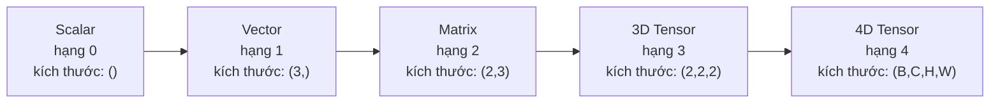
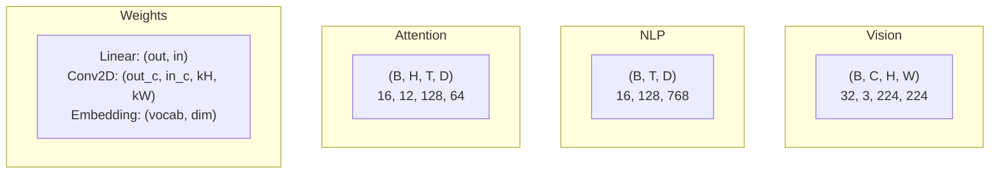
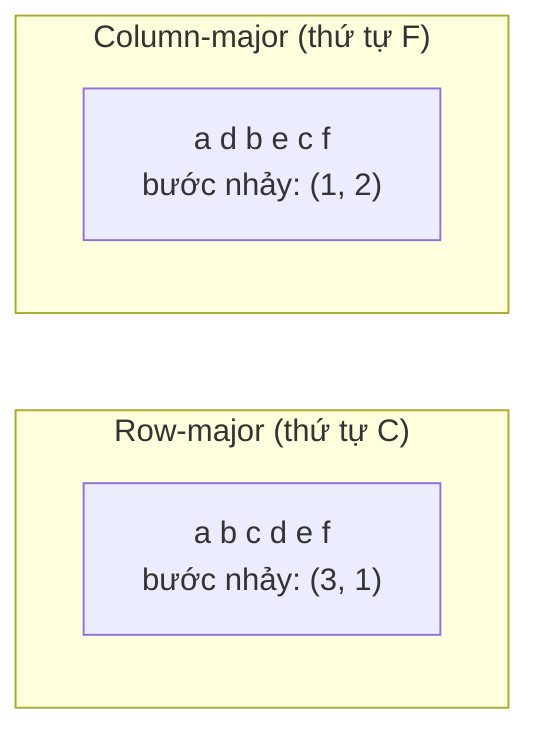
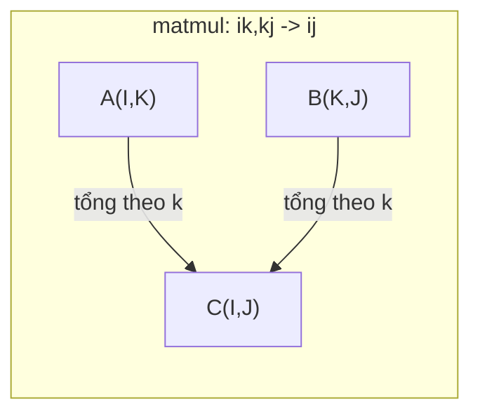

# Phép toán trên tensor

> Tensor (tensor) là ngôn ngữ chung giữa dữ liệu và học sâu. Mọi bức ảnh, mọi câu, mọi gradient đều chảy qua chúng.

**Type:** Build
**Language:** Python
**Prerequisites:** Giai đoạn 1, Bài 01 (Trực giác Đại số tuyến tính), 02 (Vector, Ma trận & các phép toán)
**Time:** ~90 phút

## Mục tiêu học tập

- Tự tay cài đặt một lớp tensor với shape (kích thước), strides (bước nhảy), reshape (định hình lại), transpose và các phép toán theo phần tử
- Áp dụng quy tắc lan truyền (broadcasting) để thao tác trên các tensor khác shape mà không cần sao chép dữ liệu
- Viết biểu thức einsum cho tích vô hướng, nhân ma trận, tích ngoài và các phép toán theo batch
- Truy vết chính xác các shape tensor qua từng bước của multi-head attention

## Vấn đề

Bạn xây một transformer. Lượt lan truyền xuôi trông gọn gàng. Bạn chạy nó và nhận được: `RuntimeError: mat1 and mat2 shapes cannot be multiplied (32x768 and 512x768)`. Bạn nhìn chằm chằm vào các shape. Bạn thử một phép transpose. Giờ nó báo `Expected 4D input (got 3D input)`. Bạn thêm một unsqueeze. Một chỗ khác lại vỡ.

Lỗi shape là bug phổ biến nhất trong code học sâu. Về khái niệm chúng không khó -- mỗi phép toán có một hợp đồng shape -- nhưng chúng nhân lên rất nhanh. Một transformer có hàng chục phép reshape, transpose và broadcast móc nối với nhau. Một trục (axis) sai là lỗi lan ra khắp nơi. Tệ hơn, có những lỗi shape không hề báo lỗi. Chúng âm thầm tạo ra rác bằng cách lan truyền theo chiều sai hoặc cộng dồn theo trục sai.

Ma trận xử lý quan hệ từng cặp giữa hai tập hợp sự vật. Dữ liệu thực không vừa với hai chiều. Một batch 32 ảnh RGB ở 224x224 là một tensor 4 chiều: `(32, 3, 224, 224)`. Self-attention với 12 head cũng là 4 chiều: `(batch, heads, seq_len, head_dim)`. Bạn cần một cấu trúc dữ liệu tổng quát cho mọi số chiều, với các phép toán kết hợp sạch sẽ trên tất cả các chiều đó. Cấu trúc đó chính là tensor. Nắm vững các phép toán của nó và lỗi shape trở nên dễ gỡ một cách tầm thường.

## Khái niệm

### Tensor là gì

Tensor là một mảng số nhiều chiều với kiểu dữ liệu đồng nhất. Số chiều là **rank** (hay **order**). Mỗi chiều là một **trục** (axis). **Shape** là một tuple liệt kê kích thước dọc theo từng trục.



Tổng số phần tử = tích của tất cả các kích thước. Một shape `(2, 3, 4)` chứa `2 * 3 * 4 = 24` phần tử.

### Shape trong học sâu

Mỗi loại dữ liệu ánh xạ tới một shape cụ thể theo quy ước.



PyTorch dùng NCHW (channels-first). TensorFlow mặc định là NHWC (channels-last). Bố cục lệch nhau gây chậm âm thầm hoặc lỗi.

### Cách bố trí bộ nhớ hoạt động

Một mảng 2D trong bộ nhớ là một chuỗi byte 1D. **Strides** cho bạn biết phải bỏ qua bao nhiêu phần tử để tiến một bước dọc theo mỗi trục.



Transpose không di chuyển dữ liệu. Nó hoán đổi các stride, khiến tensor trở thành **non-contiguous** (không liền mạch) -- các phần tử của một hàng không còn nằm cạnh nhau trong bộ nhớ.

### Quy tắc lan truyền

Broadcasting cho phép bạn thao tác trên các tensor có shape khác nhau mà không cần sao chép dữ liệu. Căn các shape từ bên phải. Hai chiều tương thích khi chúng bằng nhau hoặc một trong hai bằng 1. Các chiều ít hơn được đệm bằng 1 ở bên trái.

```
Tensor A:     (8, 1, 6, 1)
Tensor B:        (7, 1, 5)
Padded B:     (1, 7, 1, 5)
Result:       (8, 7, 6, 5)
```

### Einsum: phép toán tensor vạn năng

Tổng Einstein gán cho mỗi trục một chữ cái. Các trục có ở đầu vào nhưng không có ở đầu ra sẽ bị cộng dồn. Các trục có ở cả hai thì được giữ lại.



Các mẫu quan trọng: `i,i->` (tích vô hướng), `i,j->ij` (tích ngoài), `ii->` (vết), `ij->ji` (transpose), `bij,bjk->bik` (batch matmul), `bhtd,bhsd->bhts` (điểm số attention).

```figure
tensor-broadcast
```

## Tự tay làm

Code nằm trong `code/tensors.py`. Mỗi bước tham chiếu tới phần cài đặt ở đó.

### Bước 1: Lưu trữ tensor và stride

Một tensor lưu một danh sách phẳng các số kèm metadata về shape. Strides cho logic chỉ mục biết cách ánh xạ chỉ mục nhiều chiều sang vị trí phẳng.

```python
class Tensor:
    def __init__(self, data, shape=None):
        if isinstance(data, (list, tuple)):
            self._data, self._shape = self._flatten_nested(data)
        elif isinstance(data, np.ndarray):
            self._data = data.flatten().tolist()
            self._shape = tuple(data.shape)
        else:
            self._data = [data]
            self._shape = ()

        if shape is not None:
            total = reduce(lambda a, b: a * b, shape, 1)
            if total != len(self._data):
                raise ValueError(
                    f"Cannot reshape {len(self._data)} elements into shape {shape}"
                )
            self._shape = tuple(shape)

        self._strides = self._compute_strides(self._shape)

    @staticmethod
    def _compute_strides(shape):
        if len(shape) == 0:
            return ()
        strides = [1] * len(shape)
        for i in range(len(shape) - 2, -1, -1):
            strides[i] = strides[i + 1] * shape[i + 1]
        return tuple(strides)
```

Với shape `(3, 4)`, strides là `(4, 1)` -- bỏ qua 4 phần tử để tiến một hàng, bỏ qua 1 phần tử để tiến một cột.

### Bước 2: Reshape, squeeze, unsqueeze

Reshape thay đổi shape mà không đổi thứ tự phần tử. Tổng số phần tử phải giữ nguyên. Dùng `-1` cho một chiều để suy ra kích thước của nó.

```python
t = Tensor(list(range(12)), shape=(2, 6))
r = t.reshape((3, 4))
r = t.reshape((-1, 3))
```

Squeeze loại bỏ các trục có kích thước 1. Unsqueeze chèn thêm một trục. Unsqueeze rất quan trọng cho broadcasting -- một vector bias `(D,)` cộng vào một batch `(B, T, D)` cần được unsqueeze thành `(1, 1, D)`.

```python
t = Tensor(list(range(6)), shape=(1, 3, 1, 2))
s = t.squeeze()
v = Tensor([1, 2, 3])
u = v.unsqueeze(0)
```

### Bước 3: Transpose (chuyển vị) và permute (hoán vị trục)

Transpose đổi chỗ hai trục. Permute sắp xếp lại toàn bộ các trục. Đây chính là cách bạn chuyển đổi giữa NCHW và NHWC.

```python
mat = Tensor(list(range(6)), shape=(2, 3))
tr = mat.transpose(0, 1)

t4d = Tensor(list(range(24)), shape=(1, 2, 3, 4))
perm = t4d.permute((0, 2, 3, 1))
```

Sau transpose hoặc permute, tensor trở nên không liên tục trong bộ nhớ. Trong PyTorch, `view` thất bại trên tensor không liên tục -- hãy dùng `reshape` hoặc gọi `.contiguous()` trước.

### Bước 4: Phép toán theo từng phần tử và phép rút gọn

Phép toán theo từng phần tử (add, multiply, subtract) áp dụng độc lập lên mỗi phần tử và giữ nguyên shape. Phép rút gọn (sum, mean, max) gộp một hoặc nhiều trục lại.

```python
a = Tensor([[1, 2], [3, 4]])
b = Tensor([[10, 20], [30, 40]])
c = a + b
d = a * 2
s = a.sum(axis=0)
```

Global average pooling trong CNN: `(B, C, H, W).mean(axis=[2, 3])` cho ra `(B, C)`. Mean pooling theo chuỗi trong NLP: `(B, T, D).mean(axis=1)` cho ra `(B, D)`.

### Bước 5: Broadcasting (lan truyền) với NumPy

Hàm `demo_broadcasting_numpy()` trong `tensors.py` trình bày các mẫu cốt lõi.

```python
activations = np.random.randn(4, 3)
bias = np.array([0.1, 0.2, 0.3])
result = activations + bias

images = np.random.randn(2, 3, 4, 4)
scale = np.array([0.5, 1.0, 1.5]).reshape(1, 3, 1, 1)
result = images * scale

a = np.array([1, 2, 3]).reshape(-1, 1)
b = np.array([10, 20, 30, 40]).reshape(1, -1)
outer = a * b
```

Khoảng cách từng cặp qua broadcasting: reshape `(M, 2)` thành `(M, 1, 2)` và `(N, 2)` thành `(1, N, 2)`, trừ nhau, bình phương, cộng dồn theo trục cuối, lấy căn bậc hai. Kết quả: `(M, N)`.

### Bước 6: Các phép toán einsum

Hai hàm `demo_einsum()` và `demo_einsum_gallery()` đi qua mọi mẫu thường gặp.

```python
a = np.array([1.0, 2.0, 3.0])
b = np.array([4.0, 5.0, 6.0])
dot = np.einsum("i,i->", a, b)

A = np.array([[1, 2], [3, 4], [5, 6]], dtype=float)
B = np.array([[7, 8, 9], [10, 11, 12]], dtype=float)
matmul = np.einsum("ik,kj->ij", A, B)

batch_A = np.random.randn(4, 3, 5)
batch_B = np.random.randn(4, 5, 2)
batch_mm = np.einsum("bij,bjk->bik", batch_A, batch_B)
```

Chi phí tính toán của một phép contraction là tích kích thước của tất cả các chỉ số (cả chỉ số giữ lại lẫn chỉ số cộng dồn). Với `bij,bjk->bik` với B=32, I=128, J=64, K=128: `32 * 128 * 64 * 128 = 33,554,432` phép nhân-cộng.

### Bước 7: Cơ chế attention qua einsum

Hàm `demo_attention_einsum()` cài đặt multi-head attention từ đầu đến cuối.

```python
B, H, T, D = 2, 4, 8, 16
E = H * D

X = np.random.randn(B, T, E)
W_q = np.random.randn(E, E) * 0.02

Q = np.einsum("bte,ek->btk", X, W_q)
Q = Q.reshape(B, T, H, D).transpose(0, 2, 1, 3)

scores = np.einsum("bhtd,bhsd->bhts", Q, K) / np.sqrt(D)
weights = softmax(scores, axis=-1)
attn_output = np.einsum("bhts,bhsd->bhtd", weights, V)

concat = attn_output.transpose(0, 2, 1, 3).reshape(B, T, E)
output = np.einsum("bte,ek->btk", concat, W_o)
```

Mỗi bước đều là một phép toán tensor: chiếu (matmul qua einsum), tách head (reshape + transpose), điểm attention (batch matmul qua einsum), tổng có trọng số (batch matmul qua einsum), gộp head (transpose + reshape), chiếu đầu ra (matmul qua einsum).

## Áp dụng

### Tự viết vs NumPy

| Phép toán | Tự viết (lớp Tensor) | NumPy |
|---|---|---|
| Tạo | `Tensor([[1,2],[3,4]])` | `np.array([[1,2],[3,4]])` |
| Reshape | `t.reshape((3,4))` | `a.reshape(3,4)` |
| Chuyển vị | `t.transpose(0,1)` | `a.T` hoặc `a.transpose(0,1)` |
| Squeeze | `t.squeeze(0)` | `np.squeeze(a, 0)` |
| Tính tổng | `t.sum(axis=0)` | `a.sum(axis=0)` |
| Einsum | N/A | `np.einsum("ij,jk->ik", a, b)` |

### Tự viết vs PyTorch

```python
import torch

t = torch.tensor([[1, 2, 3], [4, 5, 6]], dtype=torch.float32)
t.shape
t.stride()
t.is_contiguous()

t.reshape(3, 2)
t.unsqueeze(0)
t.transpose(0, 1)
t.transpose(0, 1).contiguous()

torch.einsum("ik,kj->ij", A, B)
```

PyTorch bổ sung autograd, hỗ trợ GPU và các kernel BLAS tối ưu. Ngữ nghĩa shape là hoàn toàn như nhau. Nếu bạn hiểu bản tự viết, các lỗi shape của PyTorch sẽ trở nên dễ đọc.

### Mọi lớp của mạng nơ-ron như một phép toán tensor

| Phép toán | Dạng tensor | Einsum |
|---|---|---|
| Lớp tuyến tính | `Y = X @ W.T + b` | `"bd,od->bo"` + bias |
| QKV của attention | `Q = X @ W_q` | `"btd,dh->bth"` |
| Điểm attention | `Q @ K.T / sqrt(d)` | `"bhtd,bhsd->bhts"` |
| Đầu ra attention | `softmax(scores) @ V` | `"bhts,bhsd->bhtd"` |
| Batch norm | `(X - mu) / sigma * gamma` | theo từng phần tử + lan truyền |
| Softmax | `exp(x) / sum(exp(x))` | theo từng phần tử + rút gọn |

## Đóng gói

Bài học này tạo ra hai prompt có thể tái sử dụng:

1. **`outputs/prompt-tensor-shapes.md`** -- Một prompt có hệ thống để gỡ lỗi lệch shape tensor. Bao gồm bảng quyết định cho mọi phép toán thường gặp (matmul, broadcast, cat, Linear, Conv2d, BatchNorm, softmax) và một bảng tra cứu cách sửa.

2. **`outputs/prompt-tensor-debugger.md`** -- Một prompt gỡ lỗi từng bước để bạn dán vào bất kỳ trợ lý AI nào khi một lỗi shape đang chặn bạn. Đưa thông báo lỗi và shape tensor của bạn vào, nhận lại cách sửa chính xác.

## Bài tập

1. **Dễ -- Reshape khứ hồi.** Lấy một tensor shape `(2, 3, 4)`. Reshape nó thành `(6, 4)`, rồi thành `(24,)`, rồi quay lại `(2, 3, 4)`. Kiểm tra thứ tự phần tử được giữ nguyên ở mỗi bước bằng cách in dữ liệu phẳng.

2. **Trung bình -- Cài đặt broadcasting.** Mở rộng lớp `Tensor` với phương thức `broadcast_to(shape)` để mở rộng các chiều có kích thước 1 cho khớp shape đích. Sau đó sửa `_elementwise_op` để tự động broadcast trước khi thao tác. Kiểm thử với các shape `(3, 1)` và `(1, 4)` cho ra `(3, 4)`.

3. **Khó -- Tự xây dựng einsum.** Cài đặt hàm `einsum(subscripts, *tensors)` cơ bản xử lý ít nhất: tích vô hướng (`i,i->`), nhân ma trận (`ij,jk->ik`), tích ngoài (`i,j->ij`), và chuyển vị (`ij->ji`). Phân tích chuỗi chỉ số, xác định các chỉ số bị contraction, rồi lặp qua mọi tổ hợp chỉ số. So sánh kết quả của bạn với `np.einsum`.

4. **Khó -- Trình theo dõi shape của attention.** Viết một hàm nhận `batch_size`, `seq_len`, `embed_dim`, và `num_heads` làm đầu vào và in shape chính xác ở từng bước của multi-head attention: đầu vào, chiếu Q/K/V, tách head, điểm attention, trọng số softmax, tổng có trọng số, gộp head, chiếu đầu ra. Kiểm chứng với đầu ra của `demo_attention_einsum()`.

## Thuật ngữ chính

| Thuật ngữ | Người ta thường nói | Ý nghĩa thực sự |
|---|---|---|
| Tensor | "Một ma trận nhưng nhiều chiều hơn" | Một mảng đa chiều với kiểu dữ liệu đồng nhất và shape, strides, phép toán được xác định |
| Rank | "Số chiều" | Số trục. Một ma trận có rank 2, chứ không phải rank bằng hạng của ma trận đó |
| Shape | "Kích thước của tensor" | Một tuple liệt kê kích thước theo từng trục. `(2, 3)` nghĩa là 2 hàng, 3 cột |
| Stride | "Cách bộ nhớ được bố trí" | Stride (bước nhảy) là số phần tử phải bỏ qua để tiến một vị trí theo mỗi trục |
| Broadcasting | "Cứ thế mà chạy khi shape khác nhau" | Một bộ quy tắc chặt chẽ: căn từ phải sang, các chiều phải bằng nhau hoặc một trong hai phải bằng 1 |
| Contiguous | "Tensor bình thường ấy mà" | Các phần tử được lưu tuần tự trong bộ nhớ, không có khoảng trống hay sắp xếp lại so với bố cục logic |
| Einsum | "Cách viết matmul cho ngầu" | Một ký pháp tổng quát diễn đạt mọi phép contraction tensor, tích ngoài, trace hay chuyển vị trong một dòng |
| View | "Giống như reshape" | Một tensor chia sẻ cùng vùng đệm bộ nhớ nhưng có metadata shape/stride khác. Thất bại trên dữ liệu không liên tục |
| Contraction | "Cộng dồn theo một chỉ số" | Phép toán tổng quát trong đó một chỉ số chung giữa các tensor được nhân lên rồi cộng dồn, cho ra kết quả có rank thấp hơn |
| NCHW / NHWC | "Định dạng của PyTorch vs TensorFlow" | Quy ước memory layout (cách bố trí bộ nhớ) cho tensor ảnh. NCHW đặt các kênh trước các chiều không gian, NHWC đặt chúng sau |

## Đọc thêm

- [NumPy Broadcasting](https://numpy.org/doc/stable/user/basics.broadcasting.html) -- Bộ quy tắc chuẩn kèm ví dụ trực quan
- [PyTorch Tensor Views](https://pytorch.org/docs/stable/tensor_view.html) -- Khi nào view hoạt động và khi nào nó copy
- [einops](https://github.com/arogozhnikov/einops) -- Thư viện giúp việc reshape tensor dễ đọc và an toàn
- [The Illustrated Transformer](https://jalammar.github.io/illustrated-transformer/) -- Trực quan hóa các shape tensor chảy qua attention
- [Einstein Summation in NumPy](https://numpy.org/doc/stable/reference/generated/numpy.einsum.html) -- Tài liệu đầy đủ về einsum kèm ví dụ
