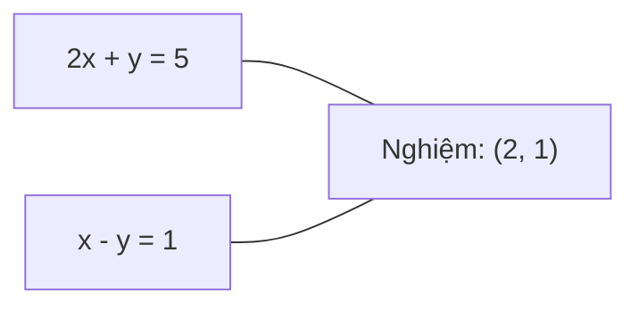
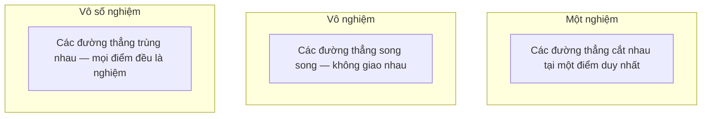

# Hệ phương trình tuyến tính

> Giải Ax = b là bài toán lâu đời nhất trong toán học mà vẫn còn đang vận hành mạng nơ-ron của bạn.

**Type:** Build
**Language:** Python
**Prerequisites:** Giai đoạn 1, Bài 01 (Linear Algebra Intuition), 02 (Vectors & Matrices), 03 (Matrix Transformations)
**Time:** ~120 phút

## Mục tiêu học tập

- Giải Ax = b bằng khử Gauss (Gaussian elimination) với chọn phần tử trụ (pivoting) từng phần và thế ngược
- Phân rã ma trận bằng LU, QR và Cholesky, rồi giải thích khi nào dùng từng cách
- Suy ra phương trình chuẩn cho bình phương tối thiểu (least squares) và nối chúng với hồi quy tuyến tính và hồi quy ridge
- Chẩn đoán các hệ có điều kiện (conditioning) xấu bằng số điều kiện và áp dụng chính quy hoá để ổn định chúng

## Vấn đề

Mỗi lần bạn huấn luyện một hồi quy tuyến tính, bạn giải một hệ phương trình tuyến tính (linear system). Mỗi lần bạn tính một khớp bình phương tối thiểu, bạn giải một hệ phương trình tuyến tính. Mỗi lần một tầng mạng nơ-ron tính `y = Wx + b`, nó đang tính một vế của một hệ phương trình tuyến tính. Khi bạn thêm chính quy hoá, bạn sửa đổi hệ đó. Khi bạn dùng quá trình Gauss, bạn phân rã một ma trận. Khi bạn nghịch đảo một ma trận hiệp phương sai cho khoảng cách Mahalanobis, bạn giải một hệ phương trình tuyến tính.

Phương trình Ax = b xuất hiện ở khắp nơi. A là ma trận các hệ số đã biết. b là vector các đầu ra đã biết. x là vector ẩn mà bạn muốn tìm. Trong hồi quy tuyến tính, A là ma trận dữ liệu của bạn, b là vector mục tiêu, và x là vector trọng số. Toàn bộ mô hình rút gọn thành: tìm x sao cho Ax càng gần b càng tốt.

Bài học này tự tay xây dựng mọi phương pháp chính để giải phương trình đó. Bạn sẽ hiểu vì sao có phương pháp nhanh còn phương pháp khác ổn định, vì sao có phương pháp chỉ dùng được cho hệ vuông còn phương pháp khác xử lý được hệ quá xác định, và vì sao số điều kiện của ma trận quyết định liệu câu trả lời của bạn có ý nghĩa gì hay không.

## Khái niệm

### Ax = b nghĩa là gì về mặt hình học

Một hệ phương trình tuyến tính có một cách diễn giải hình học. Mỗi phương trình định nghĩa một siêu phẳng. Nghiệm là điểm (hoặc tập điểm) nơi mọi siêu phẳng cùng giao nhau.

```
2x + y = 5          Two lines in 2D.
x - y  = 1          They intersect at x=2, y=1.
```



Ba trường hợp có thể xảy ra:



Ở dạng ma trận, "một nghiệm" nghĩa là A khả nghịch. "Vô nghiệm" nghĩa là hệ không nhất quán. "Vô số nghiệm" nghĩa là A có không gian null. Hầu hết bài toán ML rơi vào loại "không có nghiệm chính xác" vì bạn có nhiều phương trình (điểm dữ liệu) hơn ẩn (tham số). Đó là lúc bình phương tối thiểu xuất hiện.

### Hình ảnh theo cột so với hình ảnh theo hàng

Có hai cách để đọc Ax = b.

**Hình ảnh theo hàng.** Mỗi hàng của A định nghĩa một phương trình. Mỗi phương trình là một siêu phẳng. Nghiệm là điểm mà tất cả chúng cùng giao nhau.

**Hình ảnh theo cột.** Mỗi cột của A là một vector. Câu hỏi trở thành: tổ hợp tuyến tính nào của các cột A tạo ra b?

```
A = | 2  1 |    b = | 5 |
    | 1 -1 |        | 1 |

Row picture: solve 2x + y = 5 and x - y = 1 simultaneously.

Column picture: find x1, x2 such that:
  x1 * [2, 1] + x2 * [1, -1] = [5, 1]
  2 * [2, 1] + 1 * [1, -1] = [4+1, 2-1] = [5, 1]   check.
```

Hình ảnh theo cột là cách cơ bản hơn. Nếu b nằm trong không gian cột của A, hệ có nghiệm. Nếu b không nằm trong đó, bạn tìm điểm gần nhất trong không gian cột. Điểm gần nhất đó chính là nghiệm bình phương tối thiểu.

### Khử Gauss

Khử Gauss biến Ax = b thành một hệ tam giác trên Ux = c mà bạn giải bằng thế ngược. Đây là phương pháp trực tiếp nhất.

Thuật toán:

```
1. For each column k (the pivot column):
   a. Find the largest entry in column k at or below row k (partial pivoting).
   b. Swap that row with row k.
   c. For each row i below k:
      - Compute multiplier m = A[i][k] / A[k][k]
      - Subtract m times row k from row i.
2. Back substitute: solve from the last equation upward.
```

Ví dụ:

```
Original:
| 2  1  1 | 8 |       R2 = R2 - (2)R1     | 2  1   1 |  8 |
| 4  3  3 |20 |  -->  R3 = R3 - (1)R1 --> | 0  1   1 |  4 |
| 2  3  1 |12 |                            | 0  2   0 |  4 |

                       R3 = R3 - (2)R2     | 2  1   1 |  8 |
                                       --> | 0  1   1 |  4 |
                                           | 0  0  -2 | -4 |

Back substitute:
  -2 * x3 = -4    -->  x3 = 2
  x2 + 2  = 4     -->  x2 = 2
  2*x1 + 2 + 2 = 8 --> x1 = 2
```

Khử Gauss tốn O(n^3) phép tính. Với một hệ 1000x1000, tức khoảng một tỉ phép tính dấu phẩy động. Nhanh, nhưng bạn có thể làm tốt hơn nếu cần giải nhiều hệ với cùng một A.

### Chọn phần tử trụ từng phần: vì sao nó quan trọng

Không chọn trụ, khử Gauss có thể thất bại hoặc cho ra kết quả rác. Nếu một phần tử trụ bằng không, bạn chia cho không. Nếu nó nhỏ, bạn khuếch đại sai số làm tròn.

```
Bad pivot:                       With partial pivoting:
| 0.001  1 | 1.001 |            Swap rows first:
| 1      1 | 2     |            | 1      1 | 2     |
                                 | 0.001  1 | 1.001 |
m = 1/0.001 = 1000              m = 0.001/1 = 0.001
R2 = R2 - 1000*R1               R2 = R2 - 0.001*R1
| 0.001  1     | 1.001   |      | 1      1     | 2     |
| 0     -999   | -999.0  |      | 0      0.999 | 0.999 |

x2 = 1.000 (correct)            x2 = 1.000 (correct)
x1 = (1.001 - 1)/0.001          x1 = (2 - 1)/1 = 1.000 (correct)
   = 0.001/0.001 = 1.000        Stable because the multiplier is small.
```

Trong số học dấu phẩy động với độ chính xác hạn chế, phiên bản không chọn trụ có thể mất các chữ số có nghĩa. Chọn phần tử trụ từng phần luôn chọn phần tử trụ lớn nhất sẵn có để giảm thiểu việc khuếch đại sai số.

### Phân rã LU

Phân rã LU tách A thành một ma trận tam giác dưới L và một ma trận tam giác trên U: A = LU. Ma trận L lưu các nhân tử từ bước khử Gauss. Ma trận U là kết quả của phép khử.

```
A = L @ U

| 2  1  1 |   | 1  0  0 |   | 2  1   1 |
| 4  3  3 | = | 2  1  0 | @ | 0  1   1 |
| 2  3  1 |   | 1  2  1 |   | 0  0  -2 |
```

Vì sao phải phân rã thay vì chỉ khử? Vì một khi đã có L và U, giải Ax = b với bất kỳ b mới nào chỉ tốn O(n^2):

```
Ax = b
LUx = b
Let y = Ux:
  Ly = b    (forward substitution, O(n^2))
  Ux = y    (back substitution, O(n^2))
```

Chi phí O(n^3) chỉ phải trả một lần trong lúc phân rã. Mỗi lần giải sau đó chỉ tốn O(n^2). Nếu bạn cần giải 1000 hệ với cùng A nhưng khác vector b, LU tiết kiệm một hệ số 1000/3 trong tổng công sức.

Khi có chọn phần tử trụ từng phần, bạn nhận được PA = LU, trong đó P là ma trận hoán vị ghi lại các lần đổi hàng.

### Phân rã QR

Phân rã QR tách A thành một ma trận trực giao Q và một ma trận tam giác trên R: A = QR.

Một ma trận trực giao có tính chất Q^T Q = I. Các cột của nó là những vector trực chuẩn. Nhân với Q bảo toàn độ dài và góc.

```
A = Q @ R

Q has orthonormal columns: Q^T Q = I
R is upper triangular

To solve Ax = b:
  QRx = b
  Rx = Q^T b    (just multiply by Q^T, no inversion needed)
  Back substitute to get x.
```

QR ổn định về mặt số học hơn LU khi giải bài toán bình phương tối thiểu. Quá trình Gram-Schmidt xây Q từng cột một:

```
Given columns a1, a2, ... of A:

q1 = a1 / ||a1||

q2 = a2 - (a2 . q1) * q1        (subtract projection onto q1)
q2 = q2 / ||q2||                (normalize)

q3 = a3 - (a3 . q1) * q1 - (a3 . q2) * q2
q3 = q3 / ||q3||

R[i][j] = qi . aj    for i <= j
```

Mỗi bước loại bỏ thành phần dọc theo mọi vector q trước đó, chỉ để lại hướng trực giao mới.

### Phân rã Cholesky

Khi A đối xứng (A = A^T) và xác định dương (mọi giá trị riêng đều dương), bạn có thể tách nó thành A = L L^T với L là ma trận tam giác dưới. Đó là phân rã Cholesky.

```
A = L @ L^T

| 4  2 |   | 2  0 |   | 2  1 |
| 2  5 | = | 1  2 | @ | 0  2 |

L[i][i] = sqrt(A[i][i] - sum(L[i][k]^2 for k < i))
L[i][j] = (A[i][j] - sum(L[i][k]*L[j][k] for k < j)) / L[j][j]    for i > j
```

Cholesky nhanh gấp đôi LU và chỉ cần một nửa bộ nhớ. Nó chỉ dùng được cho ma trận đối xứng xác định dương, nhưng loại ma trận đó xuất hiện liên tục:

- Ma trận hiệp phương sai là đối xứng nửa xác định dương (xác định dương khi có chính quy hoá).
- Ma trận kernel trong quá trình Gauss là đối xứng xác định dương.
- Ma trận Hessian của một hàm lồi tại điểm cực tiểu là đối xứng xác định dương.
- A^T A luôn là đối xứng nửa xác định dương.

Trong quá trình Gauss, bạn tách ma trận kernel K bằng Cholesky, rồi giải K alpha = y để lấy trung bình dự báo. Nhân tử Cholesky cũng cho bạn log-định thức dùng cho hợp lý biên: log det(K) = 2 * sum(log(diag(L))).

### Bình phương tối thiểu: khi Ax = b không có nghiệm chính xác

Nếu A là m x n với m > n (nhiều phương trình hơn ẩn), hệ là quá xác định. Không tồn tại nghiệm chính xác. Thay vào đó, bạn cực tiểu hoá sai số bình phương:

```
minimize ||Ax - b||^2

This is the sum of squared residuals:
  sum((A[i,:] @ x - b[i])^2 for i in range(m))
```

Nghiệm cực tiểu thoả các phương trình chuẩn:

```
A^T A x = A^T b
```

Cách suy ra: khai triển ||Ax - b||^2 = (Ax - b)^T (Ax - b) = x^T A^T A x - 2 x^T A^T b + b^T b. Lấy gradient theo x, đặt nó bằng không: 2 A^T A x - 2 A^T b = 0.

```
Original system (overdetermined, 4 equations, 2 unknowns):
| 1  1 |         | 3 |
| 1  2 | x     = | 5 |       No exact x satisfies all 4 equations.
| 1  3 |         | 6 |
| 1  4 |         | 8 |

Normal equations:
A^T A = | 4  10 |    A^T b = | 22 |
        | 10 30 |            | 63 |

Solve: x = [1.5, 1.7]

This is linear regression. x[0] is the intercept, x[1] is the slope.
```

### Phương trình chuẩn chính là hồi quy tuyến tính

Mối liên hệ là chính xác. Trong hồi quy tuyến tính, ma trận dữ liệu X của bạn có một hàng cho mỗi mẫu và một cột cho mỗi đặc trưng. Vector mục tiêu y có một phần tử cho mỗi mẫu. Vector trọng số w thoả:

```
X^T X w = X^T y
w = (X^T X)^(-1) X^T y
```

Đây là nghiệm dạng đóng của hồi quy tuyến tính. Mỗi lần gọi `sklearn.linear_model.LinearRegression.fit()` đều tính công thức này (hoặc một công thức tương đương qua QR hay SVD).

Thêm một số hạng chính quy hoá lambda * I vào ma trận và bạn có hồi quy ridge:

```
(X^T X + lambda * I) w = X^T y
w = (X^T X + lambda * I)^(-1) X^T y
```

Chính quy hoá làm cho ma trận có điều kiện tốt hơn (dễ nghịch đảo chính xác hơn) và ngăn quá khớp bằng cách co các trọng số về gần không. Ma trận X^T X + lambda * I luôn đối xứng xác định dương khi lambda > 0, nên bạn có thể dùng Cholesky để giải.

### Giả nghịch đảo (Moore-Penrose)

Giả nghịch đảo (pseudoinverse) A+ tổng quát hoá phép nghịch đảo ma trận cho ma trận không vuông và ma trận suy biến. Với mọi ma trận A:

```
x = A+ b

where A+ = V Sigma+ U^T    (computed via SVD)
```

Sigma+ được tạo bằng cách lấy nghịch đảo của từng giá trị kỳ dị khác không rồi chuyển vị kết quả. Nếu A = U Sigma V^T thì A+ = V Sigma+ U^T.

```
A = U Sigma V^T        (SVD)

Sigma = | 5  0 |       Sigma+ = | 1/5  0  0 |
        | 0  2 |                | 0  1/2  0 |
        | 0  0 |

A+ = V Sigma+ U^T
```

Giả nghịch đảo cho nghiệm bình phương nhỏ nhất có chuẩn nhỏ nhất. Nếu hệ có:
- Một nghiệm: A+ b cho đúng nghiệm đó.
- Không có nghiệm: A+ b cho nghiệm bình phương nhỏ nhất.
- Vô số nghiệm: A+ b cho nghiệm có ||x|| nhỏ nhất.

`np.linalg.lstsq` và `np.linalg.pinv` của NumPy đều dùng SVD bên trong.

### Số điều kiện

Số điều kiện (condition number) đo mức độ nhạy của nghiệm trước những thay đổi nhỏ ở đầu vào. Với ma trận A, số điều kiện là:

```
kappa(A) = ||A|| * ||A^(-1)|| = sigma_max / sigma_min
```

trong đó sigma_max và sigma_min là giá trị kỳ dị lớn nhất và nhỏ nhất.

```
Well-conditioned (kappa ~ 1):        Ill-conditioned (kappa ~ 10^15):
Small change in b -->                Small change in b -->
small change in x                    huge change in x

| 2  0 |   kappa = 2/1 = 2          | 1   1          |   kappa ~ 10^15
| 0  1 |   safe to solve            | 1   1+10^(-15) |   solution is garbage
```

Quy tắc thực dụng:
- kappa < 100: an toàn, nghiệm chính xác.
- kappa ~ 10^k: bạn mất khoảng k chữ số độ chính xác do số học dấu phẩy động.
- kappa ~ 10^16 (với float64): nghiệm vô nghĩa. Ma trận thực chất là suy biến.

Trong ML, tình trạng điều kiện xấu xảy ra khi các đặc trưng gần như cộng tuyến. Chính quy hoá (cộng thêm lambda * I) cải thiện số điều kiện từ sigma_max / sigma_min thành (sigma_max + lambda) / (sigma_min + lambda).

### Phương pháp lặp: gradient liên hợp

Với những hệ thưa rất lớn (hàng triệu ẩn), các phương pháp trực tiếp như LU hay Cholesky quá đắt. Phương pháp lặp xấp xỉ nghiệm bằng cách cải thiện một dự đoán qua nhiều vòng lặp.

Gradient liên hợp (conjugate gradient, CG) giải Ax = b khi A đối xứng xác định dương. Nó tìm nghiệm chính xác trong tối đa n vòng lặp (với số học chính xác), nhưng thường hội tụ nhanh hơn nhiều nếu các trị riêng của A tụ thành cụm.

```
Algorithm sketch:
  x0 = initial guess (often zero)
  r0 = b - A x0           (residual)
  p0 = r0                 (search direction)

  For k = 0, 1, 2, ...:
    alpha = (rk . rk) / (pk . A pk)
    x_{k+1} = xk + alpha * pk
    r_{k+1} = rk - alpha * A pk
    beta = (r_{k+1} . r_{k+1}) / (rk . rk)
    p_{k+1} = r_{k+1} + beta * pk
    if ||r_{k+1}|| < tolerance: stop
```

CG được dùng trong:
- Tối ưu hoá quy mô lớn (phương pháp Newton-CG)
- Giải các bài toán rời rạc hoá PDE
- Các phương pháp kernel khi ma trận kernel quá lớn để phân rã
- Tiền điều kiện hoá cho các bộ giải lặp khác

Tốc độ hội tụ phụ thuộc vào số điều kiện. Hệ có điều kiện tốt hơn hội tụ nhanh hơn, đó là một lý do nữa khiến chính quy hoá có ích.

### Bức tranh đầy đủ: phương pháp nào khi nào

| Phương pháp | Yêu cầu | Chi phí | Trường hợp dùng |
|--------|-------------|------|----------|
| Gaussian elimination | A vuông, không suy biến | O(n^3) | Giải một lần hệ vuông |
| LU decomposition | A vuông, không suy biến | O(n^3) phân rã + O(n^2) giải | Nhiều lần giải với cùng A |
| QR decomposition | A bất kỳ (m >= n) | O(mn^2) | Bình phương nhỏ nhất, ổn định số học |
| Cholesky | A đối xứng xác định dương | O(n^3/3) | Ma trận hiệp phương sai, quá trình Gaussian, hồi quy ridge |
| Normal equations | Quá xác định (m > n) | O(mn^2 + n^3) | Hồi quy tuyến tính (n nhỏ) |
| SVD / pseudoinverse | A bất kỳ | O(mn^2) | Hệ thiếu hạng (rank deficiency), nghiệm chuẩn nhỏ nhất |
| Conjugate gradient | A đối xứng xác định dương, thưa | O(n * k * nnz) | Hệ thưa lớn, k = số vòng lặp |

### Liên hệ với ML

Mọi phương pháp trong bài này đều xuất hiện trong ML thực tế:

**Hồi quy tuyến tính.** Nghiệm dạng đóng giải phương trình chuẩn tắc (normal equations) X^T X w = X^T y. Việc này được làm qua Cholesky (nếu n nhỏ), QR (nếu ổn định số học là quan trọng), hoặc SVD (nếu ma trận có thể thiếu hạng).

**Hồi quy ridge.** Cộng lambda * I vào X^T X. Hệ chính quy hoá (X^T X + lambda * I) w = X^T y luôn giải được bằng Cholesky vì X^T X + lambda * I là đối xứng xác định dương với lambda > 0.

**Quá trình Gaussian.** Trung bình dự đoán cần giải K alpha = y với K là ma trận kernel. Phân rã Cholesky của K là cách tiếp cận chuẩn. Log hợp lý biên dùng log det(K) = 2 sum(log(diag(L))).

**Khởi tạo mạng nơ-ron.** Khởi tạo trực giao dùng phân rã QR để tạo các ma trận trọng số có các cột trực chuẩn. Điều này ngăn hiện tượng sụp tín hiệu trong mạng sâu.

**Tiền điều kiện hoá.** Các bộ tối ưu quy mô lớn dùng Cholesky không đầy đủ hoặc LU không đầy đủ làm bộ tiền điều kiện (preconditioner) cho bộ giải gradient liên hợp.

**Kỹ thuật đặc trưng.** Số điều kiện của X^T X cho bạn biết các đặc trưng có cộng tuyến hay không. Nếu kappa lớn, hãy bỏ bớt đặc trưng hoặc thêm chính quy hoá.

```figure
linear-system-conditioning
```

## Tự tay làm

### Bước 1: Khử Gauss với chọn trụ một phần

```python
import numpy as np

def gaussian_elimination(A, b):
    n = len(b)
    Ab = np.hstack([A.astype(float), b.reshape(-1, 1).astype(float)])

    for k in range(n):
        max_row = k + np.argmax(np.abs(Ab[k:, k]))
        Ab[[k, max_row]] = Ab[[max_row, k]]

        if abs(Ab[k, k]) < 1e-12:
            raise ValueError(f"Matrix is singular or nearly singular at pivot {k}")

        for i in range(k + 1, n):
            m = Ab[i, k] / Ab[k, k]
            Ab[i, k:] -= m * Ab[k, k:]

    x = np.zeros(n)
    for i in range(n - 1, -1, -1):
        x[i] = (Ab[i, -1] - Ab[i, i+1:n] @ x[i+1:n]) / Ab[i, i]

    return x
```

### Bước 2: Phân rã LU

```python
def lu_decompose(A):
    n = A.shape[0]
    L = np.eye(n)
    U = A.astype(float).copy()
    P = np.eye(n)

    for k in range(n):
        max_row = k + np.argmax(np.abs(U[k:, k]))
        if max_row != k:
            U[[k, max_row]] = U[[max_row, k]]
            P[[k, max_row]] = P[[max_row, k]]
            if k > 0:
                L[[k, max_row], :k] = L[[max_row, k], :k]

        for i in range(k + 1, n):
            L[i, k] = U[i, k] / U[k, k]
            U[i, k:] -= L[i, k] * U[k, k:]

    return P, L, U

def lu_solve(P, L, U, b):
    n = len(b)
    Pb = P @ b.astype(float)

    y = np.zeros(n)
    for i in range(n):
        y[i] = Pb[i] - L[i, :i] @ y[:i]

    x = np.zeros(n)
    for i in range(n - 1, -1, -1):
        x[i] = (y[i] - U[i, i+1:] @ x[i+1:]) / U[i, i]

    return x
```

### Bước 3: Phân rã Cholesky

```python
def cholesky(A):
    n = A.shape[0]
    L = np.zeros_like(A, dtype=float)

    for i in range(n):
        for j in range(i + 1):
            s = A[i, j] - L[i, :j] @ L[j, :j]
            if i == j:
                if s <= 0:
                    raise ValueError("Matrix is not positive definite")
                L[i, j] = np.sqrt(s)
            else:
                L[i, j] = s / L[j, j]

    return L
```

### Bước 4: Bình phương nhỏ nhất qua phương trình chuẩn tắc

```python
def least_squares_normal(A, b):
    AtA = A.T @ A
    Atb = A.T @ b
    return gaussian_elimination(AtA, Atb)

def ridge_regression(A, b, lam):
    n = A.shape[1]
    AtA = A.T @ A + lam * np.eye(n)
    Atb = A.T @ b
    L = cholesky(AtA)
    y = np.zeros(n)
    for i in range(n):
        y[i] = (Atb[i] - L[i, :i] @ y[:i]) / L[i, i]
    x = np.zeros(n)
    for i in range(n - 1, -1, -1):
        x[i] = (y[i] - L.T[i, i+1:] @ x[i+1:]) / L.T[i, i]
    return x
```

### Bước 5: Số điều kiện

```python
def condition_number(A):
    U, S, Vt = np.linalg.svd(A)
    return S[0] / S[-1]
```

## Áp dụng

Ghép các mảnh lại cho hồi quy tuyến tính và hồi quy ridge trên dữ liệu thật:

```python
np.random.seed(42)
X_raw = np.random.randn(100, 3)
w_true = np.array([2.0, -1.0, 0.5])
y = X_raw @ w_true + np.random.randn(100) * 0.1

X = np.column_stack([np.ones(100), X_raw])

w_ols = least_squares_normal(X, y)
print(f"OLS weights (ours):    {w_ols}")

w_np = np.linalg.lstsq(X, y, rcond=None)[0]
print(f"OLS weights (numpy):   {w_np}")
print(f"Max difference: {np.max(np.abs(w_ols - w_np)):.2e}")

w_ridge = ridge_regression(X, y, lam=1.0)
print(f"Ridge weights (ours):  {w_ridge}")

from sklearn.linear_model import Ridge
ridge_sk = Ridge(alpha=1.0, fit_intercept=False)
ridge_sk.fit(X, y)
print(f"Ridge weights (sklearn): {ridge_sk.coef_}")
```

## Đóng gói

Bài này tạo ra:
- `code/linear_systems.py` chứa các cài đặt từ đầu cho khử Gauss, phân rã LU, phân rã Cholesky, bình phương nhỏ nhất và hồi quy ridge
- Một minh hoạ chạy được cho thấy phương trình chuẩn tắc và LinearRegression của sklearn tạo ra cùng trọng số

## Bài tập

1. Giải hệ `[[1,2,3],[4,5,6],[7,8,10]] x = [6, 15, 27]` bằng hàm khử Gauss của bạn, bộ giải LU của bạn và `np.linalg.solve`. Kiểm tra rằng cả ba cho cùng đáp án trong dung sai dấu phẩy động.

2. Tạo ma trận ngẫu nhiên X kích thước 50x5 và mục tiêu y = X @ w_true + nhiễu. Giải tìm w bằng phương trình chuẩn tắc, QR (qua `np.linalg.qr`), SVD (qua `np.linalg.svd`) và `np.linalg.lstsq`. So sánh cả bốn nghiệm. Đo số điều kiện của X^T X và giải thích nó ảnh hưởng thế nào đến việc bạn tin phương pháp nào.

3. Tạo một ma trận gần suy biến bằng cách làm hai cột gần như giống hệt nhau (ví dụ: cột 2 = cột 1 + 1e-10 * nhiễu). Tính số điều kiện của nó. Giải Ax = b có và không có chính quy hoá (cộng 0.01 * I). So sánh nghiệm và phần dư. Giải thích vì sao chính quy hoá có ích.

4. Cài đặt thuật toán gradient liên hợp cho ma trận đối xứng xác định dương ngẫu nhiên 100x100. Đếm xem cần bao nhiêu vòng lặp để hội tụ tới dung sai 1e-8. So sánh với giới hạn lý thuyết là n vòng lặp.

5. Đo thời gian bộ giải Cholesky của bạn so với bộ giải LU của bạn và `np.linalg.solve` trên các ma trận đối xứng xác định dương kích thước 10, 50, 200, 500. Vẽ đồ thị kết quả. Kiểm tra rằng Cholesky nhanh hơn LU khoảng 2 lần.

## Thuật ngữ chính

| Thuật ngữ | Người ta thường nói | Ý nghĩa thực sự |
|------|----------------|----------------------|
| Linear system | "Giải tìm x" | Một tập phương trình tuyến tính Ax = b. Tìm x nghĩa là tìm đầu vào tạo ra đầu ra b dưới phép biến đổi A. |
| Gaussian elimination | "Khử theo hàng" | Triệt tiêu một cách có hệ thống các phần tử dưới đường chéo bằng phép biến đổi hàng, tạo ra hệ tam giác trên giải được bằng thế ngược. O(n^3). |
| Partial pivoting | "Đổi hàng để ổn định" | Trước khi khử ở cột k, đổi hàng có giá trị tuyệt đối lớn nhất trong cột đó lên vị trí trụ. Ngăn việc chia cho số nhỏ. |
| LU decomposition | "Phân rã thành tam giác" | Viết A = LU, trong đó L là tam giác dưới (lưu các nhân tử) và U là tam giác trên (ma trận sau khi khử). Phân bổ chi phí O(n^3) cho nhiều lần giải. |
| QR decomposition | "Phân rã trực giao" | Viết A = QR, trong đó Q có các cột trực chuẩn và R là tam giác trên. Ổn định hơn LU khi làm bình phương nhỏ nhất. |
| Cholesky decomposition | "Căn bậc hai của ma trận" | Với A đối xứng xác định dương, viết A = LL^T. Tốn một nửa chi phí của LU. Dùng cho ma trận hiệp phương sai, ma trận kernel và hồi quy ridge. |
| Least squares | "Khớp tốt nhất khi không thể chính xác" | Cực tiểu tổng bình phương phần dư ||Ax - b||^2 khi hệ quá xác định (nhiều phương trình hơn ẩn). |
| Normal equations | "Đường tắt bằng giải tích" | A^T A x = A^T b. Đặt gradient của ||Ax - b||^2 bằng không. Đây CHÍNH LÀ nghiệm dạng đóng của hồi quy tuyến tính. |
| Pseudoinverse | "Nghịch đảo cho ma trận không vuông" | A+ = V Sigma+ U^T qua SVD. Cho nghiệm bình phương nhỏ nhất có chuẩn nhỏ nhất với mọi ma trận, vuông hay chữ nhật, suy biến hay không. |
| Condition number | "Đáp án này đáng tin đến đâu" | kappa = sigma_max / sigma_min. Đo độ nhạy với nhiễu đầu vào. Mất khoảng log10(kappa) chữ số độ chính xác. |
| Ridge regression | "Bình phương nhỏ nhất có chính quy hoá" | Giải (X^T X + lambda I) w = X^T y. Cộng lambda I cải thiện điều kiện và co trọng số về gần không. Ngăn quá khớp. |
| Conjugate gradient | "Lặp Ax=b cho ma trận lớn" | Bộ giải lặp cho hệ đối xứng xác định dương. Hội tụ trong tối đa n bước. Thực dụng cho hệ thưa lớn khi phân rã quá đắt. |
| Overdetermined system | "Nhiều dữ liệu hơn tham số" | m > n trong hệ m-n. Không tồn tại nghiệm chính xác. Bình phương nhỏ nhất tìm xấp xỉ tốt nhất. Đây là mọi bài toán hồi quy. |
| Back substitution | "Giải từ dưới lên" | Với hệ tam giác trên, giải phương trình cuối trước rồi thế ngược lên. O(n^2). |
| Forward substitution | "Giải từ trên xuống" | Với hệ tam giác dưới, giải phương trình đầu trước rồi thế xuôi xuống. O(n^2). Dùng ở bước L trong các lần giải LU. |

## Đọc thêm

- [MIT 18.06: Linear Algebra](https://ocw.mit.edu/courses/18-06-linear-algebra-spring-2010/) (Gilbert Strang) -- khoá học kinh điển về hệ tuyến tính và phân rã ma trận
- [Numerical Linear Algebra](https://people.maths.ox.ac.uk/trefethen/text.html) (Trefethen & Bau) -- tài liệu tham chiếu chuẩn để hiểu ổn định số học, điều kiện hoá và vì sao thuật toán thất bại
- [Matrix Computations](https://www.press.jhu.edu/books/title/10678/matrix-computations) (Golub & Van Loan) -- bách khoa toàn thư cho mọi thuật toán ma trận
- [3Blue1Brown: Inverse Matrices](https://www.3blue1brown.com/lessons/inverse-matrices) -- trực giác hình học về ý nghĩa của việc giải Ax = b
