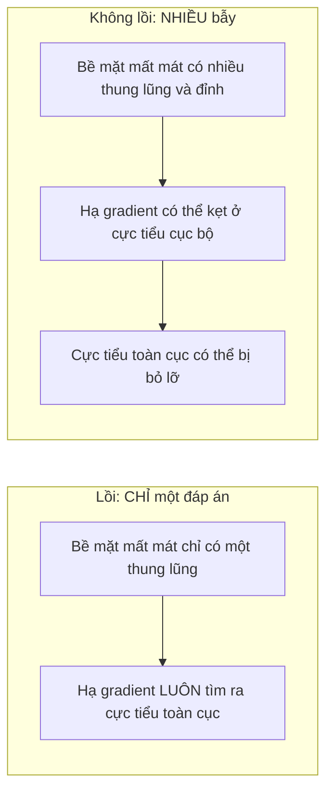
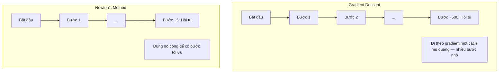
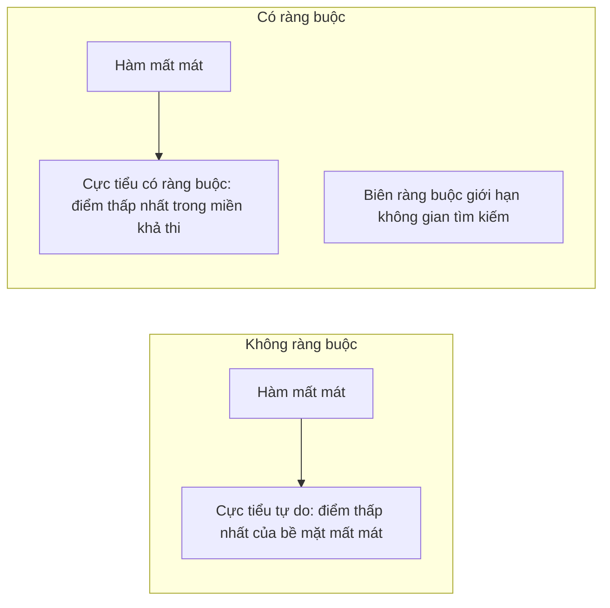
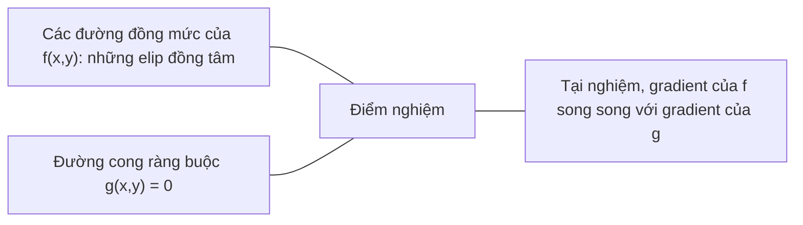

# Tối ưu lồi

> Bài toán lồi chỉ có một thung lũng. Mạng nơ-ron có hàng triệu thung lũng. Biết được khác biệt này là điều quan trọng.

**Type:** Build
**Language:** Python
**Prerequisites:** Giai đoạn 1, Bài 04 (Giải tích cho ML), 08 (Tối ưu hóa)
**Time:** ~90 phút

## Mục tiêu học tập

- Kiểm tra một hàm có lồi hay không bằng định nghĩa, đạo hàm bậc hai và tiêu chí Hessian
- Cài đặt phương pháp Newton và so sánh hội tụ bậc hai của nó với hạ gradient (gradient descent)
- Giải bài toán tối ưu có ràng buộc bằng nhân tử Lagrange và diễn giải các điều kiện KKT
- Giải thích vì sao cảnh quan hàm mất mát của mạng nơ-ron là không lồi mà SGD vẫn tìm được nghiệm tốt

## Vấn đề

Bài 08 đã dạy bạn hạ gradient, momentum và Adam. Những bộ tối ưu đó đi xuống dốc trên bất kỳ bề mặt nào. Nhưng chúng không kèm theo bảo đảm nào. Hạ gradient trên một cảnh quan không lồi có thể rơi vào một cực tiểu cục bộ tồi, kẹt ở điểm yên ngựa, hoặc dao động mãi mãi. Bạn vẫn dùng nó vì mạng nơ-ron là không lồi và không có lựa chọn nào khác.

Nhưng nhiều bài toán trong học máy là lồi. Hồi quy tuyến tính, hồi quy logistic, SVM, LASSO, hồi quy ridge. Với những bài toán này, có một thứ mạnh hơn: tối ưu với bảo đảm toán học. Một bài toán lồi chỉ có đúng một thung lũng. Bất kỳ thuật toán nào đi xuống dốc đều sẽ tới cực tiểu toàn cục. Không cần khởi động lại. Không cần lịch tốc độ học. Không cần cầu nguyện.

Hiểu về tính lồi mang lại ba điều. Thứ nhất, nó cho bạn biết khi nào bài toán của bạn dễ (lồi) và khi nào khó (không lồi). Thứ hai, nó cho bạn những công cụ nhanh hơn như phương pháp Newton cho bài toán lồi. Thứ ba, nó giải thích những khái niệm xuất hiện khắp ML: điều chuẩn (regularization) như một ràng buộc (constraint), đối ngẫu trong SVM, và vì sao học sâu vẫn hoạt động dù vi phạm mọi tính chất tốt đẹp mà tính lồi mang lại.

## Khái niệm

### Tập lồi (convex set)

Một tập S là lồi nếu với hai điểm bất kỳ trong S, đoạn thẳng nối chúng cũng nằm hoàn toàn trong S.

| Tập lồi | Không lồi |
|---|---|
| **Hình chữ nhật**: hai điểm bất kỳ bên trong đều nối được bằng một đoạn thẳng nằm trong tập | **Hình sao/lưỡi liềm**: đường thẳng giữa hai điểm bên trong có thể đi ra ngoài tập |
| **Tam giác**: tính chất đó đúng với mọi điểm bên trong | **Hình vành khuyên**: phần lỗ khiến một số đoạn thẳng rời khỏi tập |
| Đoạn thẳng giữa hai điểm bất kỳ luôn nằm trong tập | Đoạn thẳng giữa một số cặp điểm đi ra ngoài tập |

Phép kiểm tra hình thức: với mọi điểm x, y trong S và mọi t trong [0, 1], điểm tx + (1-t)y cũng nằm trong S.

Ví dụ về tập lồi:
- Một đường thẳng, một mặt phẳng, toàn bộ R^n
- Một quả cầu (đường tròn, mặt cầu, siêu cầu)
- Một nửa không gian: {x : a^T x <= b}
- Giao của một số bất kỳ các tập lồi

Ví dụ về tập không lồi:
- Một hình vành khuyên (donut)
- Hợp của hai đường tròn rời nhau
- Bất kỳ tập nào có "vết lõm" hoặc "lỗ"

### Hàm lồi (convex function)

Một hàm f là lồi nếu miền xác định của nó là một tập lồi và với hai điểm bất kỳ x, y trong miền đó và mọi t trong [0, 1]:

```
f(tx + (1-t)y) <= t*f(x) + (1-t)*f(y)
```

Về mặt hình học: đoạn thẳng giữa hai điểm bất kỳ trên đồ thị nằm phía trên hoặc nằm trên chính đồ thị.

| Tính chất | Hàm lồi | Hàm không lồi |
|---|---|---|
| **Phép thử đoạn thẳng** | Đường thẳng giữa hai điểm bất kỳ trên đồ thị nằm **phía trên hoặc trên** đường cong | Đường thẳng giữa một số điểm trên đồ thị chìm **xuống dưới** đường cong |
| **Hình dạng** | Một cái bát/thung lũng duy nhất cong lên trên | Nhiều đỉnh và thung lũng với độ cong trộn lẫn |
| **Cực tiểu cục bộ** | Mọi cực tiểu cục bộ đều là cực tiểu toàn cục | Có thể có nhiều cực tiểu cục bộ ở các độ cao khác nhau |

Các hàm lồi thông dụng:
- f(x) = x^2 (parabol)
- f(x) = |x| (trị tuyệt đối)
- f(x) = e^x (hàm mũ)
- f(x) = max(0, x) (ReLU, dù là tuyến tính từng khúc)
- f(x) = -log(x) với x > 0 (log âm)
- Mọi hàm tuyến tính f(x) = a^T x + b (vừa lồi vừa lõm)

### Kiểm tra tính lồi

Ba phép thử thực hành, từ dễ nhất đến chặt chẽ nhất.

**Phép thử 1: Đạo hàm bậc hai (1D).** Nếu f''(x) >= 0 với mọi x, thì f là lồi.

- f(x) = x^2: f''(x) = 2 >= 0. Lồi.
- f(x) = x^3: f''(x) = 6x. Âm với x < 0. Không lồi.
- f(x) = e^x: f''(x) = e^x > 0. Lồi.

**Phép thử 2: Phép thử Hessian (nhiều biến).** Nếu ma trận Hessian H(x) là nửa xác định dương với mọi x, thì f là lồi. Hessian là ma trận các đạo hàm riêng bậc hai.

**Phép thử 3: Phép thử theo định nghĩa.** Kiểm tra trực tiếp bất đẳng thức f(tx + (1-t)y) <= t*f(x) + (1-t)*f(y). Hữu ích cho những hàm khó tính đạo hàm.

### Vì sao tính lồi quan trọng

Định lý trung tâm của tối ưu lồi (convex optimization):

**Với một hàm lồi, mọi cực tiểu cục bộ đều là cực tiểu toàn cục.**

Điều này nghĩa là hạ gradient không thể bị mắc kẹt. Mọi đường đi xuống dốc đều dẫn tới cùng một đáp án. Thuật toán được bảo đảm hội tụ về nghiệm tối ưu.



Hệ quả:
- Không cần khởi động lại ngẫu nhiên
- Không cần lịch tốc độ học phức tạp
- Có thể chứng minh hội tụ (tốc độ phụ thuộc tính chất của hàm)
- Nghiệm là duy nhất (sai khác ở các vùng phẳng)

### Lồi và không lồi trong ML

| Bài toán | Lồi? | Vì sao |
|---------|---------|-----|
| Hồi quy tuyến tính (MSE) | Có | Mất mát là bậc hai theo trọng số |
| Hồi quy logistic | Có | Log-loss là lồi theo trọng số |
| SVM (hinge loss) | Có | Cực đại của các hàm tuyến tính |
| LASSO (hồi quy L1) | Có | Tổng các hàm lồi là lồi |
| Hồi quy ridge (L2) | Có | Bậc hai + bậc hai = lồi |
| Mạng nơ-ron (mọi mất mát) | Không | Các hàm kích hoạt phi tuyến tạo cảnh quan không lồi |
| Phân cụm k-means | Không | Bước gán nhãn rời rạc |
| Phân rã ma trận | Không | Tích của các ẩn số |

Các mô hình tuyến tính với mất mát lồi là lồi. Ngay khi bạn thêm các lớp ẩn với hàm kích hoạt phi tuyến, tính lồi biến mất.

### Ma trận Hessian

Hessian H của một hàm f: R^n -> R là ma trận n x n các đạo hàm riêng bậc hai.

```
H[i][j] = d^2 f / (dx_i dx_j)
```

Với f(x, y) = x^2 + 3xy + y^2:

```
df/dx = 2x + 3y       d^2f/dx^2 = 2      d^2f/dxdy = 3
df/dy = 3x + 2y       d^2f/dydx = 3      d^2f/dy^2 = 2

H = [ 2  3 ]
    [ 3  2 ]
```

Hessian cho bạn biết về độ cong:
- Mọi trị riêng dương: hàm cong lên theo mọi hướng (lồi tại điểm đó)
- Mọi trị riêng âm: cong xuống theo mọi hướng (lõm, cực đại cục bộ)
- Trị riêng trái dấu: điểm yên ngựa (cong lên theo một số hướng, cong xuống theo các hướng khác)
- Trị riêng bằng không: phẳng theo hướng đó (suy biến)

Để một hàm lồi, Hessian phải nửa xác định dương (mọi trị riêng >= 0) ở mọi nơi, không chỉ tại một điểm.

### Phương pháp Newton

Hạ gradient dùng thông tin bậc một (gradient). Phương pháp Newton dùng thông tin bậc hai (Hessian). Nó khớp một xấp xỉ bậc hai tại điểm hiện tại rồi nhảy thẳng tới cực tiểu của xấp xỉ bậc hai đó.

```
Update rule:
  x_new = x - H^(-1) * gradient

Compare to gradient descent:
  x_new = x - lr * gradient
```

Phương pháp Newton thay tốc độ học vô hướng bằng nghịch đảo Hessian. Nhờ vậy nó tự điều chỉnh kích thước bước và hướng bước dựa trên độ cong cục bộ.



Ưu điểm:
- Hội tụ bậc hai gần cực tiểu (sai số bình phương sau mỗi bước)
- Không có tốc độ học phải tinh chỉnh
- Bất biến theo tỉ lệ (hoạt động bất kể bạn tham số hóa bài toán thế nào)

Nhược điểm:
- Tính Hessian tốn O(n^2) bộ nhớ và O(n^3) để nghịch đảo
- Với một mạng nơ-ron có 1 triệu trọng số, đó là 10^12 phần tử và 10^18 phép tính
- Không thực tế cho học sâu

### Tối ưu có ràng buộc

Tối ưu không ràng buộc: cực tiểu hóa f(x) trên mọi x.
Tối ưu có ràng buộc: cực tiểu hóa f(x) thỏa mãn các ràng buộc.

Bài toán thực tế có ràng buộc. Bạn muốn tối thiểu hóa chi phí nhưng ngân sách có hạn. Bạn muốn tối thiểu hóa sai số nhưng độ phức tạp mô hình bị chặn trên.



### Nhân tử Lagrange

Phương pháp nhân tử Lagrange chuyển một bài toán có ràng buộc thành một bài toán không ràng buộc.

Bài toán: cực tiểu hóa f(x) thỏa mãn g(x) = 0.

Cách giải: đưa vào một biến mới (nhân tử Lagrange lambda) và giải bài toán không ràng buộc:

```
L(x, lambda) = f(x) + lambda * g(x)
```

Tại nghiệm, gradient của L bằng không:

```
dL/dx = df/dx + lambda * dg/dx = 0
dL/dlambda = g(x) = 0
```

Trực giác hình học: tại cực tiểu có ràng buộc, gradient của f phải song song với gradient của ràng buộc g. Nếu chúng không song song, bạn có thể di chuyển dọc bề mặt ràng buộc và giảm f thêm nữa.



Ví dụ: cực tiểu hóa f(x,y) = x^2 + y^2 thỏa mãn x + y = 1.

```
L = x^2 + y^2 + lambda(x + y - 1)

dL/dx = 2x + lambda = 0  =>  x = -lambda/2
dL/dy = 2y + lambda = 0  =>  y = -lambda/2
dL/dlambda = x + y - 1 = 0

From first two: x = y
Substituting: 2x = 1, so x = y = 0.5, lambda = -1
```

Điểm gần gốc tọa độ nhất trên đường thẳng x + y = 1 là (0.5, 0.5).

### Điều kiện KKT

Các điều kiện Karush-Kuhn-Tucker mở rộng nhân tử Lagrange cho ràng buộc bất đẳng thức.

Bài toán: cực tiểu hóa f(x) thỏa mãn g_i(x) <= 0 với i = 1, ..., m.

Các điều kiện KKT (điều kiện cần cho tính tối ưu):

```
1. Stationarity:    df/dx + sum(lambda_i * dg_i/dx) = 0
2. Primal feasibility:  g_i(x) <= 0  for all i
3. Dual feasibility:    lambda_i >= 0  for all i
4. Complementary slackness:  lambda_i * g_i(x) = 0  for all i
```

Độ lệch bù là điểm mấu chốt: hoặc ràng buộc đang hoạt động (g_i = 0, nghiệm nằm trên biên), hoặc nhân tử bằng không (ràng buộc không quan trọng). Một ràng buộc không ảnh hưởng tới nghiệm có lambda = 0.

Các điều kiện KKT là trọng tâm của SVM. Các vector hỗ trợ là những điểm dữ liệu mà tại đó ràng buộc đang hoạt động (lambda > 0). Mọi điểm dữ liệu khác có lambda = 0 và không ảnh hưởng tới biên quyết định.

### Regularization như bài toán tối ưu có ràng buộc

L1 và L2 regularization không phải là những mẹo tùy tiện. Chúng thực chất là các bài toán tối ưu có ràng buộc được hóa trang.

**L2 regularization (Ridge):**

```
minimize  Loss(w)  subject to  ||w||^2 <= t

Equivalent unconstrained form:
minimize  Loss(w) + lambda * ||w||^2
```

Ràng buộc ||w||^2 <= t định nghĩa một quả cầu (hình tròn trong 2D, hình cầu trong 3D). Nghiệm nằm ở nơi các đường đồng mức của loss chạm vào quả cầu này lần đầu.

**L1 regularization (LASSO):**

```
minimize  Loss(w)  subject to  ||w||_1 <= t

Equivalent unconstrained form:
minimize  Loss(w) + lambda * ||w||_1
```

Ràng buộc ||w||_1 <= t định nghĩa một hình thoi (hình vuông xoay trong 2D).

| Thuộc tính | Ràng buộc L2 (hình tròn) | Ràng buộc L1 (hình thoi) |
|---|---|---|
| **Hình dạng ràng buộc** | Hình tròn (hình cầu ở chiều cao hơn) | Hình thoi (hình vuông xoay trong 2D) |
| **Nơi đường đồng mức loss chạm vào** | Biên trơn — bất kỳ điểm nào trên đường tròn | Góc — thẳng hàng với một trục |
| **Hành vi của nghiệm** | Trọng số nhỏ nhưng khác 0 | Một số trọng số đúng bằng 0 (thưa) |
| **Kết quả** | Co nhỏ trọng số | Chọn đặc trưng |

Điều này giải thích vì sao L1 tạo ra mô hình thưa (chọn đặc trưng) trong khi L2 chỉ co nhỏ trọng số. Hình thoi có các góc thẳng hàng với các trục. Các đường đồng mức của loss dễ chạm vào một góc hơn, đặt một hoặc nhiều trọng số đúng bằng 0.

### Duality (đối ngẫu)

Mỗi bài toán tối ưu có ràng buộc (bài toán gốc, primal) đều có một bài toán đồng hành (bài toán đối ngẫu, dual). Với các bài toán lồi, primal và dual có cùng giá trị tối ưu. Đó là strong duality (đối ngẫu mạnh).

Hàm đối ngẫu Lagrangian:

```
Primal: minimize f(x) subject to g(x) <= 0
Lagrangian: L(x, lambda) = f(x) + lambda * g(x)
Dual function: d(lambda) = min_x L(x, lambda)
Dual problem: maximize d(lambda) subject to lambda >= 0
```

Vì sao duality quan trọng:
- Bài toán đối ngẫu đôi khi dễ giải hơn bài toán gốc
- SVM được giải ở dạng đối ngẫu, nơi bài toán phụ thuộc vào tích vô hướng giữa các điểm dữ liệu (mở đường cho kernel trick)
- Bài toán đối ngẫu cho một cận dưới của giá trị tối ưu primal, hữu ích để kiểm tra chất lượng nghiệm

Cụ thể với SVM:

```
Primal: find w, b that maximize the margin 2/||w|| subject to
        y_i(w^T x_i + b) >= 1 for all i

Dual:   maximize sum(alpha_i) - 0.5 * sum_ij(alpha_i * alpha_j * y_i * y_j * x_i^T x_j)
        subject to alpha_i >= 0 and sum(alpha_i * y_i) = 0

The dual only involves dot products x_i^T x_j.
Replace x_i^T x_j with K(x_i, x_j) to get the kernel trick.
```

### Vì sao deep learning vẫn hoạt động dù không lồi

Hàm loss của mạng nơ-ron phi lồi mạnh. Theo mọi thước đo cổ điển, việc tối ưu chúng lẽ ra phải thất bại. Vậy mà stochastic gradient descent vẫn tìm được nghiệm tốt một cách đáng tin cậy. Một số yếu tố giải thích điều này.

**Hầu hết cực tiểu cục bộ đều đủ tốt.** Trong không gian nhiều chiều, các điểm tới hạn ngẫu nhiên (nơi gradient bằng 0) áp đảo là điểm yên ngựa, không phải cực tiểu cục bộ. Số ít cực tiểu cục bộ tồn tại thường có giá trị loss gần với cực tiểu toàn cục. Việc bị kẹt trong một cực tiểu cục bộ tồi tệ là cực kỳ khó xảy ra khi không gian tham số có hàng triệu chiều.

**Điểm yên ngựa, không phải cực tiểu cục bộ, mới là trở ngại thật sự.** Trong một hàm có n tham số, điểm yên ngựa có sự pha trộn giữa các hướng cong dương và âm. Với một điểm tới hạn ngẫu nhiên trong không gian nhiều chiều, xác suất để cả n trị riêng đều dương (cực tiểu cục bộ) xấp xỉ 2^(-n). Gần như mọi điểm tới hạn đều là điểm yên ngựa. Nhiễu của SGD giúp thoát khỏi chúng.

**Dùng nhiều tham số hơn làm cảnh quan trơn hơn.** Các mạng có nhiều tham số hơn số mẫu huấn luyện sở hữu bề mặt loss trơn và liên thông hơn. Mạng rộng hơn có ít cực tiểu cục bộ tồi hơn. Điều này phản trực giác nhưng nhất quán với thực nghiệm.

**Cấu trúc cảnh quan loss:**

| Thuộc tính | Không gian chiều thấp | Không gian chiều cao |
|---|---|---|
| **Cảnh quan** | Nhiều đỉnh và thung lũng tách biệt | Các thung lũng liên thông trơn |
| **Cực tiểu** | Nhiều cực tiểu cục bộ tách biệt | Ít cực tiểu cục bộ tồi; hầu hết đều gần tối ưu |
| **Điều hướng** | Khó tìm cực tiểu toàn cục | Nhiều đường dẫn đến nghiệm tốt |
| **Điểm tới hạn** | Pha trộn cực tiểu cục bộ và điểm yên ngựa | Áp đảo là điểm yên ngựa, không phải cực tiểu cục bộ |

**Nhiễu ngẫu nhiên đóng vai trò regularization ngầm.** Mini-batch SGD thêm nhiễu giúp ngăn việc dừng lại ở các cực tiểu nhọn. Cực tiểu nhọn thì overfit; cực tiểu phẳng thì khái quát hóa tốt. Nhiễu này thiên lệch quá trình tối ưu về phía các vùng phẳng của cảnh quan loss.

### Phương pháp bậc hai trong thực tế

Phương pháp Newton thuần túy không thực tế với các mô hình lớn. Một số xấp xỉ làm cho thông tin bậc hai trở nên dùng được.

**L-BFGS (Limited-memory BFGS):** Xấp xỉ nghịch đảo Hessian bằng cách dùng m hiệu gradient gần nhất. Cần bộ nhớ O(mn) thay vì O(n^2). Hoạt động tốt với các bài toán tới khoảng 10,000 tham số. Được dùng trong ML cổ điển (logistic regression, CRF) nhưng không dùng trong deep learning.

**Natural gradient:** Dùng ma trận thông tin Fisher (kỳ vọng Hessian của log-likelihood) thay cho Hessian chuẩn. Cách này tính đến hình học của các phân phối xác suất. K-FAC (Kronecker-Factored Approximate Curvature) xấp xỉ ma trận Fisher thành một tích Kronecker, giúp nó thực tế với mạng nơ-ron.

**Tối ưu không cần Hessian (Hessian-free):** Dùng conjugate gradient để giải Hx = g mà không cần tạo ra H. Chỉ cần các tích Hessian–vector, có thể tính trong thời gian O(n) nhờ vi phân tự động.

**Xấp xỉ đường chéo:** Moment bậc hai của Adam là một xấp xỉ đường chéo của đường chéo Hessian. AdaHessian mở rộng điều này bằng cách dùng các phần tử đường chéo Hessian thật qua bộ ước lượng Hutchinson.

| Phương pháp | Bộ nhớ | Chi phí mỗi bước | Khi nào dùng |
|--------|--------|--------------|-------------|
| Gradient descent | O(n) | O(n) | Mức cơ sở, mô hình lớn |
| Phương pháp Newton | O(n^2) | O(n^3) | Bài toán lồi nhỏ |
| L-BFGS | O(mn) | O(mn) | Bài toán lồi trung bình |
| Adam | O(n) | O(n) | Mặc định cho deep learning |
| K-FAC | O(n) | O(n) mỗi lớp | Nghiên cứu, huấn luyện batch lớn |

```figure
convex-vs-nonconvex
```

## Tự tay làm

### Bước 1: Bộ kiểm tra tính lồi

Xây dựng một hàm kiểm tra tính lồi bằng thực nghiệm: lấy mẫu các điểm rồi đối chiếu với định nghĩa.

```python
import random
import math

def check_convexity(f, dim, bounds=(-5, 5), samples=1000):
    violations = 0
    for _ in range(samples):
        x = [random.uniform(*bounds) for _ in range(dim)]
        y = [random.uniform(*bounds) for _ in range(dim)]
        t = random.uniform(0, 1)
        mid = [t * xi + (1 - t) * yi for xi, yi in zip(x, y)]
        lhs = f(mid)
        rhs = t * f(x) + (1 - t) * f(y)
        if lhs > rhs + 1e-10:
            violations += 1
    return violations == 0, violations
```

### Bước 2: Phương pháp Newton cho 2D

Cài đặt phương pháp Newton với Hessian tường minh. So sánh tốc độ hội tụ với gradient descent.

```python
def newtons_method(f, grad_f, hessian_f, x0, steps=50, tol=1e-12):
    x = list(x0)
    history = [x[:]]
    for _ in range(steps):
        g = grad_f(x)
        H = hessian_f(x)
        det = H[0][0] * H[1][1] - H[0][1] * H[1][0]
        if abs(det) < 1e-15:
            break
        H_inv = [
            [H[1][1] / det, -H[0][1] / det],
            [-H[1][0] / det, H[0][0] / det],
        ]
        dx = [
            H_inv[0][0] * g[0] + H_inv[0][1] * g[1],
            H_inv[1][0] * g[0] + H_inv[1][1] * g[1],
        ]
        x = [x[0] - dx[0], x[1] - dx[1]]
        history.append(x[:])
        if sum(gi ** 2 for gi in g) < tol:
            break
    return history
```

### Bước 3: Bộ giải nhân tử Lagrange

Giải bài toán tối ưu có ràng buộc bằng gradient descent trên Lagrangian.

```python
def lagrange_solve(f_grad, g_val, g_grad, x0, lr=0.01,
                   lr_lambda=0.01, steps=5000):
    x = list(x0)
    lam = 0.0
    history = []
    for _ in range(steps):
        fg = f_grad(x)
        gv = g_val(x)
        gg = g_grad(x)
        x = [
            xi - lr * (fgi + lam * ggi)
            for xi, fgi, ggi in zip(x, fg, gg)
        ]
        lam = lam + lr_lambda * gv
        history.append((x[:], lam, gv))
    return history
```

### Bước 4: So sánh bậc một và bậc hai

Chạy gradient descent và phương pháp Newton trên cùng một hàm bậc hai. Đếm số bước để hội tụ.

```python
def quadratic(x):
    return 5 * x[0] ** 2 + x[1] ** 2

def quadratic_grad(x):
    return [10 * x[0], 2 * x[1]]

def quadratic_hessian(x):
    return [[10, 0], [0, 2]]
```

Phương pháp Newton sẽ hội tụ trong 1 bước (nó chính xác với hàm bậc hai). Gradient descent sẽ cần hàng trăm bước vì các trị riêng của Hessian chênh nhau 5 lần, tạo ra một thung lũng kéo dài.

## Áp dụng

Phân tích tính lồi được áp dụng trực tiếp khi chọn mô hình ML và bộ giải.

Với các bài toán lồi (logistic regression, SVM, LASSO):
- Dùng các bộ giải chuyên dụng (liblinear, CVXPY, scipy.optimize.minimize với method='L-BFGS-B')
- Kỳ vọng một nghiệm tối ưu toàn cục duy nhất
- Các phương pháp bậc hai thực tế và nhanh

Với các bài toán không lồi (mạng nơ-ron):
- Dùng các phương pháp bậc một (SGD, Adam)
- Chấp nhận rằng nghiệm phụ thuộc vào khởi tạo và tính ngẫu nhiên
- Dùng việc tăng số tham số, nhiễu và lịch learning rate như regularization ngầm
- Đừng tốn thời gian tìm cực tiểu toàn cục. Một cực tiểu cục bộ tốt là đủ.

```python
from scipy.optimize import minimize

result = minimize(
    fun=lambda w: sum((y - X @ w) ** 2) + 0.1 * sum(w ** 2),
    x0=np.zeros(d),
    method='L-BFGS-B',
    jac=lambda w: -2 * X.T @ (y - X @ w) + 0.2 * w,
)
```

Với SVM, dạng đối ngẫu cho phép bạn dùng kernel trick:

```python
from sklearn.svm import SVC

svm = SVC(kernel='rbf', C=1.0)
svm.fit(X_train, y_train)
print(f"Support vectors: {svm.n_support_}")
```

## Bài tập

1. **Bộ sưu tập tính lồi.** Dùng bộ kiểm tra để thử tính lồi của các hàm sau: f(x) = x^4, f(x) = sin(x), f(x,y) = x^2 + y^2, f(x,y) = x*y, f(x) = max(x, 0). Giải thích vì sao mỗi kết quả là hợp lý.

2. **Cuộc đua Newton và gradient descent.** Chạy cả hai phương pháp trên f(x,y) = 50*x^2 + y^2 từ điểm xuất phát (10, 10). Mỗi phương pháp cần bao nhiêu bước để đạt loss < 1e-10? Điều gì xảy ra với gradient descent khi số điều kiện (tỷ số giữa trị riêng Hessian lớn nhất và nhỏ nhất) tăng lên?

3. **Hình học của nhân tử Lagrange.** Cực tiểu hóa f(x,y) = (x-3)^2 + (y-3)^2 với ràng buộc x + 2y = 4. Kiểm chứng nghiệm bằng cách kiểm tra rằng gradient của f song song với gradient của g tại nghiệm.

4. **Ràng buộc regularization.** Cài đặt bài toán tối ưu có ràng buộc L1: cực tiểu hóa (x-3)^2 + (y-2)^2 với ràng buộc |x| + |y| <= 1. Chứng minh rằng nghiệm có một tọa độ bằng 0 (tính thưa đến từ ràng buộc hình thoi).

5. **Phân tích trị riêng của Hessian.** Tính Hessian của hàm Rosenbrock tại (1,1) và tại (-1,1). Tính trị riêng tại cả hai điểm. Các trị riêng cho bạn biết gì về độ cong tại điểm cực tiểu so với vùng xa nó?

## Thuật ngữ chính

| Thuật ngữ | Ý nghĩa thực sự |
|------|---------------|
| Convex set | Tập hợp mà đoạn thẳng nối hai điểm bất kỳ trong tập vẫn nằm trong tập |
| Convex function | Hàm mà đường thẳng nối hai điểm bất kỳ trên đồ thị nằm phía trên hoặc nằm trên đồ thị. Tương đương, Hessian xác định bán dương khắp nơi |
| Local minimum | Điểm thấp hơn mọi điểm lân cận. Với hàm lồi, mọi cực tiểu cục bộ đều là cực tiểu toàn cục |
| Global minimum | Điểm thấp nhất của một hàm trên toàn miền xác định |
| Hessian matrix | Ma trận chứa tất cả các đạo hàm riêng bậc hai. Mã hóa thông tin độ cong |
| Positive semidefinite | Ma trận có mọi trị riêng không âm. Tương tự nhiều chiều của "đạo hàm bậc hai >= 0" |
| Condition number | Tỷ số giữa trị riêng lớn nhất và nhỏ nhất của Hessian. Số điều kiện cao nghĩa là các thung lũng kéo dài và gradient descent chạy chậm |
| Newton's method | Bộ tối ưu bậc hai dùng nghịch đảo Hessian để xác định hướng và độ lớn bước. Hội tụ bậc hai gần điểm cực tiểu |
| Lagrange multiplier | Một biến được đưa vào để chuyển bài toán tối ưu có ràng buộc thành bài toán không ràng buộc |
| KKT conditions | Các điều kiện cần cho tính tối ưu với ràng buộc bất đẳng thức. Tổng quát hóa nhân tử Lagrange |
| Complementary slackness | Tại nghiệm, hoặc một ràng buộc là chặt, hoặc nhân tử của nó bằng 0. Không bao giờ cả hai cùng khác 0 |
| Duality | Mỗi bài toán có ràng buộc đều có một bài toán đối ngẫu đồng hành. Với bài toán lồi, cả hai có cùng giá trị tối ưu |
| Strong duality | Giá trị tối ưu primal và dual bằng nhau. Đúng với bài toán lồi thỏa mãn điều kiện Slater |
| L-BFGS | Phương pháp bậc hai xấp xỉ, lưu m hiệu gradient gần nhất thay vì toàn bộ Hessian |
| Saddle point | Điểm có gradient bằng 0 nhưng là cực tiểu theo một số hướng và là cực đại theo các hướng khác |
| Overparameterization | Dùng nhiều tham số hơn số mẫu huấn luyện. Làm cảnh quan loss trơn hơn và giảm các cực tiểu cục bộ tồi |

## Đọc thêm

- [Boyd & Vandenberghe: Convex Optimization](https://web.stanford.edu/~boyd/cvxbook/) - sách giáo khoa chuẩn, có sẵn miễn phí trực tuyến
- [Bottou, Curtis, Nocedal: Optimization Methods for Large-Scale Machine Learning (2018)](https://arxiv.org/abs/1606.04838) - nối lý thuyết tối ưu lồi với thực hành deep learning
- [Choromanska et al.: The Loss Surfaces of Multilayer Networks (2015)](https://arxiv.org/abs/1412.0233) - vì sao cảnh quan phi lồi của mạng nơ-ron không tệ như vẻ ngoài của nó
- [Nocedal & Wright: Numerical Optimization](https://link.springer.com/book/10.1007/978-0-387-40065-5) - tài liệu tham chiếu toàn diện cho phương pháp Newton, L-BFGS và tối ưu có ràng buộc

---

[← Bài trước: Hệ phương trình tuyến tính](../../17-linear-systems/docs/vi.md) · [Bài sau: Số phức cho AI →](../../19-complex-numbers/docs/vi.md)
