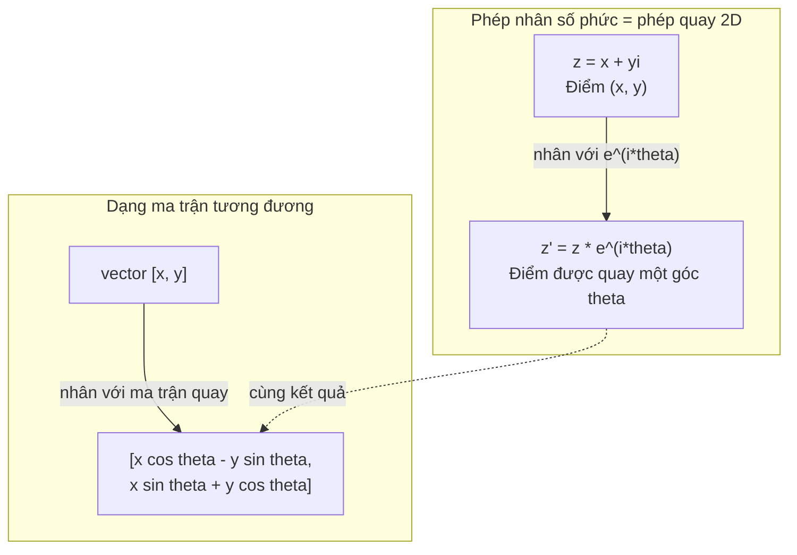
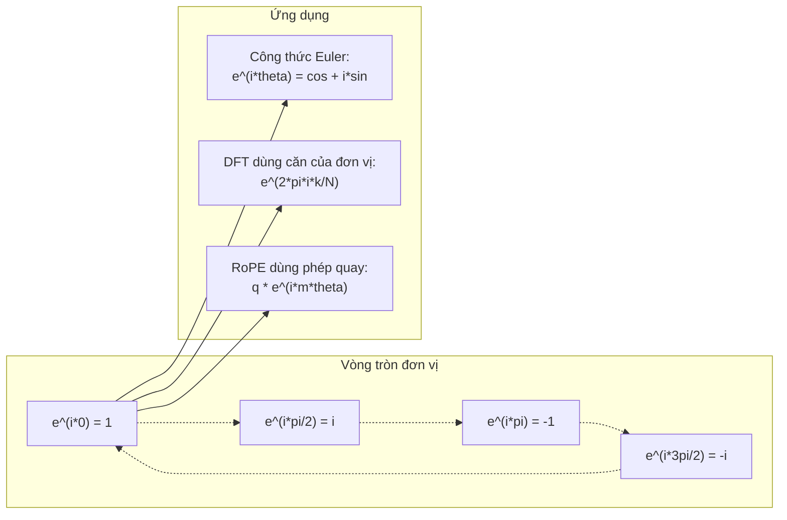

# Số phức cho AI

> Căn bậc hai của -1 không phải là thứ hư ảo. Nó là chìa khóa của phép quay (rotation), tần số và một nửa của xử lý tín hiệu.

**Type:** Learn
**Language:** Python
**Prerequisites:** Giai đoạn 1, Bài 01-04 (đại số tuyến tính, giải tích)
**Time:** ~60 phút

## Mục tiêu học tập

- Thực hiện số học trên số phức (complex number): cộng, nhân, chia, liên hợp (conjugate), ở cả dạng chữ nhật và dạng cực (polar form)
- Áp dụng công thức Euler để chuyển đổi giữa hàm mũ phức và hàm lượng giác
- Cài đặt Biến đổi Fourier Rời rạc bằng căn bậc N của đơn vị
- Giải thích cách các phép quay phức là nền tảng của RoPE và mã hóa vị trí dạng sin trong transformer

## Vấn đề

Bạn mở một bài báo về biến đổi Fourier và thấy `i` ở khắp nơi. Bạn xem mã hóa vị trí trong transformer và thấy `sin` cùng `cos` ở các tần số khác nhau -- đó là phần thực (real part) và phần ảo (imaginary part) của hàm mũ phức. Bạn đọc về điện toán lượng tử và thấy mọi thứ được diễn đạt trong không gian vector phức.

Số phức có vẻ trừu tượng. Một hệ thống số xây trên căn bậc hai của -1 nghe như một mẹo toán học. Nhưng nó không phải mẹo. Nó là ngôn ngữ tự nhiên của phép quay và dao động. Mỗi khi thứ gì đó xoay, rung hay dao động, số phức là công cụ đúng.

Không hiểu số phức, bạn không thể hiểu Biến đổi Fourier Rời rạc. Bạn không thể hiểu FFT. Bạn không thể hiểu cách RoPE (Rotary Position Embedding) hoạt động trong các mô hình ngôn ngữ hiện đại. Bạn không thể hiểu vì sao mã hóa vị trí dạng sin trong bài báo Transformer gốc lại dùng đúng những tần số đó.

Bài học này xây dựng số học phức từ đầu, kết nối nó với hình học, và chỉ cho bạn chính xác nơi số phức xuất hiện trong học máy.

## Khái niệm

### Số phức là gì?

Một số phức có hai phần: phần thực và phần ảo.

```
z = a + bi

where:
  a is the real part
  b is the imaginary part
  i is the imaginary unit, defined by i^2 = -1
```

Chỉ có vậy. Bạn mở rộng trục số thành một mặt phẳng. Các số thực nằm trên một trục. Các số ảo nằm trên trục kia. Mỗi số phức là một điểm trong mặt phẳng này.

### Số học trên số phức

**Phép cộng.** Cộng các phần thực với nhau, cộng các phần ảo với nhau.

```
(a + bi) + (c + di) = (a + c) + (b + d)i

Example: (3 + 2i) + (1 + 4i) = 4 + 6i
```

**Phép nhân.** Dùng luật phân phối và nhớ rằng i^2 = -1.

```
(a + bi)(c + di) = ac + adi + bci + bdi^2
                 = ac + adi + bci - bd
                 = (ac - bd) + (ad + bc)i

Example: (3 + 2i)(1 + 4i) = 3 + 12i + 2i + 8i^2
                            = 3 + 14i - 8
                            = -5 + 14i
```

**Liên hợp (conjugate).** Đổi dấu của phần ảo.

```
conjugate of (a + bi) = a - bi
```

Tích của một số phức với liên hợp của nó luôn là số thực:

```
(a + bi)(a - bi) = a^2 + b^2
```

**Phép chia.** Nhân tử số và mẫu số với liên hợp của mẫu số.

```
(a + bi) / (c + di) = (a + bi)(c - di) / (c^2 + d^2)
```

Việc này loại bỏ phần ảo khỏi mẫu số, cho bạn một số phức gọn gàng.

### Mặt phẳng phức

Mặt phẳng phức ánh xạ mỗi số phức thành một điểm 2D. Trục ngang là trục thực, trục dọc là trục ảo.

```
z = 3 + 2i  corresponds to the point (3, 2)
z = -1 + 0i corresponds to the point (-1, 0) on the real axis
z = 0 + 4i  corresponds to the point (0, 4) on the imaginary axis
```

Một số phức đồng thời là một điểm và một vector từ gốc tọa độ. Cách hiểu kép này khiến số phức hữu ích cho hình học.

### Dạng cực

Mọi điểm trong mặt phẳng đều có thể được mô tả bằng khoảng cách tới gốc tọa độ và góc so với trục thực dương.

```
z = r * (cos(theta) + i*sin(theta))

where:
  r = |z| = sqrt(a^2 + b^2)     (magnitude, or modulus)
  theta = atan2(b, a)             (phase, or argument)
```

Dạng chữ nhật (a + bi) tốt cho phép cộng. Dạng cực (r, theta) tốt cho phép nhân.

**Phép nhân ở dạng cực.** Nhân các độ lớn (magnitude) với nhau, cộng các góc với nhau.

```
z1 = r1 * e^(i*theta1)
z2 = r2 * e^(i*theta2)

z1 * z2 = (r1 * r2) * e^(i*(theta1 + theta2))
```

Đây là lý do số phức hoàn hảo cho phép quay. Nhân với một số phức có độ lớn bằng 1 chính là một phép quay thuần.

### Công thức Euler

Cây cầu nối hàm mũ phức và lượng giác:

```
e^(i*theta) = cos(theta) + i*sin(theta)
```

Đây là công thức quan trọng nhất trong bài này. Khi theta = pi:

```
e^(i*pi) = cos(pi) + i*sin(pi) = -1 + 0i = -1

Therefore: e^(i*pi) + 1 = 0
```

Năm hằng số cơ bản (e, i, pi, 1, 0) được nối trong một phương trình.

### Vì sao công thức Euler quan trọng với ML

Công thức Euler nói rằng `e^(i*theta)` vạch ra đường tròn đơn vị khi theta thay đổi. Tại theta = 0, bạn ở (1, 0). Tại theta = pi/2, bạn ở (0, 1). Tại theta = pi, bạn ở (-1, 0). Tại theta = 3*pi/2, bạn ở (0, -1). Một vòng quay đầy đủ là theta = 2*pi.

Điều này có nghĩa hàm mũ phức CHÍNH LÀ các phép quay. Và phép quay có mặt khắp nơi trong xử lý tín hiệu và ML.

### Liên hệ với phép quay 2D

Nhân số phức (x + yi) với e^(i*theta) sẽ quay điểm (x, y) một góc theta quanh gốc tọa độ.

```
Rotation via complex multiplication:
  (x + yi) * (cos(theta) + i*sin(theta))
  = (x*cos(theta) - y*sin(theta)) + (x*sin(theta) + y*cos(theta))i

Rotation via matrix multiplication:
  [cos(theta)  -sin(theta)] [x]   [x*cos(theta) - y*sin(theta)]
  [sin(theta)   cos(theta)] [y] = [x*sin(theta) + y*cos(theta)]
```

Chúng cho kết quả giống hệt nhau. Phép nhân số phức CHÍNH LÀ phép quay 2D. Ma trận quay chỉ là phép nhân số phức viết dưới dạng ký hiệu ma trận.



### Phasor và tín hiệu quay

Một hàm mũ phức e^(i*omega*t) là một điểm quay quanh đường tròn đơn vị với tần số góc omega. Khi t tăng, điểm đó vạch ra đường tròn.

Phần thực của điểm quay này là cos(omega*t). Phần ảo là sin(omega*t). Một tín hiệu dạng sin là bóng của một số phức đang quay.

```
e^(i*omega*t) = cos(omega*t) + i*sin(omega*t)

Real part:      cos(omega*t)    -- a cosine wave
Imaginary part: sin(omega*t)    -- a sine wave
```

Đây là cách biểu diễn phasor. Thay vì theo dõi một sóng sin gồ ghề, bạn theo dõi một mũi tên quay đều. Dịch pha (phase) trở thành độ lệch góc. Thay đổi biên độ trở thành thay đổi độ lớn. Cộng tín hiệu trở thành cộng vector.

### Căn của đơn vị

Căn bậc N của đơn vị là N điểm cách đều nhau trên đường tròn đơn vị:

```
w_k = e^(2*pi*i*k/N)    for k = 0, 1, 2, ..., N-1
```

Với N = 4, các căn là: 1, i, -1, -i (bốn điểm như bốn hướng la bàn).
Với N = 8, bạn có thêm bốn đường chéo bên cạnh bốn hướng la bàn.

Căn của đơn vị là nền tảng của Biến đổi Fourier Rời rạc. DFT phân rã một tín hiệu thành các thành phần tại N tần số cách đều này.

### Liên hệ với DFT

Biến đổi Fourier Rời rạc của một tín hiệu x[0], x[1], ..., x[N-1] là:

```
X[k] = sum_{n=0}^{N-1} x[n] * e^(-2*pi*i*k*n/N)
```

Mỗi X[k] đo mức độ tương quan của tín hiệu với căn bậc k của đơn vị -- một sin phức ở tần số k. DFT chia tín hiệu thành N phasor đang quay và cho bạn biết biên độ cùng pha của từng phasor.

### Vì sao i không phải là thứ hư ảo

Từ "imaginary" (ảo) là một sự ngẫu nhiên của lịch sử. Descartes dùng nó với ý coi thường. Nhưng i không hề "ảo" hơn số âm vào thời người ta mới từ chối chúng. Số âm trả lời câu hỏi "lấy 3 trừ 5 thì được gì?" Đơn vị ảo (imaginary unit) trả lời câu hỏi "bình phương của cái gì thì bằng -1?"

Hữu ích hơn: i là toán tử quay 90 độ. Nhân một số thực với i một lần, bạn quay 90 độ sang trục ảo. Nhân với i thêm lần nữa (i^2), bạn quay thêm 90 độ -- giờ bạn đang chỉ theo hướng thực âm. Đó là lý do i^2 = -1. Không có gì bí ẩn. Đó là một nửa vòng quay ghép từ hai phần tư vòng quay.

Đây là lý do số phức có mặt khắp nơi trong kỹ thuật. Bất cứ thứ gì quay -- sóng điện từ, trạng thái lượng tử, dao động tín hiệu, mã hóa vị trí -- đều được mô tả tự nhiên bằng số phức.

### Hàm mũ phức so với hàm lượng giác

Trước công thức Euler, các kỹ sư viết tín hiệu dưới dạng A*cos(omega*t + phi) -- biên độ A, tần số omega, pha phi. Cách này chạy được nhưng làm số học rất mệt. Cộng hai cosin khác pha đòi hỏi các đẳng thức lượng giác.

Với hàm mũ phức, cùng tín hiệu đó là A*e^(i*(omega*t + phi)). Cộng hai tín hiệu chỉ là cộng hai số phức. Nhân (điều chế) chỉ là nhân các độ lớn và cộng các góc. Dịch pha trở thành cộng góc. Dịch tần số trở thành nhân với phasor.

Toàn bộ lĩnh vực xử lý tín hiệu chuyển sang ký hiệu hàm mũ phức vì toán học gọn hơn. "Tín hiệu thực" luôn chỉ là phần thực của biểu diễn phức. Phần ảo được mang theo như một cách ghi sổ, giúp mọi phép đại số tự nhiên khớp lại.

### Liên hệ với transformer

**Sinusoidal positional encodings** (bài báo Transformer gốc):

```
PE(pos, 2i) = sin(pos / 10000^(2i/d))
PE(pos, 2i+1) = cos(pos / 10000^(2i/d))
```

Cặp sin và cos chính là phần thực và phần ảo của các hàm mũ phức ở những tần số khác nhau. Mỗi tần số cho một “độ phân giải” khác nhau khi mã hoá vị trí. Tần số thấp thay đổi chậm (vị trí thô). Tần số cao thay đổi nhanh (vị trí tinh). Cộng lại, chúng cho mỗi vị trí một dấu vân tay tần số riêng.

**RoPE (Rotary Position Embedding)** đi xa hơn một bước. Nó nhân trực tiếp các vectơ query và key với ma trận quay phức. Vị trí tương đối giữa hai token trở thành một góc quay. Attention được tính bằng các vectơ đã quay này, nhờ đó model nhạy với vị trí tương đối thông qua phép nhân phức.

| Phép toán | Dạng đại số | Ý nghĩa hình học |
|-----------|---------------|-------------------|
| Cộng | (a+c) + (b+d)i | Cộng vectơ trên mặt phẳng |
| Nhân | (ac-bd) + (ad+bc)i | Xoay và co giãn |
| Liên hợp | a - bi | Phản chiếu qua trục thực |
| Độ lớn | sqrt(a^2 + b^2) | Khoảng cách tới gốc toạ độ |
| Pha | atan2(b, a) | Góc so với trục thực dương |
| Chia | nhân với liên hợp | Xoay ngược và co giãn lại |
| Lũy thừa | r^n * e^(i*n*theta) | Xoay n lần, co giãn theo r^n |



```figure
roots-of-unity
```

## Tự tay làm

### Bước 1: Lớp Complex

Xây dựng một lớp Complex biểu diễn số phức, hỗ trợ các phép tính số học, độ lớn, pha và chuyển đổi giữa dạng chữ nhật và dạng cực.

```python
import math

class Complex:
    def __init__(self, real, imag=0.0):
        self.real = real
        self.imag = imag

    def __add__(self, other):
        return Complex(self.real + other.real, self.imag + other.imag)

    def __mul__(self, other):
        r = self.real * other.real - self.imag * other.imag
        i = self.real * other.imag + self.imag * other.real
        return Complex(r, i)

    def __truediv__(self, other):
        denom = other.real ** 2 + other.imag ** 2
        r = (self.real * other.real + self.imag * other.imag) / denom
        i = (self.imag * other.real - self.real * other.imag) / denom
        return Complex(r, i)

    def magnitude(self):
        return math.sqrt(self.real ** 2 + self.imag ** 2)

    def phase(self):
        return math.atan2(self.imag, self.real)

    def conjugate(self):
        return Complex(self.real, -self.imag)
```

### Bước 2: Chuyển đổi dạng cực và công thức Euler (Euler's formula)

```python
def to_polar(z):
    return z.magnitude(), z.phase()

def from_polar(r, theta):
    return Complex(r * math.cos(theta), r * math.sin(theta))

def euler(theta):
    return Complex(math.cos(theta), math.sin(theta))
```

Kiểm tra: `euler(theta).magnitude()` phải luôn bằng 1.0. `euler(0)` phải cho (1, 0). `euler(pi)` phải cho (-1, 0).

### Bước 3: Phép quay

Xoay một điểm (x, y) một góc theta chỉ là một phép nhân số phức:

```python
point = Complex(3, 4)
rotated = point * euler(math.pi / 4)
```

Độ lớn giữ nguyên. Chỉ có góc thay đổi.

### Bước 4: DFT từ số học phức

```python
def dft(signal):
    N = len(signal)
    result = []
    for k in range(N):
        total = Complex(0, 0)
        for n in range(N):
            angle = -2 * math.pi * k * n / N
            total = total + Complex(signal[n], 0) * euler(angle)
        result.append(total)
    return result
```

Đây là DFT O(N^2). Mỗi đầu ra X[k] là tổng các mẫu tín hiệu nhân với các căn của đơn vị (root of unity).

### Bước 5: DFT ngược

DFT ngược tái tạo lại tín hiệu gốc từ phổ của nó. So với DFT xuôi, chỉ có hai thay đổi: đổi dấu ở số mũ và chia cho N.

```python
def idft(spectrum):
    N = len(spectrum)
    result = []
    for n in range(N):
        total = Complex(0, 0)
        for k in range(N):
            angle = 2 * math.pi * k * n / N
            total = total + spectrum[k] * euler(angle)
        result.append(Complex(total.real / N, total.imag / N))
    return result
```

Cách này cho bạn tái tạo hoàn hảo. Áp DFT rồi IDFT, bạn thu lại đúng tín hiệu gốc tới độ chính xác của máy. Không mất mát thông tin nào.

### Bước 6: Căn của đơn vị

```python
def roots_of_unity(N):
    return [euler(2 * math.pi * k / N) for k in range(N)]
```

Kiểm tra hai tính chất:
- Mỗi căn đều có độ lớn đúng bằng 1.
- Tổng của cả N căn bằng không (chúng triệt tiêu nhau do đối xứng).

Những tính chất này khiến DFT khả nghịch. Các căn của đơn vị tạo thành một cơ sở trực giao cho miền tần số.

## Áp dụng

Python có hỗ trợ số phức dựng sẵn. Hậu tố `j` biểu thị đơn vị ảo.

```python
z = 3 + 2j
w = 1 + 4j

print(z + w)
print(z * w)
print(abs(z))

import cmath
print(cmath.phase(z))
print(cmath.exp(1j * cmath.pi))
```

Với mảng, numpy hỗ trợ số phức một cách tự nhiên:

```python
import numpy as np

z = np.array([1+2j, 3+4j, 5+6j])
print(np.abs(z))
print(np.angle(z))
print(np.conj(z))
print(np.real(z))
print(np.imag(z))

signal = np.sin(2 * np.pi * 5 * np.linspace(0, 1, 128))
spectrum = np.fft.fft(signal)
freqs = np.fft.fftfreq(128, d=1/128)
```

## Đóng gói

Chạy `code/complex_numbers.py` để sinh `outputs/skill-complex-arithmetic.md`.

## Bài tập

1. **Tính số phức bằng tay.** Tính (2 + 3i) * (4 - i) rồi kiểm tra lại bằng code. Sau đó tính (5 + 2i) / (1 - 3i). Vẽ cả hai kết quả trên mặt phẳng phức và kiểm tra rằng phép nhân đã xoay và co giãn số thứ nhất.

2. **Chuỗi phép quay.** Bắt đầu với điểm (1, 0). Nhân với e^(i*pi/6) mười hai lần. Kiểm tra rằng bạn quay về (1, 0) sau 12 lần nhân. In toạ độ ở từng bước và xác nhận chúng vạch ra một đa giác đều 12 cạnh.

3. **DFT của một tín hiệu đã biết.** Tạo một tín hiệu là tổng của sin(2*pi*3*t) và 0.5*sin(2*pi*7*t), lấy mẫu tại 32 điểm. Chạy DFT của bạn. Kiểm tra rằng phổ độ lớn có đỉnh tại tần số 3 và 7, với đỉnh tại 7 chỉ cao bằng nửa đỉnh tại 3.

4. **Trực quan hoá căn của đơn vị.** Tính các căn bậc 8 của đơn vị. Kiểm tra rằng chúng cộng lại bằng không. Kiểm tra rằng nhân bất kỳ căn nào với căn nguyên thuỷ e^(2*pi*i/8) sẽ cho căn kế tiếp.

5. **Tương đương với ma trận quay.** Với 10 góc ngẫu nhiên và 10 điểm ngẫu nhiên, kiểm tra rằng phép nhân số phức cho cùng kết quả với phép nhân ma trận–vectơ dùng ma trận quay 2x2. In ra chênh lệch số lớn nhất.

## Thuật ngữ chính

| Thuật ngữ | Ý nghĩa thực sự |
|------|---------------|
| Complex number | Một số dạng a + bi, trong đó a là phần thực, b là phần ảo và i^2 = -1 |
| Imaginary unit | Số i, định nghĩa bởi i^2 = -1. Không hề “tưởng tượng” theo nghĩa triết học -- nó là một toán tử quay |
| Complex plane | Mặt phẳng 2D trong đó trục x là thực và trục y là ảo. Còn gọi là mặt phẳng Argand |
| Magnitude (modulus) | Độ lớn (mô-đun): khoảng cách từ gốc toạ độ, sqrt(a^2 + b^2). Viết là \|z\| |
| Phase (argument) | Pha (argument): góc so với trục thực dương, atan2(b, a). Viết là arg(z) |
| Conjugate | Ảnh phản chiếu qua trục thực: liên hợp của a + bi là a - bi |
| Polar form | Biểu diễn z dưới dạng r * e^(i*theta) thay vì a + bi. Giúp phép nhân trở nên dễ dàng |
| Euler's formula | e^(i*theta) = cos(theta) + i*sin(theta). Nối hàm mũ với lượng giác |
| Phasor | Một số phức quay (phasor) e^(i*omega*t) biểu diễn tín hiệu hình sin |
| Roots of unity | N số phức e^(2*pi*i*k/N) với k = 0 đến N-1. N điểm cách đều nhau trên vòng tròn đơn vị |
| DFT | Discrete Fourier Transform (biến đổi Fourier rời rạc). Phân rã tín hiệu thành các thành phần hình sin phức nhờ căn của đơn vị |
| RoPE | Rotary Position Embedding. Dùng phép nhân phức để mã hoá vị trí tương đối trong attention của transformer |

## Đọc thêm

- [Visual Introduction to Euler's Formula](https://betterexplained.com/articles/intuitive-understanding-of-eulers-formula/) - xây dựng trực giác hình học mà không cần ký hiệu nặng nề
- [Su et al.: RoFormer (2021)](https://arxiv.org/abs/2104.09864) - bài báo giới thiệu Rotary Position Embedding dùng phép quay phức
- [Vaswani et al.: Attention Is All You Need (2017)](https://arxiv.org/abs/1706.03762) - bài báo Transformer gốc với sinusoidal positional encodings
- [3Blue1Brown: Euler's formula with introductory group theory](https://www.youtube.com/watch?v=mvmuCPvRoWQ) - giải thích trực quan vì sao e^(i*pi) = -1
- [Needham: Visual Complex Analysis](https://global.oup.com/academic/product/visual-complex-analysis-9780198534464) - cách trình bày trực quan hay nhất về số phức, đầy trực giác hình học
- [Strang: Introduction to Linear Algebra, Ch. 10](https://math.mit.edu/~gs/linearalgebra/) - số phức trong bối cảnh đại số tuyến tính và trị riêng

---

[← Bài trước: Tối ưu lồi](../../18-convex-optimization/docs/vi.md) · [Bài sau: Biến đổi Fourier →](../../20-fourier-transform/docs/vi.md)
