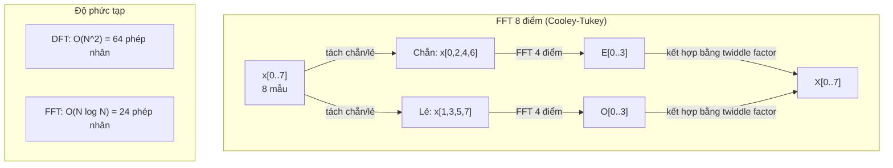
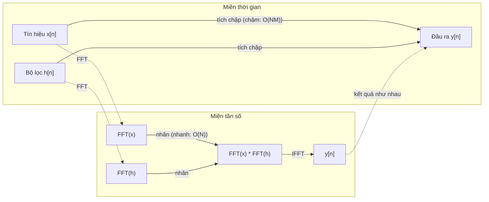

# Biến đổi Fourier

> Mọi tín hiệu đều là tổng của các sóng sin. Fourier transform (biến đổi Fourier) cho bạn biết đó là những sóng nào.

**Type:** Build
**Language:** Python
**Prerequisites:** Giai đoạn 1, Bài 01-04, 19 (số phức)
**Time:** ~90 phút

## Mục tiêu học tập

- Tự cài đặt DFT từ đầu và kiểm chứng nó với FFT Cooley-Tukey O(N log N)
- Diễn giải các hệ số tần số: trích xuất biên độ, pha và phổ công suất từ một tín hiệu
- Áp dụng định lý tích chập để thực hiện tích chập bằng phép nhân FFT
- Nối phép phân rã tần số Fourier với positional encoding của transformer và các lớp tích chập của CNN

## Vấn đề

Một bản ghi âm là một chuỗi các phép đo áp suất theo thời gian. Giá cổ phiếu là một chuỗi giá trị theo ngày. Một bức ảnh là một lưới cường độ điểm ảnh theo không gian. Tất cả những thứ này đều là dữ liệu trong miền thời gian (hoặc miền không gian). Bạn thấy các giá trị thay đổi theo một chỉ số nào đó.

Nhưng nhiều quy luật lại vô hình trong miền thời gian. Tín hiệu âm thanh này là một nốt thuần hay một hợp âm? Giá cổ phiếu này có chu kỳ theo tuần không? Bức ảnh này có kết cấu lặp lại không? Những câu hỏi này đều nói về thành phần tần số (frequency), và miền thời gian che giấu điều đó.

Biến đổi Fourier chuyển dữ liệu từ miền thời gian sang miền tần số. Nó nhận một tín hiệu rồi phân rã tín hiệu đó thành các sóng sin ở những tần số khác nhau. Mỗi sóng sin có một amplitude (biên độ) -- cho biết nó mạnh đến đâu -- và một phase (pha) -- cho biết nó bắt đầu từ đâu. Biến đổi Fourier cho bạn biết cả hai.

Điều này quan trọng với ML vì tư duy miền tần số xuất hiện ở khắp nơi. Mạng nơ-ron tích chập thực hiện tích chập, mà tích chập chính là phép nhân trong miền tần số. Positional encoding của transformer dùng phân rã tần số để biểu diễn vị trí. Các mô hình âm thanh (nhận dạng giọng nói, sinh nhạc) làm việc trên spectrogram -- biểu diễn tần số của âm thanh. Các mô hình chuỗi thời gian tìm kiếm quy luật tuần hoàn. Hiểu biến đổi Fourier cho bạn vốn từ để làm việc với tất cả những thứ đó.

## Khái niệm

### Định nghĩa DFT

Cho N mẫu x[0], x[1], ..., x[N-1], Discrete Fourier Transform tạo ra N hệ số tần số X[0], X[1], ..., X[N-1]:

```
X[k] = sum_{n=0}^{N-1} x[n] * e^(-2*pi*i*k*n/N)

for k = 0, 1, ..., N-1
```

Mỗi X[k] là một số phức. Độ lớn |X[k]| cho bạn biên độ của tần số k. Góc pha angle(X[k]) cho bạn độ lệch phase của tần số đó.

Điểm mấu chốt: `e^(-2*pi*i*k*n/N)` là một phasor quay tại tần số k. DFT tính tương quan giữa tín hiệu và từng tần số trong N tần số cách đều nhau. Nếu tín hiệu có năng lượng tại tần số k, tương quan sẽ lớn. Nếu không, nó gần bằng 0.

### Ý nghĩa của từng hệ số

**X[0]: thành phần DC.** Đây là tổng của tất cả các mẫu -- tỉ lệ với giá trị trung bình. Nó biểu diễn độ lệch hằng số (tần số 0) của tín hiệu.

```
X[0] = sum_{n=0}^{N-1} x[n] * e^0 = sum of all samples
```

**X[k] với 1 <= k <= N/2: các tần số dương.** X[k] biểu diễn tần số k chu kỳ trên N mẫu. k lớn hơn nghĩa là tần số cao hơn (dao động nhanh hơn).

**X[N/2]: tần số Nyquist.** Tần số cao nhất bạn có thể biểu diễn với N mẫu. Vượt quá mức này, bạn gặp hiện tượng aliasing -- các tần số cao đội lốt thành tần số thấp.

**X[k] với N/2 < k < N: các tần số âm.** Với tín hiệu có giá trị thực, X[N-k] = conj(X[k]). Các tần số âm là ảnh gương của các tần số dương. Đó là lý do thông tin hữu ích nằm trong N/2 + 1 hệ số đầu tiên.

### DFT ngược

DFT ngược tái tạo tín hiệu gốc từ các hệ số tần số của nó:

```
x[n] = (1/N) * sum_{k=0}^{N-1} X[k] * e^(2*pi*i*k*n/N)

for n = 0, 1, ..., N-1
```

Khác biệt duy nhất so với DFT thuận: dấu ở số mũ là dương (không phải âm), và có thêm hệ số chuẩn hoá 1/N.

DFT ngược là tái tạo hoàn hảo. Không mất mát thông tin. Bạn có thể đi từ miền thời gian sang miền tần số rồi quay lại mà không có sai số nào. DFT là một phép đổi cơ sở -- nó biểu diễn lại cùng một thông tin trong một hệ toạ độ khác.

### FFT: làm cho nhanh

DFT định nghĩa như trên có độ phức tạp O(N^2): với mỗi hệ số trong N hệ số đầu ra, bạn tính tổng trên N mẫu đầu vào. Với N = 1 triệu, đó là 10^12 phép tính.

Fast Fourier Transform (FFT) tính cùng kết quả đó trong O(N log N). Với N = 1 triệu, đó là khoảng 20 triệu phép tính thay vì một nghìn tỉ. Đây là điều khiến phân tích tần số trở nên khả thi trong thực tế.

Thuật toán Cooley-Tukey (FFT phổ biến nhất) hoạt động theo kiểu chia để trị:

1. Tách tín hiệu thành các mẫu có chỉ số chẵn và chỉ số lẻ.
2. Tính DFT của từng nửa một cách đệ quy.
3. Kết hợp hai DFT nửa kích thước bằng "twiddle factor" e^(-2*pi*i*k/N).

```
X[k] = E[k] + e^(-2*pi*i*k/N) * O[k]          for k = 0, ..., N/2 - 1
X[k + N/2] = E[k] - e^(-2*pi*i*k/N) * O[k]    for k = 0, ..., N/2 - 1

where E = DFT of even-indexed samples
      O = DFT of odd-indexed samples
```

Tính đối xứng khiến mỗi mức đệ quy chỉ tốn O(N) phép tính, và có log2(N) mức. Tổng cộng: O(N log N).



FFT yêu cầu độ dài tín hiệu là luỹ thừa của 2. Trong thực tế, người ta zero-pad tín hiệu đến luỹ thừa 2 gần nhất.

### Phân tích phổ

**Power spectrum (phổ công suất)** là |X[k]|^2 -- bình phương độ lớn của từng hệ số tần số. Nó cho thấy mỗi tần số chứa bao nhiêu năng lượng.

**Phase spectrum (phổ pha)** là angle(X[k]) -- độ lệch phase của từng tần số. Với hầu hết tác vụ phân tích, bạn quan tâm đến phổ công suất và bỏ qua pha.

```
Power at frequency k:  P[k] = |X[k]|^2 = X[k].real^2 + X[k].imag^2
Phase at frequency k:  phi[k] = atan2(X[k].imag, X[k].real)
```

### Độ phân giải tần số

Độ phân giải tần số của DFT phụ thuộc vào số mẫu N và sampling rate (tần số lấy mẫu) fs.

```
Frequency of bin k:      f_k = k * fs / N
Frequency resolution:    delta_f = fs / N
Maximum frequency:       f_max = fs / 2  (Nyquist)
```

Để phân giải được hai tần số nằm sát nhau, bạn cần nhiều mẫu hơn. Để bắt được các tần số cao, bạn cần tần số lấy mẫu cao hơn.

### Định lý tích chập

Đây là một trong những kết quả quan trọng nhất của xử lý tín hiệu và liên quan trực tiếp đến CNN.

**Tích chập trong miền thời gian bằng phép nhân điểm-điểm trong miền tần số.**

```
x * h = IFFT(FFT(x) . FFT(h))

where * is convolution and . is element-wise multiplication
```

Vì sao điều này quan trọng:

- Tích chập trực tiếp hai tín hiệu có độ dài N và M tốn O(N*M) phép tính.
- Tích chập dựa trên FFT tốn O(N log N): biến đổi cả hai, nhân, rồi biến đổi ngược.
- Với kernel lớn, tích chập bằng FFT nhanh hơn hẳn.
- Đây chính xác là điều diễn ra trong các lớp tích chập có trường tiếp nhận lớn.

Lưu ý: DFT tính tích chập vòng (tín hiệu quấn vòng lại). Với tích chập tuyến tính (không quấn vòng), hãy zero-pad cả hai tín hiệu đến độ dài N + M - 1 trước khi tính.



### Cửa sổ

DFT giả định tín hiệu là tuần hoàn -- nó coi N mẫu là một chu kỳ của một tín hiệu lặp vô hạn. Nếu tín hiệu không bắt đầu và kết thúc ở cùng một giá trị, sẽ sinh ra một điểm gián đoạn tại biên, và điểm này hiện ra như thành phần tần số cao giả tạo. Hiện tượng đó gọi là spectral leakage (rò rỉ phổ).

Window function (hàm cửa sổ) giảm rò rỉ bằng cách thu nhỏ tín hiệu về 0 ở cả hai đầu trước khi tính DFT.

Các cửa sổ thường dùng:

| Cửa sổ | Dạng | Độ rộng búp chính | Mức búp phụ | Trường hợp dùng |
|--------|-------|----------------|-----------------|----------|
| Chữ nhật | Phẳng (không cửa sổ) | Hẹp nhất | Cao nhất (-13 dB) | Khi tín hiệu tuần hoàn đúng trong N mẫu |
| Hann | Cosine nâng | Trung bình | Thấp (-31 dB) | Phân tích phổ dùng chung |
| Hamming | Cosine cải biến | Trung bình | Thấp hơn (-42 dB) | Xử lý âm thanh, phân tích giọng nói |
| Blackman | Cosine bậc ba | Rộng | Rất thấp (-58 dB) | Khi cần triệt búp phụ gay gắt |

```
Hann window:    w[n] = 0.5 * (1 - cos(2*pi*n / (N-1)))
Hamming window: w[n] = 0.54 - 0.46 * cos(2*pi*n / (N-1))
```

Áp dụng cửa sổ bằng cách nhân từng phần tử với tín hiệu trước khi tính DFT: `X = DFT(x * w)`.

### Các tính chất của DFT

| Tính chất | Miền thời gian | Miền tần số |
|----------|-------------|-----------------|
| Tuyến tính | a*x + b*y | a*X + b*Y |
| Dịch thời gian | x[n - k] | X[f] * e^(-2*pi*i*f*k/N) |
| Dịch tần số | x[n] * e^(2*pi*i*f0*n/N) | X[f - f0] |
| Tích chập | x * h | X * H (điểm-điểm) |
| Phép nhân | x * h (điểm-điểm) | X * H (tích chập vòng, chia tỉ lệ 1/N) |
| Định lý Parseval | sum \|x[n]\|^2 | (1/N) * sum \|X[k]\|^2 |
| Đối xứng liên hợp (đầu vào thực) | x[n] thực | X[k] = conj(X[N-k]) |

Định lý Parseval nói rằng tổng năng lượng là như nhau ở cả hai miền. Năng lượng được bảo toàn qua phép biến đổi.

### Liên hệ với positional encoding

Transformer nguyên bản dùng positional encoding dạng sin:

```
PE(pos, 2i)   = sin(pos / 10000^(2i/d_model))
PE(pos, 2i+1) = cos(pos / 10000^(2i/d_model))
```

Mỗi cặp chiều (2i, 2i+1) dao động ở một tần số khác nhau. Các tần số này được giãn cách theo cấp số nhân từ cao (chiều 0,1) xuống thấp (những chiều cuối cùng). Điều này cho mỗi vị trí một kết cấu riêng trên toàn bộ các dải tần -- tương tự cách các hệ số Fourier nhận diện duy nhất một tín hiệu.

Những tính chất then chốt mà nó mang lại:

- **Tính duy nhất:** Không hai vị trí nào có cùng một encoding.
- **Giá trị bị chặn:** sin và cos luôn nằm trong [-1, 1].
- **Vị trí tương đối:** Encoding của vị trí p+k có thể biểu diễn như một hàm tuyến tính của encoding tại vị trí p. Mô hình có thể học cách chú ý tới các vị trí tương đối.

### Liên hệ với CNN

Một lớp tích chập áp một bộ lọc đã học (kernel) lên đầu vào bằng cách trượt bộ lọc dọc theo tín hiệu hoặc ảnh. Về mặt toán học, đây chính là phép tích chập.

Theo định lý tích chập, điều này tương đương với:
1. FFT đầu vào
2. FFT kernel
3. Nhân trong miền tần số
4. IFFT kết quả

Các cài đặt CNN tiêu chuẩn dùng tích chập trực tiếp (nhanh hơn với kernel 3x3 nhỏ). Nhưng với kernel lớn hoặc tích chập toàn cục, các phương pháp dựa trên FFT nhanh hơn đáng kể. Một số kiến trúc (như FNet) thay thế attention hoàn toàn bằng FFT, đạt độ chính xác cạnh tranh với độ phức tạp O(N log N) thay vì O(N^2).

### Phổ đồ và biến đổi Fourier thời gian ngắn

Một phép FFT duy nhất cho bạn nội dung tần số của toàn bộ tín hiệu, nhưng không nói gì về việc các tần số đó xuất hiện khi nào. Một chirp (tín hiệu có tần số tăng dần theo thời gian) và một hợp âm (mọi tần số xuất hiện đồng thời) có thể có cùng phổ biên độ.

Biến đổi Fourier thời gian ngắn (short-time Fourier transform, STFT) giải quyết việc này bằng cách tính FFT trên các cửa sổ chồng lấp của tín hiệu. Kết quả là một phổ đồ (spectrogram): biểu diễn 2 chiều với thời gian trên một trục và tần số trên trục còn lại. Cường độ tại mỗi điểm cho thấy năng lượng ở tần số đó tại thời điểm đó.

```
STFT procedure:
1. Choose a window size (e.g., 1024 samples)
2. Choose a hop size (e.g., 256 samples -- 75% overlap)
3. For each window position:
   a. Extract the windowed segment
   b. Apply a Hann/Hamming window
   c. Compute FFT
   d. Store the magnitude spectrum as one column of the spectrogram
```

Phổ đồ là biểu diễn đầu vào tiêu chuẩn cho các model ML âm thanh. Các model nhận dạng giọng nói (Whisper, DeepSpeech) hoạt động trên mel-spectrogram -- phổ đồ với tần số được ánh xạ sang thang mel, thang này khớp hơn với cảm nhận cao độ của con người.

### Hiện tượng chồng phổ (aliasing)

Nếu tín hiệu chứa các tần số cao hơn fs/2 (tần số Nyquist (Nyquist frequency)), lấy mẫu ở tốc độ fs sẽ tạo ra các bản sao bị chồng phổ. Một tín hiệu 90 Hz lấy mẫu ở 100 Hz trông giống hệt tín hiệu 10 Hz. Không có cách nào phân biệt chúng chỉ từ các mẫu.

```
Example:
  True signal: 90 Hz sine wave
  Sampling rate: 100 Hz
  Apparent frequency: 100 - 90 = 10 Hz

  The samples from the 90 Hz signal at 100 Hz sampling rate
  are identical to the samples from a 10 Hz signal.
  No amount of math can recover the original 90 Hz.
```

Đây là lý do các bộ chuyển đổi analog sang số có kèm bộ lọc chống chồng phổ để loại bỏ các tần số trên Nyquist trước khi lấy mẫu. Trong ML, chồng phổ xuất hiện khi downsampling feature map mà không lọc thông thấp đúng cách -- một số kiến trúc xử lý việc này bằng các lớp pooling chống chồng phổ.

### Đệm số 0 (zero-padding) không làm tăng độ phân giải

Một hiểu nhầm phổ biến: đệm số 0 vào tín hiệu trước FFT sẽ cải thiện độ phân giải tần số. Không đúng. Đệm số 0 nội suy giữa các bin tần số sẵn có, cho bạn một phổ trông mượt hơn. Nhưng nó không thể tiết lộ chi tiết tần số vốn không có trong các mẫu gốc.

Độ phân giải tần số thực sự chỉ phụ thuộc vào thời gian quan sát T = N / fs. Để phân biệt hai tần số cách nhau delta_f, bạn cần ít nhất T = 1 / delta_f giây dữ liệu. Không lượng đệm số 0 nào thay đổi được giới hạn cơ bản này.

```figure
fourier-synthesis
```

## Tự tay làm

### Bước 1: DFT từ đầu

DFT với độ phức tạp O(N^2) suy ra trực tiếp từ định nghĩa.

```python
import math

class Complex:
    ...

def dft(x):
    N = len(x)
    result = []
    for k in range(N):
        total = Complex(0, 0)
        for n in range(N):
            angle = -2 * math.pi * k * n / N
            w = Complex(math.cos(angle), math.sin(angle))
            xn = x[n] if isinstance(x[n], Complex) else Complex(x[n])
            total = total + xn * w
        result.append(total)
    return result
```

### Bước 2: DFT nghịch đảo

Cùng cấu trúc, số mũ dương, chia cho N.

```python
def idft(X):
    N = len(X)
    result = []
    for n in range(N):
        total = Complex(0, 0)
        for k in range(N):
            angle = 2 * math.pi * k * n / N
            w = Complex(math.cos(angle), math.sin(angle))
            total = total + X[k] * w
        result.append(Complex(total.real / N, total.imag / N))
    return result
```

### Bước 3: FFT (Cooley-Tukey)

FFT đệ quy yêu cầu độ dài là lũy thừa của 2. Tách thành chẵn và lẻ, đệ quy, rồi kết hợp bằng các twiddle factor.

```python
def fft(x):
    N = len(x)
    if N <= 1:
        return [x[0] if isinstance(x[0], Complex) else Complex(x[0])]
    if N % 2 != 0:
        return dft(x)

    even = fft([x[i] for i in range(0, N, 2)])
    odd = fft([x[i] for i in range(1, N, 2)])

    result = [Complex(0)] * N
    for k in range(N // 2):
        angle = -2 * math.pi * k / N
        twiddle = Complex(math.cos(angle), math.sin(angle))
        t = twiddle * odd[k]
        result[k] = even[k] + t
        result[k + N // 2] = even[k] - t
    return result
```

### Bước 4: Các hàm hỗ trợ phân tích phổ

```python
def power_spectrum(X):
    return [xk.real ** 2 + xk.imag ** 2 for xk in X]

def convolve_fft(x, h):
    N = len(x) + len(h) - 1
    padded_N = 1
    while padded_N < N:
        padded_N *= 2

    x_padded = x + [0.0] * (padded_N - len(x))
    h_padded = h + [0.0] * (padded_N - len(h))

    X = fft(x_padded)
    H = fft(h_padded)

    Y = [xk * hk for xk, hk in zip(X, H)]

    y = idft(Y)
    return [y[n].real for n in range(N)]
```

## Áp dụng

Với công việc thực tế, hãy dùng FFT của numpy, vốn được hỗ trợ bởi các thư viện C tối ưu cao.

```python
import numpy as np

signal = np.sin(2 * np.pi * 5 * np.arange(256) / 256)
spectrum = np.fft.fft(signal)
freqs = np.fft.fftfreq(256, d=1/256)

power = np.abs(spectrum) ** 2

positive_freqs = freqs[:len(freqs)//2]
positive_power = power[:len(power)//2]
```

Để chia cửa sổ (windowing) và phân tích phổ nâng cao hơn:

```python
from scipy.signal import windows, stft

window = windows.hann(256)
windowed = signal * window
spectrum = np.fft.fft(windowed)
```

Với tích chập:

```python
from scipy.signal import fftconvolve

result = fftconvolve(signal, kernel, mode='full')
```

Với phổ đồ:

```python
from scipy.signal import stft

frequencies, times, Zxx = stft(signal, fs=sample_rate, nperseg=256)
spectrogram = np.abs(Zxx) ** 2
```

Ma trận phổ đồ có kích thước (n_frequencies, n_time_frames). Mỗi cột là phổ công suất tại một cửa sổ thời gian. Đây là thứ các model ML âm thanh nhận làm đầu vào.

## Đóng gói

Chạy `code/fourier.py` để sinh ra `outputs/prompt-spectral-analyzer.md`.

## Bài tập

1. **Nhận dạng âm thuần.** Tạo một tín hiệu chỉ gồm một sóng sin ở tần số chưa biết (trong khoảng 1 đến 50 Hz), lấy mẫu ở 128 Hz trong 1 giây. Dùng DFT của bạn để xác định tần số đó. Kiểm tra rằng kết quả khớp. Giờ thêm nhiễu Gaussian với độ lệch chuẩn 0.5 và lặp lại. Nhiễu ảnh hưởng đến phổ như thế nào?

2. **Kiểm chứng FFT với DFT.** Sinh một tín hiệu ngẫu nhiên dài 64. Tính cả DFT (O(N^2)) và FFT. Kiểm tra rằng mọi hệ số khớp trong sai số 1e-10. Đo thời gian cả hai hàm trên các tín hiệu dài 256, 512, 1024 và 2048. Vẽ tỉ số thời gian DFT trên thời gian FFT.

3. **Chứng minh định lý tích chập bằng ví dụ.** Tạo tín hiệu x = [1, 2, 3, 4, 0, 0, 0, 0] và bộ lọc h = [1, 1, 1, 0, 0, 0, 0, 0]. Tính trực tiếp tích chập vòng của chúng (vòng lặp lồng nhau). Sau đó tính qua FFT (biến đổi, nhân, biến đổi ngược). Kiểm tra rằng kết quả khớp nhau. Giờ thực hiện tích chập tuyến tính bằng cách đệm số 0 cho hợp lý.

4. **Ảnh hưởng của chia cửa sổ.** Tạo một tín hiệu là tổng của hai sóng sin ở 10 Hz và 12 Hz (rất gần nhau). Lấy mẫu ở 128 Hz trong 1 giây. Tính phổ công suất khi không dùng cửa sổ, với cửa sổ Hann và với cửa sổ Hamming. Cửa sổ nào giúp phân biệt hai đỉnh dễ nhất? Vì sao?

5. **Phân tích positional encoding.** Sinh positional encoding dạng sin cho d_model = 128 và max_pos = 512. Với mỗi cặp vị trí (p1, p2), tính tích vô hướng của các encoding tương ứng. Chứng minh rằng tích vô hướng chỉ phụ thuộc vào |p1 - p2|, không phụ thuộc vào vị trí tuyệt đối. Điều gì xảy ra với tích vô hướng khi khoảng cách tăng lên?

## Thuật ngữ chính

| Thuật ngữ | Ý nghĩa thực sự |
|------|---------------|
| DFT (Discrete Fourier Transform) | Chuyển N mẫu miền thời gian thành N hệ số miền tần số. Mỗi hệ số là tương quan với một sin phức ở tần số đó |
| FFT (Fast Fourier Transform) | Thuật toán O(N log N) để tính DFT. Thuật toán Cooley-Tukey tách chỉ số chẵn/lẻ một cách đệ quy |
| Inverse DFT | Tái tạo tín hiệu miền thời gian từ các hệ số tần số. Cùng công thức với DFT nhưng đảo dấu số mũ và nhân với 1/N |
| Frequency bin | Mỗi chỉ số k trong đầu ra DFT biểu diễn tần số k*fs/N Hz. "Bin" là khe tần số rời rạc |
| DC component | X[0], hệ số tần số 0. Tỉ lệ với giá trị trung bình của tín hiệu |
| Nyquist frequency | fs/2, tần số lớn nhất biểu diễn được ở tốc độ lấy mẫu fs. Các tần số cao hơn mức này bị chồng phổ |
| Power spectrum | \|X[k]\|^2, bình phương biên độ của mỗi hệ số tần số. Cho thấy phân bố năng lượng theo tần số |
| Phase spectrum | angle(X[k]), độ lệch pha của mỗi thành phần tần số. Thường bị bỏ qua khi phân tích |
| Spectral leakage | Nội dung tần số giả tạo (rò rỉ phổ) do xử lý một tín hiệu không tuần hoàn như thể nó tuần hoàn. Giảm được nhờ chia cửa sổ |
| Window function | Hàm làm mềm dần hai đầu (Hann, Hamming, Blackman) áp trước DFT để giảm rò rỉ phổ |
| Twiddle factor | Số mũ phức e^(-2*pi*i*k/N) dùng để kết hợp các DFT con trong phép tính butterfly của FFT |
| Convolution theorem | Tích chập trong miền thời gian bằng phép nhân điểm-điểm trong miền tần số. Nền tảng của xử lý tín hiệu và CNN |
| Circular convolution | Tích chập mà tín hiệu quấn vòng. Đây là thứ DFT tính toán một cách tự nhiên |
| Linear convolution | Tích chập tiêu chuẩn không quấn vòng. Đạt được bằng cách đệm số 0 trước DFT |
| Parseval's theorem | Tổng năng lượng được bảo toàn qua biến đổi Fourier (định lý Parseval). sum \|x[n]\|^2 = (1/N) sum \|X[k]\|^2 |
| Aliasing | Khi các tần số trên Nyquist xuất hiện thành các tần số thấp hơn do tốc độ lấy mẫu không đủ |

## Đọc thêm

- [Cooley & Tukey: An Algorithm for the Machine Calculation of Complex Fourier Series (1965)](https://www.ams.org/journals/mcom/1965-19-090/S0025-5718-1965-0178586-1/) - bài báo FFT gốc đã thay đổi ngành máy tính
- [3Blue1Brown: But what is the Fourier Transform?](https://www.youtube.com/watch?v=spUNpyF58BY) - phần giới thiệu trực quan hay nhất về biến đổi Fourier
- [Lee-Thorp et al.: FNet: Mixing Tokens with Fourier Transforms (2021)](https://arxiv.org/abs/2105.03824) - thay self-attention bằng FFT trong transformer
- [Smith: The Scientist and Engineer's Guide to Digital Signal Processing](http://www.dspguide.com/) - sách giáo trình trực tuyến miễn phí, đi sâu vào FFT, chia cửa sổ và phân tích phổ
- [Vaswani et al.: Attention Is All You Need (2017)](https://arxiv.org/abs/1706.03762) - positional encoding dạng sin suy ra từ phân rã tần số Fourier
- [Radford et al.: Whisper (2022)](https://arxiv.org/abs/2212.04356) - nhận dạng giọng nói dùng mel-spectrogram làm biểu diễn đầu vào

---

[← Bài trước: Số phức cho AI](../../19-complex-numbers/docs/vi.md) · [Bài sau: Lý thuyết đồ thị cho Machine Learning →](../../21-graph-theory/docs/vi.md)
