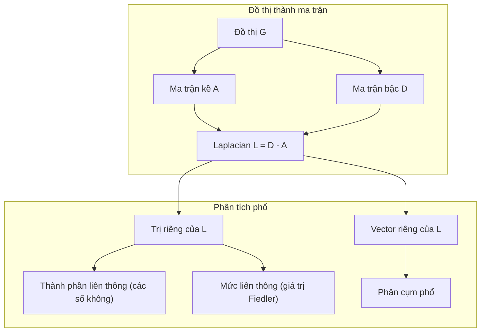
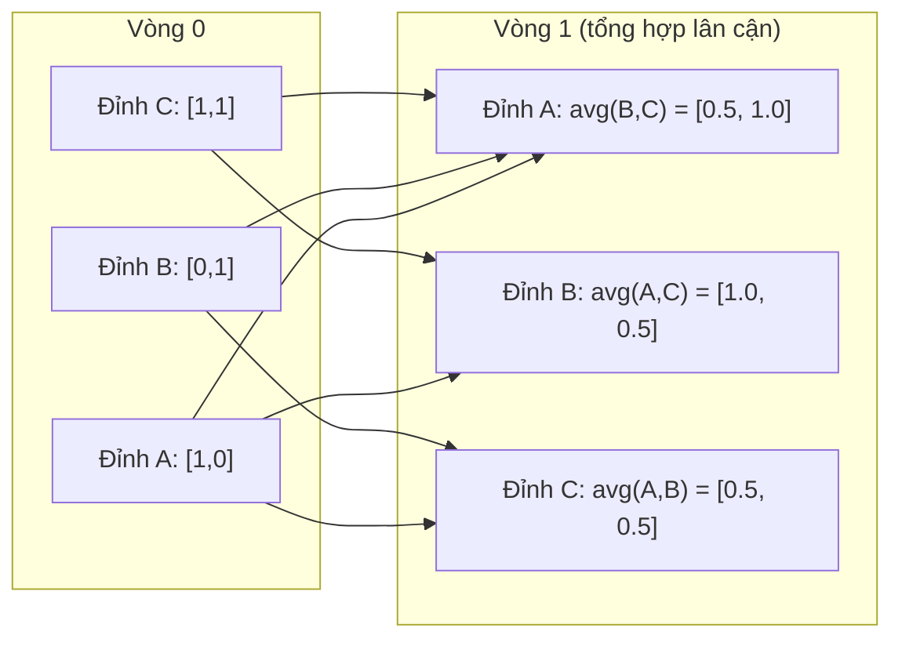

# Lý thuyết đồ thị cho Machine Learning

> Đồ thị là cấu trúc dữ liệu của các mối quan hệ. Nếu dữ liệu của bạn có các kết nối, bạn cần lý thuyết đồ thị.

**Type:** Build
**Language:** Python
**Prerequisites:** Giai đoạn 1, Bài 01-03 (đại số tuyến tính, ma trận)
**Time:** ~90 phút

## Mục tiêu học tập

- Xây dựng một lớp graph (đồ thị) với các biểu diễn adjacency matrix (ma trận kề) / adjacency list (danh sách kề) và cài đặt các thuật toán duyệt BFS và DFS
- Tính graph Laplacian và dùng các eigenvalue của nó để phát hiện connected component (thành phần liên thông) và phân cụm node (đỉnh)
- Cài đặt một vòng truyền thông điệp kiểu GNN dưới dạng phép nhân ma trận kề đã chuẩn hóa
- Áp dụng phân cụm phổ để phân hoạch một đồ thị bằng vector Fiedler

## Vấn đề

Mạng xã hội, phân tử, cơ sở tri thức, mạng trích dẫn, bản đồ đường đi -- tất cả đều là đồ thị. ML truyền thống coi dữ liệu như những bảng phẳng. Mỗi hàng độc lập. Mỗi đặc trưng là một cột. Nhưng khi cấu trúc của các kết nối trở nên quan trọng, bảng phẳng sẽ thất bại.

Hãy xét một mạng xã hội. Bạn muốn dự đoán một người dùng sẽ mua sản phẩm gì. Lịch sử mua hàng của họ quan trọng. Nhưng lịch sử mua hàng của bạn bè họ còn quan trọng hơn. Các kết nối mang theo tín hiệu.

Hoặc xét một phân tử. Bạn muốn dự đoán xem nó có liên kết với một protein hay không. Các nguyên tử quan trọng, nhưng điều thực sự quan trọng là cách các nguyên tử liên kết với nhau. Cấu trúc chính là dữ liệu.

Graph Neural Networks (GNN) là lĩnh vực phát triển nhanh nhất trong deep learning. Chúng vận hành quá trình khám phá thuốc, gợi ý xã hội, phát hiện gian lận và suy luận trên đồ thị tri thức. Mọi GNN đều dựa trên cùng một nền tảng: lý thuyết đồ thị cơ bản.

Bạn cần bốn thứ:
1. Một cách biểu diễn đồ thị dưới dạng ma trận (để bạn có thể nhân chúng)
2. Các thuật toán duyệt để khám phá cấu trúc đồ thị
3. Laplacian -- ma trận quan trọng nhất trong lý thuyết đồ thị phổ
4. Truyền thông điệp -- phép toán làm nên sức mạnh của GNN

## Khái niệm

### Đồ thị: Đỉnh và Cạnh

Một đồ thị G = (V, E) gồm các node (đỉnh) V và các edge (cạnh) E. Mỗi cạnh nối hai đỉnh.

**Có hướng vs vô hướng.** Trong một đồ thị vô hướng, cạnh (u, v) nghĩa là u nối với v VÀ v nối với u. Trong một directed graph (đồ thị có hướng), hay digraph, cạnh (u, v) nghĩa là u trỏ tới v, nhưng không nhất thiết ngược lại.

**Có trọng số vs không trọng số.** Trong một đồ thị không trọng số, cạnh hoặc tồn tại hoặc không tồn tại. Trong một đồ thị có trọng số, mỗi cạnh có một trọng số dạng số -- một khoảng cách, một chi phí, một độ mạnh.

| Loại đồ thị | Ví dụ |
|-----------|---------|
| Vô hướng, không trọng số | Mạng bạn bè Facebook |
| Có hướng, không trọng số | Mạng theo dõi Twitter |
| Vô hướng, có trọng số | Bản đồ đường đi (khoảng cách) |
| Có hướng, có trọng số | Liên kết trang web (điểm PageRank) |

### Ma trận kề

Ma trận kề A là biểu diễn cốt lõi. Với một đồ thị có n đỉnh:

```
A[i][j] = 1    if there is an edge from node i to node j
A[i][j] = 0    otherwise
```

Với đồ thị vô hướng, A đối xứng: A[i][j] = A[j][i]. Với đồ thị có trọng số, A[i][j] = trọng số của cạnh (i, j).

**Ví dụ -- một tam giác:**

```
Nodes: 0, 1, 2
Edges: (0,1), (1,2), (0,2)

A = [[0, 1, 1],
     [1, 0, 1],
     [1, 1, 0]]
```

Ma trận kề là đầu vào của mọi GNN. Các phép toán ma trận trên A tương ứng với các phép toán trên đồ thị.

### Bậc

Bậc (degree) của một đỉnh là số cạnh nối với nó. Với đồ thị có hướng, bạn có in-degree (các cạnh đi vào) và out-degree (các cạnh đi ra).

Ma trận bậc D là ma trận chéo:

```
D[i][i] = degree of node i
D[i][j] = 0    for i != j
```

Với ví dụ tam giác: D = diag(2, 2, 2) vì mỗi đỉnh nối với hai đỉnh khác.

Bậc cho bạn biết về tầm quan trọng của đỉnh. Bậc cao = đỉnh hub. Phân phối bậc của một mạng tiết lộ cấu trúc của nó. Mạng xã hội tuân theo power law (ít hub, nhiều đỉnh lá). Đồ thị ngẫu nhiên có bậc phân phối theo Poisson.

### BFS và DFS

Hai thuật toán duyệt đồ thị nền tảng. Bạn cần cả hai.

**Breadth-First Search (BFS):** Khám phá tất cả lân cận trước, rồi tới lân cận của lân cận. Dùng hàng đợi (FIFO).

```
BFS from node 0:
  Visit 0
  Queue: [1, 2]        (neighbors of 0)
  Visit 1
  Queue: [2, 3]        (add neighbors of 1)
  Visit 2
  Queue: [3]           (neighbors of 2 already visited)
  Visit 3
  Queue: []            (done)
```

BFS tìm đường đi ngắn nhất trong đồ thị không trọng số. Khoảng cách từ điểm bắt đầu tới bất kỳ đỉnh nào bằng mức BFS mà tại đó đỉnh ấy được phát hiện lần đầu. Đây là lý do BFS được dùng cho khoảng cách theo số hop trong mạng xã hội.

**Depth-First Search (DFS):** Đi sâu nhất có thể trước khi quay lui. Dùng ngăn xếp (LIFO) hoặc đệ quy.

```
DFS from node 0:
  Visit 0
  Stack: [1, 2]        (neighbors of 0)
  Visit 2               (pop from stack)
  Stack: [1, 3]         (add neighbors of 2)
  Visit 3               (pop from stack)
  Stack: [1]
  Visit 1               (pop from stack)
  Stack: []             (done)
```

DFS hữu ích cho:
- Tìm thành phần liên thông (chạy DFS từ các đỉnh chưa thăm)
- Phát hiện chu trình (các cạnh ngược trong cây DFS)
- Sắp xếp topo (đảo ngược thứ tự kết thúc của DFS)

| Thuật toán | Cấu trúc dữ liệu | Tìm được | Trường hợp sử dụng |
|-----------|---------------|-------|----------|
| BFS | Hàng đợi | Đường đi ngắn nhất | Khoảng cách mạng xã hội, duyệt đồ thị tri thức |
| DFS | Ngăn xếp | Thành phần, chu trình | Tính liên thông, sắp xếp topo |

### Laplacian của đồ thị

L = D - A. Ma trận quan trọng nhất trong lý thuyết đồ thị phổ.

Với tam giác:

```
D = [[2, 0, 0],    A = [[0, 1, 1],    L = [[2, -1, -1],
     [0, 2, 0],         [1, 0, 1],         [-1, 2, -1],
     [0, 0, 2]]         [1, 1, 0]]         [-1, -1,  2]]
```

Laplacian có những tính chất đáng chú ý:

1. **L là nửa xác định dương.** Mọi eigenvalue đều >= 0.

2. **Số eigenvalue bằng không bằng số thành phần liên thông.** Một đồ thị liên thông có đúng một eigenvalue bằng không. Một đồ thị có 3 thành phần rời rạc có ba eigenvalue bằng không.

3. **Eigenvalue khác không nhỏ nhất (giá trị Fiedler) đo mức liên thông.** Giá trị Fiedler lớn nghĩa là đồ thị liên thông tốt. Giá trị Fiedler nhỏ nghĩa là đồ thị có một điểm yếu -- một nút thắt cổ chai.

4. **Vector riêng của giá trị Fiedler (vector Fiedler) tiết lộ cách chia tốt nhất.** Các đỉnh có giá trị dương vào một nhóm, các đỉnh có giá trị âm vào nhóm kia. Đó chính là phân cụm phổ.



### Tính chất phổ

Các eigenvalue của ma trận kề và của Laplacian tiết lộ những tính chất cấu trúc mà không cần bất kỳ phép duyệt nào.

**Phân cụm phổ** hoạt động như sau:
1. Tính Laplacian L
2. Tìm k vector riêng nhỏ nhất của L (bỏ qua vector đầu tiên, vector toàn một với đồ thị liên thông)
3. Dùng các vector riêng đó làm tọa độ mới cho mỗi đỉnh
4. Chạy k-means trên các tọa độ đó

Tại sao cách này hiệu quả? Các vector riêng của L mã hóa những hàm "trơn" nhất trên đồ thị. Những đỉnh liên thông tốt với nhau nhận giá trị vector riêng giống nhau. Những đỉnh bị ngăn cách bởi một nút thắt cổ chai nhận giá trị khác nhau. Các vector riêng tách cụm một cách tự nhiên.

**Liên hệ với bước đi ngẫu nhiên.** Laplacian chuẩn hóa liên quan tới bước đi ngẫu nhiên trên đồ thị. Phân phối dừng của một bước đi ngẫu nhiên tỉ lệ với bậc của đỉnh. Thời gian trộn (bước đi hội tụ nhanh đến đâu) phụ thuộc vào khoảng phổ.

### Truyền thông điệp

Phép toán cốt lõi của Graph Neural Networks. Mỗi đỉnh thu thập thông điệp từ các lân cận, tổng hợp chúng, rồi cập nhật trạng thái của chính nó.

```
h_v^(k+1) = UPDATE(h_v^(k), AGGREGATE({h_u^(k) : u in neighbors(v)}))
```

Ở dạng đơn giản nhất, AGGREGATE = mean, và UPDATE = biến đổi tuyến tính + hàm kích hoạt:

```
h_v^(k+1) = sigma(W * mean({h_u^(k) : u in neighbors(v)}))
```

Đây là phép nhân ma trận được ngụy trang. Nếu H là ma trận của toàn bộ đặc trưng đỉnh và A là ma trận kề:

```
H^(k+1) = sigma(A_norm * H^(k) * W)
```

trong đó A_norm là ma trận kề đã chuẩn hóa (mỗi hàng có tổng bằng 1).

Một vòng truyền thông điệp cho phép mỗi đỉnh "thấy" các lân cận trực tiếp của nó. Hai vòng cho nó thấy lân cận của lân cận. K vòng cung cấp cho mỗi đỉnh thông tin từ vùng lân cận K-hop của nó.



### Khái niệm và ứng dụng ML

| Khái niệm | Ứng dụng ML |
|---------|---------------|
| Ma trận kề | Biểu diễn đầu vào cho GNN |
| Laplacian của đồ thị | Phân cụm phổ, phát hiện cộng đồng |
| BFS/DFS | Duyệt đồ thị tri thức, tìm đường đi |
| Phân phối bậc | Tầm quan trọng của đỉnh, kỹ thuật đặc trưng |
| Truyền thông điệp | Các lớp GNN (GCN, GAT, GraphSAGE) |
| Eigenvalue của L | Phát hiện cộng đồng, phân hoạch đồ thị |
| Phân cụm phổ | Nhóm đỉnh không giám sát |
| PageRank | Tầm quan trọng của đỉnh, tìm kiếm web |

```figure
graph-degree-distribution
```

## Tự tay làm

### Bước 1: Xây dựng lớp Graph từ đầu

```python
class Graph:
    def __init__(self, n_nodes, directed=False):
        self.n = n_nodes
        self.directed = directed
        self.adj = {i: {} for i in range(n_nodes)}

    def add_edge(self, u, v, weight=1.0):
        self.adj[u][v] = weight
        if not self.directed:
            self.adj[v][u] = weight

    def neighbors(self, node):
        return list(self.adj[node].keys())

    def degree(self, node):
        return len(self.adj[node])

    def adjacency_matrix(self):
        import numpy as np
        A = np.zeros((self.n, self.n))
        for u in range(self.n):
            for v, w in self.adj[u].items():
                A[u][v] = w
        return A

    def degree_matrix(self):
        import numpy as np
        D = np.zeros((self.n, self.n))
        for i in range(self.n):
            D[i][i] = self.degree(i)
        return D

    def laplacian(self):
        return self.degree_matrix() - self.adjacency_matrix()
```

Danh sách kề (`self.adj`) lưu các đỉnh lân cận một cách hiệu quả. Việc chuyển sang ma trận kề dùng numpy vì mọi phép toán phổ đều cần đến nó.

### Bước 2: BFS và DFS

```python
from collections import deque

def bfs(graph, start):
    visited = set()
    order = []
    distances = {}
    queue = deque([(start, 0)])
    visited.add(start)
    while queue:
        node, dist = queue.popleft()
        order.append(node)
        distances[node] = dist
        for neighbor in graph.neighbors(node):
            if neighbor not in visited:
                visited.add(neighbor)
                queue.append((neighbor, dist + 1))
    return order, distances


def dfs(graph, start):
    visited = set()
    order = []
    stack = [start]
    while stack:
        node = stack.pop()
        if node in visited:
            continue
        visited.add(node)
        order.append(node)
        for neighbor in reversed(graph.neighbors(node)):
            if neighbor not in visited:
                stack.append(neighbor)
    return order
```

BFS dùng deque (hàng đợi hai đầu) để có popleft O(1). DFS dùng list làm ngăn xếp. Cả hai đều ghé mỗi đỉnh đúng một lần -- thời gian O(V + E).

### Bước 3: Thành phần liên thông và trị riêng của Laplacian

```python
def connected_components(graph):
    visited = set()
    components = []
    for node in range(graph.n):
        if node not in visited:
            order, _ = bfs(graph, node)
            visited.update(order)
            components.append(order)
    return components


def laplacian_eigenvalues(graph):
    import numpy as np
    L = graph.laplacian()
    eigenvalues = np.linalg.eigvalsh(L)
    return eigenvalues
```

`eigvalsh` dành cho ma trận đối xứng -- Laplacian luôn đối xứng với đồ thị vô hướng. Hàm trả về các trị riêng theo thứ tự tăng dần. Đếm số giá trị 0 để biết số thành phần liên thông.

### Bước 4: Phân cụm phổ

```python
def spectral_clustering(graph, k=2):
    import numpy as np
    L = graph.laplacian()
    eigenvalues, eigenvectors = np.linalg.eigh(L)
    features = eigenvectors[:, 1:k+1]

    labels = np.zeros(graph.n, dtype=int)
    for i in range(graph.n):
        if features[i, 0] >= 0:
            labels[i] = 0
        else:
            labels[i] = 1
    return labels
```

Với k=2, dấu của vector Fiedler chia đồ thị thành hai cụm. Với k>2, bạn sẽ chạy k-means trên k vector riêng đầu tiên (bỏ qua vector riêng tầm thường toàn số 1).

### Bước 5: Truyền thông điệp

```python
def message_passing(graph, features, weight_matrix):
    import numpy as np
    A = graph.adjacency_matrix()
    row_sums = A.sum(axis=1, keepdims=True)
    row_sums[row_sums == 0] = 1
    A_norm = A / row_sums
    aggregated = A_norm @ features
    output = aggregated @ weight_matrix
    return output
```

Đây là một vòng truyền thông điệp của GNN. Đặc trưng mới của mỗi đỉnh là trung bình có trọng số đặc trưng các đỉnh lân cận, rồi được biến đổi bởi ma trận trọng số. Xếp chồng nhiều vòng để lan truyền thông tin xa hơn.

## Áp dụng

Với networkx và numpy, các phép toán tương tự chỉ còn một dòng:

```python
import networkx as nx
import numpy as np

G = nx.karate_club_graph()

A = nx.adjacency_matrix(G).toarray()
L = nx.laplacian_matrix(G).toarray()

eigenvalues = np.linalg.eigvalsh(L.astype(float))
print(f"Smallest eigenvalues: {eigenvalues[:5]}")
print(f"Connected components: {nx.number_connected_components(G)}")

communities = nx.community.greedy_modularity_communities(G)
print(f"Communities found: {len(communities)}")

pr = nx.pagerank(G)
top_nodes = sorted(pr.items(), key=lambda x: x[1], reverse=True)[:5]
print(f"Top 5 PageRank nodes: {top_nodes}")
```

networkx xử lý đồ thị ở mọi kích thước với phần lõi C được tối ưu. Hãy dùng nó trong môi trường thực tế. Còn bản tự viết từ đầu dùng để hiểu nó làm gì.

### Phân tích phổ với numpy

```python
import numpy as np

A = np.array([
    [0, 1, 1, 0, 0],
    [1, 0, 1, 0, 0],
    [1, 1, 0, 1, 0],
    [0, 0, 1, 0, 1],
    [0, 0, 0, 1, 0]
])

D = np.diag(A.sum(axis=1))
L = D - A

eigenvalues, eigenvectors = np.linalg.eigh(L)
print(f"Eigenvalues: {np.round(eigenvalues, 4)}")
print(f"Fiedler value: {eigenvalues[1]:.4f}")
print(f"Fiedler vector: {np.round(eigenvectors[:, 1], 4)}")

fiedler = eigenvectors[:, 1]
group_a = np.where(fiedler >= 0)[0]
group_b = np.where(fiedler < 0)[0]
print(f"Cluster A: {group_a}")
print(f"Cluster B: {group_b}")
```

Vector Fiedler gánh phần việc nặng. Thành phần dương thuộc cụm này, thành phần âm thuộc cụm kia. Không cần tối ưu lặp -- chỉ một lần phân rã trị riêng.

## Đóng gói

Bài học này tạo ra:
- `outputs/skill-graph-analysis.md` -- tài liệu tham chiếu kỹ năng để phân tích dữ liệu có cấu trúc đồ thị

## Liên hệ

| Khái niệm | Xuất hiện ở đâu |
|---------|------------------|
| Ma trận kề | Đầu vào của GCN, GAT, GraphSAGE |
| Laplacian | Phân cụm phổ, bộ lọc ChebNet |
| BFS | Duyệt đồ thị tri thức, truy vấn shortest path (đường đi ngắn nhất) |
| Truyền thông điệp | Mọi lớp GNN, truyền thông điệp nơ-ron |
| Khoảng trống phổ | Tính liên thông của đồ thị, thời gian trộn của bước đi ngẫu nhiên |
| Phân bố bậc | Mạng tuân theo luật lũy thừa, kỹ thuật đặc trưng đỉnh |
| Thành phần liên thông | Tiền xử lý, xử lý đồ thị không liên thông |
| PageRank | Xếp hạng tầm quan trọng của đỉnh, khởi tạo attention |

GNN đáng được nhắc riêng. Phép tích chập đồ thị trong GCN (Kipf & Welling, 2017) dùng ma trận kề có thêm khuyên (self-loop), A_hat = A + I:

```text
H^(l+1) = sigma(D_hat^(-1/2) * A_hat * D_hat^(-1/2) * H^(l) * W^(l))
```

trong đó A_hat = A + I (ma trận kề cộng khuyên) và D_hat là ma trận bậc của A_hat. Các khuyên bảo đảm mỗi đỉnh đưa cả đặc trưng của chính nó vào khi tổng hợp. Đây đúng là truyền thông điệp với chuẩn hóa đối xứng. D_hat^(-1/2) * A_hat * D_hat^(-1/2) là ma trận kề đã chuẩn hóa. Laplacian xuất hiện vì cách chuẩn hóa này liên hệ với L_sym = I - D^(-1/2) * A * D^(-1/2). Hiểu Laplacian tức là hiểu vì sao GCN hoạt động.

## Bài tập

1. **Tự cài đặt PageRank.** Khởi đầu với điểm số đều nhau. Mỗi bước: score(v) = (1-d)/n + d * sum(score(u)/out_degree(u)) với mọi u trỏ tới v. Dùng d=0.85. Chạy đến khi hội tụ (thay đổi < 1e-6). Kiểm thử trên một đồ thị web nhỏ.

2. **Tìm cộng đồng bằng phân cụm phổ.** Tạo một đồ thị có hai cụm tách biệt rõ ràng (ví dụ hai clique nối với nhau bằng một cạnh duy nhất). Chạy phân cụm phổ và kiểm chứng rằng nó tìm ra cách chia đúng. Điều gì xảy ra khi bạn thêm nhiều cạnh nối giữa hai cụm?

3. **Cài đặt thuật toán Dijkstra** cho shortest path trong đồ thị có trọng số. So sánh kết quả với BFS trên cùng đồ thị đó khi mọi trọng số bằng nhau.

4. **Xây dựng mạng truyền thông điệp 2 lớp.** Áp dụng truyền thông điệp hai lần với hai ma trận trọng số khác nhau. Chứng minh rằng sau 2 vòng, mỗi đỉnh đã có thông tin từ vùng lân cận 2 bước.

5. **Phân tích một đồ thị thực tế.** Dùng đồ thị Karate Club (34 đỉnh, 78 cạnh). Tính phân bố bậc, trị riêng Laplacian và phân cụm phổ. So sánh kết quả phân cụm phổ với cách chia ground truth đã biết.

## Thuật ngữ chính

| Thuật ngữ | Người ta thường nói | Ý nghĩa thực sự |
|------|----------------|----------------------|
| Graph | "Các đỉnh và các cạnh" | Một cấu trúc toán học G=(V,E) mã hóa các quan hệ từng cặp |
| Adjacency matrix | "Bảng kết nối" | Ma trận n x n trong đó A[i][j] = 1 nếu đỉnh i và j được nối với nhau |
| Degree | "Mức độ kết nối của một đỉnh" | Số cạnh chạm vào một đỉnh |
| Laplacian | "D trừ A" | L = D - A, ma trận mà các trị riêng của nó phơi ra cấu trúc đồ thị |
| Fiedler value | "Độ liên thông đại số" | Trị riêng nhỏ nhất khác 0 của L, đo mức độ liên thông tốt của đồ thị |
| BFS | "Tìm theo từng tầng" | Cách duyệt ghé hết các đỉnh lân cận trước khi đi sâu hơn, tìm được shortest path |
| DFS | "Đi sâu trước" | Cách duyệt đi theo một nhánh đến tận cùng rồi mới quay lui |
| Message passing | "Các đỉnh nói chuyện với hàng xóm" | Mỗi đỉnh tổng hợp thông tin từ các đỉnh lân cận, cốt lõi của GNN |
| Spectral clustering | "Phân cụm theo vector riêng" | Chia một đồ thị bằng các vector riêng của Laplacian |
| Connected component | "Một mảnh riêng" | Đồ thị con cực đại mà mọi đỉnh đều đi được tới mọi đỉnh khác |

## Đọc thêm

- **Kipf & Welling (2017)** -- "Semi-Supervised Classification with Graph Convolutional Networks." Bài báo khởi động GNN hiện đại. Chỉ ra rằng tích chập đồ thị phổ rút gọn thành truyền thông điệp.
- **Spielman (2012)** -- bài giảng "Spectral Graph Theory". Phần giới thiệu chuẩn mực về Laplacian, khoảng trống phổ và phân hoạch đồ thị.
- **Hamilton (2020)** -- "Graph Representation Learning." Cuốn sách bao quát GNN từ nền tảng tới ứng dụng.
- **Bronstein et al. (2021)** -- "Geometric Deep Learning: Grids, Groups, Graphs, Geodesics, and Gauges." Bài báo về khung thống nhất.
- **Veličković et al. (2018)** -- "Graph Attention Networks." Mở rộng truyền thông điệp bằng cơ chế attention.

---

[← Bài trước: Biến đổi Fourier](../../20-fourier-transform/docs/vi.md) · [Bài sau: Quá trình ngẫu nhiên (stochastic processes) →](../../22-stochastic-processes/docs/vi.md)
