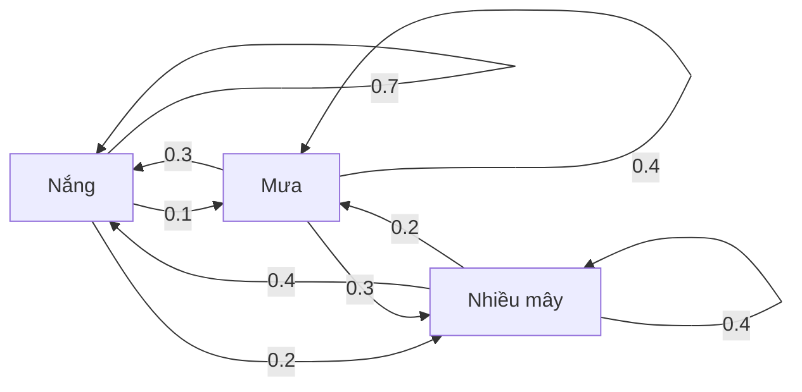
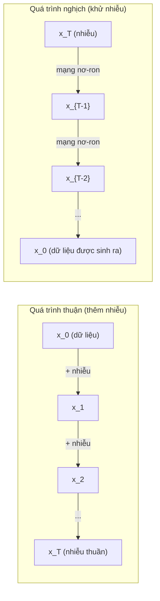

# Quá trình ngẫu nhiên (stochastic processes)

> Tính ngẫu nhiên có cấu trúc. Phần toán học đằng sau random walk (bước ngẫu nhiên), Markov chain (xích Markov) và các mô hình khuếch tán.

**Type:** Learn
**Language:** Python
**Prerequisites:** Giai đoạn 1, Bài 06-07 (xác suất, Bayes)
**Time:** ~75 phút

## Mục tiêu học tập

- Mô phỏng bước ngẫu nhiên 1D và 2D rồi kiểm chứng độ co giãn sqrt(n) của độ dịch chuyển
- Xây dựng trình mô phỏng xích Markov và tính phân phối dừng (stationary distribution) của nó bằng phân rã trị riêng
- Cài đặt Metropolis-Hastings MCMC và động học Langevin để lấy mẫu từ các phân phối mục tiêu
- Nối quá trình khuếch tán thuận với chuyển động Brown và giải thích cách quá trình nghịch sinh ra dữ liệu

## Vấn đề

Nhiều hệ thống AI có tính ngẫu nhiên biến đổi theo thời gian. Không phải ngẫu nhiên tĩnh -- mà là ngẫu nhiên có cấu trúc, có trình tự, trong đó mỗi bước phụ thuộc vào những gì đã xảy ra trước đó.

Các mô hình ngôn ngữ sinh token từng cái một. Mỗi token phụ thuộc vào ngữ cảnh trước đó. Mô hình xuất ra một phân phối xác suất, lấy mẫu từ đó rồi đi tiếp. Đó chính là một quá trình ngẫu nhiên.

Các mô hình khuếch tán thêm nhiễu vào một ảnh theo từng bước cho đến khi nó thành nhiễu trắng hoàn toàn. Rồi chúng đảo ngược quá trình, khử nhiễu từng bước cho đến khi một ảnh mới hiện ra. Quá trình thuận là một xích Markov. Quá trình nghịch là một xích Markov được học, chạy ngược lại.

Tác nhân học tăng cường thực hiện hành động trong một môi trường. Mỗi hành động dẫn tới một trạng thái mới với xác suất nào đó. Tác nhân đi theo một chính sách ngẫu nhiên trong một thế giới ngẫu nhiên. Toàn bộ là một quá trình quyết định Markov.

Lấy mẫu MCMC -- xương sống của suy luận Bayes -- dựng nên một xích Markov có phân phối dừng chính là phân phối hậu nghiệm mà bạn muốn lấy mẫu từ đó.

Tất cả những thứ trên đều dựa trên bốn ý tưởng nền tảng:
1. Bước ngẫu nhiên -- quá trình ngẫu nhiên đơn giản nhất
2. Xích Markov -- tính ngẫu nhiên có cấu trúc với một ma trận chuyển
3. Động học Langevin -- hạ gradient có thêm nhiễu
4. Metropolis-Hastings -- lấy mẫu từ bất kỳ phân phối nào

## Khái niệm

### Bước ngẫu nhiên

Bắt đầu ở vị trí 0. Mỗi bước, tung một đồng xu cân đối. Ngửa: sang phải (+1). Sấp: sang trái (-1).

Sau n bước, vị trí của bạn là tổng của n giá trị +/-1 ngẫu nhiên. Vị trí kỳ vọng là 0 (bước đi không lệch). Nhưng khoảng cách kỳ vọng so với gốc tăng theo sqrt(n).

Điều này trái với trực giác. Bước đi là công bằng -- không lệch về hướng nào. Nhưng theo thời gian, nó càng lúc càng lang thang xa nơi xuất phát. Độ lệch chuẩn sau n bước là sqrt(n).

```
Step 0:  Position = 0
Step 1:  Position = +1 or -1
Step 2:  Position = +2, 0, or -2
...
Step 100: Expected distance from origin ~ 10 (sqrt(100))
Step 10000: Expected distance from origin ~ 100 (sqrt(10000))
```

**Trong 2D**, bước đi di chuyển lên, xuống, trái hoặc phải với xác suất bằng nhau. Cùng phép co giãn sqrt(n) áp dụng cho khoảng cách tới gốc. Đường đi vẽ nên một mẫu giống fractal.

**Tại sao là sqrt(n)?** Mỗi bước là +1 hoặc -1 với xác suất bằng nhau. Sau n bước, vị trí S_n = X_1 + X_2 + ... + X_n, trong đó mỗi X_i là +/-1. Phương sai của mỗi bước là 1 và các bước độc lập, nên Var(S_n) = n. Độ lệch chuẩn = sqrt(n). Theo định lý giới hạn trung tâm, S_n / sqrt(n) hội tụ về phân phối chuẩn tắc.

Phép co giãn sqrt(n) này xuất hiện khắp nơi trong ML. Nhiễu của SGD co giãn theo 1/sqrt(batch_size). Số chiều embedding co giãn theo sqrt(d). Căn bậc hai là dấu hiệu đặc trưng của việc cộng dồn các biến ngẫu nhiên độc lập.

**Liên hệ với chuyển động Brown.** Lấy một bước ngẫu nhiên với cỡ bước 1/sqrt(n) và n bước mỗi đơn vị thời gian. Khi n tiến tới vô cùng, bước đi hội tụ về chuyển động Brown B(t) -- một quá trình thời gian liên tục trong đó B(t) có phân phối chuẩn với trung bình 0 và phương sai t.

Chuyển động Brown là nền tảng toán học của khuếch tán. Nó mô hình hóa sự rung lắc ngẫu nhiên của các hạt trong chất lỏng, sự dao động của giá cổ phiếu, và -- quan trọng nhất -- quá trình nhiễu trong các mô hình khuếch tán.

**Vỡ nợ của con bạc.** Một người đi bước ngẫu nhiên xuất phát ở vị trí k, với các rào chắn hấp thụ tại 0 và N. Xác suất chạm N trước 0 là bao nhiêu? Với bước đi công bằng: P(chạm N) = k/N. Kết quả này đơn giản và tao nhã một cách đáng ngạc nhiên. Nó nối tới lý thuyết martingale -- bước ngẫu nhiên công bằng là một martingale (giá trị kỳ vọng tương lai = giá trị hiện tại).

### Xích Markov

Xích Markov là một hệ chuyển đổi giữa các trạng thái theo xác suất cố định. Thuộc tính then chốt: trạng thái tiếp theo chỉ phụ thuộc vào trạng thái hiện tại, không phụ thuộc vào lịch sử.

```
P(X_{t+1} = j | X_t = i, X_{t-1} = ...) = P(X_{t+1} = j | X_t = i)
```

Đây là tính chất Markov. Nghĩa là bạn có thể mô tả toàn bộ động lực bằng một ma trận chuyển P:

```
P[i][j] = probability of going from state i to state j
```

Mỗi hàng của P có tổng bằng 1 (bạn buộc phải đi đâu đó).

**Ví dụ -- Thời tiết:**

```
States: Sunny (0), Rainy (1), Cloudy (2)

P = [[0.7, 0.1, 0.2],    (if sunny: 70% sunny, 10% rainy, 20% cloudy)
     [0.3, 0.4, 0.3],    (if rainy: 30% sunny, 40% rainy, 30% cloudy)
     [0.4, 0.2, 0.4]]    (if cloudy: 40% sunny, 20% rainy, 40% cloudy)
```

Bắt đầu từ bất kỳ trạng thái nào. Sau nhiều lần chuyển, phân phối các trạng thái hội tụ về phân phối dừng pi, với pi * P = pi. Đây là vector riêng bên trái của P ứng với trị riêng 1.

Với xích thời tiết, phân phối dừng là [0.55, 0.18, 0.27] -- về dài hạn, trời nắng 55% thời gian bất kể trạng thái xuất phát.



**Tính phân phối dừng.** Có hai cách:

1. **Phương pháp lũy thừa**: nhân liên tiếp một phân phối ban đầu bất kỳ với P. Sau đủ số vòng lặp, nó hội tụ.
2. **Phương pháp trị riêng**: tìm vector riêng bên trái của P ứng với trị riêng 1. Đó là vector riêng của P^T ứng với trị riêng 1.

Cả hai cách đều đòi hỏi xích thỏa các điều kiện hội tụ.

**Điều kiện hội tụ.** Một xích Markov hội tụ về một phân phối dừng duy nhất nếu nó:
- **Bất khả quy**: mọi trạng thái đều tới được từ mọi trạng thái khác
- **Không tuần hoàn**: xích không lặp theo một chu kỳ cố định

Hầu hết các xích bạn gặp trong ML đều thỏa cả hai điều kiện.

**Trạng thái hấp thụ.** Một trạng thái là hấp thụ nếu khi đã vào, bạn không bao giờ ra (P[i][i] = 1). Các xích Markov hấp thụ mô hình hóa những quá trình có trạng thái kết thúc -- một ván chơi kết thúc, một khách hàng rời bỏ, một chuỗi token chạm token kết thúc văn bản.

**Thời gian trộn.** Cần bao nhiêu bước cho đến khi xích "gần" với phân phối dừng? Về hình thức, đó là số bước cho đến khi khoảng cách biến thiên toàn phần so với phân phối dừng giảm xuống dưới một ngưỡng nào đó. Trộn nhanh = cần ít bước. Khoảng trống phổ của P (1 trừ trị riêng lớn thứ hai) quyết định thời gian trộn. Khoảng trống lớn hơn = trộn nhanh hơn.

### Liên hệ với mô hình ngôn ngữ

Sinh token trong một mô hình ngôn ngữ gần như là một quá trình Markov. Với ngữ cảnh hiện tại, mô hình xuất ra một phân phối trên token tiếp theo. Temperature điều khiển độ nhọn:

```
P(token_i) = exp(logit_i / temperature) / sum(exp(logit_j / temperature))
```

- Temperature = 1.0: phân phối chuẩn
- Temperature < 1.0: nhọn hơn (tất định hơn)
- Temperature > 1.0: phẳng hơn (ngẫu nhiên hơn)
- Temperature -> 0: argmax (tham lam)

Lấy mẫu top-k cắt còn k token có xác suất cao nhất. Lấy mẫu top-p (nucleus) cắt còn tập token nhỏ nhất có tổng xác suất vượt quá p. Cả hai đều làm thay đổi xác suất chuyển của xích Markov.

### Chuyển động Brown

Giới hạn thời gian liên tục của bước ngẫu nhiên. Vị trí B(t) có ba tính chất:
1. B(0) = 0
2. B(t) - B(s) có phân phối chuẩn với trung bình 0 và phương sai t - s (với t > s)
3. Các số gia trên những khoảng không chồng lấn là độc lập

Chuyển động Brown liên tục nhưng không khả vi ở bất kỳ đâu -- nó rung lắc ở mọi tỉ lệ. Đường đi có số chiều fractal bằng 2 trong mặt phẳng.

Trong mô phỏng rời rạc, bạn xấp xỉ chuyển động Brown bằng:

```
B(t + dt) = B(t) + sqrt(dt) * z,    where z ~ N(0, 1)
```

Phép co giãn sqrt(dt) rất quan trọng. Nó đến từ định lý giới hạn trung tâm áp dụng cho bước ngẫu nhiên.

### Động học Langevin

Hạ gradient tìm cực tiểu của một hàm. Động học Langevin tìm phân phối xác suất tỉ lệ với exp(-U(x)/T), trong đó U là hàm năng lượng và T là nhiệt độ.

```
x_{t+1} = x_t - dt * gradient(U(x_t)) + sqrt(2 * T * dt) * z_t
```

Hai lực tác động lên hạt:
1. **Lực gradient** (-dt * gradient(U)): đẩy về phía năng lượng thấp (giống hạ gradient)
2. **Lực ngẫu nhiên** (sqrt(2*T*dt) * z): đẩy theo các hướng ngẫu nhiên (khám phá)

Ở nhiệt độ T = 0, đây thuần túy là hạ gradient. Ở nhiệt độ cao, nó gần như một bước ngẫu nhiên. Ở nhiệt độ phù hợp, hạt khám phá mặt năng lượng và dành nhiều thời gian hơn ở các vùng năng lượng thấp.

**Liên hệ với mô hình khuếch tán.** Quá trình thuận của một mô hình khuếch tán là:

```
x_t = sqrt(alpha_t) * x_{t-1} + sqrt(1 - alpha_t) * noise
```

Đây là một xích Markov trộn dần dữ liệu với nhiễu. Sau đủ số bước, x_T là nhiễu Gaussian thuần.

Quá trình nghịch -- đi từ nhiễu về dữ liệu -- cũng là một xích Markov, nhưng xác suất chuyển của nó được một mạng nơ-ron học. Mạng học cách dự đoán nhiễu đã được thêm vào ở mỗi bước, rồi trừ nó đi.



### MCMC: Markov Chain Monte Carlo

Đôi khi bạn cần lấy mẫu từ một phân phối p(x) mà bạn có thể tính giá trị (sai khác một hằng số) nhưng không thể lấy mẫu trực tiếp. Phân phối hậu nghiệm Bayes là ví dụ kinh điển -- bạn biết likelihood nhân với prior, nhưng hằng số chuẩn hóa thì không tính được.

**Metropolis-Hastings** dựng nên một xích Markov có phân phối dừng là p(x):

1. Bắt đầu ở một vị trí x nào đó
2. Đề xuất một vị trí mới x' từ phân phối đề xuất Q(x'|x)
3. Tính tỉ số chấp nhận: a = p(x') * Q(x|x') / (p(x) * Q(x'|x))
4. Chấp nhận x' với xác suất min(1, a). Ngược lại, giữ nguyên ở x.
5. Lặp lại.

Nếu Q đối xứng (ví dụ Q(x'|x) = Q(x|x') = N(x, sigma^2)), tỉ số rút gọn thành a = p(x') / p(x). Bạn chỉ cần tỉ số của các xác suất -- hằng số chuẩn hóa triệt tiêu.

Xích được đảm bảo hội tụ về p(x) dưới những điều kiện nhẹ. Nhưng hội tụ có thể chậm nếu phân phối đề xuất quá nhỏ (bước ngẫu nhiên) hoặc quá lớn (tỉ lệ từ chối cao). Tinh chỉnh phân phối đề xuất là nghệ thuật của MCMC.

**Tại sao nó hiệu quả.** Tỉ số chấp nhận đảm bảo cân bằng chi tiết: xác suất đang ở x và chuyển sang x' bằng xác suất đang ở x' và chuyển sang x. Cân bằng chi tiết suy ra rằng p(x) là phân phối dừng của xích. Nên sau đủ số bước, các mẫu đến từ p(x).

**Những điểm cần lưu ý khi thực hành:**
- **Burn-in**: bỏ đi N mẫu đầu tiên. Xích cần thời gian để đi từ điểm xuất phát tới phân phối dừng.
- **Thinning**: giữ lại mỗi mẫu thứ k để giảm tự tương quan.
- **Nhiều xích**: chạy vài xích từ các điểm xuất phát khác nhau. Nếu chúng hội tụ về cùng một phân phối, bạn có bằng chứng về sự hội tụ.
- **Tỉ lệ chấp nhận**: với phân phối đề xuất Gaussian trong d chiều, tỉ lệ chấp nhận tối ưu khoảng 23% (Roberts & Rosenthal, 2001). Quá cao nghĩa là xích gần như không di chuyển. Quá thấp nghĩa là nó từ chối mọi thứ.

### Quá trình ngẫu nhiên trong AI

| Quá trình | Ứng dụng trong AI |
|---------|---------------|
| Bước ngẫu nhiên | Khám phá trong RL, embedding Node2Vec |
| Xích Markov | Sinh văn bản, lấy mẫu MCMC |
| Chuyển động Brown | Mô hình khuếch tán (quá trình thuận) |
| Động học Langevin | Mô hình sinh dựa trên score, SGLD |
| Quá trình quyết định Markov | Học tăng cường |
| Metropolis-Hastings | Suy luận Bayes, lấy mẫu hậu nghiệm |

```figure
random-walk-diffusion
```

## Tự tay làm

### Bước 1: Trình mô phỏng bước đi ngẫu nhiên

```python
import numpy as np

def random_walk_1d(n_steps, seed=None):
    rng = np.random.RandomState(seed)
    steps = rng.choice([-1, 1], size=n_steps)
    positions = np.concatenate([[0], np.cumsum(steps)])
    return positions


def random_walk_2d(n_steps, seed=None):
    rng = np.random.RandomState(seed)
    directions = rng.choice(4, size=n_steps)
    dx = np.zeros(n_steps)
    dy = np.zeros(n_steps)
    dx[directions == 0] = 1   # right
    dx[directions == 1] = -1  # left
    dy[directions == 2] = 1   # up
    dy[directions == 3] = -1  # down
    x = np.concatenate([[0], np.cumsum(dx)])
    y = np.concatenate([[0], np.cumsum(dy)])
    return x, y
```

Bước đi 1D lưu các tổng tích lũy. Mỗi bước là +1 hoặc -1. Sau n bước, vị trí chính là tổng đó. Phương sai tăng tuyến tính theo n, nên độ lệch chuẩn tăng theo sqrt(n).

### Bước 2: Chuỗi Markov

```python
class MarkovChain:
    def __init__(self, transition_matrix, state_names=None):
        self.P = np.array(transition_matrix, dtype=float)
        self.n_states = len(self.P)
        self.state_names = state_names or [str(i) for i in range(self.n_states)]

    def step(self, current_state, rng=None):
        if rng is None:
            rng = np.random.RandomState()
        probs = self.P[current_state]
        return rng.choice(self.n_states, p=probs)

    def simulate(self, start_state, n_steps, seed=None):
        rng = np.random.RandomState(seed)
        states = [start_state]
        current = start_state
        for _ in range(n_steps):
            current = self.step(current, rng)
            states.append(current)
        return states

    def stationary_distribution(self):
        eigenvalues, eigenvectors = np.linalg.eig(self.P.T)
        idx = np.argmin(np.abs(eigenvalues - 1.0))
        stationary = np.real(eigenvectors[:, idx])
        stationary = stationary / stationary.sum()
        return np.abs(stationary)
```

Phân phối dừng là vector riêng trái của P ứng với trị riêng 1. Ta tìm nó bằng cách tính các vector riêng của P^T (phép chuyển vị biến vector riêng trái thành vector riêng phải).

### Bước 3: Langevin dynamics (động lực học Langevin)

```python
def langevin_dynamics(grad_U, x0, dt, temperature, n_steps, seed=None):
    rng = np.random.RandomState(seed)
    x = np.array(x0, dtype=float)
    trajectory = [x.copy()]
    for _ in range(n_steps):
        noise = rng.randn(*x.shape)
        x = x - dt * grad_U(x) + np.sqrt(2 * temperature * dt) * noise
        trajectory.append(x.copy())
    return np.array(trajectory)
```

Gradient đẩy x về phía năng lượng thấp. Nhiễu giúp nó không bị kẹt lại. Ở trạng thái cân bằng, phân phối của các mẫu tỉ lệ với exp(-U(x)/temperature).

### Bước 4: Metropolis-Hastings

```python
def metropolis_hastings(target_log_prob, proposal_std, x0, n_samples, seed=None):
    rng = np.random.RandomState(seed)
    x = np.array(x0, dtype=float)
    samples = [x.copy()]
    accepted = 0
    for _ in range(n_samples - 1):
        x_proposed = x + rng.randn(*x.shape) * proposal_std
        log_ratio = target_log_prob(x_proposed) - target_log_prob(x)
        if np.log(rng.rand()) < log_ratio:
            x = x_proposed
            accepted += 1
        samples.append(x.copy())
    acceptance_rate = accepted / (n_samples - 1)
    return np.array(samples), acceptance_rate
```

Thuật toán đề xuất một điểm mới, kiểm tra xem điểm đó có xác suất cao hơn không (hoặc chấp nhận với xác suất tỉ lệ với tỉ số), rồi lặp lại. Tỉ lệ chấp nhận nên nằm khoảng 23-50% để chuỗi trộn tốt.

## Áp dụng

Trong thực tế, bạn dùng các thư viện có sẵn cho những thuật toán này. Nhưng hiểu cơ chế bên trong vẫn quan trọng để gỡ lỗi và tinh chỉnh.

```python
import numpy as np

rng = np.random.RandomState(42)
walk = np.cumsum(rng.choice([-1, 1], size=10000))
print(f"Final position: {walk[-1]}")
print(f"Expected distance: {np.sqrt(10000):.1f}")
print(f"Actual distance: {abs(walk[-1])}")
```

### numpy cho ma trận chuyển tiếp

```python
import numpy as np

P = np.array([[0.7, 0.1, 0.2],
              [0.3, 0.4, 0.3],
              [0.4, 0.2, 0.4]])

distribution = np.array([1.0, 0.0, 0.0])
for _ in range(100):
    distribution = distribution @ P

print(f"Stationary distribution: {np.round(distribution, 4)}")
```

Nhân phân phối ban đầu với P nhiều lần. Sau đủ số vòng lặp, nó hội tụ về phân phối dừng bất kể bạn xuất phát từ đâu. Đây là phương pháp lũy thừa để tìm vector riêng trái trội.

### Liên hệ với các framework thực tế

- **PyTorch diffusion:** `DDPMScheduler` trong `diffusers` của Hugging Face hiện thực chuỗi Markov thuận và chuỗi Markov nghịch
- **NumPyro / PyMC:** Dùng MCMC (bộ lấy mẫu NUTS, cải tiến so với Metropolis-Hastings) cho suy luận Bayes
- **Gymnasium (RL):** Hàm bước của môi trường định nghĩa một quá trình quyết định Markov

### Kiểm chứng sự hội tụ của chuỗi Markov

```python
import numpy as np

P = np.array([[0.9, 0.1], [0.3, 0.7]])

eigenvalues = np.linalg.eigvals(P)
spectral_gap = 1 - sorted(np.abs(eigenvalues))[-2]
print(f"Eigenvalues: {eigenvalues}")
print(f"Spectral gap: {spectral_gap:.4f}")
print(f"Approximate mixing time: {1/spectral_gap:.1f} steps")
```

Khoảng trống phổ cho bạn biết chuỗi quên trạng thái ban đầu nhanh đến mức nào. Khoảng trống 0.2 nghĩa là khoảng 5 bước để trộn. Khoảng trống 0.01 nghĩa là khoảng 100 bước. Hãy luôn kiểm tra điều này trước khi chạy mô phỏng dài -- một chuỗi trộn chậm sẽ lãng phí tài nguyên tính toán.

## Đóng gói

Bài học này tạo ra:
- `outputs/prompt-stochastic-process-advisor.md` -- một prompt giúp xác định khung quá trình ngẫu nhiên nào phù hợp với một bài toán cho trước

## Liên hệ

| Khái niệm | Nơi nó xuất hiện |
|---------|------------------|
| Random walk | Embedding đồ thị Node2Vec, khám phá trong RL |
| Markov chain | Sinh token trong LLM, lấy mẫu MCMC |
| Brownian motion | Quá trình khuếch tán thuận trong DDPM, các model dựa trên SDE |
| Langevin dynamics | Model sinh dựa trên score, stochastic gradient Langevin dynamics (SGLD) |
| Stationary distribution | Mục tiêu hội tụ của MCMC, PageRank |
| Metropolis-Hastings | Lấy mẫu hậu nghiệm Bayes, simulated annealing |
| Temperature | Lấy mẫu của LLM, khám phá Boltzmann trong RL, simulated annealing |
| Mixing time | Tốc độ hội tụ của MCMC, phân tích khoảng trống phổ |
| Absorbing state | Token kết thúc chuỗi, trạng thái kết thúc trong RL |
| Detailed balance (cân bằng chi tiết) | Bảo đảm tính đúng đắn cho các bộ lấy mẫu MCMC |

Các model khuếch tán (diffusion model) đáng được chú ý riêng. DDPM (Ho et al., 2020) định nghĩa một chuỗi Markov thuận:

```
q(x_t | x_{t-1}) = N(x_t; sqrt(1-beta_t) * x_{t-1}, beta_t * I)
```

trong đó beta_t là lịch nhiễu. Sau T bước, x_T xấp xỉ N(0, I). Quá trình nghịch được tham số hóa bằng một mạng nơ-ron dự đoán nhiễu:

```
p_theta(x_{t-1} | x_t) = N(x_{t-1}; mu_theta(x_t, t), sigma_t^2 * I)
```

Mỗi bước sinh dữ liệu là một bước trong chuỗi Markov đã học. Hiểu chuỗi Markov nghĩa là hiểu cách và lý do các model khuếch tán sinh ra dữ liệu.

SGLD (Stochastic Gradient Langevin Dynamics) kết hợp hạ gradient theo mini-batch với nhiễu Langevin. Thay vì tính toàn bộ gradient, bạn dùng một ước lượng ngẫu nhiên và thêm nhiễu đã hiệu chỉnh. Khi tốc độ học giảm dần, SGLD chuyển từ tối ưu hóa sang lấy mẫu -- bạn có được các mẫu xấp xỉ hậu nghiệm Bayes miễn phí. Đây là một trong những cách đơn giản nhất để lấy ước lượng độ bất định từ một mạng nơ-ron.

Điểm mấu chốt xuyên suốt các liên hệ này: quá trình ngẫu nhiên không chỉ là công cụ lý thuyết. Chúng là cơ chế tính toán bên trong các hệ thống AI hiện đại. Khi bạn chỉnh temperature của một LLM, bạn đang điều chỉnh một chuỗi Markov. Khi bạn huấn luyện một model khuếch tán, bạn đang học cách đảo ngược một quá trình giống chuyển động Brown. Khi bạn chạy suy luận Bayes, bạn đang dựng một chuỗi hội tụ về phân phối hậu nghiệm.

## Bài tập

1. **Mô phỏng 1000 bước đi ngẫu nhiên với 10000 bước mỗi lần.** Vẽ phân phối của vị trí cuối. Kiểm chứng rằng nó xấp xỉ Gauss với trung bình 0 và độ lệch chuẩn sqrt(10000) = 100.

2. **Xây một trình sinh văn bản bằng chuỗi Markov.** Huấn luyện trên một kho ngữ liệu nhỏ: với mỗi từ, đếm các chuyển tiếp sang từ tiếp theo. Dựng ma trận chuyển tiếp. Sinh câu mới bằng cách lấy mẫu từ chuỗi.

3. **Cài đặt simulated annealing** bằng Metropolis-Hastings. Bắt đầu ở nhiệt độ cao (chấp nhận gần như mọi đề xuất) rồi giảm dần (chỉ chấp nhận các cải thiện). Dùng nó để tìm cực tiểu của một hàm có nhiều cực tiểu địa phương.

4. **So sánh động lực học Langevin ở các nhiệt độ khác nhau.** Lấy mẫu từ thế giếng đôi U(x) = (x^2 - 1)^2. Ở nhiệt độ thấp, các mẫu tụ lại trong một giếng. Ở nhiệt độ cao, chúng trải ra cả hai giếng. Tìm nhiệt độ tới hạn nơi chuỗi trộn giữa hai giếng.

5. **Cài đặt quá trình khuếch tán thuận.** Bắt đầu với một tín hiệu 1D (ví dụ sóng sin). Thêm nhiễu dần qua 100 bước với lịch nhiễu tuyến tính. Cho thấy tín hiệu suy giảm thành nhiễu thuần. Sau đó cài đặt một bộ khử nhiễu đơn giản đảo ngược quá trình (kể cả một bản ngây thơ chỉ trừ đi nhiễu ước lượng).

## Thuật ngữ chính

| Thuật ngữ | Người ta thường nói | Ý nghĩa thực sự |
|------|----------------|----------------------|
| Random walk | "Chuyển động tung đồng xu" | Quá trình trong đó vị trí thay đổi theo các gia số ngẫu nhiên ở mỗi bước |
| Markov property | "Không nhớ" | Tương lai chỉ phụ thuộc vào trạng thái hiện tại, không phụ thuộc vào quá khứ |
| Transition matrix | "Bảng xác suất" | P[i][j] = xác suất chuyển từ trạng thái i sang trạng thái j |
| Stationary distribution | "Trung bình dài hạn" | Phân phối pi thỏa pi*P = pi -- trạng thái cân bằng của chuỗi |
| Brownian motion | "Rung lắc ngẫu nhiên" | Giới hạn thời gian liên tục của bước đi ngẫu nhiên, B(t) ~ N(0, t) |
| Langevin dynamics | "Hạ gradient kèm nhiễu" | Quy tắc cập nhật kết hợp gradient tất định và nhiễu ngẫu nhiên |
| MCMC | "Bước đi về phía mục tiêu" | Dựng một chuỗi Markov có phân phối dừng đúng là phân phối bạn muốn |
| Metropolis-Hastings | "Đề xuất rồi chấp nhận/từ chối" | Thuật toán MCMC dùng tỉ lệ chấp nhận để bảo đảm hội tụ |
| Temperature | "Núm chỉnh độ ngẫu nhiên" | Tham số điều khiển sự đánh đổi giữa khám phá và khai thác |
| Diffusion process | "Nhiễu vào, nhiễu ra" | Thuận: thêm nhiễu dần. Nghịch: bỏ nhiễu dần. Sinh ra dữ liệu. |

## Đọc thêm

- **Ho, Jain, Abbeel (2020)** -- "Denoising Diffusion Probabilistic Models." Bài báo DDPM đã khởi động cuộc cách mạng model khuếch tán. Trình bày rõ ràng chuỗi Markov thuận và nghịch.
- **Song & Ermon (2019)** -- "Generative Modeling by Estimating Gradients of the Data Distribution." Cách tiếp cận dựa trên score, dùng động lực học Langevin để lấy mẫu.
- **Roberts & Rosenthal (2004)** -- "General state space Markov chains and MCMC algorithms." Phần lý thuyết giải thích khi nào và vì sao MCMC hoạt động.
- **Norris (1997)** -- "Markov Chains." Sách giáo khoa chuẩn mực. Bao gồm hội tụ, phân phối dừng và thời điểm chạm.
- **Welling & Teh (2011)** -- "Bayesian Learning via Stochastic Gradient Langevin Dynamics." Kết hợp SGD với động lực học Langevin cho suy luận Bayes có khả năng mở rộng.
