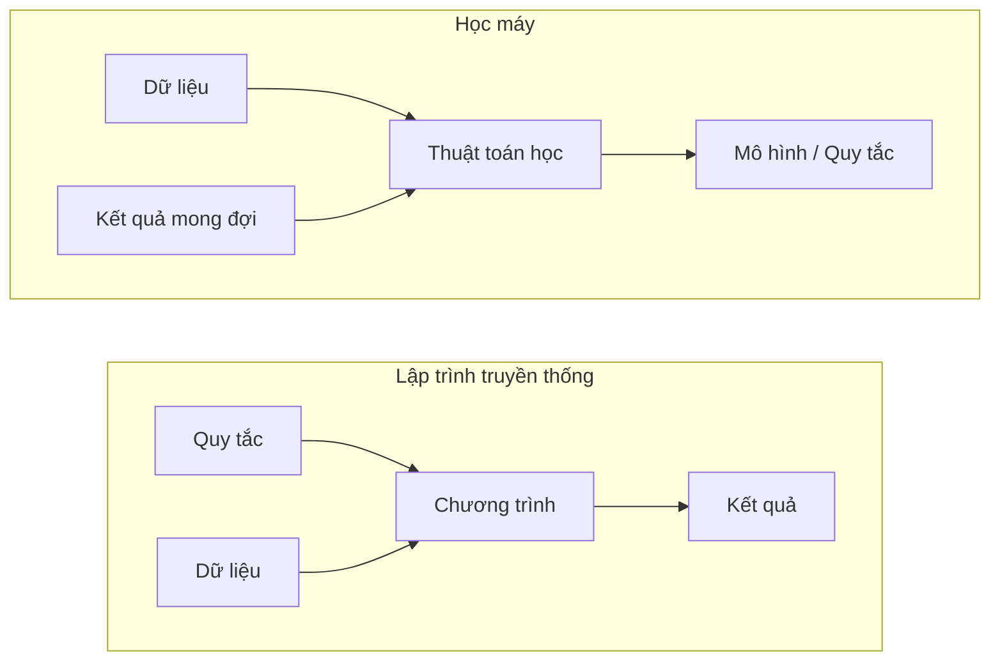
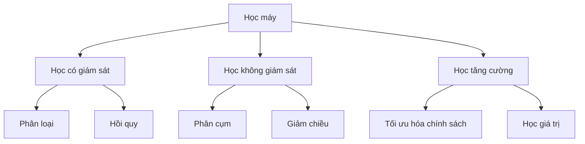
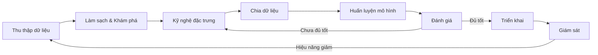
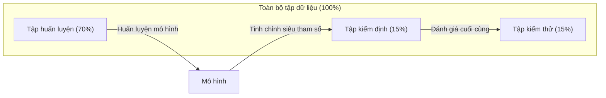
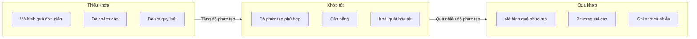
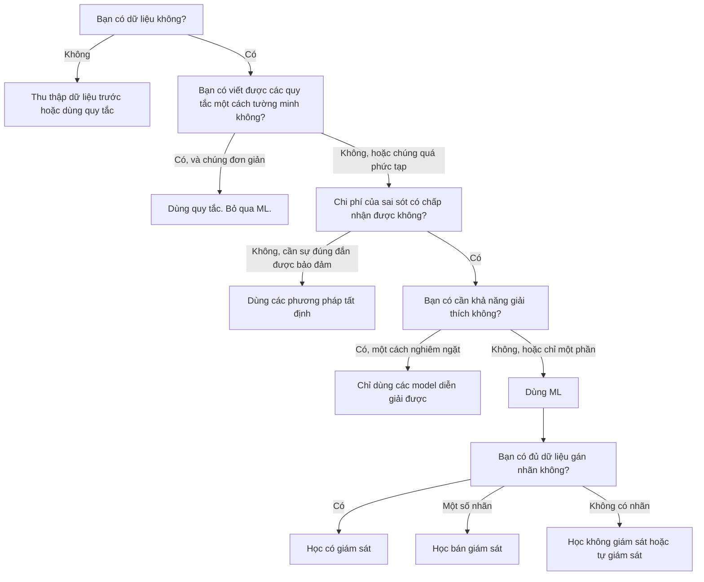

# Học máy là gì

> Học máy (machine learning) là dạy máy tính tìm ra quy luật trong dữ liệu thay vì viết tay các quy tắc.

**Type:** Học
**Languages:** Python
**Prerequisites:** Giai đoạn 1 (Nền tảng Toán học)
**Time:** ~45 phút

## Mục tiêu học tập

- Giải thích sự khác nhau giữa học có giám sát, học không giám sát và học tăng cường, đồng thời xác định loại nào áp dụng cho một bài toán cho trước
- Tự tay cài đặt bộ phân loại nearest centroid và đánh giá nó so với một baseline ngẫu nhiên
- Phân biệt nhiệm vụ phân loại và hồi quy, rồi chọn hàm mất mát phù hợp cho từng loại
- Đánh giá xem một bài toán kinh doanh cho trước có phù hợp với ML hay nên giải bằng các quy tắc tất định

## Vấn đề

Bạn muốn xây dựng một bộ lọc thư rác. Cách tiếp cận truyền thống: ngồi xuống và viết hàng trăm quy tắc. "Nếu email chứa 'FREE MONEY', đánh dấu là thư rác. Nếu nó có hơn 3 dấu chấm than, đánh dấu là thư rác." Bạn mất hàng tuần để viết quy tắc. Rồi những kẻ gửi thư rác đổi cách dùng từ. Các quy tắc của bạn hỏng. Bạn viết thêm quy tắc. Vòng lặp không bao giờ kết thúc.

Học máy đảo ngược điều này. Thay vì viết quy tắc, bạn đưa cho máy tính hàng nghìn email đã gán nhãn ("thư rác" hoặc "không phải thư rác") và để nó tự tìm ra các quy tắc. Máy tính tìm ra những quy luật mà bạn không bao giờ nghĩ tới. Khi kẻ gửi thư rác đổi chiến thuật, bạn huấn luyện lại trên dữ liệu mới thay vì viết lại mã.

Sự chuyển dịch từ "lập trình quy tắc" sang "học từ dữ liệu" này là cốt lõi của học máy. Mọi công cụ gợi ý, trợ lý giọng nói, xe tự lái và mô hình ngôn ngữ đều hoạt động theo cách này.

## Khái niệm

### Học từ dữ liệu, không phải từ quy tắc

Lập trình truyền thống và học máy giải quyết vấn đề theo hai hướng ngược nhau.



Lập trình truyền thống: bạn viết các quy tắc. Chương trình áp dụng chúng lên dữ liệu để tạo ra kết quả.

Học máy: bạn cung cấp dữ liệu và các kết quả mong đợi. Thuật toán khám phá ra các quy tắc.

"Mô hình" sinh ra từ quá trình huấn luyện CHÍNH LÀ các quy tắc, được mã hóa thành các con số (trọng số, tham số). Nó khái quát hóa từ những ví dụ đã thấy để đưa ra dự đoán trên dữ liệu chưa từng thấy.

### Ba kiểu học máy



**Học có giám sát (supervised learning)**: Bạn có các cặp đầu vào - đầu ra. Mô hình học cách ánh xạ đầu vào sang đầu ra.
- "Đây là 10.000 bức ảnh được gán nhãn mèo hoặc chó. Hãy học cách phân biệt chúng."
- "Đây là các đặc trưng (feature) và giá của những ngôi nhà. Hãy học cách dự đoán giá."

**Học không giám sát**: Bạn chỉ có đầu vào. Không có nhãn. Mô hình tự tìm ra cấu trúc.
- "Đây là 10.000 lịch sử mua hàng của khách hàng. Hãy tìm các nhóm tự nhiên."
- "Đây là các điểm dữ liệu 1.000 chiều. Hãy giảm xuống 2 chiều mà vẫn giữ cấu trúc."

**Học tăng cường**: Một tác nhân thực hiện hành động trong một môi trường và nhận phần thưởng hoặc hình phạt. Nó học một chiến lược (chính sách) để tối đa hóa tổng phần thưởng.
- "Chơi trò chơi này. +1 khi thắng, -1 khi thua. Hãy tìm ra chiến lược."
- "Điều khiển cánh tay robot này. +1 khi nhấc được vật, -0.01 cho mỗi giây lãng phí."

Phần lớn những gì bạn xây dựng trong thực tế dùng học có giám sát. Học không giám sát thường gặp ở bước tiền xử lý và khám phá dữ liệu. Học tăng cường cung cấp sức mạnh cho AI chơi game, robot, và RLHF cho các mô hình ngôn ngữ.

### Ngoài ba loại lớn

Ba phạm trù ở trên khá rõ ràng, nhưng ML trong thực tế thường làm mờ ranh giới.

**Học bán giám sát** dùng một tập nhỏ dữ liệu có nhãn và một tập lớn dữ liệu không nhãn. Bạn có thể có 100 ảnh y tế có nhãn và 100.000 ảnh không nhãn. Các kỹ thuật gồm:

- **Lan truyền nhãn:** Xây dựng một đồ thị nối các điểm dữ liệu tương tự nhau. Nhãn lan từ các nút có nhãn sang các nút lân cận không có nhãn qua đồ thị.
- **Gán nhãn giả:** Huấn luyện một mô hình trên dữ liệu có nhãn, dùng nó để dự đoán nhãn cho dữ liệu không nhãn, rồi huấn luyện lại trên toàn bộ. Mô hình tự khởi tạo tập huấn luyện của chính nó.
- **Chuẩn hóa tính nhất quán:** Mô hình nên đưa ra cùng một dự đoán cho một đầu vào và một phiên bản bị nhiễu nhẹ của đầu vào đó. Cách này hiệu quả ngay cả khi không có nhãn.

**Học tự giám sát** tạo ra sự giám sát từ chính dữ liệu. Không cần nhãn do con người tạo ra. Mô hình tự tạo bài toán dự đoán từ cấu trúc của dữ liệu.

- **Mô hình ngôn ngữ có mặt nạ (BERT):** Che 15% số từ trong một câu, huấn luyện mô hình dự đoán các từ còn thiếu. Các "nhãn" đến từ văn bản gốc.
- **Học tương phản (SimCLR):** Lấy một ảnh, tạo hai phiên bản tăng cường. Huấn luyện mô hình nhận ra rằng chúng đến từ cùng một ảnh, đồng thời phân biệt chúng với các phiên bản tăng cường của những ảnh khác.
- **Dự đoán token tiếp theo (GPT):** Dự đoán từ tiếp theo dựa trên tất cả các từ trước đó. Mọi tài liệu văn bản trở thành một ví dụ huấn luyện.

Đây không phải là những phạm trù tách biệt khỏi ba loại lớn. Chúng là các chiến lược kết hợp ý tưởng có giám sát và không giám sát. Học tự giám sát về mặt kỹ thuật là có giám sát (mô hình dự đoán một thứ gì đó), nhưng các nhãn được tạo tự động, không phải do con người tạo.

### Phân loại so với hồi quy

Đây là hai nhiệm vụ chính của học có giám sát.

| Khía cạnh | Phân loại | Hồi quy |
|--------|---------------|------------|
| Đầu ra | Các phạm trù rời rạc | Các con số liên tục |
| Ví dụ | "Email này có phải thư rác không?" | "Giá nhà sẽ là bao nhiêu?" |
| Không gian đầu ra | {cat, dog, bird} | Bất kỳ số thực nào |
| Hàm mất mát | Cross-entropy, độ chính xác | Sai số bình phương trung bình, MAE |
| Quyết định | Ranh giới giữa các lớp | Một đường cong khớp với dữ liệu |

Phân loại trả lời câu hỏi "phạm trù nào?" Hồi quy trả lời câu hỏi "bao nhiêu?"

Một số bài toán có thể được phát biểu theo cả hai cách. Dự đoán một cổ phiếu tăng hay giảm là phân loại. Dự đoán giá chính xác là hồi quy.

### Quy trình ML

Mọi dự án học máy đều đi theo cùng một pipeline, bất kể thuật toán là gì.



**Thu thập dữ liệu**: Thu thập dữ liệu thô. Nhiều dữ liệu gần như luôn tốt hơn, nhưng chất lượng quan trọng hơn số lượng.

**Làm sạch & Khám phá**: Xử lý giá trị thiếu, loại bỏ bản trùng lặp, trực quan hóa phân bố, phát hiện bất thường. Bước này thường chiếm 60-80% tổng thời gian của dự án.

**Kỹ nghệ đặc trưng**: Biến đổi dữ liệu thô thành các đặc trưng mà mô hình có thể dùng. Chuyển ngày tháng thành thứ trong tuần. Chuẩn hóa các cột số. Mã hóa các biến phân loại. Đặc trưng tốt quan trọng hơn thuật toán hào nhoáng.

**Chia dữ liệu**: Chia thành tập huấn luyện, tập kiểm định và tập kiểm thử. Mô hình huấn luyện trên dữ liệu huấn luyện, bạn tinh chỉnh siêu tham số trên dữ liệu kiểm định, và bạn báo cáo hiệu năng cuối cùng trên dữ liệu kiểm thử.

**Huấn luyện mô hình**: Đưa dữ liệu huấn luyện vào một thuật toán. Thuật toán điều chỉnh các tham số bên trong để tối thiểu hóa một hàm mất mát.

**Đánh giá**: Đo hiệu năng trên dữ liệu kiểm định/kiểm thử. Nếu hiệu năng chưa chấp nhận được, hãy quay lại và thử các đặc trưng, thuật toán hoặc siêu tham số khác.

**Triển khai**: Đưa mô hình vào môi trường sản xuất, nơi nó đưa ra dự đoán trên dữ liệu mới.

**Giám sát**: Theo dõi hiệu năng theo thời gian. Phân bố dữ liệu thay đổi (dịch chuyển dữ liệu), và các mô hình suy giảm. Khi hiệu năng giảm, hãy huấn luyện lại.

### Tập huấn luyện, kiểm định và kiểm thử

Đây là khái niệm quan trọng nhất mà người mới học hay làm sai. Bạn phải đánh giá mô hình trên dữ liệu mà nó chưa từng thấy trong quá trình huấn luyện. Nếu không, bạn đang đo khả năng ghi nhớ, chứ không phải đo việc học.



| Tập | Mục đích | Khi nào dùng | Kích thước điển hình |
|-------|---------|-----------|-------------|
| Huấn luyện | Mô hình học từ dữ liệu này | Trong quá trình huấn luyện | 60-80% |
| Kiểm định | Tinh chỉnh siêu tham số, so sánh các mô hình | Sau mỗi lần huấn luyện | 10-20% |
| Kiểm thử | Ước lượng hiệu năng khách quan cuối cùng | Một lần, ở bước cuối cùng | 10-20% |

Tập kiểm thử là thiêng liêng. Bạn nhìn vào nó đúng một lần. Nếu bạn liên tục điều chỉnh mô hình dựa trên hiệu năng kiểm thử, bạn đang thực chất huấn luyện trên tập kiểm thử và những con số bạn báo cáo trở nên vô nghĩa.

Với các tập dữ liệu nhỏ, hãy dùng kiểm định chéo k-fold: chia dữ liệu thành k phần, huấn luyện trên k-1 phần, kiểm định trên phần còn lại, xoay vòng, và lấy trung bình kết quả.

### Quá khớp so với thiếu khớp



**Thiếu khớp**: Mô hình quá đơn giản để nắm bắt các quy luật trong dữ liệu. Một đường thẳng cố khớp với một quan hệ cong. Sai số huấn luyện cao. Sai số kiểm thử cao.

**Quá khớp**: Mô hình quá phức tạp và ghi nhớ dữ liệu huấn luyện, kể cả nhiễu của nó. Một đường cong uốn lượn đi qua mọi điểm huấn luyện nhưng thất bại trên dữ liệu mới. Sai số huấn luyện thấp. Sai số kiểm thử cao.

**Khớp tốt**: Mô hình nắm bắt các quy luật thực sự mà không ghi nhớ nhiễu. Sai số huấn luyện và sai số kiểm thử đều thấp ở mức hợp lý.

Dấu hiệu của quá khớp:
- Độ chính xác trên tập huấn luyện cao hơn nhiều so với trên tập kiểm định
- Mô hình hoạt động tốt trên dữ liệu huấn luyện nhưng kém trên dữ liệu mới
- Thêm dữ liệu huấn luyện giúp cải thiện hiệu năng (mô hình đang ghi nhớ chứ không phải đang học)

Cách khắc phục quá khớp:
- Lấy thêm dữ liệu huấn luyện
- Giảm độ phức tạp của mô hình (ít tham số hơn, kiến trúc đơn giản hơn)
- Điều chuẩn (thêm một khoản phạt cho các trọng số lớn)
- Dropout (đặt ngẫu nhiên một số neuron về 0 trong quá trình huấn luyện)
- Dừng sớm (dừng huấn luyện khi sai số kiểm định bắt đầu tăng)

Cách khắc phục thiếu khớp:
- Dùng một mô hình phức tạp hơn
- Thêm nhiều đặc trưng hơn
- Giảm điều chuẩn
- Huấn luyện lâu hơn

### Đánh đổi bias–variance (bias-variance tradeoff)

Đây là khung toán học đằng sau overfitting và underfitting.

**Bias**: Sai số đến từ những giả định sai trong model. Một model tuyến tính có bias cao khi quan hệ thật là phi tuyến. Bias cao dẫn tới underfitting.

**Variance**: Sai số đến từ độ nhạy với những dao động nhỏ trong tập huấn luyện. Model có variance cao cho ra những dự đoán rất khác nhau khi được huấn luyện trên các tập con dữ liệu khác nhau. Variance cao dẫn tới overfitting.

| Độ phức tạp của model | Bias | Variance | Kết quả |
|-----------------|------|----------|--------|
| Quá thấp (model tuyến tính cho dữ liệu cong) | Cao | Thấp | Underfitting |
| Vừa phải | Trung bình | Trung bình | Khái quát hoá tốt |
| Quá cao (đa thức bậc 20 cho 10 điểm) | Thấp | Cao | Overfitting |

Tổng sai số = Bias^2 + Variance + Nhiễu không thể giảm

Bạn không thể giảm nhiễu không thể giảm (đó chính là tính ngẫu nhiên trong bản thân dữ liệu). Bạn muốn tìm điểm ngọt nơi bias^2 + variance đạt cực tiểu.

### Định lý không có bữa trưa miễn phí

Không có một thuật toán duy nhất nào tốt nhất cho mọi bài toán. Một thuật toán chạy tốt trên lớp bài toán này sẽ chạy kém trên lớp bài toán khác. Đó là lý do các nhà khoa học dữ liệu thử nhiều thuật toán và so sánh kết quả.

Trong thực tế, lựa chọn phụ thuộc vào:
- Bạn có bao nhiêu dữ liệu
- Có bao nhiêu đặc trưng
- Quan hệ là tuyến tính hay phi tuyến
- Bạn có cần khả năng diễn giải hay không
- Bạn có thể chi bao nhiêu compute

### Khi nào KHÔNG nên dùng Machine Learning

ML rất mạnh nhưng không phải lúc nào cũng là công cụ đúng. Trước khi với tay lấy một model, hãy hỏi xem bạn có thực sự cần nó không.

**Không dùng ML khi:**

- **Quy tắc đơn giản và rõ ràng.** Tính thuế, thuật toán sắp xếp, đổi đơn vị. Nếu bạn viết được logic đó bằng vài câu if, thì một model chỉ thêm phức tạp mà chẳng có lợi ích gì.
- **Bạn không có dữ liệu hoặc có rất ít dữ liệu.** ML cần ví dụ để học. Với 10 điểm dữ liệu, bạn không huấn luyện được thứ gì có ý nghĩa. Hãy thu thập dữ liệu trước.
- **Cái giá của việc sai là thảm hoạ và bạn cần sự đúng đắn được bảo đảm.** Tính liều thuốc, điều khiển lò phản ứng hạt nhân, xác minh mật mã. Model ML mang tính xác suất. Đôi khi chúng sẽ sai. Nếu "đôi khi sai" là không chấp nhận được, hãy dùng các phương pháp tất định.
- **Một bảng tra cứu hoặc heuristic giải quyết được bài toán.** Nếu một ngưỡng hay một bảng đơn giản bao phủ 99% trường hợp, thêm ML chỉ làm tăng chi phí bảo trì mà không cải thiện đáng kể.
- **Bạn không thể giải thích quyết định và khả năng giải thích là bắt buộc.** Các ngành bị quản lý chặt (cho vay, bảo hiểm, tư pháp hình sự) đôi khi yêu cầu mọi quyết định phải giải thích được đầy đủ. Một số model ML diễn giải được (hồi quy tuyến tính, cây quyết định nhỏ). Phần lớn thì không.
- **Bài toán thay đổi nhanh hơn tốc độ bạn huấn luyện lại.** Nếu quy tắc đổi hằng ngày mà huấn luyện lại mất một tuần, model luôn lỗi thời.

Dùng flowchart quyết định này:



```figure
f3-learning-boundary
```

## Tự tay làm

Đoạn code trong `code/ml_intro.py` cài đặt một bộ phân loại nearest centroid từ đầu, thuật toán ML đơn giản nhất có thể. Nó minh hoạ ý tưởng cốt lõi: học từ dữ liệu, rồi dự đoán trên dữ liệu mới.

### Bước 1: Bộ phân loại nearest centroid từ đầu

Bộ phân loại nearest centroid tính tâm (giá trị trung bình) của từng lớp trong tập huấn luyện. Để dự đoán, nó gán mỗi điểm mới vào lớp có tâm gần nhất.

```python
class NearestCentroid:
    def fit(self, X, y):
        self.classes = np.unique(y)
        self.centroids = np.array([
            X[y == c].mean(axis=0) for c in self.classes
        ])

    def predict(self, X):
        distances = np.array([
            np.sqrt(((X - c) ** 2).sum(axis=1))
            for c in self.centroids
        ])
        return self.classes[distances.argmin(axis=0)]
```

Đó là toàn bộ thuật toán. Fit tính hai giá trị trung bình. Predict tính khoảng cách. Không gradient descent, không vòng lặp, không hyperparameter.

### Bước 2: Huấn luyện trên dữ liệu tổng hợp

Chúng ta sinh một bộ dữ liệu phân loại 2D với hai lớp chồng lấn nhẹ. Bộ phân loại centroid vẽ một ranh giới quyết định tuyến tính giữa các tâm lớp.

```python
rng = np.random.RandomState(42)
X_class0 = rng.randn(100, 2) + np.array([1.0, 1.0])
X_class1 = rng.randn(100, 2) + np.array([-1.0, -1.0])
X = np.vstack([X_class0, X_class1])
y = np.array([0] * 100 + [1] * 100)
```

### Bước 3: So sánh với một baseline

Mọi model ML nên được so sánh với một baseline tầm thường. Ở đây, baseline dự đoán một lớp ngẫu nhiên. Nếu model ML của bạn không vượt được đoán ngẫu nhiên, thì có gì đó sai.

```python
baseline_preds = rng.choice([0, 1], size=len(y_test))
baseline_acc = np.mean(baseline_preds == y_test)
```

Bộ phân loại centroid nên đạt khoảng 90%+ độ chính xác trên bộ dữ liệu sạch này. Baseline ngẫu nhiên đạt khoảng 50%.

### Vì sao điều này quan trọng

Bộ phân loại nearest centroid đơn giản đến tầm thường. Nó không có hyperparameter, không vòng lặp, không gradient descent. Vậy mà nó nắm bắt được khuôn mẫu ML nền tảng:

1. **Học** một biểu diễn từ tập huấn luyện (các centroid)
2. **Dự đoán** trên dữ liệu mới dùng biểu diễn đó (khoảng cách gần nhất)
3. **Đánh giá** so với một baseline (đoán ngẫu nhiên)

Mọi thuật toán ML, từ hồi quy logistic đến transformer, đều theo cùng khuôn mẫu ba bước này. Biểu diễn trở nên phức tạp hơn, nhưng quy trình vẫn y nguyên.

### Bước 4: Những gì bộ phân loại centroid không làm được

Bộ phân loại nearest centroid giả định mỗi lớp tạo thành một khối duy nhất. Nó vẽ ranh giới quyết định tuyến tính. Nó thất bại khi:

- Các lớp có nhiều cụm (ví dụ, chữ số "1" có thể được viết theo nhiều cách khác nhau)
- Ranh giới quyết định là phi tuyến (ví dụ, một lớp bao quanh lớp khác)
- Các đặc trưng có thang đo rất khác nhau (khoảng cách bị chi phối bởi đặc trưng có thang đo lớn nhất)

Những hạn chế này là động lực cho mọi thuật toán khác bạn sẽ học. K-nearest neighbors xử lý nhiều cụm. Cây quyết định xử lý ranh giới phi tuyến. Chuẩn hoá đặc trưng khắc phục vấn đề thang đo. Mỗi bài học xây trên hạn chế của bài trước.

## Áp dụng

sklearn cung cấp `NearestCentroid` và các bộ sinh dữ liệu tổng hợp:

```python
from sklearn.neighbors import NearestCentroid
from sklearn.datasets import make_classification
from sklearn.model_selection import train_test_split

X, y = make_classification(
    n_samples=500, n_features=2, n_redundant=0,
    n_clusters_per_class=1, random_state=42
)
X_train, X_test, y_train, y_test = train_test_split(X, y, test_size=0.3)

clf = NearestCentroid()
clf.fit(X_train, y_train)
print(f"Accuracy: {clf.score(X_test, y_test):.3f}")
```

## Đóng gói

Bài học này tạo ra `outputs/prompt-ml-problem-framer.md` -- một prompt biến những bài toán kinh doanh mơ hồ thành các nhiệm vụ ML cụ thể. Đưa cho nó một mô tả bài toán ("chúng tôi muốn giảm churn" hoặc "dự đoán nhu cầu quý tới") và nó xác định loại học, định nghĩa mục tiêu dự đoán, liệt kê các đặc trưng ứng viên, chọn một độ đo thành công, thiết lập baseline, và gắn cờ những cạm bẫy như rò rỉ dữ liệu hay mất cân bằng lớp. Hãy dùng nó ở đầu mọi dự án ML để tránh xây nhầm thứ.

## Thuật ngữ chính

| Thuật ngữ | Người ta thường nói | Ý nghĩa thực sự |
|------|----------------|----------------------|
| Model | "Con AI" | Một hàm toán học với các tham số học được, ánh xạ đầu vào thành đầu ra |
| Training | "Dạy con AI" | Chạy một thuật toán tối ưu để điều chỉnh tham số của model sao cho dự đoán khớp với đầu ra đã biết |
| Feature | "Một cột đầu vào" | Một thuộc tính đo được của dữ liệu mà model dùng để đưa ra dự đoán |
| Label | "Đáp án" | Đầu ra đã biết của một ví dụ huấn luyện, dùng để tính tín hiệu sai số |
| Hyperparameter | "Một cấu hình bạn chỉnh" | Một tham số được đặt trước khi huấn luyện, điều khiển quá trình học (learning rate, số lớp) |
| Loss function | "Model sai tới mức nào" | Một hàm đo khoảng cách giữa đầu ra dự đoán và đầu ra thực tế, là thứ mà quá trình huấn luyện cố gắng cực tiểu hoá |
| Overfitting | "Nó học thuộc bài kiểm tra" | Model học phải nhiễu đặc thù của dữ liệu huấn luyện thay vì các khuôn mẫu tổng quát, nên nó thất bại trên dữ liệu mới |
| Underfitting | "Nó chẳng học được gì" | Model quá đơn giản để nắm bắt các khuôn mẫu thật trong dữ liệu |
| Generalization | "Nó chạy được trên dữ liệu mới" | Khả năng của model trong việc đưa ra dự đoán chính xác trên dữ liệu mà nó chưa từng được huấn luyện |
| Cross-validation (kiểm định chéo) | "Kiểm thử trên các mảnh khác nhau" | Liên tục chia dữ liệu thành các fold train/test và lấy trung bình kết quả, cho một ước lượng hiệu năng vững hơn |
| Regularization (điều chuẩn) | "Giữ trọng số nhỏ" | Thêm một số hạng phạt vào hàm mất mát để ngăn những model quá phức tạp |
| Data drift | "Thế giới đã thay đổi" | Phân phối thống kê của dữ liệu đến thay đổi theo thời gian, làm giảm hiệu năng của model |

## Bài tập

1. Lấy bất kỳ bộ dữ liệu nào (ví dụ Iris, Titanic). Chia nó theo tỉ lệ 70/15/15 thành tập huấn luyện/tập kiểm định/tập kiểm thử. Giải thích vì sao bạn không nên tinh chỉnh hyperparameter trên tập kiểm thử.
2. Liệt kê ba bài toán thực tế. Với mỗi bài, xác định đó là phân loại, hồi quy hay phân cụm, và là có giám sát hay không giám sát.
3. Một model đạt 99% độ chính xác trên dữ liệu huấn luyện nhưng 60% trên dữ liệu kiểm thử. Chẩn đoán vấn đề và liệt kê ba điều bạn sẽ thử để khắc phục.

## Đọc thêm

- [An Introduction to Statistical Learning](https://www.statlearning.com/) - sách giáo khoa miễn phí bao quát mọi phương pháp ML cổ điển kèm ví dụ thực hành
- [Google's Machine Learning Crash Course](https://developers.google.com/machine-learning/crash-course) - giới thiệu trực quan, súc tích về các khái niệm ML
- [Scikit-learn User Guide](https://scikit-learn.org/stable/user_guide.html) - tài liệu tham chiếu thực hành để cài đặt ML bằng Python
