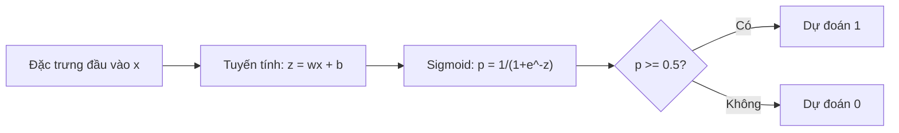
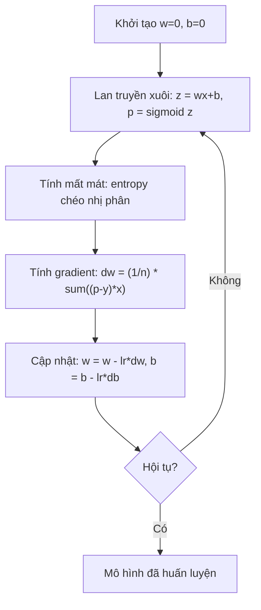

# Hồi quy logistic

> Hồi quy logistic uốn một đường thẳng thành đường cong hình chữ S để trả lời câu hỏi có-hoặc-không kèm xác suất.

**Type:** Build
**Languages:** Python
**Prerequisites:** Giai đoạn 2, Bài 01-02 (ML là gì, Hồi quy tuyến tính)
**Time:** ~90 phút

## Mục tiêu học tập

- Cài đặt hồi quy logistic từ đầu bằng hàm sigmoid và mất mát cross-entropy (entropy chéo) nhị phân
- Tính và diễn giải precision, recall, điểm F1 và ma trận nhầm lẫn cho phân loại nhị phân
- Giải thích vì sao MSE thất bại với phân loại và vì sao entropy chéo nhị phân tạo ra bề mặt chi phí lồi
- Xây dựng mô hình hồi quy softmax cho phân loại nhiều lớp và đánh giá các đánh đổi khi tinh chỉnh ngưỡng

## Vấn đề

Bạn muốn dự đoán một khối u là ác tính hay lành tính dựa trên kích thước của nó. Bạn thử hồi quy tuyến tính. Nó cho ra những con số như 0.3 hay 1.7 hay -0.5. Những số đó nghĩa là gì? 1.7 có phải "rất ác tính"? -0.5 có phải "rất lành tính"? Hồi quy tuyến tính xuất ra những con số không bị chặn. Phân loại cần xác suất bị chặn giữa 0 và 1, cùng một quyết định rõ ràng: có hay không.

Hồi quy logistic giải quyết việc này. Nó lấy cùng tổ hợp tuyến tính (wx + b) rồi đưa qua hàm sigmoid, hàm này nén mọi con số vào khoảng (0, 1). Đầu ra là một xác suất. Bạn đặt một ngưỡng (thường là 0.5) và đưa ra quyết định.

Đây là một trong những thuật toán được dùng rộng rãi nhất trong thực tế. Dù tên gọi như vậy, hồi quy logistic là thuật toán phân loại, không phải thuật toán hồi quy. Cái tên đến từ hàm logistic (sigmoid) mà nó sử dụng.

## Khái niệm

### Vì sao hồi quy tuyến tính thất bại với phân loại

Hãy tưởng tượng bạn dự đoán đỗ/trượt (1/0) dựa trên số giờ học. Hồi quy tuyến tính khớp một đường thẳng qua dữ liệu:

```
hours:  1   2   3   4   5   6   7   8   9   10
actual: 0   0   0   0   1   1   1   1   1   1
```

Một đường khớp tuyến tính có thể cho ra dự đoán như -0.2 ở giờ thứ 1 và 1.3 ở giờ thứ 10. Những giá trị này không phải xác suất. Chúng xuống dưới 0 và vượt trên 1. Tệ hơn, một điểm ngoại lai duy nhất (một người học 50 giờ) sẽ kéo lệch cả đường thẳng, làm thay đổi dự đoán cho mọi người.

Phân loại cần một hàm mà:
- Cho ra giá trị giữa 0 và 1 (xác suất)
- Tạo ra một chuyển tiếp sắc nét (decision boundary — ranh giới quyết định)
- Không bị bóp méo bởi các điểm ngoại lai ở xa ranh giới

### Hàm sigmoid

Hàm sigmoid làm đúng điều này:

```
sigmoid(z) = 1 / (1 + e^(-z))
```

Các tính chất:
- Khi z lớn và dương, sigmoid(z) tiến về 1
- Khi z lớn và âm, sigmoid(z) tiến về 0
- Khi z = 0, sigmoid(z) = 0.5
- Đầu ra luôn nằm giữa 0 và 1
- Hàm trơn và khả vi ở mọi điểm

Đạo hàm có một dạng rất tiện: sigmoid'(z) = sigmoid(z) * (1 - sigmoid(z)). Điều này làm cho việc tính gradient trở nên hiệu quả.

### Hồi quy logistic = Mô hình tuyến tính + Sigmoid

Mô hình tính z = wx + b (giống hồi quy tuyến tính), rồi áp dụng sigmoid:



Đầu ra p được hiểu là P(y=1 | x), xác suất mà đầu vào thuộc lớp 1. Ranh giới quyết định là nơi wx + b = 0, khi đó sigmoid cho ra đúng 0.5.

### Mất mát entropy chéo nhị phân

Bạn không thể dùng MSE cho hồi quy logistic. MSE với sigmoid tạo ra một bề mặt chi phí không lồi với nhiều cực tiểu cục bộ. Thay vào đó, hãy dùng entropy chéo nhị phân (log loss):

```
Loss = -(1/n) * sum(y * log(p) + (1-y) * log(1-p))
```

Vì sao cách này hiệu quả:
- Khi y=1 và p gần 1: log(1) = 0, nên mất mát gần 0 (đúng, chi phí thấp)
- Khi y=1 và p gần 0: log(0) tiến tới âm vô cực, nên mất mát rất lớn (sai, chi phí cao)
- Khi y=0 và p gần 0: log(1) = 0, nên mất mát gần 0 (đúng, chi phí thấp)
- Khi y=0 và p gần 1: log(0) tiến tới âm vô cực, nên mất mát rất lớn (sai, chi phí cao)

Hàm mất mát này lồi với hồi quy logistic, bảo đảm chỉ có một cực tiểu toàn cục.

### Gradient descent cho hồi quy logistic

Gradient của entropy chéo nhị phân với sigmoid có một dạng rất gọn:

```
dL/dw = (1/n) * sum((p - y) * x)
dL/db = (1/n) * sum(p - y)
```

Những công thức này trông y hệt gradient của hồi quy tuyến tính. Khác biệt là p = sigmoid(wx + b) thay vì p = wx + b. Sigmoid mang vào tính phi tuyến, nhưng quy tắc cập nhật gradient vẫn giữ nguyên.



### Ranh giới quyết định

Với đầu vào 2D (hai đặc trưng), ranh giới quyết định là đường thẳng nơi:

```
w1*x1 + w2*x2 + b = 0
```

Các điểm ở một phía được phân loại là 1, các điểm ở phía kia là 0. Hồi quy logistic luôn tạo ra một ranh giới quyết định tuyến tính. Nếu bạn cần ranh giới cong, bạn hoặc thêm đặc trưng đa thức, hoặc dùng một mô hình phi tuyến.

### Phân loại nhiều lớp với Softmax

Hồi quy logistic nhị phân xử lý hai lớp. Với k lớp, hãy dùng hàm softmax:

```
softmax(z_i) = e^(z_i) / sum(e^(z_j) for all j)
```

Mỗi lớp có vector trọng số riêng. Mô hình tính một điểm số z_i cho mỗi lớp, rồi softmax chuyển các điểm số thành xác suất có tổng bằng 1. Lớp được dự đoán là lớp có xác suất cao nhất.

Hàm mất mát trở thành entropy chéo phân loại:

```
Loss = -(1/n) * sum(sum(y_k * log(p_k)))
```

trong đó y_k bằng 1 cho lớp đúng và 0 cho mọi lớp khác (mã hóa one-hot).

### Các chỉ số đánh giá

Chỉ riêng độ chính xác là không đủ. Với một tập dữ liệu có 95% âm và 5% dương, một mô hình luôn dự đoán âm sẽ đạt độ chính xác 95% nhưng hoàn toàn vô dụng.

**Ma trận nhầm lẫn**:

| | Dự đoán dương | Dự đoán âm |
|---|---|---|
| Thực tế dương | Dương thật (TP) | Âm giả (FN) |
| Thực tế âm | Dương giả (FP) | Âm thật (TN) |

**Precision**: Trong tất cả các mẫu được dự đoán dương, bao nhiêu mẫu thực sự dương?
```
Precision = TP / (TP + FP)
```

**Recall** (độ nhạy): Trong tất cả các mẫu thực sự dương, ta bắt được bao nhiêu?
```
Recall = TP / (TP + FN)
```

**Điểm F1**: Trung bình điều hòa của precision và recall. Cân bằng cả hai chỉ số.
```
F1 = 2 * (Precision * Recall) / (Precision + Recall)
```

Khi nào nên ưu tiên:
- **Precision**: khi dương giả tốn kém (bộ lọc spam, bạn không muốn chặn email hợp lệ)
- **Recall**: khi âm giả tốn kém (sàng lọc ung thư, bạn không muốn bỏ sót một khối u)
- **F1**: khi bạn cần một chỉ số cân bằng duy nhất

```figure
logistic-sigmoid
```

## Tự tay làm

### Bước 1: Hàm sigmoid và sinh dữ liệu

```python
import random
import math

def sigmoid(z):
    z = max(-500, min(500, z))
    return 1.0 / (1.0 + math.exp(-z))


random.seed(42)
N = 200
X = []
y = []

for _ in range(N // 2):
    X.append([random.gauss(2, 1), random.gauss(2, 1)])
    y.append(0)

for _ in range(N // 2):
    X.append([random.gauss(5, 1), random.gauss(5, 1)])
    y.append(1)

combined = list(zip(X, y))
random.shuffle(combined)
X, y = zip(*combined)
X = list(X)
y = list(y)

print(f"Generated {N} samples (2 classes, 2 features)")
print(f"Class 0 center: (2, 2), Class 1 center: (5, 5)")
print(f"First 5 samples:")
for i in range(5):
    print(f"  Features: [{X[i][0]:.2f}, {X[i][1]:.2f}], Label: {y[i]}")
```

### Bước 2: Hồi quy logistic từ đầu

```python
class LogisticRegression:
    def __init__(self, n_features, learning_rate=0.01):
        self.weights = [0.0] * n_features
        self.bias = 0.0
        self.lr = learning_rate
        self.loss_history = []

    def predict_proba(self, x):
        z = sum(w * xi for w, xi in zip(self.weights, x)) + self.bias
        return sigmoid(z)

    def predict(self, x, threshold=0.5):
        return 1 if self.predict_proba(x) >= threshold else 0

    def compute_loss(self, X, y):
        n = len(y)
        total = 0.0
        for i in range(n):
            p = self.predict_proba(X[i])
            p = max(1e-15, min(1 - 1e-15, p))
            total += y[i] * math.log(p) + (1 - y[i]) * math.log(1 - p)
        return -total / n

    def fit(self, X, y, epochs=1000, print_every=200):
        n = len(y)
        n_features = len(X[0])
        for epoch in range(epochs):
            dw = [0.0] * n_features
            db = 0.0
            for i in range(n):
                p = self.predict_proba(X[i])
                error = p - y[i]
                for j in range(n_features):
                    dw[j] += error * X[i][j]
                db += error
            for j in range(n_features):
                self.weights[j] -= self.lr * (dw[j] / n)
            self.bias -= self.lr * (db / n)
            loss = self.compute_loss(X, y)
            self.loss_history.append(loss)
            if epoch % print_every == 0:
                print(f"  Epoch {epoch:4d} | Loss: {loss:.4f} | w: [{self.weights[0]:.3f}, {self.weights[1]:.3f}] | b: {self.bias:.3f}")
        return self

    def accuracy(self, X, y):
        correct = sum(1 for i in range(len(y)) if self.predict(X[i]) == y[i])
        return correct / len(y)


split = int(0.8 * N)
X_train, X_test = X[:split], X[split:]
y_train, y_test = y[:split], y[split:]

print("\n=== Training Logistic Regression ===")
model = LogisticRegression(n_features=2, learning_rate=0.1)
model.fit(X_train, y_train, epochs=1000, print_every=200)

print(f"\nTrain accuracy: {model.accuracy(X_train, y_train):.4f}")
print(f"Test accuracy:  {model.accuracy(X_test, y_test):.4f}")
print(f"Weights: [{model.weights[0]:.4f}, {model.weights[1]:.4f}]")
print(f"Bias: {model.bias:.4f}")
```

### Bước 3: Ma trận nhầm lẫn (confusion matrix) và các metric viết từ đầu

```python
class ClassificationMetrics:
    def __init__(self, y_true, y_pred):
        self.tp = sum(1 for t, p in zip(y_true, y_pred) if t == 1 and p == 1)
        self.tn = sum(1 for t, p in zip(y_true, y_pred) if t == 0 and p == 0)
        self.fp = sum(1 for t, p in zip(y_true, y_pred) if t == 0 and p == 1)
        self.fn = sum(1 for t, p in zip(y_true, y_pred) if t == 1 and p == 0)

    def accuracy(self):
        total = self.tp + self.tn + self.fp + self.fn
        return (self.tp + self.tn) / total if total > 0 else 0

    def precision(self):
        denom = self.tp + self.fp
        return self.tp / denom if denom > 0 else 0

    def recall(self):
        denom = self.tp + self.fn
        return self.tp / denom if denom > 0 else 0

    def f1(self):
        p = self.precision()
        r = self.recall()
        return 2 * p * r / (p + r) if (p + r) > 0 else 0

    def print_confusion_matrix(self):
        print(f"\n  Confusion Matrix:")
        print(f"                  Predicted")
        print(f"                  Pos   Neg")
        print(f"  Actual Pos     {self.tp:4d}  {self.fn:4d}")
        print(f"  Actual Neg     {self.fp:4d}  {self.tn:4d}")

    def print_report(self):
        self.print_confusion_matrix()
        print(f"\n  Accuracy:  {self.accuracy():.4f}")
        print(f"  Precision: {self.precision():.4f}")
        print(f"  Recall:    {self.recall():.4f}")
        print(f"  F1 Score:  {self.f1():.4f}")


y_pred_test = [model.predict(x) for x in X_test]
print("\n=== Classification Report (Test Set) ===")
metrics = ClassificationMetrics(y_test, y_pred_test)
metrics.print_report()
```

### Bước 4: Phân tích ranh giới quyết định

```python
print("\n=== Decision Boundary ===")
w1, w2 = model.weights
b = model.bias
print(f"Decision boundary: {w1:.4f}*x1 + {w2:.4f}*x2 + {b:.4f} = 0")
if abs(w2) > 1e-10:
    print(f"Solved for x2:     x2 = {-w1/w2:.4f}*x1 + {-b/w2:.4f}")

print("\nSample predictions near the boundary:")
test_points = [
    [3.0, 3.0],
    [3.5, 3.5],
    [4.0, 4.0],
    [2.5, 2.5],
    [5.0, 5.0],
]
for point in test_points:
    prob = model.predict_proba(point)
    pred = model.predict(point)
    print(f"  [{point[0]}, {point[1]}] -> prob={prob:.4f}, class={pred}")
```

### Bước 5: Đa lớp với softmax

```python
class SoftmaxRegression:
    def __init__(self, n_features, n_classes, learning_rate=0.01):
        self.n_features = n_features
        self.n_classes = n_classes
        self.lr = learning_rate
        self.weights = [[0.0] * n_features for _ in range(n_classes)]
        self.biases = [0.0] * n_classes

    def softmax(self, scores):
        max_score = max(scores)
        exp_scores = [math.exp(s - max_score) for s in scores]
        total = sum(exp_scores)
        return [e / total for e in exp_scores]

    def predict_proba(self, x):
        scores = [
            sum(self.weights[k][j] * x[j] for j in range(self.n_features)) + self.biases[k]
            for k in range(self.n_classes)
        ]
        return self.softmax(scores)

    def predict(self, x):
        probs = self.predict_proba(x)
        return probs.index(max(probs))

    def fit(self, X, y, epochs=1000, print_every=200):
        n = len(y)
        for epoch in range(epochs):
            grad_w = [[0.0] * self.n_features for _ in range(self.n_classes)]
            grad_b = [0.0] * self.n_classes
            total_loss = 0.0
            for i in range(n):
                probs = self.predict_proba(X[i])
                for k in range(self.n_classes):
                    target = 1.0 if y[i] == k else 0.0
                    error = probs[k] - target
                    for j in range(self.n_features):
                        grad_w[k][j] += error * X[i][j]
                    grad_b[k] += error
                true_prob = max(probs[y[i]], 1e-15)
                total_loss -= math.log(true_prob)
            for k in range(self.n_classes):
                for j in range(self.n_features):
                    self.weights[k][j] -= self.lr * (grad_w[k][j] / n)
                self.biases[k] -= self.lr * (grad_b[k] / n)
            if epoch % print_every == 0:
                print(f"  Epoch {epoch:4d} | Loss: {total_loss / n:.4f}")
        return self

    def accuracy(self, X, y):
        correct = sum(1 for i in range(len(y)) if self.predict(X[i]) == y[i])
        return correct / len(y)


random.seed(42)
X_3class = []
y_3class = []

centers = [(1, 1), (5, 1), (3, 5)]
for label, (cx, cy) in enumerate(centers):
    for _ in range(50):
        X_3class.append([random.gauss(cx, 0.8), random.gauss(cy, 0.8)])
        y_3class.append(label)

combined = list(zip(X_3class, y_3class))
random.shuffle(combined)
X_3class, y_3class = zip(*combined)
X_3class = list(X_3class)
y_3class = list(y_3class)

split_3 = int(0.8 * len(X_3class))
X_train_3 = X_3class[:split_3]
y_train_3 = y_3class[:split_3]
X_test_3 = X_3class[split_3:]
y_test_3 = y_3class[split_3:]

print("\n=== Multi-class Softmax Regression (3 classes) ===")
softmax_model = SoftmaxRegression(n_features=2, n_classes=3, learning_rate=0.1)
softmax_model.fit(X_train_3, y_train_3, epochs=1000, print_every=200)
print(f"\nTrain accuracy: {softmax_model.accuracy(X_train_3, y_train_3):.4f}")
print(f"Test accuracy:  {softmax_model.accuracy(X_test_3, y_test_3):.4f}")

print("\nSample predictions:")
for i in range(5):
    probs = softmax_model.predict_proba(X_test_3[i])
    pred = softmax_model.predict(X_test_3[i])
    print(f"  True: {y_test_3[i]}, Predicted: {pred}, Probs: [{', '.join(f'{p:.3f}' for p in probs)}]")
```

### Bước 6: Tinh chỉnh ngưỡng (threshold)

```python
print("\n=== Threshold Tuning ===")
print("Default threshold: 0.5. Adjusting the threshold trades precision for recall.\n")

thresholds = [0.3, 0.4, 0.5, 0.6, 0.7]
print(f"{'Threshold':>10} {'Accuracy':>10} {'Precision':>10} {'Recall':>10} {'F1':>10}")
print("-" * 52)

for t in thresholds:
    y_pred_t = [1 if model.predict_proba(x) >= t else 0 for x in X_test]
    m = ClassificationMetrics(y_test, y_pred_t)
    print(f"{t:>10.1f} {m.accuracy():>10.4f} {m.precision():>10.4f} {m.recall():>10.4f} {m.f1():>10.4f}")
```

## Áp dụng

Giờ hãy làm điều tương tự với scikit-learn.

```python
from sklearn.linear_model import LogisticRegression as SklearnLR
from sklearn.metrics import accuracy_score, precision_score, recall_score, f1_score
from sklearn.metrics import confusion_matrix, classification_report
from sklearn.model_selection import train_test_split
from sklearn.preprocessing import StandardScaler
import numpy as np

np.random.seed(42)
X_0 = np.random.randn(100, 2) + [2, 2]
X_1 = np.random.randn(100, 2) + [5, 5]
X_sk = np.vstack([X_0, X_1])
y_sk = np.array([0] * 100 + [1] * 100)

X_tr, X_te, y_tr, y_te = train_test_split(X_sk, y_sk, test_size=0.2, random_state=42)

scaler = StandardScaler()
X_tr_sc = scaler.fit_transform(X_tr)
X_te_sc = scaler.transform(X_te)

lr = SklearnLR()
lr.fit(X_tr_sc, y_tr)
y_pred = lr.predict(X_te_sc)

print("=== Scikit-learn Logistic Regression ===")
print(f"Accuracy:  {accuracy_score(y_te, y_pred):.4f}")
print(f"Precision: {precision_score(y_te, y_pred):.4f}")
print(f"Recall:    {recall_score(y_te, y_pred):.4f}")
print(f"F1:        {f1_score(y_te, y_pred):.4f}")
print(f"\nConfusion Matrix:\n{confusion_matrix(y_te, y_pred)}")
print(f"\nClassification Report:\n{classification_report(y_te, y_pred)}")
```

Bản triển khai từ đầu của bạn cho ra cùng ranh giới quyết định và cùng các metric. Scikit-learn bổ sung các tuỳ chọn solver (liblinear, lbfgs, saga), tự động áp dụng regularization, các chiến lược đa lớp (một-chọi-phần-còn-lại — one-vs-rest, multinomial), và những tối ưu về độ ổn định số.

## Đóng gói

Bài học này tạo ra:
- `code/logistic_regression.py` - hồi quy logistic viết từ đầu kèm các metric

## Bài tập

1. Sinh một bộ dữ liệu KHÔNG tách được tuyến tính (ví dụ: hai vòng tròn đồng tâm). Huấn luyện hồi quy logistic và quan sát việc nó thất bại. Sau đó thêm các đặc trưng đa thức (x1^2, x2^2, x1*x2) rồi huấn luyện lại. Chứng minh rằng độ chính xác được cải thiện.
2. Cài đặt ma trận nhầm lẫn đa lớp cho model softmax 3 lớp. Tính precision và recall cho từng lớp. Lớp nào khó phân loại nhất?
3. Xây dựng đường cong ROC (ROC curve) từ đầu. Với 100 giá trị ngưỡng từ 0 đến 1, hãy tính true positive rate và false positive rate. Tính AUC (diện tích dưới đường cong) bằng quy tắc hình thang.

## Thuật ngữ chính

| Thuật ngữ | Người ta thường nói | Ý nghĩa thực sự |
|------|----------------|----------------------|
| Logistic regression | "Hồi quy dùng để phân loại" | Một model tuyến tính, theo sau là hàm sigmoid, cho ra xác suất của các lớp |
| Sigmoid function | "Đường cong chữ S" | Hàm 1/(1+e^(-z)) ánh xạ mọi số thực vào khoảng (0, 1) |
| Binary cross-entropy | "Log loss" | Hàm mất mát -[y*log(p) + (1-y)*log(1-p)], phạt rất nặng những dự đoán sai nhưng lại rất tự tin |
| Decision boundary | "Đường phân chia" | Bề mặt nơi xác suất đầu ra của model bằng 0.5, tách các lớp được dự đoán |
| Softmax | "Sigmoid cho đa lớp" | Hàm biến một vector điểm số thành các xác suất có tổng bằng 1 |
| Precision | "Trong số được chọn có bao nhiêu là đúng" | TP / (TP + FP), tỉ lệ các dự đoán dương thực sự là dương |
| Recall | "Trong số đúng có bao nhiêu được chọn" | TP / (TP + FN), tỉ lệ các mẫu dương thực tế mà model nhận ra đúng |
| F1 score | "Độ chính xác cân bằng" | Trung bình điều hoà của precision và recall: 2*P*R / (P+R) |
| Confusion matrix | "Bảng phân rã lỗi" | Bảng hiển thị số đếm TP, TN, FP, FN cho từng cặp lớp |
| Threshold | "Ngưỡng cắt" | Giá trị xác suất mà vượt qua nó model dự đoán lớp 1 (mặc định 0.5, có thể chỉnh) |
| One-hot encoding | "Cột nhị phân cho các hạng mục" | Biểu diễn lớp k thành một vector toàn số 0 với một số 1 ở vị trí k |
| Categorical cross-entropy | "Log loss cho đa lớp" | Mở rộng của binary cross-entropy cho k lớp, dùng nhãn one-hot |

---

[← Bài trước: Hồi quy tuyến tính](../../02-linear-regression/docs/vi.md) · [Bài sau: Cây quyết định và Rừng ngẫu nhiên →](../../04-decision-trees/docs/vi.md)
