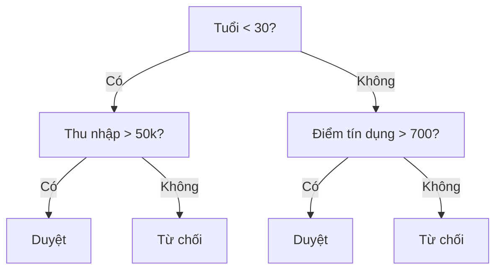
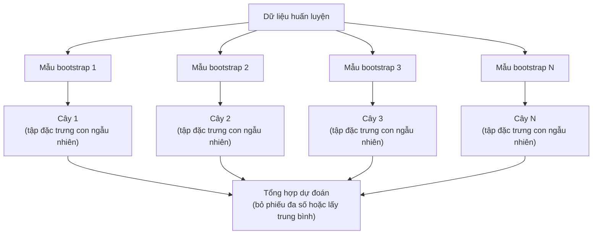

# Cây quyết định và Rừng ngẫu nhiên

> Cây quyết định chỉ là một lưu đồ. Nhưng một rừng gồm nhiều cây lại là một trong những công cụ mạnh nhất trong ML.

**Type:** Build
**Language:** Python
**Prerequisites:** Giai đoạn 1 (Bài 09 Lý thuyết thông tin, 06 Xác suất)
**Time:** ~90 phút

## Mục tiêu học tập

- Lập trình các phép tính độ vẩn đục Gini, entropy và lượng tin thu được để tìm các phân tách cây quyết định tối ưu
- Xây một bộ phân loại cây quyết định từ đầu với các kiểm soát tỉa cành trước (độ sâu tối đa, số mẫu tối thiểu)
- Dựng một rừng ngẫu nhiên bằng lấy mẫu bootstrap và ngẫu nhiên hoá đặc trưng, rồi giải thích vì sao nó giảm phương sai
- So sánh độ quan trọng đặc trưng MDI với độ quan trọng hoán vị và nhận ra khi nào MDI bị thiên vị

## Vấn đề

Bạn có dữ liệu dạng bảng. Các dòng là mẫu, các cột là đặc trưng, và có một cột mục tiêu bạn muốn dự đoán. Bạn có thể ném một mạng nơ-ron vào đó. Nhưng với dữ liệu dạng bảng, các mô hình dựa trên cây (cây quyết định, rừng ngẫu nhiên, cây tăng cường gradient) luôn vượt trội so với học sâu. Các cuộc thi Kaggle trên dữ liệu có cấu trúc bị chi phối bởi XGBoost và LightGBM, chứ không phải transformer.

Vì sao? Cây xử lý được kiểu đặc trưng hỗn hợp (số và phân loại) mà không cần tiền xử lý. Chúng xử lý quan hệ phi tuyến mà không cần thiết kế đặc trưng. Chúng diễn giải được: bạn có thể nhìn vào cây và thấy chính xác vì sao một dự đoán được đưa ra. Và rừng ngẫu nhiên, vốn lấy trung bình nhiều cây, có khả năng chống quá khớp rất tốt trên các tập dữ liệu cỡ vừa.

Bài này tự xây cây quyết định từ đầu bằng phân tách đệ quy, rồi dựng rừng ngẫu nhiên lên trên. Bạn sẽ lập trình phần toán phía sau các tiêu chí phân tách (độ vẩn đục Gini, entropy, lượng tin thu được) và hiểu vì sao một tập hợp các học viên yếu lại trở thành một học viên mạnh.

## Khái niệm

### Cây quyết định làm gì

Cây quyết định chia không gian đặc trưng thành các vùng chữ nhật bằng cách đặt ra một chuỗi câu hỏi có/không.



Mỗi nút trong kiểm tra một đặc trưng so với một ngưỡng. Mỗi nút lá đưa ra một dự đoán. Để phân loại một điểm dữ liệu mới, bạn bắt đầu ở gốc và đi theo các nhánh cho đến khi chạm một nút lá.

Cây được xây từ trên xuống bằng cách chọn, tại mỗi nút, đặc trưng và ngưỡng tách dữ liệu tốt nhất. "Tốt nhất" được định nghĩa bởi một tiêu chí phân tách.

### Tiêu chí phân tách: đo độ vẩn đục

Tại mỗi nút, ta có một tập mẫu. Ta muốn phân tách chúng sao cho các nút con thu được càng "thuần" càng tốt, nghĩa là mỗi nút con chứa chủ yếu một lớp.

**Độ vẩn đục Gini** (Gini impurity) đo xác suất mà một mẫu được chọn ngẫu nhiên sẽ bị phân loại sai nếu nó được gán nhãn theo phân bố lớp tại nút đó.

```
Gini(S) = 1 - sum(p_k^2)

where p_k is the proportion of class k in set S.
```

Với một nút thuần (toàn một lớp), Gini = 0. Với một phân tách nhị phân có hai lớp 50/50, Gini = 0.5. Càng thấp càng tốt.

```
Example: 6 cats, 4 dogs

Gini = 1 - (0.6^2 + 0.4^2) = 1 - (0.36 + 0.16) = 0.48
```

**Entropy** đo lượng thông tin (độ hỗn loạn) trong một nút. Đã trình bày ở Giai đoạn 1 Bài 09.

```
Entropy(S) = -sum(p_k * log2(p_k))
```

Với một nút thuần, entropy = 0. Với một phân tách nhị phân 50/50, entropy = 1.0. Càng thấp càng tốt.

```
Example: 6 cats, 4 dogs

Entropy = -(0.6 * log2(0.6) + 0.4 * log2(0.4))
        = -(0.6 * -0.737 + 0.4 * -1.322)
        = 0.442 + 0.529
        = 0.971 bits
```

**Lượng tin thu được** (information gain) là mức giảm độ vẩn đục (entropy hoặc Gini) sau một phân tách.

```
IG(S, feature, threshold) = Impurity(S) - weighted_avg(Impurity(S_left), Impurity(S_right))

where the weights are the proportions of samples in each child.
```

Thuật toán tham lam tại mỗi nút: thử mọi đặc trưng và mọi ngưỡng khả dĩ. Chọn cặp (đặc trưng, ngưỡng) làm cực đại lượng tin thu được.

### Cách phân tách hoạt động

Với một tập dữ liệu có n đặc trưng và m mẫu tại nút hiện tại:

1. Với mỗi đặc trưng j (j = 1 đến n):
   - Sắp xếp các mẫu theo đặc trưng j
   - Thử mọi điểm giữa hai giá trị phân biệt liên tiếp làm ngưỡng
   - Tính lượng tin thu được cho mỗi ngưỡng
2. Chọn đặc trưng và ngưỡng có lượng tin thu được cao nhất
3. Chia dữ liệu thành trái (đặc trưng <= ngưỡng) và phải (đặc trưng > ngưỡng)
4. Đệ quy trên mỗi nút con

Cách tham lam này không bảo đảm cây tối ưu toàn cục. Tìm cây tối ưu là bài toán NP-khó. Nhưng phân tách tham lam hoạt động tốt trên thực tế.

### Điều kiện dừng

Không có điều kiện dừng, cây sẽ lớn dần cho đến khi mọi nút lá đều thuần (mỗi lá một mẫu). Khi đó nó ghi nhớ hoàn hảo dữ liệu huấn luyện và tổng quát hoá cực kém.

**Tỉa cành trước** dừng cây trước khi nó lớn hết cỡ:
- Độ sâu tối đa: dừng phân tách khi cây đạt một độ sâu đặt trước
- Số mẫu tối thiểu mỗi lá: dừng nếu một nút có ít hơn k mẫu
- Lượng tin thu được tối thiểu: dừng nếu phân tách tốt nhất chỉ cải thiện độ vẩn đục ít hơn một ngưỡng
- Số nút lá tối đa: giới hạn tổng số lá

**Tỉa cành sau** mọc cây đầy đủ rồi cắt bớt:
- Tỉa cành theo độ phức tạp - chi phí (scikit-learn dùng cách này): thêm một hình phạt tỉ lệ với số lá. Tăng hình phạt để có cây nhỏ hơn
- Tỉa cành giảm lỗi: bỏ một cây con nếu lỗi trên tập kiểm định không tăng

Tỉa cành trước đơn giản và nhanh hơn. Tỉa cành sau thường cho cây tốt hơn vì nó không dừng sớm những phân tách có thể dẫn tới các phân tách hữu ích về sau.

### Cây quyết định cho hồi quy

Với hồi quy, dự đoán tại lá là trung bình của các giá trị mục tiêu trong lá đó. Tiêu chí phân tách cũng đổi:

**Giảm phương sai** thay cho lượng tin thu được:

```
VR(S, feature, threshold) = Var(S) - weighted_avg(Var(S_left), Var(S_right))
```

Chọn phân tách làm giảm phương sai nhiều nhất. Cây chia không gian đầu vào thành các vùng và dự đoán một hằng số (giá trị trung bình) trong mỗi vùng.

### Rừng ngẫu nhiên: sức mạnh của tập hợp

Một cây quyết định đơn lẻ có phương sai cao. Những thay đổi nhỏ trong dữ liệu có thể tạo ra những cây hoàn toàn khác. Rừng ngẫu nhiên khắc phục điều này bằng cách lấy trung bình nhiều cây.



Hai nguồn ngẫu nhiên làm các cây trở nên đa dạng:

**Bagging (bootstrap aggregating):** Mỗi cây được huấn luyện trên một mẫu bootstrap, tức một mẫu ngẫu nhiên có hoàn lại từ dữ liệu huấn luyện. Khoảng 63% mẫu gốc xuất hiện trong mỗi mẫu bootstrap (phần còn lại là các mẫu ngoài túi, có thể dùng để kiểm định).

**Ngẫu nhiên hoá đặc trưng:** Tại mỗi phân tách, chỉ một tập con đặc trưng ngẫu nhiên được xem xét. Với phân loại, mặc định là sqrt(n_features). Với hồi quy, n_features/3. Điều này ngăn mọi cây cùng phân tách trên một đặc trưng trội.

Điểm mấu chốt: lấy trung bình nhiều cây ít tương quan sẽ giảm phương sai mà không tăng độ chệch. Mỗi cây riêng lẻ có thể tầm thường. Tập hợp thì mạnh.

### Độ quan trọng của đặc trưng

Rừng ngẫu nhiên vốn đã cung cấp điểm quan trọng của đặc trưng. Cách phổ biến nhất:

**Mức giảm độ vẩn đục trung bình (MDI):** Với mỗi đặc trưng, cộng tổng mức giảm độ vẩn đục trên tất cả các cây và tất cả các nút có dùng đặc trưng đó. Những đặc trưng tạo ra mức giảm độ vẩn đục lớn hơn ở các phân tách sớm hơn thì quan trọng hơn.

```
importance(feature_j) = sum over all nodes where feature_j is used:
    (n_samples_at_node / n_total_samples) * impurity_decrease
```

Cách này nhanh (tính ngay trong lúc huấn luyện) nhưng thiên vị các đặc trưng có số giá trị lớn và các đặc trưng có nhiều điểm phân tách khả dĩ.

**Độ quan trọng hoán vị** là lựa chọn thay thế: xáo trộn giá trị của một đặc trưng và đo độ chính xác của mô hình giảm bao nhiêu. Đáng tin cậy hơn nhưng chậm hơn.

### Khi nào cây vượt trội mạng nơ-ron

Cây và rừng chiếm ưu thế so với mạng nơ-ron trên dữ liệu dạng bảng. Có vài lý do:

| Yếu tố | Cây | Mạng nơ-ron |
|--------|-------|----------------|
| Kiểu hỗn hợp (số + phân loại) | Hỗ trợ sẵn | Cần mã hoá |
| Tập dữ liệu nhỏ (< 10k dòng) | Hoạt động tốt | Quá khớp |
| Tương tác giữa các đặc trưng | Tìm ra nhờ phân tách | Cần thiết kế kiến trúc |
| Khả năng diễn giải | Hoàn toàn minh bạch | Hộp đen |
| Thời gian huấn luyện | Vài phút | Vài giờ |
| Độ nhạy với siêu tham số | Thấp | Cao |

Mạng nơ-ron thắng khi dữ liệu có cấu trúc không gian hoặc tuần tự (ảnh, văn bản, âm thanh). Với bảng đặc trưng phẳng, cây là lựa chọn mặc định.

```figure
decision-tree-depth
```

## Tự tay làm

### Bước 1: Độ vẩn đục Gini và entropy

Xây cả hai tiêu chí phân tách từ đầu và kiểm tra rằng chúng đồng ý với nhau về phân tách nào là tốt.

```python
import math

def gini_impurity(labels):
    n = len(labels)
    if n == 0:
        return 0.0
    counts = {}
    for label in labels:
        counts[label] = counts.get(label, 0) + 1
    return 1.0 - sum((c / n) ** 2 for c in counts.values())

def entropy(labels):
    n = len(labels)
    if n == 0:
        return 0.0
    counts = {}
    for label in labels:
        counts[label] = counts.get(label, 0) + 1
    return -sum(
        (c / n) * math.log2(c / n) for c in counts.values() if c > 0
    )
```

### Bước 2: Tìm phân tách tốt nhất

Thử mọi đặc trưng và mọi ngưỡng. Trả về cặp có lượng tin thu được cao nhất.

```python
def information_gain(parent_labels, left_labels, right_labels, criterion="gini"):
    measure = gini_impurity if criterion == "gini" else entropy
    n = len(parent_labels)
    n_left = len(left_labels)
    n_right = len(right_labels)
    if n_left == 0 or n_right == 0:
        return 0.0
    parent_impurity = measure(parent_labels)
    child_impurity = (
        (n_left / n) * measure(left_labels) +
        (n_right / n) * measure(right_labels)
    )
    return parent_impurity - child_impurity
```

### Bước 3: Xây dựng lớp DecisionTree

Chia tách đệ quy, dự đoán và theo dõi độ quan trọng đặc trưng. `_build` là trái tim của cây: nó dừng khi một nút thuần khiết hoặc chạm giới hạn pre-pruning, ngược lại nó lấy cách chia tốt nhất và đệ quy vào cả hai nút con.

```python
import random

class DecisionTree:
    def __init__(self, max_depth=None, min_samples_split=2,
                 min_samples_leaf=1, criterion="gini",
                 max_features=None):
        self.max_depth = max_depth
        self.min_samples_split = min_samples_split
        self.min_samples_leaf = min_samples_leaf
        self.criterion = criterion
        self.max_features = max_features
        self.tree = None
        self.feature_importances_ = None

    def fit(self, X, y):
        self.n_features = len(X[0])
        self.feature_importances_ = [0.0] * self.n_features
        self.n_samples = len(X)
        self.tree = self._build(X, y, depth=0)
        total = sum(self.feature_importances_)
        if total > 0:
            self.feature_importances_ = [
                fi / total for fi in self.feature_importances_
            ]

    def predict(self, X):
        return [self._predict_one(x, self.tree) for x in X]

    def _build(self, X, y, depth):
        if len(set(y)) == 1:
            return {"leaf": True, "value": y[0]}

        if self.max_depth is not None and depth >= self.max_depth:
            return self._make_leaf(y)

        if len(y) < self.min_samples_split:
            return self._make_leaf(y)

        best_feature, best_threshold, best_gain = self._best_split(X, y)

        if best_feature is None or best_gain <= 0:
            return self._make_leaf(y)

        left_X, left_y, right_X, right_y = self._split_data(
            X, y, best_feature, best_threshold
        )

        if len(left_y) < self.min_samples_leaf or len(right_y) < self.min_samples_leaf:
            return self._make_leaf(y)

        weight = len(y) / self.n_samples
        self.feature_importances_[best_feature] += weight * best_gain

        return {
            "leaf": False,
            "feature": best_feature,
            "threshold": best_threshold,
            "left": self._build(left_X, left_y, depth + 1),
            "right": self._build(right_X, right_y, depth + 1),
        }

    def _make_leaf(self, y):
        counts = {}
        for label in y:
            counts[label] = counts.get(label, 0) + 1
        return {"leaf": True, "value": max(counts, key=counts.get)}

    def _best_split(self, X, y):
        best_feature = None
        best_threshold = None
        best_gain = -1.0

        if self.max_features == "sqrt":
            k = max(1, int(math.sqrt(self.n_features)))
            feature_indices = random.sample(range(self.n_features), k)
        elif isinstance(self.max_features, int):
            if self.max_features < 1:
                raise ValueError("max_features must be at least 1 when given as an integer")
            k = min(self.max_features, self.n_features)
            feature_indices = random.sample(range(self.n_features), k)
        else:
            feature_indices = list(range(self.n_features))

        for feature_idx in feature_indices:
            values = sorted(set(X[i][feature_idx] for i in range(len(X))))
            if len(values) <= 1:
                continue

            for i in range(len(values) - 1):
                threshold = (values[i] + values[i + 1]) / 2.0
                left_y = [y[j] for j in range(len(X)) if X[j][feature_idx] <= threshold]
                right_y = [y[j] for j in range(len(X)) if X[j][feature_idx] > threshold]

                if len(left_y) < self.min_samples_leaf or len(right_y) < self.min_samples_leaf:
                    continue

                gain = information_gain(y, left_y, right_y, self.criterion)
                if gain > best_gain:
                    best_gain = gain
                    best_feature = feature_idx
                    best_threshold = threshold

        return best_feature, best_threshold, best_gain

    def _split_data(self, X, y, feature, threshold):
        left_X, left_y, right_X, right_y = [], [], [], []
        for i in range(len(X)):
            if X[i][feature] <= threshold:
                left_X.append(X[i])
                left_y.append(y[i])
            else:
                right_X.append(X[i])
                right_y.append(y[i])
        return left_X, left_y, right_X, right_y

    def _predict_one(self, x, node):
        if node["leaf"]:
            return node["value"]
        if x[node["feature"]] <= node["threshold"]:
            return self._predict_one(x, node["left"])
        return self._predict_one(x, node["right"])
```

### Bước 4: Xây dựng lớp RandomForest

Lấy mẫu bootstrap, ngẫu nhiên hóa đặc trưng và bỏ phiếu theo đa số.

```python
class RandomForest:
    def __init__(self, n_trees=100, max_depth=None,
                 min_samples_split=2, max_features="sqrt",
                 criterion="gini"):
        self.n_trees = n_trees
        self.max_depth = max_depth
        self.min_samples_split = min_samples_split
        self.max_features = max_features
        self.criterion = criterion
        self.trees = []

    def fit(self, X, y):
        n = len(X)
        for _ in range(self.n_trees):
            indices = [random.randint(0, n - 1) for _ in range(n)]
            X_boot = [X[i] for i in indices]
            y_boot = [y[i] for i in indices]
            tree = DecisionTree(
                max_depth=self.max_depth,
                min_samples_split=self.min_samples_split,
                max_features=self.max_features,
                criterion=self.criterion,
            )
            tree.fit(X_boot, y_boot)
            self.trees.append(tree)

    def predict(self, X):
        all_preds = [tree.predict(X) for tree in self.trees]
        predictions = []
        for i in range(len(X)):
            votes = {}
            for preds in all_preds:
                v = preds[i]
                votes[v] = votes.get(v, 0) + 1
            predictions.append(max(votes, key=votes.get))
        return predictions
```

Xem `code/trees.py` để có bản triển khai đầy đủ với tất cả phương thức hỗ trợ.

## Áp dụng

Với scikit-learn, huấn luyện một rừng ngẫu nhiên chỉ mất ba dòng:

```python
from sklearn.ensemble import RandomForestClassifier
from sklearn.datasets import load_iris
from sklearn.model_selection import train_test_split

X, y = load_iris(return_X_y=True)
X_train, X_test, y_train, y_test = train_test_split(X, y, random_state=42)

rf = RandomForestClassifier(n_estimators=100, random_state=42)
rf.fit(X_train, y_train)
print(f"Accuracy: {rf.score(X_test, y_test):.4f}")
print(f"Feature importances: {rf.feature_importances_}")
```

Trong thực tế, cây tăng cường gradient (XGBoost, LightGBM, CatBoost) thường mạnh hơn rừng ngẫu nhiên vì chúng xây cây tuần tự, mỗi cây sửa lỗi của các cây trước. Nhưng rừng ngẫu nhiên khó bị cấu hình sai hơn và gần như không cần tinh chỉnh siêu tham số.

## Đóng gói

Bài học này tạo ra `outputs/prompt-tree-interpreter.md` -- một prompt giúp diễn giải các điểm chia của cây quyết định cho những người ra quyết định trong kinh doanh. Đưa vào cấu trúc của một cây đã huấn luyện (độ sâu, đặc trưng, ngưỡng chia, độ chính xác) và nó sẽ chuyển mô hình thành các luật bằng ngôn ngữ thường, xếp hạng độ quan trọng đặc trưng, gắn cờ overfitting hoặc rò rỉ dữ liệu, và đề xuất bước tiếp theo. Dùng nó bất cứ khi nào bạn cần giải thích một mô hình dựa trên cây cho người không đọc code.

## Bài tập

1. Huấn luyện một cây quyết định đơn lẻ trên tập dữ liệu 2D với 3 lớp. Tự tay lần theo các điểm chia và vẽ các ranh giới quyết định hình chữ nhật. So sánh ranh giới ở max_depth=2 với max_depth=10.

2. Triển khai chia tách theo giảm phương sai cho cây hồi quy. Sinh y = sin(x) + nhiễu cho 200 điểm và huấn luyện cây hồi quy của bạn. Vẽ dự đoán hằng số theo từng đoạn của cây so với đường cong thật.

3. Xây một rừng ngẫu nhiên với 1, 5, 10, 50 và 200 cây. Vẽ độ chính xác huấn luyện và độ chính xác kiểm tra theo số lượng cây. Quan sát rằng độ chính xác kiểm tra chững lại nhưng không giảm (rừng chống được overfitting).

4. So sánh độ vẩn đục Gini với entropy làm tiêu chí chia trên 5 tập dữ liệu khác nhau. Đo độ chính xác và độ sâu cây. Trong hầu hết trường hợp, chúng cho kết quả gần như giống hệt nhau. Hãy giải thích tại sao.

5. Triển khai permutation importance. So sánh nó với MDI importance trên một tập dữ liệu có một đặc trưng là nhiễu ngẫu nhiên nhưng có số giá trị phân biệt cao. MDI sẽ xếp hạng đặc trưng nhiễu đó cao. Permutation importance thì không.

## Thuật ngữ chính

| Thuật ngữ | Người ta thường nói | Ý nghĩa thực sự |
|------|----------------|----------------------|
| Decision tree | "Một lưu đồ để dự đoán" | Mô hình phân hoạch không gian đặc trưng thành các vùng hình chữ nhật bằng cách học một chuỗi các điểm chia if/else |
| Gini impurity | "Nút bị trộn lẫn đến mức nào" | Xác suất phân loại sai một mẫu ngẫu nhiên tại một nút. 0 = thuần khiết, 0.5 = độ vẩn đục tối đa với bài toán hai lớp |
| Entropy | "Sự hỗn loạn trong một nút" | Lượng thông tin tại một nút. 0 = thuần khiết, 1.0 = độ bất định tối đa với bài toán hai lớp. Đến từ lý thuyết thông tin |
| Information gain | "Một lần chia tốt đến đâu" | Mức giảm độ vẩn đục sau một lần chia. Tiêu chí tham lam để chọn điểm chia |
| Pre-pruning | "Dừng cây sớm" | Dừng cây phát triển sớm bằng cách đặt ngưỡng độ sâu tối đa, số mẫu tối thiểu hoặc mức gain tối thiểu |
| Post-pruning | "Tỉa cây sau khi xong" | Mọc cây đầy đủ, rồi cắt bỏ những cây con không cải thiện hiệu năng trên tập kiểm định |
| Bagging | "Huấn luyện trên các tập con ngẫu nhiên" | Bootstrap aggregating. Huấn luyện mỗi mô hình trên một mẫu ngẫu nhiên khác nhau có hoàn lại |
| Random forest | "Một đống cây" | Tập hợp mô hình các cây quyết định, mỗi cây huấn luyện trên một mẫu bootstrap với tập đặc trưng con ngẫu nhiên ở mỗi lần chia |
| Feature importance (MDI) | "Đặc trưng nào quan trọng" | Tổng mức giảm độ vẩn đục mà mỗi đặc trưng đóng góp, cộng dồn trên tất cả các cây và các nút |
| Permutation importance | "Xáo trộn rồi kiểm tra" | Mức giảm độ chính xác khi các giá trị của một đặc trưng bị xáo trộn ngẫu nhiên. Đáng tin hơn MDI với các đặc trưng nhiễu |
| Variance reduction | "Bản hồi quy của information gain" | Phiên bản tương ứng của information gain cho cây hồi quy. Chọn điểm chia làm giảm phương sai của biến mục tiêu nhiều nhất |
| Bootstrap sample | "Mẫu ngẫu nhiên có lặp" | Một mẫu ngẫu nhiên rút ra có hoàn lại từ tập dữ liệu gốc. Cùng kích thước nhưng có phần tử trùng lặp |

## Đọc thêm

- [Breiman: Random Forests (2001)](https://link.springer.com/article/10.1023/A:1010933404324) - bài báo gốc về rừng ngẫu nhiên
- [Grinsztajn et al.: Why do tree-based models still outperform deep learning on tabular data? (2022)](https://arxiv.org/abs/2207.08815) - so sánh chặt chẽ giữa cây và mạng nơ-ron trên các bài toán dữ liệu dạng bảng
- [scikit-learn Decision Trees documentation](https://scikit-learn.org/stable/modules/tree.html) - hướng dẫn thực hành kèm công cụ trực quan hóa
- [XGBoost: A Scalable Tree Boosting System (Chen & Guestrin, 2016)](https://arxiv.org/abs/1603.02754) - bài báo gradient boosting thống trị Kaggle
