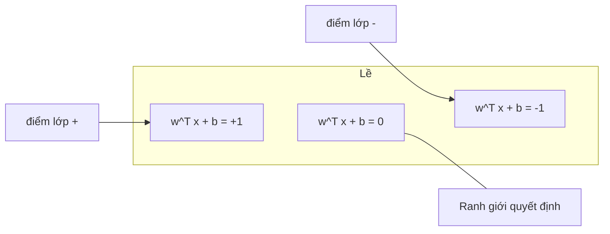
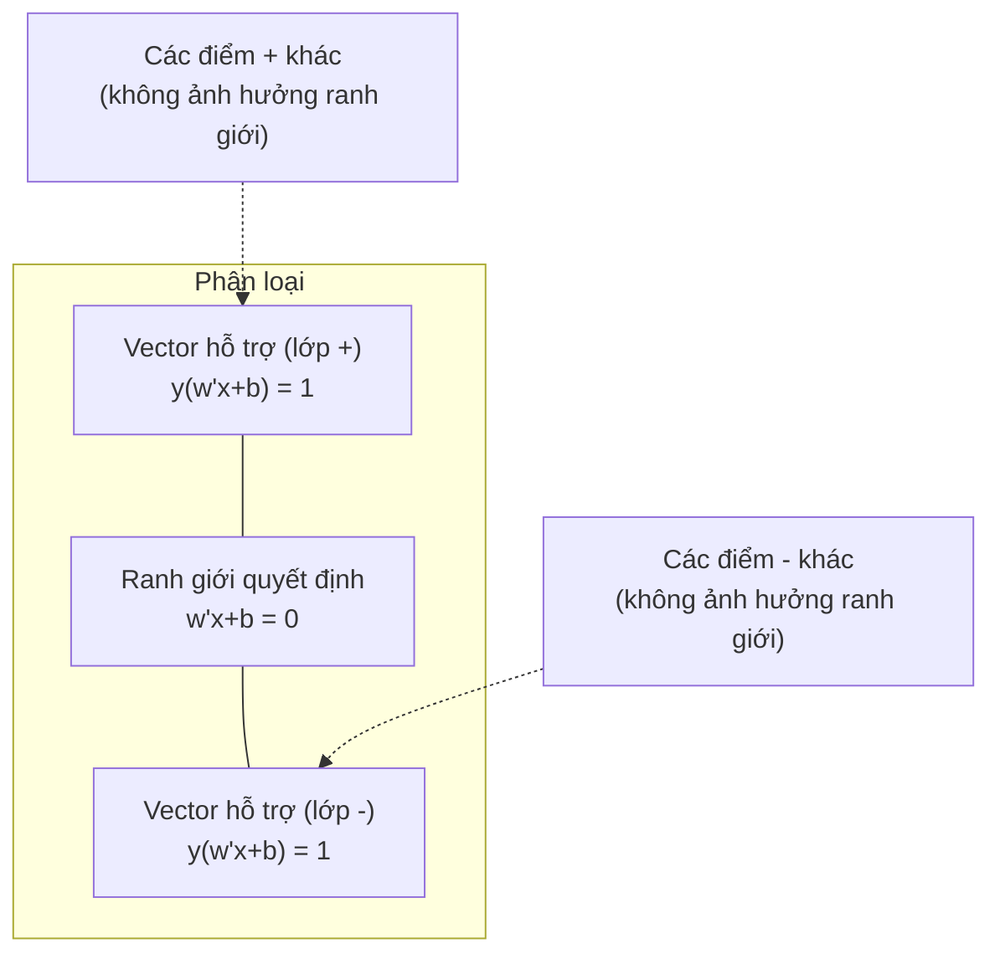
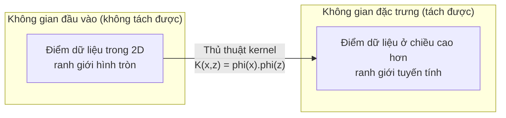

# Máy vector hỗ trợ

> Tìm con đường rộng nhất giữa hai lớp. Đó chính là toàn bộ ý tưởng.

**Type:** Build
**Language:** Python
**Prerequisites:** Giai đoạn 1 (Bài 08 Tối ưu hóa, 14 Norms và Khoảng cách, 18 Tối ưu lồi)
**Time:** ~90 phút

## Mục tiêu học tập

- Cài đặt một máy vector hỗ trợ tuyến tính từ đầu bằng mất mát hinge và gradient descent trên dạng primal
- Giải thích nguyên lý lề tối đa và xác định các vector hỗ trợ từ một model đã huấn luyện
- So sánh kernel tuyến tính, đa thức và RBF, rồi giải thích cách thủ thuật kernel tránh việc ánh xạ tường minh sang không gian nhiều chiều
- Đánh giá sự đánh đổi do tham số C điều khiển giữa độ rộng lề và lỗi phân loại

## Vấn đề

Bạn có hai lớp điểm dữ liệu và cần vẽ một đường thẳng (hay siêu phẳng — hyperplane) để tách chúng. Có vô số đường có thể dùng được. Bạn nên chọn đường nào?

Đường có lề (margin) lớn nhất. Lề là khoảng cách giữa ranh giới quyết định và các điểm dữ liệu gần nhất ở mỗi phía. Lề càng rộng thì bộ phân loại càng tự tin và tổng quát hóa tốt hơn với dữ liệu chưa thấy.

Trực giác này dẫn đến máy vector hỗ trợ (support vector machine), một trong những thuật toán tao nhã nhất về mặt toán học trong ML. SVM từng là phương pháp phân loại thống trị trước kỷ nguyên deep learning, và vẫn là lựa chọn tốt nhất cho tập dữ liệu nhỏ, dữ liệu nhiều chiều, và những bài toán cần một model có nguyên tắc, dễ hiểu cùng bảo đảm lý thuyết.

SVM liên hệ trực tiếp với Giai đoạn 1: bài toán tối ưu là lồi (Bài 18), lề được đo bằng norms (Bài 14), và thủ thuật kernel khai thác tích vô hướng để xử lý các ranh giới phi tuyến mà không bao giờ phải tính toán trong không gian nhiều chiều.

## Khái niệm

### Bộ phân loại lề tối đa

Với dữ liệu tách tuyến tính được có nhãn y_i thuộc {-1, +1} và các vector đặc trưng x_i, ta muốn một siêu phẳng w^T x + b = 0 tách hai lớp.

Khoảng cách từ một điểm x_i đến siêu phẳng là:

```
distance = |w^T x_i + b| / ||w||
```

Với một điểm được phân loại đúng: y_i * (w^T x_i + b) > 0. Lề bằng hai lần khoảng cách từ siêu phẳng đến điểm gần nhất ở mỗi phía.



Bài toán tối ưu:

```
maximize    2 / ||w||     (the margin width)
subject to  y_i * (w^T x_i + b) >= 1  for all i
```

Tương đương (cực tiểu hóa ||w||^2 dễ tối ưu hơn):

```
minimize    (1/2) ||w||^2
subject to  y_i * (w^T x_i + b) >= 1  for all i
```

Đây là một bài toán quy hoạch toàn phương lồi. Nó có nghiệm toàn cục duy nhất. Những điểm dữ liệu nằm đúng trên biên của lề (nơi y_i * (w^T x_i + b) = 1) là các vector hỗ trợ (support vector). Chúng là những điểm duy nhất quyết định ranh giới quyết định. Dịch chuyển hay xóa bất kỳ điểm nào không phải vector hỗ trợ, ranh giới vẫn không thay đổi.

### Vector hỗ trợ: vài điểm then chốt



Phần lớn điểm huấn luyện đều không quan trọng. Chỉ các vector hỗ trợ mới có ý nghĩa. Đó là lý do SVM tiết kiệm bộ nhớ khi dự đoán: bạn chỉ cần lưu các vector hỗ trợ, chứ không cần lưu toàn bộ tập huấn luyện.

Số lượng vector hỗ trợ cũng cho một chặn trên sai số tổng quát hóa. Ít vector hỗ trợ hơn so với kích thước tập dữ liệu nghĩa là tổng quát hóa tốt hơn.

### Lề mềm (soft margin): xử lý nhiễu bằng tham số C

Dữ liệu thực tế hiếm khi tách hoàn hảo. Một số điểm có thể nằm sai phía của ranh giới, hoặc nằm trong lề. Dạng lề mềm cho phép vi phạm bằng cách đưa vào các biến bù (slack variable).

```
minimize    (1/2) ||w||^2 + C * sum(xi_i)
subject to  y_i * (w^T x_i + b) >= 1 - xi_i
            xi_i >= 0  for all i
```

Biến bù xi_i đo mức độ điểm i vi phạm lề. C điều khiển sự đánh đổi:

| Giá trị C | Hành vi |
|---------|----------|
| C lớn | Phạt vi phạm mạnh. Lề hẹp, ít lỗi phân loại hơn. Dễ overfit |
| C nhỏ | Cho phép nhiều vi phạm hơn. Lề rộng, nhiều lỗi phân loại hơn. Dễ underfit |

C là nghịch đảo của độ mạnh điều chuẩn. C lớn = điều chuẩn ít hơn. C nhỏ = điều chuẩn nhiều hơn.

### Mất mát hinge (hinge loss): hàm mất mát của SVM

SVM lề mềm có thể được viết lại thành một bài toán tối ưu không ràng buộc:

```
minimize    (1/2) ||w||^2 + C * sum(max(0, 1 - y_i * (w^T x_i + b)))
```

Số hạng max(0, 1 - y_i * f(x_i)) là mất mát hinge. Nó bằng 0 khi điểm được phân loại đúng và nằm ngoài lề. Nó tuyến tính khi điểm nằm trong lề hoặc bị phân loại sai.

```
Hinge loss for a single point:

loss
  |
  | \
  |  \
  |   \
  |    \
  |     \_______________
  |
  +-----|-----|-------->  y * f(x)
       0     1

Zero loss when y*f(x) >= 1 (correctly classified, outside margin).
Linear penalty when y*f(x) < 1.
```

So sánh với mất mát logistic (hồi quy logistic):

```
Hinge:     max(0, 1 - y*f(x))          Hard cutoff at margin
Logistic:  log(1 + exp(-y*f(x)))        Smooth, never exactly zero
```

Mất mát hinge tạo ra nghiệm thưa (chỉ các vector hỗ trợ có đóng góp khác 0). Mất mát logistic dùng tất cả điểm dữ liệu. Điều này làm SVM tiết kiệm bộ nhớ hơn khi dự đoán.

### Huấn luyện SVM tuyến tính bằng gradient descent

Bạn có thể huấn luyện một SVM tuyến tính bằng gradient descent trên mất mát hinge cộng điều chuẩn L2, mà không cần giải bài toán quy hoạch toàn phương có ràng buộc:

```
L(w, b) = (lambda/2) * ||w||^2 + (1/n) * sum(max(0, 1 - y_i * (w^T x_i + b)))

Gradient with respect to w:
  If y_i * (w^T x_i + b) >= 1:  dL/dw = lambda * w
  If y_i * (w^T x_i + b) < 1:   dL/dw = lambda * w - y_i * x_i

Gradient with respect to b:
  If y_i * (w^T x_i + b) >= 1:  dL/db = 0
  If y_i * (w^T x_i + b) < 1:   dL/db = -y_i
```

Đây được gọi là dạng primal. Nó chạy trong O(n * d) mỗi epoch, với n là số mẫu và d là số đặc trưng. Với dữ liệu lớn, thưa, nhiều chiều (phân loại văn bản), cách này rất nhanh.

### Dạng đối ngẫu và thủ thuật kernel

Bài toán đối ngẫu Lagrange của bài toán SVM (từ Giai đoạn 1 Bài 18, điều kiện KKT) là:

```
maximize    sum(alpha_i) - (1/2) * sum_ij(alpha_i * alpha_j * y_i * y_j * (x_i . x_j))
subject to  0 <= alpha_i <= C
            sum(alpha_i * y_i) = 0
```

Dạng đối ngẫu chỉ liên quan đến các tích vô hướng x_i . x_j giữa các điểm dữ liệu. Đây là điểm mấu chốt. Thay mọi tích vô hướng bằng một hàm kernel K(x_i, x_j), và SVM có thể học các ranh giới phi tuyến mà không bao giờ phải tính phép biến đổi một cách tường minh.

```
Linear kernel:      K(x, z) = x . z
Polynomial kernel:  K(x, z) = (x . z + c)^d
RBF (Gaussian):     K(x, z) = exp(-gamma * ||x - z||^2)
```

Kernel RBF ánh xạ dữ liệu vào một không gian vô hạn chiều. Các điểm gần nhau trong không gian đầu vào có giá trị kernel gần 1. Các điểm xa nhau có giá trị kernel gần 0. Nó có thể học bất kỳ ranh giới quyết định trơn nào.



Thủ thuật kernel tính tích vô hướng trong không gian nhiều chiều mà không cần đi tới đó. Với kernel đa thức bậc d trong D chiều, không gian đặc trưng tường minh có O(D^d) chiều. Nhưng K(x, z) được tính trong thời gian O(D).

### SVM cho hồi quy (SVR)

SVR (Support Vector Regression) fit một ống có độ rộng epsilon quanh dữ liệu. Các điểm nằm trong ống có loss bằng 0. Các điểm nằm ngoài ống bị phạt tuyến tính.

```
minimize    (1/2) ||w||^2 + C * sum(xi_i + xi_i*)
subject to  y_i - (w^T x_i + b) <= epsilon + xi_i
            (w^T x_i + b) - y_i <= epsilon + xi_i*
            xi_i, xi_i* >= 0
```

Tham số epsilon quyết định độ rộng của ống. Ống rộng hơn = ít support vector hơn = fit mượt hơn. Ống hẹp hơn = nhiều support vector hơn = fit sát hơn.

### Vì sao SVM thua học sâu (và khi nào chúng vẫn thắng)

SVM thống trị ML từ cuối thập niên 1990 đến đầu thập niên 2010. Học sâu vượt qua chúng vì vài lý do:

| Yếu tố | SVM | Học sâu |
|--------|------|---------------|
| Kỹ thuật đặc trưng | Cần phải làm | Tự học đặc trưng |
| Khả năng mở rộng | O(n^2) đến O(n^3) với kernel | O(n) mỗi epoch với SGD |
| Ảnh/văn bản/âm thanh | Cần đặc trưng thủ công | Học từ dữ liệu thô |
| Tập dữ liệu lớn (>100k) | Chậm | Mở rộng tốt |
| Tăng tốc GPU | Lợi ích hạn chế | Tăng tốc cực lớn |

SVM vẫn thắng trong những tình huống sau:
- Tập dữ liệu nhỏ (vài trăm đến vài nghìn mẫu)
- Dữ liệu thưa nhiều chiều (văn bản với đặc trưng TF-IDF)
- Khi bạn cần bảo đảm toán học (cận margin)
- Khi thời gian huấn luyện phải tối thiểu (SVM tuyến tính rất nhanh)
- Phân loại nhị phân với cấu trúc margin rõ ràng
- Phát hiện bất thường (one-class SVM)

```figure
svm-margin
```

## Tự tay làm

### Bước 1: Hinge loss và gradient

Nền tảng. Tính hinge loss cho một batch và gradient của nó.

```python
def hinge_loss(X, y, w, b):
    n = len(X)
    total_loss = 0.0
    for i in range(n):
        margin = y[i] * (dot(w, X[i]) + b)
        total_loss += max(0.0, 1.0 - margin)
    return total_loss / n
```

### Bước 2: Linear SVM qua gradient descent

Huấn luyện bằng cách tối thiểu hóa hinge loss có regularization. Không cần solver QP.

```python
class LinearSVM:
    def __init__(self, lr=0.001, lambda_param=0.01, n_epochs=1000):
        self.lr = lr
        self.lambda_param = lambda_param
        self.n_epochs = n_epochs
        self.w = None
        self.b = 0.0

    def fit(self, X, y):
        n_features = len(X[0])
        self.w = [0.0] * n_features
        self.b = 0.0

        for epoch in range(self.n_epochs):
            for i in range(len(X)):
                margin = y[i] * (dot(self.w, X[i]) + self.b)
                if margin >= 1:
                    self.w = [wj - self.lr * self.lambda_param * wj
                              for wj in self.w]
                else:
                    self.w = [wj - self.lr * (self.lambda_param * wj - y[i] * X[i][j])
                              for j, wj in enumerate(self.w)]
                    self.b -= self.lr * (-y[i])

    def predict(self, X):
        return [1 if dot(self.w, x) + self.b >= 0 else -1 for x in X]
```

### Bước 3: Các hàm kernel

Cài đặt kernel tuyến tính, kernel đa thức và RBF.

```python
def linear_kernel(x, z):
    return dot(x, z)

def polynomial_kernel(x, z, degree=3, c=1.0):
    return (dot(x, z) + c) ** degree

def rbf_kernel(x, z, gamma=0.5):
    diff = [xi - zi for xi, zi in zip(x, z)]
    return math.exp(-gamma * dot(diff, diff))
```

### Bước 4: Margin và xác định các support vector

Sau khi huấn luyện, xác định điểm nào là support vector và tính độ rộng margin.

```python
def find_support_vectors(X, y, w, b, tol=1e-3):
    support_vectors = []
    for i in range(len(X)):
        margin = y[i] * (dot(w, X[i]) + b)
        if abs(margin - 1.0) < tol:
            support_vectors.append(i)
    return support_vectors
```

Xem `code/svm.py` để có cài đặt đầy đủ với tất cả demo.

## Áp dụng

Với scikit-learn:

```python
from sklearn.svm import SVC, LinearSVC, SVR
from sklearn.preprocessing import StandardScaler
from sklearn.pipeline import Pipeline

clf = Pipeline([
    ("scaler", StandardScaler()),
    ("svm", SVC(kernel="rbf", C=1.0, gamma="scale")),
])
clf.fit(X_train, y_train)
print(f"Accuracy: {clf.score(X_test, y_test):.4f}")
print(f"Support vectors: {clf['svm'].n_support_}")
```

Quan trọng: luôn scale đặc trưng trước khi huấn luyện SVM. SVM nhạy với độ lớn của đặc trưng vì margin phụ thuộc vào ||w||, và đặc trưng chưa scale làm méo hình học.

Với tập dữ liệu lớn, dùng `LinearSVC` (dạng primal, O(n) mỗi epoch) thay vì `SVC` (dạng dual, O(n^2) đến O(n^3)):

```python
from sklearn.svm import LinearSVC

clf = Pipeline([
    ("scaler", StandardScaler()),
    ("svm", LinearSVC(C=1.0, max_iter=10000)),
])
```

## Bài tập

1. Sinh một tập dữ liệu 2D tách tuyến tính được. Huấn luyện LinearSVM của bạn và xác định các support vector. Kiểm chứng rằng các support vector là những điểm gần ranh giới quyết định nhất.

2. Thay đổi C (tham số C) từ 0.001 đến 1000 trên một tập dữ liệu nhiễu. Vẽ ranh giới quyết định cho từng giá trị C. Quan sát sự chuyển tiếp từ margin rộng (underfitting) sang margin hẹp (overfitting).

3. Tạo một tập dữ liệu trong đó ranh giới các lớp có dạng vòng tròn (không tuyến tính). Chứng minh SVM tuyến tính thất bại. Tính ma trận kernel RBF và chứng minh các lớp trở nên tách được trong không gian đặc trưng do kernel tạo ra.

4. So sánh hinge loss với logistic loss trên cùng một tập dữ liệu. Huấn luyện SVM tuyến tính và hồi quy logistic. Đếm xem bao nhiêu điểm huấn luyện đóng góp vào ranh giới quyết định của mỗi model (support vector so với toàn bộ điểm).

5. Cài đặt SVR (loss không nhạy epsilon). Fit nó với y = sin(x) + nhiễu. Vẽ ống epsilon quanh các dự đoán và làm nổi bật các support vector (những điểm nằm ngoài ống).

## Thuật ngữ chính

| Thuật ngữ | Ý nghĩa thực sự |
|------|----------------------|
| Support vectors | Các điểm huấn luyện gần ranh giới quyết định nhất. Chỉ những điểm này mới quyết định siêu phẳng |
| Margin | Khoảng cách giữa ranh giới quyết định và các support vector gần nhất. SVM tối đa hóa khoảng cách này |
| Hinge loss | max(0, 1 - y*f(x)). Bằng 0 khi được phân loại đúng và nằm ngoài margin. Ngược lại là phạt tuyến tính |
| C parameter | Đánh đổi giữa độ rộng margin và lỗi phân loại. C lớn = margin hẹp, C nhỏ = margin rộng |
| Soft margin | Dạng SVM cho phép vi phạm margin qua các biến slack. Xử lý được dữ liệu không tách được |
| Kernel trick | Tính tích vô hướng trong không gian đặc trưng nhiều chiều mà không cần ánh xạ tường minh vào không gian đó |
| Linear kernel | K(x, z) = x . z. Tương đương tích vô hướng chuẩn. Dành cho dữ liệu tách tuyến tính |
| RBF kernel | K(x, z) = exp(-gamma * \|\|x-z\|\|^2). Ánh xạ tới vô số chiều. Học được mọi ranh giới trơn |
| Polynomial kernel | K(x, z) = (x . z + c)^d. Ánh xạ tới không gian đặc trưng của các tổ hợp đa thức |
| Dual formulation | Cách phát biểu lại bài toán SVM chỉ phụ thuộc tích vô hướng giữa các điểm dữ liệu. Cho phép dùng kernel |
| SVR | Support Vector Regression. Fit một ống epsilon quanh dữ liệu. Các điểm nằm trong ống có loss bằng 0 |
| Slack variables | xi_i: đo mức một điểm vi phạm margin. Bằng 0 với các điểm được phân loại đúng nằm ngoài margin |
| Maximum margin | Nguyên lý chọn siêu phẳng sao cho khoảng cách tới các điểm gần nhất của mỗi lớp là lớn nhất |

## Đọc thêm

- [Vapnik: The Nature of Statistical Learning Theory (1995)](https://link.springer.com/book/10.1007/978-1-4757-3264-1) - cuốn sách nền tảng về SVM và học thống kê
- [Cortes & Vapnik: Support-vector networks (1995)](https://link.springer.com/article/10.1007/BF00994018) - bài báo SVM gốc
- [Platt: Sequential Minimal Optimization (1998)](https://www.microsoft.com/en-us/research/publication/sequential-minimal-optimization-a-fast-algorithm-for-training-support-vector-machines/) - thuật toán SMO đã làm cho việc huấn luyện SVM trở nên thực tế
- [scikit-learn SVM documentation](https://scikit-learn.org/stable/modules/svm.html) - hướng dẫn thực hành kèm chi tiết cài đặt
- [LIBSVM: A Library for Support Vector Machines](https://www.csie.ntu.edu.tw/~cjlin/libsvm/) - thư viện C++ đứng sau hầu hết các cài đặt SVM

---

[← Bài trước: Cây quyết định và Rừng ngẫu nhiên](../../04-decision-trees/docs/vi.md) · [Bài sau: K-Nearest Neighbors và Khoảng cách →](../../06-knn-and-distances/docs/vi.md)
