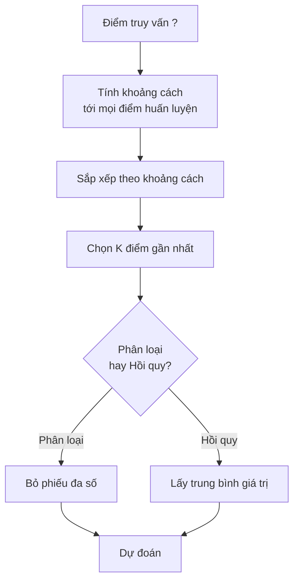
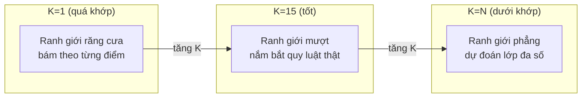
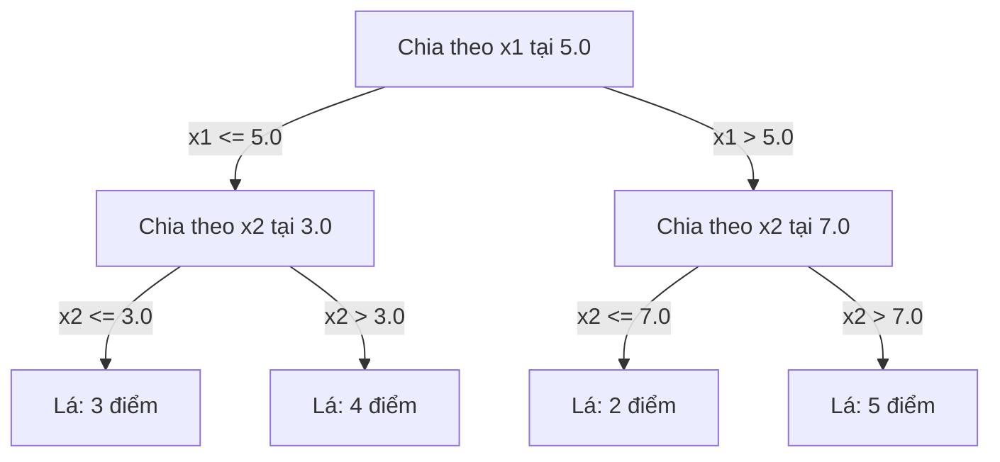

# K-Nearest Neighbors và Khoảng cách

> Lưu lại mọi thứ. Dự đoán bằng cách nhìn vào các láng giềng. Thuật toán đơn giản nhất mà thực sự hoạt động.

**Type:** Build
**Language:** Python
**Prerequisites:** Giai đoạn 1 (Bài 14 Norms và Khoảng cách)
**Time:** ~90 phút

## Mục tiêu học tập

- Cài đặt phân loại và hồi quy KNN từ đầu với K tùy chỉnh và bỏ phiếu có trọng số (weighted voting) theo khoảng cách
- So sánh các distance metric (metric khoảng cách) L1, L2, cosine và Minkowski, rồi chọn metric phù hợp với một loại dữ liệu cho trước
- Giải thích curse of dimensionality (lời nguyền số chiều) và chứng minh vì sao KNN suy giảm trong không gian nhiều chiều
- Xây dựng KD-tree để tìm láng giềng gần nhất hiệu quả và phân tích khi nào nó vượt trội hơn brute-force

## Vấn đề

Bạn có một bộ dữ liệu. Một điểm dữ liệu mới xuất hiện. Bạn cần phân loại nó hoặc dự đoán giá trị của nó. Thay vì học tham số từ dữ liệu (như hồi quy tuyến tính hay SVM), bạn chỉ cần tìm K điểm huấn luyện gần điểm mới nhất và để chúng bỏ phiếu.

Đây là k-nearest neighbors (k láng giềng gần nhất). Không có giai đoạn huấn luyện. Không có tham số nào để học. Không có hàm mất mát nào để tối thiểu hóa. Bạn lưu toàn bộ tập huấn luyện và tính khoảng cách ngay tại thời điểm dự đoán.

Nghe có vẻ quá đơn giản để hoạt động. Nhưng KNN lại cạnh tranh đáng ngạc nhiên với nhiều bài toán, đặc biệt là với bộ dữ liệu nhỏ đến trung bình, và hiểu sâu về nó sẽ mở ra những khái niệm nền tảng: việc chọn metric khoảng cách (liên hệ tới Bài 14 Giai đoạn 1), lời nguyền số chiều, và sự khác biệt giữa lazy learning (học lười) và eager learning.

KNN cũng xuất hiện khắp nơi trong AI hiện đại, chỉ là dưới những cái tên khác nhau. Cơ sở dữ liệu vector thực hiện tìm kiếm KNN trên embedding. Retrieval-augmented generation (RAG) tìm K đoạn tài liệu gần nhất. Hệ thống gợi ý tìm người dùng hoặc mặt hàng tương tự. Thuật toán là một. Quy mô và cấu trúc dữ liệu thì khác.

## Khái niệm

### Cách KNN hoạt động

Cho một bộ dữ liệu các điểm đã gán nhãn và một điểm truy vấn mới:

1. Tính khoảng cách từ điểm truy vấn tới mọi điểm trong bộ dữ liệu
2. Sắp xếp theo khoảng cách
3. Lấy K điểm gần nhất
4. Với phân loại: bỏ phiếu đa số trong K láng giềng
5. Với hồi quy: lấy trung bình (hoặc trung bình có trọng số) giá trị của K láng giềng



Đó là toàn bộ thuật toán. Không fit. Không gradient descent. Không epoch.

### Chọn K

K là siêu tham số duy nhất. Nó điều khiển sự đánh đổi bias-variance:

| K | Hành vi |
|---|----------|
| K = 1 | Ranh giới quyết định bám theo từng điểm. Sai số huấn luyện bằng 0. Phương sai cao. Quá khớp |
| K nhỏ (3-5) | Nhạy với cấu trúc cục bộ. Có thể nắm bắt ranh giới phức tạp |
| K lớn | Ranh giới mượt hơn. Bền vững hơn với nhiễu. Có thể dưới khớp |
| K = N | Dự đoán lớp đa số cho mọi điểm. Bias cực đại |

Một điểm khởi đầu phổ biến là K = sqrt(N) cho một bộ dữ liệu N điểm. Dùng K lẻ cho phân loại nhị phân để tránh hòa phiếu.



### Các metric khoảng cách

Hàm khoảng cách định nghĩa "gần" nghĩa là gì. Các metric khác nhau cho ra những láng giềng khác nhau, và những dự đoán khác nhau.

**L2 (Euclidean)** là mặc định. Khoảng cách đường thẳng.

```
d(a, b) = sqrt(sum((a_i - b_i)^2))
```

Nhạy với thang đo của đặc trưng. Luôn chuẩn hóa (standardize) đặc trưng trước khi dùng L2 với KNN.

**L1 (Manhattan)** cộng các chênh lệch tuyệt đối. Bền vững hơn với điểm ngoại lai so với L2 vì nó không bình phương các chênh lệch.

```
d(a, b) = sum(|a_i - b_i|)
```

**Cosine distance** đo góc giữa các vector, bỏ qua độ lớn. Thiết yếu cho dữ liệu văn bản và dữ liệu embedding.

```
d(a, b) = 1 - (a . b) / (||a|| * ||b||)
```

**Minkowski** tổng quát hóa L1 và L2 với tham số p.

```
d(a, b) = (sum(|a_i - b_i|^p))^(1/p)

p=1: Manhattan
p=2: Euclidean
p->inf: Chebyshev (max absolute difference)
```

Dùng metric nào phụ thuộc vào dữ liệu:

| Loại dữ liệu | Metric tốt nhất | Vì sao |
|-----------|------------|-----|
| Đặc trưng số, thang đo tương đương | L2 (Euclidean) | Mặc định, hợp với dữ liệu không gian |
| Đặc trưng số, có ngoại lai | L1 (Manhattan) | Bền vững, không khuếch đại các chênh lệch lớn |
| Embedding văn bản | Cosine | Độ lớn là nhiễu, hướng là ý nghĩa |
| Thưa và nhiều chiều | Cosine hoặc L1 | L2 chịu ảnh hưởng của lời nguyền số chiều |
| Loại hỗn hợp | Khoảng cách tùy chỉnh | Kết hợp các metric theo từng loại đặc trưng |

### KNN có trọng số

KNN chuẩn cho mọi láng giềng trong K trọng số như nhau. Nhưng một láng giềng ở khoảng cách 0.1 nên quan trọng hơn một láng giềng ở khoảng cách 5.0.

**KNN có trọng số theo khoảng cách** gán cho mỗi láng giềng một trọng số tỉ lệ nghịch với khoảng cách:

```
weight_i = 1 / (distance_i + epsilon)

For classification: weighted vote
For regression:     weighted average = sum(w_i * y_i) / sum(w_i)
```

Epsilon ngăn phép chia cho 0 khi một điểm truy vấn trùng khớp chính xác với một điểm huấn luyện.

KNN có trọng số ít nhạy với việc chọn K hơn, vì các láng giềng ở xa dù sao cũng đóng góp rất ít.

### Lời nguyền số chiều

Hiệu năng của KNN suy giảm trong không gian nhiều chiều. Đây không phải là một mối lo mơ hồ. Đó là một sự thật toán học.

**Vấn đề 1: các khoảng cách hội tụ.** Khi số chiều tăng, tỉ số giữa khoảng cách lớn nhất và khoảng cách nhỏ nhất tiến về 1. Mọi điểm trở nên "xa" như nhau so với điểm truy vấn.

```
In d dimensions, for random uniform points:

d=2:    max_dist / min_dist = varies widely
d=100:  max_dist / min_dist ~ 1.01
d=1000: max_dist / min_dist ~ 1.001

When all distances are nearly equal, "nearest" is meaningless.
```

**Vấn đề 2: thể tích bùng nổ.** Để bắt được K láng giềng trong một phần cố định của dữ liệu, bạn phải mở rộng bán kính tìm kiếm để bao phủ một phần lớn hơn nhiều của không gian đặc trưng. "Vùng lân cận" trong không gian nhiều chiều bao trùm phần lớn không gian.

**Vấn đề 3: các góc chi phối.** Trong một siêu khối đơn vị d chiều, phần lớn thể tích tập trung gần các góc chứ không phải ở tâm. Một hình cầu nội tiếp trong khối đó chỉ chứa một phần thể tích teo dần khi d tăng.

Hệ quả thực tế: KNN hoạt động tốt tới khoảng 20-50 đặc trưng. Vượt quá đó, bạn cần giảm số chiều (PCA, UMAP, t-SNE) trước khi áp dụng KNN, hoặc cần dùng các cấu trúc tìm kiếm dựa trên cây để khai thác số chiều nội tại thấp hơn của dữ liệu.

### KD-trees: tìm kiếm láng giềng gần nhất nhanh

KNN brute-force tính khoảng cách từ điểm truy vấn tới mọi điểm huấn luyện. Đó là O(n * d) cho mỗi truy vấn. Với bộ dữ liệu lớn, cách này quá chậm.

Một KD-tree phân hoạch không gian một cách đệ quy dọc theo các trục đặc trưng. Ở mỗi mức, nó chia theo một chiều tại giá trị trung vị.



Để tìm láng giềng gần nhất, bạn duyệt cây xuống lá chứa điểm truy vấn, rồi quay lui và chỉ kiểm tra các phân vùng lân cận nếu chúng có thể chứa điểm gần hơn.

Thời gian truy vấn trung bình: O(log n) với số chiều thấp. Nhưng KD-tree suy giảm về O(n) trong không gian nhiều chiều (d > 20) vì việc quay lui loại bỏ ngày càng ít nhánh hơn.

### Ball trees: tốt hơn cho số chiều trung bình

Ball tree phân hoạch dữ liệu thành các siêu cầu lồng nhau thay vì các hộp song song với trục. Mỗi nút định nghĩa một quả cầu (tâm + bán kính) chứa tất cả điểm trong cây con đó.

Ưu điểm so với KD-tree:
- Hoạt động tốt hơn ở số chiều trung bình (tới ~50)
- Xử lý được cấu trúc không song song với trục
- Thể tích bao sát hơn nghĩa là nhiều nhánh bị cắt tỉa hơn trong khi tìm kiếm

Cả KD-tree và ball tree đều là thuật toán chính xác. Với tìm kiếm quy mô thực sự lớn (hàng triệu điểm, hàng trăm chiều), người ta dùng các phương pháp láng giềng gần nhất xấp xỉ (HNSW, IVF, product quantization). Những phương pháp này được trình bày ở Bài 14 Giai đoạn 1.

### Học lười so với học chăm

KNN là một learner lười: nó không làm gì lúc huấn luyện và dồn toàn bộ công việc sang lúc dự đoán. Hầu hết thuật toán khác (hồi quy tuyến tính, SVM, mạng nơ-ron) là learner chăm: chúng tính toán nặng lúc huấn luyện để xây một model gọn, rồi dự đoán thì nhanh.

| Khía cạnh | Lười (KNN) | Chăm (SVM, mạng nơ-ron) |
|--------|------------|------------------------|
| Thời gian huấn luyện | O(1), chỉ cần lưu dữ liệu | O(n * epochs) |
| Thời gian dự đoán | O(n * d) mỗi truy vấn | O(d) hoặc O(số tham số) |
| Bộ nhớ lúc dự đoán | Lưu toàn bộ tập huấn luyện | Chỉ lưu tham số của model |
| Thích nghi với dữ liệu mới | Thêm điểm là xong ngay | Phải huấn luyện lại model |
| Biên quyết định | Ngầm định, tính tại chỗ | Tường minh, cố định sau huấn luyện |

Học lười là lựa chọn lý tưởng khi:
- Tập dữ liệu thay đổi thường xuyên (thêm/bớt điểm mà không cần huấn luyện lại)
- Bạn chỉ cần dự đoán cho rất ít truy vấn
- Bạn muốn thời gian huấn luyện bằng không
- Tập dữ liệu đủ nhỏ để tìm kiếm vét cạn còn nhanh

### KNN cho hồi quy

Thay vì bỏ phiếu theo đa số, KNN cho hồi quy lấy trung bình giá trị mục tiêu của K hàng xóm.

```
prediction = (1/K) * sum(y_i for i in K nearest neighbors)

Or with distance weighting:
prediction = sum(w_i * y_i) / sum(w_i)
where w_i = 1 / distance_i
```

KNN hồi quy tạo ra dự đoán hằng số từng khúc (hoặc trơn từng khúc nếu có trọng số). Nó không thể ngoại suy ra ngoài khoảng dữ liệu huấn luyện. Nếu mọi giá trị mục tiêu huấn luyện đều nằm trong khoảng 0 đến 100, KNN sẽ không bao giờ dự đoán 200.

```figure
knn-smoothness
```

## Tự tay làm

### Bước 1: Các hàm khoảng cách

Cài đặt khoảng cách L1, L2, cosine và Minkowski. Những hàm này nối trực tiếp với Bài 14 của Giai đoạn 1.

```python
import math

def l2_distance(a, b):
    return math.sqrt(sum((ai - bi) ** 2 for ai, bi in zip(a, b)))

def l1_distance(a, b):
    return sum(abs(ai - bi) for ai, bi in zip(a, b))

def cosine_distance(a, b):
    dot_val = sum(ai * bi for ai, bi in zip(a, b))
    norm_a = math.sqrt(sum(ai ** 2 for ai in a))
    norm_b = math.sqrt(sum(bi ** 2 for bi in b))
    if norm_a == 0 or norm_b == 0:
        return 1.0
    return 1.0 - dot_val / (norm_a * norm_b)

def minkowski_distance(a, b, p=2):
    if p == float('inf'):
        return max(abs(ai - bi) for ai, bi in zip(a, b))
    return sum(abs(ai - bi) ** p for ai, bi in zip(a, b)) ** (1 / p)
```

### Bước 2: Bộ phân loại và bộ hồi quy KNN

Xây KNN đầy đủ với K cấu hình được, metric khoảng cách, và tuỳ chọn đánh trọng số theo khoảng cách.

```python
class KNN:
    def __init__(self, k=5, distance_fn=l2_distance, weighted=False,
                 task="classification"):
        self.k = k
        self.distance_fn = distance_fn
        self.weighted = weighted
        self.task = task
        self.X_train = None
        self.y_train = None

    def fit(self, X, y):
        self.X_train = X
        self.y_train = y

    def predict(self, X):
        return [self._predict_one(x) for x in X]
```

### Bước 3: KD-tree cho tìm kiếm hiệu quả

Tự xây một KD-tree chia đệ quy theo trung vị của từng chiều.

```python
class KDTree:
    def __init__(self, X, indices=None, depth=0):
        # Recursively partition the data
        self.axis = depth % len(X[0])
        # Split on median of the current axis
        ...

    def query(self, point, k=1):
        # Traverse to leaf, then backtrack
        ...
```

Xem `code/knn.py` để có bản cài đặt đầy đủ với mọi hàm phụ trợ và demo.

### Bước 4: Co giãn đặc trưng

KNN cần co giãn đặc trưng vì khoảng cách rất nhạy với độ lớn của từng đặc trưng. Một đặc trưng trải từ 0 đến 1000 sẽ lấn át một đặc trưng trải từ 0 đến 1.

```python
def standardize(X):
    n = len(X)
    d = len(X[0])
    means = [sum(X[i][j] for i in range(n)) / n for j in range(d)]
    stds = [
        max(1e-10, (sum((X[i][j] - means[j]) ** 2 for i in range(n)) / n) ** 0.5)
        for j in range(d)
    ]
    return [[((X[i][j] - means[j]) / stds[j]) for j in range(d)] for i in range(n)], means, stds
```

## Áp dụng

Với scikit-learn:

```python
from sklearn.neighbors import KNeighborsClassifier
from sklearn.preprocessing import StandardScaler
from sklearn.pipeline import Pipeline

clf = Pipeline([
    ("scaler", StandardScaler()),
    ("knn", KNeighborsClassifier(n_neighbors=5, metric="euclidean")),
])
clf.fit(X_train, y_train)
print(f"Accuracy: {clf.score(X_test, y_test):.4f}")
```

Scikit-learn tự động dùng KD-tree hoặc ball tree khi tập dữ liệu đủ lớn và số chiều đủ thấp. Với dữ liệu nhiều chiều, nó quay về tìm kiếm vét cạn. Bạn có thể điều khiển điều này qua tham số `algorithm`.

Với tìm kiếm láng giềng gần nhất quy mô lớn (hàng triệu vector), hãy dùng FAISS, Annoy, hoặc một vector database:

```python
import faiss

index = faiss.IndexFlatL2(dimension)
index.add(embeddings)
distances, indices = index.search(query_vectors, k=5)
```

## Bài tập

1. Cài đặt phân loại KNN trên một tập dữ liệu 2D với 3 lớp. Vẽ biên quyết định cho K=1, K=5, K=15 và K=N. Quan sát sự chuyển dịch từ overfitting sang underfitting.

2. Sinh 1000 điểm ngẫu nhiên trong 2, 5, 10, 50, 100 và 500 chiều. Với mỗi số chiều, tính tỉ số giữa khoảng cách cặp lớn nhất và khoảng cách cặp nhỏ nhất. Vẽ tỉ số theo số chiều để hình dung lời nguyền số chiều.

3. So sánh khoảng cách L1, L2 và cosine cho KNN trên một bài toán phân loại văn bản (dùng vector TF-IDF). Metric nào cho độ chính xác tốt nhất? Vì sao cosine thường thắng với văn bản?

4. Cài đặt một KD-tree và đo thời gian truy vấn so với tìm kiếm vét cạn trên các tập 1k, 10k và 100k điểm trong 2D, 10D và 50D. Ở số chiều nào thì KD-tree không còn nhanh hơn tìm kiếm vét cạn?

5. Xây một bộ hồi quy KNN có trọng số cho y = sin(x) + nhiễu. So sánh với KNN không trọng số ở K=3, 10, 30. Chứng minh rằng đánh trọng số cho dự đoán trơn hơn, đặc biệt khi K lớn.

## Thuật ngữ chính

| Thuật ngữ | Ý nghĩa thực sự |
|------|----------------------|
| K-nearest neighbors | Thuật toán phi tham số dự đoán bằng cách tìm K điểm huấn luyện gần nhất với truy vấn |
| Lazy learning | Không tính toán gì lúc huấn luyện. Mọi việc diễn ra lúc dự đoán. KNN là ví dụ chuẩn |
| Eager learning | Tính toán nặng lúc huấn luyện để xây một model gọn. Hầu hết thuật toán ML đều thuộc nhóm này |
| Curse of dimensionality | Ở chiều cao, các khoảng cách hội tụ về nhau và lân cận nở ra phủ gần hết không gian, khiến KNN mất hiệu quả |
| KD-tree | Cây nhị phân chia không gian đệ quy dọc theo các trục đặc trưng. Truy vấn O(log n) ở chiều thấp |
| Ball tree | Cây gồm các siêu cầu lồng nhau. Hoạt động tốt hơn KD-tree ở chiều vừa phải (tới khoảng 50) |
| Weighted KNN | Hàng xóm được gán trọng số nghịch với khoảng cách. Hàng xóm gần hơn có ảnh hưởng lớn hơn tới dự đoán |
| Feature scaling | Chuẩn hoá các đặc trưng về thang đo tương đương. Bắt buộc với các phương pháp dựa trên khoảng cách như KNN |
| Majority vote | Phân loại bằng cách đếm lớp nào phổ biến nhất trong K hàng xóm |
| Brute force search | Tính khoảng cách tới mọi điểm huấn luyện. O(n*d) mỗi truy vấn. Chính xác nhưng chậm khi n lớn |
| Approximate nearest neighbor | Các thuật toán (HNSW, LSH, IVF) tìm điểm gần nhất một cách xấp xỉ, nhanh hơn nhiều so với tìm chính xác |
| Voronoi diagram | Cách chia không gian thành các vùng, mỗi vùng chứa mọi điểm gần một điểm huấn luyện hơn bất kỳ điểm nào khác. KNN với K=1 tạo ra biên Voronoi |

## Đọc thêm

- [Cover & Hart: Nearest Neighbor Pattern Classification (1967)](https://ieeexplore.ieee.org/document/1053964) - bài báo nền tảng về KNN, chứng minh tỉ lệ lỗi của nó nhiều nhất gấp đôi mức tối ưu Bayes
- [Friedman, Bentley, Finkel: An Algorithm for Finding Best Matches in Logarithmic Expected Time (1977)](https://dl.acm.org/doi/10.1145/355744.355745) - bài báo gốc về KD-tree
- [Beyer et al.: When Is "Nearest Neighbor" Meaningful? (1999)](https://link.springer.com/chapter/10.1007/3-540-49257-7_15) - phân tích hình thức về lời nguyền số chiều với tìm kiếm láng giềng gần nhất
- [scikit-learn Nearest Neighbors documentation](https://scikit-learn.org/stable/modules/neighbors.html) - hướng dẫn thực hành kèm cách chọn thuật toán
- [FAISS: A Library for Efficient Similarity Search](https://github.com/facebookresearch/faiss) - thư viện của Meta cho tìm kiếm láng giềng gần nhất xấp xỉ ở quy mô tỉ lệ
