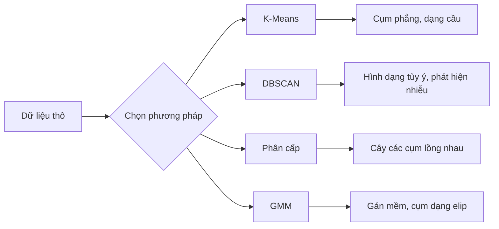

# Học không giám sát

> Không nhãn, không người thầy. Thuật toán tự tìm ra cấu trúc.

**Type:** Build
**Languages:** Python
**Prerequisites:** Giai đoạn 1 (Norms và Khoảng cách, Xác suất và Phân phối), Giai đoạn 2, Bài 01-06
**Time:** ~90 phút

## Mục tiêu học tập

- Tự cài đặt K-Means, DBSCAN và Gaussian Mixture Models từ đầu rồi so sánh hành vi phân cụm của chúng
- Đánh giá chất lượng cụm bằng điểm silhouette và phương pháp khuỷu tay để chọn K tối ưu
- Giải thích khi nào DBSCAN vượt trội hơn K-Means và xác định thuật toán nào xử lý được cụm không phải hình cầu cùng các điểm ngoại lai
- Xây dựng một pipeline phát hiện bất thường dùng các phương pháp phân cụm để gắn cờ những điểm lệch khỏi mẫu bình thường

## Vấn đề

Mọi bài ML đến giờ đều giả định dữ liệu có nhãn: "đây là đầu vào, đây là đầu ra đúng." Trong thế giới thực, nhãn rất đắt. Một bệnh viện có hàng triệu hồ sơ bệnh nhân nhưng không ai gắn nhãn thủ công từng hồ sơ theo loại bệnh. Một trang thương mại điện tử có hàng triệu phiên người dùng nhưng không ai dán nhãn tay cho từng nhóm khách hàng. Một nhóm bảo mật có log mạng nhưng không ai đánh dấu từng bất thường.

Học không giám sát tìm ra các mẫu mà không cần được bảo phải tìm gì. Nó gom những điểm dữ liệu tương tự lại, khám phá các cấu trúc ẩn, và làm lộ ra những bất thường. Nếu học có giám sát giống như học từ một cuốn sách có phần đáp án, thì học không giám sát giống như nhìn chằm chằm vào dữ liệu thô cho đến khi các mẫu tự hiện ra.

Cái khó là: không có nhãn, bạn không thể đo trực tiếp "đúng" hay "sai." Bạn cần những công cụ khác để đánh giá xem cấu trúc mà thuật toán tìm được có ý nghĩa hay không.

## Khái niệm

### Phân cụm: Gom những thứ tương tự lại với nhau

Phân cụm gán mỗi điểm dữ liệu vào một nhóm (cụm) sao cho các điểm trong cùng một nhóm giống nhau hơn là giống các điểm ở nhóm khác. Câu hỏi luôn là: "giống nhau" nghĩa là gì?



### K-Means: Cỗ máy chủ lực

K-Means chia dữ liệu thành đúng K cụm. Mỗi cụm có một tâm cụm (centroid), tức khối tâm của nó, và mọi điểm đều thuộc về tâm cụm gần nhất.

Thuật toán Lloyd:

1. Chọn ngẫu nhiên K điểm làm tâm cụm ban đầu
2. Gán mỗi điểm dữ liệu vào tâm cụm gần nhất
3. Tính lại mỗi tâm cụm là trung bình của các điểm được gán cho nó
4. Lặp lại bước 2-3 cho đến khi các phép gán không còn thay đổi

Hàm mục tiêu (quán tính cụm, inertia) đo tổng bình phương khoảng cách từ mỗi điểm tới tâm cụm được gán cho nó. K-Means tối thiểu hóa đại lượng này, nhưng chỉ tìm được cực tiểu cục bộ. Những cách khởi tạo khác nhau có thể cho ra kết quả khác nhau.

### Chọn K

Hai phương pháp tiêu chuẩn:

**Phương pháp khuỷu tay:** Chạy K-Means với K = 1, 2, 3, ..., n. Vẽ đồ thị quán tính theo K. Tìm "khuỷu tay", nơi mà việc thêm cụm không còn làm giảm quán tính một cách đáng kể nữa.

**Điểm silhouette:** Với mỗi điểm, đo mức tương đồng của nó với cụm của chính nó (a) so với cụm gần nhất khác (b). Hệ số silhouette là (b - a) / max(a, b), nằm trong khoảng từ -1 (sai cụm) đến +1 (được phân cụm tốt). Lấy trung bình trên tất cả các điểm để có điểm tổng thể.

### DBSCAN: Phân cụm dựa trên mật độ

K-Means giả định các cụm có dạng cầu và buộc bạn chọn K trước. DBSCAN không giả định điều nào trong hai điều đó. Nó tìm cụm như những vùng dày đặc, được ngăn cách bởi các vùng thưa thớt.

Hai tham số:
- **eps**: bán kính của một vùng lân cận
- **min_samples**: số điểm tối thiểu cần để tạo thành một vùng dày đặc

Ba loại điểm:
- **Điểm lõi**: có ít nhất min_samples điểm nằm trong khoảng cách eps
- **Điểm biên**: nằm trong eps của một điểm lõi nhưng bản thân không phải điểm lõi
- **Điểm nhiễu**: không phải lõi cũng không phải biên. Đây là các điểm ngoại lai.

DBSCAN nối các điểm lõi nằm trong khoảng eps của nhau vào cùng một cụm. Các điểm biên gia nhập cụm của một điểm lõi gần đó. Các điểm nhiễu không thuộc cụm nào.

Ưu điểm: tìm được cụm với bất kỳ hình dạng nào, tự động xác định số cụm, nhận ra các điểm ngoại lai. Nhược điểm: khó xử lý khi các cụm có mật độ khác nhau.

### Phân cụm phân cấp

Xây dựng một cây (dendrogram) gồm các cụm lồng nhau.

Agglomerative (từ dưới lên):
1. Bắt đầu với mỗi điểm là một cụm riêng
2. Gộp hai cụm gần nhau nhất
3. Lặp lại cho đến khi chỉ còn lại một cụm
4. Cắt dendrogram ở mức mong muốn để được K cụm

"Độ gần" giữa các cụm có thể được đo bằng:
- **Liên kết đơn**: khoảng cách nhỏ nhất giữa hai điểm bất kỳ trong hai cụm
- **Liên kết đầy đủ**: khoảng cách lớn nhất giữa hai điểm bất kỳ
- **Liên kết trung bình**: khoảng cách trung bình giữa tất cả các cặp
- **Phương pháp Ward**: phép gộp gây ra mức tăng nhỏ nhất của tổng phương sai trong cụm

### Gaussian Mixture Models (GMM)

K-Means cho phép gán cứng: mỗi điểm thuộc đúng một cụm. GMM cho phép gán mềm: mỗi điểm có một xác suất thuộc về từng cụm.

GMM giả định dữ liệu được sinh ra từ một hỗn hợp gồm K phân phối Gaussian, mỗi phân phối có trung bình và hiệp phương sai riêng. Thuật toán Expectation-Maximization (EM) luân phiên giữa:

- **Bước E**: tính xác suất mỗi điểm thuộc về từng Gaussian
- **Bước M**: cập nhật trung bình, hiệp phương sai và trọng số trộn của từng Gaussian để cực đại hóa hợp lý (likelihood) của dữ liệu

GMM có thể mô hình hóa các cụm dạng elip (không chỉ dạng cầu như K-Means) và xử lý một cách tự nhiên các cụm chồng lấn.

### Khi nào dùng cách nào

| Phương pháp | Phù hợp nhất | Tránh khi |
|--------|----------|------------|
| K-Means | Bộ dữ liệu lớn, cụm dạng cầu, đã biết K | Hình dạng bất quy tắc, có điểm ngoại lai |
| DBSCAN | Chưa biết K, hình dạng tùy ý, cần phát hiện ngoại lai | Mật độ thay đổi, số chiều rất cao |
| Phân cấp | Bộ dữ liệu nhỏ, cần dendrogram, chưa biết K | Bộ dữ liệu lớn (bộ nhớ O(n^2)) |
| GMM | Cụm chồng lấn, cần gán mềm | Bộ dữ liệu rất lớn, quá nhiều chiều |

### Phát hiện bất thường bằng phân cụm

Phân cụm hỗ trợ một cách tự nhiên cho việc phát hiện bất thường:
- **K-Means**: những điểm xa mọi tâm cụm là bất thường
- **DBSCAN**: các điểm nhiễu theo định nghĩa là bất thường
- **GMM**: những điểm có xác suất thấp dưới mọi Gaussian là bất thường

```figure
kmeans-step
```

## Tự tay làm

### Bước 1: K-Means từ đầu

```python
import math
import random


def euclidean_distance(a, b):
    return math.sqrt(sum((ai - bi) ** 2 for ai, bi in zip(a, b)))


def kmeans(data, k, max_iterations=100, seed=42):
    random.seed(seed)
    n_features = len(data[0])

    centroids = random.sample(data, k)

    for iteration in range(max_iterations):
        clusters = [[] for _ in range(k)]
        assignments = []

        for point in data:
            distances = [euclidean_distance(point, c) for c in centroids]
            nearest = distances.index(min(distances))
            clusters[nearest].append(point)
            assignments.append(nearest)

        new_centroids = []
        for cluster in clusters:
            if len(cluster) == 0:
                new_centroids.append(random.choice(data))
                continue
            centroid = [
                sum(point[j] for point in cluster) / len(cluster)
                for j in range(n_features)
            ]
            new_centroids.append(centroid)

        if all(
            euclidean_distance(old, new) < 1e-6
            for old, new in zip(centroids, new_centroids)
        ):
            print(f"  Converged at iteration {iteration + 1}")
            break

        centroids = new_centroids

    return assignments, centroids
```

### Bước 2: Phương pháp khuỷu tay và điểm silhouette

```python
def compute_inertia(data, assignments, centroids):
    total = 0.0
    for point, cluster_id in zip(data, assignments):
        total += euclidean_distance(point, centroids[cluster_id]) ** 2
    return total


def silhouette_score(data, assignments):
    n = len(data)
    if n < 2:
        return 0.0

    clusters = {}
    for i, c in enumerate(assignments):
        clusters.setdefault(c, []).append(i)

    if len(clusters) < 2:
        return 0.0

    scores = []
    for i in range(n):
        own_cluster = assignments[i]
        own_members = [j for j in clusters[own_cluster] if j != i]

        if len(own_members) == 0:
            scores.append(0.0)
            continue

        a = sum(euclidean_distance(data[i], data[j]) for j in own_members) / len(own_members)

        b = float("inf")
        for cluster_id, members in clusters.items():
            if cluster_id == own_cluster:
                continue
            avg_dist = sum(euclidean_distance(data[i], data[j]) for j in members) / len(members)
            b = min(b, avg_dist)

        if max(a, b) == 0:
            scores.append(0.0)
        else:
            scores.append((b - a) / max(a, b))

    return sum(scores) / len(scores)


def find_best_k(data, max_k=10):
    print("Elbow method:")
    inertias = []
    for k in range(1, max_k + 1):
        assignments, centroids = kmeans(data, k)
        inertia = compute_inertia(data, assignments, centroids)
        inertias.append(inertia)
        print(f"  K={k}: inertia={inertia:.2f}")

    print("\nSilhouette scores:")
    for k in range(2, max_k + 1):
        assignments, centroids = kmeans(data, k)
        score = silhouette_score(data, assignments)
        print(f"  K={k}: silhouette={score:.4f}")

    return inertias
```

### Bước 3: DBSCAN from scratch

```python
def dbscan(data, eps, min_samples):
    n = len(data)
    labels = [-1] * n
    cluster_id = 0

    def region_query(point_idx):
        neighbors = []
        for i in range(n):
            if euclidean_distance(data[point_idx], data[i]) <= eps:
                neighbors.append(i)
        return neighbors

    visited = [False] * n

    for i in range(n):
        if visited[i]:
            continue
        visited[i] = True

        neighbors = region_query(i)

        if len(neighbors) < min_samples:
            labels[i] = -1
            continue

        labels[i] = cluster_id
        seed_set = list(neighbors)
        seed_set.remove(i)

        j = 0
        while j < len(seed_set):
            q = seed_set[j]

            if not visited[q]:
                visited[q] = True
                q_neighbors = region_query(q)
                if len(q_neighbors) >= min_samples:
                    for nb in q_neighbors:
                        if nb not in seed_set:
                            seed_set.append(nb)

            if labels[q] == -1:
                labels[q] = cluster_id

            j += 1

        cluster_id += 1

    return labels
```

### Bước 4: Mô hình hỗn hợp Gaussian (thuật toán EM)

```python
def gmm(data, k, max_iterations=100, seed=42):
    random.seed(seed)
    n = len(data)
    d = len(data[0])

    indices = random.sample(range(n), k)
    means = [list(data[i]) for i in indices]
    variances = [1.0] * k
    weights = [1.0 / k] * k

    def gaussian_pdf(x, mean, variance):
        d = len(x)
        coeff = 1.0 / ((2 * math.pi * variance) ** (d / 2))
        exponent = -sum((xi - mi) ** 2 for xi, mi in zip(x, mean)) / (2 * variance)
        return coeff * math.exp(max(exponent, -500))

    for iteration in range(max_iterations):
        responsibilities = []
        for i in range(n):
            probs = []
            for j in range(k):
                probs.append(weights[j] * gaussian_pdf(data[i], means[j], variances[j]))
            total = sum(probs)
            if total == 0:
                total = 1e-300
            responsibilities.append([p / total for p in probs])

        old_means = [list(m) for m in means]

        for j in range(k):
            r_sum = sum(responsibilities[i][j] for i in range(n))
            if r_sum < 1e-10:
                continue

            weights[j] = r_sum / n

            for dim in range(d):
                means[j][dim] = sum(
                    responsibilities[i][j] * data[i][dim] for i in range(n)
                ) / r_sum

            variances[j] = sum(
                responsibilities[i][j]
                * sum((data[i][dim] - means[j][dim]) ** 2 for dim in range(d))
                for i in range(n)
            ) / (r_sum * d)
            variances[j] = max(variances[j], 1e-6)

        shift = sum(
            euclidean_distance(old_means[j], means[j]) for j in range(k)
        )
        if shift < 1e-6:
            print(f"  GMM converged at iteration {iteration + 1}")
            break

    assignments = []
    for i in range(n):
        assignments.append(responsibilities[i].index(max(responsibilities[i])))

    return assignments, means, weights, responsibilities
```

### Bước 5: Sinh dữ liệu kiểm thử và chạy toàn bộ

```python
def make_blobs(centers, n_per_cluster=50, spread=0.5, seed=42):
    random.seed(seed)
    data = []
    true_labels = []
    for label, (cx, cy) in enumerate(centers):
        for _ in range(n_per_cluster):
            x = cx + random.gauss(0, spread)
            y = cy + random.gauss(0, spread)
            data.append([x, y])
            true_labels.append(label)
    return data, true_labels


def make_moons(n_samples=200, noise=0.1, seed=42):
    random.seed(seed)
    data = []
    labels = []
    n_half = n_samples // 2
    for i in range(n_half):
        angle = math.pi * i / n_half
        x = math.cos(angle) + random.gauss(0, noise)
        y = math.sin(angle) + random.gauss(0, noise)
        data.append([x, y])
        labels.append(0)
    for i in range(n_half):
        angle = math.pi * i / n_half
        x = 1 - math.cos(angle) + random.gauss(0, noise)
        y = 1 - math.sin(angle) - 0.5 + random.gauss(0, noise)
        data.append([x, y])
        labels.append(1)
    return data, labels


if __name__ == "__main__":
    centers = [[2, 2], [8, 3], [5, 8]]
    data, true_labels = make_blobs(centers, n_per_cluster=50, spread=0.8)

    print("=== K-Means on 3 blobs ===")
    assignments, centroids = kmeans(data, k=3)
    print(f"  Centroids: {[[round(c, 2) for c in cent] for cent in centroids]}")
    sil = silhouette_score(data, assignments)
    print(f"  Silhouette score: {sil:.4f}")

    print("\n=== Elbow Method ===")
    find_best_k(data, max_k=6)

    print("\n=== DBSCAN on 3 blobs ===")
    db_labels = dbscan(data, eps=1.5, min_samples=5)
    n_clusters = len(set(db_labels) - {-1})
    n_noise = db_labels.count(-1)
    print(f"  Found {n_clusters} clusters, {n_noise} noise points")

    print("\n=== GMM on 3 blobs ===")
    gmm_assignments, gmm_means, gmm_weights, _ = gmm(data, k=3)
    print(f"  Means: {[[round(m, 2) for m in mean] for mean in gmm_means]}")
    print(f"  Weights: {[round(w, 3) for w in gmm_weights]}")
    gmm_sil = silhouette_score(data, gmm_assignments)
    print(f"  Silhouette score: {gmm_sil:.4f}")

    print("\n=== DBSCAN on moons (non-spherical clusters) ===")
    moon_data, moon_labels = make_moons(n_samples=200, noise=0.1)
    moon_db = dbscan(moon_data, eps=0.3, min_samples=5)
    n_moon_clusters = len(set(moon_db) - {-1})
    n_moon_noise = moon_db.count(-1)
    print(f"  Found {n_moon_clusters} clusters, {n_moon_noise} noise points")

    print("\n=== K-Means on moons (will fail to separate) ===")
    moon_km, moon_centroids = kmeans(moon_data, k=2)
    moon_sil = silhouette_score(moon_data, moon_km)
    print(f"  Silhouette score: {moon_sil:.4f}")
    print("  K-Means splits moons poorly because they are not spherical")

    print("\n=== Anomaly detection with DBSCAN ===")
    anomaly_data = list(data)
    anomaly_data.append([20.0, 20.0])
    anomaly_data.append([-5.0, -5.0])
    anomaly_data.append([15.0, 0.0])
    anomaly_labels = dbscan(anomaly_data, eps=1.5, min_samples=5)
    anomalies = [
        anomaly_data[i]
        for i in range(len(anomaly_labels))
        if anomaly_labels[i] == -1
    ]
    print(f"  Detected {len(anomalies)} anomalies")
    for a in anomalies[-3:]:
        print(f"    Point {[round(v, 2) for v in a]}")
```

## Áp dụng

Với scikit-learn, cùng những thuật toán đó chỉ còn là một dòng lệnh:

```python
from sklearn.cluster import KMeans, DBSCAN, AgglomerativeClustering
from sklearn.mixture import GaussianMixture
from sklearn.metrics import silhouette_score as sklearn_silhouette

km = KMeans(n_clusters=3, random_state=42).fit(data)
db = DBSCAN(eps=1.5, min_samples=5).fit(data)
agg = AgglomerativeClustering(n_clusters=3).fit(data)
gmm_model = GaussianMixture(n_components=3, random_state=42).fit(data)
```

Những phiên bản tự tay viết cho bạn thấy chính xác các thư viện này tính toán điều gì. K-Means lặp giữa việc gán điểm và tính lại tâm. DBSCAN lớn dần các cụm từ những hạt giống dày đặc. GMM luân phiên giữa bước kỳ vọng và bước cực đại hóa. Các phiên bản thư viện bổ sung tính ổn định số học, khởi tạo thông minh hơn (K-Means++) và tăng tốc GPU, nhưng logic cốt lõi vẫn như vậy.

## Đóng gói

Bài học này tạo ra các cài đặt chạy được của K-Means, DBSCAN và GMM viết từ đầu. Mã phân cụm có thể tái sử dụng làm nền cho các phương pháp học không giám sát tiên tiến hơn.

## Bài tập

1. Cài đặt khởi tạo K-Means++: thay vì chọn tâm ngẫu nhiên, chọn tâm đầu tiên ngẫu nhiên và mỗi tâm tiếp theo với xác suất tỉ lệ với bình phương khoảng cách của nó tới tâm gần nhất đã có. So sánh tốc độ hội tụ với khởi tạo ngẫu nhiên.
2. Thêm phân cụm phân cấp agglomerative (hierarchical clustering) vào mã. Cài đặt liên kết Ward (Ward's linkage) và tạo một biểu đồ cây (dendrogram) dưới dạng danh sách lồng nhau các lần gộp. Cắt nó ở các mức khác nhau và so sánh với kết quả K-Means.
3. Xây một pipeline phát hiện bất thường đơn giản: chạy DBSCAN và GMM trên cùng một tập dữ liệu, đánh dấu những điểm mà cả hai phương pháp đều cho là ngoại lệ (nhiễu trong DBSCAN, xác suất thấp trong GMM). Đo mức trùng lặp và thảo luận khi nào hai phương pháp bất đồng.

## Thuật ngữ chính

| Thuật ngữ | Người ta thường nói | Ý nghĩa thực sự |
|------|----------------|----------------------|
| Clustering | "Gom những thứ tương tự lại với nhau" | Phân hoạch dữ liệu thành các tập con, nơi độ tương đồng trong nhóm lớn hơn độ tương đồng giữa các nhóm, đo bằng một metric khoảng cách cụ thể |
| Centroid | "Tâm của một cụm" | Trung bình của tất cả các điểm được gán vào một cụm; K-Means dùng nó làm đại diện cho cụm |
| Inertia | "Các cụm chặt tới mức nào" | Tổng bình phương khoảng cách từ mỗi điểm tới tâm cụm được gán của nó; càng nhỏ càng chặt |
| Silhouette score | "Các cụm tách nhau tốt tới mức nào" | Với mỗi điểm, (b - a) / max(a, b), trong đó a là khoảng cách trung bình trong cụm và b là khoảng cách trung bình tới cụm gần nhất |
| Core point | "Một điểm nằm trong vùng dày đặc" | Trong DBSCAN, một điểm có ít nhất min_samples điểm lân cận trong phạm vi eps — tức điểm lõi (core point) |
| EM algorithm | "K-Means mềm" | Expectation-Maximization: lặp lại việc tính xác suất thành viên (bước E) và cập nhật tham số phân phối (bước M) |
| Dendrogram | "Một cây các cụm" | Biểu đồ dạng cây thể hiện thứ tự và khoảng cách mà các cụm được gộp lại trong phân cụm phân cấp — tức biểu đồ cây (dendrogram) |
| Anomaly | "Một ngoại lệ" | Một điểm dữ liệu không tuân theo mẫu kỳ vọng, được DBSCAN nhận diện là nhiễu hoặc có xác suất thấp theo GMM |

## Đọc thêm

- [Stanford CS229 - Unsupervised Learning](https://cs229.stanford.edu/notes2022fall/main_notes.pdf) - ghi chú bài giảng của Andrew Ng về phân cụm và EM
- [scikit-learn Clustering Guide](https://scikit-learn.org/stable/modules/clustering.html) - so sánh thực hành tất cả các thuật toán phân cụm kèm ví dụ trực quan
- [DBSCAN original paper (Ester et al., 1996)](https://www.aaai.org/Papers/KDD/1996/KDD96-037.pdf) - bài báo giới thiệu phân cụm dựa trên mật độ
