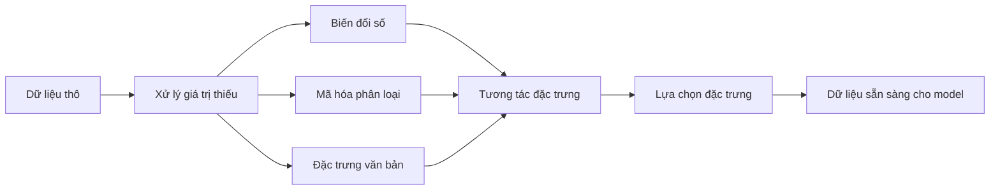

# Kỹ thuật Đặc trưng & Lựa chọn Đặc trưng

> Một đặc trưng tốt đáng giá bằng cả ngàn điểm dữ liệu.

**Type:** Build
**Languages:** Python
**Prerequisites:** Giai đoạn 1 (Thống kê cho Học máy, Đại số tuyến tính), Giai đoạn 2, Bài 01-07
**Time:** ~90 phút

## Mục tiêu học tập

- Triển khai các phép biến đổi số (chuẩn hóa z-score, co giãn thang đo min-max, biến đổi log, chia khoảng) và giải thích khi nào nên dùng mỗi phép
- Xây dựng mã hóa one-hot, mã hóa nhãn và mã hóa theo nhãn đích cho các đặc trưng phân loại, đồng thời nhận diện rủi ro rò rỉ dữ liệu trong mã hóa theo nhãn đích
- Tự xây dựng bộ vector hóa TF-IDF từ đầu và giải thích vì sao nó vượt trội hơn việc đếm từ thô trong phân loại văn bản
- Áp dụng lựa chọn đặc trưng theo phương pháp lọc (ngưỡng phương sai, tương quan, thông tin tương hỗ) để giảm số chiều

## Vấn đề

Bạn có một bộ dữ liệu. Bạn chọn một thuật toán. Bạn huấn luyện nó. Kết quả tầm thường. Bạn thử một thuật toán cầu kỳ hơn. Vẫn tầm thường. Bạn dành một tuần tinh chỉnh siêu tham số. Cải thiện không đáng kể.

Rồi có người biến đổi dữ liệu thô thành những đặc trưng tốt hơn, và một hồi quy logistic đơn giản đánh bại ensemble tăng cường gradient đã được tinh chỉnh của bạn.

Chuyện này xảy ra liên tục. Trong học máy cổ điển, cách biểu diễn dữ liệu quan trọng hơn việc chọn thuật toán. Một model giá nhà với "diện tích" và "số phòng ngủ" sẽ đánh bại một model với "địa chỉ dạng chuỗi thô", bất kể bộ học tinh vi đến đâu. Thuật toán chỉ có thể làm việc với những gì bạn đưa cho nó.

Feature engineering (kỹ thuật đặc trưng) là quá trình biến đổi dữ liệu thô thành những biểu diễn giúp model dễ tìm ra quy luật hơn. Feature selection (lựa chọn đặc trưng) là quá trình bỏ đi những đặc trưng chỉ thêm nhiễu mà không thêm tín hiệu. Gộp lại, đây là hoạt động có đòn bẩy cao nhất trong học máy cổ điển.

## Khái niệm

### Pipeline đặc trưng



### Đặc trưng số

Các con số thô hiếm khi sẵn sàng cho model. Những phép biến đổi phổ biến:

**Scaling:** Đưa các đặc trưng về cùng một khoảng để những thuật toán dựa trên khoảng cách (K-Means, KNN, SVM) đối xử với mọi đặc trưng như nhau. Co giãn min-max ánh xạ về [0, 1]. Chuẩn hóa (z-score) đưa về mean=0, std=1.

**Log transform:** Nén các phân phối lệch phải (thu nhập, dân số, số lượng từ). Biến quan hệ nhân thành quan hệ cộng.

**Binning:** Chuyển các giá trị liên tục thành các nhóm. Hữu ích khi quan hệ giữa đặc trưng và biến mục tiêu là phi tuyến nhưng theo bậc (ví dụ: các nhóm tuổi).

**Polynomial features:** Tạo ra các số hạng x^2, x^3, x1*x2. Cho phép model tuyến tính bắt được quan hệ phi tuyến, với cái giá là nhiều đặc trưng hơn.

### Đặc trưng phân loại

Model cần số. Các nhóm phân loại cần được mã hóa.

**One-hot encoding:** Tạo một cột nhị phân cho mỗi nhóm. "color = red/blue/green" trở thành ba cột: is_red, is_blue, is_green. Hoạt động tốt với đặc trưng ít nhóm nhưng bùng nổ khi có nhiều nhóm.

**Label encoding:** Ánh xạ mỗi nhóm thành một số nguyên: red=0, blue=1, green=2. Tạo ra thứ tự giả (model có thể nghĩ green > blue > red). Chỉ phù hợp với các model dựa trên cây, vốn tách theo từng giá trị riêng lẻ.

**Target encoding:** Thay mỗi nhóm bằng giá trị trung bình của biến mục tiêu trong nhóm đó. Mạnh nhưng nguy hiểm: rủi ro rò rỉ dữ liệu cao. Chỉ được tính trên dữ liệu huấn luyện và áp dụng cho dữ liệu kiểm tra.

### Đặc trưng văn bản

**Count vectorizer:** Đếm số lần mỗi từ xuất hiện trong một văn bản. "the cat sat on the mat" trở thành {the: 2, cat: 1, sat: 1, on: 1, mat: 1}.

**TF-IDF:** Term Frequency-Inverse Document Frequency. Cân trọng số các từ theo mức độ đặc trưng của chúng trên toàn bộ tập văn bản. Những từ phổ biến như "the" nhận trọng số thấp. Những từ hiếm, mang tính phân biệt nhận trọng số cao.

```
TF(word, doc) = count(word in doc) / total words in doc
IDF(word) = log(total docs / docs containing word)
TF-IDF = TF * IDF
```

### Giá trị thiếu

Dữ liệu thực luôn có lỗ hổng. Các chiến lược:

- **Drop rows:** Chỉ khi dữ liệu thiếu là hiếm và ngẫu nhiên
- **Mean/median imputation:** Đơn giản, giữ nguyên hình dạng phân phối (median bền vững hơn với ngoại lai)
- **Mode imputation:** Cho các đặc trưng phân loại
- **Indicator column:** Thêm một cột nhị phân "was_this_missing" trước khi điền. Việc dữ liệu bị thiếu tự nó có thể đã mang thông tin
- **Forward/backward fill:** Cho dữ liệu chuỗi thời gian

### Tương tác đặc trưng

Đôi khi quan hệ nằm ở sự kết hợp. "Height" và "weight" riêng lẻ kém khả năng dự báo hơn "BMI = weight / height^2". Tương tác đặc trưng nhân không gian đặc trưng lên, nên hãy dùng hiểu biết về miền để chọn đúng.

### Lựa chọn đặc trưng

Nhiều đặc trưng hơn không phải lúc nào cũng tốt hơn. Đặc trưng không liên quan thêm nhiễu, tăng thời gian huấn luyện và có thể gây quá khớp.

**Phương pháp lọc (trước model):**
- Correlation: loại bỏ những đặc trưng tương quan cao với nhau (dư thừa)
- Mutual information: đo mức độ giảm bất định về biến mục tiêu khi biết một đặc trưng
- Variance threshold: loại bỏ những đặc trưng gần như không biến thiên

**Phương pháp wrapper (dựa trên model):**
- Chuẩn hóa L1 (Lasso): đẩy trọng số của các đặc trưng không liên quan về đúng bằng không
- Loại bỏ đặc trưng đệ quy: huấn luyện, loại đặc trưng ít quan trọng nhất, lặp lại

**Vì sao lựa chọn quan trọng:** Một model với 10 đặc trưng tốt thường vượt trội một model có 10 đặc trưng tốt cộng thêm 90 đặc trưng nhiễu. Những đặc trưng nhiễu cho model cơ hội quá khớp trên các quy luật trong dữ liệu huấn luyện mà không khái quát hóa được.

```figure
feature-scaling
```

## Tự tay làm

### Bước 1: Các phép biến đổi số từ đầu

```python
import math


def min_max_scale(values):
    min_val = min(values)
    max_val = max(values)
    if max_val == min_val:
        return [0.0] * len(values)
    return [(v - min_val) / (max_val - min_val) for v in values]


def standardize(values):
    n = len(values)
    mean = sum(values) / n
    variance = sum((v - mean) ** 2 for v in values) / n
    std = math.sqrt(variance) if variance > 0 else 1.0
    return [(v - mean) / std for v in values]


def log_transform(values):
    return [math.log(v + 1) for v in values]


def bin_values(values, n_bins=5):
    min_val = min(values)
    max_val = max(values)
    bin_width = (max_val - min_val) / n_bins
    if bin_width == 0:
        return [0] * len(values)
    result = []
    for v in values:
        bin_idx = int((v - min_val) / bin_width)
        bin_idx = min(bin_idx, n_bins - 1)
        result.append(bin_idx)
    return result


def polynomial_features(row, degree=2):
    n = len(row)
    result = list(row)
    if degree >= 2:
        for i in range(n):
            result.append(row[i] ** 2)
        for i in range(n):
            for j in range(i + 1, n):
                result.append(row[i] * row[j])
    return result
```

### Bước 2: Mã hóa phân loại từ đầu

```python
def one_hot_encode(values):
    categories = sorted(set(values))
    cat_to_idx = {cat: i for i, cat in enumerate(categories)}
    n_cats = len(categories)

    encoded = []
    for v in values:
        row = [0] * n_cats
        row[cat_to_idx[v]] = 1
        encoded.append(row)

    return encoded, categories


def label_encode(values):
    categories = sorted(set(values))
    cat_to_int = {cat: i for i, cat in enumerate(categories)}
    return [cat_to_int[v] for v in values], cat_to_int


def target_encode(feature_values, target_values, smoothing=10):
    global_mean = sum(target_values) / len(target_values)

    category_stats = {}
    for feat, target in zip(feature_values, target_values):
        if feat not in category_stats:
            category_stats[feat] = {"sum": 0.0, "count": 0}
        category_stats[feat]["sum"] += target
        category_stats[feat]["count"] += 1

    encoding = {}
    for cat, stats in category_stats.items():
        cat_mean = stats["sum"] / stats["count"]
        weight = stats["count"] / (stats["count"] + smoothing)
        encoding[cat] = weight * cat_mean + (1 - weight) * global_mean

    return [encoding[v] for v in feature_values], encoding
```

### Bước 3: Đặc trưng văn bản từ đầu

```python
def count_vectorize(documents):
    vocab = {}
    idx = 0
    for doc in documents:
        for word in doc.lower().split():
            if word not in vocab:
                vocab[word] = idx
                idx += 1

    vectors = []
    for doc in documents:
        vec = [0] * len(vocab)
        for word in doc.lower().split():
            vec[vocab[word]] += 1
        vectors.append(vec)

    return vectors, vocab


def tfidf(documents):
    n_docs = len(documents)

    vocab = {}
    idx = 0
    for doc in documents:
        for word in doc.lower().split():
            if word not in vocab:
                vocab[word] = idx
                idx += 1

    doc_freq = {}
    for doc in documents:
        seen = set()
        for word in doc.lower().split():
            if word not in seen:
                doc_freq[word] = doc_freq.get(word, 0) + 1
                seen.add(word)

    vectors = []
    for doc in documents:
        words = doc.lower().split()
        word_count = len(words)
        tf_map = {}
        for word in words:
            tf_map[word] = tf_map.get(word, 0) + 1

        vec = [0.0] * len(vocab)
        for word, count in tf_map.items():
            tf = count / word_count
            idf = math.log(n_docs / doc_freq[word])
            vec[vocab[word]] = tf * idf
        vectors.append(vec)

    return vectors, vocab
```

### Bước 4: Điền giá trị thiếu từ đầu

```python
def impute_mean(values):
    present = [v for v in values if v is not None]
    if not present:
        return [0.0] * len(values), 0.0
    mean = sum(present) / len(present)
    return [v if v is not None else mean for v in values], mean


def impute_median(values):
    present = sorted(v for v in values if v is not None)
    if not present:
        return [0.0] * len(values), 0.0
    n = len(present)
    if n % 2 == 0:
        median = (present[n // 2 - 1] + present[n // 2]) / 2
    else:
        median = present[n // 2]
    return [v if v is not None else median for v in values], median


def impute_mode(values):
    present = [v for v in values if v is not None]
    if not present:
        return values, None
    counts = {}
    for v in present:
        counts[v] = counts.get(v, 0) + 1
    mode = max(counts, key=counts.get)
    return [v if v is not None else mode for v in values], mode


def add_missing_indicator(values):
    return [0 if v is not None else 1 for v in values]
```

### Bước 5: Lựa chọn đặc trưng tự viết

```python
def correlation(x, y):
    n = len(x)
    mean_x = sum(x) / n
    mean_y = sum(y) / n
    cov = sum((xi - mean_x) * (yi - mean_y) for xi, yi in zip(x, y)) / n
    std_x = math.sqrt(sum((xi - mean_x) ** 2 for xi in x) / n)
    std_y = math.sqrt(sum((yi - mean_y) ** 2 for yi in y) / n)
    if std_x == 0 or std_y == 0:
        return 0.0
    return cov / (std_x * std_y)


def mutual_information(feature, target, n_bins=10):
    feat_min = min(feature)
    feat_max = max(feature)
    bin_width = (feat_max - feat_min) / n_bins if feat_max != feat_min else 1.0
    feat_binned = [
        min(int((f - feat_min) / bin_width), n_bins - 1) for f in feature
    ]

    n = len(feature)
    target_classes = sorted(set(target))

    feat_bins = sorted(set(feat_binned))
    p_feat = {}
    for b in feat_bins:
        p_feat[b] = feat_binned.count(b) / n

    p_target = {}
    for t in target_classes:
        p_target[t] = target.count(t) / n

    mi = 0.0
    for b in feat_bins:
        for t in target_classes:
            joint_count = sum(
                1 for fb, tv in zip(feat_binned, target) if fb == b and tv == t
            )
            p_joint = joint_count / n
            if p_joint > 0:
                mi += p_joint * math.log(p_joint / (p_feat[b] * p_target[t]))

    return mi


def variance_threshold(features, threshold=0.01):
    n_features = len(features[0])
    n_samples = len(features)
    selected = []

    for j in range(n_features):
        col = [features[i][j] for i in range(n_samples)]
        mean = sum(col) / n_samples
        var = sum((v - mean) ** 2 for v in col) / n_samples
        if var >= threshold:
            selected.append(j)

    return selected


def remove_correlated(features, threshold=0.9):
    n_features = len(features[0])
    n_samples = len(features)

    to_remove = set()
    for i in range(n_features):
        if i in to_remove:
            continue
        col_i = [features[r][i] for r in range(n_samples)]
        for j in range(i + 1, n_features):
            if j in to_remove:
                continue
            col_j = [features[r][j] for r in range(n_samples)]
            corr = abs(correlation(col_i, col_j))
            if corr >= threshold:
                to_remove.add(j)

    return [i for i in range(n_features) if i not in to_remove]
```

### Bước 6: Toàn bộ quy trình xử lý và bản demo

```python
import random


def make_housing_data(n=200, seed=42):
    random.seed(seed)
    data = []
    for _ in range(n):
        sqft = random.uniform(500, 5000)
        bedrooms = random.choice([1, 2, 3, 4, 5])
        age = random.uniform(0, 50)
        neighborhood = random.choice(["downtown", "suburbs", "rural"])
        has_pool = random.choice([True, False])

        sqft_with_missing = sqft if random.random() > 0.05 else None
        age_with_missing = age if random.random() > 0.08 else None

        price = (
            50 * sqft
            + 20000 * bedrooms
            - 1000 * age
            + (50000 if neighborhood == "downtown" else 10000 if neighborhood == "suburbs" else 0)
            + (15000 if has_pool else 0)
            + random.gauss(0, 20000)
        )

        data.append({
            "sqft": sqft_with_missing,
            "bedrooms": bedrooms,
            "age": age_with_missing,
            "neighborhood": neighborhood,
            "has_pool": has_pool,
            "price": price,
        })
    return data


if __name__ == "__main__":
    data = make_housing_data(200)

    print("=== Raw Data Sample ===")
    for row in data[:3]:
        print(f"  {row}")

    sqft_raw = [d["sqft"] for d in data]
    age_raw = [d["age"] for d in data]
    prices = [d["price"] for d in data]

    print("\n=== Missing Value Handling ===")
    sqft_missing = sum(1 for v in sqft_raw if v is None)
    age_missing = sum(1 for v in age_raw if v is None)
    print(f"  sqft missing: {sqft_missing}/{len(sqft_raw)}")
    print(f"  age missing: {age_missing}/{len(age_raw)}")

    sqft_indicator = add_missing_indicator(sqft_raw)
    age_indicator = add_missing_indicator(age_raw)
    sqft_imputed, sqft_fill = impute_median(sqft_raw)
    age_imputed, age_fill = impute_mean(age_raw)
    print(f"  sqft filled with median: {sqft_fill:.0f}")
    print(f"  age filled with mean: {age_fill:.1f}")

    print("\n=== Numerical Transforms ===")
    sqft_scaled = standardize(sqft_imputed)
    age_scaled = min_max_scale(age_imputed)
    sqft_log = log_transform(sqft_imputed)
    age_binned = bin_values(age_imputed, n_bins=5)
    print(f"  sqft standardized: mean={sum(sqft_scaled)/len(sqft_scaled):.4f}, std={math.sqrt(sum(v**2 for v in sqft_scaled)/len(sqft_scaled)):.4f}")
    print(f"  age min-max: [{min(age_scaled):.2f}, {max(age_scaled):.2f}]")
    print(f"  age bins: {sorted(set(age_binned))}")

    print("\n=== Categorical Encoding ===")
    neighborhoods = [d["neighborhood"] for d in data]

    ohe, ohe_cats = one_hot_encode(neighborhoods)
    print(f"  One-hot categories: {ohe_cats}")
    print(f"  Sample encoding: {neighborhoods[0]} -> {ohe[0]}")

    le, le_map = label_encode(neighborhoods)
    print(f"  Label encoding map: {le_map}")

    te, te_map = target_encode(neighborhoods, prices, smoothing=10)
    print(f"  Target encoding: {({k: round(v) for k, v in te_map.items()})}")

    print("\n=== Text Features ===")
    descriptions = [
        "large modern house with pool",
        "small cozy cottage near downtown",
        "spacious family home with large yard",
        "modern apartment downtown with view",
        "rustic cabin in rural area",
    ]
    cv, cv_vocab = count_vectorize(descriptions)
    print(f"  Vocabulary size: {len(cv_vocab)}")
    print(f"  Doc 0 non-zero features: {sum(1 for v in cv[0] if v > 0)}")

    tf, tf_vocab = tfidf(descriptions)
    print(f"  TF-IDF vocabulary size: {len(tf_vocab)}")
    top_words = sorted(tf_vocab.keys(), key=lambda w: tf[0][tf_vocab[w]], reverse=True)[:3]
    print(f"  Doc 0 top TF-IDF words: {top_words}")

    print("\n=== Polynomial Features ===")
    sample_row = [sqft_scaled[0], age_scaled[0]]
    poly = polynomial_features(sample_row, degree=2)
    print(f"  Input: {[round(v, 4) for v in sample_row]}")
    print(f"  Polynomial: {[round(v, 4) for v in poly]}")
    print(f"  Features: [x1, x2, x1^2, x2^2, x1*x2]")

    print("\n=== Feature Selection ===")
    feature_matrix = [
        [sqft_scaled[i], age_scaled[i], float(sqft_indicator[i]), float(age_indicator[i])]
        + ohe[i]
        for i in range(len(data))
    ]

    print(f"  Total features: {len(feature_matrix[0])}")

    surviving_var = variance_threshold(feature_matrix, threshold=0.01)
    print(f"  After variance threshold (0.01): {len(surviving_var)} features kept")

    surviving_corr = remove_correlated(feature_matrix, threshold=0.9)
    print(f"  After correlation filter (0.9): {len(surviving_corr)} features kept")

    binary_prices = [1 if p > sum(prices) / len(prices) else 0 for p in prices]
    print("\n  Mutual information with target:")
    feature_names = ["sqft", "age", "sqft_missing", "age_missing"] + [f"neigh_{c}" for c in ohe_cats]
    for j in range(len(feature_matrix[0])):
        col = [feature_matrix[i][j] for i in range(len(feature_matrix))]
        mi = mutual_information(col, binary_prices, n_bins=10)
        print(f"    {feature_names[j]}: MI={mi:.4f}")

    print("\n  Correlation with price:")
    for j in range(len(feature_matrix[0])):
        col = [feature_matrix[i][j] for i in range(len(feature_matrix))]
        corr = correlation(col, prices)
        print(f"    {feature_names[j]}: r={corr:.4f}")
```

## Áp dụng

Với scikit-learn, những phép biến đổi này là các quy trình xử lý (pipeline) có thể ghép lại với nhau:

```python
from sklearn.preprocessing import StandardScaler, OneHotEncoder, PolynomialFeatures
from sklearn.impute import SimpleImputer
from sklearn.feature_extraction.text import TfidfVectorizer
from sklearn.feature_selection import mutual_info_classif, VarianceThreshold
from sklearn.compose import ColumnTransformer
from sklearn.pipeline import Pipeline

numeric_pipe = Pipeline([
    ("imputer", SimpleImputer(strategy="median")),
    ("scaler", StandardScaler()),
])

categorical_pipe = Pipeline([
    ("encoder", OneHotEncoder(sparse_output=False)),
])

preprocessor = ColumnTransformer([
    ("num", numeric_pipe, ["sqft", "age"]),
    ("cat", categorical_pipe, ["neighborhood"]),
])
```

Bản tự viết cho bạn thấy chính xác điều gì xảy ra bên trong mỗi phép biến đổi. Bản thư viện bổ sung cách xử lý các trường hợp biên, hỗ trợ ma trận thưa, và khả năng ghép nối quy trình xử lý, nhưng phần toán học vẫn y như vậy.

## Đóng gói

Bài học này tạo ra:
- `outputs/prompt-feature-engineer.md` - một prompt để xây dựng đặc trưng một cách có hệ thống từ dữ liệu thô

## Bài tập

1. Thêm phép co giãn bền vững (dùng trung vị và khoảng tứ phân vị thay cho trung bình và độ lệch chuẩn) vào phần biến đổi số. So sánh nó với co giãn chuẩn trên dữ liệu có ngoại lai cực đoan.
2. Cài đặt target encoding kiểu leave-one-out: với mỗi dòng, tính trung bình biến mục tiêu sau khi loại bỏ chính giá trị mục tiêu của dòng đó. Chứng minh cách này giảm overfitting so với target encoding ngây thơ.
3. Xây một quy trình xử lý lựa chọn đặc trưng tự động kết hợp ngưỡng phương sai, lọc tương quan, và xếp hạng theo thông tin tương hỗ. Áp dụng nó lên tập dữ liệu nhà ở và so sánh hiệu năng của model (dùng hồi quy tuyến tính đơn giản) khi dùng toàn bộ đặc trưng so với khi chỉ dùng các đặc trưng được chọn.

## Thuật ngữ chính

| Thuật ngữ | Người ta thường nói | Ý nghĩa thực sự |
|------|----------------|----------------------|
| Feature engineering | "Tạo thêm cột mới" | Biến dữ liệu thô thành những biểu diễn làm lộ ra các mẫu cho model |
| Standardization | "Làm cho nó bình thường" | Trừ đi giá trị trung bình và chia cho độ lệch chuẩn để đặc trưng có mean=0 và std=1 |
| One-hot encoding | "Tạo biến giả" | Tạo một cột nhị phân cho mỗi hạng mục, trong đó đúng một cột bằng 1 ở mỗi dòng |
| Target encoding | "Dùng đáp án để mã hoá" | Thay mỗi hạng mục bằng giá trị trung bình của biến mục tiêu cho hạng mục đó, có làm trơn để tránh overfitting |
| TF-IDF | "Đếm từ kiểu xịn" | Term Frequency nhân Inverse Document Frequency: từ được đánh trọng số theo mức độ đặc trưng của nó trên toàn kho văn bản |
| Imputation | "Điền vào chỗ trống" | Thay giá trị thiếu bằng giá trị ước lượng (trung bình, trung vị, mode, hoặc do model dự đoán) |
| Feature selection | "Vứt bỏ những cột tệ" | Loại bỏ những đặc trưng chỉ thêm nhiễu hoặc dư thừa, chỉ giữ lại những đặc trưng có tín hiệu về biến mục tiêu |
| Mutual information | "Một thứ cho bạn biết bao nhiêu về thứ khác" | Thước đo mức giảm bất định về biến Y khi quan sát biến X — tức thông tin tương hỗ |
| Data leakage | "Vô tình gian lận" | Dùng thông tin trong lúc huấn luyện mà khi dự đoán sẽ không có, khiến kết quả lạc quan một cách giả tạo |

## Đọc thêm

- [Feature Engineering and Selection (Max Kuhn & Kjell Johnson)](http://www.feat.engineering/) - sách miễn phí trực tuyến bao quát toàn cảnh về xây dựng đặc trưng
- [scikit-learn Preprocessing Guide](https://scikit-learn.org/stable/modules/preprocessing.html) - tài liệu tham khảo thực hành cho mọi phép biến đổi chuẩn
- [Target Encoding Done Right (Micci-Barreca, 2001)](https://dl.acm.org/doi/10.1145/507533.507538) - bài báo gốc về target encoding có làm trơn

---

[← Bài trước: Học không giám sát](../../07-unsupervised-learning/docs/vi.md) · [Bài sau: Đánh giá mô hình →](../../09-model-evaluation/docs/vi.md)
