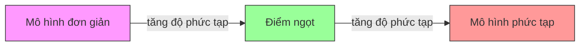
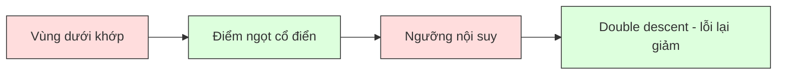
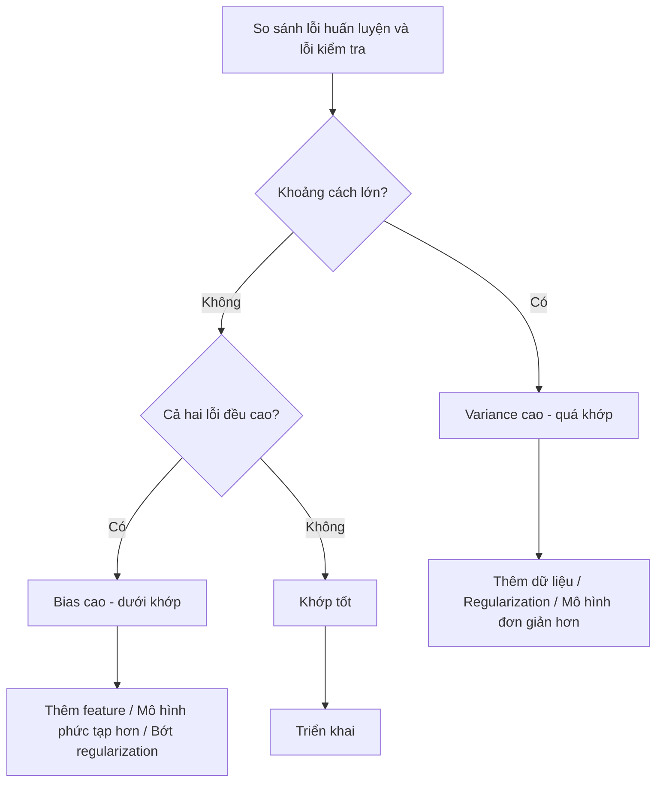
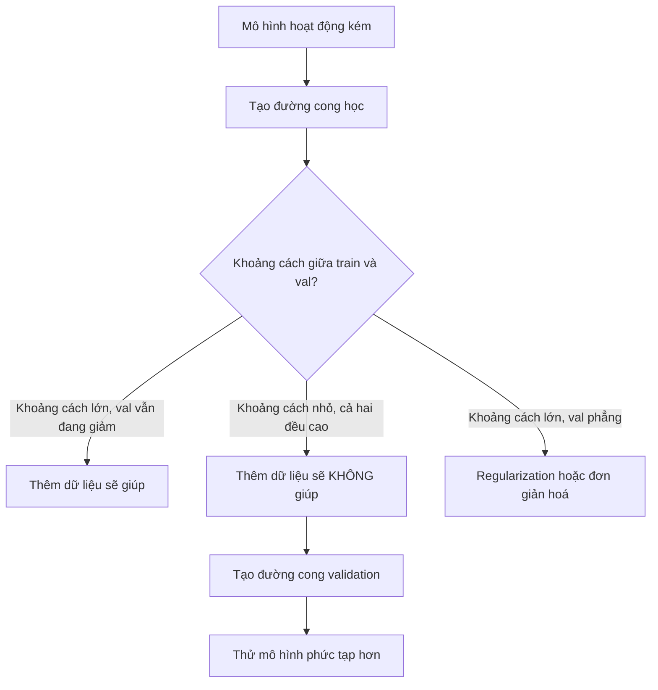

# Đánh đổi Bias-Variance

> Mọi lỗi của mô hình đều đến từ một trong ba nguồn: bias (độ lệch), variance (phương sai), hoặc nhiễu. Bạn chỉ có thể kiểm soát hai nguồn đầu tiên.

**Type:** Learn
**Language:** Python
**Prerequisites:** Giai đoạn 2, Bài 01-09 (kiến thức ML cơ bản, hồi quy, phân loại, đánh giá)
**Time:** ~75 phút

## Mục tiêu học tập

- Chứng minh phân rã bias-variance của lỗi dự đoán kỳ vọng và giải thích vai trò của nhiễu không thể giảm
- Chẩn đoán xem một mô hình đang chịu bias cao hay variance cao, dựa trên pattern lỗi huấn luyện và lỗi kiểm tra
- Giải thích cách các kỹ thuật regularization (L1, L2, dropout, early stopping) đánh đổi bias lấy variance
- Triển khai thí nghiệm trực quan hoá bias-variance tradeoff trên các mô hình có độ phức tạp tăng dần

## Vấn đề

Bạn đã huấn luyện một mô hình. Nó có một lượng lỗi nhất định trên dữ liệu kiểm tra. Lỗi đó đến từ đâu?

Nếu mô hình của bạn quá đơn giản (hồi quy tuyến tính trên một tập dữ liệu cong), nó sẽ liên tục bỏ lỡ quy luật thật. Đó là bias. Nếu mô hình của bạn quá phức tạp (đa thức bậc 20 trên 15 điểm dữ liệu), nó sẽ khớp hoàn hảo dữ liệu huấn luyện nhưng cho ra những dự đoán khác nhau một cách dữ dội trên dữ liệu mới. Đó là variance.

Với một năng lực mô hình cố định, bạn không thể tối thiểu hoá cả hai cùng lúc. Kéo bias xuống thì variance tăng lên. Kéo variance xuống thì bias tăng lên. Hiểu bias-variance tradeoff (đánh đổi bias-variance) này là kỹ năng chẩn đoán hữu ích nhất trong machine learning. Nó cho bạn biết nên làm mô hình phức tạp hơn hay đơn giản hơn, nên lấy thêm dữ liệu hay tạo feature tốt hơn, nên regularization nhiều hơn hay ít hơn.

## Khái niệm

### Bias: lỗi hệ thống

Bias đo mức dự đoán trung bình của mô hình lệch bao xa so với giá trị thật. Nếu bạn huấn luyện cùng một mô hình trên nhiều tập huấn luyện khác nhau lấy từ cùng một phân phối rồi lấy trung bình các dự đoán, bias chính là khoảng cách giữa trung bình đó và sự thật.

Bias cao nghĩa là mô hình quá cứng nhắc để nắm bắt quy luật thật. Một đường thẳng khớp vào một parabol sẽ luôn bỏ lỡ đường cong, bất kể bạn đưa cho nó bao nhiêu dữ liệu. Đây là underfitting (dưới khớp).

```
High bias (underfitting):
  Model always predicts roughly the same wrong thing.
  Training error: HIGH
  Test error: HIGH
  Gap between them: SMALL
```

### Variance: độ nhạy với dữ liệu huấn luyện

Variance đo mức dự đoán của bạn thay đổi bao nhiêu khi bạn huấn luyện trên những tập con dữ liệu khác nhau. Nếu thay đổi nhỏ trong tập huấn luyện gây ra thay đổi lớn trong mô hình, variance là cao.

Variance cao nghĩa là mô hình đang khớp nhiễu trong dữ liệu huấn luyện chứ không phải tín hiệu nền. Một đa thức bậc 20 sẽ luồn qua từng điểm huấn luyện nhưng dao động dữ dội ở giữa chúng. Đây là overfitting (quá khớp).

```
High variance (overfitting):
  Model fits training data perfectly but fails on new data.
  Training error: LOW
  Test error: HIGH
  Gap between them: LARGE
```

### Phân rã

Với mọi điểm x, lỗi dự đoán kỳ vọng theo loss bình phương phân rã chính xác thành:

```
Expected Error = Bias^2 + Variance + Irreducible Noise

where:
  Bias^2   = (E[f_hat(x)] - f(x))^2
  Variance = E[(f_hat(x) - E[f_hat(x)])^2]
  Noise    = E[(y - f(x))^2]             (sigma^2)
```

- `f(x)` là hàm thật
- `f_hat(x)` là dự đoán của mô hình bạn
- `E[...]` là kỳ vọng trên các tập huấn luyện khác nhau
- `y` là nhãn quan sát được (hàm thật cộng nhiễu)

Số hạng nhiễu là không thể giảm. Không mô hình nào làm tốt hơn sigma^2 trên dữ liệu có nhiễu. Việc của bạn là tìm cân bằng đúng giữa bias^2 và variance.

### Độ phức tạp mô hình so với lỗi



Đường cong chữ U kinh điển:

| Độ phức tạp | Bias | Variance | Tổng lỗi |
|-----------|------|----------|-------------|
| Quá thấp | HIGH | LOW | HIGH (dưới khớp) |
| Vừa đúng | MODERATE | MODERATE | LOWEST |
| Quá cao | LOW | HIGH | HIGH (quá khớp) |

### Regularization như công cụ kiểm soát bias-variance

Regularization cố ý tăng bias để giảm variance. Nó ràng buộc mô hình để mô hình không thể đuổi theo nhiễu.

- **L2 (Ridge):** Co mọi trọng số về phía 0. Giữ tất cả feature nhưng giảm ảnh hưởng của chúng.
- **L1 (Lasso):** Ép một số trọng số về đúng 0. Thực hiện chọn feature.
- **Dropout:** Tắt ngẫu nhiên các neuron trong lúc huấn luyện. Buộc mô hình phải có biểu diễn dư thừa.
- **Early stopping:** Dừng huấn luyện trước khi mô hình khớp hoàn toàn dữ liệu huấn luyện.

Cường độ regularization (lambda, dropout rate, số epoch) kiểm soát trực tiếp bạn đang đứng ở đâu trên đường cong bias-variance. Regularization nhiều hơn nghĩa là bias nhiều hơn, variance ít hơn.

### Double descent: góc nhìn hiện đại

Lý thuyết cổ điển nói: sau điểm ngọt, càng phức tạp thì càng tệ. Nhưng nghiên cứu từ năm 2019 đã chỉ ra một điều bất ngờ. Nếu bạn tiếp tục tăng năng lực mô hình vượt xa ngưỡng nội suy (ngưỡng mà mô hình có đủ tham số để khớp hoàn hảo dữ liệu huấn luyện), lỗi kiểm tra có thể lại giảm.



Hiện tượng "double descent" này giải thích vì sao những mạng nơ-ron cực kỳ tham số hoá (nhiều tham số hơn hẳn số mẫu huấn luyện) vẫn tổng quát hoá tốt. Bias-variance tradeoff cổ điển không sai, nhưng nó chưa đầy đủ cho chế độ hiện đại.

Những quan sát chính về double descent:
- Nó xảy ra ở mô hình tuyến tính, cây quyết định, và mạng nơ-ron
- Nhiều dữ liệu hơn thực ra có thể làm hại trong vùng nội suy (double descent theo mẫu)
- Nhiều epoch huấn luyện hơn cũng gây ra nó (double descent theo epoch)
- Regularization làm mượt đỉnh nhưng không xoá bỏ nó

Vì sao điều này xảy ra? Tại ngưỡng nội suy, mô hình vừa đủ năng lực để khớp mọi điểm huấn luyện. Nó bị buộc vào một nghiệm rất cụ thể luồn qua từng điểm, và những nhiễu động nhỏ trong dữ liệu gây ra thay đổi lớn trong đường khớp. Đây là nơi variance đạt đỉnh. Vượt qua ngưỡng, mô hình có nhiều nghiệm khả dĩ khớp hoàn hảo dữ liệu. Thuật toán học (ví dụ gradient descent với regularization ngầm) có xu hướng chọn nghiệm đơn giản nhất trong số đó. Thiên lệch ngầm về phía nghiệm đơn giản này là lý do các mô hình tham số hoá quá mức vẫn tổng quát hoá được.

| Chế độ | Tham số so với số mẫu | Hành vi |
|--------|----------------------|----------|
| Ít tham số hơn mẫu | p << n | Đánh đổi cổ điển áp dụng |
| Ngưỡng nội suy | p ~ n | Variance đạt đỉnh, lỗi kiểm tra tăng vọt |
| Nhiều tham số hơn mẫu | p >> n | Regularization ngầm phát huy, lỗi kiểm tra giảm |

Về mặt thực tế: nếu bạn dùng mạng nơ-ron hoặc ensemble cây lớn, đừng dừng lại đúng ở ngưỡng nội suy. Hoặc ở thấp hơn hẳn (với regularization tường minh) hoặc vượt qua hẳn. Nơi tệ nhất để đứng chính là ngay tại ngưỡng.

### Chẩn đoán mô hình của bạn



| Triệu chứng | Chẩn đoán | Cách xử lý |
|---------|-----------|-----|
| Lỗi huấn luyện cao, lỗi kiểm tra cao | Bias | Thêm feature, mô hình phức tạp hơn, bớt regularization |
| Lỗi huấn luyện thấp, lỗi kiểm tra cao | Variance | Thêm dữ liệu, regularization, mô hình đơn giản hơn, dropout |
| Lỗi huấn luyện thấp, lỗi kiểm tra thấp | Khớp tốt | Đưa vào sử dụng |
| Lỗi huấn luyện giảm, lỗi kiểm tra tăng | Đang quá khớp | Early stopping |

### Chiến lược thực tế

**Khi bias là vấn đề:**
- Thêm feature đa thức hoặc feature tương tác
- Dùng mô hình linh hoạt hơn (ensemble cây thay cho tuyến tính)
- Giảm cường độ regularization
- Huấn luyện lâu hơn (nếu chưa hội tụ)

**Khi variance là vấn đề:**
- Lấy thêm dữ liệu huấn luyện
- Dùng bagging (rừng ngẫu nhiên)
- Tăng regularization (lambda cao hơn, dropout nhiều hơn)
- Chọn feature (loại bỏ feature nhiễu)
- Dùng cross-validation để phát hiện sớm

### Phương pháp ensemble và giảm variance

Các phương pháp ensemble (tập hợp mô hình) là công cụ thực tế nhất để chống variance.

**Bagging (Bootstrap Aggregating)** huấn luyện nhiều mô hình trên những mẫu bootstrap khác nhau của dữ liệu huấn luyện, rồi lấy trung bình dự đoán của chúng. Từng mô hình riêng lẻ có variance cao, nhưng trung bình thì variance thấp hơn nhiều. Rừng ngẫu nhiên chính là bagging áp dụng lên cây quyết định.

Vì sao nó hiệu quả về mặt toán học: nếu bạn lấy trung bình N dự đoán độc lập, mỗi cái có variance sigma^2, variance của trung bình là sigma^2 / N. Các mô hình không thực sự độc lập (chúng đều thấy dữ liệu tương tự nhau), nên mức giảm nhỏ hơn 1/N, nhưng vẫn đáng kể.

**Boosting** giảm bias bằng cách xây dựng mô hình tuần tự, trong đó mỗi mô hình mới tập trung vào lỗi của ensemble tính đến thời điểm đó. Gradient boosting và AdaBoost là hai ví dụ chính. Boosting có thể quá khớp nếu bạn thêm quá nhiều mô hình, nên bạn cần early stopping hoặc regularization.

| Phương pháp | Tác dụng chính | Thay đổi bias | Thay đổi variance |
|--------|---------------|-------------|-----------------|
| Bagging | Giảm variance | Không đổi | Giảm |
| Boosting | Giảm bias | Giảm | Có thể tăng |
| Stacking | Giảm cả hai | Phụ thuộc meta-learner | Phụ thuộc mô hình nền |
| Dropout | Bagging ngầm | Tăng nhẹ | Giảm |

**Quy tắc thực tế:** nếu mô hình nền của bạn có variance cao (cây sâu, đa thức bậc cao), dùng bagging. Nếu mô hình nền của bạn có bias cao (stump nông, mô hình tuyến tính đơn giản), dùng boosting.

### Đường cong học

Learning curve (đường cong học) vẽ lỗi huấn luyện và lỗi validation như một hàm của kích thước tập huấn luyện. Đây là công cụ chẩn đoán thực tế nhất mà bạn có. Khác với việc so sánh một lần train/test, đường cong học cho bạn thấy quỹ đạo của mô hình và cho biết thêm dữ liệu có giúp ích hay không.


Cách đọc chúng:

| Tình huống | Lỗi huấn luyện | Lỗi validation | Khoảng cách | Ý nghĩa | Việc cần làm |
|----------|---------------|-----------------|-----|---------------|------------|
| Bias cao | Cao | Cao | Nhỏ | Mô hình không nắm được quy luật | Thêm feature, mô hình phức tạp hơn, bớt regularization |
| Variance cao | Thấp | Cao | Lớn | Mô hình học thuộc dữ liệu huấn luyện | Thêm dữ liệu, regularization, mô hình đơn giản hơn |
| Khớp tốt | Vừa | Vừa | Nhỏ | Mô hình tổng quát hoá tốt | Đưa vào sử dụng |
| Variance cao, đang cải thiện | Thấp | Giảm khi thêm dữ liệu | Thu hẹp | Vấn đề variance mà dữ liệu có thể chữa | Thu thập thêm dữ liệu |
| Bias cao, phẳng | Cao | Cao và phẳng | Nhỏ và phẳng | Thêm dữ liệu sẽ KHÔNG giúp | Đổi kiến trúc mô hình |

Điểm mấu chốt: nếu cả hai đường đã phẳng và khoảng cách nhỏ nhưng cả hai lỗi đều cao, thêm dữ liệu là vô ích. Bạn cần mô hình tốt hơn. Nếu khoảng cách lớn và vẫn đang thu hẹp, thêm dữ liệu sẽ giúp.

### Cách tạo đường cong học

Có hai cách tiếp cận:

**Cách 1: Thay đổi kích thước tập huấn luyện, giữ nguyên mô hình.** Giữ mô hình và siêu tham số cố định. Huấn luyện trên những tập con ngày càng lớn của dữ liệu huấn luyện. Đo lỗi huấn luyện và lỗi validation tại mỗi kích thước. Đây là đường cong học chuẩn.

**Cách 2: Thay đổi độ phức tạp mô hình, giữ nguyên dữ liệu.** Giữ dữ liệu cố định. Quét một tham số độ phức tạp (bậc đa thức, độ sâu cây, số lớp). Đo lỗi huấn luyện và lỗi validation tại mỗi mức độ phức tạp. Đây là validation curve (đường cong validation) và nó cho thấy bias-variance tradeoff một cách trực tiếp.

Hai cách bổ sung cho nhau. Cách thứ nhất cho biết thêm dữ liệu có giúp hay không. Cách thứ hai cho biết một mô hình khác có giúp hay không. Hãy chạy cả hai trước khi quyết định bước tiếp theo.



```figure
bias-variance
```

## Tự tay làm

Đoạn code trong `code/bias_variance.py` chạy toàn bộ thí nghiệm phân rã bias-variance. Đây là cách tiếp cận, từng bước một.

### Bước 1: Sinh dữ liệu tổng hợp từ một hàm đã biết

Chúng ta dùng `f(x) = sin(1.5x) + 0.5x` với nhiễu Gauss. Biết hàm thật cho phép tính chính xác bias và variance.

```python
def true_function(x):
    return np.sin(1.5 * x) + 0.5 * x

def generate_data(n_samples=30, noise_std=0.5, x_range=(-3, 3), seed=None):
    rng = np.random.RandomState(seed)
    x = rng.uniform(x_range[0], x_range[1], n_samples)
    y = true_function(x) + rng.normal(0, noise_std, n_samples)
    return x, y
```

### Bước 2: Lấy mẫu bootstrap và khớp đa thức

Với mỗi bậc đa thức, chúng ta rút nhiều tập huấn luyện bootstrap, khớp đa thức, và ghi lại dự đoán trên một lưới kiểm tra cố định. Việc này cho ta phân phối các dự đoán tại mỗi điểm kiểm tra.

```python
def fit_polynomial(x_train, y_train, degree, lam=0.0):
    X = np.column_stack([x_train ** d for d in range(degree + 1)])
    if lam > 0:
        penalty = lam * np.eye(X.shape[1])
        penalty[0, 0] = 0
        w = np.linalg.solve(X.T @ X + penalty, X.T @ y_train)
    else:
        w = np.linalg.lstsq(X, y_train, rcond=None)[0]
    return w
```

Chúng ta khớp trên 200 mẫu bootstrap khác nhau. Mỗi mẫu bootstrap được rút từ cùng phân phối nền nhưng chứa các điểm khác nhau.

### Bước 3: Tính phân rã Bias^2, Variance

Với 200 bộ dự đoán tại mỗi điểm kiểm tra, chúng ta có thể tính phân rã trực tiếp từ định nghĩa:

```python
mean_pred = predictions.mean(axis=0)
bias_sq = np.mean((mean_pred - y_true) ** 2)
variance = np.mean(predictions.var(axis=0))
total_error = np.mean(np.mean((predictions - y_true) ** 2, axis=1))
```

- `mean_pred` là E[f_hat(x)] ước lượng từ các mẫu bootstrap
- `bias_sq` là bình phương khoảng cách giữa dự đoán trung bình và sự thật
- `variance` là độ phân tán trung bình của các dự đoán qua các mẫu bootstrap
- `total_error` phải xấp xỉ bằng bias^2 + variance + nhiễu

### Bước 4: Đường cong học

Đường cong học quét kích thước tập huấn luyện trong khi giữ độ phức tạp mô hình cố định. Chúng cho biết mô hình của bạn bị giới hạn bởi dữ liệu hay bởi năng lực.

```python
def demo_learning_curves():
    sizes = [10, 15, 20, 30, 50, 75, 100, 150, 200, 300]
    degree = 5

    for n in sizes:
        train_errors = []
        test_errors = []
        for seed in range(50):
            x_train, y_train = generate_data(n_samples=n, seed=seed * 100)
            w = fit_polynomial(x_train, y_train, degree)
            train_pred = predict_polynomial(x_train, w)
            train_mse = np.mean((train_pred - y_train) ** 2)
            test_pred = predict_polynomial(x_test, w)
            test_mse = np.mean((test_pred - y_test) ** 2)
            train_errors.append(train_mse)
            test_errors.append(test_mse)
        # Average over runs gives the learning curve point
```

Với một mô hình variance cao (bậc 5 với ít dữ liệu), bạn thấy:
- Lỗi huấn luyện khởi đầu thấp và tăng lên khi nhiều dữ liệu hơn khiến việc học thuộc trở nên khó hơn
- Lỗi kiểm tra khởi đầu cao và giảm xuống khi mô hình nhận được nhiều tín hiệu hơn
- Khoảng cách thu hẹp khi có thêm dữ liệu

Với một mô hình bias cao (bậc 1), cả hai lỗi hội tụ nhanh về cùng một giá trị cao và thêm dữ liệu không giúp gì.

### Bước 5: Quét regularization

Đoạn code cũng bao gồm `demo_regularization_sweep()`, hàm này cố định một đa thức bậc cao (bậc 15) và quét cường độ regularization Ridge từ 0.001 đến 100. Việc này cho thấy bias-variance tradeoff từ một góc khác: thay vì thay đổi độ phức tạp mô hình, chúng ta thay đổi cường độ ràng buộc.

```python
def demo_regularization_sweep():
    alphas = [0.001, 0.005, 0.01, 0.05, 0.1, 0.5, 1.0, 5.0, 10.0, 50.0, 100.0]
    for alpha in alphas:
        results = bias_variance_decomposition([15], lam=alpha)
        r = results[15]
        print(f"alpha={alpha:.3f}  bias={r['bias_sq']:.4f}  var={r['variance']:.4f}")
```

Ở alpha thấp, đa thức bậc 15 gần như không bị ràng buộc. Variance chiếm ưu thế vì mô hình đuổi theo nhiễu trong từng mẫu bootstrap. Ở alpha cao, hình phạt mạnh đến mức mô hình thực chất trở thành một hàm gần như hằng số. Bias chiếm ưu thế. Alpha tối ưu nằm giữa hai cực này.

Đây chính là đường cong chữ U khi thay đổi bậc đa thức, nhưng được điều khiển bằng một núm liên tục thay vì một núm rời rạc. Trên thực tế, regularization là cách được ưu tiên để kiểm soát đánh đổi này vì nó cho phép điều chỉnh mịn mà không cần đổi tập feature.

## Áp dụng

sklearn cung cấp `learning_curve` và `validation_curve` để tự động hoá các chẩn đoán này mà không phải viết vòng lặp bootstrap.

### Đường cong validation: quét độ phức tạp mô hình

```python
from sklearn.model_selection import validation_curve
from sklearn.pipeline import make_pipeline
from sklearn.preprocessing import PolynomialFeatures
from sklearn.linear_model import Ridge

degrees = list(range(1, 16))
train_scores_all = []
val_scores_all = []

for d in degrees:
    pipe = make_pipeline(PolynomialFeatures(d), Ridge(alpha=0.01))
    train_scores, val_scores = validation_curve(
        pipe, X, y, param_name="polynomialfeatures__degree",
        param_range=[d], cv=5, scoring="neg_mean_squared_error"
    )
    train_scores_all.append(-train_scores.mean())
    val_scores_all.append(-val_scores.mean())
```

Việc này cho bạn trực tiếp đường cong bias-variance tradeoff. Nơi điểm validation tệ nhất so với điểm train, variance chiếm ưu thế. Nơi cả hai đều tệ, bias chiếm ưu thế.

### Đường cong học: quét kích thước tập huấn luyện

```python
from sklearn.model_selection import learning_curve

pipe = make_pipeline(PolynomialFeatures(5), Ridge(alpha=0.01))
train_sizes, train_scores, val_scores = learning_curve(
    pipe, X, y, train_sizes=np.linspace(0.1, 1.0, 10),
    cv=5, scoring="neg_mean_squared_error"
)
train_mse = -train_scores.mean(axis=1)
val_mse = -val_scores.mean(axis=1)
```

Vẽ `train_mse` và `val_mse` theo `train_sizes`. Hình dạng sẽ cho bạn biết mọi thứ về mô hình của bạn.

### Cross-validation với quét regularization

```python
from sklearn.model_selection import cross_val_score

alphas = [0.001, 0.01, 0.1, 1.0, 10.0, 100.0]
for alpha in alphas:
    pipe = make_pipeline(PolynomialFeatures(10), Ridge(alpha=alpha))
    scores = cross_val_score(pipe, X, y, cv=5, scoring="neg_mean_squared_error")
    print(f"alpha={alpha:>7.3f}  MSE={-scores.mean():.4f} +/- {scores.std():.4f}")
```

Việc này quét cường độ regularization cho một độ phức tạp mô hình cố định. Bạn sẽ thấy cùng một bias-variance tradeoff: alpha thấp nghĩa là variance cao, alpha cao nghĩa là bias cao.

### Ghép lại: quy trình chẩn đoán hoàn chỉnh

Trên thực tế, bạn chạy các chẩn đoán này theo trình tự:

1. Huấn luyện mô hình. Tính lỗi train và lỗi test.
2. Nếu cả hai đều cao: bạn có vấn đề bias. Nhảy tới bước 4.
3. Nếu train thấp nhưng test cao: bạn có vấn đề variance. Tạo đường cong học để xem thêm dữ liệu có giúp không. Nếu không, hãy regularization.
4. Tạo đường cong validation bằng cách quét tham số độ phức tạp chính của bạn. Tìm điểm ngọt.
5. Tại điểm ngọt, tạo đường cong học. Nếu khoảng cách vẫn lớn, bạn cần thêm dữ liệu hoặc regularization.
6. Thử Ridge/Lasso với các giá trị alpha khác nhau dùng `cross_val_score`. Chọn alpha có lỗi cross-validated thấp nhất.

Việc này tốn 10-15 phút tính toán cho hầu hết tập dữ liệu dạng bảng và tiết kiệm hàng giờ đoán mò.

## Đóng gói

Bài học này tạo ra: `outputs/prompt-model-diagnostics.md`

## Bài tập

1. Chạy phân rã với `noise_std=0` (không nhiễu). Số hạng lỗi không thể giảm thay đổi thế nào? Độ phức tạp tối ưu có thay đổi không?

2. Tăng kích thước tập huấn luyện từ 30 lên 300. Điều này ảnh hưởng thế nào đến thành phần variance? Bậc đa thức tối ưu có dịch chuyển không?

3. Thêm regularization L2 (hồi quy Ridge) vào thí nghiệm. Với một đa thức bậc cao cố định (bậc 15), quét lambda từ 0 đến 100. Vẽ bias^2 và variance như hàm của lambda.

4. Đổi hàm thật từ đa thức sang `sin(x)`. Phân rã bias-variance thay đổi thế nào? Có còn một bậc tối ưu rõ ràng không?

5. Triển khai một wrapper bootstrap aggregating (bagging) đơn giản: huấn luyện 10 mô hình trên các mẫu bootstrap rồi lấy trung bình dự đoán. Chứng minh rằng việc này giảm variance mà không tăng bias nhiều.

## Thuật ngữ chính

| Thuật ngữ | Người ta thường nói | Ý nghĩa thực sự |
|------|----------------|----------------------|
| Bias | "Mô hình quá đơn giản" | Lỗi hệ thống do giả định sai. Khoảng cách giữa dự đoán trung bình của mô hình và sự thật. |
| Variance | "Mô hình đang quá khớp" | Lỗi do độ nhạy với dữ liệu huấn luyện. Mức dự đoán thay đổi bao nhiêu qua các tập huấn luyện khác nhau. |
| Irreducible error | "Nhiễu trong dữ liệu" | Lỗi do tính ngẫu nhiên trong quá trình sinh dữ liệu thật. Không mô hình nào loại bỏ được. |
| Underfitting | "Học không đủ" | Mô hình có bias cao. Nó bỏ lỡ quy luật thật ngay cả trên dữ liệu huấn luyện. |
| Overfitting | "Học thuộc dữ liệu" | Mô hình có variance cao. Nó khớp nhiễu trong dữ liệu huấn luyện, thứ không tổng quát hoá được. |
| Regularization | "Ràng buộc mô hình" | Thêm một hình phạt để giảm độ phức tạp mô hình, đánh đổi bias lấy variance thấp hơn. |
| Double descent | "Nhiều tham số hơn có thể giúp" | Lỗi kiểm tra lại giảm khi năng lực mô hình vượt xa ngưỡng nội suy. |
| Model complexity | "Mô hình linh hoạt đến đâu" | Năng lực của mô hình trong việc khớp các quy luật tuỳ ý. Được kiểm soát bởi kiến trúc, feature, hoặc regularization. |

## Đọc thêm

- [Hastie, Tibshirani, Friedman: Elements of Statistical Learning, Ch. 7](https://hastie.su.domains/ElemStatLearn/) -- the definitive treatment of bias-variance decomposition
- [Belkin et al., Reconciling modern machine learning practice and the bias-variance trade-off (2019)](https://arxiv.org/abs/1812.11118) -- the double descent paper
- [Nakkiran et al., Deep Double Descent (2019)](https://arxiv.org/abs/1912.02292) -- epoch-wise and sample-wise double descent
- [Scott Fortmann-Roe: Understanding the Bias-Variance Tradeoff](http://scott.fortmann-roe.com/docs/BiasVariance.html) -- clear visual explanation

---

[← Bài trước: Đánh giá mô hình](../../09-model-evaluation/docs/vi.md) · [Bài sau: Phương pháp Ensemble (tập hợp mô hình) →](../../11-ensemble-methods/docs/vi.md)
