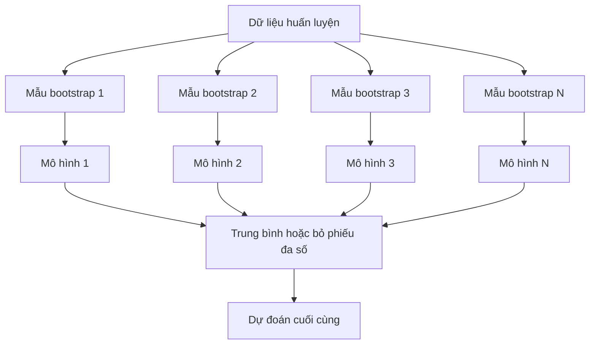
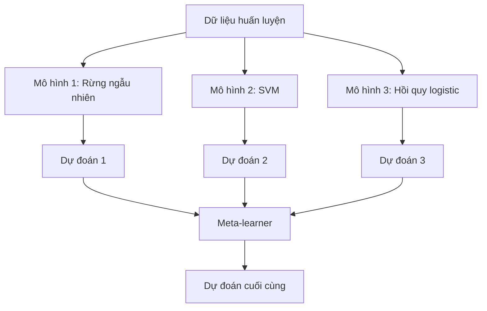

# Phương pháp Ensemble (tập hợp mô hình)

> Một nhóm các bộ học yếu (weak learner), nếu kết hợp đúng cách, sẽ trở thành một bộ học mạnh. Đây không phải là ẩn dụ. Đây là một định lý.

**Type:** Build
**Language:** Python
**Prerequisites:** Giai đoạn 2, Bài 10 (Đánh đổi Bias-Variance)
**Time:** ~120 phút

## Mục tiêu học tập

- Tự viết AdaBoost và gradient boosting từ đầu, rồi giải thích cách boosting giảm bias một cách tuần tự
- Xây dựng một tập hợp mô hình bagging và chứng minh rằng lấy trung bình các mô hình ít tương quan sẽ giảm variance mà không tăng bias
- So sánh bagging, boosting và stacking theo khía cạnh: mỗi phương pháp nhắm vào thành phần lỗi nào
- Đánh giá tính đa dạng của tập hợp mô hình và giải thích vì sao độ chính xác của bỏ phiếu đa số tăng lên khi có nhiều bộ học yếu độc lập hơn

## Vấn đề

Một cây quyết định đơn lẻ huấn luyện nhanh và dễ diễn giải, nhưng nó bị overfitting. Một mô hình tuyến tính đơn lẻ thì underfitting trên các ranh giới phức tạp. Bạn có thể mất hàng ngày để thiết kế kiến trúc mô hình hoàn hảo. Hoặc bạn có thể kết hợp một loạt mô hình chưa hoàn hảo và nhận được thứ tốt hơn bất kỳ mô hình nào trong số đó.

Các phương pháp ensemble làm chính xác điều này. Chúng là kỹ thuật đáng tin cậy nhất để thắng các cuộc thi Kaggle trên dữ liệu dạng bảng, chúng vận hành phần lớn hệ thống ML trong production, và chúng minh họa đánh đổi bias-variance trong thực tế. Bagging giảm variance. Boosting giảm bias. Stacking học xem nên tin mô hình nào trên những đầu vào nào.

## Khái niệm

### Vì sao ensemble hoạt động

Giả sử bạn có N bộ phân loại độc lập, mỗi bộ có độ chính xác p > 0.5. Bỏ phiếu đa số sẽ có độ chính xác:

```
P(majority correct) = sum over k > N/2 of C(N,k) * p^k * (1-p)^(N-k)
```

Với 21 bộ phân loại, mỗi bộ có độ chính xác 60%, độ chính xác của bỏ phiếu đa số là khoảng 74%. Với 101 bộ phân loại, con số này tăng lên 84%. Các lỗi triệt tiêu lẫn nhau khi các mô hình mắc những lỗi khác nhau.

Yêu cầu then chốt là **tính đa dạng**. Nếu mọi mô hình mắc cùng một lỗi, kết hợp chúng chẳng giúp được gì. Ensemble hoạt động vì chúng tạo ra các mô hình đa dạng thông qua:

- Các tập huấn luyện con khác nhau (bagging)
- Các tập đặc trưng con khác nhau (rừng ngẫu nhiên)
- Sửa lỗi tuần tự (boosting)
- Các họ mô hình khác nhau (stacking)

### Bagging (Bootstrap Aggregating)

Bagging tạo tính đa dạng bằng cách huấn luyện mỗi mô hình trên một mẫu bootstrap khác nhau của dữ liệu huấn luyện.



Một mẫu bootstrap được lấy ngẫu nhiên có hoàn lại từ dữ liệu gốc, cùng kích thước với dữ liệu gốc. Khoảng 63.2% mẫu duy nhất xuất hiện trong mỗi mẫu bootstrap. Phần 36.8% còn lại (các mẫu ngoài túi) cho bạn một tập validation miễn phí.

Bagging giảm variance mà không tăng bias nhiều. Mỗi cây riêng lẻ bị overfitting với mẫu bootstrap của nó, nhưng kiểu overfitting của mỗi cây là khác nhau, nên việc lấy trung bình triệt tiêu nhiễu.

**Random Forests** là bagging với một biến thể thêm: ở mỗi lần chia, chỉ một tập con đặc trưng ngẫu nhiên được xem xét. Điều này buộc các cây phải đa dạng hơn nữa. Số lượng đặc trưng ứng viên điển hình là `sqrt(n_features)` cho phân loại và `n_features / 3` cho hồi quy.

### Boosting (Sửa lỗi tuần tự)

Boosting huấn luyện các mô hình tuần tự. Mỗi mô hình mới tập trung vào những mẫu mà các mô hình trước đó làm sai.


Boosting giảm bias. Mỗi mô hình mới sửa những lỗi có tính hệ thống của tập hợp mô hình tính đến thời điểm đó. Dự đoán cuối cùng là tổng có trọng số của mọi mô hình, trong đó mô hình tốt hơn nhận trọng số cao hơn.

Đánh đổi: boosting có thể bị overfitting nếu bạn chạy quá nhiều vòng, vì nó liên tục khớp vào những mẫu khó hơn, trong đó có những mẫu có thể chỉ là nhiễu.

### AdaBoost

AdaBoost (Adaptive Boosting) là thuật toán boosting thực dụng đầu tiên. Nó dùng được với bất kỳ bộ học cơ sở nào, điển hình là decision stump (cây có độ sâu 1).

Thuật toán:

```
1. Initialize sample weights: w_i = 1/N for all i

2. For t = 1 to T:
   a. Train weak learner h_t on weighted data
   b. Compute weighted error:
      err_t = sum(w_i * I(h_t(x_i) != y_i)) / sum(w_i)
   c. Compute model weight:
      alpha_t = 0.5 * ln((1 - err_t) / err_t)
   d. Update sample weights:
      w_i = w_i * exp(-alpha_t * y_i * h_t(x_i))
   e. Normalize weights to sum to 1

3. Final prediction: H(x) = sign(sum(alpha_t * h_t(x)))
```

Mô hình có lỗi thấp hơn nhận alpha cao hơn. Các mẫu bị phân loại sai nhận trọng số cao hơn để mô hình tiếp theo tập trung vào chúng.

### Gradient Boosting

Gradient boosting tổng quát hóa boosting cho các hàm mất mát tùy ý. Thay vì đánh lại trọng số cho các mẫu, nó khớp mỗi mô hình mới vào phần dư (residual, tức gradient âm của hàm mất mát) của tập hợp mô hình hiện tại.

```
1. Initialize: F_0(x) = argmin_c sum(L(y_i, c))

2. For t = 1 to T:
   a. Compute pseudo-residuals:
      r_i = -dL(y_i, F_{t-1}(x_i)) / dF_{t-1}(x_i)
   b. Fit a tree h_t to the residuals r_i
   c. Find optimal step size:
      gamma_t = argmin_gamma sum(L(y_i, F_{t-1}(x_i) + gamma * h_t(x_i)))
   d. Update:
      F_t(x) = F_{t-1}(x) + learning_rate * gamma_t * h_t(x)

3. Final prediction: F_T(x)
```

Với hàm mất mát bình phương sai số, phần dư giả chính là phần dư thật: `r_i = y_i - F_{t-1}(x_i)`. Mỗi cây thực sự khớp vào các lỗi của tập hợp mô hình trước đó.

Learning rate (shrinkage) kiểm soát mức độ đóng góp của mỗi cây. Learning rate nhỏ hơn cần nhiều cây hơn nhưng tổng quát hóa tốt hơn. Giá trị điển hình: 0.01 đến 0.3.

### XGBoost: Vì sao nó thống trị dữ liệu dạng bảng

XGBoost (eXtreme Gradient Boosting) là gradient boosting với các tối ưu kỹ thuật giúp nó nhanh, chính xác và kháng overfitting:

- **Hàm mục tiêu có regularization:** Phạt L1 và L2 trên trọng số lá ngăn từng cây trở nên quá tự tin
- **Xấp xỉ bậc hai:** Dùng cả đạo hàm bậc một và bậc hai của hàm mất mát, cho quyết định chia tốt hơn
- **Chia nhánh nhận biết thưa (sparsity-aware):** Xử lý giá trị thiếu một cách tự nhiên bằng cách học hướng đi tốt nhất cho dữ liệu thiếu ở mỗi lần chia
- **Lấy mẫu con theo cột:** Giống rừng ngẫu nhiên, lấy mẫu các đặc trưng ở mỗi lần chia để tăng đa dạng
- **Weighted quantile sketch:** Tìm điểm chia cho các đặc trưng liên tục một cách hiệu quả trên dữ liệu phân tán
- **Cấu trúc khối nhận biết cache:** Cách bố trí bộ nhớ tối ưu cho cache line của CPU

Với dữ liệu dạng bảng, XGBoost (và kế thừa của nó là LightGBM) liên tục vượt trội so với mạng nơ-ron. Điều này sẽ không thay đổi trong thời gian tới. Nếu dữ liệu của bạn nằm gọn trong một bảng có hàng và cột, hãy bắt đầu với gradient boosting.

### Stacking (Meta-Learning)

Stacking dùng dự đoán của nhiều mô hình cơ sở làm đặc trưng cho một meta-learner.



Meta-learner học xem nên tin mô hình cơ sở nào trên những đầu vào nào. Nếu rừng ngẫu nhiên tốt hơn ở một số vùng và SVM tốt hơn ở các vùng khác, meta-learner sẽ học cách định tuyến tương ứng.

Để tránh rò rỉ dữ liệu, dự đoán của mô hình cơ sở phải được tạo thông qua cross-validation trên tập huấn luyện. Bạn không bao giờ huấn luyện mô hình cơ sở và tạo meta-feature trên cùng một dữ liệu.

### Voting

Tập hợp mô hình đơn giản nhất. Chỉ cần kết hợp trực tiếp các dự đoán.

- **Bỏ phiếu cứng (hard voting):** Bỏ phiếu đa số trên nhãn lớp.
- **Bỏ phiếu mềm (soft voting):** Lấy trung bình xác suất dự đoán, chọn lớp có xác suất trung bình cao nhất. Thường tốt hơn vì nó dùng thông tin độ tin cậy.

```figure
f3-ensemble-average
```

## Tự tay làm

### Bước 1: Decision Stump (bộ học cơ sở)

Đoạn code trong `code/ensembles.py` cài đặt mọi thứ từ đầu. Chúng ta bắt đầu với decision stump: một cây chỉ có một lần chia.

```python
class DecisionStump:
    def __init__(self):
        self.feature_idx = None
        self.threshold = None
        self.polarity = 1
        self.alpha = None

    def fit(self, X, y, weights):
        n_samples, n_features = X.shape
        best_error = float("inf")

        for f in range(n_features):
            thresholds = np.unique(X[:, f])
            for thresh in thresholds:
                for polarity in [1, -1]:
                    pred = np.ones(n_samples)
                    pred[polarity * X[:, f] < polarity * thresh] = -1
                    error = np.sum(weights[pred != y])
                    if error < best_error:
                        best_error = error
                        self.feature_idx = f
                        self.threshold = thresh
                        self.polarity = polarity

    def predict(self, X):
        n = X.shape[0]
        pred = np.ones(n)
        idx = self.polarity * X[:, self.feature_idx] < self.polarity * self.threshold
        pred[idx] = -1
        return pred
```

### Bước 2: AdaBoost viết từ đầu

```python
class AdaBoostScratch:
    def __init__(self, n_estimators=50):
        self.n_estimators = n_estimators
        self.stumps = []
        self.alphas = []

    def fit(self, X, y):
        n = X.shape[0]
        weights = np.full(n, 1 / n)

        for _ in range(self.n_estimators):
            stump = DecisionStump()
            stump.fit(X, y, weights)
            pred = stump.predict(X)

            err = np.sum(weights[pred != y])
            err = np.clip(err, 1e-10, 1 - 1e-10)

            alpha = 0.5 * np.log((1 - err) / err)
            weights *= np.exp(-alpha * y * pred)
            weights /= weights.sum()

            stump.alpha = alpha
            self.stumps.append(stump)
            self.alphas.append(alpha)

    def predict(self, X):
        total = sum(a * s.predict(X) for a, s in zip(self.alphas, self.stumps))
        return np.sign(total)
```

### Bước 3: Gradient boosting viết từ đầu

```python
class GradientBoostingScratch:
    def __init__(self, n_estimators=100, learning_rate=0.1, max_depth=3):
        self.n_estimators = n_estimators
        self.lr = learning_rate
        self.max_depth = max_depth
        self.trees = []
        self.initial_pred = None

    def fit(self, X, y):
        self.initial_pred = np.mean(y)
        current_pred = np.full(len(y), self.initial_pred)

        for _ in range(self.n_estimators):
            residuals = y - current_pred
            tree = SimpleRegressionTree(max_depth=self.max_depth)
            tree.fit(X, residuals)
            update = tree.predict(X)
            current_pred += self.lr * update
            self.trees.append(tree)

    def predict(self, X):
        pred = np.full(X.shape[0], self.initial_pred)
        for tree in self.trees:
            pred += self.lr * tree.predict(X)
        return pred
```

### Bước 4: So sánh với sklearn

Đoạn code kiểm tra rằng các cài đặt viết từ đầu của chúng ta cho độ chính xác tương đương `AdaBoostClassifier` và `GradientBoostingClassifier` của sklearn, đồng thời so sánh tất cả phương pháp cạnh nhau.

## Áp dụng

### Khi nào dùng phương pháp nào

| Phương pháp | Giảm | Tốt nhất cho | Cần lưu ý |
|--------|---------|----------|---------------|
| Bagging / Random Forest | Variance | Dữ liệu nhiễu, nhiều đặc trưng | Không giúp gì với bias |
| AdaBoost | Bias | Dữ liệu sạch, bộ học cơ sở đơn giản | Nhạy cảm với ngoại lai và nhiễu |
| Gradient Boosting | Bias | Dữ liệu dạng bảng, các cuộc thi | Huấn luyện chậm, dễ overfitting nếu không tinh chỉnh |
| XGBoost / LightGBM | Cả hai | ML dạng bảng trong production | Nhiều siêu tham số |
| Stacking | Cả hai | Giành 1-2% độ chính xác cuối cùng | Phức tạp, có nguy cơ overfitting meta-learner |
| Voting | Variance | Kết hợp nhanh các mô hình đa dạng | Chỉ giúp ích nếu các mô hình đa dạng |

### Bộ công cụ production cho dữ liệu dạng bảng

Với hầu hết bài toán dự đoán trên dữ liệu dạng bảng, đây là thứ tự nên thử:

1. **LightGBM hoặc XGBoost** với tham số mặc định
2. Tinh chỉnh n_estimators, learning_rate, max_depth, min_child_weight
3. Nếu bạn cần 0.5% cuối cùng, xây một tập hợp stacking với 3-5 mô hình đa dạng
4. Dùng cross-validation xuyên suốt

Mạng nơ-ron trên dữ liệu dạng bảng gần như luôn kém hơn gradient boosting, bất chấp những nỗ lực nghiên cứu liên tục. TabNet, NODE và các kiến trúc tương tự thỉnh thoảng ngang bằng nhưng hiếm khi vượt được một XGBoost được tinh chỉnh tốt.

## Đóng gói

Bài học này tạo ra `outputs/prompt-ensemble-selector.md` -- một prompt giúp bạn chọn đúng phương pháp ensemble cho một tập dữ liệu cụ thể. Hãy mô tả dữ liệu của bạn (kích thước, kiểu đặc trưng, mức nhiễu, cân bằng lớp) và bài toán bạn đang giải. Prompt sẽ dẫn bạn qua một danh sách kiểm tra quyết định, đề xuất một phương pháp, gợi ý siêu tham số khởi đầu, và cảnh báo những lỗi thường gặp của phương pháp đó. Nó cũng tạo ra `outputs/skill-ensemble-builder.md` với hướng dẫn chọn lựa đầy đủ.

## Bài tập

1. Sửa cài đặt AdaBoost để theo dõi độ chính xác huấn luyện sau mỗi vòng. Vẽ đồ thị độ chính xác theo số lượng estimator. Nó hội tụ ở đâu?

2. Tự cài đặt một rừng ngẫu nhiên từ đầu bằng cách thêm lấy mẫu con đặc trưng ngẫu nhiên vào cây hồi quy. Huấn luyện 100 cây với `max_features=sqrt(n_features)` và lấy trung bình các dự đoán. So sánh mức giảm variance với một cây đơn lẻ.

3. Trong cài đặt gradient boosting, thêm early stopping: theo dõi validation loss sau mỗi vòng và dừng khi nó không cải thiện trong 10 vòng liên tiếp. Nó thực sự cần bao nhiêu cây?

4. Xây một tập hợp stacking với ba mô hình cơ sở (hồi quy logistic, cây quyết định, k-nearest neighbors) và một meta-learner hồi quy logistic. Dùng cross-validation 5 fold để tạo meta-feature. So sánh với từng mô hình cơ sở riêng lẻ.

5. Chạy XGBoost trên cùng tập dữ liệu với tham số mặc định. So sánh độ chính xác của nó với gradient boosting viết từ đầu của bạn. Đo thời gian cả hai. Chênh lệch tốc độ lớn đến mức nào?

## Thuật ngữ chính

| Thuật ngữ | Người ta thường nói | Ý nghĩa thực sự |
|------|----------------|----------------------|
| Bagging | "Huấn luyện trên các tập con ngẫu nhiên" | Bootstrap aggregating: huấn luyện mô hình trên các mẫu bootstrap, lấy trung bình dự đoán để giảm variance |
| Boosting | "Tập trung vào các mẫu khó" | Huấn luyện mô hình tuần tự, mỗi mô hình sửa lỗi của tập hợp mô hình tính đến lúc đó, để giảm bias |
| AdaBoost | "Đánh lại trọng số dữ liệu" | Boosting thông qua cập nhật trọng số mẫu; các điểm bị phân loại sai nhận trọng số cao hơn cho bộ học kế tiếp |
| Gradient boosting | "Khớp vào phần dư" | Boosting thông qua việc khớp mỗi mô hình mới vào gradient âm của hàm mất mát |
| XGBoost | "Vũ khí của Kaggle" | Gradient boosting với regularization, tối ưu bậc hai và các thủ thuật tăng tốc ở mức hệ thống |
| Stacking | "Mô hình chồng lên mô hình" | Dùng dự đoán của các mô hình cơ sở làm đặc trưng đầu vào cho một meta-learner |
| Random forest | "Nhiều cây ngẫu nhiên hóa" | Bagging với cây quyết định, thêm lấy mẫu con đặc trưng ngẫu nhiên ở mỗi lần chia để tăng đa dạng |
| Ensemble diversity | "Mắc những lỗi khác nhau" | Các mô hình phải có lỗi không tương quan thì tập hợp mới cải thiện được so với từng mô hình riêng lẻ |
| Out-of-bag error | "Validation miễn phí" | Các mẫu không nằm trong một lần lấy bootstrap (~36.8%) đóng vai trò tập validation mà không cần holdout |

## Đọc thêm

- [Schapire & Freund: Boosting: Foundations and Algorithms](https://mitpress.mit.edu/9780262526036/) -- cuốn sách của những người tạo ra AdaBoost
- [Friedman: Greedy Function Approximation: A Gradient Boosting Machine (2001)](https://doi.org/10.1214/aos/1013203451) -- bài báo gốc về gradient boosting
- [Chen & Guestrin: XGBoost (2016)](https://arxiv.org/abs/1603.02754) -- bài báo XGBoost
- [Wolpert: Stacked Generalization (1992)](https://www.sciencedirect.com/science/article/abs/pii/S0893608005800231) -- bài báo gốc về stacking
- [scikit-learn Ensemble Methods](https://scikit-learn.org/stable/modules/ensemble.html) -- tài liệu tham khảo thực hành

---

[← Bài trước: Đánh đổi Bias-Variance](../../10-bias-variance/docs/vi.md) · [Bài sau: Tinh chỉnh siêu tham số →](../../12-hyperparameter-tuning/docs/vi.md)
