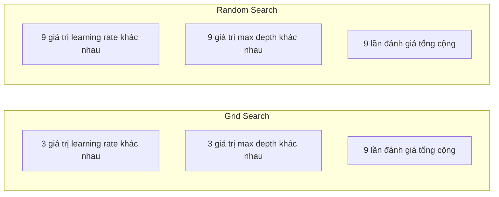
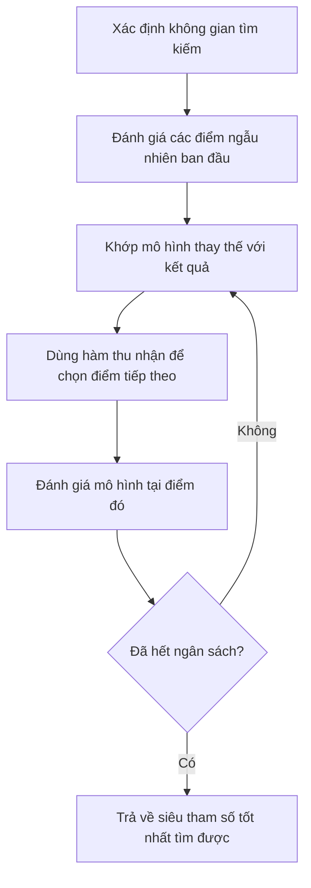
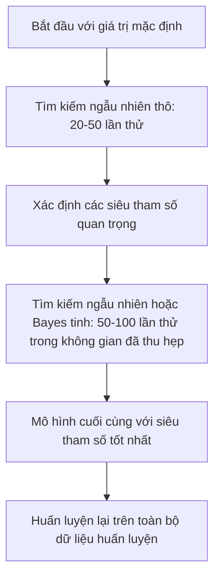
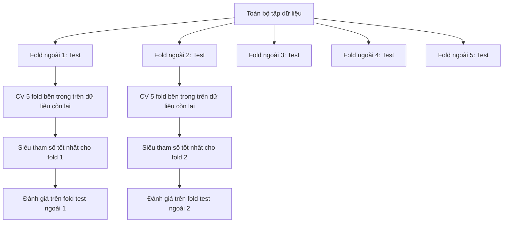

# Tinh chỉnh siêu tham số

> Hyperparameter (siêu tham số) là những nút vặn bạn xoay trước khi quá trình huấn luyện bắt đầu. Xoay chúng khéo là khác biệt giữa một mô hình tầm tầm và một mô hình xuất sắc.

**Type:** Build
**Language:** Python
**Prerequisites:** Giai đoạn 2, Bài 11 (Phương pháp ensemble)
**Time:** ~90 phút

## Mục tiêu học tập

- Hiện thực grid search (tìm kiếm lưới), random search (tìm kiếm ngẫu nhiên) và Bayesian optimization (tối ưu Bayes) từ đầu rồi so sánh hiệu quả mẫu của chúng
- Giải thích vì sao tìm kiếm ngẫu nhiên vượt trội tìm kiếm lưới khi hầu hết siêu tham số có số chiều hiệu dụng thấp
- Xây dựng một vòng lặp tối ưu Bayes dùng surrogate model (mô hình thay thế) và acquisition function (hàm thu nhận) để dẫn dắt việc tìm kiếm
- Thiết kế chiến lược tinh chỉnh siêu tham số tránh overfit tập validation nhờ cross-validation (kiểm định chéo) đúng cách

## Vấn đề

Mô hình gradient boosting của bạn có learning rate, số lượng cây, độ sâu tối đa, số mẫu tối thiểu mỗi lá, tỉ lệ subsample và tỉ lệ lấy mẫu cột. Đó là sáu siêu tham số. Nếu mỗi cái có 5 giá trị hợp lý, lưới có 5^6 = 15,625 tổ hợp. Huấn luyện mỗi tổ hợp mất 10 giây. Vậy là 43 giờ tính toán để thử hết.

Tìm kiếm lưới là cách tiếp cận hiển nhiên và cũng là cách tệ nhất khi quy mô lớn. Tìm kiếm ngẫu nhiên làm tốt hơn với ít tính toán hơn. Tối ưu Bayes còn tốt hơn nữa nhờ học từ các lần đánh giá trước đó. Biết nên dùng chiến lược nào, và siêu tham số nào thật sự quan trọng, sẽ tiết kiệm nhiều ngày thời gian GPU lãng phí.

## Khái niệm

### Tham số và siêu tham số

Tham số được học trong quá trình huấn luyện (trọng số, bias, ngưỡng chia). Siêu tham số được đặt trước khi huấn luyện bắt đầu và điều khiển cách việc học diễn ra.

| Siêu tham số | Điều khiển điều gì | Khoảng điển hình |
|---------------|-----------------|---------------|
| Learning rate | Kích thước bước mỗi lần cập nhật | 0.001 to 1.0 |
| Number of trees/epochs | Huấn luyện bao lâu | 10 to 10,000 |
| Max depth | Độ phức tạp của mô hình | 1 to 30 |
| Regularization (lambda) | Chống overfitting | 0.0001 to 100 |
| Batch size | Độ nhiễu khi ước lượng gradient | 16 to 512 |
| Dropout rate | Tỉ lệ neuron bị bỏ | 0.0 to 0.5 |

### Tìm kiếm lưới

Tìm kiếm lưới đánh giá mọi tổ hợp của các giá trị được chỉ định. Nó vét cạn và dễ hiểu, nhưng chi phí tăng theo hàm mũ với số lượng siêu tham số.

```
Grid for 2 hyperparameters:

  learning_rate: [0.01, 0.1, 1.0]
  max_depth:     [3, 5, 7]

  Evaluations: 3 x 3 = 9 combinations

  (0.01, 3)  (0.01, 5)  (0.01, 7)
  (0.1,  3)  (0.1,  5)  (0.1,  7)
  (1.0,  3)  (1.0,  5)  (1.0,  7)
```

Tìm kiếm lưới có một lỗ hổng căn bản: nếu một siêu tham số quan trọng còn cái kia thì không, phần lớn các lần đánh giá là lãng phí. Bạn chỉ thu được 3 giá trị khác nhau của tham số quan trọng từ 9 lần đánh giá.

### Tìm kiếm ngẫu nhiên

Tìm kiếm ngẫu nhiên lấy mẫu siêu tham số từ các phân phối thay vì từ một lưới. Với cùng ngân sách 9 lần đánh giá, bạn thu được 9 giá trị khác nhau của mỗi siêu tham số.



Vì sao ngẫu nhiên thắng lưới (Bergstra & Bengio, 2012):

- Hầu hết siêu tham số có số chiều hiệu dụng thấp. Với một bài toán cụ thể, thường chỉ 1-2 trong 6 siêu tham số là thật sự quan trọng.
- Tìm kiếm lưới phung phí các lần đánh giá vào những chiều không quan trọng.
- Tìm kiếm ngẫu nhiên phủ các chiều quan trọng dày đặc hơn với cùng ngân sách.
- Với 60 lần thử ngẫu nhiên, bạn có 95% cơ hội tìm được một điểm nằm trong 5% quanh điểm tối ưu — nếu search space (không gian tìm kiếm) có chứa một điểm như vậy.

### Tối ưu Bayes

Tìm kiếm ngẫu nhiên bỏ qua kết quả. Nó không học được rằng learning rate cao gây phân kỳ hay depth 3 luôn tốt hơn depth 10. Tối ưu Bayes dùng các lần đánh giá trước để quyết định tìm ở đâu tiếp theo.



Hai thành phần then chốt:

**Mô hình thay thế:** Một mô hình rẻ để đánh giá (thường là Gaussian process) xấp xỉ hàm mục tiêu đắt đỏ. Nó cho cả dự đoán lẫn ước lượng độ bất định tại bất kỳ điểm nào trong không gian tìm kiếm.

**Hàm thu nhận:** Quyết định đánh giá ở đâu tiếp theo bằng cách cân bằng khai thác (tìm gần những điểm đã biết là tốt) và khám phá (tìm nơi độ bất định cao). Các lựa chọn phổ biến:

- **Expected Improvement (EI):** Tại điểm này, ta kỳ vọng cải thiện được bao nhiêu so với kết quả tốt nhất hiện tại?
- **Upper Confidence Bound (UCB):** Dự đoán cộng thêm một bội số của độ bất định. UCB cao nghĩa là điểm đó hoặc hứa hẹn hoặc chưa được khám phá.
- **Probability of Improvement (PI):** Xác suất điểm này vượt qua kết quả tốt nhất hiện tại là bao nhiêu?

Tối ưu Bayes thường tìm được siêu tham số tốt hơn tìm kiếm ngẫu nhiên với số lần đánh giá ít hơn 2-5 lần. Chi phí phụ để khớp mô hình thay thế là không đáng kể so với việc huấn luyện mô hình thật.

### Dừng sớm

Không phải lần chạy huấn luyện nào cũng cần đi tới cùng. Nếu một cấu hình rõ ràng tệ sau 10 epoch, hãy dừng nó và đi tiếp. Đây là early stopping (dừng sớm) trong bối cảnh tìm kiếm siêu tham số.

Các chiến lược:
- **Theo patience:** Dừng nếu validation loss không cải thiện trong N epoch liên tiếp
- **Cắt tỉa theo trung vị (median pruning):** Dừng nếu kết quả trung gian của lần thử tệ hơn trung vị của các lần thử đã hoàn thành ở cùng bước
- **Hyperband:** Cấp ngân sách nhỏ cho nhiều cấu hình, rồi tăng dần ngân sách cho những cấu hình tốt nhất

Hyperband đặc biệt hiệu quả. Nó khởi động 81 cấu hình, mỗi cấu hình 1 epoch, giữ lại một phần ba tốt nhất, cho chúng 3 epoch, lại giữ một phần ba tốt nhất, và cứ thế. Cách này tìm được cấu hình tốt nhanh hơn 10-50 lần so với đánh giá tất cả cấu hình với toàn bộ ngân sách.

### Bộ điều chỉnh learning rate

Learning rate gần như luôn là siêu tham số quan trọng nhất. Thay vì giữ cố định, các bộ điều chỉnh (scheduler) thay đổi nó trong quá trình huấn luyện.

| Scheduler | Công thức | Khi nào dùng |
|-----------|---------|-------------|
| Step decay | Nhân với 0.1 mỗi N epoch | Huấn luyện CNN cổ điển |
| Cosine annealing | lr * 0.5 * (1 + cos(pi * t / T)) | Mặc định hiện đại |
| Warmup + decay | Tăng tuyến tính rồi giảm theo cosine | Transformer |
| One-cycle | Tăng rồi giảm trong một chu kỳ | Hội tụ nhanh |
| Reduce on plateau | Giảm theo hệ số khi metric không cải thiện | Mặc định an toàn |

### Tầm quan trọng của siêu tham số

Không phải mọi siêu tham số đều quan trọng như nhau. Nghiên cứu trên random forest (Probst et al., 2019) và gradient boosting cho thấy những mẫu nhất quán:

**Quan trọng cao:**
- Learning rate (luôn tinh chỉnh đầu tiên)
- Số lượng estimator / epoch (dùng dừng sớm thay vì tinh chỉnh)
- Độ mạnh của regularization

**Quan trọng trung bình:**
- Max depth / số lớp
- Min samples per leaf / weight decay
- Tỉ lệ subsample

**Quan trọng thấp:**
- Max features (với random forest)
- Lựa chọn hàm kích hoạt cụ thể
- Batch size (trong khoảng hợp lý)

Hãy tinh chỉnh những cái quan trọng trước, để phần còn lại ở giá trị mặc định.

### Chiến lược thực tế



Quy trình cụ thể:

1. **Bắt đầu với giá trị mặc định của thư viện.** Chúng do những người thực hành giàu kinh nghiệm chọn và thường đã đi được 80% chặng đường.
2. **Tìm kiếm ngẫu nhiên thô.** Khoảng rộng, 20-50 lần thử. Dùng dừng sớm để loại nhanh các lần chạy tệ.
3. **Phân tích kết quả.** Siêu tham số nào tương quan với hiệu năng? Thu hẹp không gian tìm kiếm.
4. **Tìm kiếm tinh.** Tối ưu Bayes hoặc tìm kiếm ngẫu nhiên có trọng tâm trong không gian đã thu hẹp. 50-100 lần thử.
5. **Huấn luyện lại trên toàn bộ dữ liệu huấn luyện** với siêu tham số tốt nhất tìm được.

### Tích hợp kiểm định chéo

Tinh chỉnh siêu tham số trên một lần chia validation duy nhất là rủi ro. Siêu tham số tốt nhất có thể overfit vào đúng fold validation đó. Kiểm định chéo lồng nhau (nested cross-validation) giải quyết bằng cách dùng hai vòng:

- **Vòng ngoài** (đánh giá): chia dữ liệu thành train+val và test. Báo cáo hiệu năng không thiên lệch.
- **Vòng trong** (tinh chỉnh): chia train+val thành train và val. Tìm siêu tham số tốt nhất.



Mỗi fold ngoài tự tìm siêu tham số tốt nhất của riêng nó một cách độc lập. Điểm số ở vòng ngoài là ước lượng không thiên lệch của hiệu năng tổng quát hóa.

Với sklearn:

```python
from sklearn.model_selection import cross_val_score, GridSearchCV
from sklearn.ensemble import GradientBoostingRegressor

inner_cv = GridSearchCV(
    GradientBoostingRegressor(),
    param_grid={
        "learning_rate": [0.01, 0.05, 0.1],
        "max_depth": [2, 3, 5],
        "n_estimators": [50, 100, 200],
    },
    cv=5,
    scoring="neg_mean_squared_error",
)

outer_scores = cross_val_score(
    inner_cv, X, y, cv=5, scoring="neg_mean_squared_error"
)

print(f"Nested CV MSE: {-outer_scores.mean():.4f} +/- {outer_scores.std():.4f}")
```

Cách này đắt (5 fold ngoài x 5 fold trong x 27 điểm lưới = 675 lần khớp mô hình), nhưng cho bạn một ước lượng hiệu năng đáng tin. Dùng nó khi báo cáo kết quả cuối cùng trong bài báo hoặc khi quyết định có hệ quả lớn.

### Mẹo thực tế

**Bắt đầu với learning rate.** Nó luôn là siêu tham số quan trọng nhất với các phương pháp dựa trên gradient. Learning rate tệ khiến mọi thứ khác trở nên vô nghĩa. Cố định các siêu tham số khác ở giá trị mặc định và quét learning rate trước.

**Dùng phân phối log-đều cho learning rate và regularization.** Khác biệt giữa 0.001 và 0.01 quan trọng ngang khác biệt giữa 0.1 và 1.0. Tìm kiếm tuyến tính phung phí ngân sách ở phía giá trị lớn.

**Dùng dừng sớm thay vì tinh chỉnh n_estimators.** Với boosting và mạng nơ-ron, hãy đặt n_estimators hoặc epoch cao và để dừng sớm quyết định khi nào ngừng. Cách này loại bỏ một siêu tham số khỏi việc tìm kiếm.

**Phân bổ ngân sách.** Dành 60% ngân sách tinh chỉnh cho 2 siêu tham số quan trọng nhất. Dành 40% còn lại cho tất cả những cái khác. Hai cái đầu chiếm phần lớn biến thiên hiệu năng.

**Thang đo rất quan trọng.** Không bao giờ tìm batch size trên thang log (16, 32, 64 là ổn). Luôn tìm learning rate trên thang log. Hãy chọn phân phối tìm kiếm khớp với cách siêu tham số ảnh hưởng tới mô hình.

| Loại mô hình | Siêu tham số hàng đầu | Tìm kiếm đề xuất | Ngân sách |
|-----------|--------------------|--------------------|--------|
| Random Forest | n_estimators, max_depth, min_samples_leaf | Tìm kiếm ngẫu nhiên, 50 lần thử | Thấp (huấn luyện nhanh) |
| Gradient Boosting | learning_rate, n_estimators, max_depth | Bayes, 100 lần thử + dừng sớm | Trung bình |
| Neural Network | learning_rate, weight_decay, batch_size | Bayes hoặc ngẫu nhiên, 100+ lần thử | Cao (huấn luyện chậm) |
| SVM | C, gamma (kernel RBF) | Lưới trên thang log, 25-50 lần thử | Thấp (2 tham số) |
| Lasso/Ridge | alpha | Tìm kiếm 1D trên thang log, 20 lần thử | Rất thấp |
| XGBoost | learning_rate, max_depth, subsample, colsample | Bayes, 100-200 lần thử + dừng sớm | Trung bình |

**Khi không chắc:** hãy dùng tìm kiếm ngẫu nhiên với số lần thử gấp đôi số siêu tham số (ví dụ 6 siêu tham số = tối thiểu 12 lần thử). Bạn sẽ ngạc nhiên vì tìm kiếm ngẫu nhiên với 50 lần thử thường xuyên thắng một tìm kiếm lưới được thiết kế kỹ càng.

```figure
k-fold-cv
```

## Tự tay làm

### Bước 1: Tìm kiếm lưới từ đầu

Đoạn code trong `code/tuning.py` hiện thực tìm kiếm lưới, tìm kiếm ngẫu nhiên và một bộ tối ưu Bayes đơn giản từ đầu.

```python
def grid_search(model_fn, param_grid, X_train, y_train, X_val, y_val):
    keys = list(param_grid.keys())
    values = list(param_grid.values())
    best_score = -float("inf")
    best_params = None
    n_evals = 0

    for combo in itertools.product(*values):
        params = dict(zip(keys, combo))
        model = model_fn(**params)
        model.fit(X_train, y_train)
        score = evaluate(model, X_val, y_val)
        n_evals += 1

        if score > best_score:
            best_score = score
            best_params = params

    return best_params, best_score, n_evals
```

### Bước 2: Tìm kiếm ngẫu nhiên từ đầu

```python
def random_search(model_fn, param_distributions, X_train, y_train,
                  X_val, y_val, n_iter=50, seed=42):
    rng = np.random.RandomState(seed)
    best_score = -float("inf")
    best_params = None

    for _ in range(n_iter):
        params = {k: sample(v, rng) for k, v in param_distributions.items()}
        model = model_fn(**params)
        model.fit(X_train, y_train)
        score = evaluate(model, X_val, y_val)

        if score > best_score:
            best_score = score
            best_params = params

    return best_params, best_score, n_iter
```

### Bước 3: Tối ưu Bayes (rút gọn)

Ý tưởng cốt lõi: khớp một Gaussian process với các cặp (siêu tham số, điểm số) đã quan sát, rồi dùng hàm thu nhận để quyết định xem xét ở đâu tiếp theo.

```python
class SimpleBayesianOptimizer:
    def __init__(self, search_space, n_initial=5):
        self.search_space = search_space
        self.n_initial = n_initial
        self.X_observed = []
        self.y_observed = []

    def _kernel(self, x1, x2, length_scale=1.0):
        dists = np.sum((x1[:, None, :] - x2[None, :, :]) ** 2, axis=2)
        return np.exp(-0.5 * dists / length_scale ** 2)

    def _fit_gp(self, X_new):
        X_obs = np.array(self.X_observed)
        y_obs = np.array(self.y_observed)
        y_mean = y_obs.mean()
        y_centered = y_obs - y_mean

        K = self._kernel(X_obs, X_obs) + 1e-4 * np.eye(len(X_obs))
        K_star = self._kernel(X_new, X_obs)

        L = np.linalg.cholesky(K)
        alpha = np.linalg.solve(L.T, np.linalg.solve(L, y_centered))
        mu = K_star @ alpha + y_mean

        v = np.linalg.solve(L, K_star.T)
        var = 1.0 - np.sum(v ** 2, axis=0)
        var = np.maximum(var, 1e-6)

        return mu, var

    def _expected_improvement(self, mu, var, best_y):
        sigma = np.sqrt(var)
        z = (mu - best_y) / (sigma + 1e-10)
        ei = sigma * (z * norm_cdf(z) + norm_pdf(z))
        return ei

    def suggest(self):
        if len(self.X_observed) < self.n_initial:
            return sample_random(self.search_space)

        candidates = [sample_random(self.search_space) for _ in range(500)]
        X_cand = np.array([to_vector(c) for c in candidates])
        mu, var = self._fit_gp(X_cand)
        ei = self._expected_improvement(mu, var, max(self.y_observed))
        return candidates[np.argmax(ei)]

    def observe(self, params, score):
        self.X_observed.append(to_vector(params))
        self.y_observed.append(score)
```

Mô hình thay thế GP cho hai thứ tại mỗi điểm ứng viên: điểm số dự đoán (mu) và độ bất định (var). Expected Improvement cân bằng hai thứ này: nó ưu tiên những điểm mà mô hình dự đoán điểm số cao HOẶC nơi độ bất định cao. Giai đoạn đầu, phần lớn điểm có độ bất định cao nên bộ tối ưu khám phá. Về sau, nó tập trung vào vùng hứa hẹn nhất.

### Bước 4: So sánh mọi phương pháp

Chạy cả ba phương pháp trên cùng một hàm mục tiêu tổng hợp và so sánh. Phép so sánh này dùng một wrapper rút gọn gọi từng bộ tối ưu với hàm mục tiêu trực tiếp (không huấn luyện mô hình), nên API khác với các hiện thực dựa trên mô hình ở trên:

```python
def synthetic_objective(params):
    lr = params["learning_rate"]
    depth = params["max_depth"]
    return -(np.log10(lr) + 2) ** 2 - (depth - 4) ** 2 + 10

param_grid = {
    "learning_rate": [0.001, 0.01, 0.1, 1.0],
    "max_depth": [2, 3, 4, 5, 6, 7, 8],
}

grid_best = None
grid_score = -float("inf")
grid_history = []
for combo in itertools.product(*param_grid.values()):
    params = dict(zip(param_grid.keys(), combo))
    score = synthetic_objective(params)
    grid_history.append((params, score))
    if score > grid_score:
        grid_score = score
        grid_best = params

param_dist = {
    "learning_rate": ("log_float", 0.001, 1.0),
    "max_depth": ("int", 2, 8),
}

rand_best = None
rand_score = -float("inf")
rand_history = []
rng = np.random.RandomState(42)
for _ in range(28):
    params = {k: sample(v, rng) for k, v in param_dist.items()}
    score = synthetic_objective(params)
    rand_history.append((params, score))
    if score > rand_score:
        rand_score = score
        rand_best = params

optimizer = SimpleBayesianOptimizer(param_dist, n_initial=5)
bayes_history = []
for _ in range(28):
    params = optimizer.suggest()
    score = synthetic_objective(params)
    optimizer.observe(params, score)
    bayes_history.append((params, score))
bayes_score = max(s for _, s in bayes_history)

print(f"{'Method':<20} {'Best Score':>12} {'Evaluations':>12}")
print("-" * 50)
print(f"{'Grid Search':<20} {grid_score:>12.4f} {len(grid_history):>12}")
print(f"{'Random Search':<20} {rand_score:>12.4f} {len(rand_history):>12}")
print(f"{'Bayesian Opt':<20} {bayes_score:>12.4f} {len(bayes_history):>12}")
```

Với cùng ngân sách, tối ưu Bayes thường tìm được điểm số tốt nhất nhanh nhất vì nó không phung phí các lần đánh giá vào những vùng rõ ràng tệ. Tìm kiếm ngẫu nhiên phủ được nhiều đất hơn tìm kiếm lưới. Tìm kiếm lưới chỉ thắng khi bạn có rất ít siêu tham số và có thể đủ chi phí để vét cạn.

## Áp dụng

### Optuna trong thực tế

Optuna là thư viện được khuyến nghị cho việc tinh chỉnh siêu tham số nghiêm túc. Nó hỗ trợ cắt tỉa, tìm kiếm phân tán và trực quan hóa ngay khi cài xong.

```python
import optuna

def objective(trial):
    lr = trial.suggest_float("learning_rate", 1e-4, 1e-1, log=True)
    n_est = trial.suggest_int("n_estimators", 50, 500)
    max_depth = trial.suggest_int("max_depth", 2, 10)

    model = GradientBoostingRegressor(
        learning_rate=lr,
        n_estimators=n_est,
        max_depth=max_depth,
    )
    model.fit(X_train, y_train)
    return mean_squared_error(y_val, model.predict(X_val))

study = optuna.create_study(direction="minimize")
study.optimize(objective, n_trials=100)

print(f"Best params: {study.best_params}")
print(f"Best MSE: {study.best_value:.4f}")
```

Các tính năng chính của Optuna:
- `suggest_float(..., log=True)` cho những tham số nên tìm trên thang log (learning rate, regularization)
- `suggest_int` cho tham số nguyên
- `suggest_categorical` cho các lựa chọn rời rạc
- MedianPruner có sẵn để dừng sớm các lần thử tệ
- `study.trials_dataframe()` để phân tích

### Optuna với cắt tỉa

Cắt tỉa dừng sớm những lần thử không hứa hẹn, tiết kiệm rất nhiều tính toán. Đây là mẫu cần dùng:

```python
import optuna
from sklearn.model_selection import cross_val_score

def objective(trial):
    params = {
        "learning_rate": trial.suggest_float("lr", 1e-4, 0.5, log=True),
        "max_depth": trial.suggest_int("max_depth", 2, 10),
        "n_estimators": trial.suggest_int("n_estimators", 50, 500),
        "subsample": trial.suggest_float("subsample", 0.5, 1.0),
    }

    model = GradientBoostingRegressor(**params)
    scores = cross_val_score(model, X_train, y_train, cv=3,
                             scoring="neg_mean_squared_error")
    mean_score = -scores.mean()

    trial.report(mean_score, step=0)
    if trial.should_prune():
        raise optuna.TrialPruned()

    return mean_score

pruner = optuna.pruners.MedianPruner(n_startup_trials=10, n_warmup_steps=5)
study = optuna.create_study(direction="minimize", pruner=pruner)
study.optimize(objective, n_trials=200)
```

`MedianPruner` dừng một lần thử nếu giá trị trung gian của nó tệ hơn trung vị của tất cả các lần thử đã hoàn thành ở cùng bước. Để cắt tỉa hoạt động, bạn phải gọi `trial.report()` để báo cáo metric trung gian và `trial.should_prune()` để kiểm tra xem lần thử có nên bị dừng không. Tham số `n_startup_trials=10` bảo đảm ít nhất 10 lần thử hoàn thành trọn vẹn trước khi việc cắt tỉa bắt đầu. Cách này thường tiết kiệm 40-60% tổng tính toán.

### Bộ tinh chỉnh có sẵn của sklearn

Cho các thí nghiệm nhanh, sklearn cung cấp `GridSearchCV`, `RandomizedSearchCV` và `HalvingRandomSearchCV`:

```python
from sklearn.model_selection import RandomizedSearchCV
from scipy.stats import loguniform, randint

param_dist = {
    "learning_rate": loguniform(1e-4, 0.5),
    "max_depth": randint(2, 10),
    "n_estimators": randint(50, 500),
}

search = RandomizedSearchCV(
    GradientBoostingRegressor(),
    param_dist,
    n_iter=100,
    cv=5,
    scoring="neg_mean_squared_error",
    random_state=42,
    n_jobs=-1,
)
search.fit(X_train, y_train)
print(f"Best params: {search.best_params_}")
print(f"Best CV MSE: {-search.best_score_:.4f}")
```

Dùng `loguniform` từ scipy cho learning rate và regularization. Dùng `randint` cho các siêu tham số nguyên. Cờ `n_jobs=-1` song song hóa trên tất cả nhân CPU.

### Những lỗi thường gặp khi tinh chỉnh siêu tham số

**Rò rỉ dữ liệu qua tiền xử lý.** Nếu bạn khớp scaler trên toàn bộ dữ liệu trước khi kiểm định chéo, thông tin từ fold validation sẽ rò rỉ vào phần huấn luyện. Luôn đặt tiền xử lý bên trong một `Pipeline` để nó chỉ được khớp trên fold huấn luyện.

**Overfit vào tập validation.** Chạy hàng nghìn lần thử thực chất là huấn luyện trên tập validation. Hãy dùng kiểm định chéo lồng nhau cho ước lượng hiệu năng cuối cùng, hoặc giữ riêng một tập test mà bạn không bao giờ chạm vào trong lúc tinh chỉnh.

**Tìm kiếm trong khoảng quá hẹp.** Nếu giá trị tốt nhất nằm ở biên của không gian tìm kiếm, nghĩa là bạn chưa tìm đủ rộng. Giá trị tối ưu có thể nằm ngoài khoảng của bạn. Luôn kiểm tra xem các tham số tốt nhất có nằm ở rìa không.

**Bỏ qua hiệu ứng tương tác.** Learning rate và số lượng estimator tương tác mạnh trong boosting. Learning rate thấp cần nhiều estimator hơn. Tinh chỉnh chúng độc lập cho kết quả tệ hơn tinh chỉnh cùng lúc.

**Không dùng dừng sớm cho các mô hình lặp.** Với gradient boosting và mạng nơ-ron, hãy đặt n_estimators hoặc epoch ở giá trị cao và dùng dừng sớm. Cách này tốt hơn hẳn việc tinh chỉnh số vòng lặp như một siêu tham số.

## Bài tập

1. Chạy tìm kiếm lưới và tìm kiếm ngẫu nhiên với cùng tổng ngân sách (ví dụ 50 lần đánh giá). So sánh điểm số tốt nhất tìm được. Lặp lại thí nghiệm 10 lần với các seed khác nhau. Tìm kiếm ngẫu nhiên thắng bao nhiêu lần?

2. Hiện thực Hyperband từ đầu. Bắt đầu với 81 cấu hình, mỗi cấu hình huấn luyện 1 epoch. Giữ lại 1/3 tốt nhất ở mỗi vòng và nhân ba ngân sách của chúng. So sánh tổng tính toán (tổng số epoch trên tất cả cấu hình) với việc chạy 81 cấu hình cho toàn bộ ngân sách.

3. Thêm một bộ điều chỉnh learning rate (cosine annealing) vào hiện thực gradient boosting từ Bài 11. Nó có giúp ích so với learning rate cố định không?

4. Dùng Optuna để tinh chỉnh một RandomForestClassifier trên một tập dữ liệu thật (ví dụ tập ung thư vú của sklearn). Dùng `optuna.visualization.plot_param_importances(study)` để xem siêu tham số nào quan trọng nhất. Kết quả có khớp với xếp hạng tầm quan trọng trong bài này không?

5. Hiện thực một hàm thu nhận đơn giản (Expected Improvement) và minh họa khám phá so với khai thác. Vẽ giá trị trung bình và độ bất định của mô hình thay thế, và chỉ ra EI chọn đánh giá ở đâu tiếp theo.

## Thuật ngữ chính

| Thuật ngữ | Người ta thường nói | Ý nghĩa thực sự |
|------|----------------|----------------------|
| Hyperparameter | "Một thiết lập bạn tự chọn" | Giá trị được đặt trước khi huấn luyện, điều khiển quá trình học, không được học từ dữ liệu |
| Grid search | "Thử mọi tổ hợp" | Tìm kiếm vét cạn trên một lưới tham số được chỉ định. Chi phí tăng theo hàm mũ. |
| Random search | "Cứ lấy mẫu ngẫu nhiên" | Lấy mẫu siêu tham số từ các phân phối. Phủ các chiều quan trọng tốt hơn tìm kiếm lưới. |
| Bayesian optimization | "Tìm kiếm thông minh" | Dùng mô hình thay thế của hàm mục tiêu để quyết định đánh giá ở đâu tiếp theo, cân bằng khám phá và khai thác |
| Surrogate model | "Một xấp xỉ rẻ tiền" | Mô hình (thường là Gaussian process) xấp xỉ hàm mục tiêu đắt đỏ từ các lần đánh giá đã quan sát |
| Acquisition function | "Nhìn ở đâu tiếp theo" | Cho điểm các điểm ứng viên bằng cách cân bằng cải thiện kỳ vọng với độ bất định. EI và UCB là các lựa chọn phổ biến. |
| Early stopping | "Đừng phí thời gian nữa" | Dừng huấn luyện sớm khi hiệu năng trên validation ngừng cải thiện |
| Hyperband | "Nhánh đấu loại trực tiếp cho các cấu hình" | Cấp phát tài nguyên thích ứng: khởi động nhiều cấu hình với ngân sách nhỏ, giữ những cái tốt nhất và tăng ngân sách cho chúng |
| Learning rate scheduler | "Đổi lr trong lúc huấn luyện" | Hàm điều chỉnh learning rate trong suốt quá trình huấn luyện để hội tụ tốt hơn |

## Đọc thêm

- [Bergstra & Bengio: Random Search for Hyper-Parameter Optimization (2012)](https://jmlr.org/papers/v13/bergstra12a.html) -- bài báo chứng minh ngẫu nhiên thắng lưới
- [Snoek et al., Practical Bayesian Optimization of Machine Learning Algorithms (2012)](https://arxiv.org/abs/1206.2944) -- tối ưu Bayes cho ML
- [Li et al., Hyperband: A Novel Bandit-Based Approach (2018)](https://jmlr.org/papers/v18/16-558.html) -- bài báo Hyperband
- [Optuna: A Next-generation Hyperparameter Optimization Framework](https://arxiv.org/abs/1907.10902) -- bài báo Optuna
- [Probst et al., Tunability: Importance of Hyperparameters (2019)](https://jmlr.org/papers/v20/18-444.html) -- siêu tham số nào quan trọng

---

[← Bài trước: Phương pháp Ensemble (tập hợp mô hình)](../../11-ensemble-methods/docs/vi.md) · [Bài sau: Pipeline ML →](../../13-ml-pipelines/docs/vi.md)
