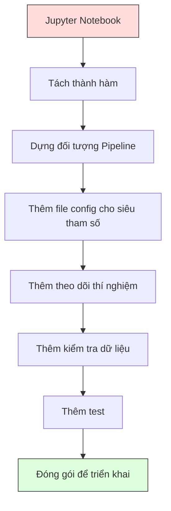

# Pipeline ML

> Một mô hình không phải là sản phẩm. Một pipeline (quy trình xử lý) mới là sản phẩm. Pipeline bao trùm mọi thứ từ dữ liệu thô đến dự đoán đã triển khai, và mỗi bước đều phải tái lập được.

**Type:** Build
**Language:** Python
**Prerequisites:** Giai đoạn 2, Bài 12 (Tinh chỉnh siêu tham số)
**Time:** ~120 phút

## Mục tiêu học tập

- Xây một pipeline ML từ đầu, nối liền điền khuyết, chuẩn hoá, mã hoá và huấn luyện mô hình thành một đối tượng tái lập được duy nhất
- Nhận diện các tình huống rò rỉ dữ liệu và giải thích cách pipeline ngăn chúng bằng việc chỉ fit transformer trên dữ liệu train
- Dựng một ColumnTransformer áp dụng tiền xử lý khác nhau cho đặc trưng số và đặc trưng phân loại
- Cài đặt tuần tự hoá pipeline và chứng minh rằng cùng một pipeline đã fit cho kết quả giống hệt trong train và production

## Vấn đề

Bạn có một notebook tải dữ liệu, điền giá trị thiếu bằng median, chuẩn hoá đặc trưng, huấn luyện mô hình và in độ chính xác. Nó chạy được. Bạn đóng gói và triển khai.

Một tháng sau, có người train lại mô hình và nhận kết quả khác. Median được tính trên toàn bộ dataset gồm cả dữ liệu test — data leakage (rò rỉ dữ liệu). Các tham số chuẩn hoá không được lưu, nên lúc suy luận dùng thống kê khác. Code feature engineering bị copy-paste giữa train và serving, và các bản copy lệch nhau. Một cột phân loại có thêm giá trị mới trong production mà encoder chưa từng thấy.

Đây không phải giả thuyết. Chúng là những lý do phổ biến nhất khiến hệ thống ML thất bại trong production. Pipeline giải quyết tất cả bằng cách đóng gói mọi bước biến đổi vào một đối tượng có thứ tự và tái lập được.

## Khái niệm

### Pipeline là gì

Pipeline là một chuỗi có thứ tự các phép biến đổi dữ liệu, kết thúc bằng một mô hình. Mỗi bước nhận đầu ra của bước trước làm đầu vào. Toàn bộ pipeline được fit một lần trên dữ liệu train. Khi suy luận, chính pipeline đã fit đó biến đổi dữ liệu mới và cho ra dự đoán.


Pipeline bảo đảm:
- Các phép biến đổi chỉ được fit (khớp) trên dữ liệu train (không rò rỉ)
- Cùng những phép biến đổi được áp dụng khi suy luận
- Toàn bộ đối tượng có thể được tuần tự hoá và triển khai như một artifact duy nhất
- Cross-validation (kiểm định chéo) áp dụng pipeline theo từng fold, ngăn rò rỉ tinh vi

### Rò rỉ dữ liệu: kẻ giết người thầm lặng

Data leakage xảy ra khi thông tin từ tập test hoặc dữ liệu tương lai lẫn vào quá trình train. Pipeline ngăn những dạng phổ biến nhất.

**Rò rỉ (sai):**
```python
X = df.drop("target", axis=1)
y = df["target"]

scaler = StandardScaler()
X_scaled = scaler.fit_transform(X)

X_train, X_test = X_scaled[:800], X_scaled[800:]
y_train, y_test = y[:800], y[800:]
```

Scaler đã thấy dữ liệu test. Mean và độ lệch chuẩn bao gồm cả mẫu test. Điều này làm ước lượng độ chính xác bị phồng lên.

**Đúng:**
```python
X_train, X_test = X[:800], X[800:]

scaler = StandardScaler()
X_train_scaled = scaler.fit_transform(X_train)
X_test_scaled = scaler.transform(X_test)
```

Với pipeline, bạn không cần phải nghĩ về điều này. Pipeline tự xử lý.

### Pipeline trong sklearn

`Pipeline` của sklearn nối các transformer và một estimator. Nó cung cấp `.fit()`, `.predict()` và `.score()` áp dụng mọi bước theo thứ tự.

```python
from sklearn.pipeline import Pipeline
from sklearn.preprocessing import StandardScaler
from sklearn.linear_model import LogisticRegression

pipe = Pipeline([
    ("scaler", StandardScaler()),
    ("model", LogisticRegression()),
])

pipe.fit(X_train, y_train)
predictions = pipe.predict(X_test)
```

Khi bạn gọi `pipe.fit(X_train, y_train)`:
1. Scaler gọi `fit_transform` trên X_train
2. Model gọi `fit` trên X_train đã chuẩn hoá

Khi bạn gọi `pipe.predict(X_test)`:
1. Scaler gọi `transform` (không phải fit_transform) trên X_test
2. Model gọi `predict` trên X_test đã chuẩn hoá

Scaler không bao giờ thấy dữ liệu test trong lúc fit. Đó chính là điểm mấu chốt.

### ColumnTransformer: pipeline riêng cho từng nhóm cột

Dataset thực tế có cột số và cột phân loại cần tiền xử lý khác nhau. `ColumnTransformer` lo việc này.

```python
from sklearn.compose import ColumnTransformer
from sklearn.preprocessing import StandardScaler, OneHotEncoder
from sklearn.impute import SimpleImputer

numeric_pipe = Pipeline([
    ("impute", SimpleImputer(strategy="median")),
    ("scale", StandardScaler()),
])

categorical_pipe = Pipeline([
    ("impute", SimpleImputer(strategy="most_frequent")),
    ("encode", OneHotEncoder(handle_unknown="ignore")),
])

preprocessor = ColumnTransformer([
    ("num", numeric_pipe, ["age", "income", "score"]),
    ("cat", categorical_pipe, ["city", "gender", "plan"]),
])

full_pipeline = Pipeline([
    ("preprocess", preprocessor),
    ("model", GradientBoostingClassifier()),
])
```

`handle_unknown="ignore"` trong OneHotEncoder là điểm then chốt cho production. Khi một danh mục mới xuất hiện (một thành phố model chưa từng thấy), nó tạo vector toàn 0 thay vì crash.

### Theo dõi thí nghiệm

Pipeline giúp việc train tái lập được, nhưng bạn còn cần theo dõi điều gì đã xảy ra qua các thí nghiệm: dùng siêu tham số nào, phiên bản dataset nào, metric ra sao, code nào đang chạy.

**MLflow** là giải pháp mã nguồn mở phổ biến nhất:

```python
import mlflow

with mlflow.start_run():
    mlflow.log_param("max_depth", 5)
    mlflow.log_param("n_estimators", 100)
    mlflow.log_param("learning_rate", 0.1)

    pipe.fit(X_train, y_train)
    accuracy = pipe.score(X_test, y_test)

    mlflow.log_metric("accuracy", accuracy)
    mlflow.sklearn.log_model(pipe, "model")
```

Mỗi lần chạy được ghi lại kèm tham số, metric, artifact và toàn bộ mô hình. Bạn có thể so sánh các lần chạy, tái lập bất kỳ thí nghiệm nào và triển khai bất kỳ phiên bản mô hình nào.

**Weights & Biases (wandb)** cung cấp chức năng tương tự với dashboard dạng hosted:

```python
import wandb

wandb.init(project="my-pipeline")
wandb.config.update({"max_depth": 5, "n_estimators": 100})

pipe.fit(X_train, y_train)
accuracy = pipe.score(X_test, y_test)

wandb.log({"accuracy": accuracy})
```

### Quản lý phiên bản mô hình

Sau khi theo dõi thí nghiệm, bạn cần quản lý phiên bản mô hình. Mô hình nào đang ở production? Cái nào ở staging? Cái nào là của tuần trước?

Model Registry của MLflow cung cấp:
- **Theo dõi phiên bản:** Mỗi mô hình được lưu có một số phiên bản
- **Chuyển giai đoạn:** "Staging", "Production", "Archived"
- **Quy trình phê duyệt:** Mô hình phải được thăng cấp lên production một cách tường minh
- **Rollback:** Quay lại phiên bản trước ngay lập tức

### Quản lý phiên bản dữ liệu với DVC

Code được quản lý phiên bản bằng git. Dữ liệu cũng cần được quản lý phiên bản — data versioning (quản lý phiên bản dữ liệu) — nhưng git không xử lý được file lớn. DVC (Data Version Control) giải quyết việc này.

```
dvc init
dvc add data/training.csv
git add data/training.csv.dvc data/.gitignore
git commit -m "Track training data"
dvc push
```

DVC lưu dữ liệu thực tế ở remote storage (S3, GCS, Azure) và giữ một file `.dvc` nhỏ trong git ghi lại hash. Khi bạn checkout một commit git, `dvc checkout` khôi phục đúng dữ liệu đã được dùng.

Nghĩa là mỗi commit git ghim cả code lẫn dữ liệu. Reproducibility (khả năng tái lập) trọn vẹn.

### Thí nghiệm tái lập được

Một thí nghiệm tái lập được cần bốn thứ:

1. **Seed ngẫu nhiên cố định:** Đặt seed cho numpy, random và framework (torch, sklearn)
2. **Ghim dependency:** requirements.txt hoặc poetry.lock với phiên bản chính xác
3. **Dữ liệu có phiên bản:** DVC hoặc tương tự
4. **File config:** Mọi siêu tham số nằm trong config, không hardcode

```python
import numpy as np
import random

def set_seed(seed=42):
    random.seed(seed)
    np.random.seed(seed)
    try:
        import torch
        torch.manual_seed(seed)
        torch.cuda.manual_seed_all(seed)
        torch.backends.cudnn.deterministic = True
    except ImportError:
        pass
```

### Từ notebook đến pipeline production



Lộ trình điển hình:

1. **Khám phá trong notebook:** Thí nghiệm nhanh, vẽ hình, nghĩ ý tưởng đặc trưng
2. **Tách thành hàm:** Đưa tiền xử lý, feature engineering, đánh giá vào các module
3. **Dựng Pipeline:** Nối các phép biến đổi thành sklearn Pipeline hoặc class tự viết
4. **Quản lý config:** Đưa mọi siêu tham số vào file YAML/JSON config
5. **Theo dõi thí nghiệm:** Thêm log MLflow hoặc wandb
6. **Kiểm tra dữ liệu:** Kiểm schema, phân phối và mẫu giá trị thiếu trước khi train
7. **Test:** Unit test cho transformer, integration test cho toàn pipeline
8. **Triển khai:** Tuần tự hoá pipeline, bọc trong API (FastAPI, Flask), đóng gói container

### Những lỗi pipeline thường gặp

| Lỗi | Tại sao tệ | Cách sửa |
|---------|-------------|-----|
| Fit trên toàn bộ dữ liệu trước khi chia | Rò rỉ dữ liệu | Dùng Pipeline với cross_val_score |
| Feature engineering ngoài pipeline | Biến đổi khác nhau giữa train và serve | Đưa mọi phép biến đổi vào Pipeline |
| Không xử lý danh mục chưa biết | Production sập khi gặp giá trị mới | OneHotEncoder(handle_unknown="ignore") |
| Hardcode tên cột | Hỏng khi schema thay đổi | Dùng danh sách tên cột từ config |
| Không kiểm tra dữ liệu | Dự đoán sai âm thầm với dữ liệu xấu | Thêm kiểm tra schema trước khi dự đoán |
| Lệch train/serving | Model thấy đặc trưng khác nhau ở prod | Một đối tượng Pipeline cho cả hai |

```figure
f3-pipeline-flow
```

## Tự tay làm

Code trong `code/pipeline.py` xây một pipeline ML hoàn chỉnh từ đầu:

### Bước 1: Transformer tự viết

```python
class CustomTransformer:
    def __init__(self):
        self.means = None
        self.stds = None

    def fit(self, X):
        self.means = np.mean(X, axis=0)
        self.stds = np.std(X, axis=0)
        self.stds[self.stds == 0] = 1.0
        return self

    def transform(self, X):
        return (X - self.means) / self.stds

    def fit_transform(self, X):
        return self.fit(X).transform(X)
```

### Bước 2: Pipeline viết từ đầu

```python
class PipelineFromScratch:
    def __init__(self, steps):
        self.steps = steps

    def fit(self, X, y=None):
        X_current = X.copy()
        for name, step in self.steps[:-1]:
            X_current = step.fit_transform(X_current)
        name, model = self.steps[-1]
        model.fit(X_current, y)
        return self

    def predict(self, X):
        X_current = X.copy()
        for name, step in self.steps[:-1]:
            X_current = step.transform(X_current)
        name, model = self.steps[-1]
        return model.predict(X_current)
```

### Bước 3: Kiểm định chéo với pipeline

Code minh hoạ cách cross-validation với pipeline ngăn rò rỉ dữ liệu: scaler được fit riêng trên dữ liệu train của từng fold.

### Bước 4: Pipeline production hoàn chỉnh với sklearn

Một pipeline hoàn chỉnh với `ColumnTransformer`, nhiều nhánh tiền xử lý và một mô hình, được train với cross-validation đúng cách và ghi log thí nghiệm.

## Đóng gói

Bài học này tạo ra:
- `outputs/prompt-ml-pipeline.md` -- một skill để xây và gỡ lỗi pipeline ML
- `code/pipeline.py` -- pipeline hoàn chỉnh từ đầu đến sklearn

## Bài tập

1. Xây một pipeline xử lý dataset có 3 cột số và 2 cột phân loại. Dùng `ColumnTransformer` để áp dụng điền khuyết median + chuẩn hoá cho cột số, và điền khuyết most-frequent + one-hot encoding cho cột phân loại. Train với cross-validation 5 fold.

2. Cố tình tạo rò rỉ dữ liệu: fit scaler trên toàn bộ dataset trước khi chia. So sánh điểm cross-validation (rò rỉ) với điểm cross-validation của pipeline (sạch). Chênh lệch lớn đến mức nào?

3. Tuần tự hoá pipeline bằng `joblib.dump`. Load nó trong một script khác và chạy dự đoán. Kiểm chứng rằng các dự đoán giống hệt nhau.

4. Thêm một transformer tự viết vào pipeline để tạo đặc trưng đa thức (bậc 2) cho hai cột số quan trọng nhất. Nó nên nằm ở đâu trong pipeline?

5. Thiết lập MLflow tracking cho pipeline. Chạy 5 thí nghiệm với siêu tham số khác nhau. Dùng MLflow UI (`mlflow ui`) để so sánh các lần chạy và chọn mô hình tốt nhất.

## Thuật ngữ chính

| Thuật ngữ | Người ta thường nói | Ý nghĩa thực sự |
|------|----------------|----------------------|
| Pipeline | "Chuỗi biến đổi + model" | Một chuỗi có thứ tự gồm các transformer đã fit và một model, áp dụng như một khối để tránh rò rỉ |
| Data leakage | "Thông tin test rò vào training" | Dùng thông tin từ ngoài tập train để xây model, làm phồng ước lượng hiệu năng |
| ColumnTransformer | "Tiền xử lý khác nhau theo từng cột" | Áp dụng các pipeline khác nhau cho các nhóm cột khác nhau rồi gộp kết quả |
| Experiment tracking | "Ghi log các lần chạy" | Ghi lại tham số, metric, artifact và phiên bản code cho mỗi lần huấn luyện |
| MLflow | "Theo dõi và triển khai model" | Nền tảng mã nguồn mở cho theo dõi thí nghiệm, model registry và triển khai |
| DVC | "Git cho dữ liệu" | Hệ thống quản lý phiên bản cho file dữ liệu lớn, lưu hash trong git và dữ liệu ở remote storage |
| Model registry | "Danh mục phiên bản model" | Hệ thống theo dõi phiên bản model kèm nhãn giai đoạn (staging, production, archived) |
| Training/serving skew | "Nó chạy được trong notebook mà" | Khác biệt trong cách xử lý dữ liệu khi train so với khi suy luận, gây lỗi âm thầm |
| Reproducibility | "Cùng code, cùng kết quả" | Khả năng thu được kết quả giống hệt từ cùng code, dữ liệu và cấu hình |

## Đọc thêm

- [scikit-learn Pipeline docs](https://scikit-learn.org/stable/modules/compose.html) -- tài liệu tham chiếu chính thức về pipeline
- [MLflow documentation](https://mlflow.org/docs/latest/index.html) -- theo dõi thí nghiệm và model registry
- [DVC documentation](https://dvc.org/doc) -- quản lý phiên bản dữ liệu
- [Sculley et al., Hidden Technical Debt in Machine Learning Systems (2015)](https://papers.nips.cc/paper/2015/hash/86df7dcfd896fcaf2674f757a2463eba-Abstract.html) -- bài báo nền tảng về độ phức tạp của hệ thống ML
- [Google ML Best Practices: Rules of ML](https://developers.google.com/machine-learning/guides/rules-of-ml) -- lời khuyên thực tế về ML trong production
