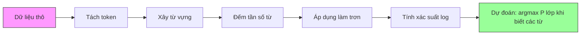

# Naive Bayes

> Giả định "ngây thơ" là sai, vậy mà nó vẫn hiệu quả. Đó chính là vẻ đẹp của nó.

**Type:** Build
**Language:** Python
**Prerequisites:** Giai đoạn 2, Bài 01-07 (phân loại, định lý Bayes)
**Time:** ~75 phút

## Mục tiêu học tập

- Cài đặt Multinomial Naive Bayes từ đầu với làm trơn Laplace (Laplace smoothing) cho phân loại văn bản
- Giải thích vì sao giả định độc lập ngây thơ sai về mặt toán học nhưng vẫn cho thứ hạng lớp đúng trên thực tế
- So sánh các biến thể Multinomial, Bernoulli và Gaussian Naive Bayes rồi chọn đúng biến thể cho từng loại đặc trưng
- Đánh giá Naive Bayes so với hồi quy logistic (logistic regression) trên dữ liệu thưa nhiều chiều và giải thích đánh đổi bias-variance đang diễn ra

## Vấn đề

Bạn cần phân loại văn bản. Email thành spam hoặc không spam. Đánh giá của khách hàng thành tích cực hoặc tiêu cực. Phiếu hỗ trợ thành các danh mục. Bạn có hàng nghìn đặc trưng (mỗi từ một đặc trưng) và dữ liệu huấn luyện hạn chế.

Hầu hết bộ phân loại đều tắc ở đây. Hồi quy logistic cần đủ mẫu để ước lượng hàng nghìn trọng số một cách đáng tin. Cây quyết định tách theo từng từ một và overfit dữ dội. KNN trong 10.000 chiều là vô nghĩa vì mọi điểm đều cách đều mọi điểm khác.

Naive Bayes (Bayes ngây thơ) xử lý được việc này. Nó đưa ra một giả định sai về mặt toán học (rằng mọi đặc trưng độc lập với mọi đặc trưng khác khi đã biết lớp), vậy mà nó vẫn vượt các mô hình "thông minh hơn" trên phân loại văn bản, nhất là khi tập huấn luyện nhỏ. Nó huấn luyện chỉ với một lượt qua dữ liệu. Nó mở rộng tới hàng triệu đặc trưng. Nó cho ra ước lượng xác suất (dù thường hiệu chuẩn kém do giả định độc lập).

Hiểu vì sao một giả định sai lại dẫn tới dự đoán tốt dạy bạn điều căn bản về học máy: mô hình tốt nhất không phải mô hình đúng nhất, mà là mô hình có đánh đổi bias-variance tốt nhất cho dữ liệu của bạn.

## Khái niệm

### Định lý Bayes (ôn nhanh)

Định lý Bayes đảo ngược xác suất có điều kiện:

```
P(class | features) = P(features | class) * P(class) / P(features)
```

Ta muốn `P(class | features)` -- xác suất hậu nghiệm (posterior) rằng một tài liệu thuộc một lớp khi biết các từ trong đó. Ta tính được từ:
- `P(features | class)` -- hợp lý (likelihood) của việc thấy những từ này trong các tài liệu thuộc lớp đó
- `P(class)` -- xác suất tiên nghiệm (prior) của lớp (spam nói chung phổ biến đến mức nào?)
- `P(features)` -- bằng chứng, giống nhau ở mọi lớp, nên có thể bỏ qua khi so sánh

Lớp có `P(class | features)` cao nhất sẽ thắng.

### Giả định độc lập ngây thơ

Tính chính xác `P(features | class)` đòi hỏi ước lượng xác suất đồng thời của tất cả đặc trưng cùng lúc. Với từ vựng 10.000 từ, bạn sẽ phải ước lượng một phân phối trên 2^10.000 tổ hợp khả dĩ. Bất khả thi.

Giả định ngây thơ: mọi đặc trưng đều độc lập có điều kiện (conditional independence) khi đã biết lớp.

```
P(w1, w2, ..., wn | class) = P(w1 | class) * P(w2 | class) * ... * P(wn | class)
```

Thay vì một phân phối đồng thời bất khả thi, bạn ước lượng n phân phối đơn giản cho từng đặc trưng. Mỗi phân phối chỉ cần một phép đếm.

Giả định này rõ ràng sai. Hai từ "machine" và "learning" không độc lập trong bất kỳ tài liệu nào. Nhưng bộ phân loại không cần ước lượng xác suất đúng. Nó cần thứ hạng đúng -- lớp nào có xác suất cao nhất. Giả định độc lập tạo ra sai số hệ thống, nhưng các sai số đó ảnh hưởng tới mọi lớp như nhau, nên thứ hạng vẫn đúng.

### Vì sao nó vẫn hiệu quả

Ba lý do:

1. **Xếp hạng quan trọng hơn hiệu chuẩn.** Phân loại chỉ cần lớp đứng đầu đúng. Kể cả khi P(spam) = 0.99999 trong lúc xác suất thật là 0.7, bộ phân loại vẫn chọn spam đúng. Ta không cần xác suất đúng. Ta cần người thắng đúng.

2. **Bias cao, variance thấp.** Giả định độc lập là một prior mạnh. Nó ràng buộc mô hình rất chặt, nhờ đó chống overfit. Với dữ liệu huấn luyện hạn chế, một mô hình hơi sai nhưng ổn định thắng một mô hình đúng về lý thuyết nhưng bất ổn dữ dội. Đây chính là đánh đổi bias-variance trong thực tế.

3. **Thông tin dư thừa triệt tiêu lẫn nhau.** Các đặc trưng tương quan cung cấp bằng chứng dư thừa. Bộ phân loại đếm bằng chứng này hai lần, nhưng nó cũng đếm hai lần cho đúng lớp. Nếu "machine" và "learning" luôn xuất hiện cùng nhau, cả hai đều là bằng chứng cho lớp "công nghệ". NB đếm chúng hai lần, nhưng đếm hai lần cho đúng lớp.

Lý do thứ tư, mang tính thực dụng: Naive Bayes cực nhanh. Huấn luyện chỉ là một lượt qua dữ liệu để đếm tần số. Dự đoán là một phép nhân ma trận. Bạn có thể huấn luyện trên một triệu tài liệu trong vài giây. Tốc độ đó cho phép bạn lặp nhanh hơn, thử nhiều bộ đặc trưng hơn và chạy nhiều thí nghiệm hơn so với các mô hình chậm.

### Toán học từng bước

Hãy đi qua một ví dụ cụ thể. Giả sử có hai lớp: spam và không spam. Từ vựng của ta có ba từ: "free", "money", "meeting".

Dữ liệu huấn luyện:
- Email spam nhắc "free" 80 lần, "money" 60 lần, "meeting" 10 lần (tổng 150 từ)
- Email không spam nhắc "free" 5 lần, "money" 10 lần, "meeting" 100 lần (tổng 115 từ)
- 40% email là spam, 60% là không spam

Với làm trơn Laplace (alpha=1):

```
P(free | spam)    = (80 + 1) / (150 + 3) = 81/153 = 0.529
P(money | spam)   = (60 + 1) / (150 + 3) = 61/153 = 0.399
P(meeting | spam) = (10 + 1) / (150 + 3) = 11/153 = 0.072

P(free | not-spam)    = (5 + 1) / (115 + 3) = 6/118 = 0.051
P(money | not-spam)   = (10 + 1) / (115 + 3) = 11/118 = 0.093
P(meeting | not-spam) = (100 + 1) / (115 + 3) = 101/118 = 0.856
```

Email mới chứa: "free" (2 lần), "money" (1 lần), "meeting" (0 lần).

```
log P(spam | email) = log(0.4) + 2*log(0.529) + 1*log(0.399) + 0*log(0.072)
                    = -0.916 + 2*(-0.637) + (-0.919) + 0
                    = -3.109

log P(not-spam | email) = log(0.6) + 2*log(0.051) + 1*log(0.093) + 0*log(0.856)
                        = -0.511 + 2*(-2.976) + (-2.375) + 0
                        = -8.838
```

Spam thắng với khoảng cách lớn. Từ "free" xuất hiện hai lần là bằng chứng mạnh cho spam. Lưu ý "meeting" không xuất hiện đóng góp 0 vào cả hai tổng log (0 * log(P)) -- trong Multinomial NB, các từ vắng mặt không có tác dụng. Chính Bernoulli NB mới mô hình hóa sự vắng mặt của từ một cách tường minh.

### Ba biến thể

Naive Bayes có ba hương vị. Mỗi loại mô hình hóa `P(feature | class)` theo cách khác nhau.

#### Multinomial Naive Bayes

Mô hình hóa mỗi đặc trưng như một số đếm. Phù hợp nhất với dữ liệu văn bản nơi đặc trưng là tần số từ hoặc giá trị TF-IDF.

```
P(word_i | class) = (count of word_i in class + alpha) / (total words in class + alpha * vocab_size)
```

`alpha` là làm trơn Laplace (giải thích bên dưới). Biến thể này là con ngựa thồ cho phân loại văn bản.

#### Gaussian Naive Bayes

Mô hình hóa mỗi đặc trưng như một phân phối chuẩn. Phù hợp nhất với đặc trưng liên tục.

```
P(x_i | class) = (1 / sqrt(2 * pi * var)) * exp(-(x_i - mean)^2 / (2 * var))
```

Mỗi lớp có trung bình và phương sai riêng cho từng đặc trưng. Cách này hiệu quả khi đặc trưng thực sự theo đường cong chuông trong mỗi lớp.

#### Bernoulli Naive Bayes

Mô hình hóa mỗi đặc trưng như nhị phân (có hoặc không). Phù hợp nhất với văn bản ngắn hoặc vector đặc trưng nhị phân.

```
P(word_i | class) = (docs in class containing word_i + alpha) / (total docs in class + 2 * alpha)
```

Khác với Multinomial, Bernoulli phạt tường minh sự vắng mặt của một từ. Nếu "free" thường xuất hiện trong spam mà lại vắng trong email này, Bernoulli tính đó là bằng chứng chống spam.

### Khi nào dùng biến thể nào

| Biến thể | Loại đặc trưng | Phù hợp nhất | Ví dụ |
|---------|-------------|----------|---------|
| Multinomial | Số đếm hoặc tần số | Phân loại văn bản, bag-of-words | Spam email, phân loại chủ đề |
| Gaussian | Giá trị liên tục | Dữ liệu bảng với đặc trưng gần chuẩn | Phân loại Iris, dữ liệu cảm biến |
| Bernoulli | Nhị phân (0/1) | Văn bản ngắn, vector đặc trưng nhị phân | Spam SMS, đặc trưng có/không |

### Làm trơn Laplace

Điều gì xảy ra khi một từ xuất hiện trong dữ liệu kiểm tra nhưng chưa từng xuất hiện trong dữ liệu huấn luyện của một lớp cụ thể?

Không làm trơn: `P(word | class) = 0/N = 0`. Một số 0 nhân vào toàn bộ tích làm `P(class | features) = 0`, bất kể mọi bằng chứng khác. Một từ chưa từng thấy duy nhất phá hủy toàn bộ dự đoán, dù bằng chứng khác ủng hộ mạnh đến đâu.

Làm trơn Laplace thêm một số đếm nhỏ `alpha` (thường là 1) vào mọi số đếm đặc trưng:

```
P(word_i | class) = (count(word_i, class) + alpha) / (total_words_in_class + alpha * vocab_size)
```

Với alpha=1, mọi từ đều có ít nhất một xác suất rất nhỏ. Từ "discombobulate" xuất hiện trong email kiểm tra không còn giết xác suất spam. Việc làm trơn có cách hiểu theo Bayes: nó tương đương đặt một prior Dirichlet đều lên các phân phối từ.

Alpha cao hơn nghĩa là làm trơn mạnh hơn (phân phối đều hơn). Alpha thấp hơn nghĩa là mô hình tin dữ liệu hơn. Alpha là siêu tham số bạn điều chỉnh.

Ảnh hưởng của alpha:

| Alpha | Tác dụng | Khi nào dùng |
|-------|--------|-------------|
| 0.001 | Gần như không làm trơn, tin dữ liệu | Tập huấn luyện rất lớn, không kỳ vọng đặc trưng chưa thấy |
| 0.1 | Làm trơn nhẹ | Tập huấn luyện lớn |
| 1.0 | Làm trơn Laplace chuẩn | Điểm khởi đầu mặc định |
| 10.0 | Làm trơn mạnh, san phẳng phân phối | Tập huấn luyện rất nhỏ, kỳ vọng nhiều đặc trưng chưa thấy |

### Tính toán trong không gian log

Nhân hàng trăm xác suất (mỗi cái nhỏ hơn 1) gây tràn dưới số dấu phẩy động. Tích trở thành 0 trong số dấu phẩy động dù giá trị thật là một số dương rất nhỏ.

Giải pháp: làm việc trong không gian log (log-space), tức xác suất log (log probability). Thay vì nhân xác suất, cộng logarit của chúng:

```
log P(class | x1, x2, ..., xn) = log P(class) + sum_i log P(xi | class)
```

Phép này biến dự đoán thành một tích vô hướng:

```
log_scores = X @ log_feature_probs.T + log_class_priors
prediction = argmax(log_scores)
```

Nhân ma trận. Đó là lý do dự đoán của Naive Bayes nhanh đến vậy -- nó cùng phép toán với một mô hình tuyến tính một lớp.

### Naive Bayes so với hồi quy logistic

Cả hai đều là bộ phân loại tuyến tính cho văn bản. Khác biệt nằm ở chỗ chúng mô hình hóa cái gì.

| Khía cạnh | Naive Bayes | Logistic Regression |
|--------|------------|-------------------|
| Loại | Sinh (mô hình hóa P(X\|Y)) | Phân biệt (mô hình hóa P(Y\|X)) |
| Huấn luyện | Đếm tần số | Tối ưu hàm mất mát |
| Dữ liệu nhỏ | Tốt hơn (prior mạnh giúp ích) | Kém hơn (không đủ để ước lượng trọng số) |
| Dữ liệu lớn | Kém hơn (giả định sai gây hại) | Tốt hơn (ranh giới linh hoạt) |
| Đặc trưng | Giả định độc lập | Xử lý được tương quan |
| Tốc độ | Một lượt, rất nhanh | Tối ưu lặp |
| Hiệu chuẩn | Xác suất kém | Xác suất tốt hơn |

Quy tắc ngón tay cái: hãy bắt đầu với Naive Bayes. Nếu bạn có đủ dữ liệu và NB bão hòa, chuyển sang hồi quy logistic.

### Pipeline phân loại



Trong thực tế, ta làm việc trong không gian log để tránh tràn dưới số dấu phẩy động. Thay vì nhân nhiều xác suất nhỏ, ta cộng logarit của chúng:

```
log P(class | features) = log P(class) + sum_i log P(feature_i | class)
```

```figure
naive-bayes
```

## Tự tay làm

Code trong `code/naive_bayes.py` cài đặt cả MultinomialNB và GaussianNB từ đầu.

### MultinomialNB

Bản cài đặt từ đầu:

1. **fit(X, y)**: Với mỗi lớp, đếm tần số của từng đặc trưng. Thêm làm trơn Laplace. Tính xác suất log. Lưu prior của lớp (log tần số lớp).

2. **predict_log_proba(X)**: Với mỗi mẫu, tính log P(class) + tổng log P(feature_i | class) cho mọi lớp. Đây là một phép nhân ma trận: X @ log_probs.T + log_priors.

3. **predict(X)**: Trả về lớp có xác suất log cao nhất.

```python
class MultinomialNB:
    def __init__(self, alpha=1.0):
        self.alpha = alpha

    def fit(self, X, y):
        classes = np.unique(y)
        n_classes = len(classes)
        n_features = X.shape[1]

        self.classes_ = classes
        self.class_log_prior_ = np.zeros(n_classes)
        self.feature_log_prob_ = np.zeros((n_classes, n_features))

        for i, c in enumerate(classes):
            X_c = X[y == c]
            self.class_log_prior_[i] = np.log(X_c.shape[0] / X.shape[0])
            counts = X_c.sum(axis=0) + self.alpha
            self.feature_log_prob_[i] = np.log(counts / counts.sum())

        return self
```

Điểm mấu chốt: sau khi fit, dự đoán chỉ là phép nhân ma trận cộng thêm một bias. Đó là lý do Naive Bayes nhanh như vậy.

### GaussianNB

Với đặc trưng liên tục, ta ước lượng trung bình và phương sai theo từng lớp, từng đặc trưng:

```python
class GaussianNB:
    def __init__(self):
        pass

    def fit(self, X, y):
        classes = np.unique(y)
        self.classes_ = classes
        self.means_ = np.zeros((len(classes), X.shape[1]))
        self.vars_ = np.zeros((len(classes), X.shape[1]))
        self.priors_ = np.zeros(len(classes))

        for i, c in enumerate(classes):
            X_c = X[y == c]
            self.means_[i] = X_c.mean(axis=0)
            self.vars_[i] = X_c.var(axis=0) + 1e-9
            self.priors_[i] = X_c.shape[0] / X.shape[0]

        return self
```

Dự đoán dùng PDF Gauss cho từng đặc trưng, nhân qua các đặc trưng (cộng trong không gian log).

### Demo: phân loại văn bản

Code sinh dữ liệu bag-of-words tổng hợp mô phỏng hai lớp (bài báo công nghệ và bài báo thể thao). Mỗi lớp có phân phối tần số từ khác nhau. MultinomialNB phân loại chúng dựa trên số đếm từ.

Dữ liệu tổng hợp hoạt động như sau: ta tạo 200 "từ" (cột đặc trưng). Từ 0-39 có tần số cao trong bài công nghệ và thấp trong bài thể thao. Từ 80-119 có tần số cao trong bài thể thao và thấp trong bài công nghệ. Từ 40-79 có tần số trung bình ở cả hai. Điều này tạo ra tình huống thực tế nơi một số từ là chỉ báo lớp mạnh còn số khác là nhiễu.

### Demo: đặc trưng liên tục

Code sinh dữ liệu kiểu Iris (3 lớp, 4 đặc trưng, các cụm Gauss). GaussianNB phân loại dựa trên trung bình và phương sai của từng lớp. Mỗi lớp có tâm khác nhau (vector trung bình) và độ tản khác nhau (phương sai), mô phỏng dữ liệu thực tế nơi các phép đo khác nhau một cách có hệ thống giữa các danh mục.

Code cũng minh họa:
- **So sánh làm trơn:** Huấn luyện MultinomialNB với các giá trị alpha khác nhau để thấy ảnh hưởng của độ mạnh làm trơn lên độ chính xác.
- **Thí nghiệm kích thước huấn luyện:** Độ chính xác của NB cải thiện thế nào khi dữ liệu huấn luyện tăng từ 20 lên 1600 mẫu. NB đạt độ chính xác khá kể cả với rất ít mẫu -- đây là lợi thế chính của nó.
- **Ma trận nhầm lẫn:** Precision, recall và F1 cho từng lớp để thấy NB sai ở đâu.

### Tốc độ dự đoán

Dự đoán của Naive Bayes là một phép nhân ma trận. Với n mẫu, d đặc trưng và k lớp:
- MultinomialNB: một phép nhân ma trận (n x d) @ (d x k) = O(n * d * k)
- GaussianNB: n * k lần đánh giá PDF Gauss, mỗi lần trên d đặc trưng = O(n * d * k)

Cả hai đều tuyến tính theo mọi chiều. So với KNN (cần tính khoảng cách tới mọi điểm huấn luyện) hay SVM với kernel RBF (cần đánh giá kernel với mọi vector hỗ trợ). NB nhanh hơn hàng bậc độ lớn ở thời điểm dự đoán.

## Áp dụng

Với sklearn, cả hai biến thể chỉ là một dòng:

```python
from sklearn.naive_bayes import GaussianNB, MultinomialNB

gnb = GaussianNB()
gnb.fit(X_train, y_train)
print(f"GaussianNB accuracy: {gnb.score(X_test, y_test):.3f}")

mnb = MultinomialNB(alpha=1.0)
mnb.fit(X_train_counts, y_train)
print(f"MultinomialNB accuracy: {mnb.score(X_test_counts, y_test):.3f}")
```

Phân loại văn bản với sklearn:

```python
from sklearn.feature_extraction.text import CountVectorizer
from sklearn.naive_bayes import MultinomialNB
from sklearn.pipeline import Pipeline

text_clf = Pipeline([
    ("vectorizer", CountVectorizer()),
    ("classifier", MultinomialNB(alpha=1.0)),
])

text_clf.fit(train_texts, train_labels)
accuracy = text_clf.score(test_texts, test_labels)
```

Code trong `naive_bayes.py` so sánh bản cài đặt từ đầu với sklearn trên cùng dữ liệu để kiểm chứng tính đúng.

### TF-IDF với Naive Bayes

Số đếm từ thô cho mọi từ trọng số ngang nhau theo mỗi lần xuất hiện. Nhưng các từ phổ biến như "the" và "is" xuất hiện thường xuyên ở mọi lớp -- chúng không mang thông tin. TF-IDF (Term Frequency - Inverse Document Frequency) giảm trọng số từ phổ biến và tăng trọng số từ hiếm, có tính phân biệt.

```python
from sklearn.feature_extraction.text import TfidfVectorizer
from sklearn.naive_bayes import MultinomialNB
from sklearn.pipeline import Pipeline

text_clf = Pipeline([
    ("tfidf", TfidfVectorizer()),
    ("classifier", MultinomialNB(alpha=0.1)),
])
```

Giá trị TF-IDF không âm nên dùng được với MultinomialNB. Kết hợp TF-IDF + MultinomialNB là một trong những baseline mạnh nhất cho phân loại văn bản. Nó thường vượt các mô hình phức tạp hơn trên tập dữ liệu có dưới 10.000 mẫu huấn luyện.

### BernoulliNB cho văn bản ngắn

Với văn bản ngắn (tweet, SMS, tin nhắn chat), BernoulliNB có thể vượt MultinomialNB. Văn bản ngắn có số đếm từ thấp nên thông tin tần số mà MultinomialNB dựa vào bị nhiễu. BernoulliNB chỉ quan tâm có hay không, điều này đáng tin hơn với văn bản ngắn.

```python
from sklearn.naive_bayes import BernoulliNB
from sklearn.feature_extraction.text import CountVectorizer

text_clf = Pipeline([
    ("vectorizer", CountVectorizer(binary=True)),
    ("classifier", BernoulliNB(alpha=1.0)),
])
```

Cờ `binary=True` trong CountVectorizer chuyển mọi số đếm thành 0/1. Không có nó, BernoulliNB vẫn chạy nhưng đang nhìn những số đếm mà nó không được thiết kế cho.

### Hiệu chuẩn xác suất của NB

Xác suất của NB được hiệu chuẩn kém. Khi NB nói P(spam) = 0.95, xác suất thật có thể là 0.7. Nếu bạn cần ước lượng xác suất đáng tin (ví dụ để đặt ngưỡng hoặc kết hợp với mô hình khác), hãy dùng CalibratedClassifierCV của sklearn:

```python
from sklearn.calibration import CalibratedClassifierCV

calibrated_nb = CalibratedClassifierCV(MultinomialNB(), cv=5, method="sigmoid")
calibrated_nb.fit(X_train, y_train)
proba = calibrated_nb.predict_proba(X_test)
```

Cách này fit một hồi quy logistic trên điểm thô của NB bằng kiểm định chéo. Xác suất thu được gần với tần số lớp thật hơn nhiều.

### Cạm bẫy thường gặp

1. **Giá trị đặc trưng âm.** MultinomialNB yêu cầu đặc trưng không âm. Nếu bạn có giá trị âm (như TF-IDF với một số cấu hình hoặc đặc trưng đã chuẩn hóa), hãy dùng GaussianNB, hoặc dịch đặc trưng cho dương.

2. **Đặc trưng có phương sai bằng 0.** GaussianNB chia cho phương sai. Nếu một đặc trưng có phương sai bằng 0 trong một lớp (mọi giá trị giống nhau), phép tính xác suất sẽ hỏng. Code thêm một số làm trơn nhỏ (1e-9) vào mọi phương sai để tránh điều này.

3. **Mất cân bằng lớp.** Nếu 99% email là không spam, prior P(not-spam) = 0.99 mạnh đến mức lấn át bằng chứng hợp lý. Bạn có thể đặt prior lớp thủ công hoặc dùng tham số class_prior trong sklearn.

4. **Co giãn đặc trưng.** MultinomialNB không cần co giãn (nó làm việc trên số đếm). GaussianNB cũng không cần (nó ước lượng thống kê theo từng đặc trưng). Đây là lợi thế so với hồi quy logistic và SVM, vốn nhạy với thang đặc trưng.

## Đóng gói

Bài học này tạo ra:
- `outputs/skill-naive-bayes-chooser.md` -- một skill quyết định để chọn đúng biến thể NB
- `code/naive_bayes.py` -- MultinomialNB và GaussianNB từ đầu, kèm so sánh với sklearn

### Khi Naive Bayes thất bại

NB thất bại khi giả định độc lập gây thứ hạng sai (không chỉ xác suất sai). Điều này xảy ra khi:

1. **Tương tác đặc trưng mạnh.** Nếu lớp phụ thuộc vào tổ hợp hai đặc trưng chứ không phụ thuộc riêng từng cái (dạng giống XOR), NB sẽ bỏ sót hoàn toàn. Mỗi đặc trưng riêng lẻ không đưa ra bằng chứng nào, và NB không thể kết hợp chúng theo cách phi tuyến.

2. **Đặc trưng tương quan cao với bằng chứng trái ngược.** Nếu đặc trưng A nói "spam" và đặc trưng B nói "không spam", nhưng A và B tương quan hoàn hảo (thực tế chúng luôn đồng ý với nhau), NB sẽ thấy bằng chứng mâu thuẫn ở nơi không hề có.

3. **Tập huấn luyện rất lớn.** Với đủ dữ liệu, các mô hình phân biệt như hồi quy logistic học được ranh giới quyết định thật và vượt NB. Giả định độc lập từng giúp khi dữ liệu nhỏ giờ lại kìm hãm mô hình.

Trên thực tế, các kiểu thất bại này hiếm gặp với phân loại văn bản. Đặc trưng văn bản nhiều, yếu riêng lẻ, và sai số của giả định độc lập có xu hướng triệt tiêu. Với dữ liệu bảng có ít đặc trưng tương quan mạnh, hãy xét hồi quy logistic hoặc mô hình dạng cây trước.

## Bài tập

1. **Thí nghiệm làm trơn.** Huấn luyện MultinomialNB trên dữ liệu văn bản với alpha là 0.01, 0.1, 1.0, 10.0 và 100.0. Vẽ độ chính xác theo alpha. Hiệu năng đạt đỉnh ở đâu? Vì sao alpha quá cao lại gây hại?

2. **Kiểm tra độc lập đặc trưng.** Lấy một tập dữ liệu văn bản thật. Chọn hai từ rõ ràng tương quan ("machine" và "learning"). Tính P(word1 | class) * P(word2 | class) rồi so với P(word1 AND word2 | class). Giả định độc lập sai đến mức nào? Nó có ảnh hưởng tới độ chính xác phân loại không?

3. **Cài đặt Bernoulli.** Mở rộng code với một lớp BernoulliNB. Chuyển bag-of-words sang nhị phân (có/không) và so độ chính xác với MultinomialNB trên dữ liệu văn bản. Khi nào Bernoulli thắng?

4. **NB so với hồi quy logistic.** Huấn luyện cả hai trên dữ liệu văn bản. Bắt đầu với 100 mẫu huấn luyện rồi tăng lên 10.000. Vẽ độ chính xác theo kích thước tập huấn luyện cho cả hai. Ở điểm nào hồi quy logistic vượt Naive Bayes?

5. **Bộ lọc spam.** Xây một bộ phân loại spam hoàn chỉnh: tách token văn bản email thô, xây từ vựng, tạo đặc trưng bag-of-words, huấn luyện MultinomialNB, đánh giá bằng precision và recall (không chỉ accuracy -- vì sao?).

## Thuật ngữ chính

| Thuật ngữ | Người ta thường nói | Ý nghĩa thực sự |
|------|----------------|----------------------|
| Naive Bayes | "Bộ phân loại xác suất đơn giản" | Bộ phân loại áp dụng định lý Bayes với giả định các đặc trưng độc lập có điều kiện khi đã biết lớp |
| Conditional independence | "Các đặc trưng không ảnh hưởng lẫn nhau" | P(A, B \| C) = P(A \| C) * P(B \| C) -- biết B không cho bạn thông tin mới về A một khi đã biết C |
| Laplace smoothing | "Làm trơn cộng một" | Thêm một số đếm nhỏ vào mọi đặc trưng để ngăn xác suất bằng 0 lấn át dự đoán |
| Prior | "Điều bạn tin trước khi thấy dữ liệu" | P(class) -- xác suất của mỗi lớp trước khi quan sát bất kỳ đặc trưng nào |
| Likelihood | "Dữ liệu khớp đến đâu" | P(features \| class) -- xác suất quan sát các đặc trưng này nếu đã biết lớp |
| Posterior | "Điều bạn tin sau khi thấy dữ liệu" | P(class \| features) -- xác suất cập nhật của lớp sau khi quan sát các đặc trưng |
| Generative model | "Mô hình cách dữ liệu được sinh ra" | Mô hình học P(X \| Y) và P(Y), rồi dùng định lý Bayes để có P(Y \| X) |
| Discriminative model | "Mô hình ranh giới quyết định" | Mô hình học trực tiếp P(Y \| X) mà không mô hình hóa cách X được sinh ra |
| Log probability | "Tránh tràn dưới" | Làm việc với log P thay vì P để tránh tích của nhiều số nhỏ trở thành 0 trong số dấu phẩy động |

## Đọc thêm

- [Tài liệu Naive Bayes của scikit-learn](https://scikit-learn.org/stable/modules/naive_bayes.html) -- cả ba biến thể kèm chi tiết toán học
- [McCallum and Nigam, A Comparison of Event Models for Naive Bayes Text Classification (1998)](https://www.cs.cmu.edu/~knigam/papers/multinomial-aaaiws98.pdf) -- so sánh kinh điển giữa Multinomial và Bernoulli cho văn bản
- [Rennie et al., Tackling the Poor Assumptions of Naive Bayes Text Classifiers (2003)](https://people.csail.mit.edu/jrennie/papers/icml03-nb.pdf) -- các cải tiến cho NB trên văn bản
- [Ng and Jordan, On Discriminative vs. Generative Classifiers (2001)](https://ai.stanford.edu/~ang/papers/nips01-discriminativegenerative.pdf) -- chứng minh NB hội tụ nhanh hơn LR với ít dữ liệu
