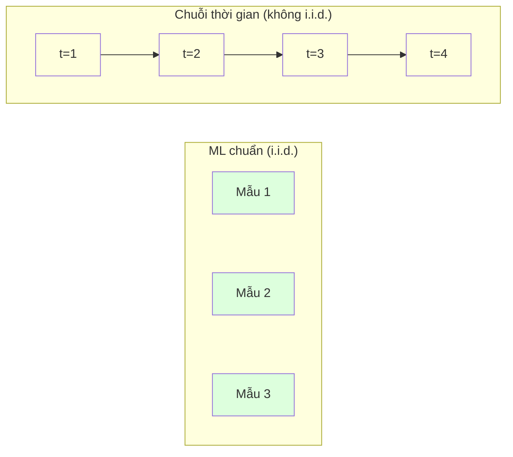
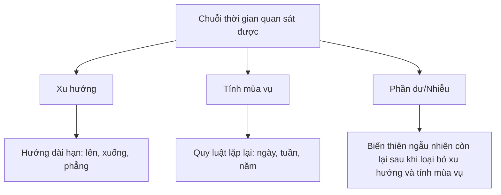
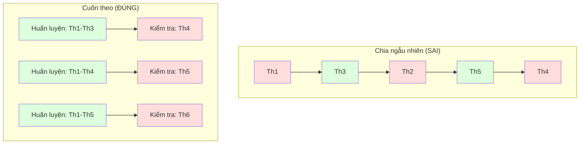

# Nền tảng chuỗi thời gian (time series)

> Hiệu suất quá khứ thực sự dự báo được kết quả tương lai -- miễn là bạn kiểm tra tính dừng (stationarity) trước.

**Type:** Build
**Language:** Python
**Prerequisites:** Giai đoạn 2, Bài 01-09
**Time:** ~90 phút

## Mục tiêu học tập

- Phân rã chuỗi thời gian thành xu hướng (trend), tính mùa vụ (seasonality) và phần dư rồi kiểm tra tính dừng
- Cài đặt đặc trưng độ trễ (lag) và thống kê trượt để biến chuỗi thời gian thành bài toán học có giám sát
- Xây dựng khung kiểm định cuốn theo (walk-forward validation) ngăn dữ liệu tương lai rò rỉ vào tập huấn luyện
- Giải thích vì sao chia train/test ngẫu nhiên là không hợp lệ với chuỗi thời gian và chứng minh khoảng cách hiệu năng so với cách chia theo thời gian đúng đắn

## Vấn đề

Bạn có dữ liệu sắp xếp theo thời gian. Doanh số theo ngày, nhiệt độ theo giờ, mức dùng CPU theo phút, giá cổ phiếu theo tuần. Bạn muốn dự báo giá trị tiếp theo, tuần tiếp theo, quý tiếp theo.

Bạn với tay lấy bộ công cụ ML quen thuộc: chia train/test ngẫu nhiên, cross-validation, ma trận đặc trưng đưa vào, dự đoán đưa ra. Mọi bước đều sai.

Chuỗi thời gian phá vỡ những giả định mà ML chuẩn dựa vào. Các mẫu không độc lập -- nhiệt độ hôm nay phụ thuộc vào hôm qua. Chia ngẫu nhiên làm rò rỉ thông tin tương lai vào quá khứ. Những đặc trưng trông tuyệt vời trong backtest lại thất bại khi chạy thật, vì chúng dựa vào các quy luật thay đổi theo thời gian.

Một mô hình đạt 95% độ chính xác với cross-validation ngẫu nhiên có thể chỉ còn 55% khi đánh giá đúng theo thời gian. Khác biệt đó không phải chuyện kỹ thuật vụn vặt. Đó là khác biệt giữa một mô hình chạy được trên giấy và một mô hình chạy được trong sản phẩm thật.

Bài này trình bày những nền tảng: điều gì khiến dữ liệu thời gian khác biệt, đánh giá mô hình một cách trung thực ra sao, và làm thế nào biến chuỗi thời gian thành đặc trưng để các mô hình ML chuẩn dùng được.

## Khái niệm

### Điều gì khiến chuỗi thời gian khác biệt

ML chuẩn giả định i.i.d. -- độc lập và phân phối giống nhau. Mỗi mẫu được rút từ cùng một phân phối, độc lập với các mẫu khác. Chuỗi thời gian vi phạm cả hai điều:

- **Không độc lập.** Giá cổ phiếu hôm nay phụ thuộc giá hôm qua. Doanh số tuần này tương quan với tuần trước.
- **Không cùng phân phối.** Phân phối dịch chuyển theo thời gian. Doanh số tháng 12 trông khác doanh số tháng 3.

Những vi phạm này không hề nhỏ. Chúng thay đổi cách bạn tạo đặc trưng, cách bạn đánh giá mô hình, và những thuật toán nào chạy được.



Trong ML chuẩn, các mẫu hoán đổi được cho nhau. Xáo trộn chúng không thay đổi gì. Trong chuỗi thời gian, thứ tự là tất cả. Xáo trộn phá hủy tín hiệu.

### Các thành phần của chuỗi thời gian

Mỗi chuỗi thời gian là sự kết hợp của:



- **Xu hướng**: Hướng dài hạn. Doanh thu tăng 10% mỗi năm. Nhiệt độ toàn cầu tăng.
- **Tính mùa vụ**: Quy luật lặp lại ở những khoảng thời gian cố định. Doanh số bán lẻ bùng nổ vào tháng 12. Nhu cầu điều hòa nhiệt độ đạt đỉnh vào tháng 7.
- **Phần dư**: Những gì còn lại sau khi loại bỏ xu hướng và tính mùa vụ. Nếu phần dư trông như nhiễu trắng, phép phân rã đã bắt được tín hiệu.

### Tính dừng

Một chuỗi thời gian là dừng nếu các tính chất thống kê của nó (trung bình, phương sai, tự tương quan) không thay đổi theo thời gian. Hầu hết phương pháp dự báo đều giả định tính dừng.

**Vì sao quan trọng:** Một chuỗi không dừng có trung bình trôi dạt. Mô hình huấn luyện trên dữ liệu tháng 1 đã học một trung bình khác với trung bình mà tháng 2 sẽ cho thấy. Nó sẽ sai một cách hệ thống.

**Cách kiểm tra:** Tính trung bình trượt và độ lệch chuẩn trượt trên các cửa sổ. Nếu chúng trôi dạt, chuỗi không dừng.

**Cách khắc phục:** Lấy sai phân (differencing). Thay vì mô hình hóa các giá trị thô, mô hình hóa mức thay đổi giữa các giá trị liên tiếp:

```
diff[t] = value[t] - value[t-1]
```

Nếu một lần lấy sai phân không làm chuỗi dừng, hãy áp dụng lần nữa (sai phân bậc hai). Hầu hết chuỗi trong thực tế chỉ cần tối đa hai lần.

**Ví dụ:**

Chuỗi gốc:       [100, 102, 106, 112, 120]
Sai phân bậc 1:  [2, 4, 6, 8] (vẫn có xu hướng đi lên)
Sai phân bậc 2:  [2, 2, 2] (hằng số -- dừng)

Chuỗi gốc có xu hướng bậc hai. Sai phân bậc một biến nó thành xu hướng bậc một. Sai phân bậc hai làm nó phẳng. Trong thực hành, hiếm khi bạn cần quá hai lần.

**Kiểm định chính thức:** Kiểm định Augmented Dickey-Fuller (ADF) là kiểm định thống kê chuẩn cho tính dừng. Giả thuyết không là "chuỗi không dừng". Một p-value dưới 0.05 nghĩa là bạn có thể bác bỏ giả thuyết không và kết luận chuỗi dừng. Chúng ta không tự cài đặt ADF từ đầu (nó cần bảng phân phối tiệm cận), nhưng cách dùng thống kê trượt trong mã của bài cho một phép kiểm tra trực quan thực dụng.

### Tự tương quan

Tự tương quan (autocorrelation) đo mức một giá trị tại thời điểm t tương quan với giá trị tại thời điểm t-k (k bước về quá khứ). Hàm tự tương quan (ACF) vẽ tương quan này theo từng độ trễ k.

**ACF cho bạn biết:**
- Chuỗi nhớ được bao xa về quá khứ. Nếu ACF về 0 sau độ trễ 5, các giá trị cách hơn 5 bước không còn liên quan.
- Có tính mùa vụ hay không. Nếu ACF vọt lên ở độ trễ 12 (dữ liệu tháng), tức là có tính mùa vụ theo năm.
- Nên tạo bao nhiêu đặc trưng độ trễ. Dùng độ trễ tới mức ACF trở nên không đáng kể.

**PACF (Hàm tự tương quan riêng phần)** loại bỏ các tương quan gián tiếp. Nếu hôm nay tương quan với 3 ngày trước chỉ vì cả hai đều tương quan với hôm qua, PACF ở độ trễ 3 sẽ bằng 0 còn ACF ở độ trễ 3 thì không.

### Đặc trưng độ trễ: biến chuỗi thời gian thành học có giám sát

Mô hình ML chuẩn cần một ma trận đặc trưng X và một nhãn y. Chuỗi thời gian chỉ cho bạn một cột giá trị. Cây cầu nối là đặc trưng độ trễ.

Lấy chuỗi [10, 12, 14, 13, 15] và tạo đặc trưng độ trễ 1 và độ trễ 2:

| lag_2 | lag_1 | target |
|-------|-------|--------|
| 10    | 12    | 14     |
| 12    | 14    | 13     |
| 14    | 13    | 15     |

Giờ bạn có một bài toán hồi quy chuẩn. Bất kỳ mô hình ML nào (hồi quy tuyến tính, random forest, gradient boosting) đều có thể dự đoán target từ các độ trễ.

Các đặc trưng khác bạn có thể tạo:
- **Thống kê trượt:** trung bình, std, min, max trên k giá trị gần nhất
- **Đặc trưng lịch:** thứ trong tuần, tháng, is_holiday, is_weekend
- **Giá trị sai phân:** mức thay đổi so với bước trước
- **Thống kê mở rộng:** trung bình tích lũy, tổng tích lũy
- **Đặc trưng tỷ lệ:** giá trị hiện tại / trung bình trượt (cách xa mức trung bình gần đây bao nhiêu)
- **Đặc trưng tương tác:** lag_1 * day_of_week (ảnh hưởng của ngày trong tuần lên đà tăng)

**Bao nhiêu độ trễ?** Dùng hàm tự tương quan. Nếu ACF còn đáng kể tới độ trễ 10, dùng ít nhất 10 độ trễ. Nếu có tính mùa vụ theo tuần, thêm độ trễ 7 (và có thể cả 14). Nhiều độ trễ cho mô hình nhiều lịch sử hơn nhưng cũng nhiều đặc trưng hơn để khớp, làm tăng nguy cơ overfitting.

**Cái bẫy căn chỉnh target.** Khi tạo đặc trưng độ trễ, target phải là giá trị tại thời điểm t, còn mọi đặc trưng phải dùng giá trị tại thời điểm t-1 hoặc sớm hơn. Nếu bạn vô tình đưa giá trị tại thời điểm t vào làm đặc trưng, bạn có một bộ dự báo hoàn hảo -- và một mô hình hoàn toàn vô dụng. Đây là lỗi phổ biến nhất trong tạo đặc trưng cho chuỗi thời gian.

### Kiểm định cuốn theo

Đây là khái niệm quan trọng nhất của bài này. k-fold cross-validation chuẩn gán mẫu vào train và test một cách ngẫu nhiên. Với chuỗi thời gian, điều đó làm rò rỉ thông tin tương lai.



Kiểm định cuốn theo:
1. Huấn luyện trên dữ liệu tới thời điểm t
2. Dự báo tại thời điểm t+1 (hoặc t+1 đến t+k với dự báo nhiều bước)
3. Trượt cửa sổ về phía trước
4. Lặp lại

Mỗi fold test chỉ chứa dữ liệu đến sau toàn bộ dữ liệu huấn luyện. Không có rò rỉ tương lai. Điều này cho bạn một ước lượng trung thực về hiệu năng của mô hình khi được triển khai.

**Cửa sổ mở rộng** dùng toàn bộ dữ liệu lịch sử để huấn luyện (cửa sổ lớn dần). **Cửa sổ trượt** dùng cửa sổ huấn luyện kích thước cố định (cửa sổ trượt đi). Dùng mở rộng khi bạn tin dữ liệu cũ vẫn còn liên quan. Dùng trượt khi thế giới đã thay đổi và dữ liệu cũ gây hại.

### Trực giác về ARIMA

ARIMA là mô hình chuỗi thời gian cổ điển. Nó có ba thành phần:

- **AR (Tự hồi quy):** Dự báo từ các giá trị quá khứ. AR(p) dùng p giá trị gần nhất.
- **I (Tích hợp):** Lấy sai phân để đạt tính dừng. I(d) áp dụng d lần lấy sai phân.
- **MA (Trung bình trượt):** Dự báo từ các sai số dự báo quá khứ. MA(q) dùng q sai số gần nhất.

ARIMA(p, d, q) kết hợp cả ba. Bạn chọn p, d, q dựa trên phân tích ACF/PACF hoặc tìm kiếm tự động (auto-ARIMA).

Chúng ta sẽ không tự cài đặt ARIMA từ đầu -- nó cần tối ưu số học nằm ngoài phạm vi bài này. Điểm mấu chốt là hiểu mỗi thành phần làm gì, để bạn đọc được kết quả ARIMA và biết khi nào nên dùng nó.

### Khi nào dùng cái gì

| Cách tiếp cận | Phù hợp nhất với | Xử lý tính mùa vụ | Xử lý đặc trưng ngoài |
|----------|---------|-------------------|------------------------|
| Đặc trưng độ trễ + ML | Dữ liệu dạng bảng có nhiều đặc trưng ngoài | Có, nhờ đặc trưng lịch | Có |
| ARIMA | Chuỗi đơn biến, ngắn hạn | Biến thể SARIMA | Không (ARIMAX cho phạm vi hạn chế) |
| Làm mượt hàm mũ | Xu hướng + mùa vụ đơn giản | Có (Holt-Winters) | Không |
| Prophet | Dự báo kinh doanh, ngày lễ | Có (số hạng Fourier) | Hạn chế |
| Mạng nơ-ron (LSTM, Transformer) | Chuỗi dài, nhiều chuỗi | Học được | Có |

Với hầu hết bài toán thực tế, đặc trưng độ trễ + gradient boosting là điểm khởi đầu mạnh nhất. Nó xử lý đặc trưng ngoài một cách tự nhiên, không đòi hỏi tính dừng, và dễ gỡ lỗi.

### Chân trời và chiến lược dự báo

Dự báo một bước dự đoán trước một bước thời gian. Dự báo nhiều bước dự đoán nhiều bước. Có ba chiến lược:

**Đệ quy (lặp):** Dự báo một bước, rồi dùng dự đoán đó làm đầu vào cho bước sau. Đơn giản nhưng sai số tích lũy -- mỗi dự đoán dùng dự đoán trước, nên sai sót cộng dồn.

**Trực tiếp:** Huấn luyện một mô hình riêng cho từng chân trời. Model-1 dự báo t+1, Model-5 dự báo t+5. Không tích lũy sai số, nhưng mỗi mô hình có ít mẫu huấn luyện hơn và chúng không chia sẻ thông tin.

**Nhiều đầu ra:** Huấn luyện một mô hình xuất ra tất cả chân trời cùng lúc. Chia sẻ thông tin giữa các chân trời nhưng cần mô hình hỗ trợ nhiều đầu ra (hoặc một hàm mất mát tùy chỉnh).

Với hầu hết bài toán thực tế, hãy bắt đầu bằng đệ quy cho chân trời ngắn (1-5 bước) và trực tiếp cho chân trời dài hơn.

### Những lỗi thường gặp trong chuỗi thời gian

| Lỗi | Vì sao xảy ra | Cách khắc phục |
|---------|---------------|-----------|
| Chia train/test ngẫu nhiên | Thói quen từ ML chuẩn | Dùng kiểm định cuốn theo hoặc chia theo thời gian |
| Dùng đặc trưng tương lai | Đặc trưng tại thời điểm t bị đưa vào nhầm | Rà soát mọi đặc trưng theo căn chỉnh thời gian |
| Overfitting vào tính mùa vụ | Mô hình học thuộc quy luật lịch | Giữ lại trọn một chu kỳ mùa vụ trong tập test |
| Bỏ qua thay đổi quy mô | Doanh thu gấp đôi nhưng quy luật giữ nguyên | Mô hình hóa phần trăm thay đổi thay vì giá trị tuyệt đối |
| Quá nhiều đặc trưng độ trễ | "Càng nhiều lịch sử càng tốt" | Dùng ACF để xác định các độ trễ liên quan |
| Không lấy sai phân | "Mô hình sẽ tự tìm ra" | Mô hình cây xử lý được xu hướng; mô hình tuyến tính cần tính dừng |

```figure
f3-series-decompose
```

## Tự tay làm

Mã trong `code/time_series.py` cài đặt các khối xây dựng cốt lõi từ đầu.

### Tạo đặc trưng độ trễ

```python
def make_lag_features(series, n_lags):
    n = len(series)
    X = np.full((n, n_lags), np.nan)
    for lag in range(1, n_lags + 1):
        X[lag:, lag - 1] = series[:-lag]
    valid = ~np.isnan(X).any(axis=1)
    return X[valid], series[valid]
```

Đoạn này biến một chuỗi 1D thành ma trận đặc trưng, trong đó mỗi dòng có `n_lags` giá trị gần nhất làm đặc trưng và giá trị hiện tại làm target.

### Cross-validation cuốn theo

```python
def walk_forward_split(n_samples, n_splits=5, min_train=50):
    assert min_train < n_samples, "min_train must be less than n_samples"
    step = max(1, (n_samples - min_train) // n_splits)
    for i in range(n_splits):
        train_end = min_train + i * step
        test_end = min(train_end + step, n_samples)
        if train_end >= n_samples:
            break
        yield slice(0, train_end), slice(train_end, test_end)
```

Mỗi lần chia đảm bảo dữ liệu huấn luyện đến trước dữ liệu test. Cửa sổ huấn luyện mở rộng theo từng fold.

### Mô hình tự hồi quy đơn giản

Một mô hình AR thuần chỉ là hồi quy tuyến tính trên đặc trưng độ trễ:

```python
class SimpleAR:
    def __init__(self, n_lags=5):
        self.n_lags = n_lags
        self.weights = None
        self.bias = None

    def fit(self, series):
        X, y = make_lag_features(series, self.n_lags)
        # Solve via normal equations
        X_b = np.column_stack([np.ones(len(X)), X])
        theta = np.linalg.lstsq(X_b, y, rcond=None)[0]
        self.bias = theta[0]
        self.weights = theta[1:]
        return self
```

Về mặt khái niệm, đây chính là hồi quy tuyến tính ở Bài 02, nhưng áp dụng cho các phiên bản trễ thời gian của cùng một biến.

### Kiểm tra tính dừng

Mã tính thống kê trượt để đánh giá tính dừng bằng mắt và bằng số:

```python
def check_stationarity(series, window=50):
    rolling_mean = np.array([
        series[max(0, i - window):i].mean()
        for i in range(1, len(series) + 1)
    ])
    rolling_std = np.array([
        series[max(0, i - window):i].std()
        for i in range(1, len(series) + 1)
    ])
    return rolling_mean, rolling_std
```

Nếu trung bình trượt trôi dạt hoặc độ lệch chuẩn trượt thay đổi, chuỗi không dừng. Hãy lấy sai phân rồi kiểm tra lại.

Mã cũng kiểm tra tính dừng bằng cách so nửa đầu và nửa sau của chuỗi. Nếu hai trung bình lệch nhau quá nửa độ lệch chuẩn hoặc tỷ lệ phương sai vượt 2x, chuỗi bị đánh dấu là không dừng.

### Tự tương quan

```python
def autocorrelation(series, max_lag=20):
    n = len(series)
    mean = series.mean()
    var = series.var()
    acf = np.zeros(max_lag + 1)
    for k in range(max_lag + 1):
        cov = np.mean((series[:n-k] - mean) * (series[k:] - mean))
        acf[k] = cov / var if var > 0 else 0
    return acf
```

## Áp dụng

Với sklearn, bạn dùng đặc trưng độ trễ trực tiếp với bất kỳ bộ hồi quy nào:

```python
from sklearn.linear_model import Ridge
from sklearn.ensemble import GradientBoostingRegressor

X, y = make_lag_features(series, n_lags=10)

for train_idx, test_idx in walk_forward_split(len(X)):
    model = Ridge(alpha=1.0)
    model.fit(X[train_idx], y[train_idx])
    predictions = model.predict(X[test_idx])
```

Với ARIMA, dùng statsmodels:

```python
from statsmodels.tsa.arima.model import ARIMA

model = ARIMA(train_series, order=(5, 1, 2))
fitted = model.fit()
forecast = fitted.forecast(steps=30)
```

Mã trong `time_series.py` minh họa cả hai cách và so sánh chúng bằng kiểm định cuốn theo.

### TimeSeriesSplit của sklearn

sklearn cung cấp `TimeSeriesSplit`, chính là cài đặt sẵn của kiểm định cuốn theo:

```python
from sklearn.model_selection import TimeSeriesSplit

tscv = TimeSeriesSplit(n_splits=5)
for train_index, test_index in tscv.split(X):
    X_train, X_test = X[train_index], X[test_index]
    y_train, y_test = y[train_index], y[test_index]
    model.fit(X_train, y_train)
    score = model.score(X_test, y_test)
```

Nó tương đương `walk_forward_split` tự viết của chúng ta nhưng đã tích hợp vào khung cross-validation của sklearn. Bạn có thể dùng nó với `cross_val_score`:

```python
from sklearn.model_selection import cross_val_score

scores = cross_val_score(model, X, y, cv=TimeSeriesSplit(n_splits=5))
print(f"Mean score: {scores.mean():.4f} +/- {scores.std():.4f}")
```

### Thước đo đánh giá

Dự báo chuỗi thời gian dùng các thước đo hồi quy, nhưng với ngữ cảnh nhận biết thời gian:

- **MAE (Sai số tuyệt đối trung bình):** Trung bình của |y_true - y_pred|. Dễ diễn giải theo đơn vị gốc. "Trung bình dự đoán lệch 3.2 độ."
- **RMSE (Căn bậc hai sai số bình phương trung bình):** Căn bậc hai của sai số bình phương trung bình. Phạt sai số lớn nặng hơn MAE. Dùng khi một lỗi lớn tệ hơn nhiều lỗi nhỏ.
- **MAPE (Sai số phần trăm tuyệt đối trung bình):** Trung bình của |error / true_value| * 100. Không phụ thuộc thang đo, hữu ích để so sánh giữa các chuỗi khác nhau. Nhưng không xác định khi giá trị thực bằng 0.
- **So sánh với baseline ngây thơ:** Luôn so sánh với các baseline đơn giản. Baseline ngây thơ theo mùa dự báo giá trị của một chu kỳ trước (hôm qua, tuần trước). Nếu mô hình của bạn không thắng nổi baseline ngây thơ, có gì đó sai.

### Đặc trưng trượt

Mã minh họa việc thêm thống kê trượt (trung bình, std, min, max trên cửa sổ 7 và 14 ngày) vào đặc trưng độ trễ. Những đặc trưng này cho mô hình thông tin về xu hướng và độ biến động gần đây mà chỉ đặc trưng độ trễ không bắt được.

Ví dụ, nếu trung bình trượt đang tăng, nó gợi ý một xu hướng đi lên. Nếu độ lệch chuẩn trượt tăng, nó gợi ý độ biến động đang lớn dần. Đây là kiểu quy luật mà mô hình dựa trên cây học được còn mô hình tuyến tính thì không.

## Đóng gói

Bài này tạo ra:
- `outputs/prompt-time-series-advisor.md` -- một prompt để đặt vấn đề chuỗi thời gian
- `code/time_series.py` -- đặc trưng độ trễ, kiểm định cuốn theo, mô hình AR, kiểm tra tính dừng

### Những baseline bạn phải vượt

Trước khi xây bất kỳ mô hình nào, hãy lập baseline:

1. **Giá trị cuối (persistence).** Dự báo rằng mai sẽ giống hôm nay. Với nhiều chuỗi, vượt qua nó khó một cách đáng ngạc nhiên.
2. **Ngây thơ theo mùa.** Dự báo rằng hôm nay sẽ giống cùng ngày tuần trước (hoặc năm trước). Nếu mô hình của bạn không thắng nổi, nó chưa học được quy luật hữu ích nào ngoài tính mùa vụ.
3. **Trung bình trượt.** Dự báo trung bình của k giá trị gần nhất. Làm mượt nhiễu nhưng không bắt được thay đổi đột ngột.

Nếu mô hình ML xịn của bạn thua baseline ngây thơ theo mùa, bạn có bug. Thường gặp nhất: rò rỉ tương lai trong đặc trưng, phương pháp đánh giá sai, hoặc chuỗi thực sự ngẫu nhiên và không dự báo được.

### Mẹo thực tế

1. **Bắt đầu bằng vẽ đồ thị.** Trước khi mô hình hóa, hãy vẽ chuỗi thô. Tìm xu hướng, tính mùa vụ, ngoại lai, điểm gãy cấu trúc (thay đổi đột ngột trong hành vi). Một phút nhìn bằng mắt thường cho bạn nhiều thông tin hơn một giờ phân tích tự động.

2. **Lấy sai phân trước, mô hình hóa sau.** Nếu chuỗi có xu hướng rõ ràng, hãy lấy sai phân trước khi tạo đặc trưng độ trễ. Mô hình dựa trên cây xử lý được xu hướng, nhưng mô hình tuyến tính thì không, và lấy sai phân không bao giờ gây hại.

3. **Giữ lại ít nhất một chu kỳ mùa vụ đầy đủ.** Nếu bạn có tính mùa vụ theo tuần, tập test cần ít nhất một tuần đầy đủ. Nếu theo tháng, ít nhất một tháng đầy đủ. Nếu không, bạn không thể đánh giá liệu mô hình có bắt được quy luật mùa vụ hay không.

4. **Giám sát khi chạy thật.** Mô hình chuỗi thời gian xuống cấp theo thời gian khi thế giới thay đổi. Theo dõi sai số dự đoán trên cơ sở cuốn theo. Khi sai số bắt đầu tăng, huấn luyện lại mô hình trên dữ liệu gần đây.

5. **Cẩn thận với thay đổi chế độ.** Một mô hình huấn luyện trên dữ liệu trước đại dịch sẽ không dự báo được hành vi sau đại dịch. Đưa các chỉ báo về những thay đổi chế độ đã biết vào làm đặc trưng, hoặc dùng cửa sổ trượt để quên dữ liệu cũ.

6. **Log-transform chuỗi lệch.** Doanh thu, giá cả và số đếm thường lệch phải. Lấy log ổn định phương sai và biến quy luật nhân thành quy luật cộng, thứ mà mô hình tuyến tính xử lý được. Dự báo trong không gian log, rồi lũy thừa để trở về đơn vị gốc.

## Bài tập

1. **Thí nghiệm tính dừng.** Sinh một chuỗi có xu hướng tuyến tính. Kiểm tra tính dừng bằng thống kê trượt. Áp dụng sai phân bậc một. Kiểm tra lại. Với xu hướng bậc hai thì cần bao nhiêu lần lấy sai phân?

2. **Chọn độ trễ.** Tính ACF trên một chuỗi có mùa vụ (chu kỳ = 7). Những độ trễ nào có tự tương quan cao nhất? Tạo đặc trưng độ trễ chỉ dùng những độ trễ đó (không dùng các độ trễ liên tiếp). Độ chính xác có cải thiện so với dùng độ trễ 1 đến 7 không?

3. **Cuốn theo so với chia ngẫu nhiên.** Huấn luyện hồi quy Ridge trên đặc trưng độ trễ. Đánh giá bằng cách chia ngẫu nhiên 80/20 và bằng kiểm định cuốn theo. Chia ngẫu nhiên đánh giá cao hơn thực tế bao nhiêu?

4. **Tạo đặc trưng.** Thêm trung bình trượt (cửa sổ 7), độ lệch chuẩn trượt (cửa sổ 7) và đặc trưng thứ trong tuần vào đặc trưng độ trễ. So sánh độ chính xác có và không có các đặc trưng thêm này bằng kiểm định cuốn theo.

5. **Dự báo nhiều bước.** Sửa mô hình AR để dự báo 5 bước thay vì 1. So sánh hai chiến lược: (a) dự báo một bước, dùng dự đoán làm đầu vào cho bước sau (đệ quy), và (b) huấn luyện mô hình riêng cho từng chân trời (trực tiếp). Cái nào chính xác hơn?

## Thuật ngữ chính

| Thuật ngữ | Người ta thường nói | Ý nghĩa thực sự |
|------|----------------|----------------------|
| Stationarity | "Các thống kê không đổi theo thời gian" | Một chuỗi có trung bình, phương sai và cấu trúc tự tương quan không đổi theo thời gian |
| Differencing | "Lấy hiệu các giá trị liên tiếp" | Tính y[t] - y[t-1] để loại bỏ xu hướng và đạt tính dừng |
| Autocorrelation (ACF) | "Chuỗi tương quan với chính nó thế nào" | Tương quan giữa một chuỗi thời gian và bản sao trễ của nó, như một hàm của độ trễ |
| Partial autocorrelation (PACF) | "Chỉ tương quan trực tiếp" | Tự tương quan ở độ trễ k sau khi loại bỏ ảnh hưởng của mọi độ trễ ngắn hơn |
| Lag features | "Giá trị quá khứ làm đầu vào" | Dùng y[t-1], y[t-2], ..., y[t-k] làm đặc trưng để dự báo y[t] |
| Walk-forward validation | "Cross-validation tôn trọng thời gian" | Đánh giá trong đó dữ liệu huấn luyện luôn đi trước dữ liệu test theo thời gian |
| ARIMA | "Mô hình chuỗi thời gian kinh điển" | AutoRegressive Integrated Moving Average: kết hợp giá trị quá khứ (AR), lấy sai phân (I) và sai số quá khứ (MA) |
| Seasonality | "Quy luật lịch lặp lại" | Các chu kỳ đều đặn, dự báo được, gắn với những mốc lịch (ngày, tuần, năm) |
| Trend | "Hướng dài hạn" | Mức tăng hoặc giảm dai dẳng của mức nền chuỗi theo thời gian |
| Expanding window | "Dùng toàn bộ lịch sử" | Kiểm định cuốn theo trong đó tập huấn luyện lớn dần qua từng fold |
| Sliding window | "Lịch sử kích thước cố định" | Kiểm định cuốn theo trong đó tập huấn luyện là một cửa sổ dài cố định trượt về phía trước |

## Đọc thêm

- [Hyndman và Athanasopoulos, Forecasting: Principles and Practice (3rd ed.)](https://otexts.com/fpp3/) -- cuốn sách miễn phí hay nhất về dự báo chuỗi thời gian
- [scikit-learn Time Series Split](https://scikit-learn.org/stable/modules/generated/sklearn.model_selection.TimeSeriesSplit.html) -- bộ chia cuốn theo của sklearn
- [statsmodels ARIMA docs](https://www.statsmodels.org/stable/generated/statsmodels.tsa.arima.model.ARIMA.html) -- cài đặt ARIMA kèm công cụ chẩn đoán
- [Makridakis et al., The M5 Competition (2022)](https://www.sciencedirect.com/science/article/pii/S0169207021001874) -- cuộc thi dự báo quy mô lớn cho thấy phương pháp ML so với phương pháp thống kê
