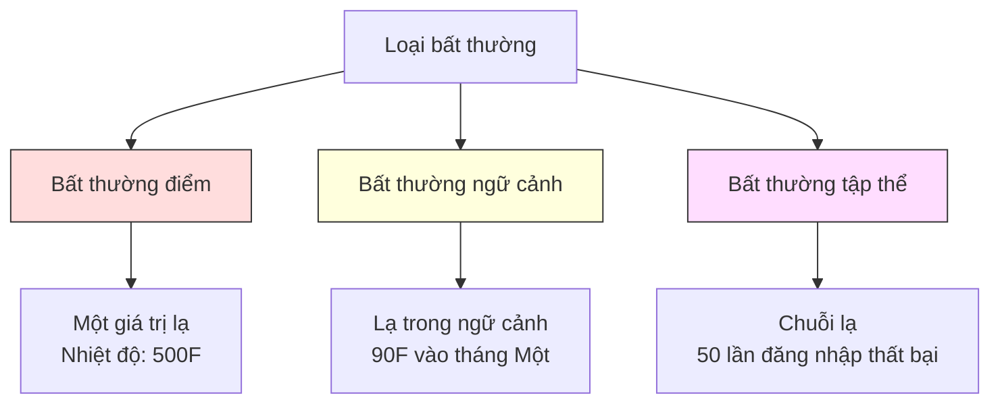
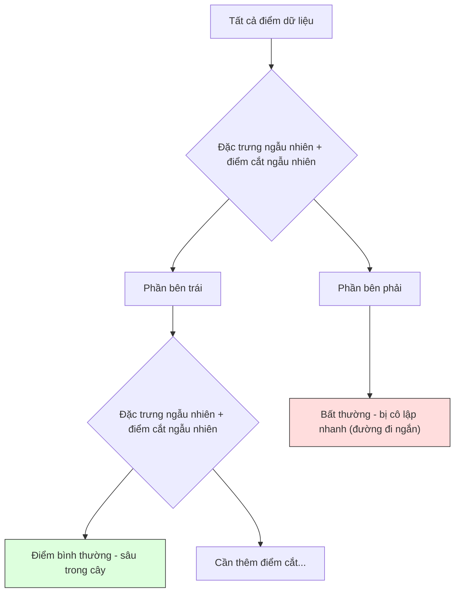

# Phát hiện bất thường

> Bình thường thì dễ định nghĩa. Bất thường là bất cứ thứ gì không khớp.

**Type:** Build
**Language:** Python
**Prerequisites:** Giai đoạn 2, Bài 01-09
**Time:** ~75 phút

## Mục tiêu học tập

- Tự cài đặt anomaly detection (phát hiện bất thường) bằng Z-score, IQR và Isolation Forest
- Phân biệt bất thường điểm (point), bất thường ngữ cảnh (contextual) và bất thường tập thể (collective), rồi chọn phương pháp phát hiện phù hợp cho từng loại
- Giải thích vì sao anomaly detection được đặt vấn đề là mô hình hoá dữ liệu bình thường thay vì phân loại bất thường
- So sánh anomaly detection không giám sát với phân loại có giám sát và đánh giá đánh đổi giữa độ bao phủ loại bất thường mới với precision (độ chính xác)

## Vấn đề

Một thẻ tín dụng được dùng ở New York lúc 2 giờ chiều, rồi ở Tokyo lúc 2 giờ 05. Một cảm biến nhà máy đọc 150 độ trong khi khoảng bình thường là 80-120. Một máy chủ gửi 50.000 request mỗi giây trong khi trung bình ngày là 200.

Đây là những bất thường. Tìm ra chúng rất quan trọng. Gian lận gây thiệt hại hàng tỉ đô. Hỏng thiết bị gây ngừng máy. Xâm nhập mạng gây mất dữ liệu.

Thách thức: bạn hiếm khi có ví dụ bất thường đã được gán nhãn. Gian lận chiếm 0,1% giao dịch. Hỏng thiết bị chỉ xảy ra vài lần mỗi năm. Bạn không thể huấn luyện một bộ phân loại chuẩn vì gần như không có gì trong lớp "bất thường" để học. Kể cả khi có vài nhãn, những bất thường bạn đã thấy không phải là những loại duy nhất bạn sẽ gặp. Chiêu gian lận của ngày mai trông khác hôm nay.

Anomaly detection lật ngược bài toán. Thay vì học cái gì là bất thường, hãy học cái gì là bình thường. Bất cứ thứ gì lệch khỏi bình thường đều đáng ngờ. Cách này chạy được mà không cần nhãn, thích ứng với các loại bất thường mới, và mở rộng được tới bộ dữ liệu khổng lồ.

## Khái niệm

### Các loại bất thường

Không phải mọi bất thường đều giống nhau:

- **Bất thường điểm (point anomaly).** Một điểm dữ liệu đơn lẻ bất thường bất kể ngữ cảnh. Một giá trị nhiệt độ 500 độ. Một giao dịch 50.000 đô từ một tài khoản thường chỉ tiêu 50 đô.
- **Bất thường ngữ cảnh (contextual anomaly).** Một điểm dữ liệu bất thường khi xét theo ngữ cảnh của nó. Nhiệt độ 90 độ là bình thường vào mùa hè, bất thường vào mùa đông. Cùng một giá trị, ngữ cảnh khác nhau.
- **Bất thường tập thể (collective anomaly).** Một chuỗi điểm dữ liệu bất thường khi xét như một nhóm, dù từng điểm riêng lẻ có thể bình thường. Năm lần đăng nhập thất bại là bình thường. Năm mươi lần liên tiếp là một cuộc tấn công brute-force.

Hầu hết các phương pháp đều phát hiện bất thường điểm. Bất thường ngữ cảnh cần đặc trưng thời gian hoặc vị trí. Bất thường tập thể cần phương pháp hiểu được chuỗi.



### Cách đặt vấn đề không giám sát

Trong phân loại chuẩn, bạn có nhãn cho cả hai lớp. Trong anomaly detection, thường bạn gặp một trong ba tình huống:

1. **Hoàn toàn không giám sát.** Không có nhãn nào cả. Bạn khớp bộ phát hiện trên toàn bộ dữ liệu và hy vọng bất thường đủ hiếm để không làm hỏng mô hình "bình thường".
2. **Bán giám sát.** Bạn có một bộ dữ liệu sạch chỉ gồm dữ liệu bình thường. Bạn khớp trên tập sạch này và chấm điểm mọi thứ còn lại. Đây là thiết lập mạnh nhất khi có thể.
3. **Giám sát yếu.** Bạn có vài bất thường đã gán nhãn. Dùng chúng để đánh giá, không phải để huấn luyện. Huấn luyện không giám sát, rồi đo precision/recall (độ chính xác/độ phủ) trên tập con có nhãn.

Điểm mấu chốt: anomaly detection về bản chất khác với phân loại. Bạn đang mô hình hoá phân phối của dữ liệu bình thường, không phải ranh giới quyết định giữa hai lớp.

### Có giám sát vs không giám sát: đánh đổi

Nếu bạn thực sự có bất thường đã gán nhãn, nên dùng chúng để huấn luyện (phân loại có giám sát) hay chỉ để đánh giá (phát hiện không giám sát)?

**Có giám sát (coi như phân loại):**
- Bắt đúng những loại bất thường bạn đã thấy trước đó
- Độ chính xác cao hơn trên các loại bất thường đã biết
- Bỏ sót hoàn toàn các loại bất thường mới
- Phải huấn luyện lại khi xuất hiện loại bất thường mới
- Cần đủ ví dụ bất thường (thường quá ít)

**Không giám sát (mô hình hoá bình thường, gắn cờ phần lệch):**
- Bắt mọi lệch khỏi bình thường, kể cả loại mới
- Không cần bất thường có nhãn
- Tỉ lệ dương tính giả cao hơn (không phải mọi thứ lạ đều xấu)
- Bền vững hơn với dịch chuyển phân phối

Trên thực tế, hệ thống tốt nhất kết hợp cả hai: phát hiện không giám sát để bao phủ rộng, mô hình có giám sát cho các loại bất thường ưu tiên cao đã biết, và con người xem xét các ca mơ hồ.

### Phương pháp Z-score

Cách đơn giản nhất. Tính trung bình và độ lệch chuẩn của từng đặc trưng. Gắn cờ mọi điểm cách trung bình hơn k độ lệch chuẩn.

```text
z_score = (x - mean) / std
anomaly if |z_score| > threshold
```

Ngưỡng mặc định là 3.0 (với phân phối Gaussian, 99.7% dữ liệu bình thường nằm trong 3 độ lệch chuẩn).

**Điểm mạnh:** Đơn giản. Nhanh. Diễn giải được ("giá trị này lệch 4,5 độ lệch chuẩn so với bình thường").

**Điểm yếu:** Giả định dữ liệu phân phối chuẩn. Nhạy với outlier (điểm ngoại lai) trong dữ liệu huấn luyện (outlier làm lệch trung bình và thổi phồng độ lệch chuẩn, khiến chúng khó bị phát hiện hơn). Thất bại trên phân phối đa đỉnh.

**Khi nào chạy tốt:** Giám sát một đặc trưng với dữ liệu gần dạng chuông. Thời gian phản hồi máy chủ, dung sai sản xuất, giá trị cảm biến với đường nền ổn định.

**Khi nào thất bại:** Dữ liệu nhiều cụm (hai văn phòng có nhiệt độ nền khác nhau), dữ liệu lệch (số tiền giao dịch mà 1000 đô là hiếm nhưng không bất thường), dữ liệu có outlier trong tập huấn luyện.

### Phương pháp IQR

Bền vững hơn Z-score. Dùng khoảng tứ phân vị thay cho trung bình và độ lệch chuẩn.

```
Q1 = 25th percentile
Q3 = 75th percentile
IQR = Q3 - Q1
lower_bound = Q1 - factor * IQR
upper_bound = Q3 + factor * IQR
anomaly if x < lower_bound or x > upper_bound
```

Hệ số mặc định là 1.5.

**Điểm mạnh:** Bền vững với outlier (phân vị không bị ảnh hưởng bởi giá trị cực trị). Chạy được trên phân phối lệch. Không giả định phân phối chuẩn.

**Điểm yếu:** Chỉ một biến (áp dụng độc lập cho từng đặc trưng). Không phát hiện được bất thường chỉ lạ khi xét các đặc trưng cùng nhau (một điểm có thể bình thường ở từng đặc trưng nhưng bất thường trong không gian chung).

**Ghi chú thực tế:** Hệ số 1.5 trong IQR tương ứng với râu (whisker) trong biểu đồ hộp. Điểm nằm ngoài râu là outlier tiềm năng. Dùng 3.0 thay vì 1.5 làm bộ phát hiện thận trọng hơn (ít cờ hơn, ít dương tính giả hơn). Hệ số đúng tuỳ vào mức bạn chấp nhận báo động giả.

### Isolation Forest

Điểm mấu chốt: bất thường thì ít và khác biệt. Trong một phép phân hoạch ngẫu nhiên dữ liệu, bất thường dễ bị cô lập hơn -- chúng cần ít điểm cắt ngẫu nhiên hơn để tách khỏi phần còn lại.



**Cách hoạt động:**
1. Xây nhiều cây ngẫu nhiên, tức một isolation forest (rừng cô lập)
2. Tại mỗi nút, chọn một đặc trưng ngẫu nhiên và một giá trị cắt ngẫu nhiên giữa min và max của đặc trưng đó
3. Tiếp tục cắt cho tới khi mọi điểm bị cô lập (nằm trong lá riêng của nó)
4. Bất thường có độ dài đường đi trung bình ngắn hơn trên tất cả các cây

**Vì sao hiệu quả:** Điểm bình thường nằm trong vùng dày đặc. Cần nhiều điểm cắt ngẫu nhiên để tách một điểm khỏi các láng giềng. Bất thường nằm trong vùng thưa. Một hai điểm cắt ngẫu nhiên là đủ để cô lập chúng.

Điểm bất thường dựa trên độ dài đường đi trung bình trên tất cả các cây, chuẩn hoá theo độ dài đường đi kỳ vọng của một cây tìm kiếm nhị phân ngẫu nhiên:

```
score(x) = 2^(-average_path_length(x) / c(n))
```

Trong đó `c(n)` là độ dài đường đi kỳ vọng với n mẫu. Điểm gần 1 nghĩa là bất thường. Điểm gần 0.5 nghĩa là bình thường. Điểm gần 0 nghĩa là rất bình thường (nằm sâu trong cụm dày).

**Điểm mạnh:** Không giả định phân phối. Chạy được ở số chiều cao. Mở rộng tốt (dưới tuyến tính theo số mẫu vì mỗi cây dùng một tập con). Xử lý được đặc trưng nhiều kiểu.

**Điểm yếu:** Vật lộn với bất thường nằm trong vùng dày (hiệu ứng che khuất). Cắt ngẫu nhiên kém hiệu quả khi có nhiều đặc trưng không liên quan.

**Siêu tham số chính:**
- `n_estimators`: Số cây. 100 thường là đủ. Nhiều cây cho điểm ổn định hơn nhưng tính chậm hơn.
- `max_samples`: Số mẫu mỗi cây. 256 là mặc định trong bài báo gốc. Giá trị nhỏ hơn làm từng cây kém chính xác hơn nhưng tăng đa dạng. Việc lấy mẫu con chính là thứ làm Isolation Forest nhanh -- mỗi cây chỉ thấy một phần nhỏ dữ liệu.
- `contamination` (tỉ lệ nhiễm bẩn): Tỉ lệ bất thường kỳ vọng. Chỉ dùng để đặt threshold (ngưỡng). Không ảnh hưởng tới bản thân điểm số.

### Local Outlier Factor (LOF)

LOF so sánh mật độ cục bộ quanh một điểm với mật độ quanh các láng giềng của nó. Một điểm nằm trong vùng thưa nhưng bị bao quanh bởi các vùng dày là bất thường.

**Cách hoạt động:**
1. Với mỗi điểm, tìm k láng giềng gần nhất
2. Tính mật độ tiếp cận cục bộ (vùng lân cận dày tới mức nào)
3. So sánh mật độ của từng điểm với mật độ của các láng giềng
4. Nếu một điểm có mật độ thấp hơn nhiều so với láng giềng, nó là outlier

**Điểm LOF:**
- LOF gần 1.0 nghĩa là mật độ tương tự láng giềng (bình thường)
- LOF lớn hơn 1.0 nghĩa là mật độ thấp hơn láng giềng (có khả năng bất thường)
- LOF lớn hơn 1.0 nhiều (ví dụ 2.0+) nghĩa là mật độ thấp hơn hẳn (nhiều khả năng là bất thường)

Phần "cục bộ" là điểm then chốt. Hãy hình dung một bộ dữ liệu có hai cụm: một cụm dày 1000 điểm và một cụm thưa 50 điểm. Một điểm ở rìa cụm thưa không lạ ở quy mô toàn cục -- nó có 50 láng giềng. Nhưng nó lạ ở quy mô cục bộ nếu các láng giềng trực tiếp dày hơn nó. LOF bắt được sắc thái mà các phương pháp toàn cục bỏ lỡ.

**Điểm mạnh:** Phát hiện bất thường cục bộ (điểm lạ trong vùng lân cận, kể cả khi không lạ ở quy mô toàn cục). Chạy được trên các cụm có mật độ khác nhau.

**Điểm yếu:** Chậm trên bộ dữ liệu lớn (O(n^2) với cách cài đặt ngây thơ). Nhạy với việc chọn k. Không tốt ở số chiều rất cao (lời nguyền số chiều ảnh hưởng tới tính toán khoảng cách).

### So sánh

| Phương pháp | Giả định | Tốc độ | Xử lý số chiều cao | Phát hiện bất thường cục bộ |
|--------|------------|-------|-------------------|------------------------|
| Z-score | Phân phối chuẩn | Rất nhanh | Có (từng đặc trưng) | Không |
| IQR | Không có (từng đặc trưng) | Rất nhanh | Có (từng đặc trưng) | Không |
| Isolation Forest | Không có | Nhanh | Có | Một phần |
| LOF | Khoảng cách có ý nghĩa | Chậm | Kém | Có |

### Thách thức khi đánh giá

Đánh giá bộ phát hiện bất thường khó hơn đánh giá bộ phân loại:

- **Mất cân bằng lớp cực đoan.** Với 0,1% bất thường, dự đoán "bình thường" cho mọi thứ cho 99,9% độ chính xác. Độ chính xác là vô dụng.
- **AUROC gây nhầm lẫn.** Với mất cân bằng nặng, AUROC có thể trông tốt kể cả khi mô hình bỏ sót hầu hết bất thường ở các ngưỡng thực tế.
- **Chỉ số tốt hơn:** Precision@k (trong top k mục bị gắn cờ, bao nhiêu là bất thường thật), AUPRC (diện tích dưới đường precision-recall), và recall ở một tỉ lệ dương tính giả cố định.

```mermaid
flowchart LR
    A[Dữ liệu thô] --> B[Huấn luyện chỉ trên dữ liệu bình thường]
    B --> C[Chấm điểm toàn bộ dữ liệu kiểm tra]
    C --> D[Xếp hạng theo điểm bất thường]
    D --> E[Đánh giá top-K mục bị gắn cờ]
    E --> F[Precision@K / AUPRC]

    style A fill:#f9f,stroke:#333
    style F fill:#9f9,stroke:#333
```

### Pipeline phát hiện bất thường

Trên thực tế, anomaly detection theo quy trình này:

1. **Thu dữ liệu đường nền.** Lý tưởng là một giai đoạn bạn biết không có (hoặc rất ít) bất thường.
2. **Kỹ thuật đặc trưng.** Đặc trưng thô cộng đặc trưng dẫn xuất (thống kê trượt, đặc trưng thời gian, tỉ số).
3. **Huấn luyện bộ phát hiện.** Khớp trên dữ liệu đường nền. Mô hình học "bình thường" trông như thế nào.
4. **Chấm điểm dữ liệu mới.** Mỗi quan sát mới nhận một điểm bất thường.
5. **Chọn ngưỡng.** Chọn mốc cắt điểm số. Đây là quyết định kinh doanh: ngưỡng cao hơn nghĩa là ít báo động giả hơn nhưng bỏ sót nhiều bất thường hơn.
6. **Báo động và điều tra.** Các điểm bị gắn cờ được đưa cho người xem xét hoặc phản ứng tự động.
7. **Thu phản hồi.** Ghi lại mục bị gắn cờ là bất thường thật hay báo động giả. Dùng dữ liệu này để đánh giá bộ phát hiện và chỉnh ngưỡng theo thời gian.

Pipeline này không bao giờ "xong". Phân phối dữ liệu dịch chuyển, loại bất thường mới xuất hiện, và ngưỡng cần điều chỉnh. Hãy coi phát hiện bất thường là một hệ thống sống, không phải một mô hình làm một lần.

```figure
f3-anomaly-fence
```

## Tự tay làm

Đoạn code trong `code/anomaly_detection.py` cài đặt Z-score, IQR và Isolation Forest từ đầu.

### Bộ phát hiện Z-score

```python
def zscore_detect(X, threshold=3.0):
    mean = X.mean(axis=0)
    std = X.std(axis=0)
    std[std == 0] = 1.0
    z = np.abs((X - mean) / std)
    return z.max(axis=1) > threshold
```

Đơn giản và vector hoá. Gắn cờ một điểm nếu bất kỳ đặc trưng nào vượt ngưỡng.

### Bộ phát hiện IQR

```python
def iqr_detect(X, factor=1.5):
    q1 = np.percentile(X, 25, axis=0)
    q3 = np.percentile(X, 75, axis=0)
    iqr = q3 - q1
    iqr[iqr == 0] = 1.0
    lower = q1 - factor * iqr
    upper = q3 + factor * iqr
    outside = (X < lower) | (X > upper)
    return outside.any(axis=1)
```

### Isolation Forest từ đầu

Bản cài đặt từ đầu xây các cây cô lập phân hoạch ngẫu nhiên không gian đặc trưng:

```python
class IsolationTree:
    def __init__(self, max_depth):
        self.max_depth = max_depth

    def fit(self, X, depth=0):
        n, p = X.shape
        if depth >= self.max_depth or n <= 1:
            self.is_leaf = True
            self.size = n
            return self
        self.is_leaf = False
        self.feature = np.random.randint(p)
        x_min = X[:, self.feature].min()
        x_max = X[:, self.feature].max()
        if x_min == x_max:
            self.is_leaf = True
            self.size = n
            return self
        self.threshold = np.random.uniform(x_min, x_max)
        left_mask = X[:, self.feature] < self.threshold
        self.left = IsolationTree(self.max_depth).fit(X[left_mask], depth + 1)
        self.right = IsolationTree(self.max_depth).fit(X[~left_mask], depth + 1)
        return self
```

Độ dài đường đi để cô lập một điểm quyết định điểm bất thường của nó. Đường ngắn hơn nghĩa là bất thường hơn.

Lớp `IsolationForest` bọc nhiều cây:

```python
class IsolationForest:
    def __init__(self, n_estimators=100, max_samples=256, seed=42):
        self.n_estimators = n_estimators
        self.max_samples = max_samples

    def fit(self, X):
        sample_size = min(self.max_samples, X.shape[0])
        max_depth = int(np.ceil(np.log2(sample_size)))
        for _ in range(self.n_estimators):
            idx = rng.choice(X.shape[0], size=sample_size, replace=False)
            tree = IsolationTree(max_depth=max_depth)
            tree.fit(X[idx])
            self.trees.append(tree)

    def anomaly_score(self, X):
        avg_path = average path length across all trees
        scores = 2.0 ** (-avg_path / c(max_samples))
        return scores
```

Hệ số chuẩn hoá `c(n)` là độ dài đường đi kỳ vọng của một tìm kiếm không thành công trong cây tìm kiếm nhị phân có n phần tử. Nó bằng `2 * H(n-1) - 2*(n-1)/n` với `H` là số điều hoà. Phép chuẩn hoá này đảm bảo điểm số so sánh được giữa các bộ dữ liệu khác kích thước.

### Các kịch bản demo

Code sinh nhiều kịch bản kiểm thử:

1. **Một cụm có outlier.** Một cụm Gaussian 2D với bất thường được chèn xa tâm. Mọi phương pháp nên chạy được ở đây.
2. **Dữ liệu đa đỉnh.** Ba cụm khác kích thước và mật độ. Điểm nằm giữa các cụm là bất thường. Z-score vật lộn vì khoảng giá trị từng đặc trưng rộng.
3. **Dữ liệu số chiều cao.** 50 đặc trưng, nhưng bất thường chỉ khác ở 5 trong số đó. Kiểm tra xem phương pháp có tìm được bất thường trong một tập con đặc trưng không.

Mỗi demo so sánh mọi phương pháp bằng precision, recall, F1 và Precision@k.

## Áp dụng

Với sklearn (dùng cài đặt của thư viện, không phải bản from-scratch):

```python
from sklearn.ensemble import IsolationForest
from sklearn.neighbors import LocalOutlierFactor

iso = IsolationForest(n_estimators=100, contamination=0.05, random_state=42)
iso.fit(X_train)
predictions = iso.predict(X_test)

lof = LocalOutlierFactor(n_neighbors=20, contamination=0.05, novelty=True)
lof.fit(X_train)
predictions = lof.predict(X_test)
```

Lưu ý `contamination` đặt tỉ lệ bất thường kỳ vọng. Đặt đúng rất quan trọng -- quá thấp thì bỏ sót bất thường, quá cao thì tạo báo động giả.

Code trong `anomaly_detection.py` so sánh bản cài đặt từ đầu với sklearn trên cùng dữ liệu.

### Tham số contamination của sklearn

Tham số `contamination` trong sklearn quyết định ngưỡng để chuyển điểm bất thường liên tục thành dự đoán nhị phân. Nó không thay đổi điểm số bên dưới.

```python
iso_5 = IsolationForest(contamination=0.05)
iso_10 = IsolationForest(contamination=0.10)
```

Cả hai cho cùng điểm bất thường. Nhưng `iso_5` gắn cờ top 5% còn `iso_10` gắn cờ top 10%. Nếu bạn không biết tỉ lệ bất thường thật (thường là không biết), hãy đặt contamination là "auto" và làm việc trực tiếp với điểm thô. Tự đặt ngưỡng dựa trên đánh đổi chi phí giữa dương tính giả và âm tính giả.

### One-Class SVM

Một bộ phát hiện bất thường không giám sát khác đáng biết. One-Class SVM khớp một ranh giới quanh dữ liệu bình thường trong không gian đặc trưng nhiều chiều (dùng thủ thuật kernel).

```python
from sklearn.svm import OneClassSVM

oc_svm = OneClassSVM(kernel="rbf", gamma="auto", nu=0.05)
oc_svm.fit(X_train)
predictions = oc_svm.predict(X_test)
```

Tham số `nu` xấp xỉ tỉ lệ bất thường. One-Class SVM chạy tốt trên bộ dữ liệu nhỏ đến vừa nhưng không mở rộng được tới dữ liệu rất lớn (ma trận kernel lớn theo bậc hai).

### Cách tiếp cận autoencoder (xem trước)

Autoencoder là mạng nơ-ron học cách nén và tái tạo dữ liệu. Huấn luyện trên dữ liệu bình thường. Lúc kiểm thử, bất thường có sai số tái tạo cao vì mạng chỉ học tái tạo các mẫu bình thường.

Nội dung này được trình bày ở Giai đoạn 3 (Học sâu), nhưng nguyên lý vẫn vậy: mô hình hoá cái bình thường, gắn cờ cái lệch.

### Phát hiện bất thường bằng ensemble

Giống như phương pháp ensemble cải thiện phân loại (Bài 11), kết hợp nhiều bộ phát hiện bất thường cải thiện việc phát hiện. Cách đơn giản nhất:

1. Chạy nhiều bộ phát hiện (Z-score, IQR, Isolation Forest, LOF)
2. Chuẩn hoá điểm của từng bộ phát hiện về [0, 1]
3. Lấy trung bình các điểm đã chuẩn hoá
4. Gắn cờ các điểm trên ngưỡng của điểm trung bình

Cách này giảm dương tính giả vì các phương pháp khác nhau có kiểu thất bại khác nhau. Một điểm bị cả bốn phương pháp gắn cờ gần như chắc chắn là bất thường. Một điểm chỉ bị một phương pháp gắn cờ có thể là đặc thù của phương pháp đó.

Các ensemble tinh vi hơn gán trọng số cho mỗi bộ phát hiện theo độ tin cậy ước lượng của nó (đo trên tập kiểm định có bất thường đã biết, nếu có).

### Cân nhắc khi triển khai

1. **Ngưỡng trôi.** Khi phân phối dữ liệu dịch chuyển, ngưỡng cố định trở nên lỗi thời. Theo dõi phân phối điểm bất thường và điều chỉnh định kỳ.
2. **Mệt mỏi vì báo động.** Quá nhiều báo động giả và người vận hành ngừng để ý. Bắt đầu với ngưỡng cao (ít cảnh báo hơn, đáng tin hơn) và hạ dần khi niềm tin được xây dựng.
3. **Cách tiếp cận ensemble.** Trong môi trường thật, kết hợp nhiều bộ phát hiện. Chỉ gắn cờ một điểm nếu nhiều phương pháp đồng ý nó bất thường. Điều này giảm dương tính giả đáng kể.
4. **Kỹ thuật đặc trưng.** Đặc trưng thô hiếm khi đủ. Thêm thống kê trượt, tỉ số, thời gian từ sự kiện trước, và đặc trưng riêng miền. Một tập đặc trưng tốt quan trọng hơn việc chọn bộ phát hiện.
5. **Vòng phản hồi.** Khi người vận hành điều tra các mục bị gắn cờ và xác nhận hoặc bỏ qua chúng, đưa thông tin đó trở lại hệ thống. Tích luỹ dữ liệu có nhãn theo thời gian để đánh giá và cải thiện bộ phát hiện.

## Đóng gói

Bài học này tạo ra:
- `outputs/skill-anomaly-detector.md` -- một skill quyết định để chọn bộ phát hiện phù hợp
- `code/anomaly_detection.py` -- Z-score, IQR và Isolation Forest từ đầu, kèm so sánh với sklearn

### Chọn ngưỡng

Điểm bất thường là liên tục. Bạn cần một ngưỡng để ra quyết định nhị phân. Đây là quyết định kinh doanh, không phải kỹ thuật.

Xét hai kịch bản:
- **Phát hiện gian lận.** Bỏ sót gian lận là đắt (hoàn tiền, niềm tin khách hàng). Báo động giả tốn 5 phút của một chuyên viên phân tích để điều tra. Đặt ngưỡng thấp để bắt nhiều gian lận hơn, chấp nhận nhiều báo động giả hơn.
- **Bảo trì thiết bị.** Một báo động giả nghĩa là một lần dừng máy không cần thiết tốn 50.000 đô. Một hỏng hóc bị bỏ sót nghĩa là sửa chữa 500.000 đô. Đặt ngưỡng để cân bằng các chi phí này.

Trong cả hai trường hợp, ngưỡng tối ưu phụ thuộc tỉ lệ chi phí giữa dương tính giả và âm tính giả. Vẽ precision và recall ở các ngưỡng khác nhau, chồng hàm chi phí lên, và chọn điểm có chi phí nhỏ nhất.

### Mở rộng tới môi trường thật

Với phát hiện bất thường thời gian thực trong môi trường thật:

1. **Huấn luyện theo lô, chấm điểm trực tuyến.** Huấn luyện mô hình định kỳ (hằng ngày, hằng tuần) trên dữ liệu bình thường gần đây. Chấm điểm mỗi quan sát mới khi nó tới.
2. **Tính đặc trưng phải khớp.** Nếu bạn huấn luyện với thống kê trượt 30 ngày, bạn cần 30 ngày lịch sử để tính đặc trưng cho một quan sát mới. Đệm phần lịch sử cần thiết.
3. **Theo dõi phân phối điểm.** Bám sát phân phối điểm bất thường theo thời gian. Nếu điểm trung vị trôi lên, hoặc dữ liệu đang thay đổi hoặc mô hình đã cũ.
4. **Khả năng giải thích.** Khi gắn cờ một bất thường, hãy nói vì sao. Z-score: "Đặc trưng X cao hơn bình thường 4,2 độ lệch chuẩn." Isolation Forest: "Điểm này bị cô lập sau trung bình 3,1 lần cắt (điểm bình thường cần 8,5)."

## Bài tập

1. **Chỉnh ngưỡng.** Chạy bộ phát hiện Z-score với ngưỡng từ 1.0 tới 5.0 theo bước 0.5. Vẽ precision và recall ở mỗi ngưỡng. Điểm ngọt cho dữ liệu của bạn nằm ở đâu?

2. **Bất thường đa biến.** Tạo dữ liệu 2D mà từng đặc trưng riêng lẻ trông bình thường, nhưng tổ hợp thì bất thường (ví dụ điểm xa đường chéo của cụm chính). Chứng minh Z-score theo từng đặc trưng bỏ sót những điểm này nhưng Isolation Forest bắt được.

3. **LOF từ đầu.** Cài đặt Local Outlier Factor dùng k láng giềng gần nhất. So sánh với LocalOutlierFactor của sklearn trên cùng dữ liệu. Dùng k=10 và k=50 -- việc chọn k ảnh hưởng tới kết quả thế nào?

4. **Phát hiện bất thường dạng luồng.** Sửa bộ phát hiện Z-score để chạy trong bối cảnh luồng: cập nhật trung bình và phương sai chạy khi điểm mới tới (thuật toán trực tuyến Welford). So sánh với Z-score theo lô trên cùng dữ liệu.

5. **Đánh giá trên dữ liệu thật.** Lấy một bộ dữ liệu có bất thường đã biết (ví dụ gian lận thẻ tín dụng từ Kaggle). Đánh giá cả bốn phương pháp bằng precision@100, precision@500 và AUPRC. Phương pháp nào tốt nhất? Vì sao?

## Thuật ngữ chính

| Thuật ngữ | Người ta thường nói | Ý nghĩa thực sự |
|------|----------------|----------------------|
| Anomaly | "Outlier, điểm lạ" | Một điểm dữ liệu lệch đáng kể so với mẫu kỳ vọng của dữ liệu bình thường |
| Point anomaly | "Một giá trị kỳ lạ" | Một quan sát đơn lẻ bất thường bất kể ngữ cảnh |
| Contextual anomaly | "Giá trị bình thường, ngữ cảnh sai" | Một quan sát bất thường theo ngữ cảnh (thời gian, vị trí, v.v.) nhưng có thể bình thường trong ngữ cảnh khác |
| Isolation Forest | "Cắt ngẫu nhiên để tìm outlier" | Một ensemble cây ngẫu nhiên cô lập bất thường với ít lần cắt hơn điểm bình thường |
| Local Outlier Factor | "So mật độ với láng giềng" | Một phương pháp gắn cờ các điểm có mật độ cục bộ thấp hơn nhiều so với mật độ láng giềng |
| Z-score | "Số độ lệch chuẩn so với trung bình" | (x - mean) / std, đo một điểm cách tâm bao xa theo đơn vị độ lệch chuẩn |
| IQR | "Khoảng tứ phân vị" | Q3 - Q1, đo độ trải của 50% dữ liệu ở giữa, dùng để phát hiện outlier bền vững |
| Contamination | "Tỉ lệ bất thường kỳ vọng" | Một siêu tham số cho bộ phát hiện biết tỉ lệ dữ liệu cần gắn cờ là bất thường |
| Precision@k | "Trong top k cờ, bao nhiêu là thật" | Precision chỉ tính trên k điểm đáng ngờ nhất, hữu ích cho phát hiện bất thường mất cân bằng |
| AUPRC | "Diện tích dưới đường precision-recall" | Một chỉ số tóm tắt hiệu năng precision-recall qua mọi ngưỡng, tốt hơn AUROC cho dữ liệu mất cân bằng |

## Đọc thêm

- [Liu et al., Isolation Forest (2008)](https://cs.nju.edu.cn/zhouzh/zhouzh.files/publication/icdm08b.pdf) -- bài báo gốc về Isolation Forest
- [Breunig et al., LOF: Identifying Density-Based Local Outliers (2000)](https://dl.acm.org/doi/10.1145/342009.335388) -- bài báo gốc về LOF
- [scikit-learn Outlier Detection docs](https://scikit-learn.org/stable/modules/outlier_detection.html) -- tổng quan mọi bộ phát hiện bất thường của sklearn
- [Chandola et al., Anomaly Detection: A Survey (2009)](https://dl.acm.org/doi/10.1145/1541880.1541882) -- khảo sát toàn diện về các phương pháp phát hiện bất thường
- [Goldstein and Uchida, A Comparative Evaluation of Unsupervised Anomaly Detection Algorithms (2016)](https://journals.plos.org/plosone/article?id=10.1371/journal.pone.0152173) -- so sánh thực nghiệm 10 phương pháp trên bộ dữ liệu thật

---

[← Bài trước: Nền tảng chuỗi thời gian (time series)](../../15-time-series/docs/vi.md) · [Bài sau: Xử lý dữ liệu mất cân bằng →](../../17-imbalanced-data/docs/vi.md)
