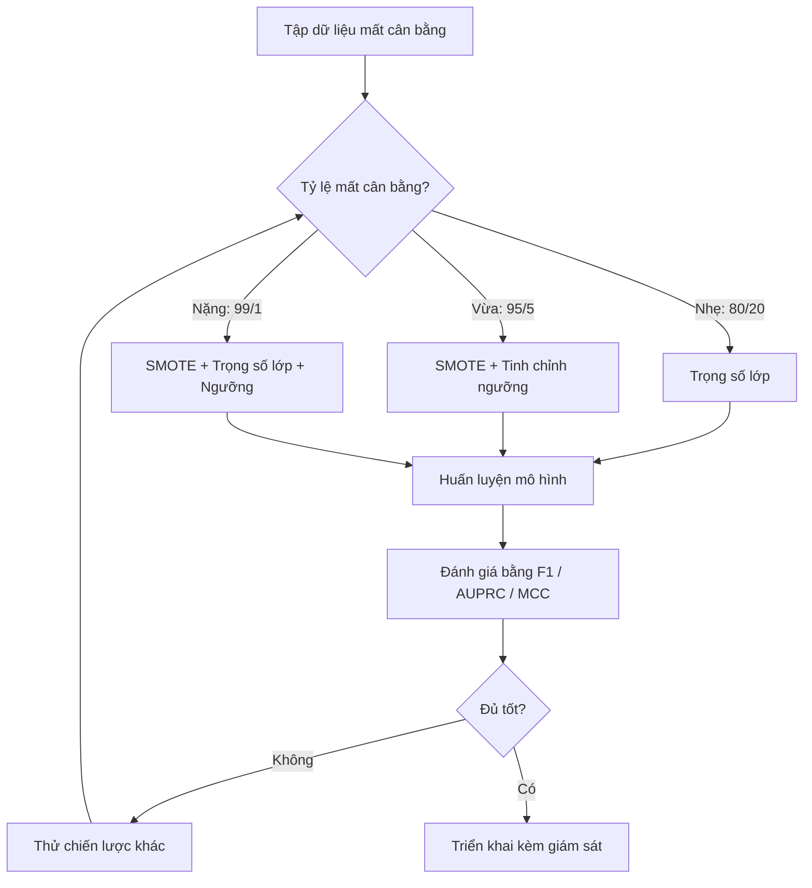
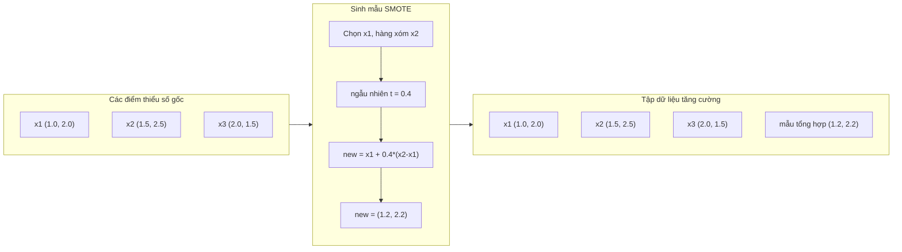
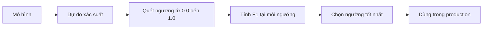
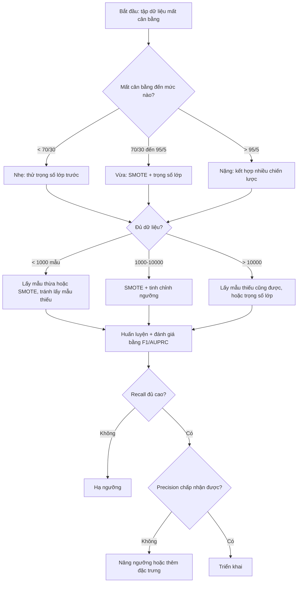

# Xử lý dữ liệu mất cân bằng

> Khi 99% dữ liệu của bạn là "bình thường", accuracy là một lời nói dối.

**Type:** Build
**Language:** Python
**Prerequisites:** Giai đoạn 2, Bài 01-09 (đặc biệt là các độ đo đánh giá)
**Time:** ~90 phút

## Mục tiêu học tập

- Tự cài đặt SMOTE từ đầu và giải thích lấy mẫu thừa tổng hợp khác gì so với nhân bản ngẫu nhiên
- Đánh giá các bộ phân loại trên dữ liệu mất cân bằng bằng F1, AUPRC và Matthews Correlation Coefficient thay vì accuracy
- So sánh trọng số lớp, tinh chỉnh ngưỡng và các chiến lược lấy mẫu lại, rồi chọn cách phù hợp với một tỷ lệ mất cân bằng cụ thể
- Xây dựng một pipeline dữ liệu mất cân bằng hoàn chỉnh, kết hợp SMOTE, trọng số lớp và tối ưu ngưỡng

## Vấn đề

Bạn xây một mô hình phát hiện gian lận. Nó đạt accuracy (độ chính xác) 99.9%. Bạn ăn mừng. Rồi bạn nhận ra nó dự đoán "không gian lận" cho mọi giao dịch.

Đây không phải là lỗi. Đó là việc hợp lý khi chỉ 0.1% giao dịch là gian lận. Mô hình học được rằng luôn đoán majority class (lớp đa số) sẽ giảm thiểu sai số tổng thể. Về mặt kỹ thuật thì đúng, nhưng hoàn toàn vô dụng.

Chuyện này xảy ra ở mọi nơi mà phân loại thực sự quan trọng. Chẩn đoán bệnh: 1% dương tính. Xâm nhập mạng: 0.01% cuộc tấn công. Lỗi sản xuất: 0.5% hàng lỗi. Lọc thư rác: 20% thư rác. Dự báo rời bỏ: 5% khách rời bỏ. minority class (lớp thiểu số) càng quan trọng thì thường càng hiếm.

Accuracy thất bại vì nó đối xử với mọi dự đoán đúng như nhau. Gắn nhãn đúng một giao dịch hợp lệ và bắt đúng một vụ gian lận đều được tính một điểm accuracy. Nhưng bắt được gian lận mới là lý do mô hình tồn tại. Chúng ta cần những độ đo, kỹ thuật và chiến lược huấn luyện buộc mô hình phải chú ý tới lớp hiếm nhưng quan trọng.

## Khái niệm

### Vì sao accuracy thất bại

Xét một bộ dữ liệu 1000 mẫu: 990 âm, 10 dương. Một mô hình luôn dự đoán âm:

|  | Dự đoán dương | Dự đoán âm |
|--|---|---|
| Thực tế dương | 0 (TP) | 10 (FN) |
| Thực tế âm | 0 (FP) | 990 (TN) |

Accuracy = (0 + 990) / 1000 = 99.0%

Mô hình bắt được 0 vụ gian lận. 0 ca bệnh. 0 lỗi sản phẩm. Nhưng accuracy nói 99%. Đây là lý do accuracy nguy hiểm với bài toán class imbalance (mất cân bằng lớp).

### Các độ đo tốt hơn

**Precision** = TP / (TP + FP). Trong số mọi thứ bị gắn cờ dương, bao nhiêu thực sự dương? Precision cao nghĩa là ít báo động giả.

**Recall** = TP / (TP + FN). Trong số mọi thứ thực sự dương, ta bắt được bao nhiêu? Recall cao nghĩa là ít bỏ sót mẫu dương.

**F1 Score** = 2 * precision * recall / (precision + recall). Trung bình điều hoà. Nó phạt sự lệch cực đoan giữa precision và recall mạnh hơn trung bình cộng.

**F-beta Score** = (1 + beta^2) * precision * recall / (beta^2 * precision + recall). Khi beta > 1, recall quan trọng hơn. Khi beta < 1, precision quan trọng hơn. F2 phổ biến trong phát hiện gian lận (bỏ sót gian lận tệ hơn báo động giả).

**AUPRC** (Area Under precision-recall curve (đường cong precision-recall)). Như AUC-ROC nhưng nhiều thông tin hơn cho dữ liệu mất cân bằng. Một bộ phân loại ngẫu nhiên có AUPRC bằng tỷ lệ lớp dương (không phải 0.5 như ROC). Nhờ vậy các cải thiện dễ nhận ra hơn.

**Matthews Correlation Coefficient** = (TP * TN - FP * FN) / sqrt((TP+FP)(TP+FN)(TN+FP)(TN+FN)). Nằm trong khoảng -1 đến +1. Chỉ cho điểm cao khi mô hình làm tốt trên cả hai lớp. Cân bằng ngay cả khi các lớp có kích thước rất khác nhau.

Với mô hình "luôn dự đoán âm" ở trên: precision = 0/0 (không xác định, thường đặt bằng 0), recall = 0/10 = 0, F1 = 0, MCC = 0. Các độ đo này chỉ ra đúng rằng mô hình vô giá trị.

### Pipeline dữ liệu mất cân bằng



### SMOTE: Synthetic Minority Oversampling Technique

oversampling (lấy mẫu thừa) ngẫu nhiên nhân bản các mẫu thiểu số sẵn có. Cách này hiệu quả nhưng dễ overfitting vì mô hình thấy lặp lại những điểm giống hệt nhau.

SMOTE tạo ra các mẫu thiểu số tổng hợp mới, hợp lý nhưng không phải bản sao. Thuật toán:

1. Với mỗi mẫu thiểu số x, tìm k hàng xóm gần nhất của nó trong các mẫu thiểu số khác
2. Chọn ngẫu nhiên một hàng xóm
3. Tạo mẫu mới trên đoạn thẳng giữa x và hàng xóm đó

Công thức: `new_sample = x + random(0, 1) * (neighbor - x)`

Phép này nội suy giữa các điểm thiểu số thật, tạo mẫu trong cùng vùng của không gian đặc trưng mà không chỉ sao chép dữ liệu sẵn có.



### So sánh các chiến lược lấy mẫu

**Random Oversampling**: nhân bản mẫu thiểu số để bằng số lượng lớp đa số.
- Ưu: đơn giản, không mất thông tin
- Nhược: bản sao y hệt gây overfitting, tăng thời gian huấn luyện

**Random Undersampling**: undersampling (lấy mẫu thiếu) — bỏ bớt mẫu đa số để bằng số lượng lớp thiểu số.
- Ưu: huấn luyện nhanh, đơn giản
- Nhược: vứt đi dữ liệu đa số có thể hữu ích, phương sai cao hơn

**SMOTE**: tạo mẫu thiểu số tổng hợp bằng nội suy.
- Ưu: sinh điểm dữ liệu mới, giảm overfitting so với lấy mẫu thừa ngẫu nhiên
- Nhược: có thể tạo mẫu nhiễu gần ranh giới quyết định, không tính đến phân phối của lớp đa số

| Chiến lược | Dữ liệu thay đổi | Rủi ro | Khi nào dùng |
|----------|-------------|------|-------------|
| Oversample | Lớp thiểu số bị nhân bản | Overfitting | Bộ dữ liệu nhỏ, mất cân bằng vừa |
| Undersample | Lớp đa số bị bỏ bớt | Mất thông tin | Bộ dữ liệu lớn, cần huấn luyện nhanh |
| SMOTE | Thêm mẫu thiểu số tổng hợp | Nhiễu ở ranh giới | Mất cân bằng vừa, đủ mẫu thiểu số cho k-NN |

### Trọng số lớp

Thay vì thay đổi dữ liệu, hãy thay đổi cách mô hình xử lý lỗi: gán class weight (trọng số lớp) cao hơn cho việc phân loại sai lớp thiểu số.

Với bài toán hai lớp có 950 mẫu âm và 50 mẫu dương:
- Trọng số cho lớp âm = n_samples / (2 * n_negative) = 1000 / (2 * 950) = 0.526
- Trọng số cho lớp dương = n_samples / (2 * n_positive) = 1000 / (2 * 50) = 10.0

Lớp dương nhận trọng số gấp 19 lần. Phân loại sai một mẫu dương tốn bằng phân loại sai 19 mẫu âm. Mô hình buộc phải chú ý tới lớp thiểu số.

Trong hồi quy logistic, điều này sửa đổi hàm mất mát:

```
weighted_loss = -sum(w_i * [y_i * log(p_i) + (1-y_i) * log(1-p_i)])
```

trong đó w_i phụ thuộc vào lớp của mẫu i.

Trọng số lớp tương đương về mặt toán học với lấy mẫu thừa khi tính theo kỳ vọng, nhưng không tạo ra điểm dữ liệu mới. Nhờ vậy chúng nhanh hơn và tránh được rủi ro overfitting do mẫu bị nhân bản.

### Tinh chỉnh ngưỡng

Hầu hết bộ phân loại xuất ra một xác suất. decision threshold (ngưỡng quyết định) mặc định là 0.5: nếu P(dương) >= 0.5, dự đoán dương. Nhưng 0.5 là tuỳ ý. Khi các lớp mất cân bằng, ngưỡng tối ưu thường thấp hơn nhiều.

Quy trình:
1. Huấn luyện một mô hình
2. Lấy xác suất dự đoán trên tập validation
3. Quét ngưỡng từ 0.0 đến 1.0
4. Tính F1 (hoặc độ đo bạn chọn) tại mỗi ngưỡng
5. Chọn ngưỡng tối đa hoá độ đo của bạn



Một mô hình có thể xuất P(gian lận) = 0.15 cho một giao dịch gian lận. Với ngưỡng 0.5, giao dịch bị xếp là không gian lận. Với ngưỡng 0.10, nó được bắt đúng. calibration (hiệu chỉnh) xác suất ít quan trọng hơn thứ hạng -- miễn là gian lận nhận xác suất cao hơn không gian lận, luôn tồn tại một ngưỡng tách được chúng.

### Học nhạy cảm chi phí

Khái quát hoá trọng số lớp. Thay vì chi phí đồng đều, gán chi phí cụ thể cho từng loại phân loại sai:

|  | Dự đoán dương | Dự đoán âm |
|--|---|---|
| Thực tế dương | 0 (đúng) | C_FN = 100 |
| Thực tế âm | C_FP = 1 | 0 (đúng) |

Bỏ sót một giao dịch gian lận (FN) tốn gấp 100 lần một báo động giả (FP). Mô hình tối ưu tổng chi phí, không phải tổng số lỗi.

Đây là cách tiếp cận có cơ sở nhất khi bạn ước lượng được chi phí thực tế. Bỏ sót một ca chẩn đoán ung thư có chi phí rất khác một báo động giả dẫn tới sinh thiết thêm. Việc làm rõ các chi phí này buộc phải đánh đổi đúng cách.

### Lưu đồ quyết định



```figure
class-imbalance
```

## Tự tay làm

### Bước 1: Sinh một bộ dữ liệu mất cân bằng

```python
import numpy as np


def make_imbalanced_data(n_majority=950, n_minority=50, seed=42):
    rng = np.random.RandomState(seed)

    X_maj = rng.randn(n_majority, 2) * 1.0 + np.array([0.0, 0.0])
    X_min = rng.randn(n_minority, 2) * 0.8 + np.array([2.5, 2.5])

    X = np.vstack([X_maj, X_min])
    y = np.concatenate([np.zeros(n_majority), np.ones(n_minority)])

    shuffle_idx = rng.permutation(len(y))
    return X[shuffle_idx], y[shuffle_idx]
```

### Bước 2: SMOTE từ đầu

```python
def euclidean_distance(a, b):
    return np.sqrt(np.sum((a - b) ** 2))


def find_k_neighbors(X, idx, k):
    distances = []
    for i in range(len(X)):
        if i == idx:
            continue
        d = euclidean_distance(X[idx], X[i])
        distances.append((i, d))
    distances.sort(key=lambda x: x[1])
    return [d[0] for d in distances[:k]]


def smote(X_minority, k=5, n_synthetic=100, seed=42):
    rng = np.random.RandomState(seed)
    n_samples = len(X_minority)
    k = min(k, n_samples - 1)
    synthetic = []

    for _ in range(n_synthetic):
        idx = rng.randint(0, n_samples)
        neighbors = find_k_neighbors(X_minority, idx, k)
        neighbor_idx = neighbors[rng.randint(0, len(neighbors))]
        t = rng.random()
        new_point = X_minority[idx] + t * (X_minority[neighbor_idx] - X_minority[idx])
        synthetic.append(new_point)

    return np.array(synthetic)
```

### Bước 3: Lấy mẫu thừa và lấy mẫu thiếu ngẫu nhiên

```python
def random_oversample(X, y, seed=42):
    rng = np.random.RandomState(seed)
    classes, counts = np.unique(y, return_counts=True)
    max_count = counts.max()

    X_resampled = list(X)
    y_resampled = list(y)

    for cls, count in zip(classes, counts):
        if count < max_count:
            cls_indices = np.where(y == cls)[0]
            n_needed = max_count - count
            chosen = rng.choice(cls_indices, size=n_needed, replace=True)
            X_resampled.extend(X[chosen])
            y_resampled.extend(y[chosen])

    X_out = np.array(X_resampled)
    y_out = np.array(y_resampled)
    shuffle = rng.permutation(len(y_out))
    return X_out[shuffle], y_out[shuffle]


def random_undersample(X, y, seed=42):
    rng = np.random.RandomState(seed)
    classes, counts = np.unique(y, return_counts=True)
    min_count = counts.min()

    X_resampled = []
    y_resampled = []

    for cls in classes:
        cls_indices = np.where(y == cls)[0]
        chosen = rng.choice(cls_indices, size=min_count, replace=False)
        X_resampled.extend(X[chosen])
        y_resampled.extend(y[chosen])

    X_out = np.array(X_resampled)
    y_out = np.array(y_resampled)
    shuffle = rng.permutation(len(y_out))
    return X_out[shuffle], y_out[shuffle]
```

### Bước 4: Hồi quy logistic với trọng số lớp

```python
def sigmoid(z):
    return 1.0 / (1.0 + np.exp(-np.clip(z, -500, 500)))


def logistic_regression_weighted(X, y, weights, lr=0.01, epochs=200):
    n_samples, n_features = X.shape
    w = np.zeros(n_features)
    b = 0.0

    for _ in range(epochs):
        z = X @ w + b
        pred = sigmoid(z)
        error = pred - y
        weighted_error = error * weights

        gradient_w = (X.T @ weighted_error) / n_samples
        gradient_b = np.mean(weighted_error)

        w -= lr * gradient_w
        b -= lr * gradient_b

    return w, b


def compute_class_weights(y):
    classes, counts = np.unique(y, return_counts=True)
    n_samples = len(y)
    n_classes = len(classes)
    weight_map = {}
    for cls, count in zip(classes, counts):
        weight_map[cls] = n_samples / (n_classes * count)
    return np.array([weight_map[yi] for yi in y])
```

### Bước 5: Tinh chỉnh ngưỡng

```python
def find_optimal_threshold(y_true, y_probs, metric="f1"):
    best_threshold = 0.5
    best_score = -1.0

    for threshold in np.arange(0.05, 0.96, 0.01):
        y_pred = (y_probs >= threshold).astype(int)
        tp = np.sum((y_pred == 1) & (y_true == 1))
        fp = np.sum((y_pred == 1) & (y_true == 0))
        fn = np.sum((y_pred == 0) & (y_true == 1))

        if metric == "f1":
            precision = tp / (tp + fp) if (tp + fp) > 0 else 0.0
            recall = tp / (tp + fn) if (tp + fn) > 0 else 0.0
            score = 2 * precision * recall / (precision + recall) if (precision + recall) > 0 else 0.0
        elif metric == "recall":
            score = tp / (tp + fn) if (tp + fn) > 0 else 0.0
        elif metric == "precision":
            score = tp / (tp + fp) if (tp + fp) > 0 else 0.0

        if score > best_score:
            best_score = score
            best_threshold = threshold

    return best_threshold, best_score
```

### Bước 6: Các hàm đánh giá

```python
def confusion_matrix_values(y_true, y_pred):
    tp = np.sum((y_pred == 1) & (y_true == 1))
    tn = np.sum((y_pred == 0) & (y_true == 0))
    fp = np.sum((y_pred == 1) & (y_true == 0))
    fn = np.sum((y_pred == 0) & (y_true == 1))
    return tp, tn, fp, fn


def compute_metrics(y_true, y_pred):
    tp, tn, fp, fn = confusion_matrix_values(y_true, y_pred)
    accuracy = (tp + tn) / (tp + tn + fp + fn)
    precision = tp / (tp + fp) if (tp + fp) > 0 else 0.0
    recall = tp / (tp + fn) if (tp + fn) > 0 else 0.0
    f1 = 2 * precision * recall / (precision + recall) if (precision + recall) > 0 else 0.0

    denom = np.sqrt(float((tp + fp) * (tp + fn) * (tn + fp) * (tn + fn)))
    mcc = (tp * tn - fp * fn) / denom if denom > 0 else 0.0

    return {
        "accuracy": accuracy,
        "precision": precision,
        "recall": recall,
        "f1": f1,
        "mcc": mcc,
    }
```

### Bước 7: So sánh mọi cách tiếp cận

```python
X, y = make_imbalanced_data(950, 50, seed=42)
split = int(0.8 * len(y))
X_train, X_test = X[:split], X[split:]
y_train, y_test = y[:split], y[split:]

# Baseline: no treatment
w_base, b_base = logistic_regression_weighted(
    X_train, y_train, np.ones(len(y_train)), lr=0.1, epochs=300
)
probs_base = sigmoid(X_test @ w_base + b_base)
preds_base = (probs_base >= 0.5).astype(int)

# Oversampled
X_over, y_over = random_oversample(X_train, y_train)
w_over, b_over = logistic_regression_weighted(
    X_over, y_over, np.ones(len(y_over)), lr=0.1, epochs=300
)
preds_over = (sigmoid(X_test @ w_over + b_over) >= 0.5).astype(int)

# SMOTE
minority_mask = y_train == 1
X_minority = X_train[minority_mask]
synthetic = smote(X_minority, k=5, n_synthetic=len(y_train) - 2 * int(minority_mask.sum()))
X_smote = np.vstack([X_train, synthetic])
y_smote = np.concatenate([y_train, np.ones(len(synthetic))])
w_sm, b_sm = logistic_regression_weighted(
    X_smote, y_smote, np.ones(len(y_smote)), lr=0.1, epochs=300
)
preds_smote = (sigmoid(X_test @ w_sm + b_sm) >= 0.5).astype(int)

# Class weights
sample_weights = compute_class_weights(y_train)
w_cw, b_cw = logistic_regression_weighted(
    X_train, y_train, sample_weights, lr=0.1, epochs=300
)
probs_cw = sigmoid(X_test @ w_cw + b_cw)
preds_cw = (probs_cw >= 0.5).astype(int)

# Threshold tuning (tune on held-out validation set, not test set)
probs_val = sigmoid(X_val @ w_cw + b_cw)
best_thresh, best_f1 = find_optimal_threshold(y_val, probs_val, metric="f1")
preds_thresh = (probs_cw >= best_thresh).astype(int)
```

Tệp mã chạy toàn bộ nội dung này trong một script duy nhất và in kết quả.

## Áp dụng

Với scikit-learn và imbalanced-learn, những kỹ thuật này chỉ là một dòng:

```python
from sklearn.linear_model import LogisticRegression
from sklearn.metrics import classification_report, f1_score
from sklearn.model_selection import train_test_split
from imblearn.over_sampling import SMOTE
from imblearn.under_sampling import RandomUnderSampler
from imblearn.pipeline import Pipeline

X_train, X_test, y_train, y_test = train_test_split(X, y, stratify=y)

model_weighted = LogisticRegression(class_weight="balanced")
model_weighted.fit(X_train, y_train)
print(classification_report(y_test, model_weighted.predict(X_test)))

smote = SMOTE(random_state=42)
X_resampled, y_resampled = smote.fit_resample(X_train, y_train)
model_smote = LogisticRegression()
model_smote.fit(X_resampled, y_resampled)
print(classification_report(y_test, model_smote.predict(X_test)))

pipeline = Pipeline([
    ("smote", SMOTE()),
    ("model", LogisticRegression(class_weight="balanced")),
])
pipeline.fit(X_train, y_train)
print(classification_report(y_test, pipeline.predict(X_test)))
```

Các cài đặt từ đầu cho thấy chính xác từng kỹ thuật làm gì. SMOTE chỉ là nội suy k-NN trên lớp thiểu số. Trọng số lớp nhân vào hàm mất mát. Tinh chỉnh ngưỡng là một vòng lặp for trên các ngưỡng cắt. Không có phép màu.

## Đóng gói

Bài học này tạo ra:
- `outputs/skill-imbalanced-data.md` -- danh sách kiểm tra quyết định để xử lý bài toán phân loại mất cân bằng

## Bài tập

1. **Borderline-SMOTE**: sửa cài đặt SMOTE để chỉ sinh mẫu tổng hợp cho các điểm thiểu số nằm gần ranh giới quyết định (những điểm có k hàng xóm gần nhất bao gồm mẫu của lớp đa số). So sánh kết quả với SMOTE chuẩn trên một bộ dữ liệu có các lớp chồng lấn.

2. **Cost matrix optimization**: cài đặt học nhạy cảm chi phí với ma trận chi phí là một tham số. Viết một hàm nhận ma trận chi phí và trả về các dự đoán tối ưu giảm thiểu chi phí kỳ vọng. Thử với các tỷ lệ chi phí khác nhau (1:10, 1:100, 1:1000) và vẽ xem đánh đổi precision-recall thay đổi thế nào.

3. **Threshold calibration**: cài đặt Platt scaling (huấn luyện một hồi quy logistic trên đầu ra thô của mô hình để tạo xác suất đã hiệu chỉnh). So sánh precision-recall curve (đường cong precision-recall) trước và sau calibration. Chứng minh rằng calibration không thay đổi thứ hạng (AUC giữ nguyên) nhưng làm xác suất có ý nghĩa hơn.

4. **Ensemble with balanced bagging**: huấn luyện nhiều mô hình, mỗi mô hình trên một mẫu bootstrap cân bằng (toàn bộ lớp thiểu số + một tập con ngẫu nhiên của lớp đa số). Lấy trung bình dự đoán của chúng. So sánh cách này với một mô hình duy nhất dùng SMOTE. Đo cả hiệu năng và phương sai qua nhiều lần chạy.

5. **Imbalance ratio experiment**: lấy một bộ dữ liệu cân bằng rồi tăng dần tỷ lệ mất cân bằng (50/50, 70/30, 90/10, 95/5, 99/1). Với mỗi tỷ lệ, huấn luyện có và không có SMOTE. Vẽ F1 theo tỷ lệ mất cân bằng cho cả hai cách. Ở tỷ lệ nào thì SMOTE bắt đầu tạo khác biệt đáng kể?

## Thuật ngữ chính

| Thuật ngữ | Người ta thường nói | Ý nghĩa thực sự |
|------|----------------|----------------------|
| Class imbalance | "Một lớp có nhiều mẫu hơn hẳn" | Phân phối các lớp trong bộ dữ liệu lệch đáng kể, khiến mô hình thiên về lớp đa số |
| SMOTE | "Lấy mẫu thừa tổng hợp" | Tạo mẫu thiểu số mới bằng cách nội suy giữa các mẫu thiểu số sẵn có và k hàng xóm thiểu số gần nhất của chúng |
| Class weights | "Làm lỗi trên lớp hiếm đắt hơn" | Nhân hàm mất mát với trọng số riêng của từng lớp để mô hình phạt nặng hơn việc phân loại sai lớp thiểu số |
| Threshold tuning | "Dịch chuyển ranh giới quyết định" | Thay ngưỡng cắt xác suất phân loại từ mặc định 0.5 sang giá trị tối ưu độ đo mong muốn |
| Precision-recall tradeoff | "Không thể có cả hai" | Hạ ngưỡng bắt được nhiều mẫu dương hơn (recall cao hơn) nhưng cũng gắn cờ nhiều dương giả hơn (precision thấp hơn), và ngược lại |
| AUPRC | "Diện tích dưới đường cong PR" | Tóm tắt đường cong precision-recall thành một con số; nhiều thông tin hơn AUC-ROC khi các lớp mất cân bằng nặng |
| Matthews Correlation Coefficient | "Độ đo cân bằng" | Tương quan giữa nhãn dự đoán và nhãn thật, chỉ cho điểm cao khi mô hình làm tốt trên cả hai lớp |
| Cost-sensitive learning | "Các lỗi khác nhau tốn chi phí khác nhau" | Đưa chi phí phân loại sai thực tế vào mục tiêu huấn luyện để mô hình tối ưu tổng chi phí, không phải số lỗi |
| Random oversampling | "Nhân bản lớp thiểu số" | Lặp lại mẫu của lớp thiểu số để cân bằng số lượng lớp; đơn giản nhưng dễ overfitting vào các điểm bị nhân bản |

## Đọc thêm

- [SMOTE: Synthetic Minority Over-sampling Technique (Chawla et al., 2002)](https://arxiv.org/abs/1106.1813) -- bài báo SMOTE gốc, vẫn là công trình được trích dẫn nhiều nhất về học từ dữ liệu mất cân bằng
- [Learning from Imbalanced Data (He & Garcia, 2009)](https://ieeexplore.ieee.org/document/5128907) -- khảo sát toàn diện về các cách tiếp cận lấy mẫu, nhạy cảm chi phí và thuật toán
- [imbalanced-learn documentation](https://imbalanced-learn.org/stable/) -- thư viện Python với các biến thể SMOTE, chiến lược lấy mẫu thiếu và tích hợp pipeline
- [The Precision-Recall Plot Is More Informative than the ROC Plot (Saito & Rehmsmeier, 2015)](https://journals.plos.org/plosone/article?id=10.1371/journal.pone.0118432) -- khi nào và vì sao nên ưu tiên đường cong PR hơn đường cong ROC cho bài toán mất cân bằng
