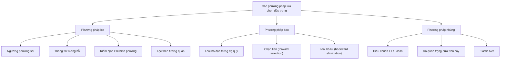
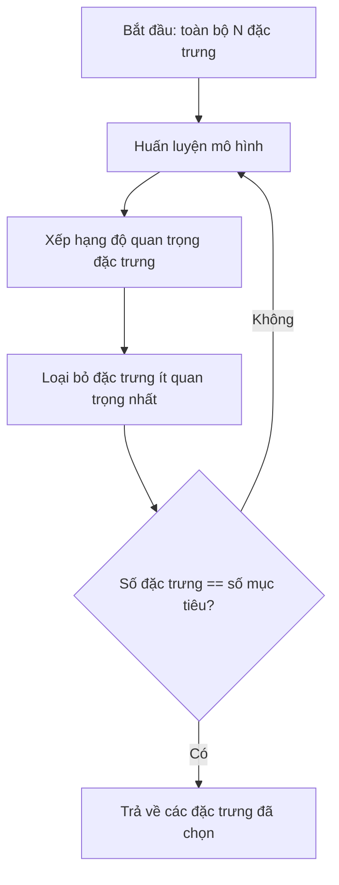
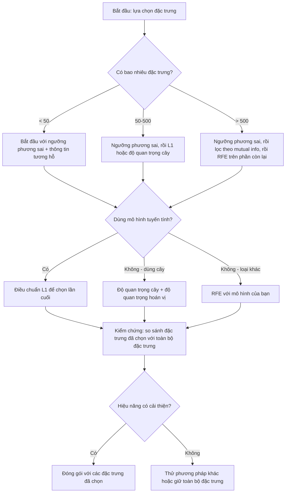

# Lựa chọn đặc trưng

> Nhiều đặc trưng hơn chưa chắc tốt hơn. Đúng đặc trưng mới tốt hơn.

**Type:** Build
**Language:** Python
**Prerequisites:** Giai đoạn 2, Bài 01-09, 08 (kỹ thuật đặc trưng)
**Time:** ~75 phút

## Mục tiêu học tập

- Cài đặt từ đầu các phương pháp lọc (variance threshold, mutual information, chi-squared) và các phương pháp bao (RFE, forward selection)
- Giải thích vì sao mutual information (thông tin tương hỗ) bắt được quan hệ phi tuyến giữa đặc trưng và mục tiêu mà correlation bỏ sót
- So sánh điều chuẩn L1 (L1 regularization, chọn lọc kiểu nhúng) với RFE (chọn lọc kiểu bao) và đánh giá đánh đổi chi phí tính toán của chúng
- Xây dựng một pipeline lựa chọn đặc trưng kết hợp nhiều phương pháp và chứng minh khả năng tổng quát hoá được cải thiện trên dữ liệu giữ lại

## Vấn đề

Bạn có 500 đặc trưng. Mô hình huấn luyện chậm, overfit liên tục, và không ai giải thích được nó đã học gì. Bạn thêm nhiều đặc trưng hơn với hy vọng cải thiện hiệu năng. Mọi thứ còn tệ hơn.

Đây là lời nguyền số chiều (curse of dimensionality) đang diễn ra. Khi số đặc trưng tăng, thể tích của không gian đặc trưng bùng nổ. Các điểm dữ liệu trở nên thưa thớt. Khoảng cách giữa các điểm hội tụ về cùng một giá trị. Mô hình cần lượng dữ liệu tăng theo cấp số nhân để tìm ra quy luật thật. Các đặc trưng nhiễu lấn át các đặc trưng tín hiệu. Overfit trở thành mặc định.

Lựa chọn đặc trưng (feature selection) là liều thuốc giải. Cắt bỏ phần nhiễu. Loại bỏ phần dư thừa. Giữ lại những đặc trưng thực sự mang thông tin về biến mục tiêu. Kết quả: huấn luyện nhanh hơn, tổng quát hoá tốt hơn, và những mô hình bạn thực sự có thể giải thích.

Mục tiêu không phải là dùng toàn bộ thông tin có sẵn. Mà là dùng đúng thông tin.

## Khái niệm

### Ba nhóm phương pháp lựa chọn đặc trưng

Mọi phương pháp lựa chọn đặc trưng đều rơi vào một trong ba nhóm:



**Phương pháp lọc (filter methods)** chấm điểm từng đặc trưng một cách độc lập bằng một phép đo thống kê. Chúng không dùng mô hình. Nhanh, nhưng bỏ sót tương tác giữa các đặc trưng.

**Phương pháp bao (wrapper methods)** huấn luyện một mô hình để đánh giá các tập con đặc trưng. Chúng dùng hiệu năng mô hình làm điểm số. Kết quả tốt hơn, nhưng đắt vì phải huấn luyện lại mô hình nhiều lần.

**Phương pháp nhúng (embedded methods)** chọn đặc trưng như một phần của quá trình huấn luyện mô hình. Điều chuẩn L1 đẩy trọng số về 0. Cây quyết định tách theo những đặc trưng hữu ích nhất. Việc chọn diễn ra trong lúc fit, không phải một bước riêng.

### Ngưỡng phương sai (Variance Threshold)

Phương pháp lọc đơn giản nhất. Nếu một đặc trưng gần như không thay đổi giữa các mẫu, nó mang gần như không thông tin nào.

Hãy tưởng tượng một đặc trưng bằng 0.0 với 999 trong 1000 mẫu. Phương sai của nó gần bằng 0. Không mô hình nào dùng được nó để phân biệt giữa các lớp. Bỏ nó đi.

```
variance(x) = mean((x - mean(x))^2)
```

Đặt một ngưỡng (ví dụ 0.01). Loại mọi đặc trưng có phương sai dưới ngưỡng đó. Cách này loại bỏ các đặc trưng hằng số hoặc gần hằng số mà không cần nhìn tới biến mục tiêu.

Khi nào dùng: như một bước tiền xử lý trước các phương pháp khác. Nó bắt được những đặc trưng vô dụng rõ ràng với chi phí gần bằng không.

Hạn chế: một đặc trưng có thể có phương sai cao mà vẫn là nhiễu thuần. Ngưỡng phương sai là cần nhưng chưa đủ.

### Thông tin tương hỗ (Mutual Information)

Thông tin tương hỗ đo mức độ mà việc biết giá trị của đặc trưng X giảm bất định về mục tiêu Y là bao nhiêu.

```
I(X; Y) = sum_x sum_y p(x, y) * log(p(x, y) / (p(x) * p(y)))
```

Nếu X và Y độc lập thì p(x, y) = p(x) * p(y), nên số hạng log bằng 0 và I(X; Y) = 0. X càng cho bạn biết nhiều về Y, thông tin tương hỗ càng cao.

Ưu điểm then chốt so với correlation: thông tin tương hỗ bắt được quan hệ phi tuyến. Một đặc trưng có thể có tương quan bằng 0 với mục tiêu nhưng thông tin tương hỗ cao, vì quan hệ là bậc hai hoặc tuần hoàn.

Với các đặc trưng liên tục, hãy rời rạc hoá thành các khoảng trước (ước lượng dựa trên histogram). Số khoảng ảnh hưởng tới ước lượng -- quá ít khoảng làm mất thông tin, quá nhiều khoảng thêm nhiễu. Một lựa chọn phổ biến: sqrt(n) khoảng hoặc quy tắc Sturges (1 + log2(n)).


### Loại bỏ đặc trưng đệ quy (RFE)

RFE (recursive feature elimination - loại bỏ đặc trưng đệ quy) là một phương pháp bao. Nó dùng chính độ quan trọng đặc trưng của mô hình để cắt tỉa lặp đi lặp lại:

1. Huấn luyện mô hình với toàn bộ đặc trưng
2. Xếp hạng đặc trưng theo độ quan trọng (hệ số với mô hình tuyến tính, mức giảm impurity với cây)
3. Loại bỏ (những) đặc trưng ít quan trọng nhất
4. Lặp lại cho tới khi còn đúng số đặc trưng mong muốn



RFE xét tới tương tác giữa các đặc trưng vì mô hình thấy tất cả đặc trưng còn lại cùng lúc. Bỏ một đặc trưng làm thay đổi độ quan trọng của những đặc trưng khác. Điều này khiến nó kỹ hơn các phương pháp lọc.

Cái giá: bạn huấn luyện mô hình N - target lần. Với 500 đặc trưng và mục tiêu 10, đó là 490 lần huấn luyện. Với những mô hình đắt, việc này chậm. Bạn có thể tăng tốc bằng cách bỏ nhiều đặc trưng mỗi bước (ví dụ mỗi vòng bỏ 10% thấp nhất).

### Điều chuẩn L1 (Lasso)

Điều chuẩn L1 cộng thêm giá trị tuyệt đối của các trọng số vào hàm mất mát:

```
loss = prediction_error + alpha * sum(|w_i|)
```

Tham số alpha điều khiển mức độ mạnh tay khi cắt tỉa đặc trưng. Alpha càng cao thì càng nhiều trọng số về đúng bằng 0.

Vì sao lại đúng bằng 0? Hình phạt L1 tạo ra vùng ràng buộc hình thoi trong không gian trọng số. Nghiệm tối ưu có xu hướng rơi vào một đỉnh của hình thoi này, nơi một hoặc nhiều trọng số bằng 0. Điều chuẩn L2 (ridge) tạo ràng buộc hình tròn, nơi trọng số co lại nhưng hiếm khi chạm 0.

Đây là lựa chọn đặc trưng kiểu nhúng: mô hình học trong lúc huấn luyện xem nên bỏ qua những đặc trưng nào. Các đặc trưng có trọng số bằng 0 coi như đã bị loại.

Ưu điểm: chỉ một lần huấn luyện, xử lý được các đặc trưng tương quan (chọn một và đưa những đặc trưng còn lại về 0), có sẵn trong hầu hết các cài đặt mô hình tuyến tính.

Hạn chế: chỉ dùng được cho mô hình tuyến tính. Không bắt được độ quan trọng đặc trưng phi tuyến.

### Độ quan trọng đặc trưng dựa trên cây

Cây quyết định và các ensemble của chúng (random forest, gradient boosting) tự nhiên xếp hạng được đặc trưng. Mỗi lần tách đều giảm impurity (Gini hoặc entropy với phân loại, phương sai với hồi quy). Những đặc trưng tạo mức giảm impurity lớn hơn thì quan trọng hơn.

Với một random forest có T cây:

```
importance(feature_j) = (1/T) * sum over all trees of
    sum over all nodes splitting on feature_j of
        (n_samples * impurity_decrease)
```

Công thức cho một điểm quan trọng đã chuẩn hoá cho từng đặc trưng. Nó tự động xử lý quan hệ phi tuyến và tương tác giữa các đặc trưng.

Lưu ý: độ quan trọng dựa trên cây bị thiên lệch về phía các đặc trưng có nhiều giá trị phân biệt (cardinality cao). Một cột ID ngẫu nhiên sẽ trông quan trọng vì nó tách hoàn hảo mọi mẫu. Hãy dùng permutation importance như một bước kiểm tra tỉnh táo.

### Độ quan trọng hoán vị (Permutation Importance)

Một phương pháp không phụ thuộc mô hình:

1. Huấn luyện mô hình và ghi lại hiệu năng đường cơ sở trên dữ liệu kiểm định
2. Với từng đặc trưng: xáo trộn ngẫu nhiên các giá trị của nó, đo mức giảm hiệu năng
3. Mức giảm càng lớn thì đặc trưng càng quan trọng

Nếu xáo trộn một đặc trưng mà không làm hại hiệu năng, mô hình không phụ thuộc vào nó. Nếu hiệu năng sụp, đặc trưng đó là then chốt.

Độ quan trọng hoán vị tránh được thiên lệch cardinality của độ quan trọng dựa trên cây. Nhưng nó chậm: mỗi đặc trưng cần một lần đánh giá đầy đủ, lặp lại nhiều lần để ổn định.

### Bảng so sánh

| Phương pháp | Loại | Tốc độ | Phi tuyến | Tương tác đặc trưng |
|--------|------|-------|-----------|---------------------|
| Ngưỡng phương sai | Lọc | Rất nhanh | Không | Không |
| Thông tin tương hỗ | Lọc | Nhanh | Có | Không |
| Lọc theo tương quan | Lọc | Nhanh | Không | Không |
| RFE | Bao | Chậm | Phụ thuộc mô hình | Có |
| L1 / Lasso | Nhúng | Nhanh | Không (tuyến tính) | Không |
| Độ quan trọng cây | Nhúng | Trung bình | Có | Có |
| Độ quan trọng hoán vị | Không phụ thuộc mô hình | Chậm | Có | Có |

### Sơ đồ quyết định



```figure
f3-feature-prune
```

## Tự tay làm

### Bước 1: Sinh dữ liệu tổng hợp với cấu trúc đặc trưng đã biết

```python
import numpy as np


def make_feature_selection_data(n_samples=500, seed=42):
    rng = np.random.RandomState(seed)

    x1 = rng.randn(n_samples)
    x2 = rng.randn(n_samples)
    x3 = rng.randn(n_samples)
    x4 = x1 + 0.1 * rng.randn(n_samples)
    x5 = x2 + 0.1 * rng.randn(n_samples)

    informative = np.column_stack([x1, x2, x3, x4, x5])

    correlated = np.column_stack([
        x1 * 0.9 + 0.1 * rng.randn(n_samples),
        x2 * 0.8 + 0.2 * rng.randn(n_samples),
        x3 * 0.7 + 0.3 * rng.randn(n_samples),
        x1 * 0.5 + x2 * 0.5 + 0.1 * rng.randn(n_samples),
        x2 * 0.6 + x3 * 0.4 + 0.1 * rng.randn(n_samples),
    ])

    noise = rng.randn(n_samples, 10) * 0.5

    X = np.hstack([informative, correlated, noise])
    y = (2 * x1 - 1.5 * x2 + x3 + 0.5 * rng.randn(n_samples) > 0).astype(int)

    feature_names = (
        [f"info_{i}" for i in range(5)]
        + [f"corr_{i}" for i in range(5)]
        + [f"noise_{i}" for i in range(10)]
    )

    return X, y, feature_names
```

Chúng ta biết chân lý: các đặc trưng 0-4 là có thông tin (thêm vào đó, 3 và 4 là bản sao tương quan của 0 và 1), các đặc trưng 5-9 tương quan với các đặc trưng có thông tin, các đặc trưng 10-19 là nhiễu thuần. Một phương pháp chọn tốt nên xếp hạng 0-4 cao nhất và 10-19 thấp nhất.

### Bước 2: Ngưỡng phương sai

```python
def variance_threshold(X, threshold=0.01):
    variances = np.var(X, axis=0)
    mask = variances > threshold
    return mask, variances
```

### Bước 3: Thông tin tương hỗ (rời rạc)

```python
def discretize(x, n_bins=10):
    min_val, max_val = x.min(), x.max()
    if max_val == min_val:
        return np.zeros_like(x, dtype=int)
    bin_edges = np.linspace(min_val, max_val, n_bins + 1)
    binned = np.digitize(x, bin_edges[1:-1])
    return binned


def mutual_information(X, y, n_bins=10):
    n_samples, n_features = X.shape
    mi_scores = np.zeros(n_features)

    y_vals, y_counts = np.unique(y, return_counts=True)
    p_y = y_counts / n_samples

    for f in range(n_features):
        x_binned = discretize(X[:, f], n_bins)
        x_vals, x_counts = np.unique(x_binned, return_counts=True)
        p_x = dict(zip(x_vals, x_counts / n_samples))

        mi = 0.0
        for xv in x_vals:
            for yi, yv in enumerate(y_vals):
                joint_mask = (x_binned == xv) & (y == yv)
                p_xy = np.sum(joint_mask) / n_samples
                if p_xy > 0:
                    mi += p_xy * np.log(p_xy / (p_x[xv] * p_y[yi]))
        mi_scores[f] = mi

    return mi_scores
```

### Bước 4: Loại bỏ đặc trưng đệ quy

```python
def simple_logistic_importance(X, y, lr=0.1, epochs=100):
    n_samples, n_features = X.shape
    w = np.zeros(n_features)
    b = 0.0

    for _ in range(epochs):
        z = X @ w + b
        pred = 1.0 / (1.0 + np.exp(-np.clip(z, -500, 500)))
        error = pred - y
        w -= lr * (X.T @ error) / n_samples
        b -= lr * np.mean(error)

    return w, b


def rfe(X, y, n_features_to_select=5, lr=0.1, epochs=100):
    n_total = X.shape[1]
    remaining = list(range(n_total))
    rankings = np.ones(n_total, dtype=int)
    rank = n_total

    while len(remaining) > n_features_to_select:
        X_subset = X[:, remaining]
        w, _ = simple_logistic_importance(X_subset, y, lr, epochs)
        importances = np.abs(w)

        least_idx = np.argmin(importances)
        original_idx = remaining[least_idx]
        rankings[original_idx] = rank
        rank -= 1
        remaining.pop(least_idx)

    for idx in remaining:
        rankings[idx] = 1

    selected_mask = rankings == 1
    return selected_mask, rankings
```

### Bước 5: Chọn đặc trưng bằng L1

```python
def soft_threshold(w, alpha):
    return np.sign(w) * np.maximum(np.abs(w) - alpha, 0)


def l1_feature_selection(X, y, alpha=0.1, lr=0.01, epochs=500):
    n_samples, n_features = X.shape
    w = np.zeros(n_features)
    b = 0.0

    for _ in range(epochs):
        z = X @ w + b
        pred = 1.0 / (1.0 + np.exp(-np.clip(z, -500, 500)))
        error = pred - y

        gradient_w = (X.T @ error) / n_samples
        gradient_b = np.mean(error)

        w -= lr * gradient_w
        w = soft_threshold(w, lr * alpha)
        b -= lr * gradient_b

    selected_mask = np.abs(w) > 1e-6
    return selected_mask, w
```

### Bước 6: Độ quan trọng dựa trên cây (cây quyết định đơn giản)

```python
def gini_impurity(y):
    if len(y) == 0:
        return 0.0
    classes, counts = np.unique(y, return_counts=True)
    probs = counts / len(y)
    return 1.0 - np.sum(probs ** 2)


def best_split(X, y, feature_idx):
    values = np.unique(X[:, feature_idx])
    if len(values) <= 1:
        return None, -1.0

    best_threshold = None
    best_gain = -1.0
    parent_gini = gini_impurity(y)
    n = len(y)

    for i in range(len(values) - 1):
        threshold = (values[i] + values[i + 1]) / 2.0
        left_mask = X[:, feature_idx] <= threshold
        right_mask = ~left_mask

        n_left = np.sum(left_mask)
        n_right = np.sum(right_mask)

        if n_left == 0 or n_right == 0:
            continue

        gain = parent_gini - (n_left / n) * gini_impurity(y[left_mask]) - (n_right / n) * gini_impurity(y[right_mask])

        if gain > best_gain:
            best_gain = gain
            best_threshold = threshold

    return best_threshold, best_gain


def tree_importance(X, y, n_trees=50, max_depth=5, seed=42):
    rng = np.random.RandomState(seed)
    n_samples, n_features = X.shape
    importances = np.zeros(n_features)

    for _ in range(n_trees):
        sample_idx = rng.choice(n_samples, size=n_samples, replace=True)
        feature_subset = rng.choice(n_features, size=max(1, int(np.sqrt(n_features))), replace=False)

        X_boot = X[sample_idx]
        y_boot = y[sample_idx]

        tree_imp = _build_tree_importance(X_boot, y_boot, feature_subset, max_depth)
        importances += tree_imp

    total = importances.sum()
    if total > 0:
        importances /= total

    return importances


def _build_tree_importance(X, y, feature_subset, max_depth, depth=0):
    n_features = X.shape[1]
    importances = np.zeros(n_features)

    if depth >= max_depth or len(np.unique(y)) <= 1 or len(y) < 4:
        return importances

    best_feature = None
    best_threshold = None
    best_gain = -1.0

    for f in feature_subset:
        threshold, gain = best_split(X, y, f)
        if gain > best_gain:
            best_gain = gain
            best_feature = f
            best_threshold = threshold

    if best_feature is None or best_gain <= 0:
        return importances

    importances[best_feature] += best_gain * len(y)

    left_mask = X[:, best_feature] <= best_threshold
    right_mask = ~left_mask

    importances += _build_tree_importance(X[left_mask], y[left_mask], feature_subset, max_depth, depth + 1)
    importances += _build_tree_importance(X[right_mask], y[right_mask], feature_subset, max_depth, depth + 1)

    return importances
```

### Bước 7: Chạy tất cả các phương pháp và so sánh

File mã chạy cả năm phương pháp trên cùng bộ dữ liệu tổng hợp và in một bảng so sánh cho thấy mỗi phương pháp chọn những đặc trưng nào.

## Áp dụng

Với scikit-learn, lựa chọn đặc trưng đã được tích hợp sẵn trong pipeline:

```python
from sklearn.feature_selection import (
    VarianceThreshold,
    mutual_info_classif,
    RFE,
    SelectFromModel,
)
from sklearn.linear_model import Lasso, LogisticRegression
from sklearn.ensemble import RandomForestClassifier

vt = VarianceThreshold(threshold=0.01)
X_filtered = vt.fit_transform(X)

mi_scores = mutual_info_classif(X, y)
top_k = np.argsort(mi_scores)[-10:]

rfe_selector = RFE(LogisticRegression(), n_features_to_select=10)
rfe_selector.fit(X, y)
X_rfe = rfe_selector.transform(X)

lasso_selector = SelectFromModel(Lasso(alpha=0.01))
lasso_selector.fit(X, y)
X_lasso = lasso_selector.transform(X)

rf = RandomForestClassifier(n_estimators=100)
rf.fit(X, y)
importances = rf.feature_importances_
```

Các cài đặt from-scratch cho thấy chính xác điều gì xảy ra bên trong mỗi phương pháp. Ngưỡng phương sai chỉ là tính `var(X, axis=0)` rồi áp một mask. Thông tin tương hỗ là đếm tần suất đồng thời và tần suất biên trong một bảng tiếp liên. RFE là một vòng lặp huấn luyện, xếp hạng rồi cắt tỉa. L1 là gradient descent kèm một bước soft-thresholding. Độ quan trọng cây cộng dồn mức giảm impurity qua các lần tách. Không có phép màu -- chỉ là thống kê và vòng lặp.

Các phiên bản sklearn thêm độ vững chắc (ví dụ mutual_info_classif dùng ước lượng mật độ k-NN thay cho chia khoảng), tốc độ (cài đặt bằng C), và tích hợp pipeline.

## Đóng gói

Bài học này tạo ra:
- `outputs/skill-feature-selector.md` -- một cây quyết định tham chiếu nhanh để chọn đúng phương pháp lựa chọn đặc trưng

## Bài tập

1. **Forward selection**: cài đặt phương án ngược của RFE. Bắt đầu với không đặc trưng nào. Ở mỗi bước, thêm đặc trưng làm hiệu năng mô hình cải thiện nhiều nhất. Dừng khi việc thêm đặc trưng không còn giúp được gì. So sánh các đặc trưng được chọn với kết quả của RFE. Cách nào nhanh hơn? Cách nào cho kết quả tốt hơn?

2. **Stability selection**: chạy lựa chọn đặc trưng L1 50 lần, mỗi lần trên một mẫu con ngẫu nhiên 80% dữ liệu, với các giá trị alpha hơi khác nhau. Đếm xem mỗi đặc trưng được chọn bao nhiêu lần. Những đặc trưng được chọn trong > 80% số lần là "ổn định". So sánh các đặc trưng ổn định với kết quả L1 chạy một lần. Cách nào đáng tin hơn?

3. **Phát hiện đa cộng tuyến (multicollinearity)**: tính ma trận tương quan cho toàn bộ đặc trưng. Cài đặt một hàm mà, với một ngưỡng tương quan cho trước (ví dụ 0.9), loại một đặc trưng khỏi mỗi cặp tương quan cao (giữ đặc trưng có thông tin tương hỗ cao hơn với mục tiêu). Thử trên bộ dữ liệu tổng hợp và kiểm chứng rằng nó loại bỏ được các đặc trưng tương quan dư thừa.

4. **Pipeline lựa chọn đặc trưng**: nối ngưỡng phương sai, bộ lọc thông tin tương hỗ và RFE thành một pipeline duy nhất. Đầu tiên loại các đặc trưng có phương sai gần bằng không, sau đó giữ 50% đặc trưng hàng đầu theo thông tin tương hỗ, rồi chạy RFE trên phần sống sót. So sánh pipeline này với việc chỉ chạy RFE trên toàn bộ đặc trưng. Pipeline có nhanh hơn không? Nó có chính xác tương đương không?

5. **Permutation importance from scratch**: tự cài đặt permutation importance. Với mỗi đặc trưng, xáo trộn giá trị của nó 10 lần, đo mức giảm trung bình của điểm F1. So sánh thứ hạng với độ quan trọng dựa trên cây. Tìm những trường hợp chúng không đồng ý và giải thích vì sao (gợi ý: các đặc trưng tương quan).

## Thuật ngữ chính

| Thuật ngữ | Người ta thường nói | Ý nghĩa thực sự |
|------|----------------|----------------------|
| Filter method | "Chấm điểm từng đặc trưng độc lập" | Cách lựa chọn đặc trưng xếp hạng đặc trưng bằng một phép đo thống kê mà không huấn luyện mô hình, đánh giá từng đặc trưng riêng lẻ |
| Wrapper method | "Dùng mô hình để chọn đặc trưng" | Cách lựa chọn đặc trưng đánh giá các tập con đặc trưng bằng cách huấn luyện một mô hình và dùng hiệu năng của nó làm tiêu chí chọn |
| Embedded method | "Mô hình tự chọn đặc trưng trong lúc huấn luyện" | Việc lựa chọn đặc trưng diễn ra như một phần của quá trình fit mô hình, ví dụ điều chuẩn L1 đẩy trọng số về 0 |
| Mutual information | "Một biến cho bạn biết bao nhiêu về biến kia" | Thước đo mức giảm bất định về Y khi đã biết X, bắt được cả phụ thuộc tuyến tính và phi tuyến |
| Recursive Feature Elimination | "Huấn luyện, xếp hạng, cắt tỉa, lặp lại" | Phương pháp bao lặp đi lặp lại: huấn luyện mô hình, loại (những) đặc trưng ít quan trọng nhất, rồi lặp lại cho tới khi đạt số lượng mục tiêu |
| L1 / Lasso regularization | "Hình phạt giết đặc trưng" | Cộng tổng giá trị tuyệt đối của các trọng số vào hàm mất mát, đẩy trọng số của những đặc trưng không quan trọng về đúng bằng 0 |
| Variance threshold | "Loại các đặc trưng hằng số" | Loại bỏ những đặc trưng có phương sai giữa các mẫu dưới một ngưỡng cho trước, lọc ra các đặc trưng không mang thông tin |
| Feature importance | "Đặc trưng nào quan trọng nhất" | Điểm số cho biết mỗi đặc trưng đóng góp bao nhiêu vào dự đoán của mô hình, tính từ mức tăng khi tách (cây) hoặc độ lớn hệ số (tuyến tính) |
| Permutation importance | "Xáo trộn rồi đo thiệt hại" | Đánh giá độ quan trọng của đặc trưng bằng cách xáo trộn ngẫu nhiên giá trị của từng đặc trưng và đo mức giảm hiệu năng mô hình |
| Curse of dimensionality | "Quá nhiều đặc trưng, không đủ dữ liệu" | Hiện tượng thêm đặc trưng làm thể tích không gian đặc trưng tăng theo cấp số nhân, khiến dữ liệu thưa thớt và khoảng cách mất ý nghĩa |

## Đọc thêm

- [An Introduction to Variable and Feature Selection (Guyon & Elisseeff, 2003)](https://jmlr.org/papers/v3/guyon03a.html) -- bài khảo sát nền tảng về các phương pháp lựa chọn đặc trưng, vẫn được tham chiếu rộng rãi
- [scikit-learn Feature Selection Guide](https://scikit-learn.org/stable/modules/feature_selection.html) -- tài liệu tham chiếu thực hành cho phương pháp lọc, bao và nhúng kèm ví dụ mã
- [Stability Selection (Meinshausen & Buhlmann, 2010)](https://arxiv.org/abs/0809.2932) -- kết hợp lấy mẫu con với lựa chọn đặc trưng để có kết quả vững và tái lập được
- [Beware Default Random Forest Importances (Strobl et al., 2007)](https://bmcbioinformatics.biomedcentral.com/articles/10.1186/1471-2105-8-25) -- chỉ ra thiên lệch cardinality trong độ quan trọng dựa trên cây và đề xuất độ quan trọng có điều kiện như một thay thế
