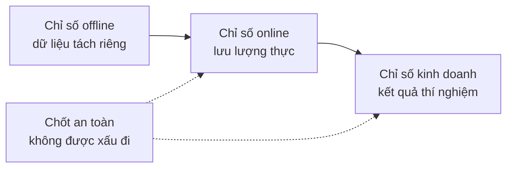

# Thiết kế hệ thống ML — Từ bài toán đến mô hình đã triển khai

> Một mô hình chỉ là một phần của hệ thống. Bản thiết kế quyết định mô hình dự đoán gì, ai hành động dựa trên nó, nó tốn bao nhiêu, và điều gì xảy ra khi nó hỏng.

**Type:** Build
**Languages:** Python
**Prerequisites:** Giai đoạn 2, Bài 09 (Đánh giá mô hình) và 13 (Pipeline ML)
**Time:** ~110 phút

## Mục tiêu học tập

- Đặt một bài toán kinh doanh thành bài toán ML với một dự đoán, một quyết định dùng dự đoán đó, và lý do vì sao các quy tắc là chưa đủ
- Phân tách chỉ số offline, online, kinh doanh và chốt an toàn, rồi so sánh mọi mô hình với baseline tầm thường và baseline heuristic
- Ước lượng chi phí mỗi ngày, độ trễ (latency) và độ cũ (staleness) của suy luận theo lô (batch inference) và suy luận trực tuyến (online inference) từ các con số lưu lượng
- Chọn một kiểu triển khai dần (shadow, canary, A/B test) và một mặc định an toàn cho mỗi chế độ lỗi (failure mode)
- Nhận diện vòng lặp phản hồi, nơi mô hình thay đổi chính dữ liệu dùng để huấn luyện phiên bản kế tiếp
- Viết một tài liệu thiết kế ML và chấm điểm nó theo một checklist cố định

## Vấn đề

Một công ty thuê bao hỏi xin "một mô hình dự đoán khách rời bỏ (churn)". Một nhà khoa học dữ liệu huấn luyện một bộ phân loại gradient boosting và báo cáo AUC 0.91. Ba tháng sau, không ai dùng nó.

Những lý do chẳng liên quan gì đến thuật toán. Không ai quyết định điểm số sẽ kích hoạt hành động nào. Điểm số về mỗi tuần một lần, nhưng nhóm giữ chân khách hàng lại gọi khách mỗi ngày. Nhãn đến từ một bảng hủy dịch vụ, bảng này cũng lưu lý do hủy, nên một đặc trưng đã chứa luôn câu trả lời. Không ai so sánh mô hình với quy tắc mà nhóm hỗ trợ vốn đã dùng: gọi cho bất kỳ ai không hoạt động trong hai tuần.

Mỗi thất bại này xảy ra trước khi việc huấn luyện bắt đầu. Chúng là những lỗi thiết kế hệ thống (system design), và một tài liệu thiết kế dài một trang sẽ hỏi về từng lỗi trong số đó. Bài này dạy những quyết định nằm trong tài liệu đó. Bạn xây một bộ công cụ định giá phục vụ theo lô (batch serving) và phục vụ trực tuyến (online serving), so sánh một mô hình với các baseline của nó, và chấm điểm một tài liệu thiết kế theo checklist.

## Khái niệm

### Từ mục tiêu kinh doanh đến bài toán ML

Một mục tiêu kinh doanh không phải là một bài toán ML. Bạn biến nó thành bài toán ML bằng bốn câu hỏi:

1. Mô hình dự đoán chính xác điều gì, và cho thực thể nào (người dùng, giao dịch, cửa hàng, mặt hàng)?
2. Quyết định nào dùng dự đoán đó, và ai hoặc cái gì đưa ra quyết định ấy?
3. Dự đoán cần vào lúc nào, và tại thời điểm đó có những dữ liệu nào?
4. Bạn biết quyết định đã tốt hơn bằng cách nào?

| Mục tiêu kinh doanh | Dự đoán | Quyết định dùng nó | Bài toán ML |
|---|---|---|---|
| Giảm churn | Xác suất một người dùng hủy trong 30 ngày tới | Gửi ưu đãi giữ chân cho 5 phần trăm cao nhất mỗi đêm | Phân loại nhị phân |
| Cắt giảm tổn thất gian lận | Xác suất một giao dịch là gian lận | Phê duyệt, xem xét hay chặn trong 100 ms | Phân loại nhị phân |
| Giữ kệ hàng luôn đầy | Số đơn vị bán ra mỗi cửa hàng mỗi ngày trong tuần tới | Số lượng đặt hàng cho từng cửa hàng | Dự báo |
| Hiển thị mặt hàng phù hợp | Điểm liên quan cho một cặp (người dùng, mặt hàng) | Thứ tự các mặt hàng trong bảng tin | Xếp hạng |

Cột thứ hai cần được chăm chút nhất. "Dự đoán churn" để ngỏ cả chân trời thời gian, thực thể lẫn hành động. "Dự đoán liệu người dùng này có hủy trong 30 ngày tới, để job tối nay chọn ai được nhận ưu đãi" cố định cả ba.

### Khi nào không nên dùng ML

Quy tắc #1 trong Rules of Machine Learning của Google nói đừng ngại ra mắt sản phẩm mà không có học máy. Học máy cần dữ liệu, và một heuristic đơn giản thường đưa bạn đi được một phần quãng đường. Đừng dùng ML trong những trường hợp sau:

- Một quy tắc ngắn đạt được mục tiêu và vẫn đúng. Quy tắc thì rẻ hơn để vận hành, kiểm thử và giải thích.
- Bạn không có nhãn và không có cách thực tế nào để thu thập chúng.
- Không ai hành động dựa trên dự đoán, nên dự đoán tốt hơn cũng chẳng thay đổi gì.
- Dữ liệu tồn tại ở thời điểm dự đoán không chứa tín hiệu.
- Một lỗi duy nhất là không thể chấp nhận, mà không người nào kiểm tra được kết quả.
- Chi phí xây và vận hành hệ thống lớn hơn giá trị của những quyết định tốt hơn.

Khi một quy tắc trở nên dài và mong manh, ML bắt đầu có lãi. Quy tắc #3 của cùng tài liệu đó ưu tiên ML hơn heuristic phức tạp, vì mô hình học được thì dễ cập nhật và bảo trì hơn.

### Ba tầng chỉ số

Bạn đo một hệ thống ML ở ba tầng, cộng thêm một nhóm giới hạn:

| Tầng | Khi nào đo được | Ví dụ về churn |
|---|---|---|
| Chỉ số offline | Trước khi ra mắt, trên dữ liệu quá khứ tách riêng (held-out) | F1 tại ngưỡng ưu đãi, precision trong 5 phần trăm cao nhất |
| Chỉ số online | Trong khi ra mắt, trên lưu lượng thực | Tỷ lệ chấp nhận ưu đãi, tỷ lệ người dùng được chấm điểm, phân bố điểm |
| Chỉ số kinh doanh | Vài tuần sau ra mắt, với một thí nghiệm | Tỷ lệ churn 30 ngày ở nhóm được can thiệp so với nhóm đối chứng |
| Chỉ số chốt an toàn | Mọi lúc | Chi phí ưu đãi cho mỗi người dùng được giữ lại, tỷ lệ hủy đăng ký, độ trễ p99 |



Các tầng này thường không đồng thuận với nhau. Chỉ số offline chấm điểm dữ liệu quá khứ, mà quá khứ thì không chứa mô hình của bạn. Chỉ số online phụ thuộc vào cách người ta phản ứng với quyết định. Chỉ số kinh doanh dịch chuyển chậm và mang nhiễu từ mọi thứ khác trong công ty.

Hãy chọn chỉ số offline khớp với quyết định. Nếu job chỉ liên hệ 5 phần trăm người dùng cao nhất, hãy đo precision trong 5 phần trăm cao nhất đó. AUC lấy trung bình trên mọi ngưỡng, kể cả những ngưỡng bạn không bao giờ dùng. Quy tắc #2 của cùng tài liệu nói hãy thiết kế và cài đặt chỉ số trước, trước khi quyết định hệ thống ML sẽ làm gì.

### Baseline

Một giá trị chỉ số chẳng có ý nghĩa gì nếu đứng một mình. F1 bằng 0.56 là tốt nếu phương án thay thế tốt nhất chỉ đạt 0.30, và là kém nếu một quy tắc đạt 0.60. Hãy so sánh mọi mô hình với ba loại baseline:

- **Baseline tầm thường.** Luôn dự đoán lớp đa số, hoặc luôn dự đoán giá trị trung bình của tập huấn luyện. Chúng ta đã dùng phép kiểm tra này trong bài đánh giá mô hình.
- **Baseline heuristic.** Một quy tắc rút ra từ kiến thức miền, hoặc một ngưỡng dựa trên một đặc trưng được fit trên dữ liệu huấn luyện.
- **Hệ thống hiện tại.** Bất cứ thứ gì đang đưa ra quyết định hôm nay, kể cả khi đó là một người với bảng tính.

Lift là điểm của mô hình trừ đi điểm của baseline mạnh nhất. Hãy đặt mức lift tối thiểu trước khi nhìn vào kết quả, và đặt đủ lớn để bù cho hệ thống phát sinh. Baseline tầm thường thường yếu. Baseline heuristic mới là cái khó vượt qua.

### Yêu cầu về dữ liệu và nhãn

Trả lời những câu hỏi sau trước khi huấn luyện:

- **Nguồn nhãn.** Bảng hay sự kiện nào định nghĩa nhãn, và ai sở hữu nó?
- **Độ trễ của nhãn.** Sau dự đoán bao lâu thì kết quả thật xuất hiện? Khoản hoàn trả do gian lận có thể đến vài tuần sau giao dịch. Nhãn churn đến vào cuối chân trời 30 ngày.
- **Chất lượng nhãn.** Ai gán nhãn, và nhãn sai thường xuyên đến mức nào?
- **Khả dụng ở thời điểm dự đoán.** Mọi đặc trưng có tồn tại ngay lúc dự đoán không? Một đặc trưng mà hệ thống ghi sau khi có kết quả sẽ làm rò rỉ nhãn vào tập huấn luyện.
- **Khối lượng mỗi lớp.** Có bao nhiêu mẫu dương? Hai trăm mẫu dương giới hạn bạn ở những mô hình đơn giản.
- **Chia theo thời gian.** Tách riêng giai đoạn gần nhất. Chúng ta chia dữ liệu theo thời gian trong bài chuỗi thời gian vì cùng lý do đó.

### Độ trễ, thông lượng (throughput) và ngân sách chi phí

Ba con số ràng buộc mọi thiết kế phục vụ:

- **Ngân sách độ trễ.** Độ trễ p99 là mức thời gian mà 99 trong 100 yêu cầu nằm dưới. Một bước kiểm tra thanh toán có thể cần 50 ms. Một báo cáo chạy đêm có thể mất hàng giờ.
- **Thông lượng đỉnh.** Quy hoạch năng lực (capacity planning) cho phút bận rộn nhất, chứ không phải cho trung bình ngày. QPS đỉnh thường gấp vài lần mức trung bình.
- **Ngân sách chi phí.** Hãy diễn đạt nó bằng đô la mỗi ngày hoặc đô la mỗi 1000 dự đoán, để bạn so sánh được các thiết kế.

Định luật Little nối hai con số đầu. Số yêu cầu đang xử lý bằng thông lượng nhân độ trễ. Với 400 yêu cầu mỗi giây và 50 ms mỗi yêu cầu, luôn có 20 yêu cầu đang xử lý tại bất kỳ thời điểm nào.

### Suy luận theo lô so với suy luận trực tuyến

Có hai cách cơ bản để phục vụ dự đoán:

- **Suy luận theo lô.** Một job chạy theo lịch chấm điểm mọi thực thể và ghi điểm vào một bảng hoặc một kho key-value. Ứng dụng đọc điểm đã lưu khi có yêu cầu.
- **Suy luận trực tuyến.** Ứng dụng gửi các đặc trưng tới dịch vụ mô hình ngay lúc có yêu cầu và chờ điểm trả về.

| Tính chất | Theo lô | Trực tuyến |
|---|---|---|
| Độ mới | Cũ bằng lần chạy gần nhất, cộng thời gian chạy | Dùng dữ liệu của chính yêu cầu |
| Độ trễ yêu cầu | Một lần đọc key-value, vài ms | Lấy đặc trưng cộng thời gian mô hình |
| Yếu tố quyết định chi phí | Số thực thể nhân số lần chạy mỗi ngày | Số bản sao được chỉnh theo QPS đỉnh |
| Thực thể mới | Không có điểm cho tới lần chạy kế tiếp | Được chấm điểm ngay ở yêu cầu đầu tiên |
| Khi nó hỏng | Điểm cũ vẫn đọc được | Yêu cầu thất bại hoặc hết thời gian chờ |

Bộ công cụ trong bài này định giá cả hai. Chi phí theo lô tăng theo số thực thể và số lần chạy mỗi ngày. Giới hạn độ cũ ngắn hơn nghĩa là nhiều lần chạy hơn. Chi phí trực tuyến tăng theo lưu lượng đỉnh, vì bạn phải trả cho những bản sao nhàn rỗi giữa các đỉnh. Một job theo lô chạy mất một giờ thì dù tốn bao nhiêu tiền cũng không thể đáp ứng giới hạn độ cũ dưới một giờ.

Thiết kế lai là chuyện thường gặp. Một job theo lô chạy đêm chấm điểm những người dùng đã biết, còn một luồng trực tuyến chấm điểm người dùng mới và những yêu cầu cần dữ liệu tươi.

### Các kiểu triển khai

Một mô hình mới tiếp cận người dùng theo từng giai đoạn:

1. **Shadow.** Mô hình mới nhận một bản sao của lưu lượng thực. Hệ thống ghi log các dự đoán của nó và không bao giờ dùng chúng. Bạn so sánh độ trễ, tỷ lệ lỗi và phân bố dự đoán với mô hình hiện tại.
2. **Canary.** Mô hình mới ra quyết định thật cho một phần nhỏ lưu lượng, thường là 1 đến 5 phần trăm. Bạn mở rộng phần này theo từng bước và rollback khi một chốt an toàn bị phá vỡ.
3. **A/B test.** Một nhóm người dùng được chia ngẫu nhiên để mỗi nhóm thấy một mô hình. Bạn đo chỉ số kinh doanh bằng một phép kiểm định thống kê, và cần đủ lưu lượng cùng đủ thời gian để thấy khác biệt.

Mỗi giai đoạn đều cần một cách rollback mất vài phút. Hãy giữ phiên bản mô hình cũ vẫn được triển khai và chuyển lưu lượng bằng cấu hình. Giai đoạn phục vụ LLM cũng nói về đúng ba kiểu này cho mô hình ngôn ngữ, trong [bài shadow và canary](../../../17-infrastructure-and-production/20-shadow-canary-progressive/docs/en.md) và [bài kiểm thử A/B](../../../17-infrastructure-and-production/21-ab-testing-llm-features/docs/en.md).

### Vòng lặp phản hồi

Vòng lặp phản hồi xuất hiện khi các quyết định của mô hình thay đổi chính dữ liệu dùng để huấn luyện phiên bản kế tiếp của nó. Sculley và cộng sự liệt kê vòng lặp phản hồi trực tiếp và ẩn trong những nguồn nợ kỹ thuật chính của các hệ thống ML. Ba trường hợp thường gặp:

- **Can thiệp che mất nhãn.** Một mô hình churn gửi ưu đãi, và ưu đãi giữ chân được vài người dùng. Tháng sau, những người dùng rủi ro cao trông có vẻ trung thành, và mô hình được huấn luyện lại học rằng các đặc trưng của họ không dự đoán được churn.
- **Hành động bị chặn không có kết quả.** Một mô hình gian lận chặn một giao dịch, nên giao dịch đó không bao giờ có nhãn hoàn trả. Mô hình được huấn luyện lại thấy ít mẫu gian lận hơn từ vùng bị chặn.
- **Phạm vi hiển thị giới hạn phản hồi.** Một mô hình xếp hạng chỉ cho hiển thị các mặt hàng đầu của nó, nên chỉ những mặt hàng đó thu được lượt nhấp.

Các cách khắc phục cùng chung một ý: giữ lại phần dữ liệu mà mô hình không tác động tới. Tách riêng một nhóm ngẫu nhiên nhỏ không bao giờ được can thiệp. Cho một phần nhỏ lưu lượng nhận quyết định ngẫu nhiên. Ghi log điểm số và quyết định kèm từng mẫu, để lần huấn luyện sau phân biệt được dữ liệu bị tác động với dữ liệu sạch.

### Chế độ lỗi và mặc định an toàn

Sớm hay muộn thì mọi phần của hệ thống cũng hỏng. Hãy quyết định hành động mặc định cho từng kiểu hỏng ngay trong bản thiết kế, chứ không phải lúc sự cố đang xảy ra:

| Kiểu hỏng | Kết quả khi không có kế hoạch | Mặc định an toàn |
|---|---|---|
| Dịch vụ mô hình hết thời gian chờ | Yêu cầu thất bại | Dùng baseline heuristic |
| Job theo lô chạy đêm thất bại | Điểm số mất tích hoặc trở nên cũ | Phục vụ điểm tốt cuối cùng trong một khoảng thời gian cố định, rồi mới dùng quy tắc |
| Đặc trưng bị thiếu hoặc ngoài miền giá trị | Mô hình chấm điểm đầu vào tồi | Dùng giá trị mặc định đã ghi trong tài liệu và ghi log sự kiện |
| Thực thể mới không có lịch sử | Không có điểm nào tồn tại | Dùng quy tắc hoặc giá trị trung bình của tổng thể |
| Phân bố điểm đột ngột dịch chuyển | Quyết định sai trên quy mô lớn | Tạm dừng các hành động tự động và báo cho một người |

Baseline heuristic trong phần chỉ số cũng chính là mặc định cho hầu hết các kiểu hỏng, nên hãy xây nó trước.

### Tài liệu thiết kế

Tài liệu thiết kế ghi lại mọi quyết định ở trên vào một chỗ, trước khi việc huấn luyện bắt đầu. Bộ kiểm tra trong bài này chấm điểm một bản JSON của tài liệu đó. Sáu mục có thể chặn buổi review, vì mỗi mục khiến hệ thống trở nên không an toàn hoặc vô dụng:

| Mục | Câu hỏi nó trả lời | Chặn |
|---|---|---|
| Vấn đề | Dự đoán điều gì, quyết định nào dùng nó, và vì sao quy tắc là chưa đủ? | Quyết định |
| Chỉ số | Những chỉ số offline, online, kinh doanh và chốt an toàn nào được áp dụng? | Chỉ số kinh doanh |
| Baseline | Những baseline tầm thường, heuristic và hệ thống hiện tại nào được áp dụng? | Một baseline heuristic hoặc hệ thống hiện tại |
| Dữ liệu | Nhãn đến từ đâu, muộn bao lâu, và mỗi đặc trưng có tồn tại ở thời điểm dự đoán không? | Không rò rỉ |
| Ngân sách và phục vụ | Những giới hạn độ trễ, QPS đỉnh, chi phí và độ cũ nào được áp dụng, và kiểu phục vụ nào phù hợp với chúng? | Không |
| Triển khai dần | Những giai đoạn shadow, canary và A/B nào được áp dụng, và bạn rollback thế nào? | Shadow hoặc canary, cộng với rollback |
| Vòng lặp phản hồi | Mô hình có thể thay đổi dữ liệu tương lai của chính nó bằng cách nào, và cái gì giữ được dữ liệu sạch? | Không |
| Chế độ lỗi | Hành động mặc định cho từng kiểu hỏng là gì? | Mặc định cho mọi kiểu hỏng |
| Giám sát | Bạn theo dõi những gì sau khi ra mắt? | Không |

```figure
mlprod-serving-cost
```

## Tự tay làm

Code trong `code/main.py` chỉ dùng thư viện chuẩn. Nó có ba công cụ: một mô hình chi phí phục vụ, một bộ so sánh baseline, và một bộ kiểm tra tài liệu thiết kế.

### Bước 1: Mô tả khối lượng công việc và đơn giá

Một đối tượng workload giữ các con số lưu lượng và ngân sách. Một mô hình chi phí giữ đơn giá. Các đơn giá là số tròn cho bài tập, không phải báo giá của nhà cung cấp.

```python
@dataclass(frozen=True)
class Workload:
    name: str
    entities: int
    requests_per_day: int
    peak_qps: float
    max_staleness_hours: float
    latency_budget_ms: float


@dataclass(frozen=True)
class CostModel:
    batch_dollars_per_million: float = 0.40
    batch_job_hours: float = 1.0
    lookup_dollars_per_million: float = 0.25
    lookup_latency_ms: float = 4.0
    replica_dollars_per_hour: float = 0.50
    replica_qps: float = 200.0
    min_replicas: int = 2
    online_latency_ms: float = 35.0
```

### Bước 2: Định giá phục vụ theo lô và trực tuyến

Một job theo lô phải chạy xong trong giới hạn độ cũ. Khoảng thời gian giữa hai lần chạy là giới hạn trừ đi thời gian chạy job. Mỗi lần chạy chấm điểm mọi thực thể, bất kể có ai hỏi xin điểm đó hay không.

```python
def batch_plan(workload: Workload, costs: CostModel) -> ServingPlan:
    refresh_hours = workload.max_staleness_hours - costs.batch_job_hours
    if refresh_hours <= 0:
        return ServingPlan(
            "batch", False, math.inf, costs.lookup_latency_ms, math.inf, 0.0,
            "staleness limit is shorter than one batch job",
        )
    runs_per_day = 24.0 / refresh_hours
    predictions = workload.entities * runs_per_day
    dollars = (
        predictions / 1e6 * costs.batch_dollars_per_million
        + workload.requests_per_day / 1e6 * costs.lookup_dollars_per_million
    )
    ...
```

Phục vụ trực tuyến trả tiền cho đủ số bản sao để xử lý đỉnh, với tối thiểu hai bản sao để đảm bảo khả dụng:

```python
def online_plan(workload: Workload, costs: CostModel) -> ServingPlan:
    replicas = max(costs.min_replicas, math.ceil(workload.peak_qps / costs.replica_qps))
    dollars = replicas * costs.replica_dollars_per_hour * 24.0
    feasible = costs.online_latency_ms <= workload.latency_budget_ms
    ...
```

`choose_serving` giữ lại những phương án thỏa giới hạn độ trễ và độ cũ rồi trả về phương án rẻ nhất. Nó trả về `None` khi không phương án nào phù hợp, nghĩa là bạn cần thay đổi ngân sách.

### Bước 3: So sánh mô hình với các baseline

Bộ so sánh chấm điểm mô hình và mọi baseline bằng cùng một chỉ số. Nó đo lift so với baseline mạnh nhất, chứ không phải yếu nhất.

```python
def compare_to_baselines(
    y_true: list,
    model_pred: list,
    baselines: dict[str, list],
    metric,
    metric_name: str,
    higher_is_better: bool = True,
    min_lift: float = 0.02,
) -> BaselineReport:
    if not baselines:
        raise ValueError("a model needs at least one baseline")
    scores = {name: metric(y_true, pred) for name, pred in baselines.items()}
    pick = max if higher_is_better else min
    best_name = pick(scores, key=scores.get)
    model_score = metric(y_true, model_pred)
    lift = model_score - scores[best_name] if higher_is_better else scores[best_name] - model_score
    return BaselineReport(metric_name, {"model": model_score, **scores}, best_name, lift, min_lift)
```

Baseline heuristic là một quy tắc dựa trên một đặc trưng. `fit_rule` thử từng giá trị của đặc trưng làm ngưỡng trên dữ liệu huấn luyện và giữ ngưỡng có F1 tốt nhất. Phần demo huấn luyện một hồi quy logistic nhỏ trên dữ liệu churn tổng hợp và so sánh nó với ba baseline.

### Bước 4: Chấm điểm một tài liệu thiết kế

Mỗi mục trong checklist có một key, một trọng số, một cờ chặn, một thông điệp và một hàm kiểm tra. Mục chặn có trọng số 2.

```python
CheckItem("decision", 2, True, "name the action that uses each prediction", lambda d: _text(d, "problem.decision")),
CheckItem("baselines", 2, True, "add a heuristic or current-system baseline", check_baselines),
CheckItem("no_leakage", 2, True, "confirm every feature exists at prediction time",
          lambda d: get_path(d, "data.features_available_at_prediction_time") is True),
CheckItem("serving_fit", 1, False, "pick a serving mode that meets the staleness, latency, and cost budgets",
          check_serving_fit),
```

`check_serving_fit` dùng lại mô hình chi phí. Nó đọc các con số workload từ tài liệu và định giá kiểu phục vụ đã chọn. Phép kiểm tra thất bại khi kiểu đó không đạt giới hạn độ cũ, ngân sách độ trễ hoặc ngân sách chi phí mỗi ngày. Một tài liệu ghi "batch" với giới hạn độ cũ ba phút sẽ trượt phép kiểm tra này. Mô hình chi phí chưa có phương án lai, nên tài liệu ghi "hybrid" sẽ trượt phép kiểm tra này cho tới khi bạn thêm phương án đó trong Bài tập 1.

`review_design_doc` cộng trọng số của các mục đã đạt rồi chia cho tổng. Kết luận "sẵn sàng để review" chỉ xuất hiện khi điểm đạt 0.85 và không mục chặn nào thất bại.

### Bước 5: Chạy nó

```bash
python3 code/main.py
```

```console
nightly churn scores
  ok batch        $0.91/day      4 ms  1.0 runs per day over 2,000,000 entities
  ok online      $24.00/day     35 ms  2 replicas sized for 40 peak QPS
  choose: batch

feed ranking, 2-hour freshness
  ok batch       $48.50/day      4 ms  24.0 runs per day over 5,000,000 entities
  ok online      $24.00/day     35 ms  2 replicas sized for 120 peak QPS
  choose: online

=== Model versus baselines (churn, metric F1) ===
  model                    0.564
  days_idle > 12.8688      0.500
  random at base rate      0.232
  majority class           0.000
  model beats the strongest baseline (days_idle > 12.8688) by +0.064
```

Baseline lớp đa số đạt F1 bằng 0, vì nó không bao giờ dự đoán churn. Quy tắc được fit mới là đối thủ thật sự. Mô hình vượt nó 0.064, nên mô hình xứng đáng có chỗ. Với các đặc trưng yếu hơn, quy tắc có thể thắng, và khi đó quy tắc mới là hệ thống đúng để triển khai.

Phần review tài liệu thiết kế in ra tài liệu yếu với sáu mục chặn và tài liệu hoàn chỉnh với điểm 1.00. Truyền vào một đường dẫn để review tài liệu của chính bạn:

```bash
python3 code/main.py my_design_doc.json
```

## Áp dụng

Mỗi phần của bộ công cụ tương ứng với những công cụ mà các nhóm dùng trong môi trường production.

**Baseline.** scikit-learn cung cấp các baseline tầm thường dưới dạng estimator, nên chúng khớp vào cùng pipeline với mô hình:

```python
from sklearn.dummy import DummyClassifier, DummyRegressor
from sklearn.metrics import f1_score

majority = DummyClassifier(strategy="most_frequent").fit(X_train, y_train)
base_rate = DummyClassifier(strategy="stratified", random_state=0).fit(X_train, y_train)
mean_value = DummyRegressor(strategy="mean").fit(X_train, y_reg_train)

print(f1_score(y_test, majority.predict(X_test)))
```

`most_frequent` tương ứng với `majority_baseline`, và `stratified` tương ứng với `base_rate_baseline`. scikit-learn không có baseline heuristic, vì heuristic đến từ miền của bạn.

**Phục vụ theo lô.** Một bộ lập lịch workflow như Apache Airflow hay Dagster chạy job chấm điểm. Job ghi điểm vào bảng trong warehouse hoặc vào kho key-value như Redis hay DynamoDB.

**Phục vụ trực tuyến.** Các model server như KServe, BentoML, NVIDIA Triton và TorchServe bọc mô hình sau một endpoint HTTP hoặc gRPC. Một web service đơn giản có nạp mô hình cũng đủ dùng cho mô hình nhỏ.

**Triển khai dần.** Các công cụ Kubernetes như Argo Rollouts chia lưu lượng cho bản phát hành canary. Các nền tảng thí nghiệm như GrowthBook và Statsig gán người dùng vào nhóm A/B và tính toán thống kê.

**Review thiết kế.** Breck và cộng sự công bố ML Test Score, một thang chấm gồm 28 phép kiểm tra và các nhu cầu giám sát cho hệ thống ML production. Bộ kiểm tra của chúng ta nhỏ hơn. Nó hỏi những câu hỏi thiết kế phải trả lời trước các phép kiểm tra đó.

## Đóng gói

Bài này tạo ra `outputs/skill-ml-design-review.md`. Skill này review một tài liệu thiết kế ML theo từng mục và nêu những lỗ hổng chặn trước tiên. Nó cũng kiểm tra lựa chọn phục vụ bằng phép tính chi phí theo lô và trực tuyến của bài này.

## Bài tập

1. Thêm một phương án lai vào `choose_serving`. Chấm điểm người dùng đã biết theo lô và người dùng mới theo trực tuyến. So sánh chi phí mỗi ngày của nó.
2. Thay đổi dữ liệu churn cho tới khi mô hình không còn vượt được quy tắc. Báo cáo thay đổi hệ số nhỏ nhất khiến lift biến mất.
3. Thêm mục `budgets.max_dollars_per_1k_predictions` vào checklist. Viết một test thất bại nếu thiếu mục đó.
4. Viết một tài liệu thiết kế JSON cho bước kiểm tra gian lận thanh toán. Chạy bộ kiểm tra và sửa mọi mục chặn.
5. Mô phỏng vòng lặp phản hồi của churn. Xóa nhãn của những người dùng đã nhận ưu đãi, huấn luyện lại, và đo thay đổi về F1.

## Thuật ngữ chính

| Thuật ngữ | Người ta thường nói | Ý nghĩa thực sự |
|------|----------------|----------------------|
| ML task | "Xây một mô hình churn" | Một mục tiêu dự đoán, một thực thể, một chân trời thời gian, và quyết định dùng dự đoán đó |
| Offline metric | "Điểm của mô hình" | Một chỉ số tính trên dữ liệu quá khứ tách riêng trước khi ra mắt |
| Online metric | "Số liệu live" | Một chỉ số đo trên lưu lượng thực trong khi mô hình đang chạy |
| Business metric | "Mục tiêu" | Kết quả kinh doanh mà quyết định phải thay đổi, được đo bằng một thí nghiệm |
| Guardrail metric | "Đừng gây hại" | Một chỉ số không được xấu đi khi mô hình mới ra mắt |
| Baseline | "Mô hình ngớ ngẩn" | Một bộ dự đoán tầm thường, heuristic hoặc hệ thống hiện tại mà mô hình phải vượt qua với biên định trước |
| Batch inference | "Điểm tính trước" | Một job chạy theo lịch chấm điểm mọi thực thể và lưu kết quả để tra cứu |
| Online inference | "Mô hình thời gian thực" | Mô hình chấm điểm từng yêu cầu khi nó đến |
| Shadow deployment | "Dark launch" | Mô hình mới chấm điểm lưu lượng thực, và không ai dùng kết quả của nó |
| Canary release | "Triển khai chậm" | Mô hình mới ra quyết định cho một phần lưu lượng nhỏ và tăng dần, với rollback sẵn sàng |
| Feedback loop | "Mô hình tự huấn luyện chính nó" | Các quyết định của mô hình thay đổi dữ liệu dùng để huấn luyện phiên bản kế tiếp |

## Đọc thêm

- [Sculley et al., Hidden Technical Debt in Machine Learning Systems (NeurIPS 2015)](https://papers.nips.cc/paper/2015/hash/86df7dcfd896fcaf2674f757a2463eba-Abstract.html): vòng lặp phản hồi, sự đan xen, và chi phí hệ thống quanh một mô hình
- [Google, Rules of Machine Learning](https://developers.google.com/machine-learning/guides/rules-of-ml): những quy tắc thực dụng cho mô hình đầu tiên, chỉ số, và tính nhất quán giữa huấn luyện với phục vụ
- [Breck et al., The ML Test Score (IEEE Big Data 2017)](https://research.google/pubs/the-ml-test-score-a-rubric-for-ml-production-readiness-and-technical-debt-reduction/): 28 phép kiểm tra đo mức sẵn sàng production
- [Kohavi, Tang, and Xu, Trustworthy Online Controlled Experiments (Cambridge University Press, 2020)](https://experimentguide.com/): cách chạy kiểm thử A/B để có câu trả lời đúng
- [Sato, Wider, and Windheuser, Continuous Delivery for Machine Learning (2019)](https://martinfowler.com/articles/cd4ml.html): dữ liệu, mô hình và pipeline triển khai được đánh phiên bản
- [Google Cloud, MLOps: Continuous delivery and automation pipelines in machine learning](https://cloud.google.com/architecture/mlops-continuous-delivery-and-automation-pipelines-in-machine-learning): ba mức độ trưởng thành cho tự động hóa huấn luyện và phục vụ
