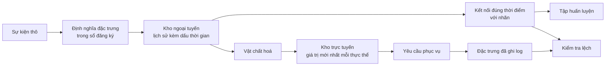

# Kho đặc trưng và lệch huấn luyện - phục vụ

> Một đặc trưng có một định nghĩa và hai bên đọc. Huấn luyện đọc lịch sử của nó tính đến thời điểm của từng nhãn, còn phục vụ đọc giá trị mới nhất. Khi hai bên đọc không khớp nhau, mô hình nhìn thấy những đầu vào mà nó chưa từng được huấn luyện.

**Type:** Build
**Languages:** Python
**Prerequisites:** Giai đoạn 2, Bài 08 (Kỹ thuật đặc trưng), 13 (Pipeline ML), 15 (Chuỗi thời gian) và 19 (Thiết kế hệ thống ML)
**Time:** ~100 phút

## Mục tiêu học tập

- Mô tả offline store (kho ngoại tuyến), online store (kho trực tuyến), entity (thực thể), event timestamp (dấu thời gian sự kiện) và TTL, cùng nhiệm vụ của từng thành phần
- Cài đặt một phép point-in-time join (kết nối đúng thời điểm) và chỉ ra cách một phép kết nối ngây thơ sao chép giá trị tương lai vào dữ liệu huấn luyện
- Kể tên bốn nguyên nhân gây training-serving skew (lệch huấn luyện - phục vụ): hai đường code, đặc trưng cũ, giá trị mặc định khác nhau và du hành thời gian
- Xây dựng một sổ đăng ký đặc trưng trong đó một định nghĩa phục vụ cả đường huấn luyện lẫn đường phục vụ
- Điền bù một đặc trưng mới trên các ngày trong quá khứ mà không đọc dữ liệu từ sau mỗi ngày đó
- Phát hiện lệch bằng cách so sánh các đặc trưng phục vụ đã ghi log với đường huấn luyện cho cùng một thực thể và thời điểm

## Vấn đề

Một nhóm xây dựng mô hình dự đoán rời bỏ (churn). Mỗi nhãn cho biết người dùng có mua gì trong 30 ngày sau ngày gán nhãn hay không. Nhóm kết nối các nhãn với bảng đặc trưng người dùng theo `user_id` và huấn luyện một luật trên `days_since_last_purchase`. Độ chính xác ngoại tuyến là 0.948.

Trên lưu lượng thật, mô hình làm tệ hơn cả một phiên bản cũ và đơn giản hơn. Bảng đặc trưng giữ giá trị mới nhất cho mỗi người dùng, với mốc thời gian từ nhiều tuần sau ngày gán nhãn. Một người dùng có lần mua cuối vào ngày 115 lại hiển thị 60 ngày không mua gì trong ảnh chụp ngày 175, nên đặc trưng đã chứa sẵn đáp án. Trong khi đó, một nhóm khác viết lại các đặc trưng phục vụ trong một dịch vụ riêng. Cửa sổ 30 ngày của họ tính thêm một ngày, và giá trị mặc định cho người dùng mới của họ là -1 thay vì 365.

Cả hai lỗi đều có cùng một nguyên nhân. Huấn luyện và phục vụ tính "cùng một đặc trưng" theo hai cách khác nhau. Bài này xây dựng các thành phần của một feature store (kho đặc trưng) từ con số không. Bạn viết một sổ đăng ký, một quy trình backfill (điền bù), một phép kết nối đúng thời điểm, một kho trực tuyến có TTL, và một bước kiểm tra lệch. Bản demo tái hiện cả hai lỗi bằng số liệu.

## Khái niệm

### Hai bên đọc của cùng một đặc trưng

Huấn luyện và phục vụ hỏi xin đặc trưng ở những dạng khác nhau:

| Thuộc tính | Huấn luyện (ngoại tuyến) | Phục vụ (trực tuyến) |
|---|---|---|
| Câu hỏi | "Giá trị cho từng cặp (thực thể, thời điểm) trong 10 triệu cặp là gì?" | "Giá trị cho đúng thực thể này ngay bây giờ là gì?" |
| Thời gian | Nhiều thời điểm trong quá khứ | Hiện tại |
| Khối lượng | Hàng triệu dòng mỗi job | Một dòng mỗi yêu cầu |
| Độ trễ | Vài phút là ổn | Vài mili giây |
| Lưu trữ | Kho ngoại tuyến: toàn bộ lịch sử kèm dấu thời gian, trong các file dạng cột hoặc một warehouse | Kho trực tuyến: giá trị mới nhất cho mỗi thực thể, trong một cơ sở dữ liệu key-value |

Một kho đặc trưng giữ cho cả hai kho luôn được nạp từ một bộ định nghĩa đặc trưng. Materialization (vật chất hoá) là job sao chép các giá trị mới nhất từ kho ngoại tuyến sang kho trực tuyến.



### Thực thể, dấu thời gian và TTL

Bốn thuật ngữ mô tả mọi dòng đặc trưng:

- **Entity.** Khoá mà một đặc trưng mô tả, chẳng hạn `user_id` hoặc `card_id`.
- **Event timestamp.** Thời điểm mà tại đó giá trị trở thành đúng. Số lần mua "tính đến ngày 14" có dấu thời gian sự kiện là ngày 14.
- **Created timestamp.** Thời điểm hệ thống ghi dòng đó. Một lần điền bù chạy hôm nay ghi các dòng có dấu thời gian sự kiện cũ và dấu thời gian tạo mới.
- **TTL (time to live).** Tuổi tối đa của một giá trị. Một giá trị cũ hơn TTL bị coi là thiếu, nên bên đọc dùng giá trị mặc định.

Một nhóm các đặc trưng có cùng thực thể, cùng nguồn và cùng TTL thường được gọi là feature view (khung đặc trưng).

### Kết nối đúng thời điểm

Một dòng huấn luyện ghép một nhãn với các giá trị đặc trưng đã tồn tại tại thời điểm gán nhãn. Phép point-in-time join làm việc này cho từng nhãn:

1. Tìm các dòng đặc trưng của cùng thực thể.
2. Giữ những dòng có dấu thời gian sự kiện bằng hoặc trước dấu thời gian của nhãn.
3. Lấy dòng mới nhất trong số đó.
4. Bỏ nó đi nếu hiệu số giữa dấu thời gian nhãn và dấu thời gian sự kiện của nó lớn hơn TTL.

Đây là một người dùng, một nhãn ở ngày 16, và các dòng đặc trưng theo tuần:

| Ngày của dòng đặc trưng | `purchases_30d` | Kết nối đúng thời điểm | Kết nối ngây thơ theo `user_id` |
|---|---|---|---|
| 7 | 4 | | |
| 14 | 3 | Được chọn | |
| 21 | 1 | Tương lai | |
| 28 | 0 | Tương lai | Được chọn |

Nhãn hỏi liệu người dùng có mua gì trong các ngày từ 17 đến 46 hay không. Dòng ngày 28 đã đếm luôn những ngày im ắng sau ngày gán nhãn. Nó cho thấy 0 lần mua vì người dùng đã ngừng mua, và đó chính là sự kiện mà nhãn đo lường. Phép kết nối ngây thơ sao chép đáp án vào đầu vào.

Chúng ta chia dữ liệu theo thời gian trong bài về chuỗi thời gian cũng vì lý do này. Một phép kết nối đúng thời điểm áp dụng quy tắc đó cho mọi dòng thay vì cho một điểm chia duy nhất.

### Các nguyên nhân gây lệch huấn luyện - phục vụ

Google's Rules of Machine Learning định nghĩa lệch huấn luyện - phục vụ là sự khác biệt giữa hiệu năng khi huấn luyện và hiệu năng khi phục vụ. Họ nêu ba nguyên nhân: cách xử lý dữ liệu khác nhau ở hai pipeline, dữ liệu thay đổi giữa lúc huấn luyện và lúc phục vụ, và một vòng phản hồi. Trong các pipeline đặc trưng, bốn nguyên nhân cụ thể lặp đi lặp lại:

| Nguyên nhân | Điều gì xảy ra | Ví dụ từ bản demo |
|---|---|---|
| Hai đường code | Huấn luyện và phục vụ tính đặc trưng bằng code khác nhau | Cửa sổ phục vụ bao gồm ngày `now - 30`, còn cửa sổ huấn luyện thì không |
| Đặc trưng cũ | Giá trị mà phục vụ đọc có độ tuổi khác với giá trị mà huấn luyện dùng | Huấn luyện đọc ảnh chụp theo tuần, còn một dịch vụ mới tính giá trị tươi mới |
| Giá trị mặc định khác nhau | Hai đường điền giá trị thiếu theo cách khác nhau | Huấn luyện dùng 365 cho "chưa mua lần nào", còn phục vụ dùng -1 |
| Du hành thời gian | Huấn luyện đọc một giá trị từ sau thời điểm gán nhãn | Phép kết nối ngây thơ đọc ảnh chụp mới nhất cho mọi nhãn |

Quy tắc #32 của cùng hướng dẫn đó nói rằng hãy tái sử dụng code giữa pipeline huấn luyện và pipeline phục vụ bất cứ khi nào có thể. Một kho đặc trưng tuân theo quy tắc đó bằng một định nghĩa duy nhất mà cả hai đường cùng gọi.

### Sổ đăng ký đặc trưng

Sổ đăng ký là danh mục các định nghĩa đặc trưng. Mỗi mục chứa một tên, một thực thể, một nguồn, một phép biến đổi, một cửa sổ, một giá trị mặc định, một TTL, người sở hữu, phiên bản và mô tả.

Hai quy tắc giữ cho nó an toàn:

- Cả hai đường đều đọc định nghĩa từ sổ đăng ký. Không dịch vụ nào giữ bản sao riêng của phép biến đổi.
- Một thay đổi đối với một định nghĩa tạo ra phiên bản mới. Phiên bản cũ vẫn còn, nên các mô hình cũ giữ được đặc trưng mà chúng đã huấn luyện.

### Điền bù

Một đặc trưng mới không có lịch sử, nhưng huấn luyện cần giá trị của nó tại mọi thời điểm gán nhãn trong quá khứ. Một lần backfill chạy định nghĩa tại từng ngày trong quá khứ và ghi một dòng cho mỗi cặp thực thể và ngày. Mỗi lần chạy chỉ đọc các sự kiện có dấu thời gian bằng hoặc trước ngày đó.

Điền bù tốn lượng tính toán tăng theo số thực thể nhân với số ngày. Chúng cũng mang theo một leakage (rò rỉ) tinh vi. Một lần điền bù chạy hôm nay ghi các dòng với dấu thời gian sự kiện cũ, nhưng nó có thể đọc dữ liệu đến muộn hoặc bị chỉnh sửa về sau. Một phép kết nối đúng thời điểm nghiêm ngặt còn kiểm tra rằng dấu thời gian tạo phải bằng hoặc trước thời điểm gán nhãn.

### Phát hiện lệch

Quy tắc #29 của cùng hướng dẫn đó nói rằng hãy ghi log các đặc trưng tại thời điểm phục vụ và dùng chúng khi huấn luyện. Ngay cả một mẫu log nhỏ cũng cho phép bạn kiểm tra tính nhất quán. Hãy so sánh từng giá trị đã ghi log với giá trị mà đường huấn luyện tạo ra cho cùng thực thể và thời điểm. Với mỗi đặc trưng, báo cáo tỉ lệ không khớp và độ lệch tuyệt đối trung bình.

Để tìm nguyên nhân, hãy so sánh ba cặp:

1. Đọc từ kho trực tuyến so với phép kết nối huấn luyện. Phép so sánh này kiểm tra toàn bộ hệ thống và phải cho thấy độ lệch bằng không.
2. Tính toán tươi mới so với phép kết nối huấn luyện. Phép so sánh này cô lập độ cũ của đặc trưng.
3. Đường code thứ hai so với tính toán tươi mới. Phép so sánh này cô lập các khác biệt về code, chẳng hạn cửa sổ và giá trị mặc định.

```figure
mlprod-pit-join
```

## Tự tay làm

Code trong `code/main.py` chỉ dùng thư viện chuẩn. Thời gian là một số nguyên ngày. Một job theo lô hằng tuần ghi ảnh chụp đặc trưng vào các ngày 7, 14, và cứ thế đến ngày 175.

### Bước 1: Định nghĩa đặc trưng và sổ đăng ký

Một `FeatureDefinition` giữ phép biến đổi dưới dạng dữ liệu: một phép tổng hợp, một cửa sổ và một giá trị mặc định. Phương thức `compute` của nó không bao giờ đọc các sự kiện sau `as_of`.

```python
@dataclass(frozen=True)
class FeatureDefinition:
    name: str
    entity: str
    aggregate: str
    window_days: int | None
    default: float
    version: int = 1
    owner: str = "growth-team"
    description: str = ""

    def compute(self, events: list[Event], as_of: int) -> float:
        visible = [e for e in events if e.day <= as_of]
        if self.window_days is not None:
            visible = [e for e in visible if e.day > as_of - self.window_days]
        if self.aggregate == "count":
            return float(len(visible))
        if self.aggregate == "sum":
            return round(sum(e.amount for e in visible), 2)
        if self.aggregate == "days_since_last":
            return float(as_of - max(e.day for e in visible)) if visible else self.default
        raise ValueError(f"unknown aggregate {self.aggregate!r}")
```

`FeatureRegistry.register` chấp nhận cùng một định nghĩa hai lần, nhưng nó từ chối một định nghĩa khác có cùng tên và cùng phiên bản. `fill_defaults` cho cả hai đường cùng một giá trị mặc định khi thiếu dữ liệu.

Một mô hình ghim một định nghĩa bằng tham chiếu như `spend_30d@1`. `compute` và `fill_defaults` phân giải tham chiếu đó, và một tên không có `@` sẽ đọc phiên bản mới nhất. Một tham chiếu có `@` mà thiếu số phiên bản sẽ ném `ValueError`, nên một lỗi gõ nhầm không thể âm thầm đọc phiên bản mới nhất mà không có cảnh báo. Tham chiếu cũng là khoá trong mỗi dòng được lưu, nên lần điền bù, kho trực tuyến và bước đọc khi phục vụ đều dùng chung định nghĩa đã ghim.

### Bước 2: Điền bù kho ngoại tuyến

```python
def backfill(registry: FeatureRegistry, names: list[str], events: list[Event], days: list[int]) -> list[FeatureRow]:
    rows = []
    for entity, entity_events in sorted(group_events(events).items()):
        for day in days:
            rows.append(FeatureRow(entity, day, registry.compute(names, entity_events, day)))
    return rows
```

Bản demo điền bù ba đặc trưng cho 299 người dùng trên 25 ngày chụp ảnh, tạo ra 7475 dòng.

### Bước 3: Phép kết nối đúng thời điểm

Sắp xếp các dòng của mỗi thực thể theo ngày một lần. Với mỗi nhãn, `bisect_right` tìm dòng cuối cùng có ngày bằng hoặc trước ngày gán nhãn. Bước kiểm tra TTL loại bỏ một dòng quá cũ.

```python
def point_in_time_join(labels: list[LabelRow], rows: list[FeatureRow], ttl_days: int | None = None) -> list[JoinedRow]:
    by_entity: dict[str, list[FeatureRow]] = defaultdict(list)
    for row in rows:
        by_entity[row.entity].append(row)
    days_index = {}
    for entity, entity_rows in by_entity.items():
        entity_rows.sort(key=lambda r: r.day)
        days_index[entity] = [r.day for r in entity_rows]
    joined = []
    for label in labels:
        days = days_index.get(label.entity, [])
        pos = bisect.bisect_right(days, label.day) - 1
        match = by_entity[label.entity][pos] if pos >= 0 else None
        if match is not None and ttl_days is not None and label.day - match.day > ttl_days:
            match = None
        joined.append(JoinedRow(
            label.entity, label.day, label.label,
            match.day if match else None, match.values if match else None,
        ))
    return joined
```

### Bước 4: Đo mức rò rỉ từ một phép kết nối ngây thơ

`naive_latest_join` chỉ kết nối theo thực thể, nên nó trả về dòng mới nhất cho mọi nhãn. Bản demo tạo nhãn vào các ngày 100, 120 và 140 rồi khớp một luật một đặc trưng trên mỗi tập huấn luyện. Sau đó nó kiểm tra cả hai luật trên các nhãn từ ngày 145, với các đặc trưng đúng thời điểm:

```console
  naive join used a snapshot from after the label day for 100% of rows
  offline accuracy, naive join: 0.948 (rule: idle > 53 days)
  offline accuracy, PIT join:   0.893 (rule: idle > 19 days)
  accuracy on day 145, trained with naive join: 0.763
  accuracy on day 145, trained with PIT join:   0.876
```

Phép kết nối ngây thơ trông tốt hơn khi ở ngoại tuyến, 0.948 so với 0.893. Trên dữ liệu mới nó lại tệ hơn, 0.763 so với 0.876. Đặc trưng bị rò rỉ đã đẩy ngưỡng khớp từ 19 lên 53 ngày không hoạt động.

### Bước 5: Kho trực tuyến và vật chất hoá

Kho trực tuyến giữ một dòng cho mỗi thực thể và từ chối các dòng cũ hơn TTL. `materialize` chỉ ghi những dòng có ngày bằng hoặc trước thời điểm chạy job.

```python
class OnlineStore:
    def __init__(self, ttl_days: int):
        self.ttl_days = ttl_days
        self._latest: dict[str, FeatureRow] = {}

    def write(self, row: FeatureRow) -> None:
        current = self._latest.get(row.entity)
        if current is None or row.day >= current.day:
            self._latest[row.entity] = row

    def read(self, entity: str, now: int) -> dict[str, float] | None:
        row = self._latest.get(entity)
        if row is None or row.day > now or now - row.day > self.ttl_days:
            return None
        return dict(row.values)
```

Với TTL 10 ngày, một lần đọc ở ngày 145 trả về dòng của ngày 140. Một lần đọc ở ngày 160, khi chưa có lần vật chất hoá mới, trả về các giá trị mặc định, vì dòng đó đã 20 ngày tuổi.

### Bước 6: Bước kiểm tra lệch

`detect_skew` so sánh hai khung nhìn được đánh khoá theo `(entity, day)`. Nó báo cáo tỉ lệ không khớp và độ lệch tuyệt đối trung bình cho từng đặc trưng, và đánh dấu một đặc trưng khi hơn 1 phần trăm giá trị khác nhau. Nó ném `ValueError` khi hai khung nhìn có tập khoá khác nhau hoặc không có khoá nào. Một yêu cầu bị thiếu có thể che giấu độ lệch, và một bước kiểm tra không có yêu cầu nào thì không cho thấy gì cả.

```python
def detect_skew(
    training: dict[tuple[str, int], dict[str, float]],
    serving: dict[tuple[str, int], dict[str, float]],
    features: list[str],
    tolerance: float = 1e-6,
    max_mismatch_rate: float = 0.01,
) -> list[SkewReport]:
    if set(training) != set(serving):
        raise ValueError(f"{len(set(training) ^ set(serving))} keys are in only one view: log and compare the same requests")
    if not training:
        raise ValueError("no requests to compare")
    keys = sorted(training)
    reports = []
    for feature in features:
        diffs = [abs(training[k][feature] - serving[k][feature]) for k in keys]
        mismatches = sum(1 for d in diffs if d > tolerance)
        rate = mismatches / len(keys)
        mean_diff = sum(diffs) / len(keys)
        reports.append(SkewReport(feature, len(keys), rate, mean_diff, rate > max_mismatch_rate))
    return reports
```

Bản demo ghi log các yêu cầu từ ngày 141 đến 150 và chạy ba phép so sánh ở phần khái niệm. Nhóm yêu cầu gồm 20 người dùng mới chưa có lịch sử.

```bash
python3 code/main.py
```

```console
=== Skew checks on 383 logged requests, days 141 to 150 ===
  online store read  vs  training join (one definition, same snapshots)
    ok   days_since_last_purchase   mismatch   0.0%  mean |diff|    0.00
    ok   purchases_30d              mismatch   0.0%  mean |diff|    0.00
    ok   spend_30d                  mismatch   0.0%  mean |diff|    0.00
  fresh compute      vs  training join (staleness only)
    SKEW days_since_last_purchase   mismatch  83.0%  mean |diff|    2.77
    SKEW purchases_30d              mismatch  30.5%  mean |diff|    0.38
    SKEW spend_30d                  mismatch  37.1%  mean |diff|   16.77
  second code path   vs  fresh compute (code differences only)
    SKEW days_since_last_purchase   mismatch   5.5%  mean |diff|   20.07
    SKEW purchases_30d              mismatch  12.5%  mean |diff|    0.13
    SKEW spend_30d                  mismatch  12.5%  mean |diff|    5.09
```

Đọc ba khối theo đúng thứ tự:

- **Một định nghĩa, cùng các ảnh chụp.** Kho trực tuyến và phép kết nối huấn luyện đọc cùng các dòng đã được vật chất hoá, nên độ lệch bằng không.
- **Độ cũ.** Một giá trị tươi mới khác với ảnh chụp theo tuần ở phần lớn các yêu cầu. Dữ liệu tươi hơn không tự động tốt hơn ở đây, vì mô hình đã học từ các giá trị cũ tới sáu ngày.
- **Khác biệt về code.** Đường code thứ hai khác ở 12.5 phần trăm các phép đếm theo cửa sổ, vì cửa sổ của nó tính thêm một ngày. Nó chỉ khác ở `days_since_last_purchase` với người dùng mới, nhưng lệch rất nhiều: -1 so với 365.

## Áp dụng

Feast là một kho đặc trưng mã nguồn mở. Mỗi phần của code viết từ đầu đều có một bản tương ứng trong Feast:

| Viết từ đầu | Feast |
|---|---|
| `FeatureDefinition`, `FeatureRegistry` | `Entity`, `FeatureView`, và `Field` trong một feature repository, đăng ký bằng `feast apply` |
| Lịch sử `FeatureRow` | Một kho ngoại tuyến, chẳng hạn một `FileSource` trên các file Parquet hoặc một bảng trong warehouse |
| `point_in_time_join` có TTL | `store.get_historical_features(entity_df=..., features=[...])` |
| `materialize` | `feast materialize-incremental <end time>` |
| `OnlineStore.read` | `store.get_online_features(features=[...], entity_rows=[...])` |
| Kiểm tra dấu thời gian tạo | `created_timestamp_column` trên nguồn và `filter_by_created_timestamp=True` |

Các định nghĩa trông như thế này. Code theo phần quickstart của Feast và không cần thiết để chạy bài học này.

```python
from datetime import timedelta

from feast import Entity, FeatureView, Field, FileSource
from feast.types import Float32, Int64

user = Entity(name="user", join_keys=["user_id"])

user_activity_source = FileSource(
    name="user_activity_source",
    path="data/user_activity.parquet",
    timestamp_field="event_timestamp",
    created_timestamp_column="created",
)

user_activity = FeatureView(
    name="user_activity",
    entities=[user],
    ttl=timedelta(days=10),
    schema=[
        Field(name="purchases_30d", dtype=Int64),
        Field(name="spend_30d", dtype=Float32),
        Field(name="days_since_last_purchase", dtype=Int64),
    ],
    source=user_activity_source,
)
```

Huấn luyện và phục vụ sau đó đọc cùng một feature view:

```python
from feast import FeatureStore

store = FeatureStore(repo_path=".")

training_df = store.get_historical_features(
    entity_df=labels_df,
    features=["user_activity:purchases_30d", "user_activity:days_since_last_purchase"],
    filter_by_created_timestamp=True,
).to_df()

online = store.get_online_features(
    features=["user_activity:purchases_30d", "user_activity:days_since_last_purchase"],
    entity_rows=[{"user_id": 42}],
).to_dict()
```

`labels_df` giữ một dòng cho mỗi nhãn với `user_id`, `event_timestamp` và nhãn. Tài liệu của Feast nêu rằng TTL được tính tương đối với từng dấu thời gian trong entity dataframe, chứ không phải so với thời điểm truy vấn. Điều đó khớp với bước kiểm tra TTL trong `point_in_time_join`. Cùng trang đó mô tả `filter_by_created_timestamp=True`, giúp các giá trị điền bù không rò rỉ vào dữ liệu huấn luyện. Không phải kho ngoại tuyến nào cũng hỗ trợ tuỳ chọn này. Một kho không hỗ trợ sẽ báo lỗi thay vì bỏ qua tuỳ chọn đó.

Tecton, Hopsworks và các kho đặc trưng trong những nền tảng ML đám mây lớn đều dùng cùng cách tách giữa kho ngoại tuyến và kho trực tuyến. Với bước kiểm tra lệch, TensorFlow Data Validation có thể so sánh dữ liệu huấn luyện với dữ liệu phục vụ để phát hiện lệch. Breck et al. mô tả hệ thống kiểm tra dữ liệu trong TFX, nền tảng ML đầu-cuối của Google, bao gồm cả lệch huấn luyện - phục vụ.

## Đóng gói

Bài học này tạo ra `outputs/skill-feature-skew-audit.md`. Skill này kiểm tra một pipeline đặc trưng để tìm du hành thời gian và lệch huấn luyện - phục vụ. Nó đi qua phép kết nối, các định nghĩa, các giá trị mặc định, độ tươi mới của từng đường, và phần ghi log mà một bước kiểm tra lệch cần có.

## Bài tập

1. Đổi khoảng ảnh chụp từ 7 ngày thành 1 ngày. Chạy lại phép so sánh độ cũ và giải thích kết quả.
2. Đặt TTL thành 3 ngày. Đếm số dòng huấn luyện mất đặc trưng và nhận giá trị mặc định.
3. Thêm một ngày tạo vào `FeatureRow`. Cho phép kết nối bỏ qua các dòng được ghi sau ngày gán nhãn.
4. Đăng ký `spend_7d` làm phiên bản 2 của `spend_30d`. Điền bù nó và in cả hai phiên bản từ sổ đăng ký.
5. Sửa `legacy_serving_features` cho đến khi bước kiểm tra lệch thứ ba đạt. Liệt kê từng thay đổi.

## Thuật ngữ chính

| Thuật ngữ | Người ta thường nói | Ý nghĩa thực sự |
|------|----------------|----------------------|
| Feature store | "Một cơ sở dữ liệu cho đặc trưng" | Một hệ thống tính đặc trưng từ một bộ định nghĩa và phục vụ chúng cho cả huấn luyện lẫn phục vụ |
| Offline store | "Dữ liệu huấn luyện" | Toàn bộ lịch sử đặc trưng kèm dấu thời gian sự kiện, được các job huấn luyện và các lần điền bù đọc |
| Online store | "Bộ nhớ đệm đặc trưng" | Giá trị mới nhất cho mỗi thực thể, được đường phục vụ đọc trong vài mili giây |
| Entity | "Cái ID" | Khoá mà một đặc trưng mô tả, chẳng hạn một người dùng hoặc một thẻ |
| Event timestamp | "Khi nó xảy ra" | Thời điểm mà tại đó một giá trị đặc trưng trở thành đúng |
| Point-in-time join | "Một phép kết nối as-of" | Phép kết nối ghép mỗi nhãn với dòng đặc trưng mới nhất tại hoặc trước thời điểm gán nhãn |
| TTL | "Hết hạn" | Tuổi tối đa của một giá trị đặc trưng trước khi bên đọc coi nó là thiếu |
| Materialization | "Đồng bộ sang trực tuyến" | Job sao chép các giá trị đặc trưng mới nhất từ kho ngoại tuyến sang kho trực tuyến |
| Backfill | "Tính lịch sử" | Chạy một định nghĩa đặc trưng tại các ngày trong quá khứ để tạo lịch sử của nó |
| Training-serving skew | "Nó chạy tốt khi ngoại tuyến" | Sự khác biệt giữa các đặc trưng hoặc hành vi khi huấn luyện và khi phục vụ |

## Đọc thêm

- [Feast, Point-in-time joins](https://docs.feast.dev/getting-started/concepts/point-in-time-joins): ngữ nghĩa TTL và bộ lọc dấu thời gian tạo
- [Tài liệu Feast](https://docs.feast.dev/): feature view, kho ngoại tuyến, kho trực tuyến và vật chất hoá
- [Google, Rules of Machine Learning](https://developers.google.com/machine-learning/guides/rules-of-ml): các quy tắc về lệch huấn luyện - phục vụ, từ Quy tắc #29 đến Quy tắc #37
- [Breck et al., Data Validation for Machine Learning (SysML 2019)](https://research.google/pubs/data-validation-for-machine-learning/): kiểm tra dữ liệu tại Google, bao gồm lệch huấn luyện - phục vụ
- [TensorFlow Data Validation guide](https://www.tensorflow.org/tfx/guide/tfdv): kiểm tra schema, phát hiện lệch và phát hiện trôi dạt
- [Sculley et al., Hidden Technical Debt in Machine Learning Systems (NeurIPS 2015)](https://papers.nips.cc/paper/2015/hash/86df7dcfd896fcaf2674f757a2463eba-Abstract.html): các phụ thuộc dữ liệu và nợ pipeline quanh một mô hình
