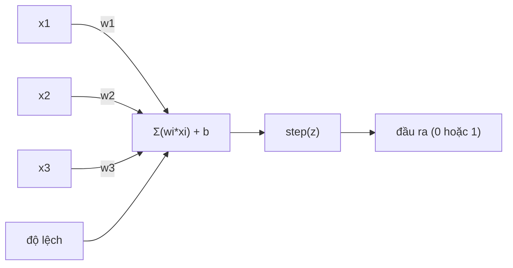
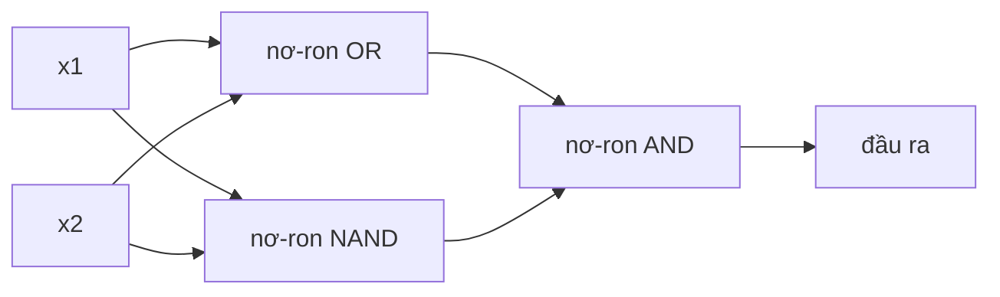

# Perceptron

> Perceptron là nguyên tử của mạng nơ-ron. Mổ nó ra, bạn thấy trọng số (weight), độ lệch (bias), và một quyết định.

**Type:** Build
**Languages:** Python
**Prerequisites:** Giai đoạn 1 (Trực giác Đại số tuyến tính)
**Time:** ~60 phút

## Mục tiêu học tập

- Triển khai một perceptron từ đầu bằng Python, gồm quy tắc cập nhật trọng số và hàm kích hoạt (activation function) bậc thang
- Giải thích vì sao một perceptron đơn lẻ chỉ giải được các bài toán tách tuyến tính (linear separability) và minh hoạ trường hợp thất bại với XOR
- Dựng một perceptron nhiều tầng bằng cách ghép các cổng OR, NAND và AND để giải XOR
- Huấn luyện mạng hai tầng với hàm kích hoạt sigmoid và lan truyền ngược (backpropagation) để tự học XOR

## Vấn đề

Bạn đã biết vector và tích vô hướng. Bạn biết ma trận biến đầu vào thành đầu ra. Nhưng máy *học* cách chọn phép biến đổi nào như thế nào?

Perceptron trả lời câu này. Nó là cỗ máy học đơn giản nhất có thể: nhận vài đầu vào, nhân với trọng số, cộng độ lệch, rồi ra một quyết định nhị phân. Sau đó chỉnh. Chỉ vậy thôi. Mọi mạng nơ-ron từng được dựng đều là các tầng của ý tưởng này xếp lên nhau.

Hiểu perceptron nghĩa là hiểu "học" thực sự nghĩa gì trong code: chỉnh các con số cho tới khi đầu ra khớp với thực tế.

## Khái niệm

### Một nơ-ron, một quyết định

Perceptron nhận n đầu vào, nhân mỗi đầu vào với một trọng số, cộng lại, thêm độ lệch, rồi đưa kết quả qua một hàm kích hoạt.



Hàm bậc thang rất dứt khoát: nếu tổng có trọng số cộng độ lệch >= 0, xuất 1. Ngược lại, xuất 0.

```
step(z) = 1  if z >= 0
           0  if z < 0
```

Đây là một bộ phân loại tuyến tính. Trọng số và độ lệch xác định một đường thẳng (hay siêu phẳng trong không gian nhiều chiều) chia không gian đầu vào thành hai vùng.

### Ranh giới quyết định (decision boundary)

Với hai đầu vào, perceptron vẽ một đường thẳng qua không gian 2D:

```
  x2
  ┤
  │  Class 1        /
  │    (0)          /
  │                /
  │               / w1·x1 + w2·x2 + b = 0
  │              /
  │             /     Class 2
  │            /        (1)
  ┼───────────/──────────── x1
```

Mọi thứ ở một phía của đường thẳng xuất 0. Mọi thứ ở phía bên kia xuất 1. Huấn luyện dịch đường thẳng này cho tới khi nó tách đúng các lớp.

### Quy tắc học

Quy tắc học của perceptron rất đơn giản:

```
For each training example (x, y_true):
    y_pred = predict(x)
    error = y_true - y_pred

    For each weight:
        w_i = w_i + learning_rate * error * x_i
    bias = bias + learning_rate * error
```

Nếu dự đoán đúng, error = 0, không có gì thay đổi. Nếu nó dự đoán 0 nhưng đáng ra là 1, trọng số tăng. Nếu dự đoán 1 nhưng đáng ra là 0, trọng số giảm. Tốc độ học (learning rate) quyết định mỗi lần chỉnh lớn cỡ nào.

### Bài toán XOR (XOR problem)

Đây là chỗ nó gãy. Nhìn các cổng logic này:

```
AND gate:           OR gate:            XOR gate:
x1  x2  out         x1  x2  out         x1  x2  out
0   0   0           0   0   0           0   0   0
0   1   0           0   1   1           0   1   1
1   0   0           1   0   1           1   0   1
1   1   1           1   1   1           1   1   0
```

AND và OR tách tuyến tính được: bạn có thể vẽ một đường thẳng duy nhất để tách các số 0 khỏi các số 1. XOR thì không. Không đường thẳng nào tách được [0,1] và [1,0] khỏi [0,0] và [1,1].

```
AND (separable):        XOR (not separable):

  x2                      x2
  1 ┤  0     1            1 ┤  1     0
    │     /                 │
  0 ┤  0 / 0              0 ┤  0     1
    ┼──/──────── x1         ┼──────────── x1
       line works!          no single line works!
```

Đây là một giới hạn nền tảng. Một perceptron đơn lẻ chỉ giải được các bài toán tách tuyến tính. Minsky và Papert đã chứng minh điều này năm 1969 và nó gần như giết chết nghiên cứu mạng nơ-ron trong một thập kỷ.

Cách khắc phục: xếp các perceptron thành tầng. Một perceptron nhiều tầng có thể giải XOR bằng cách kết hợp hai quyết định tuyến tính thành một quyết định phi tuyến.

```figure
perceptron-boundary
```

## Tự tay làm

### Bước 1: Lớp Perceptron

```python
class Perceptron:
    def __init__(self, n_inputs, learning_rate=0.1):
        self.weights = [0.0] * n_inputs
        self.bias = 0.0
        self.lr = learning_rate

    def predict(self, inputs):
        total = sum(w * x for w, x in zip(self.weights, inputs))
        total += self.bias
        return 1 if total >= 0 else 0

    def train(self, training_data, epochs=100):
        for epoch in range(epochs):
            errors = 0
            for inputs, target in training_data:
                prediction = self.predict(inputs)
                error = target - prediction
                if error != 0:
                    errors += 1
                    for i in range(len(self.weights)):
                        self.weights[i] += self.lr * error * inputs[i]
                    self.bias += self.lr * error
            if errors == 0:
                print(f"Converged at epoch {epoch + 1}")
                return
        print(f"Did not converge after {epochs} epochs")
```

### Bước 2: Huấn luyện trên các cổng logic

```python
and_data = [
    ([0, 0], 0),
    ([0, 1], 0),
    ([1, 0], 0),
    ([1, 1], 1),
]

or_data = [
    ([0, 0], 0),
    ([0, 1], 1),
    ([1, 0], 1),
    ([1, 1], 1),
]

not_data = [
    ([0], 1),
    ([1], 0),
]

print("=== AND Gate ===")
p_and = Perceptron(2)
p_and.train(and_data)
for inputs, _ in and_data:
    print(f"  {inputs} -> {p_and.predict(inputs)}")

print("\n=== OR Gate ===")
p_or = Perceptron(2)
p_or.train(or_data)
for inputs, _ in or_data:
    print(f"  {inputs} -> {p_or.predict(inputs)}")

print("\n=== NOT Gate ===")
p_not = Perceptron(1)
p_not.train(not_data)
for inputs, _ in not_data:
    print(f"  {inputs} -> {p_not.predict(inputs)}")
```

### Bước 3: Xem XOR thất bại

```python
xor_data = [
    ([0, 0], 0),
    ([0, 1], 1),
    ([1, 0], 1),
    ([1, 1], 0),
]

print("\n=== XOR Gate (single perceptron) ===")
p_xor = Perceptron(2)
p_xor.train(xor_data, epochs=1000)
for inputs, expected in xor_data:
    result = p_xor.predict(inputs)
    status = "OK" if result == expected else "WRONG"
    print(f"  {inputs} -> {result} (expected {expected}) {status}")
```

Nó sẽ không bao giờ hội tụ. Đây là bằng chứng cứng rằng một perceptron đơn lẻ không thể học XOR.

### Bước 4: Giải XOR bằng hai tầng

Mẹo: XOR = (x1 OR x2) AND NOT (x1 AND x2). Ghép ba perceptron:



```python
def xor_network(x1, x2):
    or_neuron = Perceptron(2)
    or_neuron.weights = [1.0, 1.0]
    or_neuron.bias = -0.5

    nand_neuron = Perceptron(2)
    nand_neuron.weights = [-1.0, -1.0]
    nand_neuron.bias = 1.5

    and_neuron = Perceptron(2)
    and_neuron.weights = [1.0, 1.0]
    and_neuron.bias = -1.5

    hidden1 = or_neuron.predict([x1, x2])
    hidden2 = nand_neuron.predict([x1, x2])
    output = and_neuron.predict([hidden1, hidden2])
    return output


print("\n=== XOR Gate (multi-layer network) ===")
for inputs, expected in xor_data:
    result = xor_network(inputs[0], inputs[1])
    print(f"  {inputs} -> {result} (expected {expected})")
```

Cả bốn trường hợp đều đúng. Xếp perceptron thành tầng tạo ra những ranh giới quyết định mà không perceptron đơn lẻ nào tạo được.

### Bước 5: Huấn luyện mạng hai tầng

Bước 4 nối trọng số bằng tay. Cách đó hiệu quả với XOR, nhưng không với bài toán thật, nơi bạn không biết trước trọng số đúng. Cách khắc phục: thay hàm bậc thang bằng sigmoid và học trọng số tự động qua lan truyền ngược.

```python
class TwoLayerNetwork:
    def __init__(self, learning_rate=0.5):
        import random
        random.seed(0)
        self.w_hidden = [[random.uniform(-1, 1), random.uniform(-1, 1)] for _ in range(2)]
        self.b_hidden = [random.uniform(-1, 1), random.uniform(-1, 1)]
        self.w_output = [random.uniform(-1, 1), random.uniform(-1, 1)]
        self.b_output = random.uniform(-1, 1)
        self.lr = learning_rate

    def sigmoid(self, x):
        import math
        x = max(-500, min(500, x))
        return 1.0 / (1.0 + math.exp(-x))

    def forward(self, inputs):
        self.inputs = inputs
        self.hidden_outputs = []
        for i in range(2):
            z = sum(w * x for w, x in zip(self.w_hidden[i], inputs)) + self.b_hidden[i]
            self.hidden_outputs.append(self.sigmoid(z))
        z_out = sum(w * h for w, h in zip(self.w_output, self.hidden_outputs)) + self.b_output
        self.output = self.sigmoid(z_out)
        return self.output

    def train(self, training_data, epochs=10000):
        for epoch in range(epochs):
            total_error = 0
            for inputs, target in training_data:
                output = self.forward(inputs)
                error = target - output
                total_error += error ** 2

                d_output = error * output * (1 - output)

                saved_w_output = self.w_output[:]
                hidden_deltas = []
                for i in range(2):
                    h = self.hidden_outputs[i]
                    hd = d_output * saved_w_output[i] * h * (1 - h)
                    hidden_deltas.append(hd)

                for i in range(2):
                    self.w_output[i] += self.lr * d_output * self.hidden_outputs[i]
                self.b_output += self.lr * d_output

                for i in range(2):
                    for j in range(len(inputs)):
                        self.w_hidden[i][j] += self.lr * hidden_deltas[i] * inputs[j]
                    self.b_hidden[i] += self.lr * hidden_deltas[i]
```

```python
net = TwoLayerNetwork(learning_rate=2.0)
net.train(xor_data, epochs=10000)
for inputs, expected in xor_data:
    result = net.forward(inputs)
    predicted = 1 if result >= 0.5 else 0
    print(f"  {inputs} -> {result:.4f} (rounded: {predicted}, expected {expected})")
```

Hai khác biệt then chốt so với Bước 4. Thứ nhất, sigmoid thay hàm bậc thang -- nó trơn, nên gradient tồn tại. Thứ hai, phương thức `train` lan truyền lỗi ngược từ đầu ra về tầng ẩn, chỉnh mọi trọng số theo tỉ lệ đóng góp của nó vào lỗi. Đó là lan truyền ngược trong 20 dòng.

Đây là cầu nối sang Bài 03. Phần toán đằng sau `d_output` và `hidden_deltas` là quy tắc chuỗi áp lên đồ thị mạng. Chúng ta sẽ suy ra cẩn thận ở đó.

## Áp dụng

Mọi thứ bạn vừa tự tay dựng đều có trong một dòng import:

```python
from sklearn.linear_model import Perceptron as SkPerceptron
import numpy as np

X = np.array([[0,0],[0,1],[1,0],[1,1]])
y = np.array([0, 0, 0, 1])

clf = SkPerceptron(max_iter=100, tol=1e-3)
clf.fit(X, y)
print([clf.predict([x])[0] for x in X])
```

Năm dòng. Lớp `Perceptron` 30 dòng của bạn làm đúng việc đó. Bản sklearn thêm kiểm tra hội tụ, nhiều hàm mất mát và hỗ trợ đầu vào thưa -- nhưng vòng lặp lõi y hệt: tổng có trọng số, hàm bậc thang, cập nhật trọng số khi có lỗi.

Khoảng cách thật lộ ra khi ở quy mô lớn. Những gì thay đổi trong mạng production:

- Hàm bậc thang trở thành sigmoid, ReLU, hoặc các hàm kích hoạt trơn khác
- Trọng số được học tự động qua lan truyền ngược (Bài 03)
- Các tầng sâu hơn: 3, 10, 100+ tầng
- Nguyên lý vẫn giữ nguyên: mỗi tầng tạo đặc trưng mới từ đầu ra của tầng trước

Một perceptron đơn lẻ chỉ vẽ được đường thẳng. Xếp chúng lại, bạn vẽ được hình bất kỳ.

## Đóng gói

Bài học này tạo ra:
- `outputs/skill-perceptron.md` - một skill bao quát khi nào cần kiến trúc một tầng và khi nào cần nhiều tầng

## Bài tập

1. Huấn luyện một perceptron trên cổng NAND (cổng phổ quát - mọi mạch logic đều dựng được từ NAND). Kiểm chứng trọng số và độ lệch của nó tạo thành một ranh giới quyết định hợp lệ.
2. Sửa lớp Perceptron để theo dõi ranh giới quyết định (w1*x1 + w2*x2 + b = 0) ở mỗi epoch. In ra đường thẳng dịch thế nào trong quá trình huấn luyện trên cổng AND.
3. Dựng một perceptron 3 đầu vào chỉ xuất 1 khi có ít nhất 2 trong 3 đầu vào bằng 1 (hàm bầu cử đa số). Bài toán này có tách tuyến tính được không? Vì sao?

## Thuật ngữ chính

| Thuật ngữ | Người ta thường nói | Ý nghĩa thực sự |
|------|----------------|----------------------|
| Perceptron | "Một nơ-ron giả" | Một bộ phân loại tuyến tính: tích vô hướng của đầu vào và trọng số, cộng độ lệch, qua hàm bậc thang |
| Weight | "Đầu vào đó quan trọng cỡ nào" | Một hệ số nhân co giãn đóng góp của mỗi đầu vào vào quyết định |
| Bias | "Ngưỡng (threshold)" | Một hằng số dịch ranh giới quyết định, cho phép perceptron kích hoạt ngay cả khi mọi đầu vào bằng 0 |
| Activation function | "Thứ bóp các giá trị lại" | Một hàm áp sau tổng có trọng số - hàm bậc thang cho perceptron, sigmoid/ReLU cho mạng hiện đại |
| Linearly separable | "Bạn vẽ được một đường giữa chúng" | Một tập dữ liệu mà một siêu phẳng duy nhất tách hoàn hảo các lớp |
| XOR problem | "Thứ perceptron không làm được" | Bằng chứng rằng mạng một tầng không học được các hàm không tách tuyến tính |
| Decision boundary | "Chỗ bộ phân loại chuyển" | Siêu phẳng w*x + b = 0 chia không gian đầu vào thành hai lớp |
| Multi-layer perceptron | "Một mạng nơ-ron thật" | Các perceptron xếp thành tầng, đầu ra mỗi tầng làm đầu vào cho tầng sau |

## Đọc thêm

- Frank Rosenblatt, "The Perceptron: A Probabilistic Model for Information Storage and Organization in the Brain" (1958) -- bài báo gốc khởi đầu tất cả
- Minsky & Papert, "Perceptrons" (1969) -- cuốn sách chứng minh mạng một tầng không giải được XOR và khiến nghiên cứu perceptron đóng băng một thập kỷ
- Michael Nielsen, "Neural Networks and Deep Learning", Chapter 1 (http://neuralnetworksanddeeplearning.com/) -- miễn phí trực tuyến, giải thích trực quan hay nhất về cách perceptron ghép thành mạng

---

[Bài sau: Mạng nhiều lớp và lượt lan truyền xuôi →](../../02-multi-layer-networks/docs/vi.md)
