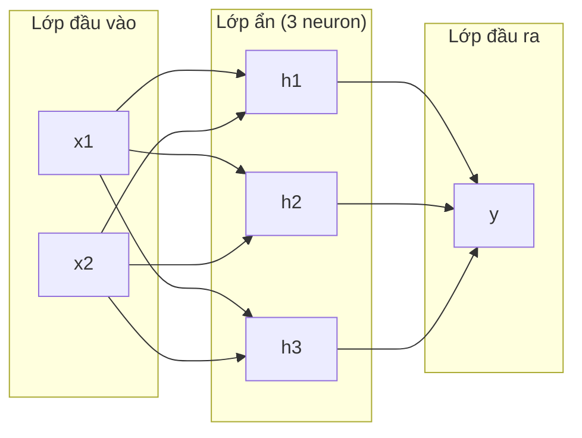
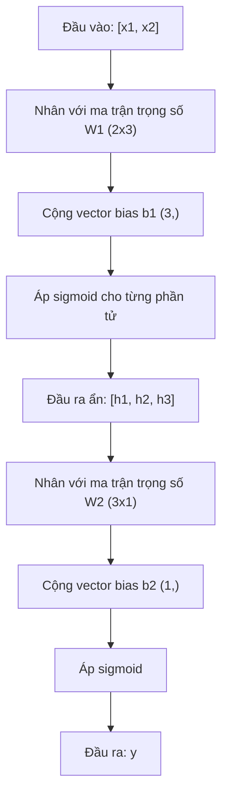
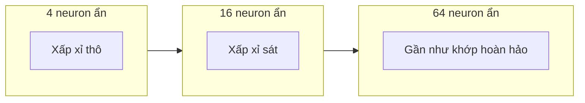

# Mạng nhiều lớp và lượt lan truyền xuôi

> Một neuron vẽ một đường thẳng. Xếp chúng lại, bạn có thể vẽ mọi thứ.

**Type:** Build
**Languages:** Python
**Prerequisites:** Giai đoạn 1 (Nền tảng Toán học), Bài 03.01 (Perceptron)
**Time:** ~90 phút

## Mục tiêu học tập

- Tự xây một mạng nhiều lớp từ đầu với các lớp Layer và Network thực hiện trọn vẹn một forward pass (lượt lan truyền xuôi)
- Theo dõi kích thước ma trận qua từng lớp của mạng và phát hiện chỗ lệch shape
- Giải thích vì sao xếp chồng các hàm kích hoạt non-linearity (phi tuyến) giúp mạng học được ranh giới quyết định có đường cong
- Giải bài toán XOR bằng kiến trúc 2-2-1 với trọng số sigmoid được chỉnh tay

## Vấn đề

Một neuron đơn là một cây thước kẻ đường thẳng. Chỉ vậy thôi. Một đường thẳng duy nhất xuyên qua dữ liệu của bạn. Mọi bài toán thật trong AI -- nhận dạng ảnh, hiểu ngôn ngữ, chơi cờ vây -- đều cần đường cong. Xếp các neuron thành lớp là cách để có đường cong.

Năm 1969, Minsky và Papert chứng minh hạn chế này là chí mạng: một mạng một lớp không thể học XOR. Không phải "học kém" -- mà là không thể, về mặt toán học. Bảng chân trị XOR đặt [0,1] và [1,0] về một phía, [0,0] và [1,1] về phía kia. Không đường thẳng nào tách được chúng.

Điều này chặn nguồn tài trợ cho mạng neuron hơn một thập kỷ. Cách sửa nhìn lại thì hiển nhiên: đừng dùng một lớp nữa. Hãy xếp các neuron thành lớp. Để lớp đầu tiên chia không gian đầu vào thành những đặc trưng mới, và để lớp thứ hai kết hợp những đặc trưng đó thành những quyết định mà không đường thẳng nào làm được.

Chồng đó chính là mạng nhiều lớp. Nó là nền tảng của mọi mô hình deep learning đang chạy trong production hôm nay. Lượt lan truyền xuôi -- dữ liệu chảy từ đầu vào qua các hidden layer (lớp ẩn) tới đầu ra -- là thứ đầu tiên bạn phải xây trước khi mọi thứ khác hoạt động.

## Khái niệm

### Các lớp: đầu vào, ẩn, đầu ra

Một mạng nhiều lớp có ba loại lớp:

**Lớp đầu vào** -- không hẳn là một lớp. Nó giữ dữ liệu thô của bạn. Hai đặc trưng nghĩa là hai node đầu vào. Không có tính toán nào diễn ra ở đây.

**Các lớp ẩn** -- nơi công việc diễn ra. Mỗi neuron nhận mọi đầu ra từ lớp trước, áp trọng số và bias, rồi đưa kết quả qua một hàm kích hoạt. Gọi là "ẩn" vì bạn không bao giờ thấy trực tiếp những giá trị này trong dữ liệu huấn luyện.

**Lớp đầu ra (output layer)** -- câu trả lời cuối cùng. Với phân loại nhị phân, một neuron với sigmoid. Với nhiều lớp, một neuron cho mỗi lớp.



Đây là một mạng 2-3-1. Hai đầu vào, ba neuron ẩn, một đầu ra. Mỗi kết nối mang một trọng số. Mỗi neuron (trừ neuron đầu vào) mang một bias.

Mỗi lớp tạo ra một vector số gọi là trạng thái ẩn. Với văn bản, trạng thái ẩn làm tăng số chiều -- mã hoá một từ thành 768 con số để nắm bắt ý nghĩa ngữ nghĩa. Với ảnh, chúng giảm số chiều -- nén hàng triệu pixel thành một biểu diễn dễ quản lý. Trạng thái ẩn là nơi việc học diễn ra.

### Neuron và hàm kích hoạt

Mỗi neuron làm ba việc:

1. Nhân từng đầu vào với trọng số tương ứng của nó
2. Cộng tất cả các tích rồi thêm bias
3. Đưa tổng đó qua một hàm kích hoạt

Hiện tại, hàm kích hoạt là sigmoid:

```
sigmoid(z) = 1 / (1 + e^(-z))
```

Sigmoid ép mọi số vào khoảng (0, 1). Đầu vào dương lớn đẩy về phía 1. Đầu vào âm lớn đẩy về phía 0. Số 0 ánh xạ thành 0.5. Chính đường cong mượt này khiến việc học trở nên khả thi -- khác với bước nhảy cứng của perceptron, sigmoid có gradient ở mọi điểm.

### Lượt lan truyền xuôi: cách dữ liệu chảy

Lượt lan truyền xuôi đẩy dữ liệu đầu vào qua mạng, lần lượt từng lớp, cho tới khi tới đầu ra. Không có việc học nào diễn ra trong lượt lan truyền xuôi. Nó là tính toán thuần tuý: nhân, cộng, kích hoạt, lặp lại.



Tại mỗi lớp, ba phép toán diễn ra theo thứ tự:

```
z = W * input + b       (linear transformation)
a = sigmoid(z)           (activation)
```

Đầu ra của lớp này trở thành đầu vào của lớp kế tiếp. Đó là toàn bộ lượt lan truyền xuôi.

### Kích thước ma trận

Theo dõi kích thước là kỹ năng gỡ lỗi quan trọng nhất trong deep learning. Đây là mạng 2-3-1:

| Bước | Phép toán | Kích thước | Shape kết quả |
|------|-----------|------------|-------------|
| Đầu vào | x | -- | (2,) |
| Tuyến tính ẩn | W1 * x + b1 | W1: (3, 2), b1: (3,) | (3,) |
| Kích hoạt ẩn | sigmoid(z1) | -- | (3,) |
| Tuyến tính đầu ra | W2 * h + b2 | W2: (1, 3), b2: (1,) | (1,) |
| Kích hoạt đầu ra | sigmoid(z2) | -- | (1,) |

Quy tắc: weight matrix (ma trận trọng số) ở lớp k có shape (neurons_in_layer_k, neurons_in_layer_k_minus_1). Hàng khớp với lớp hiện tại. Cột khớp với lớp trước đó. Nếu các shape không khớp, bạn có một lỗi.

### Định lý universal approximation (xấp xỉ phổ quát)

Năm 1989, George Cybenko chứng minh một điều đáng kinh ngạc: một mạng neuron với một lớp ẩn và đủ số neuron có thể xấp xỉ bất kỳ hàm liên tục nào với độ chính xác tuỳ ý.

Điều này không có nghĩa là một lớp ẩn luôn là tốt nhất. Nó có nghĩa là kiến trúc đó có khả năng về mặt lý thuyết. Trên thực tế, những mạng có depth (độ sâu) lớn hơn (nhiều lớp hơn, ít neuron hơn mỗi lớp) học được cùng những hàm đó với tổng số tham số ít hơn nhiều so với mạng nông-rộng. Đó là lý do deep learning hiệu quả.

Cách hình dung: mỗi neuron trong lớp ẩn học một "gò" hay một đặc trưng. Đủ số gò đặt đúng chỗ có thể xấp xỉ bất kỳ đường cong mượt nào. Nhiều neuron hơn, nhiều gò hơn, xấp xỉ tốt hơn.



### Khả năng ghép nối

Mạng neuron có thể ghép nối. Bạn có thể xếp chồng chúng, chuỗi chúng lại, chạy chúng song song. Một mô hình Whisper dùng một mạng encoder để xử lý âm thanh và một mạng decoder riêng để sinh văn bản. Các LLM hiện đại chỉ có decoder. BERT chỉ có encoder. T5 là encoder-decoder. Lựa chọn kiến trúc quyết định mô hình làm được gì.

```figure
mlp-forward
```

## Tự tay làm

Python thuần. Không numpy. Mọi phép toán ma trận viết từ đầu.

### Bước 1: Hàm kích hoạt Sigmoid

```python
import math

def sigmoid(x):
    x = max(-500.0, min(500.0, x))
    return 1.0 / (1.0 + math.exp(-x))
```

Việc kẹp vào [-500, 500] ngăn tràn số. `math.exp(500)` lớn nhưng hữu hạn. `math.exp(1000)` là vô cực.

### Bước 2: Lớp Layer

Phép toán quan trọng nhất trong toàn bộ deep learning là nhân ma trận. Mỗi lớp, mỗi attention head, mỗi lượt lan truyền xuôi -- tất cả đều là matmul xuyên suốt. Một lớp tuyến tính nhận một vector đầu vào, nhân nó với ma trận trọng số, rồi cộng thêm vector bias: y = Wx + b. Chỉ một phương trình đó đã là 90% khối lượng tính toán trong một mạng neuron.

Một lớp giữ một ma trận trọng số và một vector bias. Phương thức forward của nó nhận vector đầu vào và trả về đầu ra đã qua kích hoạt.

```python
class Layer:
    def __init__(self, n_inputs, n_neurons, weights=None, biases=None):
        if weights is not None:
            self.weights = weights
        else:
            import random
            self.weights = [
                [random.uniform(-1, 1) for _ in range(n_inputs)]
                for _ in range(n_neurons)
            ]
        if biases is not None:
            self.biases = biases
        else:
            self.biases = [0.0] * n_neurons

    def forward(self, inputs):
        self.last_input = inputs
        self.last_output = []
        for neuron_idx in range(len(self.weights)):
            z = sum(
                w * x for w, x in zip(self.weights[neuron_idx], inputs)
            )
            z += self.biases[neuron_idx]
            self.last_output.append(sigmoid(z))
        return self.last_output
```

Ma trận trọng số có shape (n_neurons, n_inputs). Mỗi hàng là trọng số của một neuron trên toàn bộ đầu vào. Phương thức forward lặp qua các neuron, tính tổng có trọng số cộng bias, áp sigmoid, rồi thu kết quả.

### Bước 3: Lớp Network

Một mạng là một danh sách các lớp. Lượt lan truyền xuôi nối chúng lại: đầu ra của lớp k chảy vào lớp k+1.

```python
class Network:
    def __init__(self, layers):
        self.layers = layers

    def forward(self, inputs):
        current = inputs
        for layer in self.layers:
            current = layer.forward(current)
        return current
```

Đó là toàn bộ lượt lan truyền xuôi. Bốn dòng logic. Dữ liệu đi vào, chảy qua từng lớp, ra ở phía bên kia.

### Bước 4: XOR với trọng số chỉnh tay

Trong Bài 01, ta giải XOR bằng cách kết hợp các perceptron OR, NAND và AND. Giờ làm điều tương tự với các lớp Layer và Network của mình. Kiến trúc 2-2-1: hai đầu vào, hai neuron ẩn, một đầu ra.

```python
hidden = Layer(
    n_inputs=2,
    n_neurons=2,
    weights=[[20.0, 20.0], [-20.0, -20.0]],
    biases=[-10.0, 30.0],
)

output = Layer(
    n_inputs=2,
    n_neurons=1,
    weights=[[20.0, 20.0]],
    biases=[-30.0],
)

xor_net = Network([hidden, output])

xor_data = [
    ([0, 0], 0),
    ([0, 1], 1),
    ([1, 0], 1),
    ([1, 1], 0),
]

for inputs, expected in xor_data:
    result = xor_net.forward(inputs)
    predicted = 1 if result[0] >= 0.5 else 0
    print(f"  {inputs} -> {result[0]:.6f} (rounded: {predicted}, expected: {expected})")
```

Các trọng số lớn (20, -20) khiến sigmoid hành xử như một hàm bước. Neuron ẩn thứ nhất xấp xỉ OR. Neuron thứ hai xấp xỉ NAND. Neuron đầu ra kết hợp chúng thành AND, tức là XOR.

### Bước 5: Phân loại hình tròn

Một bài toán khó hơn: phân loại các điểm 2D là nằm trong hay ngoài một hình tròn bán kính 0.5 tâm ở gốc toạ độ. Việc này cần một ranh giới quyết định cong -- bất khả thi với một perceptron đơn.

```python
import random
import math

random.seed(42)

data = []
for _ in range(200):
    x = random.uniform(-1, 1)
    y = random.uniform(-1, 1)
    label = 1 if (x * x + y * y) < 0.25 else 0
    data.append(([x, y], label))

circle_net = Network([
    Layer(n_inputs=2, n_neurons=8),
    Layer(n_inputs=8, n_neurons=1),
])
```

Với trọng số ngẫu nhiên, mạng sẽ phân loại kém. Nhưng lượt lan truyền xuôi vẫn chạy. Đó chính là điểm mấu chốt -- lượt lan truyền xuôi chỉ là tính toán. Học ra trọng số đúng là backpropagation, sẽ đến ở Bài 03.

```python
correct = 0
for inputs, expected in data:
    result = circle_net.forward(inputs)
    predicted = 1 if result[0] >= 0.5 else 0
    if predicted == expected:
        correct += 1

print(f"Accuracy with random weights: {correct}/{len(data)} ({100*correct/len(data):.1f}%)")
```

Trọng số ngẫu nhiên cho độ chính xác kém -- thường còn tệ hơn cả đoán theo lớp đa số. Sau khi huấn luyện (Bài 03), chính kiến trúc này với 8 neuron ẩn sẽ vẽ được một ranh giới cong tách phần trong khỏi phần ngoài.

## Áp dụng

PyTorch làm toàn bộ những việc trên trong bốn dòng:

```python
import torch
import torch.nn as nn

model = nn.Sequential(
    nn.Linear(2, 8),
    nn.Sigmoid(),
    nn.Linear(8, 1),
    nn.Sigmoid(),
)

x = torch.tensor([[0.0, 0.0], [0.0, 1.0], [1.0, 0.0], [1.0, 1.0]])
output = model(x)
print(output)
```

`nn.Linear(2, 8)` chính là lớp Layer của bạn: ma trận trọng số shape (8, 2), vector bias shape (8,). `nn.Sigmoid()` là hàm sigmoid của bạn, áp theo từng phần tử. `nn.Sequential` là lớp Network của bạn: nối các lớp theo thứ tự.

Khác biệt nằm ở tốc độ và quy mô. PyTorch chạy trên GPU, xử lý batch hàng triệu mẫu, và tự động tính gradient cho backpropagation. Nhưng logic lượt lan truyền xuôi giống hệt cái bạn vừa tự xây.

## Đóng gói

Bài học này tạo ra một prompt tái sử dụng để thiết kế kiến trúc mạng:

- `outputs/prompt-network-architect.md`

Dùng nó khi bạn cần quyết định bao nhiêu lớp, bao nhiêu neuron mỗi lớp, và dùng hàm kích hoạt nào cho một bài toán cụ thể.

## Bài tập

1. Xây một mạng 2-4-2-1 (hai lớp ẩn) và chạy lượt lan truyền xuôi trên dữ liệu XOR với trọng số ngẫu nhiên. In đầu ra của lớp ẩn trung gian để xem biểu diễn biến đổi thế nào ở mỗi lớp.

2. Đổi kích thước lớp ẩn trong bộ phân loại hình tròn từ 8 thành 2, rồi thành 32. Chạy lượt lan truyền xuôi với trọng số ngẫu nhiên mỗi lần. Số neuron ẩn có làm thay đổi miền giá trị hay phân phối đầu ra không? Vì sao?

3. Cài đặt một phương thức `count_parameters` trên lớp Network, trả về tổng số trọng số và bias có thể huấn luyện. Thử trên một mạng 784-256-128-10 (kiến trúc MNIST kinh điển). Nó có bao nhiêu tham số?

4. Xây một lượt lan truyền xuôi cho mạng 3-4-4-2. Đưa vào các giá trị màu RGB (chuẩn hoá về 0-1) và quan sát hai đầu ra. Đây là kiến trúc cho một bộ phân loại màu đơn giản với hai lớp.

5. Thay sigmoid bằng một hàm "bước rò": trả về 0.01 * z nếu z < 0, ngược lại 1.0. Chạy lượt lan truyền xuôi trên XOR với đúng các trọng số chỉnh tay ở Bước 4. Nó còn hoạt động không? Vì sao sigmoid mượt lại được ưu tiên hơn các ngưỡng cắt cứng?

## Thuật ngữ chính

| Thuật ngữ | Người ta thường nói | Ý nghĩa thực sự |
|------|----------------|----------------------|
| Forward pass | "Chạy mô hình" | Đẩy đầu vào qua từng lớp -- nhân với trọng số, cộng bias, kích hoạt -- để tạo ra đầu ra |
| Hidden layer | "Phần ở giữa" | Bất kỳ lớp nào nằm giữa đầu vào và đầu ra mà giá trị của nó không được quan sát trực tiếp trong dữ liệu |
| Multi-layer network | "Một mạng neural sâu" | Các lớp neuron xếp nối tiếp, đầu ra của lớp này là đầu vào của lớp kế tiếp |
| Activation function | "Cái phi tuyến" | Hàm được áp sau phép biến đổi tuyến tính, đưa đường cong vào ranh giới quyết định |
| Sigmoid | "Đường cong chữ S" | sigma(z) = 1/(1+e^(-z)), ép mọi số thực vào (0,1), mượt và khả vi ở mọi điểm |
| Weight matrix | "Các tham số" | Ma trận W shape (current_layer_neurons, previous_layer_neurons) chứa độ mạnh kết nối có thể học |
| Bias vector | "Độ lệch" | Vector được cộng sau phép nhân ma trận, cho phép neuron kích hoạt ngay cả khi mọi đầu vào bằng 0 |
| Universal approximation | "Mạng neuron học được mọi thứ" | Một lớp ẩn với đủ neuron có thể xấp xỉ mọi hàm liên tục -- nhưng "đủ" có thể nghĩa là hàng tỷ |
| Linear transformation | "Bước nhân ma trận" | z = W * x + b, phép tính trước khi kích hoạt, ánh xạ đầu vào sang một không gian mới |
| Decision boundary | "Chỗ bộ phân loại chuyển kết quả" | Mặt trong không gian đầu vào nơi đầu ra của mạng vượt ngưỡng phân loại |

## Đọc thêm

- Michael Nielsen, "Neural Networks and Deep Learning", Chapter 1-2 (http://neuralnetworksanddeeplearning.com/) -- lời giải thích miễn phí rõ ràng nhất về lượt lan truyền xuôi và cấu trúc mạng, kèm minh hoạ tương tác
- Cybenko, "Approximation by Superpositions of a Sigmoidal Function" (1989) -- bài báo gốc về định lý xấp xỉ phổ quát, dễ đọc đến bất ngờ
- 3Blue1Brown, "But what is a neural network?" (https://www.youtube.com/watch?v=aircAruvnKk) -- video 20 phút đi qua lớp, trọng số và lượt lan truyền xuôi, dựng đúng mô hình tinh thần
- Goodfellow, Bengio, Courville, "Deep Learning", Chapter 6 (https://www.deeplearningbook.org/) -- tài liệu tham chiếu chuẩn cho mạng nhiều lớp, miễn phí online

---

[← Bài trước: Perceptron](../../01-the-perceptron/docs/vi.md) · [Bài sau: Backpropagation (lan truyền ngược) từ đầu →](../../03-backpropagation/docs/vi.md)
