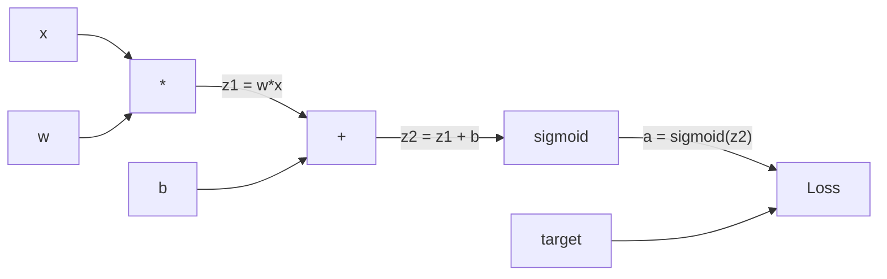
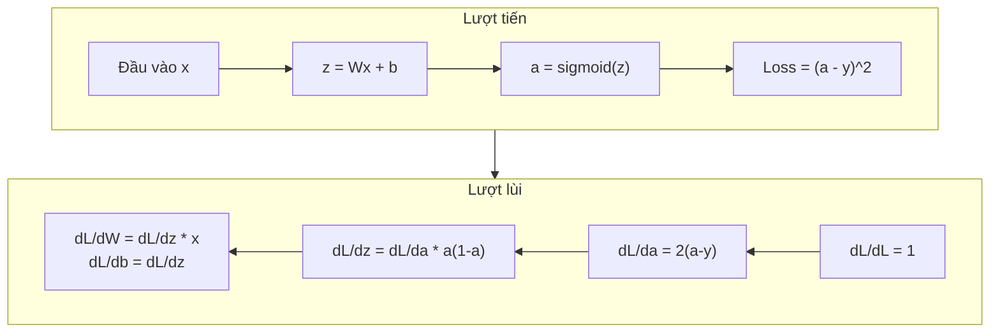
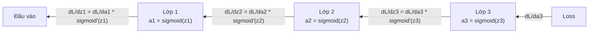

# Backpropagation (lan truyền ngược) từ đầu

> Backpropagation là thuật toán biến việc học thành có thể. Không có nó, mạng nơ-ron chỉ là những cỗ máy sinh số ngẫu nhiên đắt đỏ.

**Type:** Build
**Languages:** Python
**Prerequisites:** Bài 03.02 (Mạng nhiều lớp)
**Time:** ~120 phút

## Mục tiêu học tập

- Cài đặt một engine autograd dựa trên Value, dựng đồ thị tính toán (computational graph) và tính gradient (gradient) bằng sắp xếp topo
- Suy ra backward pass cho phép cộng, phép nhân và sigmoid bằng quy tắc chuỗi (chain rule)
- Huấn luyện một mạng nhiều lớp trên XOR và phân loại hình tròn chỉ bằng engine backpropagation tự viết của bạn
- Nhận diện vấn đề gradient tiêu biến trong mạng sigmoid sâu và giải thích tại sao gradient co lại theo hàm số mũ

## Vấn đề

Mạng của bạn có một lớp ẩn với 768 đầu vào và 3072 đầu ra. Đó là 2,359,296 trọng số. Nó đưa ra một dự đoán sai. Trọng số nào gây ra lỗi? Thử từng trọng số một nghĩa là 2.3 triệu lượt chạy tiến. Backpropagation tính cả 2.3 triệu gradient trong một lượt chạy lùi duy nhất. Đó không phải là một tối ưu hóa. Đó là khác biệt giữa huấn luyện được và bất khả thi.

Cách ngây thơ: lấy một trọng số, nhích nó một chút xíu, chạy lại lượt tiến, đo xem loss tăng hay giảm. Thế là bạn có gradient của trọng số đó. Giờ làm điều tương tự cho từng trọng số trong mạng. Nhân lên với hàng nghìn bước huấn luyện và hàng triệu điểm dữ liệu. Bạn sẽ cần thời gian địa chất mới huấn luyện được thứ gì đó hữu ích.

Backpropagation giải quyết chuyện này. Một lượt tiến, một lượt lùi, mọi gradient được tính xong. Mẹo nằm ở quy tắc chuỗi trong giải tích, được áp dụng một cách có hệ thống lên một đồ thị tính toán. Đây là thuật toán làm cho deep learning trở nên khả thi. Không có nó, chúng ta vẫn còn kẹt với những bài toán đồ chơi.

## Khái niệm

### Quy tắc chuỗi, áp dụng cho mạng nơ-ron

Bạn đã gặp quy tắc chuỗi ở Giai đoạn 01, Bài 05. Nhắc lại nhanh: nếu y = f(g(x)) thì dy/dx = f'(g(x)) * g'(x). Bạn nhân các đạo hàm dọc theo chuỗi.

Trong một mạng nơ-ron, "chuỗi" là dãy phép toán từ đầu vào tới loss. Mỗi lớp áp trọng số, cộng bias, đi qua một hàm kích hoạt. Hàm loss so sánh đầu ra cuối cùng với đích. Backpropagation lần ngược chuỗi này, tính xem mỗi phép toán đóng góp bao nhiêu vào sai số.

### Đồ thị tính toán

Mỗi lượt tiến dựng nên một đồ thị. Mỗi nút là một phép toán (nhân, cộng, sigmoid). Mỗi cạnh mang một giá trị đi tới và một gradient đi lùi.



Lượt tiến: giá trị chảy từ trái sang phải. x và w tạo ra z1 = w*x. Cộng b để có z2. Sigmoid cho ra kích hoạt a. So sánh a với đích y bằng hàm loss.

Lượt lùi: gradient chảy từ phải sang trái. Bắt đầu với dL/da (loss thay đổi thế nào theo kích hoạt). Nhân với da/dz2 (đạo hàm sigmoid). Ta được dL/dz2. Tách thành dL/db (chính bằng dL/dz2, vì z2 = z1 + b) và dL/dz1. Rồi dL/dw = dL/dz1 * x và dL/dx = dL/dz1 * w.

Mỗi nút trong đồ thị có đúng một việc trong lượt lùi: nhận gradient phía trên (upstream gradient) đưa xuống, nhân với gradient cục bộ (local gradient) của nó, rồi chuyển tiếp xuống dưới.

### Lượt tiến so với lượt lùi



Lượt tiến lưu lại mọi giá trị trung gian: z, a, đầu vào của từng lớp. Lượt lùi cần những giá trị đã lưu này để tính gradient. Đây là đánh đổi bộ nhớ - tính toán ở trung tâm của backprop. Bạn đổi bộ nhớ (lưu các kích hoạt) lấy tốc độ (một lượt thay vì hàng triệu lượt).

### Dòng gradient qua một mạng

Với mạng 3 lớp, gradient nối chuỗi qua từng lớp:



Ở mỗi lớp, gradient bị nhân với đạo hàm sigmoid. Đạo hàm sigmoid là a * (1 - a), đạt cực đại 0.25 (khi a = 0.5). Sâu ba lớp, gradient đã bị nhân với nhiều nhất 0.25^3 = 0.0156. Sâu mười lớp: 0.25^10 = 0.000001.

### Gradient tiêu biến

Đây là vấn đề gradient tiêu biến. Sigmoid nén đầu ra trong khoảng 0 và 1. Đạo hàm của nó luôn nhỏ hơn 0.25. Chồng đủ nhiều lớp sigmoid và gradient co lại về con số không. Các lớp đầu gần như không học được vì chúng nhận gradient gần bằng không.

```
sigmoid(z):     Output range [0, 1]
sigmoid'(z):    Max value 0.25 (at z = 0)

After 5 layers:   gradient * 0.25^5 = 0.001x original
After 10 layers:  gradient * 0.25^10 = 0.000001x original
```

Đây là lý do mạng sigmoid sâu gần như không thể huấn luyện. Cách khắc phục -- ReLU và các biến thể của nó -- là chủ đề của Bài 04. Còn bây giờ, hãy hiểu rằng backprop hoạt động hoàn hảo. Vấn đề nằm ở thứ mà nó phải đi xuyên qua.

### Suy ra gradient cho mạng 2 lớp

Toán cụ thể cho mạng có đầu vào x, lớp ẩn dùng sigmoid, lớp đầu ra dùng sigmoid, và loss MSE.

Lượt tiến:
```
z1 = W1 * x + b1
a1 = sigmoid(z1)
z2 = W2 * a1 + b2
a2 = sigmoid(z2)
L = (a2 - y)^2
```

Lượt lùi (áp quy tắc chuỗi từng bước):
```
dL/da2 = 2(a2 - y)
da2/dz2 = a2 * (1 - a2)
dL/dz2 = dL/da2 * da2/dz2 = 2(a2 - y) * a2 * (1 - a2)

dL/dW2 = dL/dz2 * a1
dL/db2 = dL/dz2

dL/da1 = dL/dz2 * W2
da1/dz1 = a1 * (1 - a1)
dL/dz1 = dL/da1 * da1/dz1

dL/dW1 = dL/dz1 * x
dL/db1 = dL/dz1
```

Mỗi gradient là tích của các đạo hàm riêng (partial derivative) lần ngược từ loss. Backpropagation chỉ có thế.

```figure
backprop-vanishing
```

## Tự tay làm

### Bước 1: Nút Value

Mọi con số trong phép tính của ta đều trở thành một Value. Nó lưu dữ liệu, gradient của nó, và cách nó được tạo ra (để biết cách tính gradient ngược lại).

```python
class Value:
    def __init__(self, data, children=(), op=''):
        self.data = data
        self.grad = 0.0
        self._backward = lambda: None
        self._children = set(children)
        self._op = op

    def __repr__(self):
        return f"Value(data={self.data:.4f}, grad={self.grad:.4f})"
```

Chưa có gradient (0.0). Chưa có hàm backward (không làm gì). `_children` ghi lại những Value nào đã tạo ra nó, để sau này ta có thể sắp xếp topo đồ thị.

### Bước 2: Phép toán với hàm backward

Mỗi phép toán tạo ra một Value mới và định nghĩa cách gradient chảy ngược qua nó.

```python
def __add__(self, other):
    other = other if isinstance(other, Value) else Value(other)
    out = Value(self.data + other.data, (self, other), '+')

    def _backward():
        self.grad += out.grad
        other.grad += out.grad

    out._backward = _backward
    return out

def __mul__(self, other):
    other = other if isinstance(other, Value) else Value(other)
    out = Value(self.data * other.data, (self, other), '*')

    def _backward():
        self.grad += other.data * out.grad
        other.grad += self.data * out.grad

    out._backward = _backward
    return out
```

Với phép cộng: d(a+b)/da = 1, d(a+b)/db = 1. Vậy cả hai đầu vào nhận trực tiếp gradient của đầu ra.

Với phép nhân: d(a*b)/da = b, d(a*b)/db = a. Mỗi đầu vào nhận giá trị của đầu vào kia nhân với gradient của đầu ra.

Phép `+=` là then chốt. Một Value có thể được dùng trong nhiều phép toán. Gradient của nó là tổng gradient từ mọi đường đi.

### Bước 3: Sigmoid và loss

```python
import math

def sigmoid(self):
    x = self.data
    x = max(-500, min(500, x))
    s = 1.0 / (1.0 + math.exp(-x))
    out = Value(s, (self,), 'sigmoid')

    def _backward():
        self.grad += (s * (1 - s)) * out.grad

    out._backward = _backward
    return out
```

Đạo hàm sigmoid: sigmoid(x) * (1 - sigmoid(x)). Ta đã tính sigmoid(x) = s trong lượt tiến. Dùng lại nó. Không tốn thêm việc gì.

```python
def mse_loss(predicted, target):
    diff = predicted + Value(-target)
    return diff * diff
```

MSE cho một đầu ra: (predicted - target)^2. Ta biểu diễn phép trừ bằng phép cộng với một Value bị đảo dấu.

### Bước 4: Lượt lùi

Sắp xếp topo đảm bảo ta xử lý các nút theo đúng thứ tự -- gradient của một nút được tích lũy đầy đủ trước khi ta lan truyền qua nó.

```python
def backward(self):
    topo = []
    visited = set()

    def build_topo(v):
        if v not in visited:
            visited.add(v)
            for child in v._children:
                build_topo(child)
            topo.append(v)

    build_topo(self)
    self.grad = 1.0
    for v in reversed(topo):
        v._backward()
```

Bắt đầu từ loss (gradient = 1.0, vì dL/dL = 1). Đi ngược qua đồ thị đã sắp xếp. `_backward` của mỗi nút đẩy gradient cho các nút con của nó.

### Bước 5: Lớp và mạng

```python
import random

class Neuron:
    def __init__(self, n_inputs):
        scale = (2.0 / n_inputs) ** 0.5
        self.weights = [Value(random.uniform(-scale, scale)) for _ in range(n_inputs)]
        self.bias = Value(0.0)

    def __call__(self, x):
        act = sum((wi * xi for wi, xi in zip(self.weights, x)), self.bias)
        return act.sigmoid()

    def parameters(self):
        return self.weights + [self.bias]


class Layer:
    def __init__(self, n_inputs, n_outputs):
        self.neurons = [Neuron(n_inputs) for _ in range(n_outputs)]

    def __call__(self, x):
        out = [n(x) for n in self.neurons]
        return out[0] if len(out) == 1 else out

    def parameters(self):
        params = []
        for n in self.neurons:
            params.extend(n.parameters())
        return params


class Network:
    def __init__(self, sizes):
        self.layers = []
        for i in range(len(sizes) - 1):
            self.layers.append(Layer(sizes[i], sizes[i + 1]))

    def __call__(self, x):
        for layer in self.layers:
            x = layer(x)
            if not isinstance(x, list):
                x = [x]
        return x[0] if len(x) == 1 else x

    def parameters(self):
        params = []
        for layer in self.layers:
            params.extend(layer.parameters())
        return params

    def zero_grad(self):
        for p in self.parameters():
            p.grad = 0.0
```

Một Neuron nhận đầu vào, tính tổng có trọng số + bias, rồi áp sigmoid. Khởi tạo trọng số được chia tỉ lệ theo sqrt(2/n_inputs) để tránh sigmoid bão hòa trong mạng sâu hơn. Một Layer là danh sách các Neuron. Một Network là danh sách các Layer. Phương thức `parameters()` thu tất cả Value học được để ta cập nhật chúng.

### Bước 6: Huấn luyện trên XOR

```python
random.seed(42)
net = Network([2, 4, 1])

xor_data = [
    ([0.0, 0.0], 0.0),
    ([0.0, 1.0], 1.0),
    ([1.0, 0.0], 1.0),
    ([1.0, 1.0], 0.0),
]

learning_rate = 1.0

for epoch in range(1000):
    total_loss = Value(0.0)
    for inputs, target in xor_data:
        x = [Value(i) for i in inputs]
        pred = net(x)
        loss = mse_loss(pred, target)
        total_loss = total_loss + loss

    net.zero_grad()
    total_loss.backward()

    for p in net.parameters():
        p.data -= learning_rate * p.grad

    if epoch % 100 == 0:
        print(f"Epoch {epoch:4d} | Loss: {total_loss.data:.6f}")

print("\nXOR Results:")
for inputs, target in xor_data:
    x = [Value(i) for i in inputs]
    pred = net(x)
    print(f"  {inputs} -> {pred.data:.4f} (expected {target})")
```

Xem loss giảm. Từ những dự đoán ngẫu nhiên đến đầu ra XOR đúng, hoàn toàn nhờ backpropagation tính gradient và nhích trọng số về đúng hướng.

### Bước 7: Phân loại hình tròn

Trong Bài 02, bạn tự chỉnh trọng số cho bài phân loại hình tròn. Giờ để mạng tự học chúng.

```python
random.seed(7)

def generate_circle_data(n=100):
    data = []
    for _ in range(n):
        x1 = random.uniform(-1.5, 1.5)
        x2 = random.uniform(-1.5, 1.5)
        label = 1.0 if x1 * x1 + x2 * x2 < 1.0 else 0.0
        data.append(([x1, x2], label))
    return data

circle_data = generate_circle_data(80)

circle_net = Network([2, 8, 1])
learning_rate = 0.5

for epoch in range(2000):
    random.shuffle(circle_data)
    total_loss_val = 0.0
    for inputs, target in circle_data:
        x = [Value(i) for i in inputs]
        pred = circle_net(x)
        loss = mse_loss(pred, target)
        circle_net.zero_grad()
        loss.backward()
        for p in circle_net.parameters():
            p.data -= learning_rate * p.grad
        total_loss_val += loss.data

    if epoch % 200 == 0:
        correct = 0
        for inputs, target in circle_data:
            x = [Value(i) for i in inputs]
            pred = circle_net(x)
            predicted_class = 1.0 if pred.data > 0.5 else 0.0
            if predicted_class == target:
                correct += 1
        accuracy = correct / len(circle_data) * 100
        print(f"Epoch {epoch:4d} | Loss: {total_loss_val:.4f} | Accuracy: {accuracy:.1f}%")
```

Ở đây ta dùng SGD online -- cập nhật trọng số sau từng mẫu thay vì tích lũy cả batch. Cách này phá đối xứng nhanh hơn và tránh sigmoid bão hòa trên toàn bộ mặt loss. Xáo trộn dữ liệu mỗi epoch ngăn mạng học thuộc thứ tự.

Không chỉnh tay. Mạng tự tìm ra ranh giới quyết định hình tròn. Đó là sức mạnh của backpropagation: bạn định nghĩa kiến trúc, hàm loss và dữ liệu. Thuật toán lo phần trọng số.

## Áp dụng

PyTorch làm tất cả những điều trên trong vài dòng. Ý tưởng cốt lõi y hệt -- autograd dựng đồ thị tính toán trong lượt tiến rồi lần ngược nó để tính gradient.

```python
import torch
import torch.nn as nn

model = nn.Sequential(
    nn.Linear(2, 4),
    nn.Sigmoid(),
    nn.Linear(4, 1),
    nn.Sigmoid(),
)
optimizer = torch.optim.SGD(model.parameters(), lr=1.0)
criterion = nn.MSELoss()

X = torch.tensor([[0,0],[0,1],[1,0],[1,1]], dtype=torch.float32)
y = torch.tensor([[0],[1],[1],[0]], dtype=torch.float32)

for epoch in range(1000):
    pred = model(X)
    loss = criterion(pred, y)
    optimizer.zero_grad()
    loss.backward()
    optimizer.step()

print("PyTorch XOR Results:")
with torch.no_grad():
    for i in range(4):
        pred = model(X[i])
        print(f"  {X[i].tolist()} -> {pred.item():.4f} (expected {y[i].item()})")
```

`loss.backward()` chính là `total_loss.backward()` của bạn. `optimizer.step()` chính là `p.data -= lr * p.grad` bạn viết tay. `optimizer.zero_grad()` chính là `net.zero_grad()`. Cùng một thuật toán, bản cài đặt ở mức công nghiệp. PyTorch lo tăng tốc GPU, mixed precision, gradient checkpointing, và hàng trăm loại lớp. Nhưng lượt lùi vẫn là cùng một quy tắc chuỗi áp lên cùng một đồ thị tính toán.

Huấn luyện chạy lượt tiến, rồi lượt lùi, rồi cập nhật trọng số. Suy luận chỉ chạy lượt tiến. Không gradient, không cập nhật. Sự khác biệt này quan trọng vì suy luận là thứ diễn ra trong production. Khi bạn gọi một API như Claude hay GPT, bạn đang chạy suy luận -- prompt của bạn chảy tiến qua mạng, và token đi ra ở đầu bên kia. Không trọng số nào thay đổi. Hiểu backprop quan trọng vì nó đã định hình từng trọng số trong mạng đó.

## Đóng gói

Bài học này tạo ra:
- `outputs/prompt-gradient-debugger.md` -- một prompt tái sử dụng để chẩn đoán các vấn đề gradient (tiêu biến, bùng nổ, NaN) trong bất kỳ mạng nơ-ron nào

## Bài tập

1. Thêm phương thức `__sub__` vào lớp Value (a - b = a + (-1 * b)). Rồi cài đặt phương thức `__neg__`. Kiểm tra gradient có đúng không bằng cách so với tính tay cho một biểu thức đơn giản như (a - b)^2.

2. Thêm phương thức `relu` vào Value (đầu ra max(0, x), đạo hàm là 1 nếu x > 0, ngược lại là 0). Thay sigmoid bằng relu ở các lớp ẩn và huấn luyện lại trên XOR. So sánh tốc độ hội tụ. Bạn sẽ thấy huấn luyện nhanh hơn -- đây là bản xem trước của Bài 04.

3. Cài đặt phương thức `__pow__` trên Value cho lũy thừa nguyên. Dùng nó để thay `mse_loss` bằng biểu thức `(predicted - target) ** 2` đúng nghĩa. Kiểm tra gradient khớp với bản cài đặt gốc.

4. Thêm gradient clipping vào vòng huấn luyện: sau khi gọi `backward()`, cắt mọi gradient vào khoảng [-1, 1]. Huấn luyện một mạng sâu hơn (4+ lớp dùng sigmoid) và so sánh đường loss khi có và không có clipping. Đây là lá chắn đầu tiên chống gradient bùng nổ.

5. Dựng một hình trực quan hóa: sau khi huấn luyện trên XOR, in gradient của từng tham số trong mạng. Xác định lớp nào có gradient nhỏ nhất. Điều này minh họa vấn đề gradient tiêu biến mà bạn đã đọc ở phần Khái niệm.

## Thuật ngữ chính

| Thuật ngữ | Người ta thường nói | Ý nghĩa thực sự |
|------|----------------|----------------------|
| Backpropagation | "Mạng tự học" | Thuật toán tính dL/dw cho mọi trọng số bằng cách áp quy tắc chuỗi ngược qua đồ thị tính toán |
| Computational graph | "Cấu trúc của mạng" | Đồ thị có hướng không chu trình, nút là các phép toán, cạnh mang giá trị (đi tới) và gradient (đi lùi) |
| Chain rule | "Nhân các đạo hàm vào" | Nếu y = f(g(x)) thì dy/dx = f'(g(x)) * g'(x) -- nền tảng toán học của backpropagation |
| Gradient | "Hướng dốc lên nhất" | Đạo hàm riêng của loss theo một tham số -- cho bạn biết phải đổi tham số đó thế nào để giảm loss |
| Vanishing gradient | "Mạng sâu không học được" | Gradient co lại theo hàm số mũ khi lan qua các lớp có hàm kích hoạt bão hòa như sigmoid |
| Forward pass | "Chạy mạng" | Tính đầu ra từ đầu vào bằng cách áp tuần tự phép toán của từng lớp và lưu các giá trị trung gian |
| Backward pass | "Tính gradient" | Duyệt đồ thị tính toán theo chiều ngược, tích lũy gradient ở mỗi nút bằng quy tắc chuỗi |
| Learning rate | "Học nhanh cỡ nào" | Một số vô hướng điều khiển độ lớn bước khi cập nhật trọng số: w_new = w_old - lr * gradient |
| Topological sort | "Đúng thứ tự" | Một cách sắp xếp các nút đồ thị sao cho mỗi nút xuất hiện sau mọi nút nó phụ thuộc -- đảm bảo gradient được tích lũy đủ trước khi lan truyền |
| Autograd | "Vi phân tự động" | Hệ thống dựng đồ thị tính toán trong lúc tính tiến và tự động tính gradient -- đó là việc engine của PyTorch làm |

## Đọc thêm

- Rumelhart, Hinton & Williams, "Learning representations by back-propagating errors" (1986) -- bài báo đưa backpropagation thành phổ biến và mở khóa việc huấn luyện mạng nhiều lớp
- 3Blue1Brown, chuỗi "Neural Networks" (https://www.youtube.com/playlist?list=PLZHQObOWTQDNU6R1_67000Dx_ZCJB-3pi) -- cách giải thích trực quan hay nhất về backpropagation và dòng gradient qua mạng

---

[← Bài trước: Mạng nhiều lớp và lượt lan truyền xuôi](../../02-multi-layer-networks/docs/vi.md) · [Bài sau: Hàm kích hoạt →](../../04-activation-functions/docs/vi.md)
