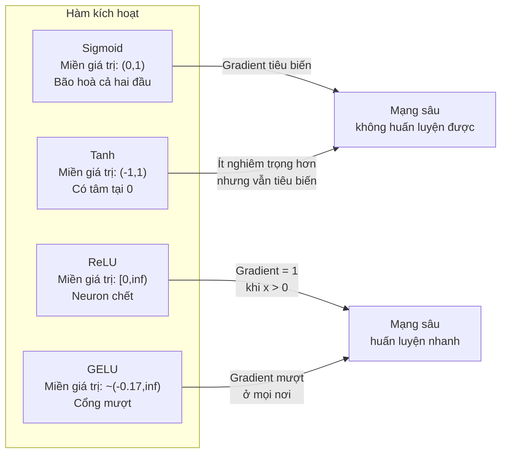
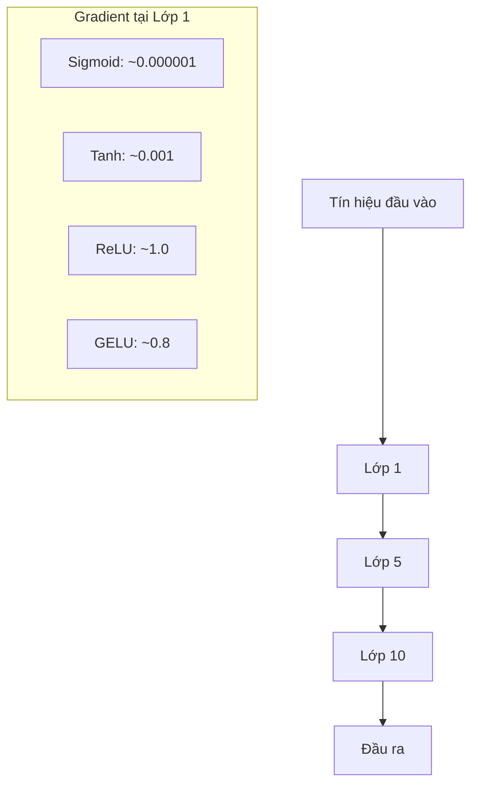
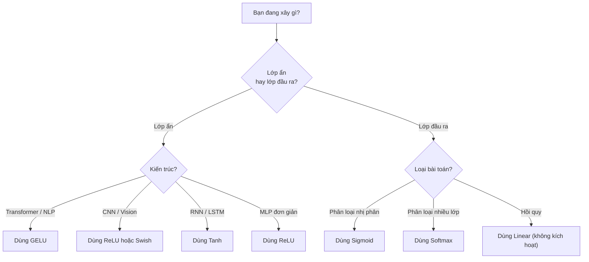

# Hàm kích hoạt

> Không có phi tuyến, mạng 100 lớp của bạn chỉ là một phép nhân ma trận hào nhoáng. Activation function (hàm kích hoạt) là những cánh cổng cho phép mạng nơ-ron suy nghĩ bằng những đường cong.

**Type:** Build
**Languages:** Python
**Prerequisites:** Bài 03.03 (Lan truyền ngược)
**Time:** ~75 phút

## Mục tiêu học tập

- Cài đặt sigmoid, tanh, ReLU, Leaky ReLU, GELU, Swish và softmax cùng đạo hàm của chúng từ đầu
- Chẩn đoán vấn đề vanishing gradient (gradient tiêu biến) bằng cách đo độ lớn giá trị kích hoạt qua 10+ lớp với các hàm kích hoạt khác nhau
- Phát hiện dead neuron (neuron chết) trong một mạng ReLU và giải thích vì sao GELU tránh được kiểu hỏng này
- Chọn đúng hàm kích hoạt cho một kiến trúc cụ thể (transformer, CNN, RNN, lớp đầu ra)

## Vấn đề

Xếp hai phép biến đổi tuyến tính: y = W2(W1x + b1) + b2. Khai triển ra: y = W2W1x + W2b1 + b2. Nó chỉ là y = Ax + c -- một phép biến đổi tuyến tính duy nhất. Dù bạn xếp bao nhiêu lớp tuyến tính, kết quả vẫn sụp về một phép nhân ma trận. Mạng 100 lớp của bạn có năng lực biểu diễn y như một lớp duy nhất.

Đây không phải là một tò mò lý thuyết. Nó có nghĩa là một mạng tuyến tính sâu thực sự không thể học XOR, không thể phân loại một tập dữ liệu xoắn ốc, không thể nhận ra một khuôn mặt. Không có hàm kích hoạt, độ sâu chỉ là ảo giác.

Hàm kích hoạt phá vỡ tính tuyến tính. Chúng bẻ cong đầu ra của mỗi lớp qua một hàm phi tuyến, cho mạng khả năng uốn ranh giới quyết định, xấp xỉ hàm bất kỳ và thực sự học. Nhưng chọn sai hàm kích hoạt thì gradient của bạn tiêu về 0 (sigmoid trong mạng sâu), bùng nổ tới vô cực (các hàm kích hoạt không bị chặn nếu không khởi tạo cẩn thận), hoặc neuron của bạn chết vĩnh viễn (ReLU với bias âm lớn). Việc chọn hàm kích hoạt quyết định trực tiếp liệu mạng của bạn có học được gì hay không.

## Khái niệm

### Vì sao phi tuyến là bắt buộc

Phép nhân ma trận có tính hợp thành. Nhân một vector với ma trận A rồi ma trận B hoàn toàn giống nhân với AB. Nghĩa là xếp mười lớp tuyến tính tương đương về mặt toán học với một lớp tuyến tính có một ma trận lớn. Tất cả tham số đó, tất cả độ sâu đó -- đều lãng phí. Bạn cần thứ gì đó phá vỡ chuỗi. Đó là việc của hàm kích hoạt.

Đây là chứng minh. Một lớp tuyến tính tính f(x) = Wx + b. Xếp hai lớp:

```
Layer 1: h = W1 * x + b1
Layer 2: y = W2 * h + b2
```

Thay vào:

```
y = W2 * (W1 * x + b1) + b2
y = (W2 * W1) * x + (W2 * b1 + b2)
y = A * x + c
```

Một lớp. Chèn một hàm kích hoạt phi tuyến g() giữa các lớp:

```
h = g(W1 * x + b1)
y = W2 * h + b2
```

Giờ phép thay thế bị phá vỡ. W2 * g(W1 * x + b1) + b2 không thể rút gọn thành một phép biến đổi tuyến tính duy nhất. Mạng có thể biểu diễn các hàm phi tuyến. Mỗi lớp thêm vào có kích hoạt sẽ tăng năng lực biểu diễn.

### Sigmoid

Hàm kích hoạt nguyên thuỷ của mạng nơ-ron.

```
sigmoid(x) = 1 / (1 + e^(-x))
```

Miền đầu ra: (0, 1). Mượt, khả vi, ánh xạ mọi số thực thành một giá trị giống xác suất.

Đạo hàm (derivative):

```
sigmoid'(x) = sigmoid(x) * (1 - sigmoid(x))
```

Giá trị lớn nhất của đạo hàm này là 0.25, đạt tại x = 0. Trong lan truyền ngược, gradient nhân dồn qua các lớp. Mười lớp sigmoid nghĩa là gradient bị nhân bởi tối đa 0.25 mười lần:

```
0.25^10 = 0.000000953674
```

Chưa tới một phần triệu tín hiệu ban đầu. Đây là vấn đề gradient tiêu biến. Gradient ở các lớp đầu trở nên nhỏ đến mức trọng số gần như không cập nhật. Mạng trông như đang học -- loss giảm ở các lớp sau -- nhưng các lớp đầu bị đóng băng. Mạng sigmoid sâu đơn giản là không huấn luyện được.

Vấn đề thêm: đầu ra của sigmoid luôn dương (0 đến 1), nghĩa là gradient trên trọng số luôn cùng dấu. Điều này gây zig-zag trong lúc hạ gradient.

### Tanh

Phiên bản có tâm của sigmoid.

```
tanh(x) = (e^x - e^(-x)) / (e^x + e^(-x))
```

Miền đầu ra: (-1, 1). Zero-centered (có tâm tại 0), điều này loại bỏ vấn đề zig-zag.

Đạo hàm:

```
tanh'(x) = 1 - tanh(x)^2
```

Đạo hàm lớn nhất là 1.0 tại x = 0 -- tốt hơn sigmoid bốn lần. Nhưng vấn đề gradient tiêu biến vẫn còn. Với đầu vào dương hoặc âm lớn, đạo hàm tiến về 0. Mười lớp vẫn nghiền nát gradient, chỉ là ít dữ dội hơn.

### ReLU: Bước đột phá

Rectified Linear Unit. Được Nair và Hinton phổ biến cho học sâu năm 2010 (bản thân hàm này có từ công trình của Fukushima năm 1969), nó đã thay đổi mọi thứ.

```
relu(x) = max(0, x)
```

Miền đầu ra: [0, vô cực). Đạo hàm cực kỳ đơn giản:

```
relu'(x) = 1  if x > 0
            0  if x <= 0
```

Không có gradient tiêu biến với đầu vào dương. Gradient đúng bằng 1, truyền thẳng qua. Đây là lý do mạng sâu trở nên huấn luyện được -- ReLU bảo toàn độ lớn gradient qua các lớp.

Nhưng có một kiểu hỏng: vấn đề neuron chết. Nếu đầu vào có trọng số của một neuron luôn âm (do bias âm lớn hoặc khởi tạo trọng số không may), đầu ra của nó luôn bằng 0, gradient luôn bằng 0, và nó không bao giờ cập nhật. Nó chết vĩnh viễn. Trong thực tế, 10-40% neuron trong một mạng ReLU có thể chết trong quá trình huấn luyện.

### Leaky ReLU

Cách sửa đơn giản nhất cho neuron chết.

```
leaky_relu(x) = x        if x > 0
                alpha * x if x <= 0
```

Trong đó alpha là một hằng số nhỏ, thường là 0.01. Phía âm có một độ dốc nhỏ thay vì bằng 0 (đó là ý nghĩa leaky -- rò), nên neuron chết vẫn nhận được tín hiệu gradient và có thể hồi phục.

### GELU: Mặc định hiện đại

Gaussian Error Linear Unit. Do Hendrycks và Gimpel giới thiệu năm 2016. Là hàm kích hoạt mặc định trong BERT, GPT và hầu hết transformer hiện đại.

```
gelu(x) = x * Phi(x)
```

Trong đó Phi(x) là hàm phân phối tích luỹ của phân phối chuẩn tắc. Xấp xỉ được dùng trong thực tế:

```
gelu(x) ~= 0.5 * x * (1 + tanh(sqrt(2/pi) * (x + 0.044715 * x^3)))
```

GELU mượt ở mọi nơi, cho phép giá trị âm nhỏ (khác ReLU vốn cắt cứng về 0), và có cách hiểu theo xác suất: nó cân mỗi đầu vào theo xác suất đầu vào đó dương dưới một phân phối Gaussian. Cổng mượt này vượt ReLU trong các kiến trúc transformer vì nó cho dòng gradient tốt hơn và tránh hoàn toàn vấn đề neuron chết.

### Swish / SiLU

Hàm kích hoạt tự cổng do Ramachandran và cộng sự phát hiện năm 2017 qua tìm kiếm tự động.

```
swish(x) = x * sigmoid(x)
```

Swish về mặt hình thức là x * sigmoid(x). Google phát hiện nó qua tìm kiếm tự động trên không gian các hàm kích hoạt -- một mạng nơ-ron thiết kế các phần của mạng nơ-ron.

Như GELU, nó mượt, không đơn điệu, và cho phép giá trị âm nhỏ. Khác biệt rất tinh tế: Swish dùng sigmoid để làm cổng còn GELU dùng CDF Gaussian. Trong thực tế, hiệu năng gần như giống hệt. Swish được dùng trong EfficientNet và một số mô hình thị giác. GELU chiếm ưu thế trong các mô hình ngôn ngữ.

### Softmax: Hàm kích hoạt đầu ra

Không dùng ở lớp ẩn. Softmax chuyển một vector điểm thô (logit) thành một phân phối xác suất.

```
softmax(x_i) = e^(x_i) / sum(e^(x_j) for all j)
```

Mỗi đầu ra nằm giữa 0 và 1. Tổng mọi đầu ra bằng 1. Điều này khiến nó thành hàm kích hoạt cuối chuẩn cho phân loại nhiều lớp. Logit lớn nhất nhận xác suất cao nhất, nhưng khác argmax, softmax khả vi và giữ thông tin về độ tin cậy tương đối.

### So sánh hình dạng



### So sánh dòng gradient



### Khi nào dùng hàm kích hoạt nào



```figure
softmax-temperature
```

## Tự tay làm

### Bước 1: Cài đặt tất cả hàm kích hoạt kèm đạo hàm

Mỗi hàm nhận một float và trả về một float. Mỗi hàm đạo hàm nhận cùng đầu vào và trả về gradient.

```python
import math

def sigmoid(x):
    x = max(-500, min(500, x))
    return 1.0 / (1.0 + math.exp(-x))

def sigmoid_derivative(x):
    s = sigmoid(x)
    return s * (1 - s)

def tanh_act(x):
    return math.tanh(x)

def tanh_derivative(x):
    t = math.tanh(x)
    return 1 - t * t

def relu(x):
    return max(0.0, x)

def relu_derivative(x):
    return 1.0 if x > 0 else 0.0

def leaky_relu(x, alpha=0.01):
    return x if x > 0 else alpha * x

def leaky_relu_derivative(x, alpha=0.01):
    return 1.0 if x > 0 else alpha

def gelu(x):
    return 0.5 * x * (1 + math.tanh(math.sqrt(2 / math.pi) * (x + 0.044715 * x ** 3)))

def gelu_derivative(x):
    phi = 0.5 * (1 + math.erf(x / math.sqrt(2)))
    pdf = math.exp(-0.5 * x * x) / math.sqrt(2 * math.pi)
    return phi + x * pdf

def swish(x):
    return x * sigmoid(x)

def swish_derivative(x):
    s = sigmoid(x)
    return s + x * s * (1 - s)

def softmax(xs):
    max_x = max(xs)
    exps = [math.exp(x - max_x) for x in xs]
    total = sum(exps)
    return [e / total for e in exps]
```

### Bước 2: Trực quan hoá nơi gradient chết

Tính gradient tại 100 điểm cách đều từ -5 đến 5. In một histogram văn bản cho thấy gradient của mỗi hàm kích hoạt gần 0 ở đâu.

```python
def gradient_scan(name, derivative_fn, start=-5, end=5, n=100):
    step = (end - start) / n
    near_zero = 0
    healthy = 0
    for i in range(n):
        x = start + i * step
        g = derivative_fn(x)
        if abs(g) < 0.01:
            near_zero += 1
        else:
            healthy += 1
    pct_dead = near_zero / n * 100
    print(f"{name:15s}: {healthy:3d} healthy, {near_zero:3d} near-zero ({pct_dead:.0f}% dead zone)")

gradient_scan("Sigmoid", sigmoid_derivative)
gradient_scan("Tanh", tanh_derivative)
gradient_scan("ReLU", relu_derivative)
gradient_scan("Leaky ReLU", leaky_relu_derivative)
gradient_scan("GELU", gelu_derivative)
gradient_scan("Swish", swish_derivative)
```

### Bước 3: Thí nghiệm gradient tiêu biến

Truyền xuôi một tín hiệu qua N lớp dùng sigmoid so với ReLU. Đo xem độ lớn giá trị kích hoạt thay đổi thế nào.

```python
import random

def vanishing_gradient_experiment(activation_fn, name, n_layers=10, n_inputs=5):
    random.seed(42)
    values = [random.gauss(0, 1) for _ in range(n_inputs)]

    print(f"\n{name} through {n_layers} layers:")
    for layer in range(n_layers):
        weights = [random.gauss(0, 1) for _ in range(n_inputs)]
        z = sum(w * v for w, v in zip(weights, values))
        activated = activation_fn(z)
        magnitude = abs(activated)
        bar = "#" * int(magnitude * 20)
        print(f"  Layer {layer+1:2d}: magnitude = {magnitude:.6f} {bar}")
        values = [activated] * n_inputs

vanishing_gradient_experiment(sigmoid, "Sigmoid")
vanishing_gradient_experiment(relu, "ReLU")
vanishing_gradient_experiment(gelu, "GELU")
```

### Bước 4: Bộ phát hiện neuron chết

Tạo một mạng ReLU, đưa các đầu vào ngẫu nhiên qua nó, đếm xem có bao nhiêu neuron không bao giờ kích hoạt.

```python
def dead_neuron_detector(n_inputs=5, hidden_size=20, n_samples=1000):
    random.seed(0)
    weights = [[random.gauss(0, 1) for _ in range(n_inputs)] for _ in range(hidden_size)]
    biases = [random.gauss(0, 1) for _ in range(hidden_size)]

    fire_counts = [0] * hidden_size

    for _ in range(n_samples):
        inputs = [random.gauss(0, 1) for _ in range(n_inputs)]
        for neuron_idx in range(hidden_size):
            z = sum(w * x for w, x in zip(weights[neuron_idx], inputs)) + biases[neuron_idx]
            if relu(z) > 0:
                fire_counts[neuron_idx] += 1

    dead = sum(1 for c in fire_counts if c == 0)
    rarely_fire = sum(1 for c in fire_counts if 0 < c < n_samples * 0.05)
    healthy = hidden_size - dead - rarely_fire

    print(f"\nDead Neuron Report ({hidden_size} neurons, {n_samples} samples):")
    print(f"  Dead (never fired):     {dead}")
    print(f"  Barely alive (<5%):     {rarely_fire}")
    print(f"  Healthy:                {healthy}")
    print(f"  Dead neuron rate:       {dead/hidden_size*100:.1f}%")

    for i, c in enumerate(fire_counts):
        status = "DEAD" if c == 0 else "WEAK" if c < n_samples * 0.05 else "OK"
        bar = "#" * (c * 40 // n_samples)
        print(f"  Neuron {i:2d}: {c:4d}/{n_samples} fires [{status:4s}] {bar}")

dead_neuron_detector()
```

### Bước 5: So sánh huấn luyện -- Sigmoid vs ReLU vs GELU

Huấn luyện cùng một mạng hai lớp trên tập dữ liệu vòng tròn (điểm nằm trong đường tròn = lớp 1, ngoài = lớp 0) với ba hàm kích hoạt khác nhau. So sánh tốc độ hội tụ.

```python
def make_circle_data(n=200, seed=42):
    random.seed(seed)
    data = []
    for _ in range(n):
        x = random.uniform(-2, 2)
        y = random.uniform(-2, 2)
        label = 1.0 if x * x + y * y < 1.5 else 0.0
        data.append(([x, y], label))
    return data


class ActivationNetwork:
    def __init__(self, activation_fn, activation_deriv, hidden_size=8, lr=0.1):
        random.seed(0)
        self.act = activation_fn
        self.act_d = activation_deriv
        self.lr = lr
        self.hidden_size = hidden_size

        self.w1 = [[random.gauss(0, 0.5) for _ in range(2)] for _ in range(hidden_size)]
        self.b1 = [0.0] * hidden_size
        self.w2 = [random.gauss(0, 0.5) for _ in range(hidden_size)]
        self.b2 = 0.0

    def forward(self, x):
        self.x = x
        self.z1 = []
        self.h = []
        for i in range(self.hidden_size):
            z = self.w1[i][0] * x[0] + self.w1[i][1] * x[1] + self.b1[i]
            self.z1.append(z)
            self.h.append(self.act(z))

        self.z2 = sum(self.w2[i] * self.h[i] for i in range(self.hidden_size)) + self.b2
        self.out = sigmoid(self.z2)
        return self.out

    def backward(self, target):
        error = self.out - target
        d_out = error * self.out * (1 - self.out)

        for i in range(self.hidden_size):
            d_h = d_out * self.w2[i] * self.act_d(self.z1[i])
            self.w2[i] -= self.lr * d_out * self.h[i]
            for j in range(2):
                self.w1[i][j] -= self.lr * d_h * self.x[j]
            self.b1[i] -= self.lr * d_h
        self.b2 -= self.lr * d_out

    def train(self, data, epochs=200):
        losses = []
        for epoch in range(epochs):
            total_loss = 0
            correct = 0
            for x, y in data:
                pred = self.forward(x)
                self.backward(y)
                total_loss += (pred - y) ** 2
                if (pred >= 0.5) == (y >= 0.5):
                    correct += 1
            avg_loss = total_loss / len(data)
            accuracy = correct / len(data) * 100
            losses.append(avg_loss)
            if epoch % 50 == 0 or epoch == epochs - 1:
                print(f"    Epoch {epoch:3d}: loss={avg_loss:.4f}, accuracy={accuracy:.1f}%")
        return losses


data = make_circle_data()

configs = [
    ("Sigmoid", sigmoid, sigmoid_derivative),
    ("ReLU", relu, relu_derivative),
    ("GELU", gelu, gelu_derivative),
]

results = {}
for name, act_fn, act_d_fn in configs:
    print(f"\n=== Training with {name} ===")
    net = ActivationNetwork(act_fn, act_d_fn, hidden_size=8, lr=0.1)
    losses = net.train(data, epochs=200)
    results[name] = losses

print("\n=== Final Loss Comparison ===")
for name, losses in results.items():
    print(f"  {name:10s}: start={losses[0]:.4f} -> end={losses[-1]:.4f} (improvement: {(1 - losses[-1]/losses[0])*100:.1f}%)")
```

## Áp dụng

PyTorch cung cấp tất cả những hàm này dưới cả dạng functional và dạng module:

```python
import torch
import torch.nn as nn
import torch.nn.functional as F

x = torch.randn(4, 10)

relu_out = F.relu(x)
gelu_out = F.gelu(x)
sigmoid_out = torch.sigmoid(x)
swish_out = F.silu(x)

logits = torch.randn(4, 5)
probs = F.softmax(logits, dim=1)

model = nn.Sequential(
    nn.Linear(10, 64),
    nn.GELU(),
    nn.Linear(64, 32),
    nn.GELU(),
    nn.Linear(32, 5),
)
```

Lớp ẩn trong transformer: GELU. Lớp ẩn trong CNN: ReLU. Lớp đầu ra cho phân loại: softmax. Lớp đầu ra cho hồi quy: không (tuyến tính). Lớp đầu ra cho xác suất: sigmoid. Chỉ vậy thôi. Hãy bắt đầu với những mặc định này. Chỉ đổi khi bạn có bằng chứng.

RNN và LSTM dùng tanh cho trạng thái ẩn và sigmoid cho các cổng, nhưng nếu hôm nay bạn xây từ đầu, có lẽ bạn không dùng RNN. Nếu neuron đang chết trong mạng ReLU của bạn, hãy chuyển sang GELU. Đừng vội dùng Leaky ReLU trừ khi bạn có lý do cụ thể -- GELU giải quyết vấn đề neuron chết và cho dòng gradient tốt hơn.

## Đóng gói

Bài học này tạo ra:
- `outputs/prompt-activation-selector.md` -- một prompt tái sử dụng giúp bạn chọn đúng hàm kích hoạt cho bất kỳ kiến trúc nào

## Bài tập

1. Cài đặt Parametric ReLU (PReLU) trong đó độ dốc âm alpha là một tham số học được. Huấn luyện nó trên tập dữ liệu vòng tròn và so sánh với Leaky ReLU cố định.

2. Chạy thí nghiệm gradient tiêu biến với 50 lớp thay vì 10. Vẽ độ lớn tại từng lớp cho sigmoid, tanh, ReLU và GELU. Tín hiệu của mỗi hàm kích hoạt thực sự về 0 ở lớp nào?

3. Cài đặt ELU (Exponential Linear Unit): elu(x) = x nếu x > 0, alpha * (e^x - 1) nếu x <= 0. So sánh tỉ lệ neuron chết của nó với ReLU trên cùng một mạng.

4. Xây một "gradient health monitor" chạy trong lúc huấn luyện: ở mỗi epoch, tính độ lớn gradient trung bình tại từng lớp. In cảnh báo khi gradient của bất kỳ lớp nào giảm dưới 0.001 hoặc vượt 100.

5. Sửa phần so sánh huấn luyện để dùng tập dữ liệu XOR từ Bài 01 thay vì vòng tròn. Hàm kích hoạt nào hội tụ nhanh nhất trên XOR? Vì sao kết quả này khác với kết quả trên vòng tròn?

## Thuật ngữ chính

| Thuật ngữ | Người ta thường nói | Ý nghĩa thực sự |
|------|----------------|----------------------|
| Activation function | "Phần phi tuyến" | Một hàm áp lên đầu ra của mỗi neuron để phá vỡ tính tuyến tính, giúp mạng học được các ánh xạ phi tuyến |
| Vanishing gradient | "Gradient biến mất trong mạng sâu" | Gradient co lại theo cấp số nhân qua các lớp khi đạo hàm của hàm kích hoạt nhỏ hơn 1, khiến các lớp đầu không thể huấn luyện |
| Exploding gradient | "Gradient nổ tung" | Gradient tăng theo cấp số nhân qua các lớp khi hệ số nhân hiệu dụng vượt 1, gây huấn luyện bất ổn |
| Dead neuron | "Một neuron đã ngừng học" | Một neuron ReLU có đầu vào vĩnh viễn âm, tạo đầu ra bằng 0 và gradient bằng 0 |
| Sigmoid | "Ép giá trị về 0-1" | Hàm logistic 1/(1+e^-x), quan trọng trong lịch sử nhưng gây gradient tiêu biến trong mạng sâu |
| ReLU | "Cắt phần âm về 0" | max(0, x) -- hàm kích hoạt đưa học sâu thành thực tế nhờ bảo toàn độ lớn gradient |
| GELU | "Hàm kích hoạt của transformer" | Gaussian Error Linear Unit, một hàm kích hoạt mượt cân đầu vào theo xác suất nó dương |
| Swish/SiLU | "ReLU tự cổng" | x * sigmoid(x), được phát hiện qua tìm kiếm tự động, dùng trong EfficientNet |
| Softmax | "Biến điểm số thành xác suất" | Chuẩn hoá một vector logit thành phân phối xác suất trong đó mọi giá trị nằm trong (0,1) và tổng bằng 1 |
| Leaky ReLU | "ReLU không chết" | max(alpha*x, x) với alpha nhỏ (0.01), ngăn neuron chết bằng cách cho phép gradient âm nhỏ |
| Saturation | "Phần phẳng của sigmoid" | Vùng mà đạo hàm của hàm kích hoạt tiến về 0, chặn dòng gradient |
| Logit | "Điểm thô trước softmax" | Đầu ra chưa chuẩn hoá của lớp cuối trước khi áp softmax hoặc sigmoid |

## Đọc thêm

- Nair & Hinton, "Rectified Linear Units Improve Restricted Boltzmann Machines" (2010) -- bài báo giới thiệu ReLU và mở đường cho việc huấn luyện mạng sâu
- Hendrycks & Gimpel, "Gaussian Error Linear Units (GELUs)" (2016) -- giới thiệu hàm kích hoạt đã trở thành mặc định cho transformer
- Ramachandran et al., "Searching for Activation Functions" (2017) -- dùng tìm kiếm tự động để phát hiện Swish, cho thấy thiết kế hàm kích hoạt có thể tự động hoá
- Glorot & Bengio, "Understanding the difficulty of training deep feedforward neural networks" (2010) -- bài báo chẩn đoán gradient tiêu biến/bùng nổ và đề xuất khởi tạo Xavier
- Goodfellow, Bengio, Courville, "Deep Learning" Chapter 6.3 (https://www.deeplearningbook.org/) -- trình bày chặt chẽ về hidden unit và hàm kích hoạt
